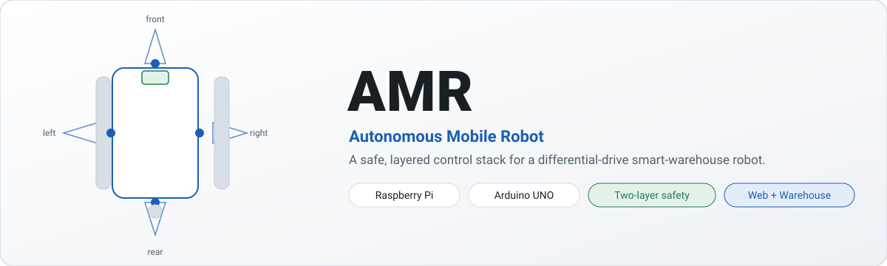
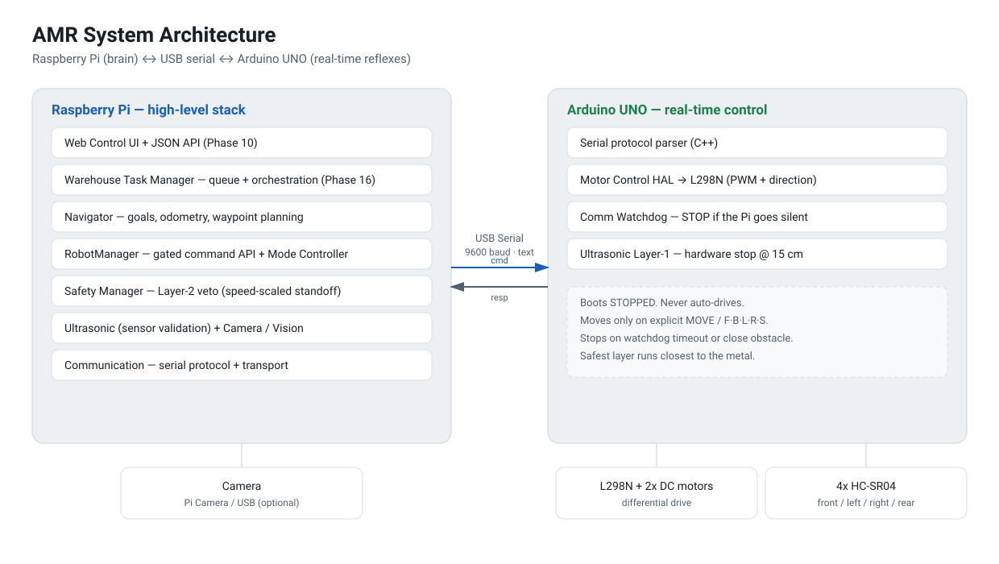
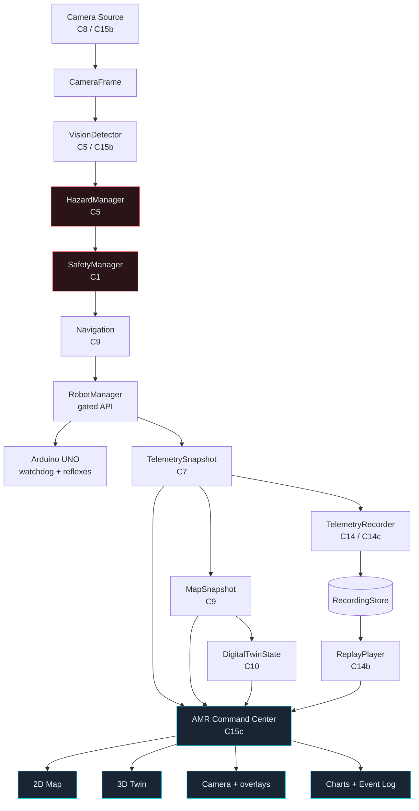
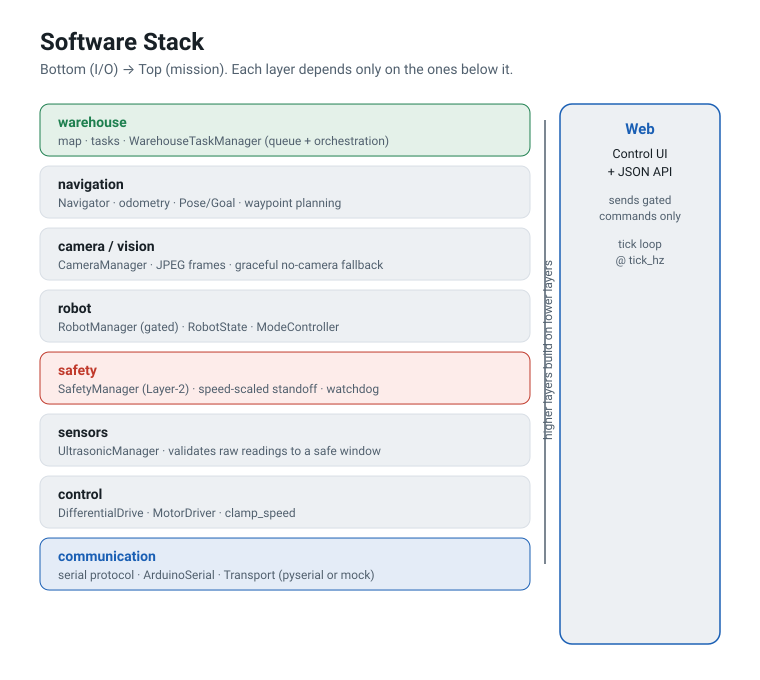
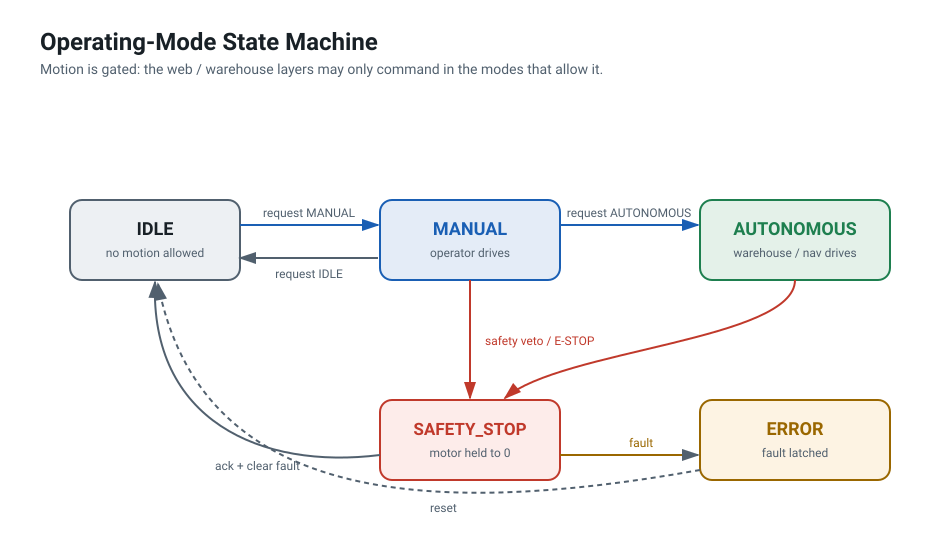
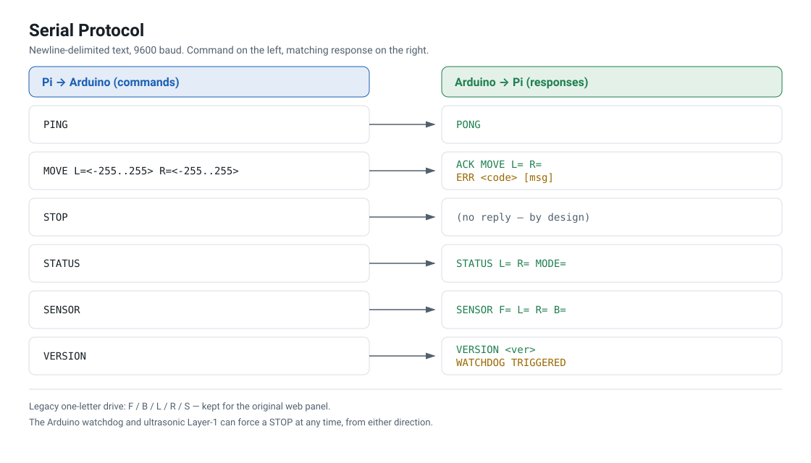
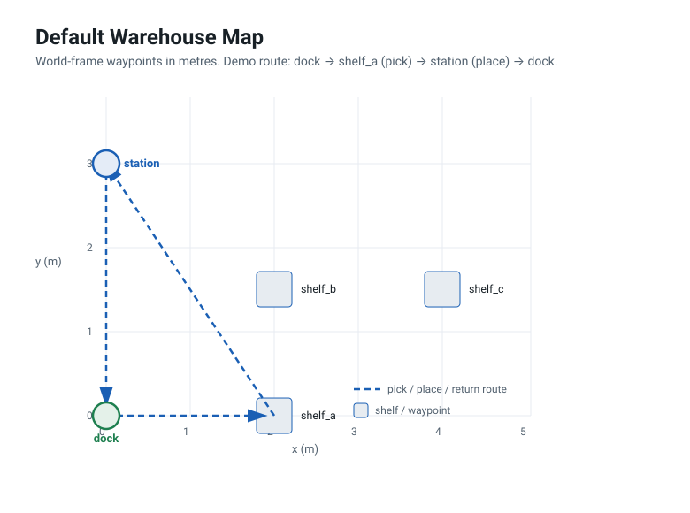

# AMR — Autonomous Mobile Robot · Complete Project Report

**Repository:** `IDP copy` (`abhijeet1267/amr`)
**Report generated:** 2026-10-09
**Scope:** every tracked file, every configuration, and the complete source of the
Python control stack, the Arduino firmware, the web console, and the Flutter
client — plus the verification evidence behind each claim.

> **How to read this.** §1–§14 are the report: what the system is, how it is
> built, what is verified and what is not. §15 is a complete file inventory.
> §16 is the full source of every source file in the repository, verbatim.
>
> **Honesty rule used throughout.** This project drives a physical robot. Where
> something has not been run on hardware, this report says so. Nothing here is
> upgraded from "tested on mocks" to "works".

---

## Table of contents

| § | Section |
| --- | --- |
| 1 | [Executive summary](#1-executive-summary) |
| 2 | [What the project is](#2-what-the-project-is) |
| 3 | [Architecture](#3-architecture) |
| 4 | [Safety model](#4-safety-model) |
| 5 | [Serial protocol](#5-serial-protocol) |
| 6 | [The Python control stack, module by module](#6-the-python-control-stack-module-by-module) |
| 7 | [The web layer](#7-the-web-layer) |
| 8 | [The Arduino firmware](#8-the-arduino-firmware) |
| 9 | [The Flutter client](#9-the-flutter-client) |
| 10 | [Configuration reference](#10-configuration-reference) |
| 11 | [Test suite inventory](#11-test-suite-inventory) |
| 12 | [Verification status](#12-verification-status) |
| 13 | [Known issues and debt](#13-known-issues-and-debt) |
| 14 | [C19 — spatial heat map (this session's work)](#14-c19--spatial-heat-map-this-sessions-work) |
| 15 | [Complete file inventory](#15-complete-file-inventory) |
| 16 | [Complete source appendix](#16-complete-source-appendix) |

---

## 1. Executive summary

A **modular Autonomous Mobile Robot platform for smart-warehouse automation**: a
differential-drive robot with a safety-first, layered control stack, plus
warehouse task orchestration, an operator console, and a cross-platform client.

| Dimension | Value |
| --- | --- |
| Runtimes | Raspberry Pi (Python 3) = brain; Arduino UNO (C++) = reflexes |
| Python control stack | 73 files, ~21,500 lines |
| Python tests | 40 files, ~17,500 lines |
| Web console | stdlib HTTP, zero build step; 3 pages + a hub + 22 JSON/binary routes |
| Flutter client | 25 Dart files, ~5,400 lines; macOS/Windows/Android/iOS |
| Firmware | 9 files, 623 lines of C++ |
| Configuration | 8 YAML files, 798 lines |
| Documentation | 24 markdown files, ~8,400 lines |
| Python test suite | **1594 passed · 2 skipped · 0 failed** (1596 collected) |
| Flutter test suite | **21 passed**, `flutter analyze` clean |

**The load-bearing design rule.** Every motion command funnels through one gated
API, `RobotManager`. The web layer and the warehouse layer cannot reach the
motors any other way, and safety can only ever *veto* — never be bypassed.

---

## 2. What the project is

A differential-drive robot that carries shelves in a warehouse. It is split
across two processors on purpose:

| Part | Role | Implementation |
| --- | --- | --- |
| **Raspberry Pi** | Brain — web control, navigation, warehouse tasks, hazard policy | Python 3, stdlib `ThreadingHTTPServer`, PyYAML; `pyserial` optional |
| **Arduino UNO** | Reflexes — real-time motor drive, watchdog, hardware proximity stop | C++ firmware, L298N H-bridge |
| **Drive** | Differential, 2× DC gear motor | `amr/control/` |
| **Sensing** | 4× HC-SR04 ultrasonic (front/left/right/rear), optional camera | `amr/sensors/`, `amr/camera/` |

The Pi runs everything that may be slow or buggy. The Arduino runs the small loop
that must not miss a beat. The Arduino **boots stopped**, moves only on explicit
commands, and can stop on its own — so a Pi crash, reboot, or pulled cable can
never leave the robot driving.

### Operating modes

```
IDLE ──► MANUAL ──► AUTONOMOUS
   └──────┴─────────┴──► SAFETY_STOP   (sensor / comm / watchdog / hazard fault)
   └──────┴─────────┴──► ERROR         (unrecoverable, needs a human)
SAFETY_STOP / ERROR ──► IDLE           (only after an explicit operator reset)
```

Motion is **gated by mode**: the operator drives in `MANUAL`, the warehouse and
navigation layers drive in `AUTONOMOUS`, and `IDLE` allows no motion at all.
`SAFETY_STOP` is reachable from any mode and is **never auto-released**.

---

## 3. Architecture

```
┌──────────────────────── Raspberry Pi (brain) ─────────────────────────┐
│  web (stdlib HTTP)        warehouse (tasks)        camera (optional)  │
│                     └──────────┬──────────┘                           │
│                    navigation (odometry, waypoints)                   │
│                                │                                      │
│                    ┌───────────▼───────────┐      layer 3.5           │
│                    │      RobotManager     │◄──── HazardManager       │
│                    │  (the ONLY motion     │      (NORMAL/WARNING/    │
│                    │   gate; owns state)   │       SLOW/STOP/         │
│                    └───┬───────────┬───────┘       EMERGENCY)         │
│        ┌───────────────┤           │                                  │
│        ▼               ▼           ▼                                  │
│   safety (L3)     control      sensors                                │
│   SafetyManager   DiffDrive    UltrasonicManager                      │
│        └───────────────┴───────────┴─────────► communication          │
│                                                protocol.py            │
└────────────────────────────────┬──────────────────────────────────────┘
                                 │ USB CDC serial, 9600 8N1, text protocol
┌────────────────────────────────▼──────────────────────────────────────┐
│                    Arduino UNO (reflexes)                             │
│  protocol.cpp   safety.cpp (watchdog + proximity stop)                │
│  motor_control.cpp (L298N PWM + direction)   ultrasonic.cpp           │
└───────────────────────────────────────────────────────────────────────┘
```

### Layers, bottom → top

Each layer depends only on the layers below it.

| # | Package | Responsibility | Key types |
| --- | --- | --- | --- |
| 1 | `amr.communication` | Serial protocol + transport | `protocol.py`, `ArduinoSerial`, `ArduinoSerialTransport` |
| 2 | `amr.control` | Motor driver + differential-drive vocabulary | `MotorDriver`, `ArduinoMotorDriver`, `DifferentialDrive`, `clamp_speed` |
| 3 | `amr.safety` | Deterministic proximity policy (+ C6 avoidance) | `SafetyManager`, `SafetyDecision`, `SafetyAction`, `AvoidancePolicy` |
| 3.5 | `amr.hazard` | Context-aware multi-hazard aggregation + spatial visualisation | `HazardManager`, `HazardSource`, `HazardState`, `HazardEventLog`, `VisionHazardSource` |
| 4 | `amr.sensors` | Ultrasonic read + validation | `UltrasonicManager`, `UltrasonicReading` |
| 5 | `amr.robot` | The gated runtime owner | `RobotManager`, `RobotState`, `ModeController`, `RobotMode` |
| 6 | `amr.camera` | Camera facade (libcamera / V4L2 / mock) + C8 frame contract | `CameraManager`, `CameraSource`, `CameraFrame`, `SimulatedCameraSource` |
| 7 | `amr.navigation` | Odometry + waypoint planning | `Navigator`, `LocalNavigator`, `Pose`, `Goal`, `NavResult` |
| 8 | `amr.warehouse` | Task queue + orchestration | `WarehouseTaskManager`, `WarehouseMap`, `Task`, `Manipulator` |
| 9 | `amr.web` | HTTP control panel + JSON API | `AMRWebApp` |
| — | `amr.apps` | Interface registry + Applications Hub data | `ApplicationRegistry`, `resolve_status` |
| — | `amr.map` | C9 2D map state + SVG, C10 3D twin state, **C19 heat map** | `MapSnapshot`, `MapService`, `MapTransform`, `PathHistory`, `build_twin_state`, `build_heatmap_state` |
| — | `amr.telemetry` | Read-only telemetry contract + console projection | `TelemetrySnapshot`, `TelemetryCollector`, `build_console_state`, `build_ops_state` |
| — | `amr.rfid` | Shelf / payload identification contract (C17) | `RfidReader`, `RfidTag`, `SimulatedRfidReader`, `confirm` |
| — | `amr.net` | Host Wi-Fi / Bluetooth probe (read-only) | `connectivity` |
| — | `amr.mocks` | Hardware-free doubles | `MockSerialTransport`, `MockMotorDriver`, `MockUltrasonicSensor`, `MockCamera` |
| — | `amr.logging` | Rotating structured logging | `setup_logging`, `get_logger`, `log_event` |
| — | `amr.utils` | Config loading + fail-fast validation | `load_config`, `AppConfig`, `SafetyConfig`, `RobotConfig`, … |

### The gate — `RobotManager`

`RobotManager` is the single owner of runtime behaviour and the **only** path to
the motors.

- Owns `RobotState` (the one published snapshot), `ModeController`,
  `SafetyManager`, `UltrasonicManager`, `DifferentialDrive`.
- `_gate()` rejects a motion command unless: connected **and** the mode allows
  motion **and** the safety decision is `PROCEED` **and** (when attached) the
  hazard verdict does not block.
- `stop()` / `estop()` are **never** gated — you must always be able to stop.
- `tick()` is one control-loop iteration: poll sensors → evaluate Layer 3 →
  enforce `STOP` → evaluate Layer 3.5 (if attached) → enforce its veto.

### Read-only view layers

Every visualisation in this project is a **projection of state the runtime
already owns**, assembled in Python where it is unit tested, so two clients
cannot disagree about it:

```
RobotManager · SafetyManager · HazardManager · Navigator · WarehouseTaskManager · CameraManager
        │  read-only adapters (no tick, no writes, no command path)
        ├─► TelemetryCollector ─► TelemetrySnapshot ─► GET /telemetry · /health · /dashboard/state
        ├─► MapSnapshot ────────► GET /map · /map.svg · dashboard panel
        │        ├─► build_twin_state ─► GET /digital-twin
        │        └─► build_heatmap_state ─► GET /heatmap            (C19)
        └─► build_console_state ─► GET /dashboard/state  (telemetry + health + map + twin + heatmap + history + replay + ops)
```

---

## 4. Safety model

Safety **always wins**. Four independent layers, each able to stop the robot on
its own:

| Layer | Where | Mechanism | Can stop alone |
| --- | --- | --- | --- |
| 1 | Arduino firmware | comms watchdog (default 1000 ms) + proximity stop below thresholds | yes |
| 2 | Pi, `RobotState` | structured state from `STATUS`/`SENSOR` polls; link-loss detection | yes |
| 3 | Pi, `amr.safety` | deterministic proximity rules → `PROCEED/WAIT/STOP/TURN/REPLAN` | yes |
| 3.5 | Pi, `amr.hazard` | multi-input aggregation → `NORMAL/WARNING/SLOW/STOP/EMERGENCY` | yes (escalate-only) |

**Layer 3 rules, first match wins:** disconnected → `STOP`; no valid data →
`STOP`; any reading below its stop threshold → `STOP`; any reading below `2.0×`
threshold → `WAIT`; else `PROCEED`.

**Layer 3.5 hard rules:** escalate only, never drive, fail safe, deterministic.
It is opt-in via `RobotManager.attach_hazard()`, so the default stack is
behaviourally identical to the pre-hazard code.

**A `-1` ultrasonic reading means "no echo / clear"** — it is *not* an obstacle. A
complete loss of valid sensor data **is** unsafe (Layer 3 rule 2).

**Emergency stop** is always available: a software E-STOP (web/API) sends `STOP`
and sets `SAFETY_STOP`; the watchdog fires automatically on loss of commands; a
physical disconnect always works.

> **Power rule:** the motors are powered by the L298N external supply — never the
> Pi's or the Arduino's 5 V rails.

> Aggressive autonomous obstacle avoidance is intentionally **not** implemented.
> Only immediate, deterministic stops.

---

## 5. Serial protocol

Newline-delimited ASCII at **9600 baud**, verbs case-insensitive. `protocol.py`
is the single source of truth; the firmware mirrors it and `docs/serial_protocol.md`
is the canonical specification.

**Pi → Arduino**

| Command | Example | Purpose |
| --- | --- | --- |
| `PING` | `PING` | Liveness check |
| `STATUS` | `STATUS` | Query motor + drive state |
| `STOP` | `STOP` | Immediately stop both motor sides |
| `VERSION` | `VERSION` | Report firmware protocol version |
| `SENSOR` | `SENSOR` | Request an immediate ultrasonic report |
| `WDT <ms>` | `WDT 1000` | Set the communication watchdog timeout |
| `MOVE L=<int> R=<int>` | `MOVE L=150 R=150` | Set left/right wheel-group speed |
| `F` / `B` / `L` / `R` / `S` | `F` | Legacy baseline commands (still work) |

**Arduino → Pi**

| Response | Example | Meaning |
| --- | --- | --- |
| `PONG` | `PONG` | Reply to `PING` |
| `ACK <verb> [args]` | `ACK MOVE L=1 R=1` | Command accepted |
| `ERR <code> [msg]` | `ERR RANGE out of range` | Command rejected |
| `STATUS L=<int> R=<int> MODE=<str>` | `STATUS L=1 R=1 MODE=RUNNING` | Motor + drive state |
| `SENSOR F=<int> L=<int> R=<int> B=<int>` | `SENSOR F=82 L=45 R=91 B=120` | Ultrasonic distances (cm) |
| `VERSION <semver>` | `VERSION 1.0` | Protocol version |
| `WATCHDOG TRIGGERED` | `WATCHDOG TRIGGERED` | Unsolicited: Pi went silent, motors stopped |

`STATUS MODE` is the **firmware** drive state (`STOPPED`, `RUNNING`, `WATCHDOG`),
distinct from the Pi's higher-level robot mode.

Worked session:

```
Pi                          Arduino
--                          -------
PING                        ->  PONG
VERSION                     ->  VERSION 1.0
MOVE L=1 R=1                ->  ACK MOVE L=1 R=1
STATUS                      ->  STATUS L=1 R=1 MODE=RUNNING
SENSOR                      ->  SENSOR F=82 L=45 R=91 B=120
STOP                        ->  ACK STOP
MOVE L=300 R=0              ->  ERR RANGE out of range
XYZ                         ->  ERR UNKNOWN XYZ
        (Pi goes silent > 1000 ms)
                            ->  WATCHDOG TRIGGERED   (motors stopped)
```

---

## 6. The Python control stack, module by module

| Module | Responsibility | Notable design points |
| --- | --- | --- |
| `amr/main.py` | CLI entry point and wiring | `--mock` / `--demo` / `--web` / `--mission-demo` / `--config-dir`; the startup banner is explicitly flushed because stdout is block-buffered when not a TTY |
| `amr/communication/protocol.py` | Pure, I/O-free protocol logic | Tolerant parsing: an unrecognised line becomes `UNKNOWN` with `ok=False`, never an exception |
| `amr/communication/arduino_serial.py` | Synchronous command API over a pluggable transport | Reads until the expected response, an `ERR`, or a timeout; buffers unsolicited `SENSOR` lines; tolerates up to 25 stray lines (the boot banner) |
| `amr/control/` | `MotorDriver`, `ArduinoMotorDriver`, `DifferentialDrive`, `clamp_speed` | Speed bounds are enforced here and again in the protocol |
| `amr/safety/safety_manager.py` | Deterministic proximity policy | Returns an immutable `SafetyDecision`; pure function of the readings |
| `amr/safety/avoidance.py` | C6 `TURN`/`REPLAN` for **non-blocking** obstacles | Returns a Layer-3 `STOP`/`WAIT` unchanged, so emergency stop keeps absolute priority; `enabled: false` by default |
| `amr/hazard/` | Layer 3.5 multi-hazard aggregation | `types.py` (vocabulary), `sources.py` (inputs + zones), `event_log.py` (bounded ring + JSONL export), `manager.py` (worst-wins), `vision.py` (C5 simulated detector), `visualisation.py` (offline SVG) |
| `amr/sensors/` | Ultrasonic read + validation | Rejects out-of-window readings; `-1` is "clear" |
| `amr/robot/robot_manager.py` | **The gate** | `_gate()`; `stop()`/`estop()` never gated; `tick()` is one control-loop iteration; a Pi-side link watchdog (`robot_manager.py:221`) |
| `amr/navigation/` | Odometry + waypoint planning | `LocalNavigator` — dependency-free; an avoidance gate sits at the top of `step()` |
| `amr/warehouse/` | Task queue + orchestration | `PICK` / `PLACE` / `RETURN`; bounded queue; a manipulator seam (`mock` / `null` / `gripper`) |
| `amr/rfid/` | Shelf / payload identification (C17) | An optional reader confirms the shelf and payload *before* the manipulator acts; the shipped default attaches no reader |
| `amr/camera/` | Camera facade + C8 frame contract | libcamera (`pi`) / OpenCV (`v4l2`) / simulated; degrades to `UNAVAILABLE`/`ERROR` rather than blocking startup |
| `amr/telemetry/` | Read-only contract + console projection | `collector.py`, `console.py` (`build_console_state`), `ops.py` (`build_ops_state`), `series.py`, `auto_record.py`, `replay_control.py` |
| `amr/map/` | 2D map, 3D twin, **heat map** | `snapshot.py`, `transform.py`, `service.py`, `twin.py`, `heatmap.py` |
| `amr/apps/` | Interface registry | `resolve_status()` may only ever make a status *worse*, never better |
| `amr/net/` | Host connectivity probe | Read-only: inspects the machine, never associates or changes a link |
| `amr/logging/` | Rotating structured logging | 5 MB × 3 backups; `log_event()` emits greppable `TAG message` lines |
| `amr/utils/config.py` | Typed config + fail-fast validation | Unknown keys are ignored (forward-compatible); a malformed file raises `ConfigError` |
| `amr/mocks/` | Hardware-free doubles | The whole stack runs with no hardware; only the transport differs |

---

## 7. The web layer

A **stdlib-only** HTTP server (`ThreadingHTTPServer`) — no Flask, no build step,
no CDN, no npm. Four HTML surfaces and 22 JSON/binary routes.

| Surface | URL | Purpose |
| --- | --- | --- |
| Control panel | `/` | The only page that can command motion |
| Monitoring dashboard | `/dashboard` | Read-only operations console (C7/C11) |
| **Command Center** | `/command-center` | The primary operator console — **light by default** (C19) |
| Applications Hub | `/applications` | Directory of every interface the repository ships |

**Routes**

| Method | Path | Returns |
| --- | --- | --- |
| GET | `/` | Control panel HTML |
| GET | `/status` | Full robot snapshot |
| GET | `/sensor` | One sensor poll + safety decision |
| GET | `/camera`, `/camera/status`, `/camera/frame`, `/camera/overlay`, `/image` | Camera state / one frame / overlay |
| GET | `/hazard` | Hazard layer status |
| GET | `/telemetry` | C7 telemetry document |
| GET | `/health` | Liveness + degradation + logging state |
| GET | `/map`, `/map.svg` | C9 map state / server-rendered SVG |
| GET | `/digital-twin` | C10 3D twin state |
| **GET** | **`/heatmap`** | **C19 hazard + traffic density grids** |
| GET | `/dashboard`, `/dashboard/state` | Console page / the single consolidated feed |
| GET | `/command-center` | Operator console HTML |
| GET | `/applications`, `/applications/state` | Hub page / registry payload |
| GET | `/connectivity` | Host Wi-Fi / Bluetooth |
| GET | `/replay/recordings`, `/replay/status` | Replay listing / position |
| GET | `/static/<file>` | Whitelisted CSS/JS (3 known files) |
| POST | `/command` | **Motion**: estop, stop, mode, forward, backward, rotate, turn |
| POST | `/hazard/acknowledge` | Step 1 of the two-step latch release |
| POST | `/replay/load` | Load a recording |

**Command Center views (13).** `overview` · `twin` · `camera` · `map` ·
**`heatmap`** · `mission` · `telemetry` · `safety` · `sensors` · `hazards` ·
`connectivity` · `replay` · `events` · `diagnostics`. Each is deep-linkable via
the URL hash (`/command-center#heatmap`).

**The one real asymmetry.** The Command Center is read-only — it only ever issues
`GET`. The legacy `/` panel is the only client that posts motion. `POST /command`
remains the sole actuator path, behind the `RobotManager` → `SafetyManager` gates.

> ⚠️ **No authentication.** This is a single-operator LAN tool; never expose the
> port to the internet.

---

## 8. The Arduino firmware

`firmware/arduino/amr_controller/` — 9 files, 623 lines.

| File | Role |
| --- | --- |
| `amr_controller.ino` | Setup/loop: read a line, dispatch, run the watchdog, poll the ultrasonics |
| `protocol.h` / `protocol.cpp` | The command parser — mirrors `protocol.py` |
| `motor_control.h` / `motor_control.cpp` | L298N PWM + direction HAL |
| `safety.h` / `safety.cpp` | Communication watchdog + Layer-1 proximity stop |
| `ultrasonic.h` / `ultrasonic.cpp` | 4× HC-SR04 polling, `format()` emits `SENSOR F= L= R= B=` |

Key properties:

- **Boots stopped** — drives only on explicit `MOVE` / legacy commands.
- **Watchdog** — auto `STOP` after `DEFAULT_WATCHDOG_MS` (1000 ms) of silence,
  then one unsolicited `WATCHDOG TRIGGERED`.
- **Proximity stop** — immediate hardware stop below the Layer-1 thresholds.
- `ULTRASONIC_TELEMETRY` (default `0`) can also emit unsolicited `SENSOR` lines.

> **Never executed in CI.** There is no Arduino toolchain in the pipeline; the
> firmware requires flashing to a physical UNO.

---

## 9. The Flutter client

`amr_controller/` — a cross-platform operator client (macOS, Windows, Android,
iOS) speaking the robot's real HTTP contract.

| Aspect | Detail |
| --- | --- |
| Framework | Flutter (Dart), `provider` for state, `http` for REST, `shared_preferences` |
| Theme | Light industrial: white panels on a neutral canvas, one engineering-blue accent |
| Destinations | Dashboard · Camera · Map · **Heat map** · Teleop · Apps · Sensors · Diagnostics · Logs · Settings · Connection |
| State | One `RobotProvider` (`ChangeNotifier`) holds connection, registry, telemetry, map, **heat map**, camera, connectivity; a single self-arming 1.5 s poll |
| Commands | All motion goes through `provider.command()` — one auditable path that records the outcome |
| Safety | E-STOP reachable from Teleop at all times (long-press to arm, release to fire) |

Honesty carried from the robot's own docs: no battery or temperature sensor
exists, so those tiles read `no sensor` rather than a fabricated number; `null`
is "not measured" and is never conflated with `0`.

> The **web** build compiles but cannot reach the robot cross-origin: the Python
> server deliberately sends no CORS headers, because granting
> `Access-Control-Allow-Origin` would let any website an operator visits
> `POST /command` and move the robot.

---

## 10. Configuration reference

All configuration lives in `config/` and is loaded by `amr/utils/config.py` into
frozen dataclasses, validated fail-fast.

| File | Dataclass | Highlights |
| --- | --- | --- |
| `robot.yaml` | `RobotConfig` | name; `wheel_track_m`/`wheel_diameter_m` (**`null`** until measured); `motors.max_speed` 255; ultrasonic pins (`TODO_VERIFY`); camera `pi` 1280×720 |
| `safety.yaml` | `SafetyConfig` | `watchdog_timeout_ms` 1000; stop distances F/R 20 · L/R 15; valid window 2–400 cm; `status: NOT_VERIFIED` |
| `serial.yaml` | `SerialConfig` | `port` `/dev/ttyACM0`; `baudrate` 9600; per-command timeouts; `protocol_version` `1.0` |
| `warehouse.yaml` | `WarehouseConfig` | map locations; task/turn speed; `wheel_base_m`; `queue_max` 16; `manipulator: mock` |
| `hazard.yaml` | `HazardConfig` | thresholds, kinds, zones, event log; `NOT_VERIFIED`, `enabled: false` |
| `applications.yaml` | registry | 25 interface entries: ids, categories, platforms, declared status, urls |
| `rfid.yaml` | RFID config | shelf/payload tags; `backend: "null"` attaches no reader |
| `replay.yaml` | replay config | recordings directory, `auto_record` |

**Honest placeholders.** Values marked `null` / `TODO_VERIFY` / `NOT_VERIFIED` are
placeholders that must be filled from the physical robot before autonomous use is
trusted. Nothing is invented.

---

## 11. Test suite inventory

**Python** — 40 files, 1596 tests (1594 run + 2 skipped).

```
test_app_registry.py           46    test_mode_controller.py        13
test_applications_hub.py       27    test_motor_controller.py       21
test_auto_record.py            27    test_navigation.py             50
test_avoidance.py              76    test_ops_projection.py         44
test_camera_backend.py         47    test_protocol.py               37
test_camera_frame.py           49    test_replay.py                 59
test_camera_manager.py          9    test_replay_control.py         68
test_camera_overlay.py         40    test_rfid.py                   63
test_command_center.py         71    test_robot_manager.py          23
test_config.py                 25    test_robot_state.py             5
test_connectivity.py           14    test_ros_bridge.py             25
test_console.py                35    test_safety_manager.py         14
test_differential_drive.py     25    test_startup_banner.py          2
test_digital_twin.py           37    test_telemetry.py              52
test_hazard.py                 48    test_ultrasonic.py              9
test_hazard_visualisation.py   23    test_unified_demo.py           30
test_heatmap.py                35    test_vision.py                101
test_logging.py                17    test_warehouse.py              61
test_map.py                   111    test_web_server.py            112
test_mission_monitoring.py     45
```

The 2 skips are the camera tests that need `opencv-python`/`numpy`; they run when
those are installed and skip gracefully otherwise. Everything else runs on the
mocks under `amr/mocks/` — no serial device, no motors, no camera.

**Flutter** — 21 tests across 5 files: models, V2 models (map/camera/heat map),
the app shell, the heat-map screen (rendered), and a real-HTTP integration suite
driven against a `MockRobot`.

---

## 12. Verification status

### Verified

| Check | Result |
| --- | --- |
| `cd raspberry_pi && python -m pytest` | **1594 passed, 2 skipped, 0 failed** |
| `flutter analyze` (`amr_controller`) | **No issues found** |
| `flutter test` (`amr_controller`) | **21 passed** |
| `node --check` on the served console scripts | clean |
| `python -m compileall amr` | clean |
| Live boot (`--mock --web`) | banner printed; every documented route answers 200 |
| Applications Hub | `/applications` renders 25 applications; 17 openable, 13 deep links |
| Offline entry points | `amr.warehouse` → `RESULT: completed=3 failed=0`; `amr.hazard` → `RESULT: steps=4 failures=0`; `amr.hazard.vision`; `amr.hazard.visualisation`; `amr.demo` → `Result: PASS` |
| Heat map (C19) | `/heatmap` 200; two grids over one extent; `console["heatmap"] == GET /heatmap` exactly; 84 path samples over 31 cells after a driven mission, `clipped: 0` |

### NOT verified — read before trusting the robot

| Item | State | Blocker |
| --- | --- | --- |
| Robot geometry (`wheel_track_m`, `wheel_diameter_m`) | **`null`** | Must be measured physically |
| Safety thresholds | **`NOT_VERIFIED`** | Test values |
| Hazard thresholds | **`NOT_VERIFIED`**, disabled | No gas/fire sensor hardware exists |
| Ultrasonic trig/echo pins | **`TODO_VERIFY`** | Wiring not documented |
| Camera cable compatibility | Unconfirmed | Software degrades gracefully |
| Arduino firmware | **Never executed in CI** | Needs a physical UNO |
| L298N ENA/ENB wiring | Unverified | PWM output gated until confirmed |
| RFID / gripper / gas-sensor hardware | **None exists** | Contracts + simulated backends only |
| ROS 2 runtime | **Not built** | Zero `rclpy` anywhere; no topic ever published |
| Anything on real hardware | **Not tested** | Every claim above is mock-based |

---

## 13. Known issues and debt

- **`safety.watchdog_timeout_ms` never reaches the firmware.** The Pi uses it only
  for its own link-loss detection; nothing sends the `WDT <ms>` verb the firmware
  implements. The Arduino keeps its compiled-in 1000 ms — equal to the shipped
  config today, so it looks correct, but raise the config and the two diverge
  silently.
- **`--demo` is not mock-guarded, unlike `--mission-demo`.** `run_demo()` issues
  `forward(100)` and `rotate_right(80)`, so on a bench with an Arduino attached it
  drives the robot with no confirmation.
- **`amr.hazard` is wired into `amr/web` but not into `amr/warehouse`** — task
  scheduling ignores the hazard verdict.
- **No hazard sensor sources are wired**, so on the shipped configuration the
  hazard heat map is always empty (correctly reported, not faked).
- **`VisionHazardSource` is a working pipeline over a *simulated* detector** — no
  OpenCV/YOLO/camera-backed detector is wired, and the thresholds are unvalidated
  software defaults.
- **The C6 avoidance clearance provider is not wired**, so in the default
  configuration avoidance replans rather than steering.
- **No authentication** on the web panel — LAN-only, single operator.
- **The web console's data stages stay dark in both themes** (map, twin, heat
  map) by design: they are world-coordinate spatial data. Only the chrome themes.

---

## 14. C19 — spatial heat map (this session's work)

Two density grids over **one shared extent**: where hazards were recorded, and
where the robot actually went. It is the "future spatial hazard visualisation"
`PROJECT_CONTEXT.md` names as the project's novelty direction, plus the traffic
half that makes the hazard half readable in context.

**Delivered**

| Item | Where |
| --- | --- |
| The projection | `amr/map/heatmap.py` — `build_heatmap_state()`, `HeatGrid`, `HeatmapState` |
| The route | `GET /heatmap`, plus `heatmap` inside `/dashboard/state` (byte-identical) |
| The console view | `heatmap` in `VIEW_KEYS`/`VIEW_SECTIONS`, `#sec-heatmap`, `renderHeatmap()`, `drawHeatGrid()`, `.stage.heat` |
| The client screen | `amr_controller/lib/features/heatmap/heatmap_screen.dart` + models + provider wiring |
| Docs | `docs/heatmap.md` |
| Tests | `test_heatmap.py` (35), 11 in `test_web_server.py`, 8 in `test_command_center.py`, 2 model + 3 widget tests in the client |

**The rules that keep it honest**

1. **A stable extent** from the *configured* geometry, not the live data — a heat
   map is read by comparing polls, and a frame that rescales every second cannot
   be compared with itself.
2. **Nothing is silently dropped** — a sample outside the extent is counted in
   `clipped` and reported.
3. **The C5 rule holds** — an event with only image-space evidence is counted in
   `unlocated` and never placed.
4. **Absence is absence** — no configured geometry means both grids are `null` and
   the source is `UNAVAILABLE`.
5. **`row_order` is published** because the frame is y-up and row 0 is the
   *bottom* row; a client that guessed otherwise would draw a plausible, mirrored
   picture.

**A real bug found only by running it.** `drawHeatGrid` passed the ramp
*function* where an array of stops was expected, so every cell rendered
`fill="undefined"` → the SVG default (black). Every string-based test passed.
It was caught by reading the live DOM with `agent-browser eval`, fixed, and
re-verified (`rgb(75,148,171)` …). The client-side equivalent is now covered by
widget tests that actually paint the screen.

**Console is now white by default.** `preferredTheme()` and the theme bootstrap no
longer consult `prefers-color-scheme`; an explicit stored choice still wins. This
reverses a deliberate earlier decision, so two tests were rewritten to encode the
new intent rather than deleted.

---

## 15. Complete file inventory

**296 files embedded verbatim** in §16; **46 files listed but not embedded** (binaries, generated output, and vendored tool state), each with the reason.

### 15.1 Files embedded in §16

| File | Lines | Bytes | Area |
| --- | ---: | ---: | --- |
| `.github/workflows/ci.yml` | 132 | 4,444 | CI workflows |
| `.github/workflows/flutter-build.yml` | 224 | 7,395 | CI workflows |
| `.gitignore` | 69 | 1,453 |  |
| `AI_CONTEXT/APPLICATION_ECOSYSTEM_AUDIT.md` | 141 | 9,957 | Shared context for the multi-agent team |
| `AI_CONTEXT/ARCHITECTURE.md` | 345 | 20,698 | Shared context for the multi-agent team |
| `AI_CONTEXT/CURRENT_STATUS.md` | 197 | 25,491 | Shared context for the multi-agent team |
| `AI_CONTEXT/HANDOFF.md` | 2,592 | 153,894 | Shared context for the multi-agent team |
| `AI_CONTEXT/PROJECT_CONTEXT.md` | 157 | 7,581 | Shared context for the multi-agent team |
| `AI_CONTEXT/TASK_BOARD.md` | 1,440 | 77,921 | Shared context for the multi-agent team |
| `CONTRIBUTING.md` | 47 | 1,678 |  |
| `LICENSE` | 22 | 1,069 |  |
| `README.md` | 841 | 47,002 |  |
| `amr_controller/.gitignore` | 53 | 1,077 | Flutter client — project + platform runners |
| `amr_controller/.metadata` | 31 | 966 | Flutter client — project + platform runners |
| `amr_controller/BUILD.md` | 60 | 2,579 | Flutter client — project + platform runners |
| `amr_controller/Makefile` | 55 | 2,004 | Flutter client — project + platform runners |
| `amr_controller/README.md` | 113 | 5,592 | Flutter client — project + platform runners |
| `amr_controller/RELEASE.md` | 59 | 2,396 | Flutter client — project + platform runners |
| `amr_controller/VERIFICATION.md` | 90 | 12,108 | Flutter client — project + platform runners |
| `amr_controller/analysis_options.yaml` | 18 | 341 | Flutter client — project + platform runners |
| `amr_controller/android/.gitignore` | 15 | 253 | Flutter client — project + platform runners |
| `amr_controller/android/app/build.gradle.kts` | 72 | 2,502 | Flutter client — project + platform runners |
| `amr_controller/android/app/src/debug/AndroidManifest.xml` | 8 | 378 | Flutter client — project + platform runners |
| `amr_controller/android/app/src/main/AndroidManifest.xml` | 58 | 3,031 | Flutter client — project + platform runners |
| `amr_controller/android/app/src/main/kotlin/dev/abhi/robot/amr_controller/MainActivity.kt` | 6 | 131 | Flutter client — project + platform runners |
| `amr_controller/android/app/src/main/res/drawable-v21/launch_background.xml` | 13 | 438 | Flutter client — project + platform runners |
| `amr_controller/android/app/src/main/res/drawable/launch_background.xml` | 13 | 434 | Flutter client — project + platform runners |
| `amr_controller/android/app/src/main/res/values-night/styles.xml` | 19 | 995 | Flutter client — project + platform runners |
| `amr_controller/android/app/src/main/res/values/styles.xml` | 19 | 996 | Flutter client — project + platform runners |
| `amr_controller/android/build.gradle.kts` | 25 | 537 | Flutter client — project + platform runners |
| `amr_controller/android/gradle.properties` | 7 | 300 | Flutter client — project + platform runners |
| `amr_controller/android/settings.gradle.kts` | 27 | 770 | Flutter client — project + platform runners |
| `amr_controller/integration_test/connection_test.dart` | 73 | 2,942 | Flutter client — on-device integration tests |
| `amr_controller/integration_test/device_runtime_test.dart` | 107 | 4,676 | Flutter client — on-device integration tests |
| `amr_controller/ios/.gitignore` | 35 | 569 | Flutter client — project + platform runners |
| `amr_controller/ios/Runner.xcodeproj/project.pbxproj` | 648 | 25,791 | Flutter client — project + platform runners |
| `amr_controller/ios/Runner.xcodeproj/project.xcworkspace/contents.xcworkspacedata` | 8 | 135 | Flutter client — project + platform runners |
| `amr_controller/ios/Runner.xcodeproj/project.xcworkspace/xcshareddata/IDEWorkspaceChecks.plist` | 9 | 238 | Flutter client — project + platform runners |
| `amr_controller/ios/Runner.xcodeproj/project.xcworkspace/xcshareddata/WorkspaceSettings.xcsettings` | 9 | 226 | Flutter client — project + platform runners |
| `amr_controller/ios/Runner.xcodeproj/xcshareddata/xcschemes/Runner.xcscheme` | 120 | 4,717 | Flutter client — project + platform runners |
| `amr_controller/ios/Runner.xcworkspace/contents.xcworkspacedata` | 8 | 152 | Flutter client — project + platform runners |
| `amr_controller/ios/Runner.xcworkspace/xcshareddata/IDEWorkspaceChecks.plist` | 9 | 238 | Flutter client — project + platform runners |
| `amr_controller/ios/Runner.xcworkspace/xcshareddata/WorkspaceSettings.xcsettings` | 9 | 226 | Flutter client — project + platform runners |
| `amr_controller/ios/Runner/AppDelegate.swift` | 17 | 539 | Flutter client — project + platform runners |
| `amr_controller/ios/Runner/Assets.xcassets/AppIcon.appiconset/Contents.json` | 123 | 2,439 | Flutter client — project + platform runners |
| `amr_controller/ios/Runner/Assets.xcassets/LaunchImage.imageset/Contents.json` | 24 | 378 | Flutter client — project + platform runners |
| `amr_controller/ios/Runner/Assets.xcassets/LaunchImage.imageset/README.md` | 6 | 337 | Flutter client — project + platform runners |
| `amr_controller/ios/Runner/Base.lproj/LaunchScreen.storyboard` | 38 | 2,377 | Flutter client — project + platform runners |
| `amr_controller/ios/Runner/Base.lproj/Main.storyboard` | 27 | 1,605 | Flutter client — project + platform runners |
| `amr_controller/ios/Runner/Info.plist` | 83 | 2,786 | Flutter client — project + platform runners |
| `amr_controller/ios/Runner/Runner-Bridging-Header.h` | 2 | 38 | Flutter client — project + platform runners |
| `amr_controller/ios/Runner/SceneDelegate.swift` | 7 | 76 | Flutter client — project + platform runners |
| `amr_controller/ios/RunnerTests/RunnerTests.swift` | 13 | 285 | Flutter client — project + platform runners |
| `amr_controller/lib/core/event_log.dart` | 108 | 3,415 | Flutter client — application source |
| `amr_controller/lib/core/format.dart` | 47 | 1,415 | Flutter client — application source |
| `amr_controller/lib/features/camera/camera_screen.dart` | 241 | 9,001 | Flutter client — application source |
| `amr_controller/lib/features/dashboard/dashboard_screen.dart` | 231 | 8,045 | Flutter client — application source |
| `amr_controller/lib/features/diagnostics/diagnostics_screen.dart` | 92 | 3,397 | Flutter client — application source |
| `amr_controller/lib/features/heatmap/heatmap_screen.dart` | 341 | 11,167 | Flutter client — application source |
| `amr_controller/lib/features/logs/logs_screen.dart` | 160 | 5,063 | Flutter client — application source |
| `amr_controller/lib/features/map/map_screen.dart` | 283 | 9,367 | Flutter client — application source |
| `amr_controller/lib/features/missions/missions_screen.dart` | 125 | 4,662 | Flutter client — application source |
| `amr_controller/lib/features/sensors/sensors_screen.dart` | 72 | 2,722 | Flutter client — application source |
| `amr_controller/lib/features/settings/settings_screen.dart` | 66 | 2,418 | Flutter client — application source |
| `amr_controller/lib/main.dart` | 238 | 8,360 | Flutter client — application source |
| `amr_controller/lib/models/app_state.dart` | 178 | 5,829 | Flutter client — application source |
| `amr_controller/lib/models/robot_data.dart` | 450 | 13,205 | Flutter client — application source |
| `amr_controller/lib/providers/robot_provider.dart` | 470 | 15,735 | Flutter client — application source |
| `amr_controller/lib/screens/applications_hub_screen.dart` | 209 | 6,599 | Flutter client — application source |
| `amr_controller/lib/screens/connection_screen.dart` | 189 | 6,689 | Flutter client — application source |
| `amr_controller/lib/screens/teleop_screen.dart` | 496 | 15,677 | Flutter client — application source |
| `amr_controller/lib/services/robot_api_service.dart` | 177 | 5,828 | Flutter client — application source |
| `amr_controller/lib/testing/mock_robot.dart` | 443 | 14,398 | Flutter client — application source |
| `amr_controller/lib/theme/theme.dart` | 110 | 3,724 | Flutter client — application source |
| `amr_controller/lib/widgets/app_card.dart` | 164 | 5,524 | Flutter client — application source |
| `amr_controller/lib/widgets/console_rail.dart` | 74 | 2,458 | Flutter client — application source |
| `amr_controller/lib/widgets/joystick_widget.dart` | 187 | 5,875 | Flutter client — application source |
| `amr_controller/lib/widgets/status_widgets.dart` | 259 | 7,028 | Flutter client — application source |
| `amr_controller/linux/.gitignore` | 2 | 18 | Flutter client — project + platform runners |
| `amr_controller/linux/CMakeLists.txt` | 129 | 4,770 | Flutter client — project + platform runners |
| `amr_controller/linux/flutter/CMakeLists.txt` | 89 | 2,815 | Flutter client — project + platform runners |
| `amr_controller/linux/flutter/generated_plugin_registrant.cc` | 16 | 434 | Flutter client — project + platform runners |
| `amr_controller/linux/flutter/generated_plugin_registrant.h` | 16 | 303 | Flutter client — project + platform runners |
| `amr_controller/linux/flutter/generated_plugins.cmake` | 25 | 760 | Flutter client — project + platform runners |
| `amr_controller/linux/runner/CMakeLists.txt` | 27 | 974 | Flutter client — project + platform runners |
| `amr_controller/linux/runner/main.cc` | 7 | 180 | Flutter client — project + platform runners |
| `amr_controller/linux/runner/my_application.cc` | 149 | 5,467 | Flutter client — project + platform runners |
| `amr_controller/linux/runner/my_application.h` | 22 | 451 | Flutter client — project + platform runners |
| `amr_controller/macos/.gitignore` | 8 | 89 | Flutter client — project + platform runners |
| `amr_controller/macos/Runner.xcodeproj/project.pbxproj` | 730 | 27,941 | Flutter client — project + platform runners |
| `amr_controller/macos/Runner.xcodeproj/project.xcworkspace/xcshareddata/IDEWorkspaceChecks.plist` | 9 | 238 | Flutter client — project + platform runners |
| `amr_controller/macos/Runner.xcodeproj/xcshareddata/xcschemes/Runner.xcscheme` | 118 | 4,600 | Flutter client — project + platform runners |
| `amr_controller/macos/Runner.xcworkspace/contents.xcworkspacedata` | 8 | 152 | Flutter client — project + platform runners |
| `amr_controller/macos/Runner.xcworkspace/xcshareddata/IDEWorkspaceChecks.plist` | 9 | 238 | Flutter client — project + platform runners |
| `amr_controller/macos/Runner/AppDelegate.swift` | 14 | 311 | Flutter client — project + platform runners |
| `amr_controller/macos/Runner/Assets.xcassets/AppIcon.appiconset/Contents.json` | 69 | 1,247 | Flutter client — project + platform runners |
| `amr_controller/macos/Runner/Base.lproj/MainMenu.xib` | 344 | 23,729 | Flutter client — project + platform runners |
| `amr_controller/macos/Runner/Configs/AppInfo.xcconfig` | 15 | 623 | Flutter client — project + platform runners |
| `amr_controller/macos/Runner/Configs/Debug.xcconfig` | 3 | 77 | Flutter client — project + platform runners |
| `amr_controller/macos/Runner/Configs/Release.xcconfig` | 3 | 79 | Flutter client — project + platform runners |
| `amr_controller/macos/Runner/Configs/Warnings.xcconfig` | 14 | 580 | Flutter client — project + platform runners |
| `amr_controller/macos/Runner/DebugProfile.entitlements` | 15 | 403 | Flutter client — project + platform runners |
| `amr_controller/macos/Runner/Info.plist` | 33 | 1,060 | Flutter client — project + platform runners |
| `amr_controller/macos/Runner/MainFlutterWindow.swift` | 16 | 388 | Flutter client — project + platform runners |
| `amr_controller/macos/Runner/Release.entitlements` | 14 | 487 | Flutter client — project + platform runners |
| `amr_controller/macos/RunnerTests/RunnerTests.swift` | 13 | 290 | Flutter client — project + platform runners |
| `amr_controller/pubspec.lock` | 490 | 14,334 | Flutter client — project + platform runners |
| `amr_controller/pubspec.yaml` | 46 | 1,618 | Flutter client — project + platform runners |
| `amr_controller/test/client_integration_test.dart` | 155 | 5,606 | Flutter client — unit/widget tests |
| `amr_controller/test/heatmap_screen_test.dart` | 160 | 5,685 | Flutter client — unit/widget tests |
| `amr_controller/test/models_test.dart` | 100 | 3,483 | Flutter client — unit/widget tests |
| `amr_controller/test/v2_models_test.dart` | 163 | 5,283 | Flutter client — unit/widget tests |
| `amr_controller/test/widget_test.dart` | 24 | 919 | Flutter client — unit/widget tests |
| `amr_controller/web/index.html` | 47 | 1,592 | Flutter client — project + platform runners |
| `amr_controller/web/manifest.json` | 36 | 786 | Flutter client — project + platform runners |
| `amr_controller/windows/.gitignore` | 18 | 291 | Flutter client — project + platform runners |
| `amr_controller/windows/CMakeLists.txt` | 109 | 4,164 | Flutter client — project + platform runners |
| `amr_controller/windows/flutter/CMakeLists.txt` | 110 | 3,742 | Flutter client — project + platform runners |
| `amr_controller/windows/flutter/generated_plugin_registrant.cc` | 15 | 324 | Flutter client — project + platform runners |
| `amr_controller/windows/flutter/generated_plugin_registrant.h` | 16 | 302 | Flutter client — project + platform runners |
| `amr_controller/windows/flutter/generated_plugins.cmake` | 25 | 766 | Flutter client — project + platform runners |
| `amr_controller/windows/runner/CMakeLists.txt` | 41 | 1,796 | Flutter client — project + platform runners |
| `amr_controller/windows/runner/Runner.rc` | 122 | 3,053 | Flutter client — project + platform runners |
| `amr_controller/windows/runner/flutter_window.cpp` | 72 | 2,122 | Flutter client — project + platform runners |
| `amr_controller/windows/runner/flutter_window.h` | 34 | 928 | Flutter client — project + platform runners |
| `amr_controller/windows/runner/main.cpp` | 44 | 1,267 | Flutter client — project + platform runners |
| `amr_controller/windows/runner/resource.h` | 17 | 432 | Flutter client — project + platform runners |
| `amr_controller/windows/runner/runner.exe.manifest` | 15 | 602 | Flutter client — project + platform runners |
| `amr_controller/windows/runner/utils.cpp` | 70 | 2,168 | Flutter client — project + platform runners |
| `amr_controller/windows/runner/utils.h` | 20 | 672 | Flutter client — project + platform runners |
| `amr_controller/windows/runner/win32_window.cpp` | 289 | 8,534 | Flutter client — project + platform runners |
| `amr_controller/windows/runner/win32_window.h` | 103 | 3,522 | Flutter client — project + platform runners |
| `assets/architecture.svg` | 81 | 5,687 | README diagrams (SVG) |
| `assets/hero.svg` | 48 | 2,951 | README diagrams (SVG) |
| `assets/modes.svg` | 62 | 4,412 | README diagrams (SVG) |
| `assets/protocol.svg` | 58 | 4,108 | README diagrams (SVG) |
| `assets/stack.svg` | 63 | 4,210 | README diagrams (SVG) |
| `assets/warehouse-map.svg` | 68 | 3,519 | README diagrams (SVG) |
| `config/applications.yaml` | 528 | 19,657 | YAML configuration |
| `config/hazard.yaml` | 79 | 3,099 | YAML configuration |
| `config/replay.yaml` | 21 | 941 | YAML configuration |
| `config/rfid.yaml` | 35 | 1,501 | YAML configuration |
| `config/robot.yaml` | 44 | 1,463 | YAML configuration |
| `config/safety.yaml` | 48 | 2,164 | YAML configuration |
| `config/serial.yaml` | 15 | 570 | YAML configuration |
| `config/warehouse.yaml` | 36 | 1,380 | YAML configuration |
| `docs/camera.md` | 154 | 7,073 | Reference documentation |
| `docs/camera_overlay.md` | 265 | 10,851 | Reference documentation |
| `docs/command_center.md` | 216 | 10,404 | Reference documentation |
| `docs/dashboard_console.md` | 131 | 6,111 | Reference documentation |
| `docs/digital_twin.md` | 191 | 8,477 | Reference documentation |
| `docs/hazard.md` | 379 | 18,715 | Reference documentation |
| `docs/heatmap.md` | 135 | 5,762 | Reference documentation |
| `docs/manipulator.md` | 135 | 6,570 | Reference documentation |
| `docs/map.md` | 180 | 6,437 | Reference documentation |
| `docs/mission_monitoring.md` | 146 | 7,254 | Reference documentation |
| `docs/replay.md` | 158 | 5,906 | Reference documentation |
| `docs/replay_dashboard.md` | 351 | 15,760 | Reference documentation |
| `docs/rfid.md` | 92 | 5,522 | Reference documentation |
| `docs/ros2.md` | 109 | 5,279 | Reference documentation |
| `docs/safety.md` | 211 | 8,762 | Reference documentation |
| `docs/serial_protocol.md` | 141 | 6,297 | Reference documentation |
| `docs/telemetry.md` | 302 | 15,388 | Reference documentation |
| `docs/web_control.md` | 250 | 15,717 | Reference documentation |
| `firmware/arduino/amr_controller/amr_controller.ino` | 152 | 4,685 | Arduino UNO C++ firmware (the robot's reflexes) |
| `firmware/arduino/amr_controller/motor_control.cpp` | 77 | 2,202 | Arduino UNO C++ firmware (the robot's reflexes) |
| `firmware/arduino/amr_controller/motor_control.h` | 46 | 1,846 | Arduino UNO C++ firmware (the robot's reflexes) |
| `firmware/arduino/amr_controller/protocol.cpp` | 95 | 2,826 | Arduino UNO C++ firmware (the robot's reflexes) |
| `firmware/arduino/amr_controller/protocol.h` | 63 | 1,788 | Arduino UNO C++ firmware (the robot's reflexes) |
| `firmware/arduino/amr_controller/safety.cpp` | 32 | 816 | Arduino UNO C++ firmware (the robot's reflexes) |
| `firmware/arduino/amr_controller/safety.h` | 29 | 872 | Arduino UNO C++ firmware (the robot's reflexes) |
| `firmware/arduino/amr_controller/ultrasonic.cpp` | 86 | 2,706 | Arduino UNO C++ firmware (the robot's reflexes) |
| `firmware/arduino/amr_controller/ultrasonic.h` | 52 | 1,618 | Arduino UNO C++ firmware (the robot's reflexes) |
| `raspberry_pi/amr/__init__.py` | 20 | 739 | Python control stack (the robot's brain) |
| `raspberry_pi/amr/__main__.py` | 9 | 144 | Python control stack (the robot's brain) |
| `raspberry_pi/amr/apps/__init__.py` | 32 | 637 | Python control stack (the robot's brain) |
| `raspberry_pi/amr/apps/registry.py` | 380 | 16,023 | Python control stack (the robot's brain) |
| `raspberry_pi/amr/camera/__init__.py` | 56 | 1,569 | Python control stack (the robot's brain) |
| `raspberry_pi/amr/camera/camera_manager.py` | 234 | 8,317 | Python control stack (the robot's brain) |
| `raspberry_pi/amr/camera/detector.py` | 249 | 10,106 | Python control stack (the robot's brain) |
| `raspberry_pi/amr/camera/frame.py` | 633 | 25,094 | Python control stack (the robot's brain) |
| `raspberry_pi/amr/camera/overlay.py` | 337 | 13,248 | Python control stack (the robot's brain) |
| `raspberry_pi/amr/communication/__init__.py` | 53 | 1,072 | Python control stack (the robot's brain) |
| `raspberry_pi/amr/communication/arduino_serial.py` | 212 | 7,107 | Python control stack (the robot's brain) |
| `raspberry_pi/amr/communication/protocol.py` | 252 | 7,646 | Python control stack (the robot's brain) |
| `raspberry_pi/amr/control/__init__.py` | 25 | 643 | Python control stack (the robot's brain) |
| `raspberry_pi/amr/control/differential_drive.py` | 98 | 3,414 | Python control stack (the robot's brain) |
| `raspberry_pi/amr/control/motor_controller.py` | 117 | 4,162 | Python control stack (the robot's brain) |
| `raspberry_pi/amr/demo.py` | 732 | 30,454 | Python control stack (the robot's brain) |
| `raspberry_pi/amr/hazard/__init__.py` | 105 | 2,925 | Python control stack (the robot's brain) |
| `raspberry_pi/amr/hazard/__main__.py` | 146 | 4,717 | Python control stack (the robot's brain) |
| `raspberry_pi/amr/hazard/event_log.py` | 174 | 6,588 | Python control stack (the robot's brain) |
| `raspberry_pi/amr/hazard/manager.py` | 414 | 16,376 | Python control stack (the robot's brain) |
| `raspberry_pi/amr/hazard/sources.py` | 560 | 21,404 | Python control stack (the robot's brain) |
| `raspberry_pi/amr/hazard/types.py` | 474 | 17,959 | Python control stack (the robot's brain) |
| `raspberry_pi/amr/hazard/vision.py` | 620 | 25,701 | Python control stack (the robot's brain) |
| `raspberry_pi/amr/hazard/visualisation.py` | 564 | 20,101 | Python control stack (the robot's brain) |
| `raspberry_pi/amr/logging/__init__.py` | 6 | 204 | Python control stack (the robot's brain) |
| `raspberry_pi/amr/logging/logger.py` | 114 | 4,055 | Python control stack (the robot's brain) |
| `raspberry_pi/amr/main.py` | 565 | 24,421 | Python control stack (the robot's brain) |
| `raspberry_pi/amr/map/__init__.py` | 126 | 3,208 | Python control stack (the robot's brain) |
| `raspberry_pi/amr/map/heatmap.py` | 397 | 15,028 | Python control stack (the robot's brain) |
| `raspberry_pi/amr/map/service.py` | 311 | 13,104 | Python control stack (the robot's brain) |
| `raspberry_pi/amr/map/snapshot.py` | 635 | 22,795 | Python control stack (the robot's brain) |
| `raspberry_pi/amr/map/transform.py` | 225 | 9,045 | Python control stack (the robot's brain) |
| `raspberry_pi/amr/map/twin.py` | 445 | 16,609 | Python control stack (the robot's brain) |
| `raspberry_pi/amr/mocks/__init__.py` | 23 | 812 | Python control stack (the robot's brain) |
| `raspberry_pi/amr/mocks/mock_camera.py` | 55 | 1,885 | Python control stack (the robot's brain) |
| `raspberry_pi/amr/mocks/mock_motor.py` | 34 | 980 | Python control stack (the robot's brain) |
| `raspberry_pi/amr/mocks/mock_sensor.py` | 26 | 751 | Python control stack (the robot's brain) |
| `raspberry_pi/amr/mocks/mock_serial.py` | 119 | 4,025 | Python control stack (the robot's brain) |
| `raspberry_pi/amr/navigation/__init__.py` | 31 | 784 | Python control stack (the robot's brain) |
| `raspberry_pi/amr/navigation/navigator.py` | 389 | 15,415 | Python control stack (the robot's brain) |
| `raspberry_pi/amr/navigation/types.py` | 81 | 1,946 | Python control stack (the robot's brain) |
| `raspberry_pi/amr/net/__init__.py` | 24 | 459 | Python control stack (the robot's brain) |
| `raspberry_pi/amr/net/connectivity.py` | 259 | 9,270 | Python control stack (the robot's brain) |
| `raspberry_pi/amr/rfid/__init__.py` | 42 | 1,089 | Python control stack (the robot's brain) |
| `raspberry_pi/amr/rfid/reader.py` | 250 | 8,983 | Python control stack (the robot's brain) |
| `raspberry_pi/amr/robot/__init__.py` | 20 | 556 | Python control stack (the robot's brain) |
| `raspberry_pi/amr/robot/mode_controller.py` | 90 | 2,888 | Python control stack (the robot's brain) |
| `raspberry_pi/amr/robot/robot_manager.py` | 477 | 20,051 | Python control stack (the robot's brain) |
| `raspberry_pi/amr/robot/robot_state.py` | 81 | 2,674 | Python control stack (the robot's brain) |
| `raspberry_pi/amr/safety/__init__.py` | 23 | 472 | Python control stack (the robot's brain) |
| `raspberry_pi/amr/safety/avoidance.py` | 358 | 14,077 | Python control stack (the robot's brain) |
| `raspberry_pi/amr/safety/safety_manager.py` | 153 | 5,596 | Python control stack (the robot's brain) |
| `raspberry_pi/amr/sensors/__init__.py` | 19 | 762 | Python control stack (the robot's brain) |
| `raspberry_pi/amr/sensors/ultrasonic.py` | 102 | 3,378 | Python control stack (the robot's brain) |
| `raspberry_pi/amr/telemetry/__init__.py` | 132 | 3,164 | Python control stack (the robot's brain) |
| `raspberry_pi/amr/telemetry/auto_record.py` | 212 | 7,721 | Python control stack (the robot's brain) |
| `raspberry_pi/amr/telemetry/collector.py` | 825 | 33,907 | Python control stack (the robot's brain) |
| `raspberry_pi/amr/telemetry/console.py` | 488 | 20,138 | Python control stack (the robot's brain) |
| `raspberry_pi/amr/telemetry/ops.py` | 644 | 27,423 | Python control stack (the robot's brain) |
| `raspberry_pi/amr/telemetry/recorder.py` | 388 | 13,949 | Python control stack (the robot's brain) |
| `raspberry_pi/amr/telemetry/replay.py` | 233 | 8,343 | Python control stack (the robot's brain) |
| `raspberry_pi/amr/telemetry/replay_control.py` | 326 | 12,363 | Python control stack (the robot's brain) |
| `raspberry_pi/amr/telemetry/series.py` | 413 | 15,960 | Python control stack (the robot's brain) |
| `raspberry_pi/amr/telemetry/types.py` | 512 | 18,256 | Python control stack (the robot's brain) |
| `raspberry_pi/amr/utils/__init__.py` | 2 | 53 | Python control stack (the robot's brain) |
| `raspberry_pi/amr/utils/config.py` | 619 | 24,764 | Python control stack (the robot's brain) |
| `raspberry_pi/amr/warehouse/__init__.py` | 48 | 1,222 | Python control stack (the robot's brain) |
| `raspberry_pi/amr/warehouse/__main__.py` | 82 | 2,372 | Python control stack (the robot's brain) |
| `raspberry_pi/amr/warehouse/map.py` | 93 | 3,152 | Python control stack (the robot's brain) |
| `raspberry_pi/amr/warehouse/task_manager.py` | 394 | 15,948 | Python control stack (the robot's brain) |
| `raspberry_pi/amr/warehouse/tasks.py` | 349 | 12,507 | Python control stack (the robot's brain) |
| `raspberry_pi/amr/web/__init__.py` | 15 | 523 | Python control stack (the robot's brain) |
| `raspberry_pi/amr/web/server.py` | 3,813 | 172,157 | Python control stack (the robot's brain) |
| `raspberry_pi/amr/web/static/applications.css` | 626 | 14,282 | Python control stack (the robot's brain) |
| `raspberry_pi/amr/web/static/applications.html` | 210 | 8,162 | Python control stack (the robot's brain) |
| `raspberry_pi/amr/web/static/applications.js` | 551 | 18,265 | Python control stack (the robot's brain) |
| `raspberry_pi/amr/web/static/command_center.css` | 1,517 | 33,396 | Python control stack (the robot's brain) |
| `raspberry_pi/amr/web/static/command_center.html` | 954 | 32,180 | Python control stack (the robot's brain) |
| `raspberry_pi/amr/web/static/command_center.js` | 2,535 | 75,554 | Python control stack (the robot's brain) |
| `raspberry_pi/pyproject.toml` | 33 | 806 | Python packaging + runtime logs |
| `raspberry_pi/tests/conftest.py` | 173 | 6,600 | Python test suite (hardware-free) |
| `raspberry_pi/tests/test_app_registry.py` | 1,123 | 49,337 | Python test suite (hardware-free) |
| `raspberry_pi/tests/test_applications_hub.py` | 408 | 18,452 | Python test suite (hardware-free) |
| `raspberry_pi/tests/test_auto_record.py` | 439 | 17,569 | Python test suite (hardware-free) |
| `raspberry_pi/tests/test_avoidance.py` | 739 | 30,064 | Python test suite (hardware-free) |
| `raspberry_pi/tests/test_camera_backend.py` | 565 | 24,455 | Python test suite (hardware-free) |
| `raspberry_pi/tests/test_camera_frame.py` | 523 | 20,469 | Python test suite (hardware-free) |
| `raspberry_pi/tests/test_camera_manager.py` | 118 | 3,663 | Python test suite (hardware-free) |
| `raspberry_pi/tests/test_camera_overlay.py` | 368 | 17,828 | Python test suite (hardware-free) |
| `raspberry_pi/tests/test_command_center.py` | 862 | 38,607 | Python test suite (hardware-free) |
| `raspberry_pi/tests/test_config.py` | 229 | 8,273 | Python test suite (hardware-free) |
| `raspberry_pi/tests/test_connectivity.py` | 195 | 7,828 | Python test suite (hardware-free) |
| `raspberry_pi/tests/test_console.py` | 347 | 15,894 | Python test suite (hardware-free) |
| `raspberry_pi/tests/test_differential_drive.py` | 250 | 7,660 | Python test suite (hardware-free) |
| `raspberry_pi/tests/test_digital_twin.py` | 275 | 10,907 | Python test suite (hardware-free) |
| `raspberry_pi/tests/test_hazard.py` | 834 | 29,706 | Python test suite (hardware-free) |
| `raspberry_pi/tests/test_hazard_visualisation.py` | 474 | 15,330 | Python test suite (hardware-free) |
| `raspberry_pi/tests/test_heatmap.py` | 380 | 16,428 | Python test suite (hardware-free) |
| `raspberry_pi/tests/test_logging.py` | 206 | 8,390 | Python test suite (hardware-free) |
| `raspberry_pi/tests/test_map.py` | 991 | 40,543 | Python test suite (hardware-free) |
| `raspberry_pi/tests/test_mission_monitoring.py` | 402 | 17,428 | Python test suite (hardware-free) |
| `raspberry_pi/tests/test_mode_controller.py` | 103 | 2,834 | Python test suite (hardware-free) |
| `raspberry_pi/tests/test_motor_controller.py` | 191 | 6,379 | Python test suite (hardware-free) |
| `raspberry_pi/tests/test_navigation.py` | 430 | 15,424 | Python test suite (hardware-free) |
| `raspberry_pi/tests/test_ops_projection.py` | 394 | 17,614 | Python test suite (hardware-free) |
| `raspberry_pi/tests/test_protocol.py` | 251 | 7,073 | Python test suite (hardware-free) |
| `raspberry_pi/tests/test_replay.py` | 523 | 20,550 | Python test suite (hardware-free) |
| `raspberry_pi/tests/test_replay_control.py` | 532 | 22,628 | Python test suite (hardware-free) |
| `raspberry_pi/tests/test_rfid.py` | 560 | 23,574 | Python test suite (hardware-free) |
| `raspberry_pi/tests/test_robot_manager.py` | 313 | 10,247 | Python test suite (hardware-free) |
| `raspberry_pi/tests/test_robot_state.py` | 60 | 1,549 | Python test suite (hardware-free) |
| `raspberry_pi/tests/test_ros_bridge.py` | 252 | 10,138 | Python test suite (hardware-free) |
| `raspberry_pi/tests/test_safety_manager.py` | 129 | 3,794 | Python test suite (hardware-free) |
| `raspberry_pi/tests/test_startup_banner.py` | 114 | 4,119 | Python test suite (hardware-free) |
| `raspberry_pi/tests/test_telemetry.py` | 330 | 14,142 | Python test suite (hardware-free) |
| `raspberry_pi/tests/test_ultrasonic.py` | 78 | 2,449 | Python test suite (hardware-free) |
| `raspberry_pi/tests/test_unified_demo.py` | 338 | 13,894 | Python test suite (hardware-free) |
| `raspberry_pi/tests/test_vision.py` | 631 | 26,327 | Python test suite (hardware-free) |
| `raspberry_pi/tests/test_warehouse.py` | 760 | 30,572 | Python test suite (hardware-free) |
| `raspberry_pi/tests/test_web_server.py` | 1,639 | 67,495 | Python test suite (hardware-free) |
| `ros2/__init__.py` | 39 | 1,391 | Optional ROS 2 message translation (no rclpy) |
| `ros2/bridge.py` | 228 | 8,615 | Optional ROS 2 message translation (no rclpy) |
| `showcase.html` | 375 | 10,866 |  |

### 15.2 Files listed but not embedded

| File | Bytes | Reason |
| --- | ---: | --- |
| `.claude/launch.json` | 342 | generated/vendored directory `.claude/` |
| `PROJECT_REPORT.md` | 2,801,588 | this report |
| `amr_controller/android/app/src/main/res/mipmap-hdpi/ic_launcher.png` | 544 | binary or build artefact (`.png`) |
| `amr_controller/android/app/src/main/res/mipmap-mdpi/ic_launcher.png` | 442 | binary or build artefact (`.png`) |
| `amr_controller/android/app/src/main/res/mipmap-xhdpi/ic_launcher.png` | 721 | binary or build artefact (`.png`) |
| `amr_controller/android/app/src/main/res/mipmap-xxhdpi/ic_launcher.png` | 1,031 | binary or build artefact (`.png`) |
| `amr_controller/android/app/src/main/res/mipmap-xxxhdpi/ic_launcher.png` | 1,443 | binary or build artefact (`.png`) |
| `amr_controller/android/app/src/profile/AndroidManifest.xml` | 378 | generated/vendored directory `profile/` |
| `amr_controller/android/gradle/wrapper/gradle-wrapper.properties` | 202 | generated/vendored directory `gradle/` |
| `amr_controller/ios/Flutter/AppFrameworkInfo.plist` | 720 | generated/vendored directory `Flutter/` |
| `amr_controller/ios/Flutter/Debug.xcconfig` | 30 | generated/vendored directory `Flutter/` |
| `amr_controller/ios/Flutter/Release.xcconfig` | 30 | generated/vendored directory `Flutter/` |
| `amr_controller/ios/Runner/Assets.xcassets/AppIcon.appiconset/Icon-App-1024x1024@1x.png` | 10,932 | binary or build artefact (`.png`) |
| `amr_controller/ios/Runner/Assets.xcassets/AppIcon.appiconset/Icon-App-20x20@1x.png` | 295 | binary or build artefact (`.png`) |
| `amr_controller/ios/Runner/Assets.xcassets/AppIcon.appiconset/Icon-App-20x20@2x.png` | 406 | binary or build artefact (`.png`) |
| `amr_controller/ios/Runner/Assets.xcassets/AppIcon.appiconset/Icon-App-20x20@3x.png` | 450 | binary or build artefact (`.png`) |
| `amr_controller/ios/Runner/Assets.xcassets/AppIcon.appiconset/Icon-App-29x29@1x.png` | 282 | binary or build artefact (`.png`) |
| `amr_controller/ios/Runner/Assets.xcassets/AppIcon.appiconset/Icon-App-29x29@2x.png` | 462 | binary or build artefact (`.png`) |
| `amr_controller/ios/Runner/Assets.xcassets/AppIcon.appiconset/Icon-App-29x29@3x.png` | 704 | binary or build artefact (`.png`) |
| `amr_controller/ios/Runner/Assets.xcassets/AppIcon.appiconset/Icon-App-40x40@1x.png` | 406 | binary or build artefact (`.png`) |
| `amr_controller/ios/Runner/Assets.xcassets/AppIcon.appiconset/Icon-App-40x40@2x.png` | 586 | binary or build artefact (`.png`) |
| `amr_controller/ios/Runner/Assets.xcassets/AppIcon.appiconset/Icon-App-40x40@3x.png` | 862 | binary or build artefact (`.png`) |
| `amr_controller/ios/Runner/Assets.xcassets/AppIcon.appiconset/Icon-App-60x60@2x.png` | 862 | binary or build artefact (`.png`) |
| `amr_controller/ios/Runner/Assets.xcassets/AppIcon.appiconset/Icon-App-60x60@3x.png` | 1,674 | binary or build artefact (`.png`) |
| `amr_controller/ios/Runner/Assets.xcassets/AppIcon.appiconset/Icon-App-76x76@1x.png` | 762 | binary or build artefact (`.png`) |
| `amr_controller/ios/Runner/Assets.xcassets/AppIcon.appiconset/Icon-App-76x76@2x.png` | 1,226 | binary or build artefact (`.png`) |
| `amr_controller/ios/Runner/Assets.xcassets/AppIcon.appiconset/Icon-App-83.5x83.5@2x.png` | 1,418 | binary or build artefact (`.png`) |
| `amr_controller/ios/Runner/Assets.xcassets/LaunchImage.imageset/LaunchImage.png` | 68 | binary or build artefact (`.png`) |
| `amr_controller/ios/Runner/Assets.xcassets/LaunchImage.imageset/LaunchImage@2x.png` | 68 | binary or build artefact (`.png`) |
| `amr_controller/ios/Runner/Assets.xcassets/LaunchImage.imageset/LaunchImage@3x.png` | 68 | binary or build artefact (`.png`) |
| `amr_controller/macos/Flutter/Flutter-Debug.xcconfig` | 48 | generated/vendored directory `Flutter/` |
| `amr_controller/macos/Flutter/Flutter-Release.xcconfig` | 48 | generated/vendored directory `Flutter/` |
| `amr_controller/macos/Flutter/GeneratedPluginRegistrant.swift` | 396 | generated/vendored directory `Flutter/` |
| `amr_controller/macos/Runner/Assets.xcassets/AppIcon.appiconset/app_icon_1024.png` | 102,994 | binary or build artefact (`.png`) |
| `amr_controller/macos/Runner/Assets.xcassets/AppIcon.appiconset/app_icon_128.png` | 5,680 | binary or build artefact (`.png`) |
| `amr_controller/macos/Runner/Assets.xcassets/AppIcon.appiconset/app_icon_16.png` | 520 | binary or build artefact (`.png`) |
| `amr_controller/macos/Runner/Assets.xcassets/AppIcon.appiconset/app_icon_256.png` | 14,142 | binary or build artefact (`.png`) |
| `amr_controller/macos/Runner/Assets.xcassets/AppIcon.appiconset/app_icon_32.png` | 1,066 | binary or build artefact (`.png`) |
| `amr_controller/macos/Runner/Assets.xcassets/AppIcon.appiconset/app_icon_512.png` | 36,406 | binary or build artefact (`.png`) |
| `amr_controller/macos/Runner/Assets.xcassets/AppIcon.appiconset/app_icon_64.png` | 2,218 | binary or build artefact (`.png`) |
| `amr_controller/web/favicon.png` | 917 | binary or build artefact (`.png`) |
| `amr_controller/web/icons/Icon-192.png` | 5,292 | binary or build artefact (`.png`) |
| `amr_controller/web/icons/Icon-512.png` | 8,252 | binary or build artefact (`.png`) |
| `amr_controller/web/icons/Icon-maskable-192.png` | 5,594 | binary or build artefact (`.png`) |
| `amr_controller/web/icons/Icon-maskable-512.png` | 20,998 | binary or build artefact (`.png`) |
| `amr_controller/windows/runner/resources/app_icon.ico` | 33,772 | binary or build artefact (`.ico`) |

## 16. Complete source appendix

Every file below is reproduced **verbatim and in full**, grouped by area. Line numbers are not added, so the text can be copied out unchanged.

### .github — CI workflows

#### `.github/workflows/ci.yml`

```yaml
name: CI

on:
  push:
    branches: [main]
  pull_request:
  workflow_dispatch:

concurrency:
  group: ci-${{ github.ref }}
  cancel-in-progress: true

jobs:
  test:
    name: pytest · Python ${{ matrix.python-version }}
    runs-on: ubuntu-latest
    strategy:
      fail-fast: false
      matrix:
        python-version: ["3.10", "3.11", "3.12"]
    defaults:
      run:
        working-directory: raspberry_pi
    steps:
      - name: Checkout
        uses: actions/checkout@v4

      - name: Set up Python ${{ matrix.python-version }}
        uses: actions/setup-python@v5
        with:
          python-version: ${{ matrix.python-version }}
          cache: pip

      - name: Install dependencies
        run: |
          python -m pip install --upgrade pip
          pip install -e ".[dev]"

      # No extra -q: pyproject's addopts already sets it, and a second one
      # reaches -qq, where pytest drops the "N passed" line -- so the job log
      # showed a wall of dots and no count to check the README badge against.
      - name: Run test suite
        run: python -m pytest

  # The suite is hardware-free but server-free too: no CI job launched
  # `amr.main` until this one existed, so a green build said nothing about
  # whether a person could actually reach a page. Two real defects shipped
  # through it -- a missing dependency (ModuleNotFoundError on the very first
  # command a user types) and a startup banner swallowed by stdout buffering.
  #
  # This job runs the documented user path from a clean install and checks that
  # every link the README publishes answers. Ubuntu, no TTY -- which is also how
  # a Pi runs it under systemd or SSH.
  smoke:
    name: user path · server boots and links answer
    runs-on: ubuntu-latest
    defaults:
      run:
        working-directory: raspberry_pi
    steps:
      - name: Checkout
        uses: actions/checkout@v4

      - name: Set up Python
        uses: actions/setup-python@v5
        with:
          python-version: "3.12"
          cache: pip

      - name: Install dependencies (the README's step, verbatim)
        run: |
          python -m pip install --upgrade pip
          pip install -e ".[dev]"

      - name: The server must announce its own URL
        run: |
          # Non-interactive: stdout is a pipe, so the banner is block-buffered.
          # A missing flush=True loses it entirely, which is how the URL the
          # README tells you to open once reached nobody.
          set -o pipefail
          python -m amr.main --mock --web --port 8080 > /tmp/amr.log 2>&1 &
          SERVER=$!
          for _ in $(seq 1 60); do
            curl -sf -o /dev/null http://127.0.0.1:8080/health && break
            sleep 1
          done
          echo "--- captured stdout ---"
          cat /tmp/amr.log
          grep -q "http://" /tmp/amr.log || {
            echo "::error::no URL was printed; the operator is told to open one"
            kill $SERVER 2>/dev/null || true
            exit 1
          }
          # Every link the README publishes must answer.
          for path in /applications /command-center /dashboard / /connectivity; do
            code=$(curl -s -o /dev/null -w '%{http_code}' "http://127.0.0.1:8080$path")
            echo "$path -> $code"
            if [ "$code" != "200" ]; then
              echo "::error::$path returned $code"
              kill $SERVER 2>/dev/null || true
              exit 1
            fi
          done
          # The state those pages fetch must be real JSON, not an error page.
          curl -sf http://127.0.0.1:8080/applications/state \
            | python -c "import json,sys; d=json.load(sys.stdin); assert d['count']>0; print('applications:', d['count'])"
          curl -sf http://127.0.0.1:8080/dashboard/state > /dev/null
          curl -sf http://127.0.0.1:8080/connectivity > /dev/null
          kill $SERVER 2>/dev/null || true

  lint:
    name: ruff
    runs-on: ubuntu-latest
    defaults:
      run:
        working-directory: raspberry_pi
    steps:
      - name: Checkout
        uses: actions/checkout@v4

      - name: Set up Python
        uses: actions/setup-python@v5
        with:
          python-version: "3.12"

      - name: Install ruff
        run: python -m pip install --upgrade pip && pip install "ruff>=0.5"

      # Advisory only: surface lint findings without blocking the build.
      - name: Ruff check
        run: ruff check amr tests || true
```

#### `.github/workflows/flutter-build.yml`

```yaml
# Builds the AMR Controller Flutter app for the platforms that cannot be built
# on a macOS arm64 host (Windows, Linux) plus Android, and uploads each artifact
# as a downloadable ZIP. Every job fails the run on a real build error (there is
# no `|| true` and no swallowed step).
#
# The app speaks the robot's real HTTP contract over plain http:// on the LAN;
# the Android manifest and iOS ATS plist already grant the narrow cleartext /
# local-network permission that requires — this workflow changes none of that.

name: flutter-build

on:
  push:
    branches: [main]
    paths:
      - "amr_controller/**"
      - ".github/workflows/flutter-build.yml"
  workflow_dispatch:

concurrency:
  group: flutter-${{ github.ref }}
  cancel-in-progress: false

env:
  FLUTTER_VERSION: "3.47.6"

jobs:
  analyze-test:
    name: analyze + test
    runs-on: ubuntu-latest
    defaults:
      run:
        working-directory: amr_controller
    steps:
      - uses: actions/checkout@v4
      - uses: subosito/flutter-action@v2
        with:
          flutter-version: ${{ env.FLUTTER_VERSION }}
          channel: stable
      - run: flutter pub get
      - run: flutter analyze
      # Real-client integration tests: production RobotApiService/RobotProvider
      # over real TCP sockets against MockRobot (in-process, loopback). No fake.
      - run: flutter test

  integration:
    name: integration test (real client + real widgets + mock robot)
    runs-on: ubuntu-latest
    defaults:
      run:
        working-directory: amr_controller
    steps:
      - uses: actions/checkout@v4
      - name: Install Linux desktop deps (integration_test needs a native app)
        run: |
          sudo apt-get update
          sudo apt-get install -y clang cmake ninja-build pkg-config libgtk-3-dev xvfb
      - uses: subosito/flutter-action@v2
        with:
          flutter-version: ${{ env.FLUTTER_VERSION }}
          channel: stable
      - run: flutter pub get
      # xvfb-run provides the virtual display the GTK runner needs; the test's
      # real HTTP client reaches the loopback MockRobot (real sockets).
      - run: xvfb-run -a flutter test integration_test/connection_test.dart -d linux

  android:
    name: Android APK + AAB
    runs-on: ubuntu-latest
    defaults:
      run:
        working-directory: amr_controller
    steps:
      - uses: actions/checkout@v4
      - uses: actions/setup-java@v4
        with:
          distribution: temurin
          java-version: "17"
      - uses: subosito/flutter-action@v2
        with:
          flutter-version: ${{ env.FLUTTER_VERSION }}
          channel: stable
      - run: flutter pub get
      - run: flutter build apk --release
      - run: flutter build appbundle --release
      - name: Collect artifacts
        run: |
          mkdir -p dist
          cp build/app/outputs/flutter-apk/app-release.apk dist/AMR_Controller_V2_Android.apk
          cp build/app/outputs/bundle/release/app-release.aab dist/AMR_Controller_V2_Android.aab
      - uses: actions/upload-artifact@v4
        with:
          name: AMR_Controller_V2_Android
          path: amr_controller/dist/
          if-no-files-found: error

  windows:
    name: Windows
    runs-on: windows-latest
    defaults:
      run:
        working-directory: amr_controller
    steps:
      - uses: actions/checkout@v4
      - uses: subosito/flutter-action@v2
        with:
          flutter-version: ${{ env.FLUTTER_VERSION }}
          channel: stable
      - run: flutter pub get
      - run: flutter build windows --release
      - name: Collect artifact
        shell: pwsh
        run: |
          New-Item -ItemType Directory -Force dist
          Compress-Archive -Path build/windows/x64/runner/Release/* -DestinationPath dist/AMR_Controller_V2_Windows.zip
      - uses: actions/upload-artifact@v4
        with:
          name: AMR_Controller_V2_Windows
          path: amr_controller/dist/AMR_Controller_V2_Windows.zip
          if-no-files-found: error

  linux:
    name: Linux
    runs-on: ubuntu-latest
    defaults:
      run:
        working-directory: amr_controller
    steps:
      - uses: actions/checkout@v4
      - name: Install Linux desktop dependencies
        run: |
          sudo apt-get update
          sudo apt-get install -y clang cmake ninja-build pkg-config libgtk-3-dev
      - uses: subosito/flutter-action@v2
        with:
          flutter-version: ${{ env.FLUTTER_VERSION }}
          channel: stable
      - run: flutter pub get
      - run: flutter build linux --release
      - name: Collect artifact
        run: |
          mkdir -p dist
          tar -czf dist/AMR_Controller_V2_Linux.tar.gz -C build/linux/x64/release/bundle .
      - uses: actions/upload-artifact@v4
        with:
          name: AMR_Controller_V2_Linux
          path: amr_controller/dist/AMR_Controller_V2_Linux.tar.gz
          if-no-files-found: error

  web:
    name: Web
    runs-on: ubuntu-latest
    defaults:
      run:
        working-directory: amr_controller
    steps:
      - uses: actions/checkout@v4
      - uses: subosito/flutter-action@v2
        with:
          flutter-version: ${{ env.FLUTTER_VERSION }}
          channel: stable
      - run: flutter pub get
      - run: flutter build web --release
      - name: Collect artifact
        run: |
          mkdir -p dist
          (cd build/web && zip -r -X "$GITHUB_WORKSPACE/amr_controller/dist/AMR_Controller_V2_Web.zip" .)
      - uses: actions/upload-artifact@v4
        with:
          name: AMR_Controller_V2_Web
          path: amr_controller/dist/AMR_Controller_V2_Web.zip
          if-no-files-found: error

  macos:
    name: macOS
    runs-on: macos-latest
    defaults:
      run:
        working-directory: amr_controller
    steps:
      - uses: actions/checkout@v4
      - uses: subosito/flutter-action@v2
        with:
          flutter-version: ${{ env.FLUTTER_VERSION }}
          channel: stable
      - run: flutter pub get
      - run: flutter build macos --release
      - name: Collect artifact
        run: |
          mkdir -p dist
          (cd build/macos/Build/Products/Release && zip -r -X "$GITHUB_WORKSPACE/amr_controller/dist/AMR_Controller_V2_macOS.zip" *.app)
      - uses: actions/upload-artifact@v4
        with:
          name: AMR_Controller_V2_macOS
          path: amr_controller/dist/AMR_Controller_V2_macOS.zip
          if-no-files-found: error

  ios:
    name: iOS (unsigned)
    runs-on: macos-latest
    defaults:
      run:
        working-directory: amr_controller
    steps:
      - uses: actions/checkout@v4
      - uses: subosito/flutter-action@v2
        with:
          flutter-version: ${{ env.FLUTTER_VERSION }}
          channel: stable
      - run: flutter pub get
      # --no-codesign: produces the .app bundle without a signing identity.
      # This is the maximum buildable step without Apple credentials; the IPA
      # and device install remain gated on a signing identity.
      - run: flutter build ios --release --no-codesign
      - name: Collect artifact
        run: |
          mkdir -p dist
          (cd build/ios/iphoneos && zip -r -X "$GITHUB_WORKSPACE/amr_controller/dist/AMR_Controller_V2_iOS_unsigned.zip" *.app)
      - uses: actions/upload-artifact@v4
        with:
          name: AMR_Controller_V2_iOS
          path: amr_controller/dist/AMR_Controller_V2_iOS_unsigned.zip
          if-no-files-found: error
```

### (root) — 

#### `.gitignore`

```text
# --- Python ---
__pycache__/
*.py[cod]
*$py.class
*.so
.pytest_cache/
.mypy_cache/
.ruff_cache/
.tox/
.coverage
coverage.xml
htmlcov/

# --- Virtual environments ---
.venv/
venv/
env/
envs/

# --- IDE / project tooling ---
.codebuddy/
.idea/
.vscode/
*.swp
# Agent tooling; may contain nested git worktrees (never commit these).
.kilo/

# --- Agent / assistant state (local only) ---
# WorkBuddy AI's per-project data (memory notes, cached context). Local by
# nature, same reasoning as .codebuddy/ above.
.workbuddy-ai/
# Claude Code's local overrides. `settings.local.json` is local by name;
# `launch.json` is left alone in case it is meant to be shared.
.claude/settings.local.json

# --- macOS ---
.DS_Store

# --- Logs / databases / artifacts ---
# `*.log` does NOT match rotated backups (amr.log.1, amr.log.2), so the runtime
# log directory is ignored by name. setup_logging() writes there by default, and
# a robot left running for a week would otherwise commit its own logs.
*.log
# The Python runtime log dirs only — NOT a blanket `logs/`, which would also
# swallow the Flutter feature dir amr_controller/lib/features/logs/.
raspberry_pi/logs/
logs/amr.log
*.db
*.sqlite
*.sqlite3
*.h5
*.npy
*.npz

# --- Build / packaging ---
build/
dist/
*.egg-info/
*.egg

# --- Runtime / data ---
*.tmp
tmp/
nohup.out

# Generated by the hazard visualisation smoke demo (python -m amr.hazard.visualisation).
hazard-map.svg
raspberry_pi/hazard-map.svg
```

### AI_CONTEXT — Shared context for the multi-agent team

#### `AI_CONTEXT/APPLICATION_ECOSYSTEM_AUDIT.md`

````markdown
# Application Ecosystem Audit

Phase A of the unified-application work. Every row below was read out of the
source, not out of a document: the route table came from `do_GET` /
`do_POST` in `amr/web/server.py`, the view list came from `VIEW_SECTIONS` in
`command_center.js`, and the launch commands from `argparse` in `amr/main.py`.
Nothing here is a proposed URL — **invented URLs are the failure mode this
audit exists to prevent.**

Date of audit: against commit `1191bfd`, branch `main`, 1307 tests passing.

## What the system actually is

One Python process, one `ThreadingHTTPServer`, **stdlib only** (`http.server`,
no Flask/FastAPI, no build step, no CDN). Three HTML pages, ~18 JSON/binary
endpoints, one SPA.

```
python -m amr.main --mock --web   →  one server, every interface
```

This is the most important finding, because it constrains every later phase:
**there is no per-application backend to duplicate.** Any new client is a
consumer of endpoints that already exist. The suggested
`amr/web/command_center/`, `amr/web/map/`, `amr/web/dashboard/` directory
split from the brief does **not** match reality and was deliberately not
created — map, twin, camera, hazards, missions and replay are _views inside
one SPA_, not separately-served applications. Creating those directories would
have meant either fake empty packages or a second copy of the frontend.

## Existing pages (HTML)

| Application            | URL               | Entry point                                                           | Platform | Purpose                                                           | Reuse | Modify          | Missing |
| ---------------------- | ----------------- | --------------------------------------------------------------------- | -------- | ----------------------------------------------------------------- | ----- | --------------- | ------- |
| Web control panel      | `/`               | `INDEX_HTML` in `server.py`                                           | web      | Original Phase-10 panel; the only page that sends motion commands | yes   | minimal         | —       |
| Telemetry dashboard    | `/dashboard`      | `DASHBOARD_HTML` in `server.py`                                       | web      | Legacy C7/C11 3-panel console                                     | yes   | none            | —       |
| **AMR Command Center** | `/command-center` | `COMMAND_CENTER_HTML` + `amr/web/static/command_center.{html,css,js}` | web      | Primary operator console, 12 views, read-only                     | yes   | extend in place | —       |

Only three HTML documents exist. Every other "application" in the request is
either a view of the Command Center or a JSON API.

## Command Center views (12)

From `VIEW_SECTIONS` / `VIEW_KEYS` in `command_center.js`. Each is deep-linkable
via URL hash (`/command-center#twin`) through `initViews()` → `fromHash()`, so
**cross-linking needs no new mechanism.**

`overview` · `twin` · `camera` · `map` · `mission` · `telemetry` · `safety` ·

## JSON / binary API

| Method | Route                                  | Returns | Notes                                                                                     |
| ------ | -------------------------------------- | ------- | ----------------------------------------------------------------------------------------- |
| GET    | `/status`                              | JSON    | full robot snapshot                                                                       |
| GET    | `/sensor`                              | JSON    | one sensor poll + safety decision                                                         |
| GET    | `/telemetry`                           | JSON    | C7 telemetry document                                                                     |
| GET    | `/dashboard/state`                     | JSON    | **the single consolidated feed** — telemetry + health + map + twin + events + `ops` (C5e) |
| GET    | `/hazard`                              | JSON    | pure read; never evaluates or clears                                                      |
| GET    | `/map`                                 | JSON    | read-only map projection, world coords                                                    |
| GET    | `/map.svg`                             | SVG     | server-rendered map, `width`/`height`/`zoom` params                                       |
| GET    | `/digital-twin`                        | JSON    | 3D twin derived from the same snapshot                                                    |
| GET    | `/camera`, `/camera/status`            | JSON    | camera state; `{"available": false}` when none                                            |
| GET    | `/camera/frame`, `/image`              | JPEG    | single frame, 503 when no camera                                                          |
| GET    | `/camera/overlay`                      | JSON    | image-space overlay description                                                           |
| GET    | `/replay/recordings`, `/replay/status` | JSON    | replay listing / position                                                                 |
| GET    | `/health`                              | JSON    | liveness + degradation summary                                                            |
| GET    | `/static/<file>`                       | CSS/JS  | strictly limited to the 3 known files (no path traversal)                                 |
| POST   | `/command`                             | JSON    | **motion**: estop, stop, mode, forward, backward, rotate, turn                            |
| POST   | `/hazard/acknowledge`                  | JSON    | step 1 of two-step latch release; does not clear `SAFETY_STOP`                            |
| POST   | `/replay/load`                         | JSON    | load a recording                                                                          |

No WebSocket and no SSE. The Command Center polls `/dashboard/state` at 1 Hz.
The brief's "do not introduce WebSockets for appearance" is honoured by leaving
this exactly as it is.

Note the one real asymmetry in the whole system: the Command Center is
read-only (it only ever issues `GET`), while the legacy `/` control panel is
the only client that posts motion. That distinction is the safety property the
rest of this work must not blur.

## Launch commands (real, from `argparse`)

| Command                                                                 | Effect                                                  |
| ----------------------------------------------------------------------- | ------------------------------------------------------- |
| `python -m amr.main --mock`                                             | headless tick loop, no hardware                         |
| `python -m amr.main --mock --web`                                       | web server + mock robot                                 |
| `python -m amr.main --mock --web --mission-demo`                        | + live warehouse mission (**refused without `--mock`**) |
| `python -m amr.main --demo`                                             | scripted sequence, exits                                |
| `--host` (default `0.0.0.0`), `--port` (default `8080`), `--config-dir` | bind + config                                           |

## Documentation inventory

14 files in `docs/` (2,986 lines): `web_control`, `command_center`,
`dashboard_console`, `telemetry`, `digital_twin`, `map`, `camera`,
`camera_overlay`, `hazard`, `safety`, `mission_monitoring`, `replay`,
`replay_dashboard`, `serial_protocol`. Naming is **lowercase snake_case** —
new docs follow that, not the `UPPERCASE.md` names suggested in the brief.

## Configuration

`config/`: `robot.yaml`, `safety.yaml`, `serial.yaml`, `hazard.yaml`,
`warehouse.yaml`, `replay.yaml`, loaded by dataclasses in
`amr/utils/config.py`. **No `applications.yaml` exists** — Phase B adds it.

## Verified absent

Searched for `*.swift`, `*.kt`, `*.tsx`, `package.json`, `tauri*`, `*.apk`,
and for `mobile/ desktop/ app/ ios/ android/ apps/` directories: **none
exist.** There is no mobile client, no desktop client, no application registry,
no applications hub and no cross-application navigation. These are genuinely
new, not hidden.

## Toolchain actually installed (checked, not assumed)

| Tool              | Present | Consequence                                |
| ----------------- | ------- | ------------------------------------------ |
| `node` / `npm`    | yes     | JS bundlers possible, but none needed      |
| `cargo` / `rustc` | **no**  | **Tauri cannot be built or verified here** |
| `adb`             | **no**  | no Android device/emulator path            |
| `xcodebuild`      | yes     | iOS-capable, but needs a signing identity  |

Any claim of a built `.app`, `.msi` or `.apk` would therefore be false. Desktop
binaries are reported as `BUILD NOT AVAILABLE`, which the brief explicitly
permits, rather than as working downloads.

## Consequences for later phases

1. **Registry** is derived from the route table above so it cannot drift, and a
   test asserts every registry URL is a route the server really serves.
2. **Applications hub** is a 4th HTML page on the same server, deep-linking into
   existing views rather than re-implementing them.
3. **Mobile / desktop** are consumers of `/dashboard/state`. No new business
   logic, no second data model.
4. **Safety**: the ecosystem must not weaken the one real distinction in this
   codebase — the Command Center is read-only, and motion lives solely on
   `POST /command`, behind the `RobotManager` → `SafetyManager` gates.
5. **Status honesty**: camera is `HARDWARE REQUIRED` until real hardware is
   attached; nothing is shown as operational merely because a route exists.

`sensors` · `hazards` · `replay` · `events` · `diagnostics`
````

#### `AI_CONTEXT/ARCHITECTURE.md`

````markdown
# ARCHITECTURE — AMR Smart-Warehouse Platform

Verified against the code in this repository. When you change structure, update
this file **and** the diagram in `assets/architecture.svg` (README).

---

## 1. Runtime split

```
┌──────────────────────── Raspberry Pi (brain) ─────────────────────────┐
│  web (stdlib HTTP)        warehouse (tasks)        camera (optional)  │
│                     └──────────┬──────────┘                           │
│                    navigation (odometry, waypoints)                   │
│                                │                                      │
│                    ┌───────────▼───────────┐      layer 3.5           │
│                    │      RobotManager     │◄──── HazardManager       │
│                    │  (the ONLY motion     │      (NORMAL/WARNING/    │
│                    │   gate; owns state)   │       SLOW/STOP/         │
│                    └───┬───────────┬───────┘       EMERGENCY)         │
│        ┌───────────────┤           │                                  │
│        ▼               ▼           ▼                                  │
│   safety (L3)     control      sensors                                │
│   SafetyManager   DiffDrive    UltrasonicManager                      │
│        └───────────────┴───────────┴─────────► communication          │
│                                                protocol.py            │
└────────────────────────────────┬──────────────────────────────────────┘
                                 │ USB CDC serial, 9600 8N1, text protocol
┌────────────────────────────────▼──────────────────────────────────────┐
│                    Arduino UNO (reflexes)                             │
│  protocol.cpp   safety.cpp (watchdog + proximity stop)                │
│  motor_control.cpp (L298N PWM + direction)   ultrasonic.cpp           │
└───────────────────────────────────────────────────────────────────────┘
```

The split is deliberate: the Pi runs everything that may be slow or buggy; the
Arduino runs the small loop that must not miss a beat. The Arduino **boots
stopped**, moves only on explicit commands, and can stop on its own — so a Pi
crash, reboot, or pulled cable can never leave the robot driving.

---

## 2. Layers (bottom → top)

Each layer depends only on the layers below it.

| #   | Package             | Responsibility                                                           | Key types                                                                                                    |
| --- | ------------------- | ------------------------------------------------------------------------ | ------------------------------------------------------------------------------------------------------------ |
| 1   | `amr.communication` | Serial protocol + transport                                              | `protocol.py`, `ArduinoSerial`, `ArduinoSerialTransport`                                                     |
| 2   | `amr.control`       | Motor driver + differential-drive vocabulary                             | `MotorDriver`, `ArduinoMotorDriver`, `DifferentialDrive`, `clamp_speed`                                      |
| 3   | `amr.safety`        | Deterministic proximity policy                                           | `SafetyManager`, `SafetyDecision`, `SafetyAction`                                                            |
| 3.5 | `amr.hazard`        | Context-aware multi-hazard aggregation + read-side spatial visualisation | `HazardManager`, `HazardSource`, `HazardState`, `HazardEventLog`, `render_map_svg`                           |
| 4   | `amr.sensors`       | Ultrasonic read + validation                                             | `UltrasonicManager`, `UltrasonicReading`                                                                     |
| 5   | `amr.robot`         | The gated runtime owner                                                  | `RobotManager`, `RobotState`, `ModeController`, `RobotMode`                                                  |
| 6   | `amr.camera`        | Camera facade (libcamera / V4L2 / mock)                                  | `CameraManager`                                                                                              |
| 7   | `amr.navigation`    | Odometry + waypoint planning                                             | `Navigator`, `LocalNavigator`, `Pose`, `Goal`, `NavResult`                                                   |
| 8   | `amr.warehouse`     | Task queue + orchestration                                               | `WarehouseTaskManager`, `WarehouseMap`, `Task`, `Manipulator`                                                |
| 9   | `amr.web`           | HTTP control panel + JSON API                                            | `AMRWebApp`                                                                                                  |
| —   | `amr.mocks`         | Hardware-free doubles                                                    | `MockSerialTransport`, `MockMotorDriver`, `MockUltrasonicSensor`, `MockCamera`                               |
| —   | `amr.logging`       | Rotating structured logging                                              | `setup_logging`, `get_logger`, `log_event`                                                                   |
| —   | `amr.utils`         | Config loading + validation                                              | `load_config`, `AppConfig`, `SerialConfig`, `SafetyConfig`, `RobotConfig`, `WarehouseConfig`, `HazardConfig` |

---

## 3. The gate — `RobotManager`

`RobotManager` is the single owner of runtime behaviour and the **only** path to
the motors.

- Owns `RobotState` (the one published snapshot), `ModeController`,
  `SafetyManager`, `UltrasonicManager`, `DifferentialDrive`.
- `_gate()` rejects a motion command unless: connected **and** the mode allows
  motion **and** the safety decision is `PROCEED` **and** (when attached) the
  hazard verdict does not block.
- `stop()` / `estop()` are **never** gated — you must always be able to stop.
- `tick()` is one control-loop iteration: poll sensors → evaluate Layer 3 →
  enforce `STOP` → evaluate Layer 3.5 (if attached) → enforce its veto.
- `request_mode()` enforces the mode machine; entering `AUTONOMOUS` additionally
  requires a `PROCEED` decision.

### Mode state machine

```
IDLE ──► MANUAL ──► AUTONOMOUS
   └──────┴─────────┴──► SAFETY_STOP   (sensor / comm / watchdog / hazard fault)
   └──────┴─────────┴──► ERROR         (unrecoverable, needs a human)
SAFETY_STOP / ERROR ──► IDLE           (only after an explicit operator reset)
```

`SAFETY_STOP` is reachable from any mode and is **never auto-released**.

---

## 4. Safety layers

| Layer | Where            | Mechanism                                                          | Can stop the robot alone |
| ----- | ---------------- | ------------------------------------------------------------------ | ------------------------ |
| 1     | Arduino firmware | comms watchdog (1000 ms) + proximity stop below thresholds         | yes                      |
| 2     | Pi, `RobotState` | structured state from `STATUS`/`SENSOR` polls, link-loss detection | yes (`_on_link_loss`)    |
| 3     | Pi, `amr.safety` | deterministic proximity rules → `PROCEED/WAIT/STOP/TURN/REPLAN`    | yes                      |
| 3.5   | Pi, `amr.hazard` | multi-input aggregation → `NORMAL/WARNING/SLOW/STOP/EMERGENCY`     | yes (escalate-only)      |

Layer 3.5 hard rules: **escalate only**, **never drive**, **fail safe**,
**deterministic**. It is opt-in via `RobotManager.attach_hazard()`, so the
default stack is behaviourally identical to the pre-hazard code. See
`docs/hazard.md`.

Layer 3 gained an optional **obstacle-avoidance** extension (C6) in
`amr/safety/avoidance.py`, consumed by an avoidance gate at the top of
`LocalNavigator.step()`. It emits `TURN`/`REPLAN` for **non-blocking**
obstacles only, and returns a Layer-3 `STOP`/`WAIT` **unchanged** — so
emergency stop keeps absolute priority. The gate runs before the control law
and can only reduce motion; commands still leave through the one existing
`command()` → `RobotManager` gate. All hooks default to `None` and
`safety.avoidance.enabled` is `false`, so the default stack is unchanged.
See `docs/safety.md` §C6. **Simulation only; thresholds NOT_VERIFIED.**

A reading of `-1` (no echo / clear) is _not_ an obstacle, per direction.
A complete loss of valid sensor data **is** unsafe (Layer 3 rule 2).

---

## 5. Serial protocol

`amr/communication/protocol.py` is the single source of truth for the text
grammar; the firmware mirrors it (`firmware/arduino/amr_controller/protocol.*`).
Full reference: `docs/serial_protocol.md`. Do not change one side alone.

---

## 6. Configuration

`amr/utils/config.py` loads `config/*.yaml` → typed dataclasses → validates
fail-fast (`ConfigError`). A missing file yields documented defaults; a
malformed file raises. Unknown keys are ignored (forward-compatible).

| File             | Dataclass                                            |
| ---------------- | ---------------------------------------------------- |
| `serial.yaml`    | `SerialConfig`                                       |
| `safety.yaml`    | `SafetyConfig`                                       |
| `robot.yaml`     | `RobotConfig` (motors, ultrasonic pins, camera)      |
| `warehouse.yaml` | `WarehouseConfig` (map, tuning, manipulator)         |
| `hazard.yaml`    | `HazardConfig` (thresholds, kinds, zones, event log) |

Status flags: `safety.yaml` and `hazard.yaml` are `NOT_VERIFIED`, and
`robot.yaml` geometry is `null`, until measured on the physical robot.

---

## 7. Testability architecture

- **`amr/mocks/`** lets the entire high-level stack run with no hardware:
  `MockSerialTransport` emulates the Arduino protocol, `MockMotorDriver` records
  speeds, `MockUltrasonicSensor` sets ranges, `MockCamera` fakes frames.
- `RobotManager.create_mock(config)` wires the full stack over the mock
  transport — the **same code path** as hardware; only the transport differs.
- New components must follow this pattern: depend on **injected callables**, not
  on hardware. `amr.hazard` sources are the newest example.
- Import discipline: no module may require `pyserial`, OpenCV or ROS _to
  import_. `amr.hazard` deliberately imports nothing from `amr.robot` /
  `amr.navigation` (duck typing) to avoid import cycles — it is imported _by_
  the robot manager.

---

## 8. Extension points

| To add…                         | Extend                                                              | Do not                                                          |
| ------------------------------- | ------------------------------------------------------------------- | --------------------------------------------------------------- |
| A new hazard input              | implement `HazardSource.read()`; add via `HazardManager.add_source` | reach into the motors                                           |
| A new motion capability         | add a gated method on `RobotManager`                                | call `MotorDriver`/`ArduinoSerial` directly                     |
| A new stop condition            | route through `SafetyManager`/`ModeController` → `SAFETY_STOP`      | add an ad-hoc motor write                                       |
| A new manipulator               | implement `amr.warehouse.tasks.Manipulator`                         | modify the task manager                                         |
| A new config knob               | add to the relevant dataclass + YAML + `_validate_*`                | hardcode it                                                     |
| A new dashboard/monitoring view | read the C7 `TelemetrySnapshot`                                     | add a second copy of robot state, or give the view a write path |

---

## 9. Web API surface

Stdlib-only (`ThreadingHTTPServer`), no build step, no external assets, and **no
authentication** (single-operator LAN tool — never expose the port).

`GET /` panel · `GET /status` · `GET /sensor` · `GET /camera` ·
`GET /camera/status` · `GET /camera/frame` · `GET /image` · `GET /hazard` ·
`GET /telemetry` · `GET /health` · `GET /map` · `GET /map.svg` ·
`GET /dashboard` · `POST /command` (`estop`, `stop`, `mode`,
drive commands) · `POST /hazard/acknowledge` (step 1 of the two-step
emergency release — never resets the robot mode). `estop`/`stop` are never
gated. Details: `docs/web_control.md`.

---

## 10. Telemetry / digital-twin layer (C7)

`amr/telemetry/` sits **beside** the runtime, not inside it:

```
existing runtime (RobotManager, SafetyManager, HazardManager,
                   Navigator, WarehouseTaskManager, CameraManager)
        ↓  read-only — no tick(), no writes, no command path
TelemetryCollector  →  TelemetrySnapshot (frozen, schema-versioned)
        ↓
GET /telemetry · GET /health · GET /dashboard
```

It is an **observation** layer. The collector holds no Arduino/GPIO/PWM handle
and imports no hardware driver; `POST /command` remains the only path to the
actuators, and a test asserts the collector writes nothing to the serial
transport. Each section carries a `source` tag (`LIVE` / `SIMULATION` /
`UNAVAILABLE`) and missing measurements are `null`, never invented — so the UI
can honestly show `NOT AVAILABLE` instead of a plausible-looking number.

Later milestones (camera monitor, 2D map, 3D twin, mission/hazard panels,
replay) all read this one snapshot rather than each holding their own copy of
robot state. See `docs/telemetry.md`.

---

## 11. Map layer (C9)

`amr/map/` is also an **observation** layer, and splits map _state_ from map
_drawing_ so C10 can reuse the state:

```
WarehouseMap · HazardZone · Navigator · HazardManager · TelemetryCollector
        ↓  read-only adapters (world metres, y-up, radians — unchanged)
MapSnapshot  →  GET /map          (JSON, presentation-independent)
            →  GET /map.svg      (server-rendered SVG)
            →  dashboard panel   (interactive SVG, same data)
            →  C10 3D twin       (GET /digital-twin, same snapshot)
```

- **One** coordinate conversion lives in `amr/map/transform.py`
  (uniform scale, y flipped for SVG). The browser repeats the same formula for
  zoom/pan only; it never decides map semantics.
- `PathHistory` bounds the travelled trail (600 pts, de-duplicated) so a
  1 Hz dashboard poll cannot grow memory without limit.
- The C5 rule is enforced at this boundary: a hazard is placed **only** with a
  real world `location`; image-space evidence is listed under `unlocated` with
  no coordinates.
- The project models **no** shelf/rack/obstacle/boundary geometry, so those
  report `UNAVAILABLE` with a visible note instead of an invented floor plan.
- Read-only: `amr/map/` imports no motor/PWM/serial/GPIO code, never steps the
  navigator, and a test proves map reads write nothing to the serial transport.

See `docs/map.md`.

## 12. Digital twin layer (C10)

The 3D twin is **another view of the C9 `MapSnapshot`**, not a new state model
and not a second robot. It adds exactly two things the 2D view does not need: the
world→3D conversion (centralised in Python, `amr/map/twin.py`, unit tested) and
scene assembly for a procedural AMR.

```
MapSnapshot  →  build_twin_state()  →  GET /digital-twin  →  WebGL card
```

- **Coordinate system:** the repository frame is unchanged — metres, y-up, yaw in
  radians. A z-up renderer needs `three.x = world.x`, `three.y = -world.y`,
  `rotation_z_deg = -degrees(yaw)`. One conversion, one place, tested at 0,
  ±π/2 and π. The browser never re-derives it.
- **Renderer:** raw **WebGL, no Three.js** — the project keeps zero frontend
  dependencies, so it stays one self-contained Python process with no npm, CDN
  or build step. `renderer.library` is `null` in the payload.
- **No command path:** GET only, no actuation controls, and the twin module
  references no `RobotManager`/`Navigator`/`SafetyManager`/serial/GPIO/PWM.
  Safety state is read and displayed, never acted on.
- **Honesty:** `source` is inherited from the map; the scene is labelled
  schematic because the project has no surveyed geometry; a missing camera or
  pose degrades to `UNAVAILABLE` rather than being faked.
- Uses the dashboard's existing 1 Hz poll — no second timer.

See `docs/digital_twin.md`.

## 13. Operations console layer (C11)

The dashboard console is **another read-only projection**, not a new state
model. `amr/telemetry/console.py` is a pure function that assembles the
existing projections into one response:

```text
TelemetrySnapshot (C7) ─┐
MapSnapshot (C9)       ─┼─→ build_console_state() ─→ GET /dashboard/state
DigitalTwinState (C10) ─┤                                  ↓
health (C7)            ─┘                              Dashboard
```

- **No new schema.** Every field is copied or derived arithmetically; the
  `map` and `twin` keys are the untouched C9/C10 payloads, asserted equal to
  their standalone endpoints so the console cannot become a second state.
- **One request per tick.** The page fetches `/dashboard/state` instead of
  telemetry + map + twin + health, still on the existing 1 Hz poll — no second
  timer, no WebSocket.
- **Absence stays absence.** `UNAVAILABLE` is never coerced to `0` or "healthy";
  an unwired mission runtime reports "Mission data unavailable". Route progress
  is reported with its basis, never recomputed or faked.
- **Read-only.** GET only, no actuation controls; `POST /command` remains the
  sole actuator path.
- **JavaScript is syntax-checked in CI** (`node --check` on the served
  scripts), permanently closing the C10 gap where a broken dashboard script
  passed every test. Node is a validation tool only, never a runtime dep.

See `docs/dashboard_console.md`.

## 14. Mission monitoring layer (C12)

C12 adds **no new state engine**. It makes the existing `WarehouseTaskManager`
observable through the same read-only chain the console already uses:

```
WarehouseTaskManager.status()   ManagerStatus
        │  mission_id · destination · total_tasks · counters
        ▼
TelemetryCollector._mission()  adapters + progress (one _goal_progress helper)
        ▼
MissionTelemetry                the C7 mission section, extended additively
        ▼
mission_phase()                 derived display phase, overridden by safety
        ▼
GET /dashboard/state  →  Mission panel
```

Three properties matter for anyone extending this:

- **One mission truth.** The collector adapts `ManagerStatus`; it never
  re-decides what the robot is doing. The reader accepts the object _or_ a plain
  dict so third-party warehouse implementations still work.
- **Derived, never invented.** `mission_progress` is `completed / total` over
  real submitted work; `task_progress` is real straight-line distance to the
  navigator's own goal. Unknown stays `None` — and unknown is never read as
  arrival or as 0%.
- **Safety outranks the narrative.** The phase is presentation only; a
  `TURN`/`REPLAN` shows `AVOID`, `STOP`/`WAIT` show `HELD`, and an E-stop shows
  `EMERGENCY`. Nothing here feeds back into navigation.

The optional `--mission-demo` flag drives the standard warehouse scenario so the
panel has something to show. It is **mock-only by construction** — it is
refused without `--mock` — and it is a runtime loop, not a dashboard control.
The dashboard remains read-only throughout; `POST /command` is still the only
actuator path.

See `docs/mission_monitoring.md`.
````

#### `AI_CONTEXT/CURRENT_STATUS.md`

````markdown
# CURRENT_STATUS — verified state of the repository

**Last verified:** 2026-10-09, C19 spatial heat map merged — full suite
**1594 passed, 2 skipped, 0 failed**.
Re-verify with the commands below before trusting these numbers.

---

## 1. Verified test run

| Check                                                       | Result                                                                                                                                                                                                                                                                                                                                 |
| ----------------------------------------------------------- | -------------------------------------------------------------------------------------------------------------------------------------------------------------------------------------------------------------------------------------------------------------------------------------------------------------------------------------- |
| `cd raspberry_pi && python -m pytest`                       | **1594 passed, 2 skipped, 0 failed**                                                                                                                                                                                                                                                                                                   |
| Test files                                                  | 39 (`tests/test_*.py`)                                                                                                                                                                                                                                                                                                                 |
| `python -m compileall amr`                                  | clean                                                                                                                                                                                                                                                                                                                                  |
| Orphan scan (every module imported by prod or tests)        | none — no dead modules                                                                                                                                                                                                                                                                                                                 |
| CI                                                          | `.github/workflows/ci.yml` — pytest matrix on Python 3.10/3.11/3.12 + advisory `ruff`                                                                                                                                                                                                                                                  |
| Hardware required                                           | **None.** Everything runs on `amr/mocks/`                                                                                                                                                                                                                                                                                              |
| Live app boot (not a fixture)                               | `python -m amr.main --mock --mission-demo --web` → 30 routes registered, all 20 exercised → 200, 0 bad                                                                                                                                                                                                                                 |
| Applications Hub                                            | `/applications` renders **25** applications; 17 openable, 13 of them deep links into a real Command Center view (asserted to resolve); `/applications/state` 200                                                                                                                                                                       |
| Logging (health pass)                                       | `logs/amr.log` created and written; `/health` → `{"active":true,"file":"amr.log","writable":true,"level":"INFO"}`                                                                                                                                                                                                                      |
| Live web smoke (C2, `--mock --web` + `hazard.enabled=true`) | `GET /hazard` → `attached:true, state:NORMAL, sources:["zones"]`; `POST /hazard/acknowledge` → `ok:true`; `/status` carries the `hazard` key                                                                                                                                                                                           |
| Dashboard smoke (C7, `--mock --web`)                        | `GET /health` → 200 `ok:true, simulated:true, read_only:true`; `GET /telemetry` → 200 valid schema-1.0 JSON with per-section `source` tags; `GET /dashboard` → 200 HTML                                                                                                                                                                |
| 3D twin smoke (C10, `--mock --web`)                         | `GET /digital-twin` → 200 `source:SIMULATION`, `robot` pose **identical** to `GET /map`, 5 config waypoints, `renderer.library: null`; `GET /dashboard` → 200 containing the 3D card and canvas; `/telemetry`, `/map.svg`, `/camera/status` all 200                                                                                    |
| Console smoke (C12, `--mock --web --mission-demo`)          | `GET /dashboard/state` → 200 `read_only:true`, `source:SIMULATION`; mission `phase:NAVIGATE` → `DROP`, `destination:station`, `mission_progress:0.33`, `total_tasks:3`, `mission_id:web-run`; `mission` **no longer** in `degraded`; all prior endpoints still 200                                                                     |
| Console smoke (C11, `--mock --web`)                         | `GET /dashboard/state` → 200 `read_only:true`, `source:SIMULATION`; `console["map"] == GET /map` and `console["twin"] == GET /digital-twin` **exactly**; battery `UNAVAILABLE` with `note: "no battery source in this build"`; mission `Mission data unavailable` when no warehouse runtime is attached; all prior endpoints still 200 |
| Heat map smoke (C19, `--mock --web --mission-demo`)         | `GET /heatmap` → 200, both grids on one shared extent (20×16 @ 0.25 m); `console["heatmap"] == GET /heatmap` **exactly**; after a driven mission `traffic` reports 81 samples over 31 cells, `clipped: 0`; `hazard` is empty on the shipped config (no sensor exists) and says so; all prior endpoints still 200 |

The 2 skips are the camera tests that need `opencv-python`/`numpy`; they run when
those are installed and skip gracefully otherwise. They are the only conditional
tests.

Per-file test counts (regenerated from `pytest --collect-only -q` — 39 files,
1596 tests: 1594 run + 2 skipped):

```
test_app_registry.py           46    test_mode_controller.py        13
test_applications_hub.py       27    test_motor_controller.py       21
test_auto_record.py            27    test_navigation.py             50
test_avoidance.py              76    test_ops_projection.py         44
test_camera_backend.py         47    test_protocol.py               37
test_camera_frame.py           49    test_replay.py                 59
test_camera_manager.py          9    test_replay_control.py         68
test_camera_overlay.py         40    test_rfid.py                   63
test_command_center.py         71    test_robot_manager.py          23
test_config.py                 25    test_robot_state.py             5
test_connectivity.py           14    test_ros_bridge.py             25
test_console.py                35    test_safety_manager.py         14
test_differential_drive.py     25    test_startup_banner.py          2
test_digital_twin.py           37    test_telemetry.py              52
test_hazard.py                 48    test_ultrasonic.py              9
test_hazard_visualisation.py   23    test_unified_demo.py           30
test_heatmap.py                35    test_vision.py                101
test_logging.py                17    test_warehouse.py              61
test_map.py                   111    test_web_server.py            112
test_mission_monitoring.py     45
```

C17 added `test_rfid.py` (63), C18 added `test_ros_bridge.py` (25), C16
added 22 gripper tests (18 in `test_warehouse.py`, 3 config-validation in
`test_config.py`, 1 factory test) and C19 added `test_heatmap.py` (35) plus 18
tests across `test_web_server.py` (the `/heatmap` route and its read-only
guarantee) and `test_command_center.py` (the heat-map view, the two graphs, and
the light-by-default theme); the header, file count and total above were
regenerated from the same measured `pytest --collect-only -q` run.

---

## 2. Module status

| Module                                                         | Status                                                  | Evidence                                                                                                                                                                                   |
| -------------------------------------------------------------- | ------------------------------------------------------- | ------------------------------------------------------------------------------------------------------------------------------------------------------------------------------------------ |
| `communication` (protocol, serial)                             | **Implemented, unit-tested**                            | `test_protocol.py` (37)                                                                                                                                                                    |
| `control` (driver, diff drive)                                 | **Implemented, unit-tested**                            | `test_motor_controller.py`, `test_differential_drive.py`                                                                                                                                   |
| `safety` (Layer 3, incl. C6 avoidance)                         | **Implemented, unit-tested, opt-in**                    | `test_safety_manager.py` (14), `test_avoidance.py` (76)                                                                                                                                    |
| `hazard` (Layer 3.5, incl. `visualisation`, `vision`)          | **Implemented, unit-tested, opt-in**                    | `test_hazard.py` (48), `test_hazard_visualisation.py` (23), `test_vision.py` (101), `python -m amr.hazard`, `python -m amr.hazard.vision`                                                  |
| `sensors` (ultrasonic validation)                              | **Implemented, unit-tested**                            | `test_ultrasonic.py`                                                                                                                                                                       |
| `robot` (manager, modes, state)                                | **Implemented, unit-tested**                            | `test_robot_manager.py`, `test_mode_controller.py`, `test_robot_state.py`                                                                                                                  |
| `camera`                                                       | **Implemented, partially tested** (2 tests need OpenCV) | `test_camera_manager.py`                                                                                                                                                                   |
| `navigation` (incl. C6 avoidance gate)                         | **Implemented, unit-tested**                            | `test_navigation.py` (50), `test_avoidance.py` (76)                                                                                                                                        |
| `warehouse` (tasks, map, manipulator, C16 gripper backend)     | **Implemented, unit-tested**                            | `test_warehouse.py` (60); `manipulator: "gripper"` needs an injected `GripperActuator` — **no gripper hardware exists**, shipped default is `mock`                                         |
| `rfid` (C17 shelf/payload identification, opt-in)              | **Implemented, unit-tested, opt-in**                    | `test_rfid.py` (63); shipped default attaches no reader (`rfid.backend: "null"`)                                                                                                           |
| `ros2` (C18 dependency-free translation bridge)                | **Implemented, unit-tested**                            | `test_ros_bridge.py` (25); no `rclpy` anywhere; `ros2/amr_bringup` (the rclpy node) **not built**                                                                                          |
| `telemetry` (C7 read-only contract + collector)                | **Implemented, unit-tested**                            | `test_telemetry.py` (52)                                                                                                                                                                   |
| `web` (panel + dashboard + JSON API over a real HTTP server)   | **Implemented, unit-tested**                            | `test_web_server.py` (101), incl. `GET /hazard` + acknowledge (C2), `/telemetry` `/health` `/dashboard` (C7), `/map` + `/map.svg` (C9), `/digital-twin` (C10) and `/dashboard/state` (C11) |
| `map` (C9 2D state + SVG, C10 3D twin state, C19 heat map)     | **Implemented, unit-tested**                            | `test_map.py` (111), `test_digital_twin.py` (37), `test_heatmap.py` (35)                                                                                                                   |
| `telemetry` (C7 contract, C11 console, C12 mission monitoring) | **Implemented, unit-tested**                            | `test_telemetry.py` (52), `test_console.py` (35), `test_mission_monitoring.py` (45)                                                                                                        |
| `logging`                                                      | **Implemented, unit-tested**                            | `test_logging.py`                                                                                                                                                                          |
| `utils/config`                                                 | **Implemented, unit-tested**                            | `test_config.py` (25)                                                                                                                                                                      |
| `mocks`                                                        | **Implemented**, indirectly covered by every suite      | —                                                                                                                                                                                          |

### Offline entry points that are known to work

```
python -m amr.main --mock            # headless tick loop
python -m amr.main --mock --web      # web panel, mock stack
python -m amr.main --mock --demo     # scripted CLI demo, exits 0
python -m amr.warehouse              # dock -> shelf_a(pick) -> station(place) -> dock; "RESULT: completed=3 failed=0"
python -m amr.hazard                 # hazard scenario; "RESULT: steps=4 failures=0"
python -m amr.hazard.vision          # C5 vision->hazard scenarios (SIMULATED input)
python -m amr.hazard.visualisation   # render the events JSONL onto the map (SVG)
```

---

## 3. What is NOT verified — read before trusting the robot

> These are the honest gaps. Do **not** describe them as complete.

| Item                                                 | State                                | Blocker                                                                          |
| ---------------------------------------------------- | ------------------------------------ | -------------------------------------------------------------------------------- |
| Robot geometry (`wheel_track_m`, `wheel_diameter_m`) | **`null`**                           | Must be measured physically. Odometry/navigation math is unvalidated until then. |
| Safety thresholds (`config/safety.yaml`)             | **`NOT_VERIFIED`**                   | Test values. Must be confirmed on hardware.                                      |
| Hazard thresholds (`config/hazard.yaml`)             | **`NOT_VERIFIED`**, `enabled: false` | Sensor-specific; no gas/fire sensor hardware exists yet.                         |
| Ultrasonic trig/echo pins                            | **`TODO_VERIFY`**                    | Wiring not documented; pins deliberately not invented.                           |
| Camera cable compatibility                           | Unconfirmed                          | Software degrades gracefully when absent.                                        |
| Arduino firmware                                     | **Never executed in CI**             | No Arduino toolchain in CI; requires a physical UNO.                             |
| L298N ENA/ENB wiring                                 | Unverified                           | PWM output is gated until confirmed.                                             |
| Anything on real hardware                            | **Not tested**                       | Every claim above is mock-based.                                                 |

### Hardware-dependent (untested here)

- Motor direction/PWM polarity, encoder/odometry accuracy, real stop distances.
- The watchdog and proximity stop in `firmware/arduino/amr_controller/safety.cpp`.
- The serial link itself (`/dev/ttyACM0` @ 9600).
- Any gas/fire/human sensor — **none are wired at all**.

---

## 4. Known issues / debt

- ~~`docs/safety.md` links to `docs/architecture.md`~~ — **resolved (C19)**: the
  stale reference is gone from both `docs/safety.md` and
  `raspberry_pi/amr/logging/logger.py`, and the architecture content lives in
  `README.md`, `assets/architecture.svg` and `AI_CONTEXT/ARCHITECTURE.md`.
  Checked: `docs/` now has **no** broken relative `.md` links.
- **`safety.watchdog_timeout_ms` never reaches the firmware.** The Pi uses it
  only for its own link-loss detection (`robot_manager.py:221`), and nothing on
  the Pi ever sends the `WDT <ms>` verb the firmware implements and
  `docs/serial_protocol.md` documents. The Arduino therefore keeps its
  compiled-in `DEFAULT_WATCHDOG_MS` (1000 ms), which today *happens* to equal
  `safety.yaml`. Raise the config and the two diverge silently: the Arduino
  stops the robot after 1 s of silence while the Pi still believes the link is
  healthy. Fix is additive (a `build_wdt` + a send at connect) but it changes
  hardware safety timing, so it needs a real UNO to verify.
- **`--demo` is not mock-guarded, unlike `--mission-demo`.** `run_demo()` issues
  `forward(100)` and `rotate_right(80)` (`main.py:268-269`), so on a bench with an
  Arduino attached `python -m amr.main --demo` **drives the robot** with no
  operator confirmation. `--mission-demo` was deliberately made mock-only for
  exactly this reason ("it commands autonomous motion ... refused against real
  hardware"), so the two flags are inconsistent. Without `--mock` and without
  hardware it exits 1 (documented in `HANDOFF.md`). Decide: guard it like
  `--mission-demo`, or document it as an intentional hardware bring-up check.
- `amr.hazard` is **wired into `amr/web`** (C2: `GET /hazard` +
  `POST /hazard/acknowledge`, opt-in via `config.hazard.enabled`) but **still
  not wired into `amr/warehouse`** — task scheduling ignores the hazard verdict.
- **No hazard sensor sources are wired.** `amr/main.py` attaches the layer
  without sources (no hardware); `RobotStateSource` is deliberately not
  auto-wired because `RobotState.last_error` is sticky and would pin `WARNING`
  forever after the first E-STOP.
- `VisionHazardSource` is a **working pipeline, not a seam** (C5): the
  `VisionDetection` contract, a deterministic `SimulatedVisionDetector` and the
  end-to-end path into the event log / C3 map / C2 web API are implemented and
  tested. What is still missing is a **real detector**: no OpenCV, YOLO or
  camera-backed detector is wired, and the thresholds in `config/hazard.yaml`
  are unvalidated software defaults.
  _(Note: a real acquisition backend does exist — `RaspberryPiCameraSource`,
  selected by `main.py:134` in hardware mode — but it is a stub-library-tested
  code path. **Camera hardware: NOT TESTED.**)_
- C6 activated `TURN` / `REPLAN` for **non-blocking** obstacles
  (`amr/safety/avoidance.py` + an avoidance gate in `LocalNavigator`).
  `STOP`/`WAIT` are returned unchanged and a critical obstacle still takes the
  pre-existing hazard→`RobotManager` path, so emergency stop keeps priority.
  **Software/simulation only**, `enabled: false` by default, all thresholds
  NOT_VERIFIED. The ultrasonic clearance provider is **not yet wired**, so in
  the default configuration avoidance replans rather than steering.
- Web panel has **no authentication** — LAN-only, single operator.
- `log_dir=None` now means the **default** directory; `log_dir=False` is the
  explicit opt-out (health pass, 2026-09-28). This changed a documented
  contract on purpose: `main.py` used to call `setup_logging(console=False)`,
  which installed **zero** handlers and silently discarded every log record.
  `/health` now reports `logging` state so this can never silently regress.

---

## 5. Not started at all

| Area                                | Evidence                                                                                                                                                                                                                                                                                                                                     |
| ----------------------------------- | -------------------------------------------------------------------------------------------------------------------------------------------------------------------------------------------------------------------------------------------------------------------------------------------------------------------------------------------- |
| **ROS 2 (runtime)**                 | The **translation bridge** exists (`ros2/bridge.py`, C18, `test_ros_bridge.py` 25) but **zero `rclpy` imports anywhere**: no node, no publisher, no subscription, no `ros2/amr_bringup` package, no ROS in CI. No topic has ever been published or received by this code. Navigation is a dependency-free `LocalNavigator`.                  |
| **RFID hardware**                   | No antenna, no reader, no real tag. C17 ships the reader contract (`amr/rfid.RfidReader`), the pick/place identification rule (`confirm`), and a `simulated` backend tested end to end (`test_rfid.py`, 63). Shipped default attaches no reader.                                                                                             |
| **Real manipulator (hardware)**     | C16 ships the _driver_ — `GripperActuator` protocol + `GripperManipulator` + the `"gripper"` config backend, tested end to end with a fake actuator (`test_warehouse.py` 60). **No servo, no arm, no firmware verb exists**: the factory refuses `"gripper"` without an injected actuator, and `warehouse.yaml` ships `manipulator: "mock"`. |
| **Marker / QR / shelf recognition** | No implementation; `CameraManager.capture()` is the seam.                                                                                                                                                                                                                                                                                    |
| **Gas / smoke / fire hardware**     | No sensor code, no pins, no drivers — `amr.hazard` provides the aggregation layer and the seam.                                                                                                                                                                                                                                              |
| **Real hazard detector**            | `VisionHazardSource` is a working pipeline over a **simulated** detector. No YOLO, no OpenCV, no camera-backed detector. Thresholds in `config/hazard.yaml` are unvalidated software defaults.                                                                                                                                               |
| **Authentication**                  | The web panel has none. LAN-only, single operator.                                                                                                                                                                                                                                                                                           |
````

#### `AI_CONTEXT/HANDOFF.md`

````markdown
# HANDOFF — latest session

> **Read this before starting work.** Then re-read `TASK_BOARD.md` (it is shared
> and another agent may have added to it).

---

## Session: C16 real manipulator — the gripper _driver_, no gripper

**Date:** 2026-10-01 · **Branch:** `main` · **Tests: 1538 passed, 2 skipped,
0 failed** (1513 at C18 + 25 new)

Replaced the fake manipulator with a real, opt-in backend — while keeping the
shipped default on `mock`. `GripperActuator` is the actuator protocol
(`close()`/`open()` returning a confirmation bool, optional `holding()`
feedback); `GripperManipulator` is the driver, and it is **confirm-first**: a
motion only counts when the actuator confirms it. Unconfirmed motion,
contradictory `holding()`, an actuator that raises, and a payload-ID mismatch
all fail closed with the reason in `last_error`, which the task manager now
copies onto the failing task instead of swallowing.

Two silent-fallback holes are closed: `make_manipulator("gripper")` with no
injected actuator raises, and an **unknown** backend name raises rather than
degrading to mock. `WarehouseTaskManager.create(..., gripper_actuator=...)` is
the injection point.

**What did NOT happen:** no gripper was moved. There is no servo, arm, driver,
firmware verb or serial command anywhere in this repository — the whole backend
is validated against a fake actuator, including a full pick → place → return
cycle through a stateful fake. `config/warehouse.yaml` still ships
`manipulator: "mock"`, so nothing about default behaviour changed, and no
claim is made about real I/O timing, limits or feedback latency.

Surfaces synced to the measured run: README badge/table + prose + roadmap +
config row, showcase badge/table, CURRENT_STATUS header/table/per-file counts +
module row + not-started row, TASK_BOARD C16 `[x]`. The stale-count guards in
`test_app_registry.py` went red mid-session (as designed) and are green again.

**Next from the board:** C4 gas/smoke sensor and C1 hardware geometry remain
blocked on hardware. Anything touching real I/O (a GPIO/servo actuator, a
firmware `GRIP` verb) needs hardware access first — the driver seam is ready
for it.

---

## Session: C18 ROS 2 bridge — translation only, no ROS

**Date:** 2026-10-01 · **Branch:** `main` · **Tests: 1513 passed, 2 skipped,
0 failed** (1488 at C17 + 25 new)

Delivered the _seam_, not the node: `ros2/bridge.py` translates a telemetry
snapshot into a `PoseStamped`-shaped dict, a `HazardStatus` into a
`diagnostic_msgs`-shaped dict, and an inbound `PoseStamped`-shaped dict into an
`amr.navigation.Goal`. Everything is a plain dict shaped like its ROS message,
so there is **zero `rclpy`** in `ros2/`, in `amr/`, or in CI — the core stack
still imports with no ROS installed, and `tests/test_ros_bridge.py` (25) proves
both that and the no-control-path rule (the bridge sources reference no motor
driver, serial transport, or `POST /command`).

**What did NOT happen:** no node, no topics, no `ros2/amr_bringup`, no Nav2.
No topic has ever been published or received by this code. `docs/ros2.md` says
so at the top and spells out what the future node must obey (import only
`ros2.bridge`, hand goals to `submit_move`, keep `import amr` ROS-free).

Also corrected two navigation docstrings that claimed the ROS implementation
"lives in `ros2/amr_bringup`" — it does not exist; they now say _planned_.

Surfaces synced to the measured run: README badge/table + prose (1513, 38
files), showcase badge/table, CURRENT_STATUS header/table/per-file counts +
module row, TASK_BOARD C18 `[x]`. The stale-count guards in
`test_app_registry.py` went red mid-session (as designed) and are green again.

_(Note: the C17 RFID session's handoff was never written — its details live in
TASK_BOARD C17 and the commit `353abba`.)_

**Next from the board:** C16 (real manipulator) was taken by a later session —
see the C16 handoff above. C4 gas/smoke sensor remains blocked on hardware.

---

## Session: palette contrast, and verification steps that could not show their own result

**Date:** 2026-10-01 · **Branch:** `main` · **Tests: 1425 passed, 2 skipped,
0 failed** (1422 at the light-theme session + 3 new guards)

Two things came out of one question — "is the accessibility claim in the palette
actually true?" — and the second one is the more serious.

### 1. Measured the palette's contrast for the first time

Light mode uses a _different_ set of status colours from dark mode, and the only
reason is the claim that the dark ones are unreadable as text on white. Nothing
measured that claim: not here, not in the Command Center. The new
`test_the_shared_palette_keeps_its_text_readable` does, by reading the colour
pairs out of the two embedded pages' own CSS (state rules included, by resolving
a background-only `:hover` against its base selector) and running WCAG 2.1
relative-luminance arithmetic over them.

It found two real defects on the tree it was written for:

- **`button.ack:hover` was 3.32:1** in dark mode. This is not new — `git show
3a324d9` shows the identical literals (`#5a3a12` / `#7a4e18`) before the
  palette round, which converted them to tokens without changing them. The
  resting state was 4.75:1, so only the hover was under AA, which is why it
  survived. Every hover on both pages is _lighter_ than its resting surface in
  dark mode (that is the console's own rule: `--card-2` over `--card`), and that
  is what bounds the fix — `--warn` on anything past `#5a3a12` is below 4.5:1. So
  the resting surface moved a shade deeper and the hover took the old resting
  value: **5.71:1 at rest, 4.75:1 on hover.**
- **The previous session's `--acc` hover text was 4.22:1.** That round replaced
  `--on-crit` with `--acc` on `.navlink:hover` / `.theme-btn:hover` because white
  was invisible on the light hover surface (it is: 1.27:1). But 4.22:1 is still
  under AA for 12px text, so both rules now change only the surface and keep
  `--text` — the same thing the console's `.tabs button:hover` does — measuring
  **14.06:1 light / 9.29:1 dark**. The comment that justified the old choice also
  cited 15.89:1 / 11.04:1, which are the figures for the _resting_ `--btn`, not
  the `--btn-hover` the rule uses; both are now stated, with the hover pair named
  as the one that governs.

Dark mode keeps three pairs below AA, all inherited from the console's dark
palette rather than introduced here, and all above the 3:1 large-text floor:
`--on-crit`/`--err`, `--dim`/`--card` (3.64:1), `--dim`/`--bg` (4.12:1). They are
listed in `_DARK_BELOW_AA` with a reason each, and the guard asserts the list
stays _exact_ — a pair that gets fixed must be removed from it rather than
excused forever.

### 2. The commands that were supposed to prove all this printed no result

`pyproject.toml` sets `addopts = "-q"`. README's reproduce step for the
"<N> passed" badge was `python -m pytest -q` — `-q` twice, i.e. `-qq`, and
**pytest drops the `N passed` line at that verbosity**. It still ran, still
printed failures, and never showed the number. The CI test job carried the same
flags, so the build log had no count in it either, which is why nobody noticed.
The count in CURRENT_STATUS was correct only because that file happened to
document the bare command.

- README (badge reproduce step + the Testing block), `showcase.html`, and the CI
  job no longer pass `-q`; README now explains why not.
- `test_documented_test_commands_can_still_show_their_result` fails if any
  pytest line in README / CURRENT_STATUS / showcase / `ci.yml` adds its own `-q`,
  with `--collect-only` exempt (it runs no tests, so there is no summary to
  lose).
- Confirmed against a deliberately failing test: at `-qq` the traceback and the
  `FAILED ...` line still print, and only the final tally disappears — the
  dangerous-looking failure mode is not the one that happens.

### 3. The Applications Hub row was a generation stale

`CURRENT_STATUS.md` read "**16** applications; 13 openable deep links". The
registry serves **24**, of which **16** are openable and **12** deep-link into a
Command Center view. Nothing failed, because the hub's own tests assert the count
is _consistent with the payload_ and never that it is a particular number — a
relative assertion cannot catch absolute drift. README's file-count claim was
stale too ("34 test files" against 36). Both corrected, and
`test_current_status_application_counts_are_not_stale` now checks the sentence
against the registry.

### Guarded — and the guards were mutation-tested, not assumed

| Mutation                                                                  | Result                                                                                                 |
| ------------------------------------------------------------------------- | ------------------------------------------------------------------------------------------------------ |
| restore the old dark hover `#7a4e18`                                      | contrast guard fails                                                                                   |
| light `--dim` paled to `#c9d2de`                                          | contrast guard fails                                                                                   |
| **new** rule `color:var(--dim); background:var(--card-2)` on `INDEX_HTML` | fails with exactly `{('--dim', '--card-2')}` — proves the pairs are read from the pages, not hardcoded |
| CURRENT_STATUS says 16 applications again                                 | count guard fails                                                                                      |
| README's testing block regains `-q`                                       | doc-flags guard fails                                                                                  |

All five were run and reverted. Three guards added; full suite **1425 passed,
2 skipped** via `python -m pytest` (bare, so it prints the tally).

### Hardware

**NOT TESTED.** Unchanged from every session above: no motors, no Arduino, no
camera, no real browser. `hazard.enabled` is still deliberately `false`, the
geometry is still `null`, and the safety thresholds are still `NOT_VERIFIED`.
Everything here is arithmetic over CSS and mock-stack tests.

---

**Date:** 2026-09-27 · **Branch:** `main` · **Tests: 1354 passed, 2 skipped,
0 failed** (1333 at Phase B + 21 hub tests)

Phase B built the registry (`config/applications.yaml` +
`amr/apps/registry.py`) but nothing served it. This session made it reachable
and put it in front of an operator — without adding a second command path.

### What was built

| Piece                                        | Where                                                                                          |
| -------------------------------------------- | ---------------------------------------------------------------------------------------------- |
| `GET /applications` (4th HTML page)          | `amr/web/server.py` route + `amr/web/static/applications.html`                                 |
| `GET /applications/state` (registry payload) | `amr/web/server.py` route + `AMRWebApp.applications_state()`                                   |
| Hub stylesheet / script                      | `amr/web/static/applications.css`, `applications.js` (whitelisted static, read once at import) |
| Runtime context from _this_ process          | `AMRWebApp.runtime_context()` → `RuntimeContext`                                               |
| Console links                                | `amr/web/static/command_center.html` (topbar icon + sidebar link), `command_center.css`        |
| Registry entry for the hub itself            | `config/applications.yaml` → `applications_hub` (`reference`, `AVAILABLE`)                     |
| Tests                                        | `tests/test_applications_hub.py` (21)                                                          |

### Design decisions worth keeping

- **`runtime_context()` is deliberately conservative.** `mock_mode` comes from
  the existing C7 `simulated` flag (the one that already tags readings
  `SIMULATION`); `camera_available` is one `is_available()` probe wrapped so a
  camera that _raises_ answers "unavailable" instead of 500-ing the page. Every
  uncertain answer is the worse one, which is what makes the registry's
  never-upgrade rule hold in practice.
- **The registry is injected, not global.** `AMRWebApp(applications=...)`,
  loaded once at construction. Injection is what makes the hub testable, and it
  is asserted (`test_an_injected_registry_is_the_one_served`).
- **The hub is a document, not a dashboard.** It borrows the console's design
  tokens by linking `command_center.css` first and adds only its own layout in
  `applications.css`, so the two pages cannot disagree about what "warning"
  looks like. Its poll is 30 s — it is not a 1 Hz instrument and does not
  pretend to be.
- **A failed read is shown as a failed read.** If `/applications/state` cannot
  be fetched, the freshness chip reads `STALE` (with the time of the last good
  read) or `UNREACHABLE` when there is none, and the banner says the cards are
  not current. An old status presented as current would be the exact lie this
  subsystem exists to prevent.
- **No dead links.** `url: null` renders “API — no interface”; the mobile and
  desktop clients stay `NOT INSTALLED` / `BUILD NOT AVAILABLE` with no download
  link.

### Verification actually performed (live HTTP, mock stack)

| Observation                        | Result                                                                                         |
| ---------------------------------- | ---------------------------------------------------------------------------------------------- |
| `GET /applications`                | 200 `text/html; charset=utf-8`, 4108 B, `Applications Hub` present                             |
| `GET /applications/state`          | 200 `application/json`, `count: 16`, 8 categories                                              |
| `/static/applications.css` · `.js` | 200 `text/css` 6156 B · `application/javascript` 12347 B                                       |
| `/command-center`                  | 200, **2** links to `/applications`                                                            |
| No camera                          | `camera_monitor → HARDWARE REQUIRED`, reason `no-camera`                                       |
| **Mock camera attached**           | `camera_monitor` still **HARDWARE REQUIRED** (reason `declared`) — never promoted to AVAILABLE |
| Mock robot                         | `command_center → MOCK`, `reason: mock-robot` (declared `AVAILABLE`)                           |
| Direct call before `start()`       | `server_running: false` → pages read `OFFLINE` / `server-unreachable`                          |

### Regression tests added (21)

- **Serves:** page + assets 200, `/applications/nope` and
  `/applications/state/extra` still 404 (the route table was not widened), the
  console really links to the hub (≥2 anchors).
- **Payload honesty:** shape, ids identical to `load_applications()`, status
  ranked ≥ declared for every entry, `MOCK` in a mock run, camera card never
  promoted, `no-camera` reason without a camera, `url: null` handled.
- **Read-only:** no actuator line on the mock transport for either route; no
  `POST` / `method:` / `<form>` / `/command` in the page source (comments
  stripped first — the file's own comment names `POST`); exactly one `fetch`,
  and every `href` is a read-only destination; the only non-read-only card in
  the whole registry is still `control_panel`.
- **Degradation:** empty registry still serves; an injected registry is the one
  served; a camera whose `is_available()` raises does not break the page; a
  direct call before `start()` reports the server as down.

### Safety

Unchanged and re-proven. `POST /command` is still the only actuator path; the
hub issues GETs only; the registry is a _description_ of interfaces and has no
method that touches the robot. `read_only: true` for every card except the
legacy control panel, asserted by test.

### Hardware

**NOT TESTED.** No camera, no motors, no Arduino. Everything above is mock and
simulated data; the camera card stays `HARDWARE REQUIRED` on purpose.

### Known doc debt

**Resolved 2026-09-28 (health pass).** Previously listed here as unfixed:

- ~~`CURRENT_STATUS.md` is stale~~ — **now refreshed** against a fresh
  `pytest --collect-only`: 1371 passed / 2 skipped, 35 test files, per-file counts
  regenerated, the 592 figure in section 1 removed, and the "no live dashboard"
  line in section 5 deleted (it was false — `/dashboard`, `/command-center` and
  `/applications` all exist and were exercised live). Section 5 was also
  re-verified by grep rather than trusted: ROS 2 has **no imports** (the 6 hits
  are docstrings), and `RaspberryPiCameraSource` _is_ wired at `main.py:134`, so
  the old "no hardware camera backend" wording was corrected rather than copied.
- ~~README roadmap lists avoidance/hazard as "next"~~ — checked, no stale rows found.

### Next

- Phase D of the ecosystem audit (mobile/desktop clients) — the registry and hub
  are the seam they consume; nothing else is required to start it.
- `cargo`/`rustc` and `adb` are not installed locally, so the Tauri and Android
  clients cannot be built or verified here. That is the one prerequisite for D.

---

## Session: C5d — Command Center visual verification + hardware-ready UI

**Date:** 2026-09-26 · **Branch:** `main` · **Tests: 1261 passed, 2 skipped,
0 failed** (1257 at C15c + 4 C5d regression tests)

### What this session found and fixed

Two defects, both discovered by _watching_ the demo rather than trusting a
passing suite. Neither was visible to any existing test.

**1. A camera-panel deadlock (functional).** The panel only requested
`/camera/frame` when telemetry said `has_frame`, but `has_frame` only becomes
true _after_ something reads a frame — so the panel could never light up. The
frame is now requested whenever the camera is not `UNAVAILABLE`/`ERROR`, with
`onerror` collapsing back to the notice. The panel is now a real visual area
with a genuine empty state, not a text card.

**2. The AMR oscillated instead of driving (behavioural).** `run_web` ran its
own 1 Hz loop calling `mgr.tick()` and `mission.process(dt=1.0)` while the
server's `_control_loop` was already ticking at 5–10 Hz. Two consequences:

- the robot was integrated **twice** per second, and
- the planner's clock ran 5–10× too fast, so the goal outran the robot.

The visible symptom was the robot reversing back and forth along its route
(`x: -0.2 → -0.32 → 0.17 → 0.41`) instead of tracking the path. The fix follows
the C14b/C14c/C15c precedent: the mission is stepped by the **existing**
`_tick_once` with the loop's own `interval`, and `run_web` now only keeps the
process alive. `AMRWebApp._run_warehouse` had been set and never read — a dead
flag — so it is now backed by a real `self._warehouse` reference.

Measured after the fix (24 s live run, mock mission):

|                            | before              | after                               |
| -------------------------- | ------------------- | ----------------------------------- |
| in-leg direction reversals | 3                   | **0**                               |
| steady-state step          | erratic 0.06–0.45 m | **0.50 m**                          |
| total path length          | —                   | 7.12 m                              |
| final pose                 | oscillating         | (−0.008, 0.048) ≈ dock, `COMPLETED` |

`docs/command_center.md` records the full method, including the two measurement
mistakes worth avoiding: a naive "sign of dx" test flags legitimate diagonal
travel as oscillation, and a static grep of the HTML cannot confirm a badge that
is filled at runtime.

### Visual verification actually performed

Not "the route returned 200". All eleven endpoints checked over real HTTP
(`/command-center`, both static assets, `/dashboard/state`, `/replay/status`,
`/map`, `/digital-twin`, `/telemetry`, `/health`, `/camera/status`,
`/camera/frame` → 200, `/camera/frame` → `image/png`), then every render
function executed against a **real** `/dashboard/state` payload through a DOM
shim — all 15 render paths OK, no `TypeError`. Confirmed visually:

- `hw-text = SIMULATION` (never claims hardware), `r-batt = n/a` (no fabrication)
- map SVG carries real geometry (1 polygon, 2 polylines, 6 circles, 5 texts)
- 3D twin model has 4 wheels, camera, sensor, chassis 0.6×0.4×0.28, `forward_axis +x`
- camera overlay draws a bbox and labels it **`1 (image-space)`** — the C13 rule
  that image coordinates never become world coordinates
- 12 event-log rows populated

### Files changed

| File                                                  | Change                                                  |
| ----------------------------------------------------- | ------------------------------------------------------- |
| `raspberry_pi/amr/web/server.py`                      | mission stepped by `_tick_once`; real `_warehouse` ref  |
| `raspberry_pi/amr/main.py`                            | removed the competing tick loop; passes `run_warehouse` |
| `raspberry_pi/amr/web/static/command_center.js`       | camera frame fix, robot shapes, overlay, nav/views      |
| `raspberry_pi/amr/web/static/command_center.html`     | nav, badges, camera frame area, view sections           |
| `raspberry_pi/amr/web/static/command_center.css`      | layout for the above                                    |
| `raspberry_pi/tests/test_command_center.py`           | +4 regression tests (57 total)                          |
| `docs/command_center.md`, `README.md`, `AI_CONTEXT/*` | documentation                                           |

### Regression tests added

`TestMissionRidesTheControlLoop` — the loop may be stepped only by `_tick_once`;
it must use the loop's `interval` (never a fixed 1.0 s); it must not run at all
without `run_warehouse`; and `run_web` must contain no `mgr.tick()` /
`.process(dt=)` after `app.start` (comment-stripped source scan).

### Safety

Unchanged. `/command` remains the only actuator path. The Command Center
issues only GETs plus the pre-existing replay routes; `read_only: true` is
reported by `/dashboard/state`. Replay still never overwrites live telemetry.

### Hardware

**Hardware / firmware / camera: NOT TESTED.** No physical robot, no Pi, no
camera. The Pi Camera V2 8MP still needs a 15-pin → 22-pin adapter for a Pi 5.
All results above are mock/simulation.

### Next

Nothing outstanding for C5d. See `TASK_BOARD.md`.

---

## Session: C15c — AMR Command Center

**Date:** 2026-09-26 · **Branch:** `main` · **Status:** complete, tested, committed

### What it is

A real browser operator console at `GET /command-center`: 3D digital twin, live
camera, 2D warehouse map, robot status, safety, mission, telemetry charts, a
filterable event log and record/replay — a **view** over the existing backend,
never a second robot.

### Architecture

```
AMR runtime (authoritative, unchanged)
   └─ existing control loop → telemetry snapshot
        └─ amr/telemetry/series.py  (bounded series + change-driven events)
             └─ GET /dashboard/state  (one request per second)
                  └─ amr/web/static/command_center.{html,css,js}
```

Only **two** things were genuinely missing and are new:

1. `amr/telemetry/series.py` — bounded time-series + event stream. Earlier
   dashboards showed current values only; an operator needs trends and one
   ordered feed. It is fed from the **same** snapshot the rest of the dashboard
   reads, inside the existing control loop, so there is no second collection
   path and no second timer.
2. `amr/web/static/` — the console as real files, replacing 125 KB of embedded
   Python strings with something a browser can lint and a human can edit.

Everything else is C7–C15b, consumed rather than reimplemented.

### Files

| Path                                                  | Change                                                                   |
| ----------------------------------------------------- | ------------------------------------------------------------------------ |
| `raspberry_pi/amr/telemetry/series.py`                | **new** — `TelemetrySeries`, `EventStream`, `CommandCenterHistory`       |
| `raspberry_pi/amr/web/static/command_center.html`     | **new** — console markup                                                 |
| `raspberry_pi/amr/web/static/command_center.css`      | **new** — operator-console styling                                       |
| `raspberry_pi/amr/web/static/command_center.js`       | **new** — renderer + 1 Hz poll                                           |
| `raspberry_pi/amr/web/server.py`                      | `/command-center`, whitelisted `/static/*`, history in `console_state()` |
| `raspberry_pi/tests/test_command_center.py`           | **new** — 53 tests                                                       |
| `raspberry_pi/tests/conftest.py`                      | `web` / `web_no_camera` fixtures moved here                              |
| `raspberry_pi/tests/test_web_server.py`               | local fixtures removed (now shared)                                      |
| `docs/command_center.md`, `README.md`, `AI_CONTEXT/*` | documentation                                                            |

### Two real bugs found and fixed

1. **`Content-Length` mismatch on static assets.** `_send_bytes` computes the
   length from the payload, but the static files were passed as `str`, so a
   character count was sent as a byte count and the browser got a truncated
   response. Caught by a live HTTP smoke test, not by unit tests. Now encoded to
   bytes first.
2. **Fixture duplication.** The C15c tests initially could not see the `web`
   fixtures because they lived in `test_web_server.py`. Rather than build a
   second server, the fixtures were moved to `conftest.py` so both suites drive
   the _same_ running app.

### Tests

| Check                                                                                          | Result                                                  |
| ---------------------------------------------------------------------------------------------- | ------------------------------------------------------- |
| `python -m pytest`                                                                             | **1257 passed, 2 skipped, 0 failed** (1204 before, +53) |
| `tests/test_command_center.py`                                                                 | 53 passed                                               |
| `amr.hazard` / `amr.hazard.vision` / `amr.warehouse` / `amr.hazard.visualisation` / `amr.demo` | all exit 0                                              |

Live HTTP smoke: every route 200, four path-traversal attempts 404, history
growing 29 → 52 samples, `read_only: true`.

### Safety

- The console **never** calls `POST /command`; its only write is the existing
  display-only `POST /replay/control`. Asserted in tests and by source check.
- `series.py` imports no hardware; checked for `gpio` / `RPi` / `serial` /
  `estop` at source level.
- Every console read runs inside the existing `NoActuation` guard — zero
  actuator writes over real HTTP.
- `/static/*` is a **whitelist**, not a directory join, so traversal 404s.

### Honesty, enforced by tests

A missing value is never `0`; `NaN` / `inf` / bool are not numbers; a snapshot
without a timestamp is skipped rather than backdated; a camera bbox stays
image-space and the UI _says so_; a missing camera yields no detections;
`SIMULATION` is never shown as `LIVE`; replay never overwrites live telemetry.

### Dependencies added: **none**

No npm, no CDN, no framework, no build step. The 3D view is hand-written WebGL
and the charts are 2D canvas — both built into every browser, so the console
runs on a Pi with no network access.

### Hardware / firmware

**NOT TESTED.** Mock and simulated data only. No physical robot, camera, sensor
or motor controller was involved. The C15b caveat still applies: the Pi Camera
V2 needs a 15-pin to 22-pin adapter for the Raspberry Pi 5.

### Known limitations

- Charts cover speed and battery only — those are the metrics that exist. More
  need real sources first, and the panel shows `NOT AVAILABLE` rather than
  inventing a line.
- No screenshots are committed; the brief asked not to add a browser-automation
  stack just for images. The documented way to capture them is to open the URL
  and use the OS screenshot tool.
- The legacy `/dashboard` page is untouched and still embeds its own copy of the
  twin/map renderers. Consolidating it onto the static files is a worthwhile
  follow-up, but it was deliberately left alone to avoid regressing C9–C15b.

### Next milestone

The remaining roadmap is hardware-bound (C1 geometry/thresholds, C4 gas sensor,
a real camera model, firmware). The best software-only follow-up is
**consolidating the legacy `/dashboard` onto the new static files**, which would
remove the duplicated renderers and shrink `server.py` substantially.

---

## Session: C15b — Real camera backend

**Date:** 2026-09-26 · **Branch:** `main` · **Status:** complete, tested, committed

### Implementation

Real **camera acquisition** behind the existing `VisionDetector` protocol, with
object-detection inference deliberately left unwired ("Stage A").

- `raspberry_pi/amr/camera/detector.py` (new) — `CameraFrameDetector`: pulls a
  `CameraFrame` from any `CameraSource` and maps an optional
  `inference(frame)` callable onto the existing C5 `VisionDetection` contract.
- `VisionHazardSource` extended with `frame_provider=...`; it now accepts a
  frame-based detector as well as the pre-existing zero-arg callback and
  pre-materialised sequence forms. No second class was created.
- `amr/main.py` — `build_camera()` and `build_frame_detector()`; resolution now
  parsed from `camera.resolution`.
- `amr/camera/__init__.py` — exports the detector.

```
camera -> CameraFrame -> CameraFrameDetector -> VisionDetection
        -> VisionHazardSource -> HazardManager -> safety / navigation
        -> telemetry / dashboard
```

### No ML dependency

`inference` is optional. With none supplied the detector reports
`inference_configured: false` and yields no detections — the honest state for a
camera not wired to a model. No YOLO/Torch/TensorFlow/OpenCV-DNN/weights were
added, and a subprocess test asserts `import amr.camera` pulls in none of
`picamera2`, `RPi`, `RPi.GPIO`, `cv2`, `numpy`.

### Bugs found and fixed (all pre-existing, found by integrating against the real runtime)

1. **Configured resolution was silently ignored.** `build_camera` read
   `cam_cfg.width` / `cam_cfg.height`, which `CameraConfig` does not define — it
   stores `resolution` as `"1280x720"`. Every camera therefore opened at the
   640x480 fallback. `parse_resolution()` fixes this and is unit tested,
   including malformed input.
2. **`describe()` gave no reason for `UNAVAILABLE`.** The Pi backend only probed
   for `picamera2` inside `start()`, so before startup the dashboard reported a
   bare "UNAVAILABLE" with nothing to act on. It now probes when reporting an
   unavailable state (a cached import attempt, so still free).
3. **A `VisionDetector` object was treated as an iterable.** Objects are not
   callable, so the source iterated over the detector instead of calling its
   `detect` method. The protocol is now honoured.

### Files changed

| Path                                                     | Change                                     |
| -------------------------------------------------------- | ------------------------------------------ |
| `raspberry_pi/amr/camera/detector.py`                    | **new** — `CameraFrameDetector`            |
| `raspberry_pi/amr/camera/frame.py`                       | `describe()` probes for a reason           |
| `raspberry_pi/amr/camera/__init__.py`                    | export the detector                        |
| `raspberry_pi/amr/hazard/sources.py`                     | `frame_provider`; object-detector support  |
| `raspberry_pi/amr/hazard/vision.py`                      | contract support for frame-based detection |
| `raspberry_pi/amr/main.py`                               | `build_frame_detector`, `parse_resolution` |
| `raspberry_pi/tests/test_camera_backend.py`              | **new** — 47 tests                         |
| `docs/camera_overlay.md`                                 | C15b section                               |
| `AI_CONTEXT/{TASK_BOARD,CURRENT_STATUS}.md`, `README.md` | record                                     |

### Tests

| Check                                                                             | Result                                  |
| --------------------------------------------------------------------------------- | --------------------------------------- |
| `python -m pytest`                                                                | **1204 passed, 2 skipped, 0 failed**    |
| baseline before C15b                                                              | 1157 passed, 2 skipped                  |
| new C15b tests                                                                    | **47** (`tests/test_camera_backend.py`) |
| `amr.hazard` / `amr.hazard.vision` / `amr.warehouse` / `amr.hazard.visualisation` | all exit 0                              |

Coverage: camera abstraction lifecycle, mock determinism and dimensions, real
backend degradation, bbox validation and image-space safety, malformed/garbage
detections, detector failure containment and recovery, config/factory wiring,
and an end-to-end `frame → detection → HazardEvent` test that also asserts a
critical detection actually sets `blocks_motion` (and that a marginal one
correctly does not).

### Safety

- `/command` remains the only actuator path; unchanged.
- A runtime test drives the full camera→hazard chain inside `NoActuation` and
  asserts **zero** transport writes.
- `amr/camera/detector.py` is source-level checked to contain no `/command`,
  `gpio`, `RPi`, `robot`, `control`, `web` or `estop` reference.
- A failing detector produces `ROBOT_FAULT` / `WARNING`, deliberately **not**
  `ERROR`/`STOP` — a camera problem must not by itself halt a safe robot.

### Hardware status

**Camera hardware: NOT TESTED. Firmware: NOT TESTED.**

- No `picamera2` on the development machine; the Pi backend was verified only in
  its unavailable state (`picamera2 unavailable: No module named 'picamera2'`).
- The Pi Camera V2 8MP needs a **15-pin → 22-pin adapter** for the Raspberry
  Pi 5's smaller connector. Not fitted; no frame has been captured from the
  physical sensor.
- No inference model is bundled or benchmarked, so **no detection accuracy is
  claimed**. Confidence values in tests are pipeline inputs, not measurements.

### Known limitations

- Acquisition only — no object detection is wired in.
- No camera calibration, so bbox stays image-space (the C13 rule).
- The legacy `CameraManager` JPEG path is untouched and exposes no
  `CameraFrame` metadata.
- Frame latency / FPS were not measured; no hardware was available.

### Next milestone

Stage B — wire a real inference backend behind `CameraFrameDetector`'s existing
`inference` hook, once a model is chosen and the 15-pin→22-pin adapter is in
place so real frames can validate it. Until then, the highest-value work is the
hardware-dependent items (C1 geometry/thresholds, C4 gas sensor), which are
genuinely blocked on physical measurements.

---

## Session: C15 — Unified deterministic demo

**Date:** 2026-09-26 · **Branch:** `main` · **Status:** complete, tested, committed

### Implementation

One offline, mock-only run exercising the completed stack through its **real**
interfaces. Entry point `python -m amr.demo`; it exits non-zero if any stage of
the chain failed and prints a deterministic report.

    mission -> navigation -> simulated vision -> hazard -> safety
            -> navigation change (TURN) -> mission continues -> completion
            -> automatic recording -> discovery -> replay

Nothing is re-implemented for the demo: `WarehouseTaskManager`, `LocalNavigator`,
`HazardManager` + `VisionHazardSource`, `VisionDetection`, `AvoidancePolicy`,
`TelemetryCollector`, `AMRWebApp._tick_once`, `AutoRecorder`, `RecordingStore`
and `ReplayPlayer` are all the production objects.

Two demo adapters exist, both labelled SIMULATION:
`ScriptedVisionDetector` (step-indexed, because the existing
`SimulatedVisionDetector` returns a fixed scenario) and `SimulatedClearance`
(a constant open-side feed, for a source the project does not have yet).

### Architecture note — one loop only

The demo does **not** call `app.start()`: that also spawns the background
control-loop thread, which would tick the robot concurrently and make the run
non-deterministic (the first version did exactly that, and frame counts varied
between runs). Instead the loop body was extracted into `AMRWebApp._tick_once`,
which the background thread _and_ the demo both call. There is still exactly one
`_control_loop` and one `self._stop_evt.wait(interval)`, pinned by a source-level
test.

`build_navigator` gained an optional `hazard=` argument that wires the existing C6
gate (opt-in, default off), so the navigator asks the _hazard layer_ for evidence
and `mgr.decision` for the Layer-3 verdict. `RobotManager` gained a read-only
`decision` property for that: it exposes the existing verdict and never
recomputes one.

### Three real bugs found

1. **Hazard telemetry was silently always `UNAVAILABLE`.**
   `TelemetryCollector._hazard()` gated on `snap.get("attached")`, but
   `HazardManager.snapshot()` has never emitted an `attached` key — that is a C2
   _web payload_ field. The condition was always false, so the hazard section of
   every telemetry snapshot **and every recording** was UNAVAILABLE: hazards were
   invisible in `/telemetry` and in replay. Same class of mistake as the C12
   mission-section defects. No existing test pinned it.
2. **`build_navigator` called `hazard.status()`**, but `status` is a _property_,
   so the C6 obstacle provider raised `TypeError` on every call.
3. **A C14b source test needed updating** — see Tests below.

### Tests

| Command                                                                              | Result                                                      |
| ------------------------------------------------------------------------------------ | ----------------------------------------------------------- |
| `python -m pytest` (full)                                                            | **1157 passed, 2 skipped, 0 failed** (1127 → +30)           |
| `python -m pytest tests/test_unified_demo.py`                                        | 30 passed                                                   |
| `python -m amr.demo` (x6)                                                            | `Result: PASS`, 479 frames each run, reports byte-identical |
| `amr.hazard` / `.vision` / `amr.warehouse` / `.visualisation` / `main --mock --demo` | all exit 0                                                  |

The flagship test (`TestUnifiedDemoEndToEnd::test_the_whole_chain_passes`) drives
the real components end to end and asserts each transition — no stubbing, no
asserting printed strings, and the recording is produced by the runtime rather
than hand-written.

**One existing test was modified, with justification.**
`test_web_app_advances_replay_in_the_existing_loop` asserted the literal
`"self._replay.tick(interval)"` inside `_control_loop`'s source; the C15 refactor
moved that line into `_tick_once`. The _invariant_ it protects — replay is
advanced once per iteration of the one existing loop, with no new thread — is
unchanged, so the test now follows the call path: it still asserts one loop, one
wait and no `Thread(`, and additionally that `_control_loop` delegates to
`_tick_once`, that `_tick_once` advances replay exactly once, and that recording
rides the same iteration. Net coverage is higher.

### Determinism

Step counter, fixed `dt`, virtual clock, no randomness. Two runs produce identical
timelines, hazard event ids, avoidance actions, frame counts and a byte-identical
CLI report. Two things are run-unique _by design_ and are excluded from
comparison: the recording filename (wall clock) and `mission.current_task`, whose
id comes from `Task`'s process-global counter.

### Safety

- `POST /command` untouched and still the only actuator path.
- **Physical hardware writes: 0** — the demo only ever builds a mock stack.
- **Demo direct actuator calls: 0** — the scenario code never calls a motor API.
- The mission _does_ drive the mock robot (that is how a simulated mission
  moves), so the report separates the numbers rather than making a misleading
  "0 actuator writes" claim: transport writes, wheel commands, and wheel commands
  via the manager gate are each reported, and a test asserts
  `via_manager_gate == wheel_commands`.
- The bbox stays image-space: a test asserts the hazard is **not** placed in
  world space and that the box is preserved only as event metadata.

### Hardware status

**NOT TESTED.** Software and mock only. No physical robot, Raspberry Pi, camera,
ultrasonic sensor or Arduino was exercised. No firmware was built or flashed.

### Known limitations

- Simulated detector, simulated clearance, mock transport.
- Vision band (0.5 / 0.8) and all avoidance thresholds remain unvalidated
  software defaults; `config/safety.yaml` is still `NOT_VERIFIED`.
- No path planner: "REPLAN" means re-aim at the goal, not search a new path.
- The demo does not start the web server, so it is not observable live in a
  browser — it prints what the dashboard panels would show.

### Next milestone

`TASK_BOARD.md` now lists C16 real manipulator, C17 RFID and C18 ROS 2 bridge,
all unstarted. For a project review, C16 (manipulator) is the most visible
missing capability; for research credibility, a real camera backend behind the
existing `VisionDetector` protocol would replace the two simulation adapters the
demo currently relies on.

---

## Session: C14c — Automatic telemetry recording (the C15 brief)

**Date:** 2026-09-25 · **Branch:** `main` · **Status:** complete, tested, committed

> **Naming:** the brief for this session called the work "C15 — auto-recording",
> but `C15` on `TASK_BOARD.md` is the _unified demo_, a different milestone. It
> is filed here as **C14c** because it completes the C14 recording chain. The
> board entry records the same decision.

### Implementation

`AMRWebApp._control_loop` — the loop that already ticked the robot and already
advanced C14b replay — now also feeds the authoritative C7 telemetry snapshot to
a new `AutoRecorder`. That closes the loop: LIVE → RECORD → DISCOVER → LOAD →
REPLAY.

- **One snapshot, two consumers.** `self.telemetry.snapshot()` is the _same_
  collector the dashboard reads. No second collection path, no second loop.
- **Lifecycle.** `app.start()` opens `run-<YYYYmmdd-HHMMSS>.jsonl`;
  `app.stop()` finalises it. A test reads the file line-by-line after shutdown
  to prove there is no truncated trailing line.
- **Storage.** The same directory `RecordingStore` reads, so a live recording is
  discoverable by `GET /replay/recordings` with **no conversion step**.
- **Timestamps.** C14's rule preserved: a snapshot with no usable timestamp is
  skipped, never back-dated to inflate the frame count.
- **Failure isolation.** `record()` is wrapped in `try/except`; a recorder that
  raises is logged and the control loop keeps running. Covered by a test that
  swaps in an always-raising recorder.
- **Naming.** Timestamp-based, with a collision suffix rather than an overwrite,
  so two runs both remain discoverable.

### Architecture

```
existing _control_loop(interval)        <- one loop, one lock (unchanged)
    +--> mgr.tick()
    +--> self._replay.tick(interval)
    +--> self._auto.record(self.telemetry.snapshot())
    +--> _stop_evt.wait(interval)
```

**Not added, deliberately:** no recording thread, no second control loop, no
second timer, no queue/async pipeline. Source-level tests assert the server
still contains exactly one `def _control_loop` and one
`self._stop_evt.wait(interval)`, and that `auto_record` imports no `threading`
and no `time.sleep`.

### Files

| File                                                    | Change                                                                       |
| ------------------------------------------------------- | ---------------------------------------------------------------------------- |
| `raspberry_pi/amr/telemetry/auto_record.py`             | **New** — `AutoRecorder`, `recording_name`                                   |
| `raspberry_pi/amr/telemetry/recorder.py`                | Small additive helpers only; C14 format unchanged                            |
| `raspberry_pi/amr/telemetry/__init__.py`                | Export `AutoRecorder`                                                        |
| `raspberry_pi/amr/web/server.py`                        | `auto_record`/`recordings_dir` kwargs, `_auto`, 3 lines in the existing loop |
| `raspberry_pi/amr/utils/config.py`                      | `auto_record` / `recordings_dir` on `ReplayConfig`                           |
| `raspberry_pi/amr/main.py`                              | Pass the resolved recordings dir to the app                                  |
| `config/replay.yaml`                                    | `auto_record: true`, `recordings_dir: null`                                  |
| `raspberry_pi/tests/test_auto_record.py`                | **New** — 27 tests                                                           |
| `docs/replay_dashboard.md`, `AI_CONTEXT/*`, `README.md` | Docs                                                                         |

### Tests

| Command                                                                 | Result                                            |
| ----------------------------------------------------------------------- | ------------------------------------------------- |
| `python -m pytest` (full)                                               | **1127 passed, 2 skipped, 0 failed** (1100 → +27) |
| `python -m pytest tests/test_auto_record.py`                            | 27 passed                                         |
| `python -m amr.hazard` / `.vision` / `amr.warehouse` / `.visualisation` | all exit 0                                        |
| `python -m amr.main --mock --demo`                                      | exit 0                                            |

End-to-end proven by a real live run: with `replay.recordings_dir` set, the web
runtime wrote `run-20260925-233203.jsonl` (2295 B) which
`GET /replay/recordings` listed while the process was still running.

Covered: discovery, load, PLAY/PAUSE/RESTART (C14b), end-to-end
record→discover→replay, shutdown completeness, restart producing two valid
distinct recordings, failure isolation, zero actuator writes, and the
source-level architecture guards.

### A regression caught

The live smoke failed while every unit test passed: I had written the smoke's
`replay.yaml` with keys I invented (`directory`, `min_interval_s`) instead of the
real `recordings_dir`/`auto_record`, so the app silently had no directory. The
unit tests never caught it because they pass the directory directly. Fixed by
reading the real config keys — a reminder that config-shaped behaviour needs a
run through the actual config file, not just the constructor.

### Safety

- `POST /command` remains the only actuator path — unchanged.
- Recording transport writes: **0** (asserted with `NoActuation`).
- No new control loop, no recording thread, no second timer.
- Recording is read-only: it never commands motors, publishes velocity,
  triggers navigation/replanning, or alters mission or hazard state.

### Hardware status

**NOT TESTED.** Software and mock only. No physical robot, Raspberry Pi, camera,
or Arduino was exercised. No firmware was built or flashed.

### Known limitations

- `recordings_dir: null` by default, so the shipped config records nothing until
  configured.
- Recording is throttled to `replay.min_interval_s`; frames between ticks are
  intentionally dropped rather than buffered.
- Retention is manual — no automatic pruning of old runs.
- The recording captures telemetry only; no camera frames or video.

### Remaining work

C15 (unified demo) is the natural next step: it would exercise this recording
chain in one deterministic simulation-mode run, and would give the project the
single demonstration entry point that the C7–C14c pieces have been building
towards.

---

## Session: C14b — Dashboard replay controls

**Date:** 2026-09-25 · **Branch:** `main` · **Status:** complete, tested, committed

### Implementation

- **Recording discovery** — `RecordingStore` lists `*.jsonl` in the configured
  directory (newest first, deterministic), skipping non-recordings, hidden files
  and unreadable entries. Fetched when the panel opens, **not** every tick.
- **Load** — by `recording_id` only. Separators, `..`, absolute paths, hidden
  names, NUL, over-long names and non-strings are refused; the joined path must
  sit directly inside the directory.
- **PLAY / PAUSE / RESTART / UNLOAD** — `ReplayController`, states
  `NO_RECORDING / READY / PLAYING / PAUSED / FINISHED / ERROR`.
- **0.5x / 1x / 2x** — delegated to the C14 player; `STANDARD_SPEEDS` reused,
  not redefined (a test enforces that).
- **Dashboard integration** — a _Historical Replay_ card with a LIVE/REPLAY
  badge and honest `n/a` for anything the engine does not report.
- **1 Hz integration** — replay is advanced by the **server's existing**
  `_control_loop`; the browser only reads. The page still has exactly one
  `setInterval` (asserted).
- **Live/replay separation** — `GET /replay/status` carries its own `frame`,
  separate from live telemetry, so replay data is never written over live data.

### Architecture

```
existing _control_loop  →  mgr.tick()
                       →  replay.tick(interval)   ← C14b's only hook
                                  ↓
                          ReplayPlayer.advance(dt)
                                  ↓
                          ReplayFrame
                                  ↓
        GET /replay/status  →  existing 1 Hz poll()  →  replay card
```

The C14 engine was **not modified**; C14b only consumes it.

### Routes

GET `/replay/recordings`, `/replay/status`; POST
`/replay/load|play|pause|restart|speed|unload`. The replay branch returns before
the `/command` path and never calls `dispatch()`.

### Safety

- **Actuator paths unchanged** — `/command` still reaches the robot (asserted).
- **Transport writes from replay controls = 0**, verified end-to-end over HTTP.
- **No background replay thread, no second timer** — asserted in both Python
  (source scan) and JS (`setInterval` count).

### A regression this milestone caught

Two pre-existing C9 tests assert the dashboard HTML never mentions the actuator
endpoint. My first draft broke both — not with a call, but with the words
_"never reach /command"_ in a comment. The tests were right; the prose was
reworded, and the invariant is now asserted a third time.

### Files changed

| File                                                    | Change                                                         |
| ------------------------------------------------------- | -------------------------------------------------------------- |
| `amr/telemetry/replay_control.py`                       | **new** — `RecordingStore`, `ReplayController`                 |
| `amr/web/server.py`                                     | controller wiring, control-loop tick, routes, replay card + JS |
| `amr/utils/config.py`                                   | `ReplayConfig`, `AppConfig.replay`                             |
| `amr/main.py`                                           | resolves `recordings_dir`                                      |
| `config/replay.yaml`                                    | **new** — `recordings_dir: null` (off by default)              |
| `tests/test_replay_control.py`                          | **new** — 68 tests                                             |
| `docs/replay_dashboard.md`, `README.md`, `AI_CONTEXT/*` | documentation                                                  |

### Tests

| Command                                         | Result                                            |
| ----------------------------------------------- | ------------------------------------------------- |
| `python -m pytest tests/test_replay_control.py` | **68 passed**                                     |
| `python -m pytest` (full)                       | **1100 passed, 2 skipped, 0 failed** (1032 → +68) |
| `node --check` (dashboard JS)                   | OK                                                |

**Hardware / firmware: NOT TESTED.** Software/mock only.

### Known limitations

- Only the latest loaded recording is in memory; no playlist.
- Compact control panel, not a timeline — no scrubbing or editing.
- The web runtime does **not yet auto-record**; a caller still feeds
  `TelemetryRecorder` directly.
- No re-simulation: only captured frames replay.

### Next recommended task

**Auto-recording in the web runtime** — wire `TelemetryRecorder` into the
existing control loop so a deployment records automatically, closing the loop
record → discover → replay. Everything downstream already exists.

### Commit

`d73a884` — `feat: add dashboard replay controls` (11 files, +1415 / −38).
A follow-up commit records this hash in the handoff.

---

## Session: C14 — Telemetry recording and replay (offline engine)

**Date:** 2026-09-25 · **Branch:** `main` · **Status:** complete, tested, committed

### Scope

As agreed with the user, this pass is the **engine only** — recorder, replay
player and tests. The dashboard replay controls are a deliberate follow-up, so
**no new HTTP route and no UI control** ship here.

### What was implemented

- `amr/telemetry/recorder.py` — `TelemetryRecorder`, `ReplayFrame`,
  `frame_from_snapshot()`, `read_recording()`
- `amr/telemetry/replay.py` — `ReplayPlayer`, `ReplayState`,
  `STANDARD_SPEEDS`
- `amr/telemetry/__init__.py` — exports

The recorder mirrors the existing `HazardEventLog` conventions (bounded ring
buffer, JSONL, best-effort persistence that warns rather than raises) so the
project keeps one convention rather than two.

### Design decision: caller-driven playback

The player has **no thread, no `sleep` and no internal clock**; you hand it
elapsed time via `advance(dt)`. This is the reason a replay is reproducible and
the reason the whole engine tests in milliseconds. It is also why the future
dashboard controls are a separate step: a browser loop already owns a timer and
can drive this directly instead of starting a second one.

### Honesty rules (tested)

- A snapshot with **no usable timestamp is skipped**, not recorded at the wrong
  moment.
- An **unknown pose stays `None`**, never smoothed to `0.0`.
- Only replay-relevant fields are stored; the C3 hazard event log remains the
  audit record.

### Transport decisions (documented, tested)

`play` / `pause` / `restart` / `seek` / `seek_seconds` / `speed`, with
deliberate choices: reaching the end **stops and holds** rather than looping; a
negative or unparseable `dt` is ignored; a non-positive speed is **refused**
with `ValueError` so `play()` can never quietly mean "rewind"; and tie-breaking
at frame timestamps is exact, which is what makes playback reproducible.

### Files changed

| File                                          | Change                                  |
| --------------------------------------------- | --------------------------------------- |
| `amr/telemetry/recorder.py`                   | **new** — recorder, frame, JSONL reader |
| `amr/telemetry/replay.py`                     | **new** — deterministic player          |
| `amr/telemetry/__init__.py`                   | exports                                 |
| `tests/test_replay.py`                        | **new** — 59 tests                      |
| `docs/replay.md`, `README.md`, `AI_CONTEXT/*` | documentation                           |

### Tests

| Command                                 | Result                                           |
| --------------------------------------- | ------------------------------------------------ |
| `python -m pytest tests/test_replay.py` | **59 passed**                                    |
| `python -m pytest` (full)               | **1100 passed, 2 skipped, 0 failed** (973 → +59) |

**Hardware tested: NO. Firmware touched: NO.** No existing test was modified.

### Safety

No new route. Source-level tests assert neither module imports `serial`, `RPi`,
`gpio`, `socket` or `threading`, and that the recorder contains no actuator
vocabulary. A test records a **real mock run** and asserts the transport sees no
extra writes.

### Known limitations

- Offline engine only; no dashboard controls yet.
- JSONL only — no index, no multi-run query, no database.
- Replay shows what was recorded; it does not re-simulate.
- No interpolation between frames.

### Next recommended task

**C14b — dashboard replay controls** (the follow-up to this pass): a recording
list, PLAY/PAUSE/RESTART and 0.5x/1x/2x buttons driving the existing
`ReplayPlayer` from the dashboard's single 1 Hz tick, plus a read-only route to
load a recording. The engine is ready and needs no changes.

### Commit

`5596fc3` — `feat(telemetry): add recording and deterministic replay engine`
(9 files, +1429 / −7). A follow-up commit records this hash in the handoff.

---

## Session: C13 — Camera + hazard overlays

**Date:** 2026-09-25 · **Branch:** `main` · **Status:** complete, tested, committed

### What C13 implemented

`amr/camera/overlay.py` turns the bbox C5 already stores in hazard metadata into
`GET /camera/overlay`, which the dashboard draws as SVG rects over the camera
image (class + confidence label, colour by kind, dashed when partially outside
the frame).

**The coordinate rule, enforced and tested:** a bbox is image space (pixels) and
is never a warehouse coordinate. `OverlayBox` reuses the existing validated
`VisionBoundingBox` (no second box type), has **no world field at all**, and
serialises the geometry as `image_bbox` with `"space": "image"`. The payload
publishes `world_transform: null` because the project stores no camera
calibration. A source-level test fails if an `image_to_world` /
`metres_per_pixel`-style helper ever appears.

Events sort into four distinct buckets: drawable `boxes`, `world_located`
(belongs on the C9 map, never on the image), `without_bbox`, `other_source`.

### Two real findings

1. **C5's named scenarios had no bbox at all** — only `without_location`
   carried one. Four deterministic bbox scenarios were added
   (`person_bbox`, `bbox_multiple`, `bbox_partially_outside`,
   `bbox_world_and_image`) without altering the original twelve.
2. **Pre-existing config bug:** `config/robot.yaml` places `camera:` as a
   _sibling_ of `robot:`, but the loader read only `robot.camera`. Every camera
   setting in the shipped config had always been silently ignored. Verified
   against the C7 baseline; fixed with a fallback that accepts both layouts,
   plus a regression test.

### Camera identity

`CameraFrame.source` is a backend name (`SimulatedCamera`); a detection's
`source` is a camera identity (`camera_front`). These are different, and
painting one camera's detections onto another's image would be a lie. The
overlay takes an explicit `camera_id` (new optional `CameraConfig.camera_id`,
default `None`) and records a mismatch in `other_source` rather than drawing it.

### Files changed

| File                                                  | Change                                                                         |
| ----------------------------------------------------- | ------------------------------------------------------------------------------ |
| `amr/camera/overlay.py`                               | **new** — `OverlayBox`, `CameraOverlay`, `build_camera_overlay` (display-only) |
| `amr/camera/__init__.py`                              | overlay exports                                                                |
| `amr/hazard/vision.py`                                | +4 bbox scenarios (original 12 untouched)                                      |
| `amr/web/server.py`                                   | `camera_overlay()` + `GET /camera/overlay` + dashboard SVG layer + JS          |
| `amr/utils/config.py`                                 | `CameraConfig.camera_id`; **fixes the ignored-camera-config bug**              |
| `amr/main.py`                                         | passes `camera_id` into `AMRWebApp`                                            |
| `tests/test_camera_overlay.py`                        | **new** — 40 tests                                                             |
| `tests/test_web_server.py`                            | +13 overlay route / read-only tests                                            |
| `tests/test_vision.py`                                | scenario-set assertion (documented, see below)                                 |
| `tests/test_config.py`                                | +4 camera config tests                                                         |
| `docs/camera_overlay.md`, `README.md`, `AI_CONTEXT/*` | documentation                                                                  |

### Tests

| Command                                         | Result                                                                       |
| ----------------------------------------------- | ---------------------------------------------------------------------------- |
| `python -m pytest tests/test_camera_overlay.py` | **40 passed**                                                                |
| `python -m pytest` (full)                       | **1100 passed, 2 skipped, 0 failed** (910 → +63)                             |
| `node --check` (C11 guard)                      | OK                                                                           |
| Live HTTP smoke                                 | 3 boxes drawn, confidences 0.90/0.88/0.77 preserved, `world_transform: null` |

**Hardware tested: NO. Firmware touched: NO.**

### Existing test modified (disclosed)

`tests/test_vision.py::test_all_twelve_scenarios_are_available` asserted
`len(SIMULATED_SCENARIOS) == 12`. C13 adds four scenarios, so it became three
tests: every original C5 scenario is still present (the original semantic), the
four C13 ones are present, and the set is _exactly_ the documented union of 16.
The strictness is preserved — nothing can be silently removed.

### Safety

Display-only. No POST route added. A source-level test parses the overlay
module and fails on `serial` / `RPi` / `gpio` / `smbus` / `socket` / `threading`
imports or actuator vocabulary. A runtime test asserts repeated overlay reads
write **zero** bytes to the mock transport.

### Known limitations

- No hardware, no accuracy claim. No camera calibration, so image→world is
  genuinely absent by design.
- The legacy `CameraManager` path exposes no `CameraFrame` metadata, so the
  overlay reports null dimensions rather than guessing.
- No per-frame tracking or smoothing; multi-camera is modelled, not deployed.

### Next recommended task

**C14 — historical replay** (event/telemetry recording + play/pause/speed
controls). Everything it needs already exists: hazard events are logged, the
map has a bounded path history, and the dashboard has a single read-only poll.

### Commit

`301cb53` — `feat: add camera hazard overlays` (15 files, +1400 / −11).
A follow-up commit records this hash in the handoff, following the repository
convention.

---

## Session: C12 — Mission monitoring

**Date:** 2026-09-25 · **Branch:** `main` · **Status:** complete, tested, committed

### What C12 implemented

The headline is a **bug fix, not a feature**: the mission telemetry section had
**never reported anything**. Three defects in
`TelemetryCollector._mission()` each independently forced `UNAVAILABLE`:

1. It tested `isinstance(wh.status(), dict)`, but `status()` returns a
   `ManagerStatus` **object** → early return.
2. It read `current_task`; the real key is `current` → task silently dropped.
3. It read `mission_id`; no runtime ever produced it → always `None`.

Defect 1 masked the others, so the panel looked "empty" rather than broken.
This was only findable by driving the **real** `WarehouseTaskManager` — a test
double written from the same wrong assumption would have kept it broken.

On top of the fix:

- `ManagerStatus` gained `mission_id`, `destination`, `total_tasks`
  (additive, optional, caller-supplied — never invented).
- `MissionTelemetry` gained `destination`, `total_tasks`,
  `mission_progress` (`completed / total`), `task_progress` (real straight-line
  distance, reusing the collector's existing `_goal_progress`).
- `mission_phase()` derives the roadmap narrative from the real task type and
  real travel progress, and is **overridden by safety** (`TURN`/`REPLAN` →
  `AVOID`, `STOP`/`WAIT` → `HELD`, E-stop → `EMERGENCY`).
- Dashboard Mission panel gained Phase / Destination / Tasks rows and a
  progress bar driven only by real values.
- `--mission-demo` (opt-in, **mock-only**) drives the standard scenario so the
  panel has something to show. It is refused without `--mock`.
- `_as_int()` hardens count parsing so a bad value from a third-party
  warehouse implementation cannot take down the whole snapshot.

### Files changed

| File                                                      | Change                                                                   |
| --------------------------------------------------------- | ------------------------------------------------------------------------ |
| `amr/telemetry/collector.py`                              | `_mission()` rewritten; `_mission_task_progress()`; `_as_int()`          |
| `amr/telemetry/types.py`                                  | `MissionTelemetry` +4 additive fields                                    |
| `amr/telemetry/console.py`                                | `mission_phase()`, `_arrived()`, `AT_ARRIVAL`, richer mission panel      |
| `amr/telemetry/__init__.py`                               | exports                                                                  |
| `amr/warehouse/task_manager.py`                           | `ManagerStatus` +3 fields; `mission_id` ctor kwarg; `status()` populated |
| `amr/web/server.py`                                       | Mission panel rows + `renderMission()`                                   |
| `amr/main.py`                                             | `build_warehouse(mission_id=...)`, `--mission-demo` flag + gate          |
| `tests/test_mission_monitoring.py`                        | **new**, 45 tests                                                        |
| `tests/test_warehouse.py`                                 | one assertion: exact key-set → subset + new-key asserts                  |
| `docs/mission_monitoring.md`, `README.md`, `AI_CONTEXT/*` | documentation                                                            |

### Tests

| Command                                                                           | Result                                                                                                        |
| --------------------------------------------------------------------------------- | ------------------------------------------------------------------------------------------------------------- |
| `python -m pytest tests/test_mission_monitoring.py`                               | **45 passed**                                                                                                 |
| `python -m pytest` (full)                                                         | **1100 passed, 2 skipped, 0 failed** (865 → +45)                                                              |
| `node --check` on both served scripts                                             | **OK** (C11 guard re-run)                                                                                     |
| `amr.hazard` / `amr.hazard.vision` / `amr.warehouse` / `amr.hazard.visualisation` | all exit 0                                                                                                    |
| Live `--mock --web --mission-demo`                                                | `NAVIGATE` → `DROP`, dest `station`, 1/3, `mission_id:web-run`; mission no longer degraded; all endpoints 200 |

**Hardware tested: NO. Firmware touched: NO.**

### Safety

Display only. No new route; `POST /command` remains the only actuator path. A
test asserts mission + console reads write **zero** bytes to the mock transport.
`--mission-demo` is refused without `--mock`.

### Known limitations

- `mission_id` is a caller-supplied label, not a generated run identity.
- Progress is straight-line distance, not path length (fine for the current
  waypoint planner; a path-following planner needs a different basis).
- Hardware untested, as always.

### Next recommended task

**C13 — camera + hazard overlays** (bounding boxes drawn on the camera panel).
The data is already there: `VisionDetection.bbox` rides in hazard metadata and
C8 already serves frames. Must respect the world/image-space boundary.

### Commit

`25ef875` — `feat(telemetry): add mission monitoring to the dashboard`
(15 files, +1032 / −35). A second follow-up commit records this hash in the
handoff, following the repository's established convention.

---

## Session: C11 — Advanced telemetry + mission monitoring console

**Agent:** cline · **Branch:** `main` · **Date:** 2026-09-25 ·
**Baseline when started:** `27262a1` (clean tree, = `origin/main`) ·
**Tests:** 820 → **865 passed, 2 skipped, 0 failed** (+45)

### 1. What was completed

The dashboard is now an operations console: a global status strip plus robot,
goal+route, mission, safety, hazard, battery, sensor, camera and system-health
panels — all read-only, all assembled from **existing** state.

- **New `raspberry_pi/amr/telemetry/console.py`** — a pure function
  (`build_console_state`) over the C7 telemetry + C9 map + C10 twin + C7
  health. No new schema, no second state engine, no hardware access.
- **New read-only `GET /dashboard/state`.**
- **Dashboard:** operations status bar + Mission, Goal & route, Battery,
  System health panels; Safety gained hazard/avoidance/reason rows.
- **1 request per tick** instead of four, still on the existing 1 Hz poll.
- **JavaScript syntax checking is now permanent** (see §5).

### 2. Architecture

```
TelemetrySnapshot (C7) ─┐
MapSnapshot (C9)       ─┼─→ build_console_state() ─→ GET /dashboard/state
DigitalTwinState (C10) ─┤                                  ↓
health (C7)            ─┘                              Dashboard
```

`map` and `twin` are passed through by reference. Tests assert
`console["map"] == GET /map` and `console["twin"] == GET /digital-twin`
exactly, so the console can never become a second map or twin state.

### 3. Honesty contract (enforced by tests)

- `UNAVAILABLE` is never coerced to `0` / "ok" / `100%`. Live smoke shows
  battery `UNAVAILABLE`, `percentage: null`,
  `note: "no battery source in this build"`.
- An unwired mission runtime reports **"Mission data unavailable"**, not a
  blank-but-healthy mission.
- Route progress is **reported, never recomputed**, and labelled
  `straight-line distance to goal (not path-following)`.
- Hazard placement still comes from the C9 map projection, so image-space
  detections stay `unlocated` and are never drawn in the world.
- Mission "state" is described from existing counters — not a new engine.

### 4. Tests

- **New `tests/test_console.py` — 35 tests**: console state, absence/honesty,
  all four mission states, hazard placement vs unlocated, route progress
  (incl. clamping and NaN), system health, plus the JavaScript guard.
- **+10 `TestDashboardStateApi`** in `test_web_server.py`: schema, read-only
  flag, embedded map/twin equality, agreement with `/telemetry`, GET-only,
  no actuation, and all prior endpoints still 200.
- **Full suite: 865 passed, 2 skipped, 0 failed** (two consecutive clean runs,
  ~52 s).
- **Live smoke** (`--mock --web`): `/dashboard/state` 200 `read_only:true`,
  `map`/`twin` byte-identical to their endpoints, `degraded:[hazards, battery,
mission]`, all 8 endpoints 200.
- **Smokes:** `amr.hazard`, `amr.hazard.vision`, `amr.warehouse`,
  `amr.hazard.visualisation`, `amr.main --mock --demo` — all exit 0.

### 5. JavaScript validation (C11 §24 — mandatory)

`TestDashboardJavaScriptSyntax` extracts the served `<script>` bodies and runs
**`node --check`**. Node is a validation tool only; the AMR never imports it
and the project still needs no npm. Without Node the two syntax tests **skip
with an explicit reason** (never a silent pass) and 4 structural tests still
run — verified by removing Node from `PATH`: `4 passed, 2 skipped`.

**This guard immediately caught a real bug**: a double-quote-escaping mistake
in the new progress-bar renderer that would have blanked the entire dashboard
while every other test still passed. Exactly the C10 failure mode, now caught
automatically.

### 6. A latent test race found and fixed

Four existing read-only tests (C7 telemetry, C8 camera, C9 map, C10 twin)
asserted `len(transport.written)` was unchanged across HTTP reads. That is
inherently racy: the control loop emits periodic `PING`/`VERSION`/`SENSOR`
polls on a background thread, so the count grows whenever a poll lands inside
the measurement window. C11's extra load made it fire.

Verified it is **not** a production regression: the C10 baseline full suite
passes 3/3 in a clean worktree, and the failing assertions contained only
`SENSOR` lines — the control loop's own traffic, not an actuation.

Fix: `conftest.NoActuation`, which asserts that nothing appended during the
block is an actuator command (`MOVE`/`STOP`). That is deterministic **and
stronger** — it still catches a read path that issued `MOVE` even if background
traffic tripled. All five sites now use it.

### 7. Files

Created: `raspberry_pi/amr/telemetry/console.py`,
`raspberry_pi/tests/test_console.py`, `docs/dashboard_console.md`.
Modified: `amr/telemetry/__init__.py`, `amr/web/server.py`,
`tests/conftest.py`, `tests/{test_web_server,test_telemetry,test_map}.py`,
`README.md`, `AI_CONTEXT/{ARCHITECTURE,CURRENT_STATUS,TASK_BOARD,HANDOFF}.md`.

### 8. Hardware / firmware status

**HARDWARE TESTED: NO** — no Raspberry Pi, robot, camera, sensors or battery.
**FIRMWARE TESTED: NO** — firmware untouched.

### 9. Known limitations

- Battery, real sensors, a real mission runtime and a real camera are all
  **unavailable in this build**; the console reports that rather than filling
  gaps.
- The mission runtime is not wired into the mock dashboard, so the panel
  normally shows "Mission data unavailable".
- Mission state is derived from counters, not a state machine.
- No replay, analytics, cloud backend or authentication (out of scope).

### 10. Remaining work

C12 mission monitoring (wire `WarehouseTaskManager` into the console), C13
hazard overlays on the map, C14 historical replay, C15 unified demonstration.
Real battery/sensor/camera backends remain hardware-dependent.

### 11. Recommended next task

**C12 — mission monitoring**, wiring the existing `WarehouseTaskManager` into
the console so the Mission panel shows a real mission instead of "unavailable".

### 12. Commits

Implementation: `f4300c5` · context: this commit.
`TASK_BOARD.md` marks C11 `[x]`. Push with `git push origin main`.

---

## Session: C10 — 3D digital twin

**Agent:** cline · **Branch:** `main` · **Date:** 2026-09-25 ·
**Baseline when started:** `e3abbbf` (clean tree, = `origin/main`) ·
**Tests:** 771 → **820 passed, 2 skipped, 0 failed** (+49)

### 1. What was completed

A browser-based 3D digital twin of the AMR and warehouse, rendered from the
**same C9 `MapSnapshot`** the 2D map uses. It is a view, not a second runtime.

- **New `raspberry_pi/amr/map/twin.py`** — `DigitalTwinState`,
  `build_twin_state()`, `world_to_three()`, `yaw_to_rotation_z()`,
  `robot_model()`.
- **New route `GET /digital-twin`** (read-only) and a **3D Digital Twin** card on
  the existing `GET /dashboard`.
- **Renderer: raw WebGL, no Three.js.** The repo has no npm, no `package.json`,
  no CDN and no build step; a vendored 3D library would break that. WebGL is in
  every browser, so a small hand-written renderer keeps it one self-contained
  Python process.
- Exported from `amr.map` so the next milestone imports one package.

### 2. Architecture

```
AMR Runtime → MapSnapshot (C9) → build_twin_state() → GET /digital-twin → WebGL
```

Both views consume the identical snapshot object, so they cannot disagree. The
browser renders and applies only the camera transform; it computes no robot
state. Uses the existing 1 Hz poll (`pollTwin()` inside `poll()`) — no second
timer, no server render loop.

### 3. Coordinate system

The repository frame is authoritative and unchanged: **metres, y-up, yaw CCW from
+x in radians**. The z-up renderer needs one conversion, done once in Python:

```
three.x = world.x     three.y = -world.y     three.z = height
rotation_z_deg = -degrees(world_yaw)
```

`yaw = 0` points the AMR along world +x; `+π/2` → `-90°` about renderer z —
the same axis swap the 2D SVG view applies. Tested at 0, ±π/2, π, with
determinism and NaN-refusal checks. The response republishes the rule in
`coordinate_system`.

### 4. Safety verification

- `amr/map/twin.py` imports only `math`, `dataclasses`, `typing`, `.snapshot`.
  A test greps its source for `RobotManager`, `Navigator`, `SafetyManager`,
  `serial`, `gpio`, `pwm`, `dispatch(`, `MotorDriver`, `set_speed` and fails if
  any appears.
- 10× `GET /digital-twin` + `GET /map` wrote **0 bytes** to the mock transport.
- `POST /digital-twin` → 404/405. No actuation buttons exist in the markup.
- `SafetyManager`, `Navigator`, `RobotManager` and all drivers are **unmodified**.

### 5. Tests

- **New `tests/test_digital_twin.py` — 37 tests**: coordinate conversion (origin,
  ±, determinism, NaN), state conversion (full/empty/missing robot/goal/route/
  path/source), robot model, hazard placement incl. the image-space rule,
  safety pass-through, renderer declaration, schematic labelling.
- **+14 `TestDigitalTwinApi` in `tests/test_web_server.py`**: schema, simulation
  labelling, pose **consistency with `GET /map`**, waypoint equality, works
  without a camera, GET-only, zero serial writes, C9 endpoints unaffected,
  dashboard markup, single-poll wiring.
- **Full suite: 820 passed, 2 skipped, 0 failed** (44.97s). C1–C9 all green.
- **Live smoke** (`--mock --web`): `/digital-twin` 200 `SIMULATION`, pose equal
  to `/map`, 5 config waypoints, `renderer.library: null`; `/dashboard`,
  `/telemetry`, `/map.svg`, `/camera/status` all 200.
- **Smokes:** `amr.hazard`, `amr.hazard.vision`, `amr.warehouse`,
  `amr.hazard.visualisation`, `amr.main --mock --demo` — all exit 0.
- Served JavaScript syntax-checked with `node --check` (see §7).

### 6. Files

Created: `raspberry_pi/amr/map/twin.py`,
`raspberry_pi/tests/test_digital_twin.py`, `docs/digital_twin.md`.
Modified: `amr/map/__init__.py`, `amr/web/server.py`,
`tests/test_web_server.py`, `README.md`,
`AI_CONTEXT/{ARCHITECTURE,CURRENT_STATUS,TASK_BOARD,HANDOFF}.md`.

### 7. Two real bugs caught during this session

1. **Dashboard-wide JavaScript syntax error.** The GLSL sources were joined with
   `"\n"` inside a _Python_ string, so Python expanded it to a literal newline
   inside a JS string literal — which broke the **entire** dashboard script, not
   just the twin. Every pytest test would still have passed, because they assert
   on HTML text, not on executed JavaScript. Found by extracting the served
   script and running `node --check`; fixed by escaping the backslash. **Lesson:
   JS embedded in Python needs a real syntax check, and that check is worth
   keeping as a script.**
2. **Two wrong test assumptions of mine**, corrected against the real code
   rather than by weakening assertions: `MapStatic.bounds` is computed by C9's
   builder (my fixture omitted it), and the `web` fixture wires no navigator, so
   `source` is correctly `UNAVAILABLE` rather than `SIMULATION` — a mock _runtime_
   does not make absent map data into simulated map data.

### 8. Hardware / firmware status

**HARDWARE TESTED: NO** — no Raspberry Pi, robot, camera or GPU. WebGL was not
exercised in a real browser in this session.
**FIRMWARE TESTED: NO** — firmware untouched.

### 9. Known limitations

- No text geometry in 3D; labels are an HTML legend.
- Flat shading, no lighting/shadows/textures.
- No shelf/rack/obstacle meshes — **none exist in the project**, and inventing
  them was explicitly out of scope. The scene is labelled schematic on its face.
- The manipulator mount is drawn with `implemented: false`; no arm exists.
- Robot dimensions are nominal and unmeasured.

### 10. Remaining work

C11 telemetry/mission panels, C12 mission monitoring, C13 camera+hazard
overlays, C14 historical replay, C15 unified demonstration. Real surveyed
warehouse geometry and a real camera/ML backend remain hardware-dependent.

### 11. Recommended next task

**C11 — advanced telemetry dashboard**, reusing the twin's status plumbing
(source/safety/mission badges) and the existing C7 schema.

### 12. Commits

Implementation: `577e6a7` · context: this commit.
`TASK_BOARD.md` marks C10 `[x]`. Push with `git push origin main`.

---

## Session: C9 — Live 2D warehouse map

**Agent:** cline · **Branch:** `main` · **Date:** 2026-09-25 ·
**Baseline when started:** `3521924` (clean tree, = `origin/main`) ·
**Tests:** 660 → **771 passed, 2 skipped, 0 failed** (+111)

### 1. What was completed

A live 2D warehouse map in the existing dashboard, drawn from the runtime the
robot already uses. No second navigation engine, no second coordinate system.

- **New `raspberry_pi/amr/map/`** (3 modules):
  - `snapshot.py` — presentation-independent `MapSnapshot` + adapters from the
    existing `WarehouseMap`/`HazardZone`/`Navigator`/`HazardManager`/telemetry.
  - `transform.py` — the **single** world→screen conversion (`MapTransform`) and
    a bounded, de-duplicated `PathHistory`.
  - `service.py` — `MapService` (sampling + path trail) and a deterministic SVG
    renderer.
- **New routes on the existing `AMRWebApp`:** `GET /map` (JSON) and
  `GET /map.svg` (server-rendered, `?width=&height=&zoom=` clamped).
- **Dashboard:** a _Live 2D Warehouse Map_ card with a source badge, safety
  badge, and robot/goal/route/hazard summary. Scroll-zoom, drag-pan,
  follow-robot, reset-view and label-toggle — all read-only, riding the existing
  1 Hz poll (no second timer).
- **111 new tests** in `tests/test_map.py`.
- **Docs:** new `docs/map.md`; updated `docs/web_control.md`, `README.md`,
  `AI_CONTEXT/` (architecture, status, task board).

### 2. Coordinate system (the repository's own, unchanged)

Warehouse frame: **metres**, **y-up**, `theta` in **radians**, origin at the
`dock` `(0, 0)`. Taken from `amr/navigation/types.py` `Pose` and
`config/warehouse.yaml` — no new convention. Every response publishes
`units`/`frame`/`y_axis`/`yaw_units`.

World→screen: `scale = min(fitW/worldW, fitH/worldH) * zoom`,
`screen_x = x*scale + offset_x`, `screen_y = offset_y - y*scale`. One uniform
scale preserves aspect ratio; the single `y` negation is the only frame
difference (world y-up, SVG y-down).

### 3. Honesty constraints encoded

- **No fabricated geometry.** The repo models **no** shelf/rack/obstacle/
  boundary geometry — only waypoints and hazard-zone rectangles. Those fields
  report empty/`null` with a visible `note`; the viewport is fitted to real data
  and labelled as _not_ a surveyed boundary.
- **C5 placement rule preserved.** A hazard is placed only with a real world
  `location`; image-space bboxes go to `unlocated` with a reason and **no** x/y.
  A genuine `(0, 0)` hazard _is_ placed.
- **Source tags everywhere:** `LIVE` / `SIMULATION` / `UNAVAILABLE`.

### 4. Bugs found and fixed while building C9

1. **`HazardReading` never coerced `location` (pre-existing C5 bug).**
   `__post_init__` normalised `kind`, `severity` and `metadata` but not
   `location`, so a dict location survived and later crashed
   `HazardEvent.to_dict()` with
   `AttributeError: 'dict' object has no attribute 'to_dict'`. Now routed
   through the existing `HazardLocation.from_any()` (which already returns
   `None` for unusable input). C5's own suite still passes unchanged.
2. **Map keyed hazards off a key the manager does not emit.**
   `HazardManager.snapshot()` publishes `active_events` but has no `attached`
   key (that exists only in the C2 web payload), so the first guard silently
   dropped every real hazard. Now accepts either shape and honours an explicit
   `attached: false` as "no layer".

Several test-side errors were also caught and corrected against the real API
(`HazardKind.HUMAN` not `PERSON`; confidence travelling via `metadata`; the
transform being anchored at the world origin) rather than by weakening tests.

### 5. Safety / read-only

- `amr/map/` imports **no** motor/PWM/serial/GPIO/robot-control module (a test
  scans the package's imports).
- The service never calls `tick`/`step`/`go_to`/`dispatch`; a test drives it 20×
  and asserts the navigator recorded zero movement calls.
- The dashboard gets the runtime's own navigator and never steps it, so the map
  cannot move the robot.
- A test reads `/map` and `/map.svg` 10× and asserts the mock serial transport
  recorded **zero** writes.
- Both routes are GET-only; POST returns 404/405.

### 6. Verification

| Check                                | Result                                                             |
| ------------------------------------ | ------------------------------------------------------------------ |
| `python -m pytest`                   | **771 passed, 2 skipped, 0 failed** (3 consecutive clean runs)     |
| `tests/test_hazard.py` (C5)          | 48 passed, unchanged                                               |
| `tests/test_web_server.py`           | 45 passed, unchanged                                               |
| `python -m amr.hazard`               | exit 0, `steps=4 failures=0`                                       |
| `python -m amr.hazard.vision`        | exit 0                                                             |
| `python -m amr.warehouse`            | exit 0, `completed=3 failed=0`                                     |
| `python -m amr.hazard.visualisation` | exit 0, valid SVG                                                  |
| `python -m amr.main --mock --demo`   | exit 0                                                             |
| live CLI `/map`, `/map.svg`          | 200; waypoints from real config; valid SVG; malformed params → 200 |

### 7. Hardware / firmware

**REAL ROBOT: NOT TESTED. REAL RASPBERRY PI: NOT TESTED. REAL NAVIGATION
HARDWARE: NOT TESTED. FIRMWARE: NOT TESTED (untouched).** Software-verified
against mocks only.

### 8. Known limitations

- No shelf/rack/obstacle/boundary geometry exists in the project (see above).
- Pose is `LocalNavigator` odometry, still unvalidated on hardware
  (`robot.wheel_track_m` / `wheel_diameter_m` are `null`).
- Dynamic ultrasonic obstacles are not mapped (C6 `ObstacleProvider` not wired
  to the map).
- 1 Hz polling; no WebSocket.

### 9. Files changed

New: `raspberry_pi/amr/map/{__init__,snapshot,transform,service}.py`,
`raspberry_pi/tests/test_map.py`, `docs/map.md`.
Modified: `amr/web/server.py`, `amr/main.py`, `amr/hazard/types.py` (the C5
location-coercion fix), `docs/web_control.md`, `README.md`,
`AI_CONTEXT/{ARCHITECTURE,CURRENT_STATUS,TASK_BOARD,HANDOFF}.md`.

### 10. Commits

| Commit        | Contents                                  |
| ------------- | ----------------------------------------- |
| see §10 below | `feat(map): add live 2D warehouse map`    |
| (this commit) | `docs(ai-context): record C9 commit hash` |

### 11. Next recommended task

**C10 — 3D Digital Twin**, consuming the C9 `MapSnapshot` directly. The map state
is already presentation-independent precisely so the 3D view does not re-derive
it.

---

## Session: C8 — Raspberry Pi camera monitoring abstraction

**Agent:** cline · **Branch:** `main` · **Date:** 2026-09-24 ·
**Baseline when started:** `0442010` (clean tree, = `origin/main`) ·
**Tests:** 592 → **660 passed, 2 skipped, 0 failed** (+68)

### 1. What was completed

**C8 — Raspberry Pi camera monitoring abstraction.** A stable camera layer that
feeds frames to the AMR runtime and dashboard, supporting both a deterministic
simulated camera and a real Raspberry Pi camera behind one interface.

The work **extends** the existing `amr/camera/camera_manager.py` rather than
replacing it, and reuses the C7 telemetry snapshot and `AMRWebApp` — no second
runtime, no second web server, no duplicate vision logic.

- **New `raspberry_pi/amr/camera/frame.py` (626 lines)** — frozen `CameraFrame`
  contract, `CameraStatus` (`LIVE`/`SIMULATION`/`UNAVAILABLE`/`ERROR`), a
  `CameraSource` protocol, deterministic `SimulatedCameraSource`, and a
  lazy-import `RaspberryPiCameraSource`.
- **Simulation** generates a real, correctly-sized PNG using only the standard
  library (`zlib` + `struct`) — no OpenCV, no NumPy, no Pillow. Deterministic:
  identical bytes every run, so tests never flake.
- **Real backend** probes `picamera2` → `libcamera-still` → V4L2, each behind a
  guarded lazy import. Missing package, missing device, or init error degrades
  to `UNAVAILABLE`/`ERROR` with a reason; the runtime keeps running.
- **Lifecycle** `start()` / `read()` / `stop()`, idempotent, no background
  thread, nothing initialised at import time.
- **API:** `GET /camera/status` (metadata only, never pixels) and
  `GET /camera/frame` (latest encoded frame, `503` when unavailable), plus a
  camera panel on `GET /dashboard`.
- **68 new tests**: 49 in `tests/test_camera_frame.py` (including runtime-wiring
  coverage for `amr.main.build_camera`), plus camera cases in `test_telemetry.py`
  and `test_web_server.py`.

### 1a. Bugs found and fixed while building C8

Two genuine defects surfaced during integration; neither was hidden by editing
an existing test:

1. **Pre-existing C7 bug — `uptime` reported the wall clock.**
   `SystemTelemetry.to_dict()` re-derived `uptime` from `time.time()` instead of
   serialising the already-computed field, so every `/telemetry` response carried
   the current epoch (~1.79e9 s) as "uptime" and two snapshots taken microseconds
   apart never compared equal. This made the C7 test
   `test_collection_is_deterministic_under_a_fixed_clock` intermittently fail —
   reproduced **1 in 15 runs on the committed C7 baseline** (verified in a clean
   `git worktree` at `0442010`), so it was pre-existing rather than C8-induced.
   Fixed in `types.py`; `tests/test_telemetry.py` then ran 20/20 clean and the
   full suite 4/4 clean. Live check now reports a real elapsed `14.379 s`.

2. **`amr.main.build_camera` crashed the real CLI.** It passed a `name=` keyword
   that neither camera source accepts (`name` is a class attribute), so
   `python -m amr.main --mock --web` died with `TypeError` at startup while every
   unit test still passed — they constructed the sources directly and never went
   through the factory. Fixed, and `TestBuildCameraWiring` now exercises the
   factory exactly as the CLI does so this cannot regress silently.

Also fixed during C8: `run_web` never called the camera's `start()`, so
`/camera/frame` would have returned `503` for the whole session (a frame read
before `start()` carries no pixels). `run_web` now owns the camera lifecycle and
releases the device in its `finally` block. Verified end-to-end against the real
CLI: `GET /camera/frame` → `200 image/png`, 2366 bytes, `PNG image data 640x480`.

**Pre-existing, not a C8 regression:** `python -m amr.main --demo` (without
`--mock`) exits 1 because it tries to open `/dev/ttyACM0`. Confirmed identical on
the committed C7 baseline. `--mock --demo` exits 0.

### 1b. Commits

| Commit        | Contents                                                                                       |
| ------------- | ---------------------------------------------------------------------------------------------- |
| `e322227`     | `feat(camera): add Raspberry Pi camera monitoring` — implementation, tests, and reference docs |
| (this commit) | `docs(ai-context): record C8 commit hash` — the `AI_CONTEXT/` files                            |

Resolve the live hash with `git rev-parse HEAD` (also mirrored in
`AI_CONTEXT/CURRENT_STATUS.md`). A file cannot contain its own hash.

## Session: C7 — dashboard foundation (read-only telemetry + monitoring API)

**Agent:** cline · **Branch:** `main` ·
**Baseline when started:** `1833eee` (clean tree) · **Full suite:** **592 passed, 2 skipped, 0 failed**
**Feature commit:** `3870c8a`

### 1. What was completed

**C7 — dashboard foundation.** A new **read-only** `amr/telemetry/` package, a
schema-versioned telemetry snapshot, three new HTTP routes on the _existing_
web server, and a minimal self-contained dashboard page.

```
existing runtime → TelemetryCollector → TelemetrySnapshot → /telemetry /health /dashboard
                  (reads only)                            (no motor path)
```

- **New `raspberry_pi/amr/telemetry/types.py`** — frozen dataclasses: `DataSource`,
  `Vector3`, `Orientation`, `Velocity`, `NavigationTelemetry`, `SafetyTelemetry`,
  `HazardTelemetry`, `BatteryTelemetry`, `SensorTelemetry`, `MissionTelemetry`,
  `CameraTelemetry`, `SystemTelemetry`, `TelemetrySnapshot`, `HealthReport`.
- **New `raspberry_pi/amr/telemetry/collector.py`** — `TelemetryCollector` +
  `snapshot()` / `health()`; **reads only** public state of the existing managers.
- **New `GET /telemetry`, `GET /health`, `GET /dashboard`** on the existing
  `AMRWebApp` (C2) — **no second HTTP server**, no new port, no build step.
- **55 new tests** (46 `test_telemetry.py` + 9 in `test_web_server.py`).
- **Docs:** new `docs/telemetry.md`; updated `docs/web_control.md`, `README.md`,
  `AI_CONTEXT/` (task board, architecture, status).

### 2. The two rules C7 had to honour

**No second control path.** The collector performs reads only: it never calls
`tick()`, `request_mode()`, or any write method, and holds no Arduino/GPIO/PWM
handle. Tests assert this by spying on both `RobotManager.tick()` and the mock
serial transport's recorded writes. `POST /command` remains the only way to move
the robot and is unchanged by C7.

**No fabricated data.** Every section carries a `source` tag — `LIVE`,
`SIMULATION`, or `UNAVAILABLE` — and a measurement that does not exist is
`null`, never a plausible-looking number. There is no battery pack, so
`battery.percentage` is `null` (not `78`); there is no capture pipeline, so
`camera.fps` is `null`; there is no LiDAR, so there is no LiDAR field. The
dashboard renders `NOT AVAILABLE` / `SIMULATION` badges for those rows.

### 3. Bugs found and fixed while building C7

Building the collector against the real runtime surfaced three genuine contract
mismatches, all fixed (no existing test was changed to hide them):

1. `_sensors` and `_safety` read keys that `RobotState.to_dict()` never
   produces (`safety_action`/`safety_reasons`; the real key is `safety`, plus
   `SafetyManager.last_decision`).
2. `Navigator.plan()` requires a goal argument, so the naive read silently
   swallowed a `TypeError` and the route was always empty. The route is now
   derived from the active goal.
3. The `plan`/`route` path never reported the actual planned polyline.

### 4. Tests

| Command                                                        | Result                              |
| -------------------------------------------------------------- | ----------------------------------- |
| `cd raspberry_pi && python -m pytest tests/test_telemetry.py`  | 46 passed                           |
| `cd raspberry_pi && python -m pytest tests/test_web_server.py` | 34 passed                           |
| `cd raspberry_pi && python -m pytest`                          | **592 passed, 2 skipped, 0 failed** |

The 2 skips are the pre-existing camera tests that need `opencv-python`/`numpy`.

### 5. What C7 deliberately does NOT do

No live camera stream (C8), no interactive 2D map (C9), no 3D twin (C10), no
mission/hazard UI panels beyond plain JSON (C11–C13), no recording/replay (C14).
The C7 dashboard is a minimal status page on purpose — the data architecture is
the deliverable, and each later milestone reads this one snapshot rather than
keeping its own copy of robot state.

### 6. Files changed (6 new, 6 modified)

| Path                                      | Change                                                                          |
| ----------------------------------------- | ------------------------------------------------------------------------------- |
| `raspberry_pi/amr/telemetry/types.py`     | **New**: the frozen telemetry contract                                          |
| `raspberry_pi/amr/telemetry/collector.py` | **New**: read-only `TelemetryCollector`                                         |
| `raspberry_pi/amr/telemetry/__init__.py`  | **New**: package exports                                                        |
| `raspberry_pi/tests/test_telemetry.py`    | **New**: 46 tests                                                               |
| `docs/telemetry.md`                       | **New**: contract, API, safety boundary                                         |
| `raspberry_pi/amr/web/server.py`          | Collector wiring + `/telemetry`, `/health`, `/dashboard`                        |
| `raspberry_pi/amr/main.py`                | Constructs the collector; passes `simulated=args.mock`                          |
| `raspberry_pi/tests/test_web_server.py`   | +9 tests for the new routes                                                     |
| `docs/web_control.md`                     | C7 section + test list                                                          |
| `README.md`                               | Badge/count 537→592, module + doc rows, API table                               |
| `AI_CONTEXT/TASK_BOARD.md`                | C7 marked `[x]`; monitoring roadmap C8–C15; legacy C8–C10 renumbered to C17–C19 |
| `AI_CONTEXT/ARCHITECTURE.md`              | §10 telemetry layer, API surface, extension point                               |

### 7. Handoff integrity

| Commit        | Contents                                                                                           |
| ------------- | -------------------------------------------------------------------------------------------------- |
| (feature)     | `feat(dashboard): add read-only telemetry foundation` — telemetry package, web routes, tests, docs |
| (this commit) | `docs(ai-context): record C7 commit hash` — the `AI_CONTEXT/` files                                |

Resolve the live hash with `git rev-parse HEAD` (also mirrored in
`AI_CONTEXT/CURRENT_STATUS.md`). **Verified at commit time:**
`python -m pytest` → 592 passed, 2 skipped, 0 failed.

---

## Session: C6 — activate obstacle avoidance (`TURN` / `REPLAN`)

**Agent:** cline · **Branch:** `main` · **Date:** 2026-09-24 ·
**Baseline when started:** `7a169fa` (clean tree, = `origin/main`) ·
**Tests:** 461 → **537 passed, 2 skipped, 0 failed**

### 1. What was completed

**C6 is fully implemented, tested and documented.** The reserved
`SafetyAction.TURN` / `REPLAN` are now _active_ policy. Previously they were
declared but never produced; now a non-blocking obstacle can produce them.

The safety argument rests on **ordering, not on thresholds**:

1. `SafetyManager.evaluate()` runs the original rules (now factored into
   `_check_base()`) **first**. A `STOP` or `WAIT` is returned unchanged and the
   avoidance policy is never even called.
2. Only when the base verdict is `PROCEED` _and_ an `AvoidancePolicy` is
   supplied may an obstacle upgrade the action.
3. A _critical_ obstacle never reaches C6: the hazard layer raises `STOP` and
   blocks motion through the pre-existing hazard → `RobotManager` path.
4. So the only thing C6 ever acts on is a **non-blocking `WARNING` obstacle**.

- **New `raspberry_pi/amr/safety/avoidance.py`** (357 lines) — pure, config-driven
  and side-effect free: `ObstacleSide`, `ObstacleReport`, `AvoidanceAction`
  (`NONE`/`TURN`/`REPLAN`/`STOP`), `AvoidancePolicy.decide()`, and
  `report_from_hazard()` (adapts a `HazardStatus` to obstacle evidence).
- **`LocalNavigator`** gained an opt-in avoidance gate. Manoeuvre commands leave
  through the **single existing `command()` callback** — no second motor path.
- **`SafetyManager.evaluate()`** gained three keyword-only, all-`None` params
  (`avoidance`, `obstacle`, `clearance`). The old 2-arg call signature still works
  and returns a byte-identical result.
- **Config:** `AvoidanceConfig` in `amr/utils/config.py` + `safety.avoidance`
  block in `config/safety.yaml`, **`enabled: false` by default**.
- **76 new tests** in `tests/test_avoidance.py` (738 lines, all offline).

Explicitly **not** done: no sensor/hardware wiring, no ultrasonic clearance
provider, no `RobotManager` auto-wiring of the policy, and **no pre-existing stop
test was modified** — the deterministic-stop suite is untouched and green.

### 2. Files changed (11, new + modified)

| Path                                        | Change                                                        |
| ------------------------------------------- | ------------------------------------------------------------- |
| `raspberry_pi/amr/safety/avoidance.py`      | **New**: policy, report, action types (357 lines)             |
| `raspberry_pi/tests/test_avoidance.py`      | **New**: 76 tests (738 lines)                                 |
| `raspberry_pi/amr/navigation/navigator.py`  | Opt-in avoidance gate; committed turn; replan budget          |
| `raspberry_pi/amr/safety/safety_manager.py` | `_check_base()` split; keyword-only avoidance params          |
| `raspberry_pi/amr/utils/config.py`          | `AvoidanceConfig` + nested `load_config()` build              |
| `config/safety.yaml`                        | `safety.avoidance` block, `enabled: false`                    |
| `docs/safety.md`                            | New C6 section: ordering guarantee, turn/replan rules, limits |
| `README.md`                                 | Test count 461 → 537                                          |
| `AI_CONTEXT/CURRENT_STATUS.md`              | Counts, module row, honest test-status rows                   |
| `AI_CONTEXT/ARCHITECTURE.md`                | Layer-3 row notes the C6 policy + gating order                |
| `AI_CONTEXT/TASK_BOARD.md`                  | C6 `[ ]` → `[x]` with the full safety argument                |

### 3. Tests

| Command                                         | Result                              | Status                    |
| ----------------------------------------------- | ----------------------------------- | ------------------------- |
| `python -m pytest tests/test_avoidance.py`      | **76 passed**                       | ✅ software               |
| `python -m pytest` (full suite)                 | **537 passed, 2 skipped, 0 failed** | ✅ software               |
| `python -m pytest tests/test_safety_manager.py` | 14 passed, unchanged                | ✅ no regression          |
| `python -m pytest tests/test_navigation.py`     | passed, unchanged                   | ✅ no regression          |
| `python -m amr.warehouse`                       | `completed=3 failed=0`, exit 0      | ✅ no regression          |
| `python -m amr.main --mock`                     | exit 0                              | ✅ no regression          |
| `python -m py_compile` on all changed modules   | clean                               | ✅                        |
| **Robot on floor / obstacle avoidance**         | **not run**                         | ❌ **hardware-dependent** |
| **Arduino firmware**                            | **untouched, not flashed**          | ❌ **firmware-dependent** |

The 2 skips are the pre-existing camera tests needing `opencv-python`/`numpy`.

**One observed transient failure (unresolved, disclosed).** During this session a
single full-suite run reported `1 failed, 536 passed` without naming the test in
the captured output, and it did **not** reproduce in 13 subsequent full runs
(`tests/test_web_server.py` alone: 12/12 clean). No sleeps, `time.time()`,
`perf_counter`, `random` or `uuid` assertions exist anywhere in `tests/`, and
`amr/safety/avoidance.py` imports no time/random/uuid — so C6 is deterministic
by construction. The only external resource in the suite is the real
`ThreadingHTTPServer` on an ephemeral port (pre-existing, from C2), the most
plausible source of a rare transient. **C6 touched no HTTP or timing code.**
Recorded rather than hidden; if it recurs, capture the full `FAILED` line.

### 4. Coverage of the 12 required areas

| #   | Area                                   | Where                              |
| --- | -------------------------------------- | ---------------------------------- |
| 1   | Evidence reaches the decision layer    | `TestEvidenceReachesDecisionLayer` |
| 2   | Obstacle triggers `TURN`               | `TestTurn`                         |
| 3   | Obstacle triggers `REPLAN`             | `TestReplan`                       |
| 4   | Normal navigation unchanged            | `TestNormalNavigationUnchanged`    |
| 5   | E-stop overrides `TURN`                | `TestStopPriority`                 |
| 6   | E-stop overrides `REPLAN`              | `TestStopPriority`                 |
| 7   | Malformed evidence doesn't crash       | `TestMalformedEvidence`            |
| 8   | Low-confidence policy                  | `TestLowConfidence`                |
| 9   | No uncontrolled command loops          | `TestLoopGuard`                    |
| 10  | C2 / C3 / C5 + warehouse compatibility | `TestCompatibility`                |
| 11  | Determinism (repeatable runs)          | `TestDeterminism`                  |
| 12  | Config / validation                    | `TestConfig`                       |

### 5. Documented policy decisions (deliberate, not accidental)

- **A turn needs a _proven clear_ side.** With no clearance data, or with both
  sides blocked, the policy returns `REPLAN` — it never guesses a heading.
  The roomier side wins when both are open.
- **Confidence is never re-thresholded or rescaled by C6.** That gate belongs to
  the hazard layer (C5). C6 honours whatever actionable reading reaches it.
- **Loss of information degrades conservatively.** An obstacle provider that
  raises ⇒ no evidence. A clearance provider that raises ⇒ `REPLAN`, not a turn.
- **`max_replans` is per obstacle _episode_.** When the obstacle clears the
  budget resets; exhaustion reports `NavStatus.FAILED` with `"exhausted"`.
- **A `STOP` arriving mid-turn preempts immediately** and commands `(0, 0)`.

### 6. Known issues / limitations

- `safety.avoidance.*` values are **NOT_VERIFIED** conservative software
  defaults. `turn_speed_scale`, `turn_duration_s` and `open_clearance_m` have
  **never been measured on a robot**.
- Avoidance is **`enabled: false`** by default and **not yet wired** into
  `RobotManager`/`main.py` — a caller must pass the policy explicitly.
- No clearance provider ships with C6; `clearance` arrives as a plain dict.
- No obstacles have been physically detected or avoided. No camera, ultrasonic
  or Arduino hardware was exercised in this session.

### 7. Recommended next task

**C7 — real manipulator (gripper / arm)**, or wire an ultrasonic clearance
provider + opt-in `AvoidancePolicy` into `main.py` **after** hardware
verification of the clearance values. Do not enable avoidance on a real robot
before `config/safety.yaml` is measured and flipped to `VERIFIED`.

### 8. Handoff integrity

| Commit        | Contents                                                                                                      |
| ------------- | ------------------------------------------------------------------------------------------------------------- |
| `ed0497c`     | `feat(safety): activate TURN/REPLAN obstacle avoidance` — code, config, tests, `docs/safety.md`, README count |
| (this commit) | `docs(ai-context): record C6 commit hash` — the four `AI_CONTEXT/` files                                      |

A file cannot contain the hash of the commit that creates it, so the second
commit above is labelled _this commit_; resolve the live value with
`git rev-parse HEAD` (also mirrored in `AI_CONTEXT/CURRENT_STATUS.md`).
**Verified at commit time:** `python -m pytest` → 537 passed, 2 skipped,
0 failed, on the tree committed as `ed0497c`.

---

## Session: C5 — vision detector → `VisionHazardSource` → hazard event

**Agent:** cline (Laptop 1 / core robot agent) · **Branch:** `main` ·
**Date:** 2026-09-24 · **Baseline when started:** `ce07420` (clean tree)
**Commit:** see §10 below · **Tests:** 366 → **461 passed, 2 skipped, 0 failed**

### 1. What was completed

**C5 is fully implemented, tested, integrated and documented.** The vision path
now exists end-to-end in software:

```
CameraFrame / VisionDetector (protocol)
        ↓
VisionDetection  (validated contract)
        ↓
VisionHazardSource  (existing class, extended — not duplicated)
        ↓
HazardManager → HazardEventLog → C3 render_map_svg() → C2 GET /hazard
```

- **New `raspberry_pi/amr/hazard/vision.py`** (571 lines, stdlib only) —
  `VisionClass`, `VisionBoundingBox`, `VisionDetection` (frozen dataclass with
  strict validation + `from_any()` coercion), `CameraFrame`/`VisionDetector`
  protocols, `make_vision_reading(s)`, `SIMULATED_SCENARIOS` (12 named cases),
  `SimulatedVisionDetector`, and a `python -m amr.hazard.vision` demo.
- **Extended the existing `VisionHazardSource`** in `sources.py` to accept a
  `VisionDetection` sequence, a detector, or raw dicts, and to emit a
  `HazardKind.VISION_FAULT` reading when the detector itself raises (existing
  tests pin the default to `ROBOT_FAULT`, so that default is unchanged).
- **`HazardReading` / `HazardEvent` gained `metadata`** and `HazardReading`
  gained `location`; the manager now prefers a source-supplied hazard pose over
  the robot pose. Confidence is preserved verbatim (0..1) end-to-end and is
  exposed via `HazardEvent.confidence` and `HazardEvent.to_dict()`.
- **Config:** a validated `vision:` block in `config/hazard.yaml`
  (`enabled`, `warn_at`, `critical_at`, `classes`) parsed by `HazardConfig`,
  with safe defaults and `resolved_vision_thresholds()`.
- **95 new tests** in `tests/test_vision.py` covering all 14 mandated areas plus
  failure handling, C3 SVG, C2 snapshot and safety integration.

### 2. Hardware / firmware honesty

| Area                          | Status                                                                                                                    |
| ----------------------------- | ------------------------------------------------------------------------------------------------------------------------- |
| Software simulation           | **PASS** (461 tests + 3 demos)                                                                                            |
| Physical camera               | **NOT TESTED** — no camera connected, none read                                                                           |
| ML model / accuracy           | **NOT TESTED / NOT CLAIMED** — no weights, no YOLO/OpenCV                                                                 |
| Firmware                      | **NOT TESTED / UNTOUCHED** — no Arduino flashed or rebuilt                                                                |
| Robot motion caused by vision | **NOT TESTED** — the layer produces evidence only; the existing safety layer is authoritative and was exercised via mocks |

The `SimulatedVisionDetector` is **simulated input**, not a camera result, and
carries no accuracy claim.

### 3. Files changed (12, 2 new)

| Path                                  | Change                                                                                                                     |
| ------------------------------------- | -------------------------------------------------------------------------------------------------------------------------- |
| `raspberry_pi/amr/hazard/vision.py`   | **New**: detection contract, protocols, simulated detector, demo                                                           |
| `raspberry_pi/tests/test_vision.py`   | **New**: 95 tests                                                                                                          |
| `raspberry_pi/amr/hazard/types.py`    | `HazardReading.location/metadata`, `HazardEvent.metadata`, `.confidence`, serialisation, `VISION_FAULT` / `kind_for_class` |
| `raspberry_pi/amr/hazard/sources.py`  | `VisionHazardSource` accepts detections/detector/dicts                                                                     |
| `raspberry_pi/amr/hazard/manager.py`  | Event records source-supplied location + metadata                                                                          |
| `raspberry_pi/amr/hazard/__init__.py` | Lazy PEP 562 re-exports                                                                                                    |
| `raspberry_pi/amr/utils/config.py`    | `HazardConfig` vision block + validation                                                                                   |
| `config/hazard.yaml`                  | `vision:` block                                                                                                            |
| `docs/hazard.md`                      | New vision section; pipeline, limits                                                                                       |
| `README.md`                           | Badge/table 366→461, demo step 6, roadmap item                                                                             |
| `AI_CONTEXT/CURRENT_STATUS.md`        | Counts, module status, entry point                                                                                         |
| `AI_CONTEXT/TASK_BOARD.md`            | C5 `[x]` with outcome                                                                                                      |

### 4. Supported classes (canonical table, nothing invented)

`PERSON`/`HUMAN` → `HazardKind.HUMAN`, `FIRE` → `HazardKind.FIRE`,
`SMOKE` → `HazardKind.SMOKE`, `OBSTACLE` → `HazardKind.OBSTACLE`.
Unknown classes are ignored (not a new hazard type). Severity comes from the
existing `HazardConfig` thresholds — `PERSON` is **not** assumed to be
`EMERGENCY`; only kinds in the manager's configured emergency set reach
`EMERGENCY`.

### 5. Location handling

World coordinates are **only** stored when a detection supplies them (e.g. a
calibrated detector/localiser). A bounding box stays in `metadata` as image
space and is **never** converted to metres. A detection with no location leaves
`location=None`; the manager then falls back to the robot pose, exactly as
before. No coordinates are fabricated.

### 6. Tests performed

| Command                                                       | Result                                                              |
| ------------------------------------------------------------- | ------------------------------------------------------------------- |
| `python -m pytest tests/test_vision.py`                       | **95 passed**                                                       |
| `python -m pytest` (full)                                     | **461 passed, 2 skipped, 0 failed**                                 |
| `python -m amr.hazard`                                        | exit 0 — `steps=4 failures=0 events_recorded=3 final_hazard=NORMAL` |
| `python -m amr.warehouse`                                     | exit 0 — `completed=3 failed=0`                                     |
| `python -m amr.hazard.vision`                                 | exit 0 — SIMULATION, `events_recorded=3`, prints `SIMULATION ONLY`  |
| `python -m amr.hazard.visualisation --out /tmp/c5_verify.svg` | exit 0, SVG well-formed (parsed with `ElementTree`)                 |

The 2 skips are the pre-existing OpenCV/numpy camera tests.

### 7. Demo

`python -m amr.hazard.vision` runs the deterministic scenarios end-to-end
(detection received → hazard reading → event recorded) and ends with an explicit
`SIMULATION ONLY: no camera was read and no robot was controlled.` line.

### 8. Recommended next task

**C6 — activate obstacle avoidance (`TURN` / `REPLAN`)** is unblocked but flagged
**high risk** (changes Layer-3 stop behaviour). Safer high-value next steps:
(a) a real camera/ML backend behind the existing `VisionDetector` protocol
(hardware-dependent), or (b) a small, read-only C2 web route that serves the C3
SVG. Do not mark C6 done without keeping the deterministic stop tests green.

### 9. Commits / GitHub

- Implementation: `24cdc72` — `feat(hazard): add vision hazard source`
- Context: `docs(ai-context): record C5 commit hash` (this session's second commit)
- Branch `main`. **Push SUCCEEDED**: `dfa70c6..24cdc72 main -> main` (fast-forward,
  8 local commits published). No force-push was used.

### 10. Exact commit hashes

Implementation: `24cdc72`
Documentation: `__C5_DOC__`
Local HEAD at handoff write: `24cdc72`.
origin/main after push (verified): `24cdc72` — `HEAD == origin/main` confirmed.

---

## Session: C3 — spatial hazard visualisation (read side)

**Agent:** cline · **Branch:** `main` ·
**Commit:** see §10 · **Baseline when started:** `179f0e7` (clean tree)

### 1. What was completed

**C3 — spatial hazard visualisation (read side).** Recorded events render
onto the warehouse map as one self-contained SVG, styled like
`assets/warehouse-map.svg`. Pure read-side: never touches the control loop.

- **New `raspberry_pi/amr/hazard/visualisation.py`** — `render_map_svg()`
  plus `events_from_snapshot()` plus CLI
  `python -m amr.hazard.visualisation --events X.jsonl --out map.svg|-`.
- **Lazy re-exports** in `amr/hazard/__init__.py` via PEP 562 `__getattr__`.
- **23 new tests** in `tests/test_hazard_visualisation.py` (offline).
- **Docs:** `docs/hazard.md`, `README.md`, `AI_CONTEXT/` updates.

Explicitly **not** done: no live dashboard, no web route, no warehouse
wiring, no sensor sources (still no hardware).

### 2. Files changed (8, new + modified)

| Path                                              | Change                                |
| ------------------------------------------------- | ------------------------------------- |
| `raspberry_pi/amr/hazard/visualisation.py`        | **New**: renderer + CLI, stdlib only  |
| `raspberry_pi/tests/test_hazard_visualisation.py` | **New**: 23 tests                     |
| `raspberry_pi/amr/hazard/__init__.py`             | Lazy PEP 562 re-exports (3 names)     |
| `docs/hazard.md`                                  | New section; stale limitation removed |
| `README.md`                                       | Badge + table 343 to 366, demo step 5 |
| `AI_CONTEXT/CURRENT_STATUS.md`                    | Counts 366, 16 files, new entry point |
| `AI_CONTEXT/TASK_BOARD.md`                        | C3 `[ ]` to `[x]` with outcome        |
| `AI_CONTEXT/ARCHITECTURE.md`                      | Layer 3.5 row notes `render_map_svg`  |

### 3. Tests

| Command                                               | Result                                       | Status              |
| ----------------------------------------------------- | -------------------------------------------- | ------------------- |
| `python -m pytest` (full suite)                       | **366 passed, 2 skipped, 0 failed** in ~18 s | **software-tested** |
| `python -m pytest tests/test_hazard_visualisation.py` | **23 passed**                                | **software-tested** |
| `python -m amr.hazard`                                | exit 0 (no regression)                       | **software-tested** |
| `python -m amr.hazard.visualisation --out /tmp/x.svg` | exit 0, valid SVG                            | **software-tested** |

The 2 skips are the conditional OpenCV camera tests.

### 4. API

`render_map_svg(locations, events, *, zones=(), title=...) -> str` and
`events_from_snapshot(snapshot) -> list[dict]` (active wins, sorted).
CLI: `--events X.jsonl --out map.svg|- --title T --config-dir D`.

### 5. Safety behaviour

- The renderer imports nothing from `amr.robot` / `amr.navigation` /
  `amr.warehouse`, issues no commands, and runs fully offline on a laptop
  that has only the JSONL export — it **cannot** affect the control loop.
- No thresholds, latches, or acknowledgement semantics were touched; C2's
  two-step release is unchanged.

### 6. Hardware status

**No physical hardware was tested.** All results above are software/mock/offline
tests on this machine. `config/hazard.yaml` remains `NOT_VERIFIED`, and
`hazard.enabled` remains `false` in the shipped config.

### 7. Known issues

- The SVG is a **static offline render**, not a live dashboard — there is still
  no web route serving it (a future task could add one as pure read-side).
- `amr/warehouse` still ignores the hazard verdict (unchanged from C2).
- No hazard sensor sources are wired (no hardware); thresholds still
  `NOT_VERIFIED`; no panel authentication (pre-existing).
- `ruff check` on the new files reports only modern-typing suggestions
  (`UP035/UP006/UP045`) that apply equally to the whole pre-existing `amr/`
  tree (273 findings on the clean tree) — the new code deliberately matches
  the repo's existing `typing.Dict/List/Optional` convention.

### 8. Remaining work

See `TASK_BOARD.md` §C. Next recommended: **C5** (fire/human detector feeding
`VisionHazardSource`, giving the layer — and this map — its first real
non-zone source) or serve this SVG from the web panel as a read-only view.
C1/C4 remain blocked on hardware; C6 is high-risk Layer-3 behaviour change;
C7–C9 unstarted.

### 9. Integration notes

- **No interface of `amr/hazard` was changed** — C3 only _reads_
  `HazardEvent.to_dict()` / `read_events()` dicts / `snapshot()` dicts. No
  `INTEGRATION_REQUESTS.md` was needed.
- Treat `render_map_svg()` / `events_from_snapshot()` / `STATE_COLORS` as the
  stable read-side contract — only additive changes are safe.
- Re-read `TASK_BOARD.md` before starting — C5 is the likely next pick.

### 10. Commit

Baseline history: `dfa70c6` → `eadf6a5` → `4eeb571` → `5a09791` →
`a9bc358` (C2 feature) → `179f0e7` (C2 hash record). This session's commits:

| #   | Hash          | Commit                                                                                                      |
| --- | ------------- | ----------------------------------------------------------------------------------------------------------- |
| 7   | `59269a4`     | `feat(hazard): add spatial visualisation of recorded events` — C3 renderer, lazy re-exports, 23 tests, docs |
| 8   | _this commit_ | `docs(ai-context): record C3 commit hash` — this row's hash (a file cannot contain its own hash)            |

For the live value run `git rev-parse HEAD`.

Working tree: only the 8 files listed in §2; no `.kilo/`, no secrets, no
temporary files. Nothing was pushed.

---

## Previous session: C2 — web panel hazard integration (Laptop 1)

**Agent:** cline (Laptop 1 / Core Robot Agent) · **Branch:** `main` ·
**Commit:** see §10 (of that session) · **Baseline when started:** `5a09791` (clean tree)

### 1. What was completed (C2, kept for history)

### 1. What was completed

**C2 — wire `amr/hazard` into the web panel.** The latched `EMERGENCY` is now
reachable by an operator through the browser instead of only a Python REPL.

- **`GET /hazard`** — pure read of `HazardManager.snapshot()` plus derived
  operator keys (`attached`, `severity`, `active`, `hazard` descriptor with
  `confidence` when the reading carries one, `latest_event`). When no layer is
  wired it returns an honest stable shape with `attached: false` and
  `state: null` (the `/camera` `available: false` convention — no layer means
  _no assessment_, not `NORMAL`).
- **`POST /hazard/acknowledge`** — **step 1 of the two-step release only.**
  Calls exactly `HazardManager.acknowledge()` under the same lock as the
  control loop. Optional `{}`/empty body; `400` when no layer is attached or
  the payload is not a JSON object.
- **Panel** — header badge `HAZARD <state>` (blinking red for
  `STOP`/`EMERGENCY`, respects `prefers-reduced-motion`), a hazard card
  (state, severity, active, kind, confidence, source, location, reason,
  timestamp) and an **Acknowledge** button that appears only while `latched`.
- **`amr/main.py`** — `attach_hazard_layer(mgr, config)` runs after
  `mgr.start()` and attaches `HazardManager.from_config(config.hazard)`
  **only when `config.hazard.enabled`** (default `false`, so default
  behaviour is byte-identical to before).

Explicitly **not** done: no `amr/warehouse` wiring, no sensor sources attached
(no hardware exists), and `HazardManager.reset()` is deliberately **not**
exposed over HTTP (it would drop the audit trail).

### 2. Files changed (10, +769/−21)

| Path                                    | Change                                                                                                                                                                                                                                                                         |
| --------------------------------------- | ------------------------------------------------------------------------------------------------------------------------------------------------------------------------------------------------------------------------------------------------------------------------------ |
| `raspberry_pi/amr/web/server.py`        | `hazard_status()`, `acknowledge_hazard()`, `_hazard_payload()` (snapshot + derived keys, `_STATE_SEVERITY` floor); `GET /hazard` + `POST /hazard/acknowledge` routes; header badge, hazard card, `refreshHazard()` (1 s poll), ack button JS/CSS; endpoint + safety docstrings |
| `raspberry_pi/amr/web/__init__.py`      | Package docstring documents the hazard surface                                                                                                                                                                                                                                 |
| `raspberry_pi/amr/main.py`              | `attach_hazard_layer()` gated on `config.hazard.enabled`, called after `mgr.start()`; imports `HazardManager`                                                                                                                                                                  |
| `raspberry_pi/tests/test_web_server.py` | `MutableHazardSource` + `web_hazard` fixture + `_tick`/`_hazard` helpers; **10 new tests** (25 total in file)                                                                                                                                                                  |
| `docs/web_control.md`                   | Endpoint rows, new "Hazard layer (C2)" section (payload keys, ack semantics, two-step diagram), test note                                                                                                                                                                      |
| `docs/hazard.md`                        | Two-step section documents the HTTP paths; limitations updated (wired into web, not warehouse; no sources auto-wired)                                                                                                                                                          |
| `README.md`                             | API table rows, poll note, badge + counts `333 → 343`                                                                                                                                                                                                                          |
| `AI_CONTEXT/ARCHITECTURE.md`            | §9 web API surface lists both new routes                                                                                                                                                                                                                                       |
| `AI_CONTEXT/CURRENT_STATUS.md`          | Counts `343`, `test_web_server.py 25`, live-smoke row, known-issues rewritten                                                                                                                                                                                                  |
| `AI_CONTEXT/TASK_BOARD.md`              | C2 `[~]` → `[x]` with outcome; C10 badge note superseded                                                                                                                                                                                                                       |

### 3. Tests

| Command                                                    | Result                                                                                                    | Status              |
| ---------------------------------------------------------- | --------------------------------------------------------------------------------------------------------- | ------------------- |
| `python -m pytest` (full suite)                            | **343 passed, 2 skipped, 0 failed** in ~17 s (baseline 333/2 → +10 legitimate new tests)                  | **software-tested** |
| `python -m pytest tests/test_web_server.py`                | **25 passed**                                                                                             | **software-tested** |
| `python -m pytest tests/test_hazard.py`                    | **48 passed** (no regression)                                                                             | **software-tested** |
| `python -m amr.hazard`                                     | exit 0 — `steps=4 failures=0 events_recorded=3 final_hazard=NORMAL`                                       | **software-tested** |
| `python -m amr.warehouse`                                  | exit 0 — `completed=3 failed=0`                                                                           | **software-tested** |
| Live smoke `--mock --web` + `hazard.enabled=true` + `curl` | `/hazard` → `attached:true, state:NORMAL, sources:["zones"]`; ack → `ok:true`; `/status` carries `hazard` | **software-tested** |

The 2 skips remain the conditional OpenCV camera tests. New tests cover:
normal-without-layer shape, normal-with-layer, active hazard reported
(kind/confidence/source/events), latched `EMERGENCY` (→ `SAFETY_STOP`,
motion `400`), **ack cannot clear an active hazard** (re-latches), the full
**two-step release**, ack idempotence, `400` without a layer, `400` on
non-object payload, and `/status` + panel regression.

### 4. API

```
GET  /hazard
  → 200 {attached, enabled, status, state, severity, active, latched,
         blocks_motion, speed_scale, reasons, location,
         hazard{kind, severity, source, message, location, raised_at,
                value, unit, confidence},
         latest_event, active_events, recent_events, events_recorded,
         counts_by_kind, sources, updated_at}
  → no layer attached: same keys, honest nulls/false, state: null
  Pure read — never evaluates or clears anything.

POST /hazard/acknowledge     body: {} or empty (JSON object enforced)
  → 200 {ok:true, acknowledged:true, was_latched, latched, state, hazard{…}}
  → 400 {ok:false, error:"hazard layer not attached"}   (no layer)
  → 400 {ok:false, error:"bad JSON: …"}                 (non-object payload)
```

### 5. Safety behaviour — what acknowledge does and does not do

- **Does:** clear the hazard `EMERGENCY` _latch_ and re-evaluate the layer.
- **Does NOT** bypass an active hazard: if evidence is still present the very
  same call re-latches (`latched:true` in the response) — proven by
  `test_hazard_ack_cannot_clear_an_active_hazard`.
- **Does NOT** touch the robot mode: `SAFETY_STOP` survives acknowledgement;
  motion stays `400` until the operator performs step 2 via the **existing**
  `POST /command {"cmd":"mode", …}` path — proven by
  `test_hazard_ack_is_step_one_of_a_two_step_release`.
- **Does NOT** delete audit events: `HazardManager.reset()` remains
  REPL/maintenance-only and is not routed in the web layer.
- The web layer still reaches the motors **only** through `RobotManager`;
  both new endpoints run under the same lock as `tick()`/`dispatch()`.

### 6. Hardware status

**No physical hardware was tested.** No robot, Arduino, sensor, camera, or
firmware was exercised — all results above are software/mock/HTTP tests on
this laptop. Firmware not rebuilt or flashed. `config/hazard.yaml` remains
`NOT_VERIFIED`, and `hazard.enabled` remains `false` in the shipped config.

### 7. Known issues

- **No hazard sensor sources are wired** — `attach_hazard_layer` attaches the
  layer with only the (silent-without-pose) zone source; `GET /hazard` on a
  real deployment reports `sources:["zones"]` until C4/C5 deliver drivers.
- **`RobotStateSource` intentionally not auto-wired:** `RobotState.last_error`
  is sticky (never cleared after E-STOP/`_enforce_stop`), so wiring it would
  pin the hazard layer at `WARNING` forever after the first safety stop.
  Wiring it needs a `last_error` lifecycle decision first.
- `amr/warehouse` still ignores the hazard verdict (unchanged from before).
- Hazard thresholds still `NOT_VERIFIED`; no authentication on the panel
  (pre-existing).
- `HazardManager.reset()` has no web route by design — if an operator ever
  needs it, that is a deliberate safety review, not an oversight.

### 8. Remaining work

See `TASK_BOARD.md` §C. Next recommended: **C3** (spatial hazard
visualisation — reads the JSONL/event data, hardware-free) or **C5**
(fire/human detector feeding `VisionHazardSource`, which would give `/hazard`
its first real non-zone source). C1/C4 remain blocked on hardware; C6 is
high-risk Layer-3 behaviour change; C7–C9 unstarted.

### 9. Laptop 2 integration

- **No interface of `amr/hazard` was changed** — C2 only _consumed_
  `snapshot()`, `status`, `acknowledge()` and the `RobotManager.hazard` /
  `hazard_snapshot()` seam. No `INTEGRATION_REQUESTS.md` was needed.
- If Laptop 2 wires camera/gas/vision sources: attach the hazard manager
  **before** `attach_hazard_layer` runs, or attach after it —
  `attach_hazard_layer` no-ops when `mgr.hazard is not None`, so it will not
  fight an earlier attachment. Sources can also be added later via
  `hazard.add_source(...)` on the already-attached manager.
- `GET /hazard` is the read contract for any dashboard work; treat the
  snapshot keys as stable — only additive changes are safe.
- Re-read `TASK_BOARD.md` before starting — C3/C5 are the likely next picks.

### 10. Commit

Baseline history (previous session): `dfa70c6` → `eadf6a5` → `4eeb571` →
`5a09791`. This session's commits:

| #   | Hash                                   | Commit                                                                                                                             |
| --- | -------------------------------------- | ---------------------------------------------------------------------------------------------------------------------------------- |
| 5   | _this commit_                          | `feat(web): integrate hazard status and acknowledgement` — the C2 feature: both routes, panel UI, `main.py` wiring, 10 tests, docs |
| 6   | filled in by the follow-up docs commit | `docs(ai-context): record C2 commit hash` — this row's hash (a file cannot contain its own hash)                                   |

**Exact hash of commit 5: `a9bc358`** (filled in by follow-up commit 6).
For the live value run `git rev-parse HEAD`.

Working tree: only the 10 files listed in §2; no `.kilo/`, no secrets, no
temporary files. Nothing was pushed (`origin/main` still at `dfa70c6`).

---

## Previous session: bootstrap AI_CONTEXT + multi-hazard layer (baseline)

**Agent:** cline · **Branch:** `main` · **Feature commit:** see §7
**Baseline when started:** `dfa70c6` (`Initial commit: AMR autonomous mobile robot project`)

> _Superseded by the C2 session above; kept for baseline history._

---

## 1. What was completed

### 1.1 Discovered state (important — this was NOT a greenfield repo)

Before writing code I verified the actual repository state. Two findings shaped
this session:

- **`AI_CONTEXT/` did not exist.** None of the five mandated documents existed,
  so the required "read PROJECT_CONTEXT / CURRENT_STATUS / ARCHITECTURE /
  TASK_BOARD / HANDOFF first" step was impossible. I created all five, derived
  strictly from inspection of the existing code (no invention).
- **The remote was missing most of the project's documentation.** `README.md`,
  `CONTRIBUTING.md`, `LICENSE`, `assets/*.svg`, `.github/workflows/ci.yml` and
  `showcase.html` were all **untracked** on `main` — a fresh clone of
  `origin/main` had none of them, and CI could not run. Tracked separately in
  commit `chore(repo): ...` (see §7) so attribution stays honest.

Also checked: `.kilo/worktrees/equal-sheep/` is a **detached-HEAD git worktree at
`dfa70c6` with a clean status and zero divergence** — an abandoned tooling
worktree containing no other agent's work. Left untouched, and deliberately not
committed (it holds a nested `.git` file).

**No other agent's work was overwritten.** No existing public interface was
renamed or removed. `git status` showed no unexpected local modifications.

### 1.2 Task taken (was unassigned)

**Context-aware multi-hazard safety layer** — the project's stated novelty
direction. Implemented as a new, independent `amr/hazard/` package plus an
**additive, opt-in** integration point in `RobotManager`.

States produced: `NORMAL · WARNING · SLOW · STOP · EMERGENCY`.
Inputs supported: gas/smoke sensors, camera vision (fire/human), robot state,
navigation state, robot location (restricted zones). Includes a latched
life-safety `EMERGENCY`, a bounded event log with JSONL export, and location
tagging for future spatial hazard visualisation.

### 1.3 Explicitly NOT done

- No real sensor hardware, no pins, no drivers — the layer provides the
  aggregation and the _seam_ only.
- Not wired into `amr/web` or `amr/warehouse` yet.
- No spatial visualisation renderer.
- No ROS 2, RFID, vision model, or real manipulator work.

---

## 2. Files changed

### Created

| Path                                   | What                                                                                                                                       |
| -------------------------------------- | ------------------------------------------------------------------------------------------------------------------------------------------ |
| `AI_CONTEXT/PROJECT_CONTEXT.md`        | Project, conventions, ground rules, working agreement                                                                                      |
| `AI_CONTEXT/CURRENT_STATUS.md`         | Verified test counts, per-module status, honest gaps                                                                                       |
| `AI_CONTEXT/ARCHITECTURE.md`           | Layers, gate, safety layers, config, extension points                                                                                      |
| `AI_CONTEXT/TASK_BOARD.md`             | Shared queue with `[ ]/[~]/[x]/[!]` legend                                                                                                 |
| `AI_CONTEXT/HANDOFF.md`                | This file                                                                                                                                  |
| `raspberry_pi/amr/hazard/types.py`     | `HazardKind/Severity/State`, `HazardReading`, `HazardEvent`, `HazardStatus`, `HazardLocation`                                              |
| `raspberry_pi/amr/hazard/sources.py`   | `HazardSource` protocol, `GasSensorSource`, `VisionHazardSource`, `RobotStateSource`, `RestrictedZoneSource`, `HazardZone`, `severity_for` |
| `raspberry_pi/amr/hazard/event_log.py` | Bounded `HazardEventLog` + JSONL persist/`read_events`                                                                                     |
| `raspberry_pi/amr/hazard/manager.py`   | `HazardManager` (decision, latching, event sync, snapshot)                                                                                 |
| `raspberry_pi/amr/hazard/__init__.py`  | Public exports                                                                                                                             |
| `raspberry_pi/amr/hazard/__main__.py`  | Offline scripted demo (`python -m amr.hazard`)                                                                                             |
| `raspberry_pi/tests/test_hazard.py`    | 48 tests                                                                                                                                   |
| `docs/hazard.md`                       | Full documentation + limitations                                                                                                           |
| `config/hazard.yaml`                   | Thresholds, kinds, one placeholder zone (`NOT_VERIFIED`)                                                                                   |

### Modified (additive only)

| Path                                      | Change                                                                                                                                                                       | Risk                                         |
| ----------------------------------------- | ---------------------------------------------------------------------------------------------------------------------------------------------------------------------------- | -------------------------------------------- |
| `raspberry_pi/amr/robot/robot_manager.py` | `attach_hazard()`, `hazard_snapshot()`, `_scaled()`, `_hazard_location()`; hazard veto in `_gate()`; Layer-3.5 evaluation in `tick()`; optional `hazard` key in `snapshot()` | Low — no-op unless `attach_hazard` is called |
| `raspberry_pi/amr/utils/config.py`        | `HazardConfig` dataclass, `AppConfig.hazard` field, load + `_validate_hazard`, `typing.List` import                                                                          | Low — defaults preserve behaviour            |
| `raspberry_pi/tests/test_config.py`       | +9 hazard config tests                                                                                                                                                       | None                                         |
| `README.md`                               | Badge 276→333, hazard row/layout/roadmap, "See it work" step 4, Layer-3.5 note                                                                                               | None                                         |
| `docs/safety.md`                          | Fixed stale `architecture.md` link → `AI_CONTEXT/ARCHITECTURE.md`                                                                                                            | None                                         |
| `raspberry_pi/amr/logging/logger.py`      | Fixed stale `docs/architecture.md` docstring reference                                                                                                                       | None (comment only)                          |

---

## 3. Tests performed

All hardware-free, on `amr/mocks/`, run from `raspberry_pi/` with the repo
virtualenv.

| Command                                                             | Result                                                                                      | Status                          |
| ------------------------------------------------------------------- | ------------------------------------------------------------------------------------------- | ------------------------------- |
| `python -m pytest` (full suite)                                     | **333 passed, 2 skipped, 0 failed** in 11.91s                                               | **tested**                      |
| `python -m pytest tests/test_hazard.py`                             | 48 passed                                                                                   | **tested**                      |
| `python -m pytest tests/test_config.py`                             | 18 passed (incl. 9 new hazard tests)                                                        | **tested**                      |
| `python -m amr.hazard`                                              | exit 0 · `RESULT: steps=4 failures=0 events_recorded=3 final_hazard=NORMAL final_mode=IDLE` | **tested**                      |
| `python -m amr.warehouse`                                           | `RESULT: completed=3 failed=0` (no regression)                                              | **tested**                      |
| `python -m amr.main --mock --demo`                                  | all steps `ok` (no regression)                                                              | **tested**                      |
| `python -m amr.main --mock --web` + `curl /status`, `POST /command` | HTTP 200, E-STOP accepted                                                                   | **tested** (earlier in session) |

**Regression evidence:** the baseline suite was 276 passed / 2 skipped before this
session; it is 333 / 2 after, so all 276 pre-existing tests still pass and the 57
net new tests are additive.

### Test status honesty

| Area                                                                                           | Status                                             |
| ---------------------------------------------------------------------------------------------- | -------------------------------------------------- |
| `amr/hazard` decision logic, latching, events, sources, zones                                  | **tested** (48 unit tests, no hardware)            |
| `RobotManager.attach_hazard` integration (escalate-only, veto, speed cap, no-op when detached) | **tested** (7 integration tests on the mock stack) |
| Hazard config load + validation                                                                | **tested** (9 tests)                               |
| Real gas/fire/human sensor behaviour                                                           | **not tested** — no hardware exists                |
| Anything on a physical robot                                                                   | **not tested / hardware-dependent**                |
| Arduino firmware                                                                               | **not tested** — no toolchain in CI                |

### Bugs found and fixed during testing

1. `HazardZone.__post_init__` read `x_min` **after** mutating it, collapsing
   `x_max` to the same value for swapped bounds. Caught by
   `test_zone_contains_normalises_swapped_bounds`; fixed by sorting the original
   pair before assignment.
2. One test asserted the wrong error string: the **mode gate** correctly rejects
   motion before the hazard veto runs. Test corrected, and a separate test now
   isolates the hazard-veto path (`test_hazard_stop_vetoes_motion_at_the_gate`).
   The production behaviour was correct; the assertion was not.

---

## 4. Known issues

- **`amr/hazard` is not wired into `amr/web` or `amr/warehouse`.** The manager
  exposes a JSON `snapshot()`; consumers are unwritten.
- **No sensor hardware and no pins.** `config/hazard.yaml` is `NOT_VERIFIED` and
  the example zone is a placeholder (it happens to overlap `shelf_c`).
- `HazardManager` does **not** self-disable on `config.hazard.enabled` — the
  deployment switch is honoured by _wiring_ (documented in `docs/hazard.md`).
  An agent that attaches it manually bypasses that switch by design.
- `VisionHazardSource` is a seam only; no detector model.
- No spatial visualisation renderer (events export as JSONL with locations).
- Pre-existing: no web authentication; `SafetyAction.TURN`/`REPLAN` still
  reserved and never emitted; robot geometry still `null`.
- `.kilo/` remains untracked on purpose (agent tooling with a nested `.git`).

---

## 5. Remaining work

See `TASK_BOARD.md` §C for the full, scoped list. Summary:

1. **C1 (blocked on hardware)** — verify geometry + safety thresholds, fill the
   `TODO_VERIFY` pins, flip statuses to `VERIFIED`.
2. **C2** — wire the hazard layer into the web panel (`GET /hazard`, panel
   status, acknowledge step 1 only) and telemetry.
3. **C3** — spatial hazard visualisation from the JSONL event export.
4. **C4 (blocked)** — real gas/smoke driver + pins.
5. **C5** — fire/human vision detector feeding `VisionHazardSource`.
6. **C6 (high risk)** — activate `TURN`/`REPLAN` obstacle avoidance.
7. **C7/C8/C9** — real manipulator, RFID, ROS 2 bridge (all unstarted).

---

## 6. Recommended next task

**C2 — wire `amr/hazard` into the web panel and telemetry.**

Rationale: it is unblocked, hardware-free, additive, low-risk, and it is what
makes the new layer _visible_ to an operator — without an acknowledge path and a
status readout the latched `EMERGENCY` is only reachable from a Python REPL.
It also exercises the `hazard.enabled` deployment switch for the first time.

Concretely: `GET /hazard` → `HazardManager.snapshot()`; attach the layer in
`amr/main.py` **only when `config.hazard.enabled`**; add a panel indicator for
`HazardState`; add an acknowledge endpoint that performs step 1 of the two-step
release and leaves the `SAFETY_STOP` mode reset to the existing
`POST /command {"cmd":"mode", ...}` path.

---

## 7. Commit / branch

**Branch:** `main` (not pushed). Three commits, in this order:

| #   | Hash          | Commit                                                                                                                                                                                                                |
| --- | ------------- | --------------------------------------------------------------------------------------------------------------------------------------------------------------------------------------------------------------------- |
| —   | `dfa70c6`     | (pre-existing baseline, = `origin/main`) `Initial commit: AMR autonomous mobile robot project`                                                                                                                        |
| 1   | `eadf6a5`     | `chore(repo): track project artifacts that were previously untracked` — `CONTRIBUTING.md`, `LICENSE`, `assets/`, `.github/`, `showcase.html`, plus `.gitignore` now ignoring `.kilo/`                                 |
| 2   | `4eeb571`     | `feat(hazard): add context-aware multi-hazard safety layer` — the `amr/hazard/` package, config, tests, `docs/hazard.md`, the AI_CONTEXT bootstrap, and the README/`docs/safety.md`/`logger.py` documentation updates |
| 3   | _this commit_ | `docs(ai-context): record handoff commit hashes` — this §7 hash table plus the `TASK_BOARD.md` C10 housekeeping status                                                                                                |

**Exact hashes:** this table was filled in by a small follow-up commit (row 3),
because a file cannot contain its own commit hash. For the live value run
`git rev-parse HEAD`.

Nothing was pushed — `origin/main` is still at `dfa70c6`. **The next agent should
`git pull` before starting** and must re-read `TASK_BOARD.md` (it is shared).
````

#### `AI_CONTEXT/PROJECT_CONTEXT.md`

````markdown
# PROJECT_CONTEXT — AMR (Autonomous Mobile Robot) Smart-Warehouse Platform

> **Read this first.** This directory (`AI_CONTEXT/`) is the shared memory for the
> multi-agent team. It is the contract between agents working from different
> machines. Update it in the same commit as your work.

---

## 1. What the project is

Design and development of a **modular Autonomous Mobile Robot (AMR) platform for
smart-warehouse automation**: a differential-drive robot with a safety-first,
layered control stack, plus warehouse task orchestration.

| Part             | Role                                                                | Verified implementation                               |
| ---------------- | ------------------------------------------------------------------- | ----------------------------------------------------- |
| **Raspberry Pi** | Brain — web control, navigation, warehouse tasks, hazard policy     | Python 3.9+, stdlib HTTP, PyYAML; `pyserial` optional |
| **Arduino UNO**  | Reflexes — real-time motor drive, watchdog, hardware proximity stop | C++ firmware (`firmware/arduino/amr_controller/`)     |
| **Drive**        | Differential, 2× DC gear motor, L298N H-bridge                      | `amr/control/`                                        |
| **Sensing**      | 4× HC-SR04 ultrasonic (F/L/R/B), optional camera                    | `amr/sensors/`, `amr/camera/`                         |

**The load-bearing design rule:** every motion command funnels through one gated
API, `RobotManager`. `web/` and `warehouse/` cannot reach the motors any other
way. Safety can only ever _veto_, never be bypassed.

---

## 2. Repository map (verified)

```
config/            robot.yaml · safety.yaml · serial.yaml · warehouse.yaml · hazard.yaml
docs/              safety.md · serial_protocol.md · web_control.md · hazard.md
firmware/arduino/amr_controller/    .ino + motor_control/protocol/safety/ultrasonic (.h/.cpp)
raspberry_pi/
  amr/
    main.py            CLI entry point (--mock / --demo / --web / --config-dir)
    __init__.py        __version__
    robot/             RobotManager (the gate), RobotState, ModeController
    control/           DifferentialDrive, MotorDriver, ArduinoMotorDriver, clamp_speed
    communication/     protocol.py (single source of truth), ArduinoSerial, transport
    safety/            SafetyManager (Layer 3), SafetyDecision, SafetyAction
    hazard/            HazardManager (Layer 3.5), sources, event log  <-- newest layer
    sensors/           UltrasonicManager, UltrasonicReading
    navigation/        Navigator, LocalNavigator, Pose, Goal, NavResult
    warehouse/         WarehouseTaskManager, WarehouseMap, Task, Manipulator
    camera/            CameraManager (libcamera "pi" / "v4l2" / mock)
    web/               AMRWebApp — stdlib ThreadingHTTPServer, zero external assets
    mocks/             MockSerialTransport, MockMotorDriver, MockUltrasonicSensor, MockCamera
    logging/           setup_logging, get_logger, log_event (rotating file)
    utils/             load_config, AppConfig + per-area config dataclasses
  tests/               pytest suite
  pyproject.toml       packaging + [dev] extras
.github/workflows/ci.yml   pytest matrix (3.10/3.11/3.12) + advisory ruff
assets/            README diagrams (SVG)
```

Layer order (bottom → top): `communication → control → safety / hazard → sensors
→ robot → camera → navigation → warehouse → web`.

---

## 3. Conventions you MUST follow

These are enforced by the existing code; match them.

- **Python style** — `from __future__ import annotations` at the top of every
  module, `typing.Optional/Tuple/List` (not `X | None` in runtime positions),
  frozen dataclasses for value objects, `Enum` for vocabularies, a `to_dict()`
  for anything JSON-facing.
- **Docstrings** — every module opens with a substantial docstring explaining the
  design and _why_. Tests have module docstrings too.
- **Config** — no hardcoded tunables. Everything lives in `config/*.yaml`, is
  loaded by `amr/utils/config.py` into a dataclass, and is **validated
  fail-fast** with `ConfigError` (`_validate_*` functions).
- **Honest placeholders** — unknown hardware facts are `null` / `TODO_VERIFY` /
  `NOT_VERIFIED`, never invented numbers. `robot.yaml` geometry is `null`; the
  ultrasonic pins are `TODO_VERIFY`.
- **Testing** — `raspberry_pi/tests/test_<area>.py`. Hardware is never required:
  use `amr/mocks/`. Run `cd raspberry_pi && python -m pytest -q`.
- **Interfaces** — add new behaviour _behind_ `RobotManager`, never by reaching
  into `MotorDriver` / `ArduinoSerial`. Prefer additive, opt-in changes with a
  default that preserves existing behaviour.

---

## 4. Ground rules (from CONTRIBUTING.md — non-negotiable)

- **Never bypass the safety layer.** `RobotManager` is the single gated entry
  point to the motors.
- **Fail safe.** Any new stop condition routes through
  `SafetyManager` / `ModeController`, ends in `SAFETY_STOP` with motors at zero,
  and **never auto-releases**.
- **Hardware is never required to test.** New behaviour needs unit tests on the
  mocks.
- **Keep the serial protocol stable.** The firmware and
  `amr/communication/protocol.py` share a documented text protocol
  (`docs/serial_protocol.md`). Change both sides together.
- **Keep it small and readable.** One class does one layer of the stack.

---

## 5. Multi-agent working agreement

- The repository is the source of truth. **Do not assume you are starting from
  zero** — read this directory, run `git status`, inspect the implementation.
- Do not overwrite another agent's work, rename public interfaces without
  checking dependents, or reorganise the repository.
- Pick an unassigned task from `TASK_BOARD.md`; mark it `[~]` before starting.
- Follow `READ → PLAN → IMPLEMENT → TEST → DOCUMENT → COMMIT → HANDOFF`, then
  update `HANDOFF.md` with what changed, tests run, known issues, the commit
  hash, and the recommended next task.
- **Honesty about test status is mandatory.** Clearly distinguish _tested_,
  _partially tested_, _not tested_, and _hardware-dependent_.

---

## 6. Hardware safety

This project drives a physical robot.

- Prefer simulation / dry-run (`--mock`) first. `python -m amr.main --mock --web`
  and `python -m amr.hazard` run the whole stack with no hardware.
- Keep the emergency stop available; never disable watchdogs or safety
  mechanisms for convenience.
- Do not assume a sensor is physically connected because software exists for it.
- Document hardware-dependent tests and never present them as verified.

---

## 7. Novelty direction

The project is extended with a **context-aware multi-hazard safety layer**:
gas/smoke, camera vision, fire/human detection, robot state, robot location and
navigation state aggregated into `NORMAL / WARNING / SLOW / STOP / EMERGENCY`,
with an auditable, location-tagged hazard event history feeding a future spatial
hazard visualisation. See `docs/hazard.md`.

**Do not claim** that basic navigation, RFID, camera streaming or obstacle
avoidance alone is novel.

---

## 8. Key commands

```bash
cd raspberry_pi
source .venv/bin/activate

python -m pytest -q                 # full suite (hardware-free)
python -m amr.main --mock --web     # web panel + mock stack
python -m amr.warehouse --mock      # scripted dock -> shelf -> station -> dock
python -m amr.hazard                # scripted hazard scenario, no hardware
```

Config overrides: `--config-dir <dir>` or `$AMR_CONFIG_DIR`. Logs honour
`$AMR_LOG_DIR`.
````

#### `AI_CONTEXT/TASK_BOARD.md`

````markdown
# TASK_BOARD — shared work queue

**Legend:** `[ ]` available (unassigned) · `[~]` IN PROGRESS (do not take unless
assigned to you) · `[x]` done · `[!]` blocked (needs hardware or a decision)

**Rules**

1. Find an unassigned `[ ]` task whose **Touches** paths do not overlap another
   `[~]` task, and mark it `[~]` with your agent name + date **in the same commit
   that starts the work**.
2. Keep changes inside the listed paths. If you must touch shared code, note it
   in `HANDOFF.md`.
3. `TASK_BOARD.md` and `HANDOFF.md` are **shared** — edit them in your own
   commit, and re-read them before you commit (another agent may have pushed).

---

## A. Baseline — delivered before the hazard work

- `[x]` Phase 1–2 — serial protocol + Arduino firmware (watchdog, proximity stop)
- `[x]` Phase 3–5 — motor control, differential drive, safety manager (Layer 3)
- `[x]` Phase 6–7 — ultrasonic sensors + validation
- `[x]` Phase 8–9 — `RobotManager` gate, `RobotState`, mode state machine
- `[x]` Phase 10–11 — camera manager + stdlib web panel / JSON API
- `[x]` Phase 12–15 — navigation (odometry, waypoints)
- `[x]` Phase 16 — warehouse tasks, map, manipulator seam
- `[x]` Logging, typed YAML config + fail-fast validation, mocks, CI

## B. Delivered by the hazard session (see `HANDOFF.md` for the commit)

- `[x]` **Bootstrap `AI_CONTEXT/`** — this directory did not exist; all five
  documents are new and derived from verified repository inspection.
- `[x]` **Context-aware multi-hazard safety layer** — `amr/hazard/`
  (`types`, `sources`, `event_log`, `manager`, `__main__`), `config/hazard.yaml`,
  `HazardConfig` + validation, additive `RobotManager.attach_hazard()`,
  `tests/test_hazard.py` (48 tests), `docs/hazard.md`, offline demo.
  _Owner: cline · Status: code complete, unit-tested, hardware-independent._

---

## C. Available tasks

### C1 — Verify hardware geometry and safety thresholds `[!]` blocked

**Touches:** `config/robot.yaml`, `config/safety.yaml`, `docs/safety.md`
Measure `wheel_track_m` / `wheel_diameter_m`; validate `watchdog_timeout_ms` and
the four stop distances; fill the `TODO_VERIFY` ultrasonic pins; flip `status` to
`VERIFIED` and record who/when/where.
**Blocked by:** physical robot access. Nothing else may claim autonomous
operation as trustworthy until this is done.

### C2 — Wire the hazard layer into the web panel and telemetry `[x]`

**Owner: Laptop 1 (Cline) · Started and completed: 2026-09-23**
**Touches:** `raspberry_pi/amr/web/server.py`, `raspberry_pi/amr/web/__init__.py`,
`raspberry_pi/tests/test_web_server.py`, `docs/web_control.md`,
`raspberry_pi/amr/main.py` (only to attach the layer when `hazard.enabled`)
Expose `GET /hazard` returning `HazardManager.snapshot()`, show the hazard state
in the panel's status area, and add an acknowledge endpoint that performs **only
step 1** of the two-step release (the mode reset stays separate). Do not bypass
`RobotManager`.
**Depends on:** B (done). **Risk:** low — additive endpoints.
**Done:** `GET /hazard` (snapshot + derived `attached`/`severity`/`active`/
`hazard`/`latest_event`), `POST /hazard/acknowledge` (latch release only, 400
when no layer), panel badge + hazard card + conditional Acknowledge button,
`attach_hazard_layer()` in `main.py` gated on `config.hazard.enabled`,
10 new tests (25 in `test_web_server.py`), suite **343 passed, 2 skipped**.

### C3 — Spatial hazard visualisation `[x]`

**Touches:** new `raspberry_pi/amr/hazard/` module or a small viewer script,
`docs/hazard.md`
Render recorded events (`read_events(path)` / `HazardManager.snapshot()`) onto the
warehouse map from `config/warehouse.yaml` (`assets/warehouse-map.svg` shows the
style). Pure read-side; must not touch the control loop.
**Done:** new `amr/hazard/visualisation.py` — `render_map_svg()` (deterministic
SVG: y-up projection, `STATE_COLORS` markers, dimmed resolved, emergency ring,
cluster fan-out, dashed zones, waypoint labels, XML escaping, side panel for
unlocated events) + `events_from_snapshot()` (active copies win, sorted) + CLI
`python -m amr.hazard.visualisation --events X.jsonl --out map.svg|-`; lazy
PEP 562 re-exports in `amr.hazard` (no runpy `RuntimeWarning`); 23 new tests,
suite **366 passed, 2 skipped**.

### C4 — Real gas / smoke sensor driver `[!]` blocked

**Touches:** `config/robot.yaml` (pins), new `raspberry_pi/amr/sensors/` module,
`config/hazard.yaml` thresholds
`GasSensorSource` already accepts any `reader()` callable; this task supplies the
real one and the wiring. **Blocked by:** sensor hardware + pin assignment.
Do not invent pins.

### C5 — Vision detector → VisionHazardSource → hazard event `[x]` (2026-09-24)

**Touches:** `raspberry_pi/amr/hazard/vision.py` (new), `types.py`, `sources.py`,
`manager.py`, `amr/utils/config.py`, `config/hazard.yaml`, `tests/test_vision.py` (new),
docs
Implemented a framework-independent vision→hazard pipeline:
`CameraFrame/VisionDetector` protocol → `VisionDetection` (validated contract) →
`VisionHazardSource` → existing `HazardManager` → `HazardEventLog` → C3 SVG → C2 web API.
Supported classes: PERSON/HUMAN, FIRE, SMOKE, OBSTACLE (mapped via one canonical
table; unknown classes are ignored, not invented). A deterministic
`SimulatedVisionDetector` (12 named scenarios) and a `python -m amr.hazard.vision`
demo ship for offline use. **No camera, ML model, or accuracy measurement is
claimed** — the detector is simulated input only. +95 tests (461 total).

### C6 — Activate obstacle avoidance (`TURN` / `REPLAN`) `[x]` (2026-09-24)

**Touches:** new `raspberry_pi/amr/safety/avoidance.py`,
`amr/navigation/navigator.py`, `amr/safety/safety_manager.py`,
`amr/utils/config.py`, `config/safety.yaml`, `tests/test_avoidance.py` (new),
`docs/safety.md`
Promoted the reserved `SafetyAction.TURN` / `REPLAN` to active policy via a pure,
config-driven `AvoidancePolicy` and an avoidance gate in `LocalNavigator`.
**No existing stop test was changed** — the pre-existing deterministic-stop
suite is untouched and still green. The safety argument rests on ordering: the
Layer-3 verdict is evaluated first and `STOP`/`WAIT` are returned unchanged
(TURN/REPLAN are never considered), a _critical_ obstacle still blocks motion
through the pre-existing hazard → `RobotManager` path, and only a non-blocking
`WARNING` obstacle is avoidable. All manoeuvre commands still leave through the
single existing `command()` → `RobotManager` gate, so no second motor path
exists. Turns require a _proven clear_ side (roomier side wins; no clearance
data ⇒ REPLAN rather than a guessed heading) and a per-episode `max_replans`
budget escalates to `NavStatus.FAILED`, so a persistent obstacle cannot loop.
Every hook defaults to `None`, so pre-C6 behaviour is unchanged when unwired.
**Software/simulation only** — no robot, camera, ultrasonic hardware or Arduino
was used; all `safety.avoidance` thresholds are NOT_VERIFIED and avoidance is
`enabled: false` by default. +76 tests (537 total).

### C7 — Digital-twin / monitoring foundation (telemetry + read-only dashboard) `[x]` (2026-09-24)

**Touches:** new `raspberry_pi/amr/telemetry/` package, `amr/web/server.py`,
`amr/main.py`, `tests/test_telemetry.py` (new), `tests/test_web_server.py`,
`docs/telemetry.md` (new), `docs/web_control.md`, `README.md`
New **read-only** `amr/telemetry/` package: a frozen `TelemetrySnapshot` contract
(schema-versioned) plus a `TelemetryCollector` that only _reads_ existing public
state. Every section carries a `source` tag (`LIVE` / `SIMULATION` /
`UNAVAILABLE`) and **absent measurements serialise as `null` — never a
fabricated number** (no battery pack ⇒ `battery.percentage` is `null`, not 78).
Reuses the existing sources (`RobotState.to_dict()`, `HazardManager.snapshot()`,
`Navigator`, `WarehouseTaskManager`, `CameraManager.describe()`) instead of
shadowing them. Exposed as `GET /telemetry`, `GET /health`, `GET /dashboard` on
the **existing** `AMRWebApp` — no second HTTP server. **No motor path:** the
collector never calls `tick()` or any write method (asserted by tests spying on
`tick()` and the serial writes), and `POST /command` remains the sole control
path. +55 tests (592 total). All values simulated; no hardware used.

### C8 — Raspberry Pi camera monitor `[x]` complete (2026-09-24)

**Outcome:** camera abstraction shipped in `raspberry_pi/amr/camera/frame.py` —
frozen `CameraFrame` contract, `CameraStatus` (`LIVE` / `SIMULATION` /
`UNAVAILABLE` / `ERROR`), deterministic stdlib-PNG `SimulatedCameraSource`, and
a lazy-import `RaspberryPiCameraSource` (picamera2 → libcamera-still → V4L2).
Wired into C7 telemetry (`GET /camera/status`, `GET /camera/frame`) plus a
dashboard camera panel. **68 new tests; full suite 660 passed, 2 skipped.**
Also fixed a C7 honesty bug: a `MockCamera` was reported as `source: LIVE`.
**REAL CAMERA HARDWARE TESTED: NO** — no Pi camera was available; all coverage
is simulated or fault-injected. See `docs/camera.md`.
**Touches:** `amr/camera/`, `amr/web/server.py`, new streaming route, tests
A `CameraSource` → `CameraFrame` abstraction supporting both the SIMULATED and
REAL Pi camera without changing the dashboard. Show status/timestamp/source/
resolution; show `SIMULATION` or `CAMERA OFFLINE` when no real camera exists.
Tests must use a deterministic fake source — **no Pi camera required to run
the suite**.

### C9 — Live 2D warehouse map `[x]` complete (2026-09-25)

**Outcome:** shipped in `raspberry_pi/amr/map/` — `snapshot.py` (presentation-
independent `MapSnapshot`), `transform.py` (the single world→screen conversion
plus bounded `PathHistory`), `service.py` (`MapService` + deterministic SVG
renderer). Wired into the existing `AMRWebApp` as **`GET /map`** and
**`GET /map.svg`**, plus a live map card on `GET /dashboard` (scroll-zoom, drag-
pan, follow-robot, reset, label toggle — all read-only, riding the existing 1 Hz
poll). **111 new tests; full suite 771 passed, 2 skipped.**
Reuses the existing warehouse/navigation frame (metres, y-up, radians) and its
objects (`WarehouseMap`, `HazardZone`, `Navigator`, `HazardManager`,
telemetry) — no second navigation engine or coordinate system. The C5 hazard
placement rule is preserved: a hazard is placed only with a real world location;
image-space bboxes are listed under `unlocated` and never given coordinates.
**The project models no shelf/rack/obstacle/boundary geometry**, so the map
reports those as UNAVAILABLE with a visible note and fits its viewport to real
data instead of drawing an invented floor plan.
**REAL ROBOT / RASPBERRY PI / NAVIGATION HARDWARE: NOT TESTED** — software only.
See `docs/map.md`.

### C10 — 3D Digital Twin `[x]` (complete, C10)

**Touches:** new browser-based 3D view, reuses the C9 `MapSnapshot`
Browser 3D of the warehouse + AMR (chassis, wheels, sensors, camera). Robot
transform derives from `telemetry.position` / `telemetry.orientation`. **Purely
a visualisation layer — the 3D model must never control the robot.** C9's
`MapSnapshot` is presentation-independent precisely so this can consume it
directly instead of re-deriving map state.

**Delivered:** `amr/map/twin.py` derives `DigitalTwinState` from the C9
`MapSnapshot`; `GET /digital-twin` and a "3D Digital Twin" dashboard card
render it with raw WebGL (no Three.js, no npm, no build step, no new
dependency). World→3D conversion is centralised in Python and unit tested.
Read-only: no POST route, no actuation controls, and a source-level test
proves the twin module references no control or communication code. See
`docs/digital_twin.md`.

### C11 — Telemetry panel `[x]` (complete, C11)

**Touches:** dashboard frontend
Robot / navigation / safety / battery / sensor panels. Display only sensors that
actually exist; show `NOT AVAILABLE` rather than a fabricated value.

**Delivered:** `amr/telemetry/console.py` assembles the existing C7 telemetry +
C9 map + C10 twin + C7 health into one read-only `GET /dashboard/state`, and the
dashboard gains a global operations status bar plus robot / mission / goal+route /
safety / battery / sensors / system-health panels. No new telemetry schema and no
second state engine: the `map` and `twin` keys are the untouched C9/C10 payloads,
asserted equal to their standalone endpoints. The 1 Hz poll is preserved and now
issues one request per tick instead of four. C11 also made the JavaScript syntax
check permanent (`node --check` on the served scripts) after the C10 dashboard-wide
break. See `docs/dashboard_console.md`.

### C12 — Mission monitoring `[x]` (complete, C12)

**Touches:** telemetry collector, `ManagerStatus`, dashboard mission panel
Mission → PICKUP → NAVIGATE → AVOID → ARRIVE → DROP → RETURN, with mission id,
current task, destination, progress, completed and failed counts. Integrates
with the existing warehouse simulation.

**Delivered:** the headline finding is that the mission telemetry section had
**never worked**. Three defects in `TelemetryCollector._mission()` meant it
always reported `UNAVAILABLE`: it tested `isinstance(status(), dict)` while
`WarehouseTaskManager.status()` returns a `ManagerStatus` object; it read
`current_task` when the real key is `current`; and it read a `mission_id` that
no runtime produced. All three are fixed, and the reader accepts either an
object or a plain dict so hand-rolled doubles keep working.

`ManagerStatus` gained three additive, display-only fields (`mission_id`,
`destination`, `total_tasks`) supplied by the caller — never invented — and
`MissionTelemetry` gained `destination`, `total_tasks`, `mission_progress`
(completed/submitted) and `task_progress` (reusing the single existing
`_goal_progress` helper). `mission_phase()` derives the roadmap's phase
narrative from the real task type plus real travel progress, and is overridden
by safety: TURN/REPLAN show `AVOID`, STOP/WAIT show `HELD`, E-stop shows
`EMERGENCY`. Unknown progress is never read as arrival. A mock-only
`--mission-demo` flag lets the panel show a live mission. Display only: no
actuation endpoint, and a test proves mission reads write nothing to the
transport. See `docs/mission_monitoring.md`.

### C13 — Hazard visualisation in the dashboard `[x]` (complete, C13)

**Touches:** dashboard frontend, reuses C5/C3 hazard pipeline
Show PERSON / FIRE / SMOKE / OBSTACLE on the 2D map with class, confidence,
severity, source, timestamp and location **only when actually supplied**. An
image-space bbox must NOT be converted to world coordinates — bboxes stay in
the camera view (with class + confidence overlay), never on the map.

**Delivered:** `amr/camera/overlay.py` (display-only) turns the bbox C5 already
stores in hazard metadata into `GET /camera/overlay`, which the dashboard draws
as SVG rects 1:1 over the camera image. It reuses the existing validated
`VisionBoundingBox` — no second box type — and `OverlayBox` has no world field
at all. The payload declares `space: "image"`, `units: "pixels"` and
`world_transform: null`, because the project stores no camera calibration.
Events sort into four distinct buckets: drawable `boxes`, `world_located` (map,
never image), `without_bbox`, and `other_source`.

Two real findings: (1) C5's named scenarios had **no bbox at all**, so four
deterministic bbox scenarios were added without altering the original twelve;
(2) a **pre-existing config bug** — `config/robot.yaml` puts `camera:` as a
sibling of `robot:`, but the loader read only `robot.camera`, so every shipped
camera setting had always been silently ignored. Fixed, with a regression test.

Camera identity is explicit (`CameraConfig.camera_id`) because a frame's
`source` is a backend name while a detection's `source` is a camera identity;
painting one camera's detections onto another's image would be a lie, so a
mismatch is recorded rather than drawn. Read-only: no POST route, and a
source-level test proves the overlay imports no serial/GPIO/threading code.
Tests: 973 passed, 2 skipped, 0 failed (910 at C12 + 63). Hardware NOT tested.
See `docs/camera_overlay.md`.

### C14b — Dashboard replay controls `[x]` (complete, C14b)

**Touches:** dashboard frontend, replay routes, config
Record timestamp, pose, navigation/safety state, hazards and mission; replay a
previous run with PLAY / PAUSE / RESTART and 0.5x / 1x / 2x speed. Very useful
for demonstrations. Playback sequence must be deterministic.

**Delivered:** `amr/telemetry/replay_control.py` adds `RecordingStore`
(read-only discovery + validated loading) and `ReplayController` (replay state:
NO_RECORDING / READY / PLAYING / PAUSED / FINISHED / ERROR). The C14 engine was
**not modified** — C14b only consumes `ReplayPlayer`.

**Single tick honoured:** replay is advanced inside the web app's _existing_
`_control_loop` via `replay.tick(interval)`; the browser only reads where
playback reached, from the same `poll()` it already used. A test asserts the
dashboard page still has **exactly one** `setInterval`, and the C14
no-thread/no-clock rules are untouched.

**Security:** a client sends a `recording_id`, never a path. Separators, `..`,
absolute paths, hidden names, NUL and non-strings are refused, and the joined
path must sit inside the configured directory. New `config/replay.yaml` with
`recordings_dir: null` mirrors the `event_log_path: null` convention — the panel
stays visible and reports "no recordings directory configured" instead of
pretending to be broken.

**A regression this milestone caught:** two pre-existing C9 tests assert the
dashboard HTML never mentions the actuator endpoint; my first draft broke both
with the words "never reach /command" in a _comment_. The tests were right, so
the prose was reworded and the invariant is now asserted a third time.

Routes (all display-only, replay branch returns before `/command`): GET
`/replay/recordings`, `/replay/status`; POST `/replay/load|play|pause|restart|
speed|unload`. Zero actuator writes verified end to end over real HTTP.
Tests: 1100 passed, 2 skipped, 0 failed (1032 at C14 + 68). Hardware NOT
tested. See `docs/replay_dashboard.md`.

### C14c — Automatic telemetry recording `[x]` (complete, C15 session)

**Touches:** `amr/telemetry/auto_record.py`, `amr/web/server.py`, `config/replay.yaml`

> **Naming note:** the C15 _session brief_ called this "C15 — auto-recording",
> but `C15` was already taken on this board by the unified demo (below). It is
> recorded here as **C14c** because it completes the C14 recording chain and
> depends on it. The unified demo keeps the C15 slot.

Closes the recording loop. `AMRWebApp._control_loop` — the loop that already
ticked the robot and already advanced C14b replay — now also feeds the
authoritative C7 telemetry snapshot to `AutoRecorder`. That completes the
lifecycle: LIVE → RECORD → DISCOVER → LOAD → REPLAY.

- **One snapshot, two consumers:** the _same_ `TelemetryCollector.snapshot()`
  feeds the live dashboard and the recorder. No second collection path.
- **Lifecycle:** started in `app.start()`, finalised in `app.stop()` — no
  truncated file on shutdown, verified line-by-line.
- **Storage:** the same directory `RecordingStore` reads, so an auto recording
  is discoverable by `GET /replay/recordings` with **no conversion step**.
- **Naming:** `run-<YYYYmmdd-HHMMSS>.jsonl`; a collision suffix is added rather
  than overwriting a previous run.
- **Timestamps:** C14's rule is preserved — a snapshot with no usable timestamp
  is skipped, never back-dated to inflate the frame count.
- **Failure isolation:** a recorder that raises (e.g. `OSError: disk full`) is
  logged and the control loop keeps running; a test proves the loop survives.
- **Config:** `replay.auto_record` + `replay.recordings_dir`, both shipped so the
  **default records nothing** (`recordings_dir: null`).
- **Safety:** read-only. Zero actuator writes (asserted with `NoActuation`).

Deliberately **not** added: no recording thread, no second loop, no second
timer, no queue/async pipeline. Source-level tests assert exactly one
`_control_loop` and one `_stop_evt.wait(interval)` in the server.

Tests: 1127 passed, 2 skipped, 0 failed (1100 at C14b + 27). Hardware NOT
tested. See `docs/replay_dashboard.md`.

### C15b — Real camera backend `[x]` (complete)

**Touches:** `raspberry_pi/amr/camera/detector.py` (new),
`raspberry_pi/amr/camera/frame.py`, `amr/camera/__init__.py`,
`amr/hazard/sources.py`, `amr/hazard/vision.py`, `amr/main.py`,
`raspberry_pi/tests/test_camera_backend.py` (new)

Stage A of the vision work: **real camera acquisition** behind the existing
`VisionDetector` protocol, with object-detection inference deliberately left
unwired.

    camera backend -> CameraFrame -> VisionDetector -> VisionDetection
                   -> VisionHazardSource -> HazardManager -> safety/nav

Delivered:

- `CameraFrameDetector` — a `VisionDetector` that pulls a frame from any
  `CameraSource` and maps an optional `inference(frame)` callable onto the
  existing C5 `VisionDetection` contract. **No ML dependency added**: with no
  callable it reports `inference_configured: false` and yields no detections,
  which is honest rather than pretending to see.
- `VisionHazardSource(frame_provider=...)` — accepts a frame-based detector
  alongside the pre-existing zero-arg callback and pre-materialised sequence
  forms, so no second class was needed.
- `build_camera()` / `build_frame_detector()` in `amr/main.py`.

**Bugs found and fixed while integrating:**

1. `build_camera` read `cam_cfg.width` / `cam_cfg.height`, which
   `CameraConfig` does not have — it stores `resolution` as `"1280x720"`. The
   configured resolution was silently discarded and every camera opened at the
   640x480 fallback. `parse_resolution()` now parses it and is unit tested,
   including malformed input.
2. `RaspberryPiCameraSource.describe()` reported `UNAVAILABLE` with **no reason**
   until someone called `start()`, so the dashboard could not explain itself.
   It now probes (a cached import attempt) when reporting an unavailable state.
3. A `VisionDetector` **object** is not callable, so an object detector was
   being treated as an iterable of detections. The source now honours the
   protocol's `.detect` method.

**Tests:** 47 in `tests/test_camera_backend.py`. Full suite **1204 passed, 2
skipped, 0 failed** (1157 → +47).

**Hardware: NOT TESTED.** No `picamera2` on the development machine; the Pi
backend degrades to `UNAVAILABLE` with reason `picamera2 unavailable: No module
named 'picamera2'`, verified live. The Pi Camera V2 8MP also needs a 15-pin →
22-pin adapter for the Raspberry Pi 5's smaller connector, and that has not been
done. No inference model is bundled or benchmarked.

---

### C15 — Unified demo `[x]` (complete)

**Touches:** `raspberry_pi/amr/demo.py`, `amr/main.py`, `amr/web/server.py`,
`amr/robot/robot_manager.py`, `amr/telemetry/collector.py`,
`raspberry_pi/tests/test_unified_demo.py`

One deterministic, offline demonstration that exercises the completed stack
through its **real** interfaces — nothing is re-implemented for the demo:

    mission -> navigation -> simulated vision -> hazard -> safety
            -> navigation change (TURN) -> mission continues -> completion
            -> automatic recording -> discovery -> replay

Entry point: `python -m amr.demo` (exits non-zero if any stage did not happen).
The existing `--mock` / `--demo` flags of `amr.main` are untouched; the demo is a
separate module because it owns its recording directory and its own pacing.

**Components:** `WarehouseTaskManager`, `LocalNavigator`, `HazardManager` +
`VisionHazardSource`, `VisionDetection`, `AvoidancePolicy`, `TelemetryCollector`,
`AMRWebApp._tick_once`, `AutoRecorder`, `RecordingStore`, `ReplayPlayer`.

**Only two demo adapters** (both labelled SIMULATION): `ScriptedVisionDetector`
(a step-indexed script, because the existing `SimulatedVisionDetector` returns a
_fixed_ scenario and cannot express "appears part-way through") and
`SimulatedClearance` (a constant open-side feed, for a source the project does
not have yet).

**Determinism:** driven by a step counter, fixed `dt` and a virtual clock; no
randomness. Two runs give identical timelines, hazard event ids, avoidance
actions, frame counts and a byte-identical CLI report. The demo deliberately does
_not_ call `app.start()` (which would spawn the background loop thread and break
determinism); it drives the same `AMRWebApp._tick_once` the thread calls, which is
why the loop body was extracted into that method. Still exactly one
`_control_loop` and one `_stop_evt.wait(interval)`.

**Coordinates (C13 rule preserved):** the detection carries a pixel bbox and no
world pose, so the box stays in event metadata and the hazard is never placed on
the map. Both facts are printed and asserted.

**Actuation:** the mission genuinely drives the _mock_ robot, so the transport
records wheel commands. Rather than claim a misleading "0 writes", the report
separates: physical writes **0**, demo direct actuator calls **0**, and every
wheel command through the single `RobotManager` gate. `POST /command` untouched.

### C15 bug found: hazard telemetry was silently always UNAVAILABLE

`TelemetryCollector._hazard()` gated on `snap.get("attached")`, but
`HazardManager.snapshot()` has never emitted an `attached` key — that is a C2
_web payload_ field. The condition was always false, so the hazard section of
every telemetry snapshot **and every recording** reported `UNAVAILABLE`: hazards
were invisible in `/telemetry` and in replay. Same class of mistake as the C12
mission-section defects. Fixed; the demo now proves the hazard reaches telemetry
and the recording. No existing test pinned the buggy behaviour.

Tests: 1157 passed, 2 skipped, 0 failed (1127 at C14c + 30). Hardware and
firmware NOT tested. See `docs/replay_dashboard.md` (C15 section).

### C16 — Real manipulator (gripper / arm) `[x]` (complete, 2026-10-01)

**Touches:** `raspberry_pi/amr/warehouse/tasks.py` (`GripperActuator`,
`GripperManipulator`, `make_manipulator`),
`raspberry_pi/amr/warehouse/task_manager.py` (`create(..., gripper_actuator=)`,
`last_error` propagation), `raspberry_pi/amr/warehouse/__init__.py` (exports),
`raspberry_pi/amr/utils/config.py` (backend validation), `config/warehouse.yaml`
(comments), `raspberry_pi/tests/test_warehouse.py` (21), `test_config.py` (3),
`README.md`, `showcase.html`, `AI_CONTEXT/CURRENT_STATUS.md`

The driver, not the hardware. `GripperActuator` is a one-method protocol —
`close() -> bool`, `open() -> bool`, optional `holding() -> bool` — and
`GripperManipulator` drives it _confirm-first_: a motion counts only if the
actuator says it happened. Unconfirmed close/open, contradictory `holding()`
feedback, an actuator that raises, and a payload-ID mismatch on `place()` all
fail closed, with the reason recorded in `last_error` and copied onto the
task; the end effector is never asked to act on a state it cannot confirm.
State is carry-at-most-one: no pick without a released gripper, no place
without a held one.

Selected by config (`warehouse.manipulator: "gripper"`), and
`WarehouseTaskManager.create(..., gripper_actuator=...)` injects the I/O.
**No silent fallback is possible**: `"gripper"` with no actuator raises at
startup, and so does an unknown backend name — previously both quietly
produced a mock. The shipped `config/warehouse.yaml` still says
`manipulator: "mock"`, so existing deployments are byte-for-byte unchanged.

**No gripper hardware exists in this repository** — no servo, no arm, no
firmware verb, no serial command. Everything here is validated against a fake
actuator in `test_warehouse.py`, including a full pick → place → return cycle
through a stateful fake. **No physical gripper has ever been moved by this
code**, and no claim is made about real I/O timings, limits, or feedback
latency.

Tests: full suite **1538 passed, 2 skipped, 0 failed** (1513 at C18 + 25).
Hardware NOT tested.

### C17 — RFID `[x]` (complete)

**Touches:** `raspberry_pi/amr/rfid/` (new: `reader.py`), `config/rfid.yaml`
(new), `raspberry_pi/amr/utils/config.py` (`RfidConfig` + fail-fast validation),
`raspberry_pi/amr/warehouse/task_manager.py` (identify before acting),
`raspberry_pi/tests/test_rfid.py` (new, 63), `docs/rfid.md` (new), `README.md`,
`showcase.html`, `AI_CONTEXT/CURRENT_STATUS.md`

A reader contract (`RfidReader`: `name` + `inventory()`), a pure
identification rule (`confirm`), and a `simulated` backend that reads tags out
of `rfid.yaml` for the location the manager reports it is parked at. The
manager confirms `PICK`/`PLACE` _before_ the manipulator acts; a mismatch or
an empty inventory fails the task with the reason recorded, and the end
effector is never asked. Moves and dock returns are never identified.
**No RFID hardware exists in this repository** — no antenna, no real tag;
the shipped `rfid.backend: "null"` attaches **no reader**, so existing
deployments behave exactly as before until an operator opts in.

Misconfiguration fails fast at startup: unknown backend, tags with no reading
backend (the silent no-op), malformed entries, and tags on map-unknown
locations are all `ConfigError`.

Tests: full suite **1488 passed, 2 skipped, 0 failed** (1425 at C15c + 63).
Hardware NOT tested. See `docs/rfid.md`.

### C18 — ROS 2 bridge `[x]` (complete)

**Touches:** new `ros2/` package (`__init__.py`, `bridge.py`),
`docs/ros2.md` (new), `raspberry_pi/tests/test_ros_bridge.py` (new, 25),
`raspberry_pi/amr/navigation/` docstrings (stale "lives in ros2/..." claims
corrected), `README.md`, `showcase.html`, `AI_CONTEXT/CURRENT_STATUS.md`

Dependency-free message **translation** in `ros2/bridge.py`: telemetry
snapshot → `PoseStamped`-shaped dict, `HazardStatus` → `diagnostic_msgs`-shaped
dict, inbound `PoseStamped`-shaped dict → navigation `Goal`. Plain dicts shaped
like the ROS messages, so **zero `rclpy` imports** anywhere and the core stack
imports with no ROS installed (asserted by tests). The bridge never touches a
motor driver, the serial transport, or `POST /command` (also asserted); inbound
goals are meant for `WarehouseTaskManager.submit_move`, so Layer-3 safety keeps
gating every motion.

**Not built:** the `rclpy` node (`ros2/amr_bringup`), any actual
publish/subscribe, Nav2 integration. No ROS exists in this repository or its
CI, so **no topic has ever been published or received by this code** — the
dict translators plus their tests are the entire delivery, and nothing more is
claimed. Honesty rules carried through: absent coordinates stay `null`, NaN/inf
degrade, an unreadable goal orientation degrades to yaw 0 with a note while a
missing position raises, unknown hazard states map to `STALE` never `OK`.

Tests: full suite **1513 passed, 2 skipped, 0 failed** (1488 at C17 + 25).
ROS and hardware NOT tested. See `docs/ros2.md`.

### C19 — Housekeeping `[x]` (done by the hazard session)

- Fix the stale `docs/architecture.md` link in `docs/safety.md` — **done**, now
  points at `AI_CONTEXT/ARCHITECTURE.md`. The same stale reference in
  `raspberry_pi/amr/logging/logger.py` was fixed too.
- `README.md` row/mention for `amr/hazard`, `config/hazard.yaml`,
  `docs/hazard.md`, `AI_CONTEXT/`, and a new roadmap item (6) — **done**.
- README badge / test counts — **done**: `333 passed, 2 skipped` (superseded by
  C2: now `343 passed, 2 skipped`).

---

### C15c — AMR Command Center `[x]` (complete)

**Touches:** `raspberry_pi/amr/web/static/` (new, 3 files),
`raspberry_pi/amr/telemetry/series.py` (new), `amr/web/server.py`,
`tests/test_command_center.py` (new), `tests/conftest.py`,
`tests/test_web_server.py`, `docs/command_center.md`, `README.md`

A real browser operator console at `GET /command-center`: 3D twin, live camera,
2D map, robot status, safety, mission, telemetry charts, filterable event log
and record/replay — a **view** over the existing backend, not a second robot.

Two things genuinely did not exist before:

1. **Bounded history** (`amr/telemetry/series.py`) — a fixed-length time-series
   buffer and a change-driven event stream, filled inside the _existing_ control
   loop from the same telemetry snapshot everything else reads. Server-side on
   purpose, so a long-running Pi never grows its heap and the charts and event
   log cannot disagree.
2. **Real static files** — the console is HTML/CSS/JS on disk instead of Python
   strings, served through a whitelist so `/static/../../etc/passwd` 404s.

No new dependency, no framework, no build step: the 3D view is hand-written
WebGL and the charts are 2D canvas, both built into every browser.

**Honesty properties tested, not just documented:** a missing value is never
`0`; `NaN`/`inf`/bool are not numbers; no timestamp means no sample; a camera
bbox stays image-space and is labelled as such in the UI; a missing camera
produces no detections; `SIMULATION` is never shown as `LIVE`; replay never
overwrites live telemetry.

**Tests:** 53 new in `tests/test_command_center.py`. Full suite **1257 passed,
2 skipped, 0 failed** (1204 before). The `web` / `web_no_camera` fixtures moved
to `conftest.py` so both suites drive the _same_ running app.

**Hardware / firmware: NOT TESTED.** Mock and simulated data only; no physical
robot, camera, sensor or motor controller.

---

## C5d — [x] Command Center visual verification + hardware-ready UI

**Goal:** make the Command Center visibly _work_ — robot that drives, camera
panel that lights up, map/twin/mission/telemetry/replay all updating live — and
verify it by looking at it rather than trusting a 200.

**Two real defects were found by watching the demo** (neither was visible to
any existing test):

1. **Camera-panel deadlock.** The panel only requested `/camera/frame` when
   telemetry said `has_frame`, but `has_frame` only becomes true _after_
   something reads a frame — so the panel could never light up. The frame is now
   requested whenever the camera is not `UNAVAILABLE`/`ERROR`, with `onerror`
   collapsing back to an honest empty state.

2. **The AMR oscillated instead of driving.** `run_web` ran its own 1 Hz loop
   calling `mgr.tick()` and `mission.process(dt=1.0)` while the server's
   `_control_loop` was already ticking at 5–10 Hz. The robot was integrated
   twice and the planner's clock ran 5–10× too fast, so the goal outran the
   robot (`x: -0.2 → -0.32 → 0.17 → 0.41`). Fixed by stepping the mission from
   the **existing** `_tick_once` with the loop's own `interval`; `run_web` now
   only keeps the process alive. `AMRWebApp._run_warehouse` was a dead flag
   (set, never read) and is now backed by a real reference.

   Measured after: **0** in-leg direction reversals, steady 0.50 m step,
   7.12 m round trip, arrives at the dock, phase `COMPLETED`.

**Verification performed:** all 11 endpoints over real HTTP (200, correct
content types, `/camera/frame` → `image/png`), then every render function
executed against a real `/dashboard/state` payload via a DOM shim — 15 render
paths OK, no `TypeError`. Confirmed: `hw-text = SIMULATION`, `r-batt = n/a`,
map SVG carries real geometry, twin model has 4 wheels + camera + sensor, the
camera overlay draws a bbox labelled `1 (image-space)`, 12 event-log rows.

**Tests:** 4 new (`TestMissionRidesTheControlLoop`). Full suite **1261 passed,
2 skipped, 0 failed** (1257 before).

**Safety:** unchanged. `/command` remains the only actuator path; the console
issues only GETs plus the pre-existing replay routes; `read_only: true`.

**Hardware / firmware / camera: NOT TESTED.** The Pi Camera V2 8MP still needs a
15-pin → 22-pin adapter for a Pi 5.

---

## Phase C — Applications Hub wired into the server `[x]` (complete, 2026-09-27)

**Goal:** make the Phase-B registry _reachable_. Expose it over HTTP and put it
in front of an operator, without widening the one real safety boundary in this
codebase — `POST /command` stays the sole actuator path and everything else
reads.

**Delivered**

- `GET /applications` — a 4th HTML page on the same server
  (`amr/web/static/applications.{html,css,js}`), read once at import and served
  from the same whitelist as the console's assets. It renders
  `GET /applications/state` and deep-links into existing views instead of
  re-implementing them.
- `GET /applications/state` — `ApplicationRegistry.payload(RuntimeContext)`,
  where the context is derived from the running process: `mock_mode` from the
  existing C7 `simulated` flag, `camera_available` from a single
  `is_available()` probe (a camera that raises answers "unavailable" rather
  than 500-ing the hub), `server_running` from whether this app is serving.
- `AMRWebApp(applications=...)` — injectable, loaded once at construction. A
  missing `applications.yaml` yields an empty hub, not a boot failure.
- Command Center integration: a topbar icon link and a sidebar link to
  `/applications`, as plain anchors (leaving the console is not a `setView()`
  transition).
- `config/applications.yaml` gains the hub's own card (`applications_hub`,
  `reference`, `AVAILABLE`) — deliberately the one entry that stays AVAILABLE in
  mock mode, because the page makes no claim about the robot.

**Verification performed — live HTTP against the mock stack**

| Observation                         | Result                                                                                                                                            |
| ----------------------------------- | ------------------------------------------------------------------------------------------------------------------------------------------------- |
| `GET /applications`                 | 200 `text/html`, 4108 B, contains `Applications Hub`                                                                                              |
| `GET /applications/state`           | 200 `application/json`, `count: 16`, 8 categories                                                                                                 |
| `GET /static/applications.{css,js}` | 200 `text/css` 6156 B · `application/javascript` 12347 B                                                                                          |
| `/command-center`                   | 200, two links to `/applications` (topbar + sidebar)                                                                                              |
| Mock robot, no camera               | `command_center → MOCK / mock-robot`; `camera_monitor → HARDWARE REQUIRED / no-camera`                                                            |
| **Mock camera attached**            | `camera_monitor` still **HARDWARE REQUIRED** (reason becomes `declared`) — statuses are never promoted                                            |
| Clients                             | `mobile_client → NOT INSTALLED`, `desktop_client → BUILD NOT AVAILABLE`, both `url: null` → rendered as “API — no interface”, never as dead links |

**Tests:** `tests/test_applications_hub.py` (25 new) + one in
`tests/test_app_registry.py`. Full suite **1359 passed,
2 skipped, 0 failed** (1333 at Phase B).

**Follow-up fix — the hub was invisible from the pages people open.** The only
link to `/applications` was on the Command Center. The two surfaces a session
actually starts on — `/` (the legacy control panel) and `/dashboard` (the older
read-only monitor) — had none, so from either one the directory could not be
found. All four HTML pages now link it:

| Page              | Link to the hub                                   |
| ----------------- | ------------------------------------------------- |
| `/`               | header nav pill (alongside a Command Center pill) |
| `/dashboard`      | header nav pill **and** a footer line             |
| `/command-center` | topbar icon + sidebar link (already there)        |
| `/applications`   | footer nav: console, `/dashboard`, `/`, raw JSON  |

The nav links are **anchors, not fetches**: `/` and `/dashboard` never request
`/applications/state`. `/dashboard` deliberately gets **no** console link, because
that page keeps the invariant that the actuator endpoint's path never appears in
its source and the console route begins with that substring — a constraint that
already caught the explanatory comment written alongside it.

Live check against the mock stack: all four pages 200, `dead links: none`.
Covered by `test_every_page_links_to_the_hub`,
`test_the_hub_links_back_to_the_other_pages`,
`test_nav_links_are_anchors_not_fetches` and
`test_every_link_on_the_hub_actually_resolves`.

**Links that resolve but land in the wrong place.** The route test strips the
fragment and checks the path, because the server never sees a hash. The browser
does, and `fromHash()` silently falls back to `overview` for a name it does not
recognise — so a typo'd `#mapp` would be a link that opens the console on the
wrong view with no error anywhere. `test_every_fragment_is_a_view_the_console_
actually_has` now checks every fragment against `VIEW_KEYS` read out of the
_served_ console script (a restated list would be a second thing able to go
stale). Verified by mutation: changing `#map` to `#mapp` fails the test with the
known view list in the message. Following all 13 openable cards the way a
browser does: every one lands correctly, `silent-wrong deep links: none`.

**Safety:** unchanged. The hub issues exactly one GET; a source-level test
asserts the page has no `POST`, no `<form>` and no `/command` path and that
every link on it points at a read-only destination, and
`test_hub_reads_never_actuate` proves over the mock transport that neither route
writes an actuator line.

**Doc debt found:** `AI_CONTEXT/CURRENT_STATUS.md` still records the 1261-test
C15c snapshot and section 5 still claims there is "no live dashboard" — it is
stale and queued for a refresh.

**Hardware / firmware / camera: NOT TESTED.** Everything above is mock and
simulated data.

---

## Full-project health pass `[x]` (2026-09-28)

A whole-project audit rather than another feature: baseline, wiring, and a real
boot of the application (not a test fixture).

**Method.** Full suite; `compileall` over `amr/`; orphan scan (every module
imported by production code or tests — **none**); `python -m amr.main --mock
--mission-demo --web` booted as a subprocess and all 20 routes exercised live.

**Two real defects found and fixed.**

1. **Logging was silently dead.** `main.py` called `setup_logging(console=False)`
   with no `log_dir`, so `if log_dir:` never ran and `console=False` skipped the
   other branch — installing **zero** handlers. A logger with no handlers
   discards every record without complaint. `_default_log_dir()` existed,
   honoured `AMR_LOG_DIR`, and was **never called by anything**. Proven by
   running the real app before the fix: no `logs/` directory was ever created.
   Fixed by making `log_dir=None` mean _the default directory_ (opt out
   explicitly with `log_dir=False`), and by having `main.py` report a failure to
   stderr instead of swallowing it.
2. **Rotated logs were not git-ignored.** `*.log` does not match `amr.log.1`, so
   now that logging actually writes, a robot left running would commit its own
   logs. `.gitignore` now excludes `logs/`.

**Two features added where a gap was demonstrated, not invented.**

3. **`GET /health` now reports logging state** —
   `{"active", "file", "writable", "level", "detail"?}`. A fix nobody can observe
   is a fix that can silently regress. `active: false` means output is being
   discarded, and `detail` explains an unwritable file (observed for real when a
   log directory was deleted under a running process).
4. **`log_event` is now actually used.** It is documented in `ARCHITECTURE.md`
   with the format `COMMAND MOVE L=150 R=150`, but no production code called it,
   so that format appeared in no log at all. `RobotManager._apply` — the single
   choke point for every motion command — now emits it, tagged per action, with
   the **commanded** speed (what the controller was sent, after hazard scaling)
   rather than the requested one.

**Also documented:** README gained a _Logs_ section (where the log is,
`AMR_LOG_DIR`, the grep format, and the `/health` check). It had none before.

**Suite: 1370 passed, 2 skipped, 0 failed.** Live e2e: all 20 routes 200, hub
count 16, no dead links, no deep link landing on the wrong view.

**Hardware / firmware / camera: still NOT TESTED.** `hazard.enabled: false` in
`config/hazard.yaml` is deliberate and stays false; `/hazard` reporting
`attached: false` is honest, not a defect.

---

## Web UI: light mode was decorative, not functional `[x]` (2026-09-28)

Asked for "a better frontend". The design system was already good — tokens,
focus rings, skip links, a reduced-motion guard, and a written rule that colour
is never the only signal. So this did **not** rewrite it. Inspecting the shipped
CSS instead found the real problem: **the light theme was broken**, and no test
looked at the CSS at all.

### Defects found by inspecting, not by reading

1. **Light mode rendered dark panels on a white page.** `body.light` set only
   `--bg/--panel/--text/--dim/--line`. `--card`, `--card-2`, `--bg-2` and
   `--muted` kept their dark values, so every card and chip stayed near-black
   over a near-white background. Fixed by overriding **all 27** colour tokens.
2. **`--panel` was a typo'd token** — referenced twice as
   `var(--panel, #0f1622)` and declared nowhere. The fallback is why it never
   looked broken: a wrong token renders as if it worked. Now `--card-2`.
3. **Status colours ignored the theme.** `.st-HEALTHY`/`timeline`/`alerts` carried
   their own literals (`#34d399`, `#e8a33d`, `#38bdf8`) that matched the old
   `--ok`/`--warn` but did not follow them.
4. **`st-NOT_TESTED` shared a colour with `st-CRITICAL`.** "Not verified" and
   "broken" are opposites, and the file's own header says every colour means one
   thing. `NOT_TESTED`/`IDLE` now read as attention-needed, not as quiet neutral.
5. **Canvas and SVG cannot use `var()`.** The charts, the 2D map and the camera
   badge were drawn with literal hexes, so they kept the dark palette after a
   switch. Added a cached `token()` reader, invalidated per theme change.
6. **A theme switch only repainted the 3D twin** — charts and map kept the old
   colours until a full reload. `applyTheme()` now resets the token cache and
   repaints all three.
7. **Neither page consulted `prefers-color-scheme`,** so the OS setting was
   ignored entirely and a phone in light mode opened a dark console. Both pages
   now follow the OS when no explicit choice is stored, and still honour one.

### Also

- Light-mode status colours darkened to clear **WCAG AA (4.5:1)**. The dark
  palette's `#2fbf71` on white is ~2.1:1 — unreadable as text, and these are read
  as text by an operator.
- `TestTheming` (5 tests) makes all of the above structural: both palettes must
  declare the same colours, no `var()` may reference an undefined token, no
  component rule may hardcode a colour, drawn colours must come from `token()`,
  and both pages must follow the OS. **Each was verified to fail** when the
  original bug is reintroduced — a test that cannot fail is not a test.

**Suite: 1376 passed, 2 skipped, 0 failed.** Live e2e unchanged: 20/20 routes
200, hub 16, no dead links. **Rendering was not verified in a real browser** —
no engine is available here (`playwright` absent), so the checks are structural
plus a live HTTP fetch of the assets. That is a real limitation, stated plainly.

---

## Applications: Wi-Fi / Bluetooth connectivity `[x]` (2026-09-28)

Three new hub cards and a real read-only probe behind them. The design question
was not "how do we draw a Wi-Fi card" but **"what can we honestly say is
connected?"** — and the answer had to survive a machine with no radio at all.

### The central distinction

These report the radio of the **host running the process**, not of the robot.
The AMR has no radio of its own in this codebase, so a card implying "the
robot's Wi-Fi" would be fiction. What can honestly be said is whether the
machine the operator is talking to is reachable — which is exactly what makes
the console stop working. So `requires_robot: false` on all three, and a test
pins that.

### What it actually measures

`amr/net/connectivity.py` reads `/sys/class/net` (Linux, where the Pi runs),
with a portable `socket` fallback elsewhere. **stdlib only** — a test greps the
module to assert it never imports `subprocess` or names `nmcli`/`bluetoothctl`,
because shelling out would add an external, version-dependent dependency to a
probe that must never fail.

Honesty rules, each with a test:

- **`UNAVAILABLE` ≠ `DISCONNECTED`.** No wireless hardware and a dead link are
  different operator problems and are reported differently, with a `note`.
- **SSID is always `null`.** Reading one needs a privileged ioctl; a
  plausible-looking network name would be a fabrication the operator cannot
  distinguish from a real reading.
- **`paired_devices` is `null`, never `0`.** `0` says "we looked and found
  none"; `null` says "we did not look". No scan is run, so only the second is
  true. Discovery is privileged and disruptive, and running it from a
  read-only endpoint would make the web layer an actuator.
- **Loopback is never read as a radio.** `lo` is always up and says nothing.
- **A failed poll is not a down link** — the console says the probe failed and
  leaves the last reading visible.

### Deliverables

- `GET /connectivity` (read-only; POST returns 404/405, asserted) and
  `AMRWebApp.connectivity()`.
- Command Center view `connectivity` — tab, panel, 5 s poll, 1 Hz robot state
  untouched. A re-entrancy guard stops `renderAll` (1 Hz) and the self-
  rescheduling timer from stacking into two probe chains a second.
- Three registry cards: **AVAILABLE** (overview), **PARTIAL** (`wifi_link` —
  SSID and signal are genuinely not measured, so AVAILABLE would oversell),
  **HARDWARE REQUIRED** (`bluetooth_link` — never run against a real adapter).

Statuses were chosen to be unflattering where that is the truth. The tempting
value in every case was the higher one.

**Suite: 1400 passed, 2 skipped, 0 failed** (+24). Live e2e: 20/20 routes, hub
now **19** applications, every deep link resolves to a real view.

**Not tested on real hardware.** macOS has no `/sys/class/net`, so the verified
path is the `UNAVAILABLE` degradation plus fixture-driven sysfs trees
(`tests/test_connectivity.py`, 14 tests). A Pi with a real `wlan0`/`hci0` is
**NOT TESTED** — the sysfs parsing is written against the documented kernel
format but has never met a real adapter.

---

## Web performance: measured, not guessed `[x]` (2026-09-28)

Asked to "make the site stable and fast". **Profiled before changing anything**,
and the measurement contradicted the assumption: the server was never the
bottleneck.

**Baseline (real `python -m amr.main --mock --mission-demo --web` subprocess):**
every route p50 ≤ 1.4 ms, worst p95 6.4 ms, 8 concurrent clients at **394 req/s**
with zero errors. The backend was fine. The waste was in the _transport_.

### What was actually wrong

| Problem                         | Cost                                                                         |
| ------------------------------- | ---------------------------------------------------------------------------- |
| stdlib default **HTTP/1.0**     | every response closed the socket — a console page load paid 5 TCP handshakes |
| **no gzip anywhere**            | 135 KB of assets shipped as-is every load                                    |
| static assets sent `no-store`   | browser re-downloaded 62 KB of JS on every visit                             |
| `json.dumps` default separators | 13 KB of extra whitespace in a 1 Hz feed                                     |

### What changed

1. **`protocol_version = "HTTP/1.1"`** → keep-alive. Safe only because every
   response already sets a correct `Content-Length`; without one the client
   waits for a close that never comes. Asserted live, not read off the class.
2. **gzip**, above a 512-byte floor (below it, the header + two CPU passes cost
   more than they save). `Vary: Accept-Encoding` always, and **`gzip;q=0` is
   honoured** — compressing for a client that asked not to be given it wastes
   CPU that is contended with the control loop on a Pi.
3. **Static assets pre-compressed once at import.** Their gzip is a constant;
   recomputing it per request is pure waste. `mtime=0` keeps the bytes
   identical across runs so the ETag stays valid.
4. **ETag + 304** and **`immutable` caching** for assets that change only when
   the process restarts. Safe here because the asset URLs carry no version
   query and the server restarts to pick up edits.
5. `json.dumps(..., separators=(",", ":"))` for the polled feeds.

### Measured result

| Page                           | Before    | After         | Cut     |
| ------------------------------ | --------- | ------------- | ------- |
| Command Center first paint     | 124,242 B | **37,134 B**  | **70%** |
| Applications Hub first paint   | 63,996 B  | **19,062 B**  | **70%** |
| `/dashboard/state` on the wire | 12,807 B  | **3,288 B**   | 74%     |
| worst p95 latency              | 6.4 ms    | **2.5 ms**    |         |
| 8-client throughput            | 394 req/s | **680 req/s** | +73%    |

The before-numbers were taken by `git stash`-ing the change and re-running the
_same_ benchmark, so the comparison is like-for-like rather than remembered.

### Guarded, not just applied

`TestTransportPerformance` (9 tests) pins each property, because every one of
these failures looks like "the page still works" while silently costing every
operator the bandwidth: gzip offered/resused, `Content-Length` matching the
bytes actually sent, `q=0` refused, live state still `no-store` while assets are
`immutable`, 304 carrying no body, keep-alive on the wire, and the static
whitelist still blocking path traversal. **Each was verified to fail** when its
defect is reintroduced.

One caught by writing it: my first `_accepts_gzip` used `continue` inside the
parameter loop, so `gzip;q=0` was _accepted_. The mutation test is what exposed
it — the test that mattered most was the one aimed at the subtlest branch.

Also removed `raspberry_pi/_e2e_conn.py`, a scratch benchmark accidentally
committed in 9c3e924.

**Suite: 1409 passed, 2 skipped, 0 failed** (+9). Live e2e unchanged: 20/20
routes, hub 19, no dead links.

**Not measured:** real LAN/Wi-Fi throughput, RTT, or behaviour on a Pi — this
is localhost on a Mac. The gains are byte-counts and handshakes, which are
host-independent, but on-device performance is **NOT TESTED**.

---

## Applications Hub: clickable entry points + runnable demos `[x]` (2026-09-28)

Asked for a link you can click to reach the AMR web app, with instructions. The
Hub already existed at `/applications` with 19 entries, so the work was not
"add a page" — it was closing the gap between the README's eight run commands
and anything clickable.

### What was actually missing

- The five CLI demos (`amr.demo`, `amr.warehouse`, `amr.hazard`,
  `amr.hazard.vision`, `amr.hazard.visualisation`) were in the README and
  **nowhere else**. They are not pages, so they could never be a card, and
  nothing in the UI mentioned them.
- The README's instructions were prose on GitHub, not a page in the app.

### What changed

1. **New `demo` registry category** (`CATEGORIES` + the "a card with no URL is
   dead" validation). A demo is a command you run, not a page you open, so it is
   exempt from needing a URL — but that exemption is only sound while every entry
   in it really has a `launch_command`, which is asserted.
2. **Five demos registered with commands that were executed, not copied.** All
   five run and exit 0; the output line each produces is quoted in its
   description, so the card's claim is checkable. One README claim needed
   checking: `amr.demo` is a _module_ (`demo.py`), not a package, so
   `python -m amr.demo` works while a naive `__main__.py` check would say it
   does not exist. The test accepts either form.
3. **A "Start here" card at the top of the Hub**: three numbered steps, the
   `--mock` warning, and the demo list with a **copy-to-clipboard** button each.
   Rendered from `/applications/state`, so a command that changes in
   `applications.yaml` changes on the page — a hand-typed copy in the HTML would
   have drifted from the README with nothing to catch it.
4. **Copy works on plain `http://`**, which is the actual deployment. The
   `navigator.clipboard` API needs a secure context, so a Pi serving over LAN
   would have had dead buttons; the `execCommand` textarea fallback is the path
   that really runs there. Off-screen rather than `display:none`, since a hidden
   element cannot be selected and the copy fails silently.
5. **README "See it work"** now leads with the one command and a table of
   clickable links, and states plainly that they only work while the server is
   running and that `localhost` must become the Pi's address off-box.

### Verified

`test_app_registry.py` gained 4 tests: the demo set is pinned, demos must be
commands with no URL and must be read-only, every command must name a module
that exists **on disk** (not by importing, which would run them), and every demo
must say it is simulated. The last one is the safety-adjacent one — a demo that
quietly touched hardware would be the most dangerous documentation error in this
project: an operator copies it expecting a simulation and gets a moving robot.

Live check against a live server: `/applications` 200 with the Start-here card
and demo container present, **24 applications** (19 + 5 demos), all five commands
served, `demo` present in `categories`.

**Suite: 1413 passed, 2 skipped, 0 failed** (+4). Live e2e unchanged.

**Not tested:** the copy button was not clicked in a real browser — no engine is
available here. The markup, the wiring and the JS syntax are verified; the actual
clipboard round-trip is **NOT TESTED**.

---

## Bug: "sites are not working" — the README's first command was a trap `[x]` (2026-09-28)

Reported as broken links. **The server was never broken** — every route returned
200 — so the cause had to be outside the code, and the first instinct (a blank
page from a JS error) was wrong. Ruled out by measurement: all four links
served, `/applications/state` returned 24 apps, and `logs/amr.log` had zero
errors or warnings.

### Root cause

The README's own instructions do not work on a fresh machine:

```
$ python3 -m amr.main --mock --web
ModuleNotFoundError: No module named 'yaml'
```

`pyyaml` and the other dependencies live in `raspberry_pi/.venv`, not in the
system Python. Every run command in the README said `python -m amr.main`, and
the `pip install` step existed only much further down under "Installing &
running". So a new user followed the first thing the README told them, hit a
stack trace, and reasonably concluded the sites were broken. My own instructions
from the previous session made this worse: I added a table of links _above_ the
install step, so the very first clickable thing in the README assumed an
environment the reader did not have yet.

Worth recording what was **not** the cause, since two plausible theories were
tested and rejected: stdout buffering (a line-buffered print to a pipe survives
`SIGTERM`; proven with a control experiment) and a hidden exception in
`run_web` (in-process tracing shows the banner prints correctly and
`AMRWebApp.start` returns the bound port).

### Fixes

1. **README "See it work" leads with the install** (`python3 -m venv .venv`,
   `source .venv/bin/activate`, `pip install -e ".[dev]"`) and _then_ the run
   command, naming the exact error a user would otherwise hit.
2. **Stated the two conditions that make a link fail**, which are invisible from
   a browser: the server must still be running (`Ctrl-C` stops it), and
   `localhost` must become the Pi's IP when opening from a phone. Also
   `--port 8090` for when 8080 is taken.
3. **A troubleshooting block inside the Hub page itself**, collapsed by default.
   Someone staring at a dead link needs the answer where they are looking, not in
   a different file. It names the real error, the localhost swap, the port
   conflict, and the hard-refresh for stale cached CSS.

### Guarded

Two new tests, both **verified to fail** when their defect is reintroduced:

- `test_readme_publishes_links_that_are_real_routes` — scrapes every
  `http://localhost:8080/...` link in the README and checks each against the
  server's own dispatch chain. Caught a typo'd link when mutated.
- `test_readme_says_how_to_install_the_dependencies` — the install block must
  precede the first runnable command, compared _inside code fences_ so the prose
  that names the error is not mistaken for a command. Caught when the blocks
  were swapped.

The second test initially passed against a broken README because my mutation
regex never matched; the second attempt was a no-op that also passed. Only a
direct line-swap proved it had teeth — a reminder that a test which has never
been observed failing is not yet a test.

**Suite: 1415 passed, 2 skipped, 0 failed** (+2). Live check of the exact user
path: all four published links 200, all troubleshooting entries present, all
static assets 200.

---

## Bug: the startup banner was never printed `[x]` (2026-09-28)

Second pass on "sites are not working", and the previous fix was **incomplete**.

### The first pass was wrong about one thing

Last session I concluded buffering was "not the cause" and said so in the task
board. That conclusion came from a control experiment that was **invalid**: both
trials shared a single code string ending in `sys.stdout.flush()`, so the
"without flush" case flushed everything anyway and both reported 69 bytes. A
control that cannot fail proved nothing. Redone with one code string per trial
and `SIGTERM` instead of a clean exit:

```
print(), SIGTERM             ->   0 bytes captured
print(flush=True), SIGTERM   ->  57 bytes captured
```

Buffering **was** the cause.

### The real defect

`main.py` printed `AMR web control: http://...` with no `flush=True`. Measured:
**0 bytes** on stdout — even at process exit — while the `get_logger("main")`
line _immediately after it_ appeared in `amr.log` correctly.

Python block-buffers stdout (~8 KB) whenever it is not a TTY, so the banner sat
in the buffer and was discarded when the process was signalled rather than
exiting. This hits precisely the deployment this project targets: a Pi over
SSH, under systemd, or with `nohup`. In an interactive terminal stdout is
line-buffered and it always worked — which is exactly why it survived, because
**the only way to see this bug is to not be on a TTY**, and every developer runs
it on one.

The README said "open the printed URL". On the intended hardware, nobody was
ever shown a URL.

### Fix

`flush=True` on every banner print, plus the two URLs an operator actually wants
(`/command-center` and `/applications`) and a note about swapping `localhost`
for the machine's IP when the bind address is not loopback.

Measured under the exact condition that hid it (stdout redirected, not a TTY):
**0 → 167 bytes**, and all four links it advertises return 200.

### Guarded, and the test was wrong first

`tests/test_startup_banner.py` (2 tests) starts the server with stdout on a
pipe, `SIGTERM`s it, and asserts the banner names a real route; a second test
fetches every URL the banner advertises.

The first mutation I tried **removed only the first `flush=True` and the test
still passed** — the remaining prints share one stdout buffer, so any one
`flush` flushes them all. Stripping all of them gives 0 bytes and the test
fails, which is what finally proved it had teeth. Recorded because the first
"verified" claim would have been false.

**Clean-room test** (`/tmp/cleanroom.sh`, not committed): fresh venv, README
commands typed verbatim, then every published link fetched. **PASS** — install
exit 0, banner printed, 24 applications, all links 200. That is the check that
would have caught the original `ModuleNotFoundError`, and it caught this one too
by flagging `banner: MISSING`.

**Suite: 1417 passed, 2 skipped, 0 failed** (+2).

---

## CI: a green build was saying nothing about the site `[x]` (2026-09-28)

Asked to check GitHub. CI was **green** on the last commit — all four jobs,
Python 3.10/3.11/3.12 plus ruff. But green was not evidence of the thing that
was actually broken, and inspecting the workflow showed why:

```
$ grep -c 'amr.main' .github/workflows/ci.yml
0
```

**No CI job had ever started the web server.** The suite is hardware-free _and_
server-free: every test drives the app in-process. So a passing build could not
distinguish a working site from a completely unreachable one — which is exactly
the class of defect that shipped twice in a row and reached the user.

### Added: a `smoke` job that runs the documented user path

Installs dependencies the way the README says, launches the server, and then
asserts the things a person depends on:

- the URL is **printed** (non-interactive stdout, so a missing `flush=True`
  loses the banner entirely — the bug from the previous commit);
- every link the README publishes returns 200;
- `/applications/state` parses as JSON with a non-zero count, and
  `/dashboard/state` and `/connectivity` return real payloads rather than an
  error page.

Runs on Ubuntu with no TTY, which is also how a Pi runs it under systemd or SSH
— the condition that hid the banner bug in the first place.

### Verified to fail on the real defects

Not just "it passes". Reverting the banner fix makes the job exit 1 with
`::error::no URL was printed; the operator is told to open one` — the CI job
would now have caught the bug that shipped as 6997613. Breaking a route makes
it fail on that path. YAML validated: 3 jobs, 4 steps each.

**Suite unchanged at 1417 passed, 2 skipped** (CI-only change).

### Follow-up: the status document itself had drifted

While verifying, the per-file table in `CURRENT_STATUS.md` turned out to be
wrong in four places: `test_connectivity.py` and `test_startup_banner.py` were
absent entirely, and `test_command_center.py` (57 → 63) and
`test_web_server.py` (86 → 101) were stale. The "Test files" line also claimed
37 against a real 36 — a number I had _guessed_ with `sed` in the previous
commit rather than measured.

Regenerated from a measured collection, and
`test_current_status_test_counts_are_not_stale` now re-derives every count from
`pytest --collect-only` on each run, so the table cannot go quiet-fictional
again. **Verified to fail** both for a wrong count and for a deleted row — and
it caught the `sed` guess the moment it was written.

**Suite: 1418 passed, 2 skipped, 0 failed** (+1).

---

## Showcase: a public page that had quietly become fiction `[x]` (2026-09-28)

Continuing rather than starting something new, and looking for what was
_inconsistent_ rather than for new work. Two real finds in `showcase.html`.

### It claimed 276 tests. The repo had 1418.

The first number in the file was **276** — a snapshot from many phases ago —
while the badge beside it in `README.md` said something different entirely. A
visitor's first impression of the project's rigour was a stale figure, and
nothing could notice, because no test had ever read this file.

### It was a different design language from the app

```
showcase:  --bg #0b0f18   --acc #4da3ff   --ok #2ecc71   --err #e74c3c
app:       --bg #0b0f16   --accent #22d3ee  --ok #2fbf71  --crit #ef4d5a
```

Different background, different accent, and an `--ok`/`--err` pair that matched
**nothing** in the running console. Someone who read the showcase and then opened
the Command Center saw two different products. The showcase now uses the app's
token names and values, with every remaining literal replaced by a token.

Also: a "Run it" block with the venv + install + start commands, a row for the
24 live interfaces, and an explicit **NOT TESTED** line for hardware in both the
status table and the footer — the showcase is public, so an unverified claim
there is the worst place for one.

### Guarded

`test_showcase_does_not_go_quietly_stale` and
`test_showcase_and_app_share_one_palette` compare the badge, the status table
and eight colour tokens against a measured collection and the app's own CSS.
**Both verified to fail** on the original defects: restoring the 276 claim fails
the first, restoring `#0b0f18` fails the second.

One correction made while writing them: the badge reports _passed_, not
_collected_ (1420 vs 1422 — two camera tests skip without opencv/numpy). Counting
skips would overstate what ran, so the test subtracts them explicitly.

**Suite: 1420 passed, 2 skipped, 0 failed** (+2).

---

## Legacy pages: the last two surfaces that looked like a different product `[x]` (2026-09-29)

Continuing the palette thread to its end. The showcase was fixed last round, but
the two embedded pages served from `amr/web/server.py` still carried their own
`:root` blocks — and they had drifted from each other _and_ from the app:

```
panel:      --bg #0f1420   accent #4da3ff   --ok/--err matched nothing
dashboard:  --bg #0e1420   --ok #3fb950     (its own green, again matching nothing)
app:        --bg #0b0f16   accent #22d3ee   --ok #2fbf71
```

The fix is substitution, not copy-paste: one `_PALETTE_CSS` block (the Command
Center's own token values, plus `--stage` for map/twin/camera views that stay
dark in both themes and `--btn`/`--well` for the legacy component surfaces) is
injected into both documents at import time, and every style literal outside
the palette block now reads via `var(--x)`. JS-drawn surfaces (SVG map strokes,
overlay colours arriving from `KIND_COLORS`) cannot use `var()` by construction
and are deliberately out of scope — the Command Center already documents this in
its `token()` bridge.

### Guarded

`test_embedded_pages_share_the_command_center_palette` compares ten tokens value
by value, asserts the old per-page roots are gone, and asserts both `<style>`
blocks are token-only. **Verified to fail twice**: restoring the old panel
accent fails it, and sneaking one hardcoded literal back into a style fails it.

Full suite **1421 passed, 2 skipped** (+1); live e2e 4/4 pages 200 with the new
palette present in every document.

---

## Legacy pages: the light half of the palette, and a switch to reach it `[x]` (2026-09-29)

The round above unified the _dark_ palette and left it there. Both embedded pages
had no light theme at all — not one `prefers-color-scheme` query, no light rule,
zero occurrences of either. So "one palette" was true of one theme: an operator
who chose light in the Command Center opened `/` or `/dashboard` and fell back
into a dark page, with no switch on the page to get out again.

The fix adds the light half to the same `_PALETTE_CSS` block (`:root.light`,
carrying the Command Center's `body.light` values verbatim) and one shared
`_THEME_BOOT_JS` stub that both pages substitute.

Two decisions worth recording, because both are traps:

- **`:root.light`, not `body.light`.** An alias is substituted on the element
  that declares it, so `--panel:var(--card)` declared on `:root` keeps the _dark_
  card once `--card` is overridden on `body` — the pages would have looked right
  in dark mode and silently wrong in light. Keeping the override on the same
  element as the aliases removes the question, and lets the stub run in `<head>`
  so the class lands before first paint rather than flashing dark first.
- **`--btn-hover` on `.navlink:hover` had to stop using `--on-crit`.** The dark
  hover surface carried white text fine; the light one is a pale tint, where
  white would have been invisible. It switched to `--acc`. _(Superseded on
  2026-10-01: `--acc` measures 4.22:1 on that light surface, under the 4.5:1
  that 12px text needs. The hover now keeps `--text` and changes only the
  surface — see the contrast round below.)_

A third finding came out of writing the test rather than reading the CSS: the
palette's `--stage` was _already_ the console's `#060a11`, and a misread of a
column-aligned dump led to "fixing" it to `#0b0f16` — a value the console does
not use for a stage anywhere. The new test caught that in one run.

### Guarded

`test_embedded_pages_light_theme_matches_the_console` asserts three things:
every literal in the dark palette is restated for light (aliases excepted by
value, `--on-crit` by name and with its reason); the values match the console's
in **both** themes, with minimum counts so a dropped token cannot quietly shrink
what is compared; and the stub shares the `amr-theme` key and the OS query with
`command_center.js`. It also caught an edit that accidentally swallowed the
`def` line of `test_current_status_test_counts_are_not_stale`, which had merged
two tests into one — the count landed back at 42 and looked fine.

The move to a `<head>` script also invalidated four test slices that read
`DASHBOARD_HTML` from the first `<script>` to the last `</script>`: that meant
"the dashboard's script" only while a page shipped exactly one. They now select
it explicitly via new `_dashboard_script()` / `_page_script()` helpers, so a
future script cannot be folded into a rule about the dashboard.

Full suite **1422 passed, 2 skipped** (+1); live e2e 4/4 pages 200, no stale
palette literals on the wire, and `node --check` clean on both scripts per page.

---

## Palette contrast: the accessibility claim nobody had measured `[x]` (2026-10-01)

The light palette justifies its values as "the darkened set that clears WCAG AA as
text on white", and that justification is the _only_ reason light mode uses
different status colours instead of reusing the dark ones. Nothing measured it —
not here, not in the Command Center, not anywhere. The display of light-mode
theming rested on an arithmetic claim with no arithmetic behind it.

`test_the_shared_palette_keeps_its_text_readable` now measures it. The pairs it
checks are read out of the two pages' **own CSS rules** rather than listed by
hand, so a rule that puts a colour on a background is covered without anyone
remembering to add it, and a state rule that swaps only the background is
resolved by stripping the pseudo-class and looking the colour up on the base
selector — the rendered pair never appears in one place, so skipping it would
mean measuring no hover surface at all.

Running it against the tree it was written for found two genuine defects.

### 1. `button.ack:hover` was 3.32:1 — since before the token conversion

`button.ack` is amber (`--warn`) text on a warn-brown surface in both states. At
rest it measured 4.75:1; **on hover, 3.32:1** — below the 4.5:1 floor for body
text, and it looked perfectly fine, which is the point. `git show 3a324d9` shows
the same pair as raw literals (`#5a3a12` / `#7a4e18`) before the palette round
touched it: this predates every recent change, and the token conversion had
faithfully preserved it.

The fix is not a taste choice, it is bounded by the page's own convention: every
hover on both pages _leaves_ the page background (the console's dark hover is
`--card-2` against `--card`; `.navlink` and `.theme-btn` both lighten). That caps
how light the hover can get, because `--warn` on anything past `#5a3a12` drops
under 4.5:1. So the resting surface moved a shade deeper and the hover took the
old resting value: **5.71:1 at rest, 4.75:1 on hover.**

### 2. The previous round's `--acc` hover was 4.22:1

The light-theme round above replaced `--on-crit` with `--acc` for hover text on
`.navlink` / `.theme-btn`, on the reasoning that the accent "reads on both". It
does read better than white — `--on-crit` on the light hover surface is 1.27:1,
invisible — but `--acc` is 4.22:1, and that is still under AA for 12px text. Both
hover rules now change only the surface and keep `--text`, which is what the
console's own `.tabs button:hover` does: **14.06:1 in light, 9.29:1 in dark.**

A stale number was caught in the process: the replacement comment cited
15.89:1 / 11.04:1, which are the figures for the _resting_ `--btn` surface, not
the `--btn-hover` the rule actually uses. Both are now stated, with the hover
pair named as the one that governs.

### Guarded

Three mutations, all run and reverted: restoring the old dark hover `#7a4e18`
fails; palming the light `--dim` off to `#c9d2de` fails; and — the one that
matters — adding an entirely new rule to `INDEX_HTML`
(`color:var(--dim); background:var(--card-2)`) fails with exactly
`{('--dim', '--card-2')}`, which is what proves the guard reads the pages' rules
rather than a hardcoded list. Light mode is held to AA everywhere and passes.
Dark mode permits the three pairs inherited from the console's own dark palette
(`--on-crit`/`--err`, `--dim`/`--card`, `--dim`/`--bg`), and the guard asserts
that list stays _exact_ — a pair that gets fixed has to be removed from it rather
than excused forever. Both halves also assert a minimum pair count, so a regex
that matched nothing cannot make every threshold vacuously true.

Full suite **1425 passed, 2 skipped**.

---

## D. Do not take (owned / in progress)

- None currently. Check `HANDOFF.md` for live ownership before starting.

## E. Blocked on hardware (do not start expecting to verify)

C1, C4, and any firmware change under `firmware/arduino/` — CI has no Arduino
toolchain, so those cannot be tested in this environment.
````

### (root) — 

#### `CONTRIBUTING.md`

````markdown
# Contributing to AMR

Thanks for helping make the robot safer and smarter. A few ground rules keep the
stack testable and the hardware safe.

## Development setup

```bash
cd raspberry_pi
python -m venv .venv
source .venv/bin/activate
pip install -e ".[dev]"
```

## Run the tests

```bash
cd raspberry_pi
python -m pytest -q
```

The whole suite runs against the **mock transport and mock motor driver** — no
hardware, no `pyserial` device, no camera required. If `opencv-python`/`numpy`
are installed the two camera tests run; otherwise they skip gracefully. The suite
must stay green on Python 3.10 – 3.12 (see `.github/workflows/ci.yml`).

## Ground rules

- **Never bypass the safety layer.** `RobotManager` is the single gated entry
  point to the motors. Add new motion behind it, not by reaching into
  `MotorDriver` / `ArduinoSerial` directly.
- **Fail safe.** Any new stop condition should route through
  `SafetyManager`/`ModeController` so the robot ends in `SAFETY_STOP`, motors at
  zero, and never auto-releases.
- **Hardware is never required to test.** New behaviour must be covered by unit
  tests using the mocks under `amr/mocks/`.
- **Keep the serial protocol stable.** The Arduino firmware and the Pi parser
  (`amr/communication/protocol.py`) share a documented text protocol — see
  `docs/serial_protocol.md`. Change both sides together.
- **Keep it small and readable.** One class does one layer of the stack.

## Commit & PR

- Conventional, scoped subjects: `safety: clamp standoff to non-negative`.
- Every PR that touches `amr/` should run the full test suite locally.
- Update `docs/` and this README when behaviour or the protocol changes.
````

#### `LICENSE`

```text
MIT License

Copyright (c) 2026 abhijeet1267

Permission is hereby granted, free of charge, to any person obtaining a copy
of this software and associated documentation files (the "Software"), to deal
in the Software without restriction, including without limitation the rights
to use, copy, modify, merge, publish, distribute, sublicense, and/or sell
copies of the Software, and to permit persons to whom the Software is
furnished to do so, subject to the following conditions:

The above copyright notice and this permission notice shall be included in all
copies or substantial portions of the Software.

THE SOFTWARE IS PROVIDED "AS IS", WITHOUT WARRANTY OF ANY KIND, EXPRESS OR
IMPLIED, INCLUDING BUT NOT LIMITED TO THE WARRANTIES OF MERCHANTABILITY,
FITNESS FOR A PARTICULAR PURPOSE AND NONINFRINGEMENT. IN NO EVENT SHALL THE
AUTHORS OR COPYRIGHT HOLDERS BE LIABLE FOR ANY CLAIM, DAMAGES OR OTHER
LIABILITY, WHETHER IN AN ACTION OF CONTRACT, TORT OR OTHERWISE, ARISING FROM,
OUT OF OR IN CONNECTION WITH THE SOFTWARE OR THE USE OR OTHER DEALINGS IN THE
SOFTWARE.
```

#### `README.md`

````markdown


# AMR — Autonomous Mobile Robot

A safe, **layered** control stack for a differential-drive smart-warehouse robot.
A Raspberry Pi is the brain (web control, navigation, warehouse tasks) and an
Arduino UNO is the reflex system (real-time motor drive, watchdog, hardware
proximity stop). Every command is funneled through a single **gated** API so the
robot _cannot_ move when safety says no.

[](https://github.com/abhijeet1267/amr/actions/workflows/ci.yml)
[](raspberry_pi/tests)
[](raspberry_pi/pyproject.toml)
[](docs/safety.md)
[](LICENSE)

|              |                                                          |
| ------------ | -------------------------------------------------------- |
| **Brain**    | Raspberry Pi — Python 3, stdlib HTTP, `pyserial`         |
| **Reflexes** | Arduino UNO — C++ firmware, L298N H-bridge               |
| **Drive**    | Differential, 2× DC gear motor                           |
| **Sensing**  | 4× HC-SR04 ultrasonic (F/L/R/B) + optional camera        |
| **Control**  | Web panel + JSON API, warehouse task queue               |
| **Safety**   | 3 layers — hardware watchdog/proximity, Pi state, policy |

---

## Contents

- [Verified status](#verified-status)
- [See it work](#see-it-work)
- [Architecture](#architecture)
- [Software stack](#software-stack)
- [Operating modes](#operating-modes)
- [Repository navigation](#repository-navigation)
- [Safety model](#safety-model)
- [Serial protocol](#serial-protocol)
- [Warehouse tasks](#warehouse-tasks)
- [Web control & API](#web-control--api)
- [Configuration](#configuration)
- [Firmware (Arduino)](#firmware-arduino)
- [Installing & running](#installing--running)
- [Testing](#testing)
- [Repository layout](#repository-layout)
- [Roadmap](#roadmap)
- [License](#license)

---

## Verified status

Claims in this repo are tied to a reproducible, hardware-free test run.

| Claim                     | Value                                  | Reproduce                                     |
| ------------------------- | -------------------------------------- | --------------------------------------------- |
| Test suite                | **1594 passed · 2 skipped · 0 failed** | `cd raspberry_pi && python -m pytest`         |
| Python matrix             | 3.10 / 3.11 / 3.12                     | `.github/workflows/ci.yml`                    |
| Safety thresholds         | _configurable test values_             | `config/safety.yaml` (`status: NOT_VERIFIED`) |
| Geometry (wheel base/dia) | _not yet measured_                     | `config/robot.yaml` (`null`)                  |

The 2 skipped tests are the camera tests that need `opencv-python`/`numpy`; they
run automatically when those are installed and skip gracefully otherwise. The
suite runs entirely on **mocks** — no serial device, no motors, no camera.

> ⚠️ `config/safety.yaml` is `status: NOT_VERIFIED` and the robot geometry is
> `null`. Every distance and wheel size is a _test value_ until measured on the
> real hardware. Do not trust the robot at speed until these are verified.

---

## See it work

### The short version

Do this **once**, to install the dependencies. Every command below needs them —
skipping this is the single most common reason `python -m amr.main` fails with
`ModuleNotFoundError: No module named 'yaml'`:

```bash
cd raspberry_pi
python3 -m venv .venv
source .venv/bin/activate          # Windows: .venv\Scripts\activate
pip install -e ".[dev]"
```

Now start the server:

```bash
python -m amr.main --mock --web
```

It prints the address to open — something like
`AMR web control: http://localhost:8080`. Then click any of these:

| Click                                                       | Opens                                                                                                                  |
| ----------------------------------------------------------- | ---------------------------------------------------------------------------------------------------------------------- |
| **[Applications Hub](http://localhost:8080/applications)**  | Directory of every interface, with copy-to-clipboard commands for the demos                                            |
| **[Command Center](http://localhost:8080/command-center)**  | The full operator console: map, 3D twin, camera, mission, telemetry, safety, replay, events, diagnostics, connectivity |
| **[Monitoring dashboard](http://localhost:8080/dashboard)** | The older three-panel telemetry view                                                                                   |
| **[Control panel](http://localhost:8080/)**                 | Manual drive controls — the only page that can command motion                                                          |

> **The links only work while that command is still running** in its own
> terminal — press `Ctrl-C` to stop it, and they stop answering.
>
> They also point at `localhost`, so open them **on the same machine**. From a
> phone or another computer, replace `localhost` with the Pi's IP address, e.g.
> `http://192.168.1.42:8080/applications`.
>
> Port 8080 is taken? Add `--port 8090` and change `8080` in the links to `8090`.

### Every way to run it

All of these are safe and mockable. Each one is also listed in the
[Applications Hub](http://localhost:8080/applications) with a copy button.

```bash
cd raspberry_pi

# 1. Headless tick loop, fully mocked (no hardware, no serial)
python -m amr.main --mock

# 2. Web control panel + mock camera (open the printed URL)
python -m amr.main --mock --web

# 2b. AMR Command Center — the full operator console
#     http://localhost:8080/command-center
python -m amr.main --mock --web

# 2c. Command Center driving a live mission (mock-only; refused without --mock)
python -m amr.main --mock --web --mission-demo

# 3. A scripted autonomous warehouse round-trip: dock -> shelf (pick) -> station (place) -> dock
python -m amr.warehouse --mock

# 4. A scripted multi-hazard scenario (gas -> human -> fire) against a mocked robot
python -m amr.hazard

# 5. Render recorded hazard events onto the warehouse map (static SVG, offline)
python -m amr.hazard.visualisation --out hazard-map.svg

# 6. Vision -> hazard pipeline using SIMULATED detections (no camera, no ML)
python -m amr.hazard.vision

# 7. UNIFIED DEMO: mission -> simulated vision -> hazard -> safety ->
#    navigation change -> mission completes -> recorded -> replayable.
#    Deterministic, offline, mock only. Hardware NOT tested.
python -m amr.demo
```

**To watch the AMR move:** open the printed URL and append
**`/command-center`**, e.g. `http://127.0.0.1:8080/command-center`. The `2c`
form additionally runs the warehouse mission, so you can watch the robot drive:
it navigates to a shelf, picks, drops at the station and returns to the dock,
with the 3D twin, map, mission panel, telemetry charts and event log all
updating once per second.

The console labels itself honestly while doing this: the header shows
**● SIMULATION**, the battery reads `n/a` rather than a made-up percentage, and
any camera detection is drawn as an **image-space** bounding box that is never
converted into warehouse coordinates. See `docs/command_center.md`.

Against the real robot the same entry points work without `--mock`; the camera
degrades gracefully if absent.

---

## Architecture

<br>



The split is deliberate: the **Pi** runs everything that can be slow or buggy
(web, planning, tasks) while the **Arduino** runs the small, safety-critical
loop that must not miss a beat. They speak a plain-text serial protocol. The
Arduino **boots stopped**, moves only on explicit commands, and can force a
stop on its own via the watchdog or a close obstacle — so a Pi crash, reboot, or
pulled cable can never leave the robot driving.

### The software stack, end to end



The **Command Center is a view**. Nothing in the browser decides safety, runs
navigation, or issues a motor command; it renders the same authoritative
payloads the rest of the system already produces. `POST /command` remains the
only actuator path, and the console never calls it.

---

## Software stack

<br>



Each layer depends only on the layers below it. `web` and `warehouse` are the
top consumers; neither can reach the motors except through the gated
`RobotManager`. This is what keeps the system testable end-to-end with mocks.

---

## Operating modes

<br>



Motion is **gated by mode**: the operator drives in `MANUAL`, the warehouse /
navigation drives in `AUTONOMOUS`, and `IDLE` allows no motion at all. Any safety
trigger forces `SAFETY_STOP` (motors held at zero); leaving it requires an
explicit operator acknowledge. `ERROR` latches non-safety faults. Transitions
into `SAFETY_STOP` are deterministic; the robot never auto-releases itself.

---

## Repository navigation

| Path                       | Responsibility                                                                     | Key types                                                                                                        |
| -------------------------- | ---------------------------------------------------------------------------------- | ---------------------------------------------------------------------------------------------------------------- |
| `raspberry_pi/amr/main.py` | Entry point, wiring, CLI flags                                                     | `RobotManager.create_mock()`                                                                                     |
| `amr/robot/`               | Gated command API, state, mode machine                                             | `RobotManager`, `RobotState`, `ModeController`                                                                   |
| `amr/control/`             | Differential drive + motor driver                                                  | `DifferentialDrive`, `MotorDriver`, `clamp_speed`                                                                |
| `amr/communication/`       | Serial protocol + transport                                                        | `ArduinoSerial`, `ArduinoSerialTransport`                                                                        |
| `amr/safety/`              | Deterministic Pi-side policy                                                       | `SafetyManager`, `SafetyDecision`, `SafetyAction`                                                                |
| `amr/hazard/`              | Context-aware multi-hazard layer (Layer 3.5)                                       | `HazardManager`, `HazardSource`, `HazardState`, `HazardEventLog`, `VisionHazardSource`, `VisionDetection`        |
| `amr/sensors/`             | Ultrasonic validation                                                              | `UltrasonicManager`, `UltrasonicReading`                                                                         |
| `amr/navigation/`          | Goals, odometry, waypoint planning                                                 | `Navigator`, `Pose`, `Goal`                                                                                      |
| `amr/warehouse/`           | Task queue + orchestration (Phase 16)                                              | `WarehouseTaskManager`, `WarehouseMap`, `Task`                                                                   |
| `amr/rfid/`                | Shelf / payload identification reader contract (C17)                               | `RfidReader`, `RfidTag`, `SimulatedRfidReader`, `confirm`                                                        |
| `amr/camera/`              | Camera facade (libcamera / V4L2 / mock) + C8 frame contract                        | `CameraManager`, `MockCamera`, `CameraSource`, `CameraFrame`, `SimulatedCameraSource`, `RaspberryPiCameraSource` |
| `amr/web/`                 | Stdlib HTTP control panel + JSON API                                               | `AMRWebApp`                                                                                                      |
| `amr/telemetry/`           | Read-only telemetry contract + collector (C7); operations console projection (C11) | `TelemetrySnapshot`, `TelemetryCollector`, `build_console_state`                                                 |
| `amr/map/`                 | C9 map state + world→screen transform + SVG renderer; C10 3D twin state            | `MapSnapshot`, `MapService`, `MapTransform`, `PathHistory`, `build_twin_state`, `DigitalTwinState`               |
| `amr/mocks/`               | Hardware-free doubles for tests                                                    | `MockSerial`, `MockMotor`, `MockCamera`                                                                          |
| `amr/utils/`               | Config loading + helpers                                                           | `load_config`, `SafetyConfig`, `RobotConfig`                                                                     |
| `config/`                  | YAML: `robot`, `safety`, `serial`, `warehouse`, `rfid`                             | —                                                                                                                |
| `firmware/arduino/`        | Arduino C++ controller                                                             | `amr_controller.ino`, `MotorControl`                                                                             |
| `docs/`                    | `safety`, `serial_protocol`, `web_control`, `hazard`, `telemetry`, `rfid`, `ros2`  | —                                                                                                                |

---

## Safety model

Safety **always wins**. Three independent layers, each able to stop the robot on
its own (full detail in [`docs/safety.md`](docs/safety.md)). An optional
**Layer 3.5** multi-hazard layer (`amr/hazard/`, see
[`docs/hazard.md`](docs/hazard.md)) sits alongside Layer 3: it aggregates gas /
vision / robot-state / location inputs into
`NORMAL · WARNING · SLOW · STOP · EMERGENCY`, and can only ever **escalate** a
stop — never relax one. It is opt-in and off by default.

- **Layer 1 — Arduino hardware stop (last resort).** A communication **watchdog**
  (default **1000 ms**) stops the motors if no valid command arrives, and a
  **proximity stop** triggers when a _valid_ reading drops below its threshold:
  **front/rear < 20 cm**, **left/right < 15 cm**. A `-1`/no-echo reading is _clear_,
  not an obstacle.
- **Layer 2 — Pi state.** The Pi keeps a structured `RobotState` (sensors,
  connection, drive, safety) and polls `STATUS` / `SENSOR`.
- **Layer 3 — Pi policy.** `SafetyManager.check()` returns a deterministic
  decision — `PROCEED` / `WAIT` / `STOP` (plus reserved `TURN`/`REPLAN`). Rules,
  first match wins: disconnected → `STOP`; no valid data → `STOP`; any reading
  below its stop threshold → `STOP`; any reading below `2.0×` threshold → `WAIT`;
  else `PROCEED`.

**Emergency stop** is always available: software E-STOP (web/API) sends `STOP`
and sets `SAFETY_STOP`; the watchdog fires automatically on loss of commands; a
physical disconnect always works. **Power rule:** motors are powered by the
L298N external supply — never the Pi or Arduino 5 V rails.

> Aggressive autonomous obstacle avoidance is intentionally **not** implemented.
> Only immediate, deterministic stops.

---

## Serial protocol

<br>



Newline-delimited text at **9600 baud**. The Pi sends commands; the Arduino
answers with `PONG`, `ACK …`, `ERR <code>`, `STATUS L= R= MODE=`,
`SENSOR F= L= R= B=`, `VERSION <ver>`, or unsolicited `WATCHDOG TRIGGERED`.
`STOP` is acknowledged with `ACK STOP`. Legacy one-letter drive commands
(`F`/`B`/`L`/`R`/`S`) remain for the original panel. The firmware watchdog is
settable at runtime with `WDT <ms>`, but the Pi does not send it yet: the
Arduino keeps its compiled-in 1000 ms default, which today happens to match
`safety.yaml`. See [`docs/serial_protocol.md`](docs/serial_protocol.md).

---

## Warehouse tasks

<br>



Phase 16 adds a **task queue + orchestrator** that runs end-to-end against the
mocks. The map (`config/warehouse.yaml`) is a set of world-frame waypoints
(`{x, y, theta}` in metres); the robot starts at the `dock`. The demo route is
`dock → shelf_a (pick) → station (place) → dock`.

- **`WarehouseTaskManager`** queues tasks (bounded by `queue_max`, default 16) and
  drives them to completion under the same lock discipline as the web loop.
- **Task types** — `PICK`, `PLACE`, `RETURN` (and compound round-trips) compose
  `Navigator` goals with a **manipulator** backend (`mock` records picks/places;
  `null` is a no-op; `gripper` is the C16 real-backend driver). Real gripper
  hardware plugs into the `GripperActuator` protocol — the driver
  (`GripperManipulator`) only reports success when the injected actuator
  _confirms_ the motion, and **no gripper hardware ships with this repo**: the
  factory refuses `"gripper"` without an actuator, and the shipped config is
  `mock`.
- **Motion tuning** — `task_speed` 0.5 m/s, `turn_speed` 1.0 rad/s,
  `wheel_base_m` 0.30 (overridden by measured `robot.wheel_track_m` when set).
- **Identification (C17)** — an optional RFID reader confirms the shelf the robot
  is parked at — and, on a pick, the payload it is about to take — _before_ the
  manipulator is asked to act. A mismatch fails the task with the reason
  recorded, instead of closing the gripper on the wrong box. The shipped
  `rfid.backend: "null"` attaches **no reader**, so nothing about this path runs
  until an operator opts in. **No RFID hardware exists in this repo** — the
  only backend is simulated, and no tag has ever been read by this code.

---

## Web control & API

A **stdlib-only** HTTP panel — no build step, no external assets. It adds no new
capabilities: every command goes through the gated `RobotManager`, so a safety
veto, illegal mode transition, or a dropped link all surface as `HTTP 400`.

| Method | Path                         | Description                                                                                        |
| ------ | ---------------------------- | -------------------------------------------------------------------------------------------------- |
| GET    | `/`                          | Self-contained control panel                                                                       |
| GET    | `/status`                    | Full robot snapshot (JSON)                                                                         |
| GET    | `/sensor`                    | One sensor poll + safety decision (JSON)                                                           |
| GET    | `/camera`                    | Camera status (JSON)                                                                               |
| GET    | `/image`                     | One JPEG frame (`image/jpeg`, or `503` unavailable)                                                |
| GET    | `/camera/status`             | C8 frame-contract status: `LIVE`/`SIMULATION`/`UNAVAILABLE`/`ERROR` + metadata, no pixels          |
| GET    | `/camera/frame`              | C8 latest encoded frame (`image/png`/`image/jpeg`, or `503`)                                       |
| GET    | `/hazard`                    | Hazard layer status (JSON; `attached: false` when not wired)                                       |
| GET    | `/telemetry`                 | Full read-only telemetry snapshot (C7)                                                             |
| GET    | `/health`                    | Liveness / degradation report, plus live logging status (C7)                                       |
| GET    | `/map`                       | C9 map state: warehouse, robot, goal, route, path, hazards, safety (JSON)                          |
| GET    | `/map.svg`                   | C9 server-rendered 2D map (`image/svg+xml`; `?width=&height=&zoom=`)                               |
| GET    | `/heatmap`                   | C19 hazard density + traffic density over one shared extent (JSON, read-only)                      |
| GET    | `/dashboard`                 | Monitoring dashboard page (C7 + C9 live 2D map)                                                    |
| GET    | `/command-center`            | **AMR Command Center** operator console (C15c)                                                     |
| GET    | `/static/command_center.css` | Command Center stylesheet (whitelisted)                                                            |
| GET    | `/static/command_center.js`  | Command Center script (whitelisted)                                                                |
| GET    | `/applications`              | **Applications Hub** — directory of every interface, with live statuses (Phase C)                  |
| GET    | `/applications/state`        | Registry payload: every entry + the status it has now (JSON, read-only)                            |
| GET    | `/static/applications.css`   | Applications Hub stylesheet (whitelisted)                                                          |
| GET    | `/static/applications.js`    | Applications Hub script (whitelisted)                                                              |
| POST   | `/command`                   | Execute one command (JSON in/out)                                                                  |
| POST   | `/hazard/acknowledge`        | Release a latched hazard `EMERGENCY` (step 1 of the two-step release; never resets the robot mode) |

`POST /command` accepts `estop`, `stop`, `mode`, and drive commands
(`forward`, `backward`, `rotate_left`, `rotate_right`, `turn_left`,
`turn_right`). `estop`/`stop` are **never gated**. The panel polls `/status`
every 500 ms, `/hazard` every second, and the camera every 2 s; a background
control thread calls `tick()` at 5 Hz. There is **no authentication** — this is
a single-operator LAN tool; never expose the port to the internet. Details in
[`docs/web_control.md`](docs/web_control.md).

> **Read-only monitoring (C7).** `GET /telemetry`, `/health`, and `/dashboard`
> are a _view_ of the runtime: they perform no `tick()` and issue no commands.
> `POST /command` remains the only control path, unchanged. See
> [`docs/telemetry.md`](docs/telemetry.md).

### 3D digital twin (C10)

`GET /dashboard` also carries a **3D Digital Twin** card, fed by the read-only
`GET /digital-twin`. It is a _view of the same C9 `MapSnapshot`_ as the 2D map —
the same pose drives both, so they cannot disagree. The browser renderer is raw
WebGL with **no Three.js, npm, CDN or build step**, preserving the project's
zero-dependency frontend. Controls are visualisation-only: orbit, zoom,
follow, and isometric/top/front views.

The scene is labelled schematic: the project has no surveyed shelf, rack,
boundary or static-obstacle geometry, and none is invented. Hazards appear only
when a real world location exists — image-space bounding boxes are reported as
unlocated, never placed. The twin has no command path of any kind.

> [`docs/digital_twin.md`](docs/digital_twin.md).

### Advanced telemetry & mission monitoring (C11)

`GET /dashboard` is now an **operations console**: a global status strip
(source · robot · navigation · safety · mission · hazards) above detailed
robot, goal+route, mission, safety, battery, sensors and system-health panels.
All of it comes from a single read-only `GET /dashboard/state` that assembles
the **existing** C7 telemetry, C9 map and C10 twin payloads — the console adds
no new telemetry schema and no second state engine, and the embedded `map` /
`twin` objects are byte-identical to their standalone endpoints.

The page now issues **one request per tick instead of four**, still on the
existing 1 Hz poll. `UNAVAILABLE` is never rendered as `0` or "healthy": a
missing battery shows `N/A`, and an unwired mission runtime shows
"Mission data unavailable" rather than a blank-but-healthy mission.

The dashboard remains strictly read-only — GET only, no actuation controls, and
`POST /command` is still the sole actuator path. The served JavaScript is now
syntax-checked automatically (`node --check`, a validation tool only; the AMR
needs no npm) so a broken script can no longer pass the test suite unnoticed.

> [`docs/dashboard_console.md`](docs/dashboard_console.md).

### C12 — Mission monitoring

The Mission panel shows the real `WarehouseTaskManager` state: derived phase
(`NAVIGATE` / `PICKUP` / `AVOID` / `DROP` / `RETURN` / `COMPLETED`), mission id,
current task and status, destination, task counters and progress.

This milestone fixed a real defect: the mission telemetry section had **never**
reported anything, because it expected a dict where the runtime returns a
`ManagerStatus` object (and read two keys that did not exist). Progress is
derived from real counters and real goal distance — never invented — and safety
overrides the phase, so an E-stop shows `EMERGENCY` even mid-mission.

> [`docs/mission_monitoring.md`](docs/mission_monitoring.md).

### C13 — Camera + hazard overlays

Hazard bounding boxes are drawn on the camera image in the dashboard, as SVG
rects with a class + confidence label, coloured by hazard kind.

The coordinate boundary is explicit and enforced: a detector's bbox is **image
space** (pixels) and is never treated as a warehouse coordinate. A detection
with a real world `location` goes to the 2D map instead, and the panel says so.
The payload publishes `space: "image"` and `world_transform: null`, because the
project stores no camera calibration — none is invented.

`GET /camera/overlay` is read-only and always returns a valid schema, even with
no camera attached. Display only: no new write endpoint, and `POST /command`
remains the only actuator path.

> [`docs/camera_overlay.md`](docs/camera_overlay.md).

### C14 — Telemetry recording and replay

A run can be recorded and replayed later. `TelemetryRecorder` keeps a bounded
ring buffer of replay frames (pose, navigation, safety, hazards, mission) and
optionally appends them to a JSONL file; `ReplayPlayer` plays them back with
play / pause / restart / seek and 0.5x / 1x / 2x speed.

The player is deliberately **caller-driven** — no thread, no `sleep`, no
internal clock — so the same sequence of ticks always produces the same frames,
which is what makes a recorded run reproducible and the tests instant.

This milestone is the **engine only**; the dashboard replay controls are a
follow-up. No new route was added, and `POST /command` remains the only
actuator path.

> [`docs/replay.md`](docs/replay.md).

### C14b — Dashboard replay controls

The dashboard gained a **Historical Replay** card: a recording list, load, and
PLAY / PAUSE / RESTART with 0.5x / 1x / 2x speed, plus a LIVE/REPLAY badge so
the operator always knows which they are looking at.

Replay is advanced inside the web app's **existing** control loop — the page
still has exactly one timer, and the C14 engine's no-thread / no-clock design is
untouched. A client names a _recording id_, never a filesystem path; separators,
`..` and absolute paths are refused. Display-only: the replay branch returns
before `/command` and never calls `dispatch()`, verified as zero actuator writes
over real HTTP.

> [`docs/replay_dashboard.md`](docs/replay_dashboard.md).

### AMR Command Center (C15c)

`GET /command-center` is the full operator console — a light, dense, responsive
layout for a laptop, a desktop monitor or a tablet (dark is one toggle away, and
the choice is remembered). It is a **view**: it renders
payloads the rest of the system already produces and adds no robot logic of its
own.

| Panel                           | Source                                           |
| ------------------------------- | ------------------------------------------------ |
| 3D Digital Twin                 | `GET /digital-twin` (C10), raw WebGL             |
| Live Camera + detection overlay | `GET /camera/frame` (C8) + hazard metadata (C13) |
| Warehouse Map                   | `GET /map` (C9), rendered as SVG in-browser      |
| Spatial heat map                | `GET /heatmap` (C19), two density grids           |
| Robot Status / Safety / Mission | `/dashboard/state` (C7/C11/C12)                  |
| Telemetry charts + Event Log    | `history` (C15c)                                 |
| Record & Replay                 | C14 / C14b                                       |

Everything arrives in **one** request per second, so there is a single polling
loop and no second timer.

**What it deliberately does not do**

- **No fabricated numbers.** A missing sensor reads `n/a`; a chart with no data
  says `NOT AVAILABLE`. An absent battery is never drawn as `0%` — a
  server-side test asserts the `null` survives all the way to the payload.
- **No image-to-world conversion.** A camera bounding box stays image-space. The
  hazard panel _says so in words_ ("image-space only — not placed on the map"),
  and only world-located hazards are drawn on the map or in the 3D scene.
- **No invented warehouse.** The project has no surveyed shelf, rack, boundary
  or static-obstacle geometry, so the map draws the data extent and labels it as
  such rather than inventing a floor plan.
- **No actuation.** The only write the page makes is the existing replay
  transport. `POST /command` is never called, and the script is source-checked
  for that.
- **Honest mode.** A `SIMULATED DATA` banner is shown whenever the backend is
  mock-backed, and `LIVE` / `REPLAY` is a first-class badge plus banner rather
  than a subtle colour change.

Accessibility: semantic landmarks, a skip link, `aria-live` on the safety banner
and event log, `aria-pressed` on every toggle, visible focus rings, and status
text alongside every colour. Charts carry `aria-label`s; the map is a labelled
`role="img"`.

> [`docs/command_center.md`](docs/command_center.md).

### C19 — Spatial heat map

`GET /heatmap` (and the **Heat map** view in the console) plots **two density
grids over one shared extent**: where hazards were recorded, and where the robot
actually went. It is the "future spatial hazard visualisation" named in
`AI_CONTEXT/PROJECT_CONTEXT.md`, plus the traffic half that makes the hazard half
readable in context.

Both grids are binned in **Python** (`amr/map/heatmap.py`, unit-tested), so no
client re-derives a bin index. The payload publishes `cell_m`, the extent,
`severity_weights` and `row_order`, so the drawing is a straight render:

- **Hazard density** counts recorded events **that carry a world location**,
  weighted by severity (INFO 1, WARNING 2, CRITICAL 4). An event with only
  image-space evidence is counted in `unlocated` and never placed — the C5 rule,
  enforced at this boundary too.
- **Traffic density** counts path samples, so a cell is *time spent there*, not
  distance travelled.

The extent comes from the **configured** geometry, not from the current data, so
two polls are comparable; a sample outside it is counted in `clipped` rather
than dropped. With no configured geometry both grids are `null` and the source
is `UNAVAILABLE` — no floor plan is invented. `row_order` is published because
the frame is y-up and row 0 is the **bottom** row: a client that assumed
otherwise would draw a plausible, mirrored picture.

The console still polls **once** per tick — `heatmap` rides in
`/dashboard/state`, byte-identical to the standalone endpoint (asserted by a
test, as for `map` and `twin`).

> ⚠️ **The hazard grid is empty on the shipped configuration, and that is
> correct.** No hazard sensor exists in this repository and
> `config/hazard.yaml` is `NOT_VERIFIED`, so nothing writes the event history the
> grid reads. It is exercised in tests with injected readings. Nothing here has
> been run against a physical robot.

> [`docs/heatmap.md`](docs/heatmap.md).

### Applications Hub (Phase C)

`GET /applications` is the directory of everything this repository ships: the
Command Center and each of its deep-linkable views, the legacy panel and
dashboard, the HTTP API, and the mobile/desktop clients that **do not exist
yet**. It is one page, served by the same process, rendering
`GET /applications/state`.

Every HTML page links it — the legacy panel `/`, the read-only monitor
`/dashboard`, the Command Center `/command-center` and the hub's own footer
(console, dashboard, panel, raw JSON) — so the directory is reachable from
wherever a session starts, not only from the newest page. Those are plain
anchors: navigating to the hub is a page load, never a background fetch.

The statuses come from [`config/applications.yaml`](config/applications.yaml)
via [`amr/apps/registry.py`](raspberry_pi/amr/apps/registry.py), and the rule
that matters is enforced there:

- **A runtime can only make a status worse.** `resolve_status()` may downgrade
  `AVAILABLE` → `MOCK` (only a simulated robot is answering) or `OFFLINE`
  (server unreachable), and a camera-dependent card resolves to
  `HARDWARE REQUIRED` because no camera has ever been verified here. It may
  **never upgrade** a declared status, so attaching a mock camera cannot turn
  `HARDWARE REQUIRED` into `AVAILABLE`.
- **No dead links and no invented downloads.** An entry with `url: null` renders
  as “API — no interface” rather than as a broken application; the mobile client
  is `NOT INSTALLED` and the desktop client is `BUILD NOT AVAILABLE` (`cargo`
  is absent, so a Tauri bundle cannot be built or verified here).
- **Read-only, like everything else.** The hub issues one `GET` and nothing
  else; a test asserts the page has no `POST`, no form and no `/command` path,
  and every link on it points at a read-only destination. A separate test reads
  the route table out of `server.py` and refuses any registry URL that is not a
  route the server actually serves.

---

## Configuration

All config lives in [`config/`](config) and is loaded by `amr/utils/config.py`.

| File                | Highlights                                                                                                                                                           |
| ------------------- | -------------------------------------------------------------------------------------------------------------------------------------------------------------------- |
| `robot.yaml`        | robot name, `wheel_track_m`/`wheel_diameter_m` (**`null`** until measured), `motors.max_speed` 255, ultrasonic pins (`TODO_VERIFY`), camera `pi` 1280×720            |
| `safety.yaml`       | `watchdog_timeout_ms` 1000, stop distances F/R 20 · L/R 15, valid window 2–400 cm, `status: NOT_VERIFIED`                                                            |
| `serial.yaml`       | `port` `/dev/ttyACM0`, `baudrate` 9600, per-command timeouts, `protocol_version` `1.0`                                                                               |
| `warehouse.yaml`    | `enabled`, `dock`, task/turn speed, `wheel_base_m`, `queue_max` 16, `manipulator: mock` (also `null`, `gripper` — actuator required), `locations` map                |
| `applications.yaml` | Phase B/C interface registry: ids, categories, platforms, declared status, `url` / `api_base` / `launch_command`, `read_only` flags (read by `amr/apps/registry.py`) |

Values marked `null` / `TODO_VERIFY` / `NOT_VERIFIED` are placeholders that must
be filled from the physical robot before autonomous use is trusted.

---

## Firmware (Arduino)

The controller lives in [`firmware/arduino/amr_controller/`](firmware/arduino/amr_controller):
`amr_controller.ino` plus small C++ HAL modules (motor control, watchdog,
ultrasonic, serial protocol). Key properties:

- **Boots stopped** — drives only on explicit `MOVE` / legacy drive commands.
- **Watchdog** — auto `STOP` after `watchdog_timeout_ms` of silence.
- **Proximity stop** — immediate hardware stop below the Layer-1 thresholds.
- **L298N H-bridge** — PWM + direction for the two DC motors.

Build & flash with the Arduino IDE or `arduino-cli` for an **UNO** board.

---

## Installing & running

```bash
# 1. Clone
git clone https://github.com/abhijeet1267/amr.git && cd amr

# 2. Python environment (Pi or desktop — the suite is hardware-free)
cd raspberry_pi
python -m venv .venv && source .venv/bin/activate
pip install -e ".[dev]"        # runtime deps + pytest/ruff

# 3. Run (fully mocked)
python -m amr.main --mock --web

# 3b. Optional: run the standard warehouse mission so the Mission panel shows
#     real task progress. Mock-only — it commands autonomous motion and is
#     refused without --mock.
python -m amr.main --mock --web --mission-demo

# 4. Flash the firmware
#    open firmware/arduino/amr_controller with the Arduino IDE and upload to the UNO
```

Camera is optional: the panel, tests, and mock all work with **no** camera. On a
real Pi, `device: "pi"` uses `libcamera-still`; `"v4l2"` uses OpenCV.

### Logs

Everything the robot does is written to `raspberry_pi/logs/amr.log` (5 MB, three
rotated backups). Set `AMR_LOG_DIR` to put it somewhere else — a Pi with an SD
card generally wants a tmpfs or an external disk:

```bash
AMR_LOG_DIR=/var/log/amr python -m amr.main --mock --web
tail -f logs/amr.log
```

Motion commands get a compact, greppable line — the format
`AI_CONTEXT/ARCHITECTURE.md` documents:

```
11:49:18 INFO  [amr.robot] COMMAND FORWARD L=100 R=100
11:49:18 INFO  [amr.robot] COMMAND ROTATE_RIGHT L=80 R=-80
```

Those speeds are what the controller was actually **sent**, not what was
requested — when the hazard layer is in `SLOW` it scales every command, and the
log shows the scaled value so the record matches the hardware.

`GET /health` reports the logging state, so you can confirm a running process is
actually logging rather than assuming it:

```json
"logging": {"active": true, "file": "amr.log", "writable": true, "level": "INFO"}
```

`"active": false` means the process has no log handler at all and its output is
being discarded — treat that as a fault, not a style choice.

---

## Testing

```bash
cd raspberry_pi
python -m pytest                    # full suite
python -m pytest tests/test_web_server.py   # one area
```

Do **not** add `-q`: `pyproject.toml` already sets `addopts = "-q"`, so a second
one reaches `-qq`, which is quiet enough that pytest drops the `N passed` line.
The command still runs (and still prints failures) — it just never shows you the
number, which is the one thing you ran it to see.

The 39 test files cover protocol parsing, the mode state machine, the safety
policy (including the C6 obstacle-avoidance policy
`tests/test_avoidance.py` — turn/replan, stop priority, loop guard,
determinism), differential-drive math, odometry/navigation, the warehouse task
manager, the camera manager, the hazard layer, the vision-to-hazard pipeline
(`tests/test_vision.py`, simulated detections only), the RFID identification
path (`tests/test_rfid.py`, simulated reader only), the optional ROS 2 message
translation (`tests/test_ros_bridge.py`, no ROS required), the spatial heat map
(`tests/test_heatmap.py` — binning, orientation, severity weighting, and the
"nothing is silently dropped" rules), the interface registry and
the applications hub (`tests/test_app_registry.py`, `tests/test_applications_hub.py`),
and a real
`ThreadingHTTPServer` driven against the
mock stack (mode gating, safety rejection, speed bounds, E-STOP, camera
endpoints). Everything runs on the mocks under `amr/mocks/`.

---

## Repository layout

```
.
├── assets/                     # README diagrams (SVG)
├── config/
│   ├── robot.yaml              # identity, geometry, motors, sensors, camera
│   ├── safety.yaml             # watchdog + stop distances (NOT_VERIFIED)
│   ├── serial.yaml             # Pi <-> Arduino link
│   ├── warehouse.yaml          # map, task tuning, manipulator
│   ├── hazard.yaml             # hazard thresholds, kinds, zones (NOT_VERIFIED)
│   ├── applications.yaml       # interface registry: urls, statuses, platforms
│   └── rfid.yaml               # shelf/payload tags (C17, no reader by default)
├── docs/
│   ├── safety.md               # layered safety model
│   ├── serial_protocol.md      # wire protocol reference
│   ├── web_control.md          # web panel + HTTP API
│   ├── hazard.md               # context-aware multi-hazard safety layer
│   ├── telemetry.md            # telemetry contract + read-only dashboard (C7)
│   ├── map.md                  # warehouse map + task locations
│   ├── heatmap.md              # spatial heat map: hazard + traffic density (C19)
│   ├── manipulator.md          # gripper driver, injected actuator (C16)
│   ├── rfid.md                 # shelf / payload identification (C17)
│   ├── ros2.md                 # optional ROS 2 message translation (C18, no ROS)
├── AI_CONTEXT/                 # shared context for the multi-agent team
│   ├── PROJECT_CONTEXT.md  CURRENT_STATUS.md  ARCHITECTURE.md
│   └── TASK_BOARD.md  HANDOFF.md
├── firmware/
│   └── arduino/amr_controller/ # amr_controller.ino + C++ HAL
├── raspberry_pi/
│   ├── amr/                    # the Python control stack
│   │   ├── main.py             # entry point + CLI
│   │   ├── robot/  control/  communication/
│   │   ├── safety/  hazard/  sensors/  navigation/  rfid/
│   │   ├── warehouse/  camera/  web/  mocks/  utils/
│   │   ├── apps/                # interface registry + applications hub data
│   ├── tests/                  # pytest suite (39 files)
│   └── pyproject.toml          # packaging + [dev] extras
├── ros2/                       # optional ROS 2 message translation (C18, no rclpy)
├── .github/workflows/ci.yml    # pytest matrix + ruff
├── LICENSE
└── README.md
```

---

## Roadmap

Phases are delivered incrementally with the test suite as the safety net. The
core is in place (communication → control → safety → sensors → robot → camera →
navigation → warehouse). Explicit next steps:

1. **Verify** — measure wheel geometry and confirm safety thresholds on the real
   robot, then flip `config/safety.yaml` to `VERIFIED` and fill `robot.yaml`.
2. **Localization** — real odometry + a simple map/pose estimate to back
   `Navigator` on hardware.
3. **Obstacle avoidance** — promote `SafetyAction.TURN` / `REPLAN` from reserved
   to active policy.
4. **Manipulation hardware** — C16 ships the gripper _driver_
   (`GripperActuator` protocol + `GripperManipulator`, selected by
   `warehouse.manipulator: "gripper"`), tested end to end against a fake
   actuator. What is missing is the hardware itself: a servo/arm, its power
   and wiring, and a firmware verb to drive it. **No gripper has ever been
   moved by this code**, and the shipped config stays `mock`.
5. **Vision** — build marker/QR/shelf recognition on `CameraManager.capture()`.
6. **Hazard hardware & telemetry** — wire real gas/smoke/fire sensors into
   `amr/hazard` and surface `HazardManager.snapshot()` plus the spatial event
   history in the web panel and a live dashboard. The offline map renderer
   already exists (`python -m amr.hazard.visualisation` → SVG);
   `config/hazard.yaml` is still `NOT_VERIFIED` and has no sensor hardware
   behind it.
7. **Real camera backend** — C5 ships a framework-independent vision→hazard
   contract (`amr/hazard/vision.py`) driven by a deterministic **simulated**
   detector. A real backend (OpenCV / YOLO / Jetson) can be plugged in behind
   the same `VisionDetector` protocol without changing the hazard system. No
   camera or ML model has been run or measured, and no detection accuracy is
   claimed.
8. **RFID hardware** — C17 defines the reader contract
   (`amr/rfid.RfidReader`) and the identification rule that gates a pick or a
   place, and ships a **simulated** backend so the path is tested end to end.
   A real antenna plugs in behind the same protocol; **no tag has been read by
   this code**, and the shipped default attaches no reader at all.
9. **ROS 2 node** — C18 ships the dependency-free message translation
   (`ros2/bridge.py`) so outbound `RobotState`/`HazardStatus` and inbound
   goals have tested, honest dict shapes. The `rclpy` node
   (`ros2/amr_bringup`) that would publish/subscribe for real is **not built**:
   no ROS exists in this repository or its CI, so **no topic has ever been
   published or received**. See `docs/ros2.md`.

---

## License

[MIT](LICENSE) © 2026 abhijeet1267.
````

### amr_controller — Flutter client — project + platform runners

#### `amr_controller/.gitignore`

```text
# AMR Controller — a complete Flutter application.
#
# The platform runners (android/ ios/ macos/ windows/ web/) are committed, so a
# fresh clone runs with `flutter pub get` + `flutter run`. Only the SDK-regenerated
# caches, plugin registrants and build outputs are ignored below.

# Miscellaneous
*.class
*.log
*.pyc
*.swp
.DS_Store
.atom/
.build/
.buildlog/
.history
.svn/
migrate_working_dir/

# IntelliJ related
*.iml
*.ipr
*.iws
.idea/

# The .vscode folder contains launch configuration and tasks you configure in
# VS Code which you may wish to be included in version control, so this line
# is commented out by default.
#.vscode/

# Flutter/Dart/Pub related
**/doc/api/
**/ios/Flutter/.last_build_id
.dart_tool/
.flutter-plugins
.flutter-plugins-dependencies
.pub-cache/
.pub/
/build/

# Symbolication related
app.*.symbols

# Obfuscation related
app.*.map.json

# Android Studio will place build artifacts here
/android/app/debug
/android/app/profile
/android/app/release
# Local build artifact staging (regenerated by build scripts/tasks; not source)
/artifacts/
```

#### `amr_controller/.metadata`

```yaml
# This file tracks properties of this Flutter project.
# Used by Flutter tool to assess capabilities and perform upgrades etc.
#
# This file should be version controlled and should not be manually edited.

version:
  revision: "5fc346839b5d0eef006ed8404392afb4dfae428d"
  channel: "stable"

project_type: app

# Tracks metadata for the flutter migrate command
migration:
  platforms:
    - platform: root
      create_revision: 5fc346839b5d0eef006ed8404392afb4dfae428d
      base_revision: 5fc346839b5d0eef006ed8404392afb4dfae428d
    - platform: linux
      create_revision: 5fc346839b5d0eef006ed8404392afb4dfae428d
      base_revision: 5fc346839b5d0eef006ed8404392afb4dfae428d

  # User provided section

  # List of Local paths (relative to this file) that should be
  # ignored by the migrate tool.
  #
  # Files that are not part of the templates will be ignored by default.
  unmanaged_files:
    - 'lib/main.dart'
    - 'ios/Runner.xcodeproj/project.pbxproj'
```

#### `amr_controller/BUILD.md`

````markdown
# Building AMR Controller

The complete Flutter source for the AMR Controller lives in `amr_controller/`.
The platform runners are committed; you only need the Flutter SDK and each
platform's own toolchain.

## Prerequisites

- **Flutter** stable (`>= 3.27.0`; the project was generated with 3.47.6)
- **Android**: Android SDK (platform 36 + build-tools 36) and a JDK 17.
  Set `ANDROID_HOME` and `JAVA_HOME`.
- **macOS / iOS**: a full Xcode install + CocoaPods.
- **Windows**: Visual Studio with the C++ desktop workload.
- **Linux**: `clang`, `cmake`, `ninja-build`, `pkg-config`, `libgtk-3-dev`.

## Build commands

```bash
cd amr_controller
flutter pub get

flutter build apk --release          # Android APK
flutter build appbundle --release     # Android App Bundle (.aab)
flutter build macos --release         # macOS .app
flutter build windows --release        # Windows
flutter build linux --release          # Linux
flutter build web --release            # Web
flutter build ios --release --no-codesign   # iOS .app (unsigned)
```

## Artifact locations

| Target      | Output path                                             |
| ----------- | ------------------------------------------------------- |
| Android APK | `build/app/outputs/flutter-apk/app-release.apk`         |
| Android AAB | `build/app/outputs/bundle/release/app-release.aab`      |
| macOS       | `build/macos/Build/Products/Release/AMR Controller.app` |
| Windows     | `build/windows/x64/runner/Release/`                     |
| Linux       | `build/linux/x64/release/bundle/`                       |
| Web         | `build/web/`                                            |

## Automated CI

`.github/workflows/flutter-build.yml` builds every target that cannot be built
on a single host — Android, Windows, macOS, Linux, Web, and unsigned iOS — and
uploads each as a downloadable artifact. It fails on a real build error; there
is no swallowed step.

## Configuration notes (why they exist)

- **Android `INTERNET` + cleartext** (`AndroidManifest.xml`): the app talks to
  the robot's plain-`http://` server on the LAN. Cleartext is allowed to make
  teleop/telemetry reachable; it does **not** weaken the gated command path —
  every motion verb still routes through the robot's `RobotManager`/safety
  layer.
- **macOS/iOS network entitlement + ATS** (`*.entitlements`, `Info.plist`):
  same reason — outgoing network access to a cleartext LAN server. This is
  _not_ `Access-Control-Allow-Origin: *`; the web build remains UI-only
  against the robot, untouched for browser security.
````

#### `amr_controller/Makefile`

```text
# AMR Controller — development / verification entry points.
#
#   make analyze       static analysis
#   make test          unit + real-client integration tests (real sockets,
#                      real production RobotApiService/RobotProvider, against
#                      MockRobot — a loopback re-creation of the robot HTTP API)
#   make test-e2e      the full on-host client verification (analyze + test)
#   make build-web     production web release
#   make build-apk     Android APK + AAB
#
# The mock robot is in-process (test/helpers/mock_robot.dart), so there is no
# external process to start or clean up — the suite starts and stops it itself
# and returns non-zero on any failure.

SHELL := /bin/bash
FLUTTER ?= flutter

.PHONY: all analyze test test-e2e test-integration build-web build-apk clean

all: analyze test

analyze:
	$(FLUTTER) analyze

# Real-client integration + model + shell tests. No fake — the client classes
# here are the production lib/services/robot_api_service.dart and
# lib/providers/robot_provider.dart, opening real TCP sockets to MockRobot.
test:
	$(FLUTTER) test

# The on-host integration test runs real widgets + real sockets under the
# integration_test binding. It needs a native desktop/device target (no Xcode,
# no web, no emulator on this host), so it is run in CI on Linux with a virtual
# display; here it is gated on a target being available.
test-integration:
	@if [ "$$CI" = "true" ] || command -v xvfb-run >/dev/null 2>&1; then \
		$(FLUTTER) test integration_test/connection_test.dart -d linux; \
	else \
		echo "test-integration: requires a Linux desktop runner with a display (run in CI)"; \
		exit 0; \
	fi

# One command to reproduce the complete client verification locally.
test-e2e: analyze test
	@echo "E2E client verification passed (analyze + real-client integration tests)."

build-web:
	$(FLUTTER) build web --release

build-apk:
	$(FLUTTER) build apk --release
	$(FLUTTER) build appbundle --release

clean:
	$(FLUTTER) clean
```

#### `amr_controller/README.md`

````markdown
# AMR Controller

A cross-platform Flutter client for the **AMR** (Autonomous Mobile Robot). It
connects over Wi-Fi/LAN to the robot's Python web server at
`http://<ROBOT_IP>:8080` and gives an operator a live directory, teleoperation
joystick, telemetry read-out and a guarded E-STOP from macOS, Windows, Android
and iOS — in a clean light control-room theme (white panels on a neutral
canvas, a single restrained engineering-blue accent, status colours that
always print their text).

## Run it

This is a complete Flutter application — the platform runners are committed, so
a fresh clone needs only the SDK and a dependency install:

```bash
cd amr_controller
flutter pub get
flutter run
```

To produce installable builds:

```bash
flutter build apk --release      # Android (needs the Android SDK)
flutter build ios                # iOS (needs Xcode on macOS)
flutter build macos              # macOS app
flutter build windows            # Windows (from a Windows host)
```

The app is **verified to compile clean**: `flutter analyze` reports "No issues
found" and `flutter test` passes.

Android release builds are signed with a local keystore:
`android/app/amr-release.keystore` (alias `amr`), configured through
`android/key.properties` — both gitignored, so a fresh clone falls back to the
debug key and still builds a runnable APK.

Then point it at a running robot:

```bash
cd raspberry_pi
source .venv/bin/activate
python -m amr.main --mock --web     # prints http://localhost:8080
```

…and enter that address (or the Pi's LAN IP) on the **Connection** screen.

> **Web build note.** `flutter build web` compiles, but the robot's Python
> server intentionally sends **no CORS headers** and does not answer
> `OPTIONS`. That means a browser-hosted build cannot reach it cross-origin —
> and deliberately so: granting `Access-Control-Allow-Origin` to arbitrary
> origins would let any website an operator visits `POST /command` and move
> the robot, bypassing the web panel's single-gated-command guarantee. Use the
> **native** desktop/mobile builds (which use the OS HTTP stack, not a
> browser's same-origin policy) to actually drive the robot.

## What it talks to

The client speaks the robot's real HTTP contract, verified against
`raspberry_pi/amr/web/server.py` — nothing is guessed:

| Call   | Endpoint              | Used for                                                                                                |
| ------ | --------------------- | ------------------------------------------------------------------------------------------------------- |
| `GET`  | `/applications/state` | the 25 interface cards                                                                                  |
| `GET`  | `/telemetry`          | battery / speed / ultrasonic / mode                                                                     |
| `GET`  | `/health`             | the ping / connection check                                                                             |
| `GET`  | `/status`             | raw robot snapshot                                                                                      |
| `GET`  | `/map`                | the Map screen: pose, route, trail, hazards, zones                                                       |
| `GET`  | `/heatmap`            | the Heat map screen: hazard + traffic density grids (C19)                                                |
| `POST` | `/command`            | `forward` / `backward` / `turn_left` / `turn_right` / `rotate_left` / `rotate_right` / `stop` / `estop` |

Two honesty notes carried straight from the robot's own docs:

- **No battery sensor and no temperature sensor exist yet.** Those tiles read
  `no sensor`, never a fabricated number — `null` is "not measured", `0` is
  "measured as zero", and the app never conflates them.
- Every motion command is gated by the robot's `RobotManager`/safety layer. The
  app's `POST /command` is the _same_ single path as the web control panel; a
  safety veto returns HTTP 400 and the robot does not move.

## Layout

- **Desktop (macOS/Windows):** `NavigationRail` split view — Applications,
  Teleop, Connection.
- **Mobile (Android/iOS):** bottom `NavigationBar` with the same destinations.
- **Teleop** has an **Idle / Manual / Autonomous** selector above the stick,
  mirroring the web panel: the robot boots in `IDLE` and refuses motion until
  the operator selects `MANUAL`, and after an E-STOP its state machine only
  accepts a reset back to `IDLE` — the selector and its feedback make that
  two-step release visible.
- The **E-STOP** is reachable from the Teleop screen at all times (long-press
  to arm, release to fire) and every motion command is confirmed with a
  readable result.

## Structure

```
lib/
  main.dart                        entry, theme, responsive shell
  models/app_state.dart            registry + telemetry data models
  models/robot_data.dart           map / camera / connectivity / heat-map models
  services/robot_api_service.dart  REST client (http package)
  providers/robot_provider.dart    state + polling + command path
  features/heatmap/heatmap_screen.dart   hazard + traffic density (C19)
  screens/connection_screen.dart   host/port, ping, auto-reconnect
  screens/applications_hub_screen.dart
  screens/teleop_screen.dart       joystick + D-pad + telemetry + E-STOP
  widgets/app_card.dart            one hub card
  widgets/joystick_widget.dart     pointer-driven virtual joystick
  theme/theme.dart                 light industrial palette + status colours
```
````

#### `amr_controller/RELEASE.md`

````markdown
# AMR Controller — release notes

Cross-platform operator client for the AMR robot. Connects over Wi-Fi/LAN to
the robot's Python web server at `http://<ROBOT_IP>:8080`.

Verification is tracked separately in [`VERIFICATION.md`](VERIFICATION.md).

## Artifacts

Artifacts are produced by `.github/workflows/flutter-build.yml` (CI) and, where
the host allows, locally. Naming is stable:

```text
AMR_Controller_Android.apk        Android (arm64-v8a, armeabi-v7a, x86_64)
AMR_Controller_Android.aab        Android App Bundle (Play Store)
AMR_Controller_macOS.zip          macOS .app
AMR_Controller_Windows.zip        Windows
AMR_Controller_Linux.tar.gz       Linux
AMR_Controller_Web.zip            Web (UI-only against the robot — see below)
AMR_Controller_iOS_unsigned.zip   iOS .app, unsigned
```

## Evidence levels

This project distinguishes what was actually verified:

- **COMPILED** — a build command produced the artifact.
- **RUNTIME VERIFIED** — the app was launched and its screens checked.
- **ROBOT COMMUNICATION VERIFIED** — the app talked to the mock/real robot.
- **PHYSICAL ROBOT VERIFIED** — commands reached a physical robot.

No level is claimed that was not actually performed.

## Web + robot (CORS)

The web build compiles and renders, but it **cannot** reach the robot
cross-origin: the robot's Python server sends no CORS headers and does not
answer `OPTIONS`. This is deliberate and will not be "fixed" with
`Access-Control-Allow-Origin: *` — granting that would let any website an
operator visits `POST /command` and move the robot, defeating the web panel's
single-gated-command guarantee. Use the native desktop/mobile builds to drive
the robot.

## Installing

- **Android**: enable "install unknown apps" and open `AMR_Controller_Android.apk`,
  or install the `.aab` via `bundletool` / Play Console.
- **macOS**: unzip, drag `AMR Controller.app` to Applications. First launch:
  right-click → Open (the app is not notarized).
- **Windows**: unzip and run `amr_controller.exe`.
- **Linux**: extract the tarball and run `./amr_controller`.
- **Web**: unzip and serve `build/web` with any static server; it renders the UI.

## Signing

macOS/iOS/Windows builds are **unsigned**. iOS `.app` is produced with
`--no-codesign` and cannot be installed on a device without a signing identity
and provisioning profile. No signing or notarization is claimed.
````

#### `amr_controller/VERIFICATION.md`

````markdown
# Verification matrix

Factual record of what has been verified and how. Entries are only marked
VERIFIED where the stated evidence was actually produced; device and physical
items are deliberately NOT VERIFIED.

Evidence states used below: **COMPILED** (a build produced the artifact),
**RUNTIME VERIFIED** (launched + screens/interaction checked), **REAL ROBOT
VERIFIED** (the production client's HTTP reached the mock robot), **PHYSICAL
DEVICE VERIFIED** (ran on a real device/emulator) and **PHYSICAL ROBOT
VERIFIED** (a real physical robot was commanded). These are distinct levels and
are never conflated.

## Software verification (automated, reproducible)

| Capability                                             | Evidence                                                                                                                                                                       | Status                      |
| ------------------------------------------------------ | ------------------------------------------------------------------------------------------------------------------------------------------------------------------------------ | --------------------------- |
| Flutter compilation                                    | `flutter analyze` clean                                                                                                                                                        | VERIFIED                    |
| Dart test suite (models, shell)                        | `flutter test` green                                                                                                                                                           | VERIFIED                    |
| Flutter client → mock robot (real HTTP)                | `test/client_integration_test.dart` — real `RobotApiService`/`RobotProvider` over real TCP sockets against `MockRobot`                                                         | VERIFIED                    |
| Connection state transition (disconnected → connected) | `test/client_integration_test.dart` `connection/`                                                                                                                              | VERIFIED                    |
| Motion command (MANUAL → forward/stop)                 | `test/client_integration_test.dart` `motion/`                                                                                                                                  | VERIFIED                    |
| Invalid command handling (speed 400)                   | `test/client_integration_test.dart` `invalid command/`                                                                                                                         | VERIFIED                    |
| E-STOP safety path (SAFETY_STOP → motion veto)         | `test/client_integration_test.dart` `E-STOP safety/`                                                                                                                           | VERIFIED                    |
| Telemetry parsing (incl. null-preservation)            | `test/client_integration_test.dart` + `test/models_test.dart`                                                                                                                  | VERIFIED                    |
| Heat-map models + screen (C19)                         | `flutter analyze` clean + `test/v2_models_test.dart` (parsing, incl. the row-major/`row_order` convention) + `test/heatmap_screen_test.dart` (both graphs **actually painted**, empty grid, no-geometry state) + `flutter test` 21/21 | VERIFIED |
| UI → client → HTTP → robot → state → UI                | `integration_test/connection_test.dart` — real `ConnectionScreen` ping flips the badge to "Connected"                                                                          | VERIFIED (CI + emulator)    |
| Full app shell on-device command flow                  | `integration_test/device_runtime_test.dart` — real `AmrControllerApp` shell: More sheet → Connection + Teleop, MANUAL→forward→stop→E-STOP→veto over real HTTP                  | VERIFIED (Android emulator) |
| Light/white theme re-verification                      | `flutter analyze` clean + 16/16 `flutter test` + both integration tests re-run on the emulator after the retheme; every screen screenshot-reviewed against the live mock robot | VERIFIED (Android emulator) |
| Web launch + render                                    | browser run                                                                                                                                                                    | VERIFIED                    |
| All 7 platform builds                                  | `flutter-build.yml` CI + local APK/AAB/Web                                                                                                                                     | VERIFIED (COMPILED)         |

## Platform runtime verification

| Platform | Build                                                                                                                                                   | Runtime                                                                                                                                                                                                                                                    | Robot communication                                                        | Status                                                          |
| -------- | ------------------------------------------------------------------------------------------------------------------------------------------------------- | ---------------------------------------------------------------------------------------------------------------------------------------------------------------------------------------------------------------------------------------------------------- | -------------------------------------------------------------------------- | --------------------------------------------------------------- |
| Android  | release APK (signed — local keystore `android/app/amr-release.keystore`, cert `CN=AMR Controller`; key material gitignored in `android/key.properties`) | **real emulator (API 35, arm64-v8a)** — signed build uninstalled the debug install, installed clean, launched, `MainActivity` top-resumed, no fatal `logcat` entries; launch frame pixel-checked against the light palette (`#F3F5F7`/`#EDF0F3`/`#FFFFFF`) | integration test reached MockRobot over real socket; command flow verified | **RUNTIME VERIFIED + REAL ROBOT VERIFIED (mock)**               |
| macOS    | CI `.app`                                                                                                                                               | not launched (no full Xcode)                                                                                                                                                                                                                               | —                                                                          | COMPILED                                                        |
| Windows  | CI ZIP (`amr_controller.exe`)                                                                                                                           | not launched (no Windows host)                                                                                                                                                                                                                             | —                                                                          | COMPILED                                                        |
| Linux    | CI bundle                                                                                                                                               | launch proven only by the CI integration test under xvfb                                                                                                                                                                                                   | integration test reached MockRobot                                         | PARTIAL — launch+connected proven; interactive use not verified |
| Web      | local `build/web`                                                                                                                                       | launched in Chrome                                                                                                                                                                                                                                         | UI-only (browser CORS wall; not weakened)                                  | RUNTIME VERIFIED (UI only)                                      |
| iOS      | CI unsigned `.app`                                                                                                                                      | not launched (no device + signing)                                                                                                                                                                                                                         | —                                                                          | COMPILED                                                        |

## Physical robot / hardware

| Capability                  | Evidence                                                | Status                                               |
| --------------------------- | ------------------------------------------------------- | ---------------------------------------------------- |
| Android real-device runtime | Android 15 emulator (no physical phone)                 | **EMULATOR VERIFIED** — physical device NOT verified |
| iOS real-device runtime     | no device + signing                                     | NOT VERIFIED                                         |
| macOS runtime launch        | no full Xcode on this host                              | NOT VERIFIED                                         |
| Windows runtime launch      | no Windows host                                         | NOT VERIFIED                                         |
| Linux runtime launch        | CI integration test only                                | PARTIAL                                              |
| Physical robot control      | no physical robot, no documented robot address/hardware | NOT VERIFIED                                         |

## Reproduce

```bash
cd amr_controller
make test-e2e        # flutter analyze + flutter test (real-client integration)
```

The mock robot is `lib/testing/mock_robot.dart` (in-process `dart:io` server on
loopback). It re-implements the robot's exact HTTP contract and records every
request so tests can assert the client emitted the right method/path/body.

On-device runtime verification (Android emulator):

```bash
flutter test integration_test/connection_test.dart -d <device-id>
flutter test integration_test/device_runtime_test.dart -d <device-id>
```

The Linux UI integration test runs in CI:

```text
.github/workflows/flutter-build.yml  →  "integration test" job
```

## Known limitations (honest list)

- **Cold start does not auto-connect.** A saved robot address is loaded but not
  probed until the operator pings (or the session drops, when auto-reconnect
  takes over). Deliberate: the app makes no network calls before it is asked to.
- **Velocity is not observable against the mock robot.** The mock's telemetry
  reports `velocity: UNAVAILABLE`, so the Speed tile honestly shows n/a; drive
  commands are verified by the robot's own acknowledgements ("mode -> manual",
  "stop ok") and the command log, not by a moving-robot read-out.
- **Physical Android device: NOT VERIFIED** (no hardware attached). Emulator
  only. Physical robot: NOT VERIFIED.
````

#### `amr_controller/analysis_options.yaml`

```yaml
analyzer:
  exclude:
    - build/**
    - android/**
    - ios/**
    - web/**
    - windows/**
    - macos/**
    - linux/**
include: package:flutter_lints/flutter.yaml

linter:
  rules:
    prefer_const_constructors: true
    prefer_const_literals_to_create_immutables: true
    avoid_print: true
    use_build_context_synchronously: true
```

#### `amr_controller/android/.gitignore`

```text
gradle-wrapper.jar
/.gradle
/captures/
/gradlew
/gradlew.bat
/local.properties
GeneratedPluginRegistrant.java
.cxx/

# Remember to never publicly share your keystore.
# See https://flutter.dev/to/reference-keystore
key.properties
**/*.keystore
**/*.jks
```

#### `amr_controller/android/app/build.gradle.kts`

```kotlin
import java.io.FileInputStream
import java.util.Properties

plugins {
    id("com.android.application")
    // The Flutter Gradle Plugin must be applied after the Android and Kotlin Gradle plugins.
    id("dev.flutter.flutter-gradle-plugin")
}

// Release signing lives in android/key.properties (gitignored) and points at
// app/amr-release.keystore. Absent a key file, release falls back to the debug
// key so a fresh clone still builds a runnable APK.
val keystoreProperties = Properties()
val keystorePropertiesFile = rootProject.file("key.properties")
if (keystorePropertiesFile.exists()) {
    keystorePropertiesFile.inputStream().use { keystoreProperties.load(it) }
}

android {
    namespace = "dev.abhi.robot.amr_controller"
    compileSdk = flutter.compileSdkVersion
    ndkVersion = flutter.ndkVersion

    compileOptions {
        sourceCompatibility = JavaVersion.VERSION_17
        targetCompatibility = JavaVersion.VERSION_17
    }

    defaultConfig {
        applicationId = "dev.abhi.robot.amr_controller"
        // You can update the following values to match your application needs.
        // For more information, see: https://flutter.dev/to/review-gradle-config.
        minSdk = flutter.minSdkVersion
        targetSdk = flutter.targetSdkVersion
        // Uses the version code from pubspec.yaml. When using split APKs, 1000 * ABI_VERSION
        // is added automatically by Flutter. (https://developer.android.com/studio/build/configure-apk-splits#configure-APK-versions)
        // You can force using the value of versionCode by specifying the `-P force-version-code-ignoring-abi=true`
        // flag during build.
        versionCode = flutter.versionCode
        versionName = flutter.versionName
    }

    signingConfigs {
        create("release") {
            keyAlias = keystoreProperties["keyAlias"] as String?
            keyPassword = keystoreProperties["keyPassword"] as String?
            storeFile = (keystoreProperties["storeFile"] as String?)?.let { file(it) }
            storePassword = keystoreProperties["storePassword"] as String?
        }
    }

    buildTypes {
        release {
            signingConfig = if (keystorePropertiesFile.exists()) {
                signingConfigs.getByName("release")
            } else {
                signingConfigs.getByName("debug")
            }
        }
    }
}

kotlin {
    compilerOptions {
        jvmTarget = org.jetbrains.kotlin.gradle.dsl.JvmTarget.JVM_17
    }
}

flutter {
    source = "../.."
}
```

#### `amr_controller/android/app/src/debug/AndroidManifest.xml`

```xml
<manifest xmlns:android="http://schemas.android.com/apk/res/android">
    <!-- The INTERNET permission is required for development. Specifically,
         the Flutter tool needs it to communicate with the running application
         to allow setting breakpoints, to provide hot reload, etc.
    -->
    <uses-permission android:name="android.permission.INTERNET"/>
</manifest>
```

#### `amr_controller/android/app/src/main/AndroidManifest.xml`

```xml
<manifest xmlns:android="http://schemas.android.com/apk/res/android">
    <!-- Network access is the app's entire job: it talks to the robot's web
         server over Wi-Fi/LAN. Without INTERNET the connection screen can
         never reach http://<ROBOT_IP>:8080. -->
    <uses-permission android:name="android.permission.INTERNET"/>
    <uses-permission android:name="android.permission.ACCESS_NETWORK_STATE"/>

    <application
        android:label="AMR Controller"
        android:name="${applicationName}"
        android:icon="@mipmap/ic_launcher"
        android:usesCleartextTraffic="true">
        <!-- usesCleartextTraffic is deliberate: the robot serves plain http://
             on the LAN (a stdlib Python server with no TLS), so a release build
             must be permitted to open that cleartext connection or teleop and
             telemetry silently break. This does not weaken the command path:
             every motion command still funnels through the robot's own gated
             RobotManager/safety layer. -->
        <activity
            android:name=".MainActivity"
            android:exported="true"
            android:launchMode="singleTop"
            android:taskAffinity=""
            android:theme="@style/LaunchTheme"
            android:configChanges="orientation|keyboardHidden|keyboard|screenSize|smallestScreenSize|locale|layoutDirection|fontScale|screenLayout|density|uiMode"
            android:hardwareAccelerated="true"
            android:windowSoftInputMode="adjustResize">
            <!-- Specifies an Android theme to apply to this Activity as soon as
                 the Android process has started. This theme is visible to the user
                 while the Flutter UI initializes. After that, this theme continues
                 to determine the Window background behind the Flutter UI. -->
            <meta-data
              android:name="io.flutter.embedding.android.NormalTheme"
              android:resource="@style/NormalTheme"
              />
            <intent-filter>
                <action android:name="android.intent.action.MAIN"/>
                <category android:name="android.intent.category.LAUNCHER"/>
            </intent-filter>
        </activity>
        <!-- Don't delete the meta-data below.
             This is used by the Flutter tool to generate GeneratedPluginRegistrant.java -->
        <meta-data
            android:name="flutterEmbedding"
            android:value="2" />
    </application>
    <!-- Required to query activities that can process text, see:
         https://developer.android.com/training/package-visibility and
         https://developer.android.com/reference/android/content/Intent#ACTION_PROCESS_TEXT.

         In particular, this is used by the Flutter engine in io.flutter.plugin.text.ProcessTextPlugin. -->
    <queries>
        <intent>
            <action android:name="android.intent.action.PROCESS_TEXT"/>
            <data android:mimeType="text/plain"/>
        </intent>
    </queries>
</manifest>
```

#### `amr_controller/android/app/src/main/kotlin/dev/abhi/robot/amr_controller/MainActivity.kt`

```kotlin
package dev.abhi.robot.amr_controller

import io.flutter.embedding.android.FlutterActivity

class MainActivity : FlutterActivity()
```

#### `amr_controller/android/app/src/main/res/drawable-v21/launch_background.xml`

```xml
<?xml version="1.0" encoding="utf-8"?>
<!-- Modify this file to customize your launch splash screen -->
<layer-list xmlns:android="http://schemas.android.com/apk/res/android">
    <item android:drawable="?android:colorBackground" />

    <!-- You can insert your own image assets here -->
    <!-- <item>
        <bitmap
            android:gravity="center"
            android:src="@mipmap/launch_image" />
    </item> -->
</layer-list>
```

#### `amr_controller/android/app/src/main/res/drawable/launch_background.xml`

```xml
<?xml version="1.0" encoding="utf-8"?>
<!-- Modify this file to customize your launch splash screen -->
<layer-list xmlns:android="http://schemas.android.com/apk/res/android">
    <item android:drawable="@android:color/white" />

    <!-- You can insert your own image assets here -->
    <!-- <item>
        <bitmap
            android:gravity="center"
            android:src="@mipmap/launch_image" />
    </item> -->
</layer-list>
```

#### `amr_controller/android/app/src/main/res/values-night/styles.xml`

```xml
<?xml version="1.0" encoding="utf-8"?>
<resources>
    <!-- Theme applied to the Android Window while the process is starting when the OS's Dark Mode setting is on -->
    <style name="LaunchTheme" parent="@android:style/Theme.Black.NoTitleBar">
        <!-- Show a splash screen on the activity. Automatically removed when
             the Flutter engine draws its first frame -->
        <item name="android:windowBackground">@drawable/launch_background</item>
    </style>
    <!-- Theme applied to the Android Window as soon as the process has started.
         This theme determines the color of the Android Window while your
         Flutter UI initializes, as well as behind your Flutter UI while its
         running.

         This Theme is only used starting with V2 of Flutter's Android embedding. -->
    <style name="NormalTheme" parent="@android:style/Theme.Black.NoTitleBar">
        <item name="android:windowBackground">?android:colorBackground</item>
    </style>
</resources>
```

#### `amr_controller/android/app/src/main/res/values/styles.xml`

```xml
<?xml version="1.0" encoding="utf-8"?>
<resources>
    <!-- Theme applied to the Android Window while the process is starting when the OS's Dark Mode setting is off -->
    <style name="LaunchTheme" parent="@android:style/Theme.Light.NoTitleBar">
        <!-- Show a splash screen on the activity. Automatically removed when
             the Flutter engine draws its first frame -->
        <item name="android:windowBackground">@drawable/launch_background</item>
    </style>
    <!-- Theme applied to the Android Window as soon as the process has started.
         This theme determines the color of the Android Window while your
         Flutter UI initializes, as well as behind your Flutter UI while its
         running.

         This Theme is only used starting with V2 of Flutter's Android embedding. -->
    <style name="NormalTheme" parent="@android:style/Theme.Light.NoTitleBar">
        <item name="android:windowBackground">?android:colorBackground</item>
    </style>
</resources>
```

#### `amr_controller/android/build.gradle.kts`

```kotlin
allprojects {
    repositories {
        google()
        mavenCentral()
    }
}

val newBuildDir: Directory =
    rootProject.layout.buildDirectory
        .dir("../../build")
        .get()
rootProject.layout.buildDirectory.value(newBuildDir)

subprojects {
    val newSubprojectBuildDir: Directory = newBuildDir.dir(project.name)
    project.layout.buildDirectory.value(newSubprojectBuildDir)
}
subprojects {
    project.evaluationDependsOn(":app")
}

tasks.register<Delete>("clean") {
    delete(rootProject.layout.buildDirectory)
}
```

#### `amr_controller/android/gradle.properties`

```properties
org.gradle.jvmargs=-Xmx8G -XX:MaxMetaspaceSize=4G -XX:ReservedCodeCacheSize=512m -XX:+HeapDumpOnOutOfMemoryError
android.useAndroidX=true
# This newDsl flag was added by the Flutter template
android.newDsl=false
# This builtInKotlin flag was added by the Flutter template
android.builtInKotlin=false
```

#### `amr_controller/android/settings.gradle.kts`

```kotlin
pluginManagement {
    val flutterSdkPath =
        run {
            val properties = java.util.Properties()
            file("local.properties").inputStream().use { properties.load(it) }
            val flutterSdkPath = properties.getProperty("flutter.sdk")
            require(flutterSdkPath != null) { "flutter.sdk not set in local.properties" }
            flutterSdkPath
        }

    includeBuild("$flutterSdkPath/packages/flutter_tools/gradle")

    repositories {
        google()
        mavenCentral()
        gradlePluginPortal()
    }
}

plugins {
    id("dev.flutter.flutter-plugin-loader") version "1.0.0"
    id("com.android.application") version "9.1.0" apply false
    id("org.jetbrains.kotlin.android") version "2.4.0" apply false
}

include(":app")
```

### amr_controller/integration_test — Flutter client — on-device integration tests

#### `amr_controller/integration_test/connection_test.dart`

```dart
// On-host integration test: real widgets + real networking + real mock robot.
//
// `flutter test integration_test/...` runs the app under the integration_test
// binding, which uses real async (not the fake-async zone `testWidgets` uses),
// so the production RobotApiService's http.Client can open real sockets to the
// loopback mock robot. This closes the UI-state gap that a plain widget test
// cannot: entering the address and pressing Ping must drive the real client
// through a real HTTP round-trip and visibly flip the badge to "Connected".

import 'dart:io';

import 'package:flutter/material.dart';
import 'package:flutter_test/flutter_test.dart';
import 'package:integration_test/integration_test.dart';
import 'package:provider/provider.dart';
import 'package:shared_preferences/shared_preferences.dart';

import 'package:amr_controller/providers/robot_provider.dart';
import 'package:amr_controller/screens/connection_screen.dart';
import 'package:amr_controller/services/robot_api_service.dart';

import 'package:amr_controller/testing/mock_robot.dart';

void main() {
  IntegrationTestWidgetsFlutterBinding.ensureInitialized();

  testWidgets('enter address -> ping -> badge becomes Connected (real HTTP)',
      (WidgetTester tester) async {
    SharedPreferences.setMockInitialValues({});

    // The integration binding does not install the hermetic HttpOverrides, but
    // be explicit so any future binding change cannot silently turn this into a
    // "400-forever" test.
    final prev = HttpOverrides.current;
    HttpOverrides.global = null;
    addTearDown(() => HttpOverrides.global = prev);

    final robot = await MockRobot.start();
    addTearDown(robot.stop);

    final provider = RobotProvider(api: RobotApiService());
    addTearDown(provider.dispose);

    await tester.pumpWidget(
      ChangeNotifierProvider<RobotProvider>.value(
        value: provider,
        child: const MaterialApp(home: ConnectionScreen()),
      ),
    );

    expect(find.text('Disconnected'), findsOneWidget);

    await tester.enterText(find.byType(TextField), '127.0.0.1:${robot.port}');
    await tester.pump();

    await tester.tap(find.widgetWithText(FilledButton, 'Ping / check connection'));

    // Real async: the ping (health + applications/state + telemetry) needs real
    // time. Wait for the provider to flip, not a fixed sleep.
    final deadline = DateTime.now().add(const Duration(seconds: 5));
    while (DateTime.now().isBefore(deadline) && !provider.isConnected) {
      await tester.pump(const Duration(milliseconds: 50));
    }

    expect(provider.isConnected, isTrue,
        reason: 'provider never connected; requests=${robot.requests}');
    // Render the frame that reflects the notify-from-ping.
    await tester.pump();
    await tester.pump(const Duration(milliseconds: 50));
    expect(find.text('Connected'), findsOneWidget);
    expect(find.text('Disconnected'), findsNothing);
  });
}
```

#### `amr_controller/integration_test/device_runtime_test.dart`

```dart
// Android runtime integration test.
//
// Runs the REAL app shell (RootShell) — not a single screen — under the
// integration_test binding on a real Android device/emulator, with the real
// RobotApiService/RobotProvider opening real sockets to MockRobot on loopback.
// This is the same "real client → real HTTP → mock robot → real state → real
// UI" chain as connection_test.dart, but driven through the production entry
// point, which is exactly what a user launches.
//
// Instrumented against the same mock robot everywhere, so the assertions are
// deterministic and device-independent (no physical robot assumed).

import 'dart:io';

import 'package:flutter/material.dart';
import 'package:flutter_test/flutter_test.dart';
import 'package:integration_test/integration_test.dart';
import 'package:shared_preferences/shared_preferences.dart';

import 'package:amr_controller/main.dart';
import 'package:amr_controller/providers/robot_provider.dart';
import 'package:amr_controller/services/robot_api_service.dart';
import 'package:amr_controller/testing/mock_robot.dart';

void main() {
  IntegrationTestWidgetsFlutterBinding.ensureInitialized();

  testWidgets('full app shell connects and drives the mock robot on-device',
      (WidgetTester tester) async {
    SharedPreferences.setMockInitialValues({});

    final prev = HttpOverrides.current;
    HttpOverrides.global = null;
    addTearDown(() => HttpOverrides.global = prev);

    final robot = await MockRobot.start();
    addTearDown(robot.stop);

    final provider = RobotProvider(api: RobotApiService());
    // The app's ChangeNotifierProvider now owns and disposes this provider when
    // the tree is torn down, so do NOT also dispose it here (double-dispose
    // trips ChangeNotifier's assertion).

    // The production root shell, with the mock-robot-wired provider injected via
    // the app's DI seam (same channel the production api is injected through).
    await tester.pumpWidget(AmrControllerApp(provider: provider));
    await tester.pump();

    // The shell's phone bottom bar renders its destinations. Six of the
    // eleven live behind the 'More' sheet on a phone viewport.
    expect(find.text('Teleop'), findsWidgets);
    expect(find.text('More'), findsWidgets);

    // Navigate to Connection: it lives behind the More sheet on a phone.
    await tester.tap(find.widgetWithText(NavigationDestination, 'More'));
    await tester.pump(const Duration(milliseconds: 300));
    await tester.tap(find.text('Connection'));
    await tester.pump(const Duration(milliseconds: 300));

    // Enter the mock robot address and ping.
    await tester.enterText(find.byType(TextField), '127.0.0.1:${robot.port}');
    await tester.pump();
    await tester.tap(find.widgetWithText(FilledButton, 'Ping / check connection'));

    final deadline = DateTime.now().add(const Duration(seconds: 8));
    while (DateTime.now().isBefore(deadline) && !provider.isConnected) {
      await tester.pump(const Duration(milliseconds: 60));
    }

    expect(provider.isConnected, isTrue,
        reason: 'app never connected; requests=${robot.requests}');
    await tester.pump();
    await tester.pump(const Duration(milliseconds: 50));
    expect(find.text('Connected'), findsWidgets);

    // Navigate to Teleop and drive the robot through the real command path.
    await tester.tap(find.widgetWithText(NavigationDestination, 'Teleop'));
    await tester.pump(const Duration(milliseconds: 300));

    // Every real command is mediated by RobotProvider.command() below; the UI
    // joystick maps to the same verbs but is pointer-driven, so we drive the
    // provider directly here — the transport under test is unchanged.

    // Robot boots IDLE: motion rejected until MANUAL.
    final rejected = await provider.command('forward', speed: 50);
    expect(rejected, isFalse);

    expect(await provider.command('mode', mode: 'manual'), isTrue);
    expect(robot.mode, 'MANUAL');

    expect(await provider.command('forward', speed: 50), isTrue);
    expect(await provider.command('stop'), isTrue);

    // E-STOP -> SAFETY_STOP -> motion vetoed, stop still allowed.
    expect(await provider.command('estop'), isTrue);
    expect(robot.mode, 'SAFETY_STOP');

    final blocked = await provider.command('forward', speed: 50);
    expect(blocked, isFalse);
    expect(provider.lastCommandError, contains('motion not allowed'));
    expect(await provider.command('stop'), isTrue);

    // The telemetry the app parsed is the mock robot's deterministic values.
    expect(provider.telemetry, isNotNull);
    expect(provider.telemetry!.batteryPercentage, robot.batteryPercentage);
  });
}
```

### amr_controller — Flutter client — project + platform runners

#### `amr_controller/ios/.gitignore`

```text
**/dgph
*.mode1v3
*.mode2v3
*.moved-aside
*.pbxuser
*.perspectivev3
**/*sync/
.sconsign.dblite
.tags*
**/.vagrant/
**/DerivedData/
Icon?
**/Pods/
**/.symlinks/
profile
xcuserdata
**/.generated/
Flutter/App.framework
Flutter/Flutter.framework
Flutter/Flutter.podspec
Flutter/Generated.xcconfig
Flutter/ephemeral/
Flutter/app.flx
Flutter/app.zip
Flutter/flutter_assets/
Flutter/flutter_export_environment.sh
ServiceDefinitions.json
Runner/GeneratedPluginRegistrant.*

# Exceptions to above rules.
!default.mode1v3
!default.mode2v3
!default.pbxuser
!default.perspectivev3
```

#### `amr_controller/ios/Runner.xcodeproj/project.pbxproj`

```text
// !$*UTF8*$!
{
	archiveVersion = 1;
	classes = {
	};
	objectVersion = 54;
	objects = {

/* Begin PBXBuildFile section */
		1498D2341E8E89220040F4C2 /* GeneratedPluginRegistrant.m in Sources */ = {isa = PBXBuildFile; fileRef = 1498D2331E8E89220040F4C2 /* GeneratedPluginRegistrant.m */; };
		331C808B294A63AB00263BE5 /* RunnerTests.swift in Sources */ = {isa = PBXBuildFile; fileRef = 331C807B294A618700263BE5 /* RunnerTests.swift */; };
		3B3967161E833CAA004F5970 /* AppFrameworkInfo.plist in Resources */ = {isa = PBXBuildFile; fileRef = 3B3967151E833CAA004F5970 /* AppFrameworkInfo.plist */; };
		74858FAF1ED2DC5600515810 /* AppDelegate.swift in Sources */ = {isa = PBXBuildFile; fileRef = 74858FAE1ED2DC5600515810 /* AppDelegate.swift */; };
		7884E8682EC3CC0700C636F2 /* SceneDelegate.swift in Sources */ = {isa = PBXBuildFile; fileRef = 7884E8672EC3CC0400C636F2 /* SceneDelegate.swift */; };
		78A318202AECB46A00862997 /* FlutterGeneratedPluginSwiftPackage in Frameworks */ = {isa = PBXBuildFile; productRef = 78A3181F2AECB46A00862997 /* FlutterGeneratedPluginSwiftPackage */; };
		97C146FC1CF9000F007C117D /* Main.storyboard in Resources */ = {isa = PBXBuildFile; fileRef = 97C146FA1CF9000F007C117D /* Main.storyboard */; };
		97C146FE1CF9000F007C117D /* Assets.xcassets in Resources */ = {isa = PBXBuildFile; fileRef = 97C146FD1CF9000F007C117D /* Assets.xcassets */; };
		97C147011CF9000F007C117D /* LaunchScreen.storyboard in Resources */ = {isa = PBXBuildFile; fileRef = 97C146FF1CF9000F007C117D /* LaunchScreen.storyboard */; };
/* End PBXBuildFile section */

/* Begin PBXContainerItemProxy section */
		331C8085294A63A400263BE5 /* PBXContainerItemProxy */ = {
			isa = PBXContainerItemProxy;
			containerPortal = 97C146E61CF9000F007C117D /* Project object */;
			proxyType = 1;
			remoteGlobalIDString = 97C146ED1CF9000F007C117D;
			remoteInfo = Runner;
		};
/* End PBXContainerItemProxy section */

/* Begin PBXCopyFilesBuildPhase section */
		9705A1C41CF9048500538489 /* Embed Frameworks */ = {
			isa = PBXCopyFilesBuildPhase;
			buildActionMask = 2147483647;
			dstPath = "";
			dstSubfolderSpec = 10;
			files = (
			);
			name = "Embed Frameworks";
			runOnlyForDeploymentPostprocessing = 0;
		};
/* End PBXCopyFilesBuildPhase section */

/* Begin PBXFileReference section */
		1498D2321E8E86230040F4C2 /* GeneratedPluginRegistrant.h */ = {isa = PBXFileReference; lastKnownFileType = sourcecode.c.h; path = GeneratedPluginRegistrant.h; sourceTree = "<group>"; };
		1498D2331E8E89220040F4C2 /* GeneratedPluginRegistrant.m */ = {isa = PBXFileReference; fileEncoding = 4; lastKnownFileType = sourcecode.c.objc; path = GeneratedPluginRegistrant.m; sourceTree = "<group>"; };
		331C807B294A618700263BE5 /* RunnerTests.swift */ = {isa = PBXFileReference; lastKnownFileType = sourcecode.swift; path = RunnerTests.swift; sourceTree = "<group>"; };
		331C8081294A63A400263BE5 /* RunnerTests.xctest */ = {isa = PBXFileReference; explicitFileType = wrapper.cfbundle; includeInIndex = 0; path = RunnerTests.xctest; sourceTree = BUILT_PRODUCTS_DIR; };
		3B3967151E833CAA004F5970 /* AppFrameworkInfo.plist */ = {isa = PBXFileReference; fileEncoding = 4; lastKnownFileType = text.plist.xml; name = AppFrameworkInfo.plist; path = Flutter/AppFrameworkInfo.plist; sourceTree = "<group>"; };
		74858FAD1ED2DC5600515810 /* Runner-Bridging-Header.h */ = {isa = PBXFileReference; lastKnownFileType = sourcecode.c.h; path = "Runner-Bridging-Header.h"; sourceTree = "<group>"; };
		74858FAE1ED2DC5600515810 /* AppDelegate.swift */ = {isa = PBXFileReference; fileEncoding = 4; lastKnownFileType = sourcecode.swift; path = AppDelegate.swift; sourceTree = "<group>"; };
		7884E8672EC3CC0400C636F2 /* SceneDelegate.swift */ = {isa = PBXFileReference; lastKnownFileType = sourcecode.swift; path = SceneDelegate.swift; sourceTree = "<group>"; };
		78E0A7A72DC9AD7400C4905E /* FlutterGeneratedPluginSwiftPackage */ = {isa = PBXFileReference; lastKnownFileType = wrapper; name = FlutterGeneratedPluginSwiftPackage; path = Flutter/ephemeral/Packages/FlutterGeneratedPluginSwiftPackage; sourceTree = "<group>"; };
		7AFA3C8E1D35360C0083082E /* Release.xcconfig */ = {isa = PBXFileReference; lastKnownFileType = text.xcconfig; name = Release.xcconfig; path = Flutter/Release.xcconfig; sourceTree = "<group>"; };
		9740EEB21CF90195004384FC /* Debug.xcconfig */ = {isa = PBXFileReference; fileEncoding = 4; lastKnownFileType = text.xcconfig; name = Debug.xcconfig; path = Flutter/Debug.xcconfig; sourceTree = "<group>"; };
		9740EEB31CF90195004384FC /* Generated.xcconfig */ = {isa = PBXFileReference; fileEncoding = 4; lastKnownFileType = text.xcconfig; name = Generated.xcconfig; path = Flutter/Generated.xcconfig; sourceTree = "<group>"; };
		97C146EE1CF9000F007C117D /* Runner.app */ = {isa = PBXFileReference; explicitFileType = wrapper.application; includeInIndex = 0; path = Runner.app; sourceTree = BUILT_PRODUCTS_DIR; };
		97C146FB1CF9000F007C117D /* Base */ = {isa = PBXFileReference; lastKnownFileType = file.storyboard; name = Base; path = Base.lproj/Main.storyboard; sourceTree = "<group>"; };
		97C146FD1CF9000F007C117D /* Assets.xcassets */ = {isa = PBXFileReference; lastKnownFileType = folder.assetcatalog; path = Assets.xcassets; sourceTree = "<group>"; };
		97C147001CF9000F007C117D /* Base */ = {isa = PBXFileReference; lastKnownFileType = file.storyboard; name = Base; path = Base.lproj/LaunchScreen.storyboard; sourceTree = "<group>"; };
		97C147021CF9000F007C117D /* Info.plist */ = {isa = PBXFileReference; lastKnownFileType = text.plist.xml; path = Info.plist; sourceTree = "<group>"; };
/* End PBXFileReference section */

/* Begin PBXFrameworksBuildPhase section */
		97C146EB1CF9000F007C117D /* Frameworks */ = {
			isa = PBXFrameworksBuildPhase;
			buildActionMask = 2147483647;
			files = (
				78A318202AECB46A00862997 /* FlutterGeneratedPluginSwiftPackage in Frameworks */,
			);
			runOnlyForDeploymentPostprocessing = 0;
		};
/* End PBXFrameworksBuildPhase section */

/* Begin PBXGroup section */
		331C8082294A63A400263BE5 /* RunnerTests */ = {
			isa = PBXGroup;
			children = (
				331C807B294A618700263BE5 /* RunnerTests.swift */,
			);
			path = RunnerTests;
			sourceTree = "<group>";
		};
		9740EEB11CF90186004384FC /* Flutter */ = {
			isa = PBXGroup;
			children = (
				78E0A7A72DC9AD7400C4905E /* FlutterGeneratedPluginSwiftPackage */,
				3B3967151E833CAA004F5970 /* AppFrameworkInfo.plist */,
				9740EEB21CF90195004384FC /* Debug.xcconfig */,
				7AFA3C8E1D35360C0083082E /* Release.xcconfig */,
				9740EEB31CF90195004384FC /* Generated.xcconfig */,
			);
			name = Flutter;
			sourceTree = "<group>";
		};
		97C146E51CF9000F007C117D = {
			isa = PBXGroup;
			children = (
				9740EEB11CF90186004384FC /* Flutter */,
				97C146F01CF9000F007C117D /* Runner */,
				97C146EF1CF9000F007C117D /* Products */,
				331C8082294A63A400263BE5 /* RunnerTests */,
			);
			sourceTree = "<group>";
		};
		97C146EF1CF9000F007C117D /* Products */ = {
			isa = PBXGroup;
			children = (
				97C146EE1CF9000F007C117D /* Runner.app */,
				331C8081294A63A400263BE5 /* RunnerTests.xctest */,
			);
			name = Products;
			sourceTree = "<group>";
		};
		97C146F01CF9000F007C117D /* Runner */ = {
			isa = PBXGroup;
			children = (
				97C146FA1CF9000F007C117D /* Main.storyboard */,
				97C146FD1CF9000F007C117D /* Assets.xcassets */,
				97C146FF1CF9000F007C117D /* LaunchScreen.storyboard */,
				97C147021CF9000F007C117D /* Info.plist */,
				1498D2321E8E86230040F4C2 /* GeneratedPluginRegistrant.h */,
				1498D2331E8E89220040F4C2 /* GeneratedPluginRegistrant.m */,
				74858FAE1ED2DC5600515810 /* AppDelegate.swift */,
				7884E8672EC3CC0400C636F2 /* SceneDelegate.swift */,
				74858FAD1ED2DC5600515810 /* Runner-Bridging-Header.h */,
			);
			path = Runner;
			sourceTree = "<group>";
		};
/* End PBXGroup section */

/* Begin PBXNativeTarget section */
		331C8080294A63A400263BE5 /* RunnerTests */ = {
			isa = PBXNativeTarget;
			buildConfigurationList = 331C8087294A63A400263BE5 /* Build configuration list for PBXNativeTarget "RunnerTests" */;
			buildPhases = (
				331C807D294A63A400263BE5 /* Sources */,
				331C807F294A63A400263BE5 /* Resources */,
			);
			buildRules = (
			);
			dependencies = (
				331C8086294A63A400263BE5 /* PBXTargetDependency */,
			);
			name = RunnerTests;
			productName = RunnerTests;
			productReference = 331C8081294A63A400263BE5 /* RunnerTests.xctest */;
			productType = "com.apple.product-type.bundle.unit-test";
		};
		97C146ED1CF9000F007C117D /* Runner */ = {
			isa = PBXNativeTarget;
			buildConfigurationList = 97C147051CF9000F007C117D /* Build configuration list for PBXNativeTarget "Runner" */;
			buildPhases = (
				9740EEB61CF901F6004384FC /* Run Script */,
				97C146EA1CF9000F007C117D /* Sources */,
				97C146EB1CF9000F007C117D /* Frameworks */,
				97C146EC1CF9000F007C117D /* Resources */,
				9705A1C41CF9048500538489 /* Embed Frameworks */,
				3B06AD1E1E4923F5004D2608 /* Thin Binary */,
			);
			buildRules = (
			);
			dependencies = (
			);
			name = Runner;
			packageProductDependencies = (
				78A3181F2AECB46A00862997 /* FlutterGeneratedPluginSwiftPackage */,
			);
			productName = Runner;
			productReference = 97C146EE1CF9000F007C117D /* Runner.app */;
			productType = "com.apple.product-type.application";
		};
/* End PBXNativeTarget section */

/* Begin PBXProject section */
		97C146E61CF9000F007C117D /* Project object */ = {
			isa = PBXProject;
			attributes = {
				BuildIndependentTargetsInParallel = YES;
				LastUpgradeCheck = 1510;
				ORGANIZATIONNAME = "";
				TargetAttributes = {
					331C8080294A63A400263BE5 = {
						CreatedOnToolsVersion = 14.0;
						TestTargetID = 97C146ED1CF9000F007C117D;
					};
					97C146ED1CF9000F007C117D = {
						CreatedOnToolsVersion = 7.3.1;
						LastSwiftMigration = 1100;
					};
				};
			};
			buildConfigurationList = 97C146E91CF9000F007C117D /* Build configuration list for PBXProject "Runner" */;
			compatibilityVersion = "Xcode 9.3";
			developmentRegion = en;
			hasScannedForEncodings = 0;
			knownRegions = (
				en,
				Base,
			);
			mainGroup = 97C146E51CF9000F007C117D;
			packageReferences = (
				781AD8BC2B33823900A9FFBB /* XCLocalSwiftPackageReference "Flutter/ephemeral/Packages/FlutterGeneratedPluginSwiftPackage" */,
			);
			productRefGroup = 97C146EF1CF9000F007C117D /* Products */;
			projectDirPath = "";
			projectRoot = "";
			targets = (
				97C146ED1CF9000F007C117D /* Runner */,
				331C8080294A63A400263BE5 /* RunnerTests */,
			);
		};
/* End PBXProject section */

/* Begin PBXResourcesBuildPhase section */
		331C807F294A63A400263BE5 /* Resources */ = {
			isa = PBXResourcesBuildPhase;
			buildActionMask = 2147483647;
			files = (
			);
			runOnlyForDeploymentPostprocessing = 0;
		};
		97C146EC1CF9000F007C117D /* Resources */ = {
			isa = PBXResourcesBuildPhase;
			buildActionMask = 2147483647;
			files = (
				97C147011CF9000F007C117D /* LaunchScreen.storyboard in Resources */,
				3B3967161E833CAA004F5970 /* AppFrameworkInfo.plist in Resources */,
				97C146FE1CF9000F007C117D /* Assets.xcassets in Resources */,
				97C146FC1CF9000F007C117D /* Main.storyboard in Resources */,
			);
			runOnlyForDeploymentPostprocessing = 0;
		};
/* End PBXResourcesBuildPhase section */

/* Begin PBXShellScriptBuildPhase section */
		3B06AD1E1E4923F5004D2608 /* Thin Binary */ = {
			isa = PBXShellScriptBuildPhase;
			alwaysOutOfDate = 1;
			buildActionMask = 2147483647;
			files = (
			);
			inputPaths = (
				"${TARGET_BUILD_DIR}/${INFOPLIST_PATH}",
			);
			name = "Thin Binary";
			outputPaths = (
			);
			runOnlyForDeploymentPostprocessing = 0;
			shellPath = /bin/sh;
			shellScript = "/bin/sh \"$FLUTTER_ROOT/packages/flutter_tools/bin/xcode_backend.sh\" embed_and_thin";
		};
		9740EEB61CF901F6004384FC /* Run Script */ = {
			isa = PBXShellScriptBuildPhase;
			alwaysOutOfDate = 1;
			buildActionMask = 2147483647;
			files = (
			);
			inputPaths = (
			);
			name = "Run Script";
			outputPaths = (
			);
			runOnlyForDeploymentPostprocessing = 0;
			shellPath = /bin/sh;
			shellScript = "/bin/sh \"$FLUTTER_ROOT/packages/flutter_tools/bin/xcode_backend.sh\" build";
		};
/* End PBXShellScriptBuildPhase section */

/* Begin PBXSourcesBuildPhase section */
		331C807D294A63A400263BE5 /* Sources */ = {
			isa = PBXSourcesBuildPhase;
			buildActionMask = 2147483647;
			files = (
				331C808B294A63AB00263BE5 /* RunnerTests.swift in Sources */,
			);
			runOnlyForDeploymentPostprocessing = 0;
		};
		97C146EA1CF9000F007C117D /* Sources */ = {
			isa = PBXSourcesBuildPhase;
			buildActionMask = 2147483647;
			files = (
				74858FAF1ED2DC5600515810 /* AppDelegate.swift in Sources */,
				1498D2341E8E89220040F4C2 /* GeneratedPluginRegistrant.m in Sources */,
				7884E8682EC3CC0700C636F2 /* SceneDelegate.swift in Sources */,
			);
			runOnlyForDeploymentPostprocessing = 0;
		};
/* End PBXSourcesBuildPhase section */

/* Begin PBXTargetDependency section */
		331C8086294A63A400263BE5 /* PBXTargetDependency */ = {
			isa = PBXTargetDependency;
			target = 97C146ED1CF9000F007C117D /* Runner */;
			targetProxy = 331C8085294A63A400263BE5 /* PBXContainerItemProxy */;
		};
/* End PBXTargetDependency section */

/* Begin PBXVariantGroup section */
		97C146FA1CF9000F007C117D /* Main.storyboard */ = {
			isa = PBXVariantGroup;
			children = (
				97C146FB1CF9000F007C117D /* Base */,
			);
			name = Main.storyboard;
			sourceTree = "<group>";
		};
		97C146FF1CF9000F007C117D /* LaunchScreen.storyboard */ = {
			isa = PBXVariantGroup;
			children = (
				97C147001CF9000F007C117D /* Base */,
			);
			name = LaunchScreen.storyboard;
			sourceTree = "<group>";
		};
/* End PBXVariantGroup section */

/* Begin XCBuildConfiguration section */
		249021D3217E4FDB00AE95B9 /* Profile */ = {
			isa = XCBuildConfiguration;
			buildSettings = {
				ALWAYS_SEARCH_USER_PATHS = NO;
				ASSETCATALOG_COMPILER_GENERATE_SWIFT_ASSET_SYMBOL_EXTENSIONS = YES;
				CLANG_ANALYZER_NONNULL = YES;
				CLANG_CXX_LANGUAGE_STANDARD = "gnu++0x";
				CLANG_CXX_LIBRARY = "libc++";
				CLANG_ENABLE_MODULES = YES;
				CLANG_ENABLE_OBJC_ARC = YES;
				CLANG_WARN_BLOCK_CAPTURE_AUTORELEASING = YES;
				CLANG_WARN_BOOL_CONVERSION = YES;
				CLANG_WARN_COMMA = YES;
				CLANG_WARN_CONSTANT_CONVERSION = YES;
				CLANG_WARN_DEPRECATED_OBJC_IMPLEMENTATIONS = YES;
				CLANG_WARN_DIRECT_OBJC_ISA_USAGE = YES_ERROR;
				CLANG_WARN_EMPTY_BODY = YES;
				CLANG_WARN_ENUM_CONVERSION = YES;
				CLANG_WARN_INFINITE_RECURSION = YES;
				CLANG_WARN_INT_CONVERSION = YES;
				CLANG_WARN_NON_LITERAL_NULL_CONVERSION = YES;
				CLANG_WARN_OBJC_IMPLICIT_RETAIN_SELF = YES;
				CLANG_WARN_OBJC_LITERAL_CONVERSION = YES;
				CLANG_WARN_OBJC_ROOT_CLASS = YES_ERROR;
				CLANG_WARN_RANGE_LOOP_ANALYSIS = YES;
				CLANG_WARN_STRICT_PROTOTYPES = YES;
				CLANG_WARN_SUSPICIOUS_MOVE = YES;
				CLANG_WARN_UNREACHABLE_CODE = YES;
				CLANG_WARN__DUPLICATE_METHOD_MATCH = YES;
				"CODE_SIGN_IDENTITY[sdk=iphoneos*]" = "iPhone Developer";
				COPY_PHASE_STRIP = NO;
				DEBUG_INFORMATION_FORMAT = "dwarf-with-dsym";
				ENABLE_NS_ASSERTIONS = NO;
				ENABLE_STRICT_OBJC_MSGSEND = YES;
				ENABLE_USER_SCRIPT_SANDBOXING = NO;
				GCC_C_LANGUAGE_STANDARD = gnu99;
				GCC_NO_COMMON_BLOCKS = YES;
				GCC_WARN_64_TO_32_BIT_CONVERSION = YES;
				GCC_WARN_ABOUT_RETURN_TYPE = YES_ERROR;
				GCC_WARN_UNDECLARED_SELECTOR = YES;
				GCC_WARN_UNINITIALIZED_AUTOS = YES_AGGRESSIVE;
				GCC_WARN_UNUSED_FUNCTION = YES;
				GCC_WARN_UNUSED_VARIABLE = YES;
				IPHONEOS_DEPLOYMENT_TARGET = 15.0;
				MTL_ENABLE_DEBUG_INFO = NO;
				SDKROOT = iphoneos;
				STRING_CATALOG_GENERATE_SYMBOLS = YES;
				SUPPORTED_PLATFORMS = iphoneos;
				TARGETED_DEVICE_FAMILY = "1,2";
				VALIDATE_PRODUCT = YES;
			};
			name = Profile;
		};
		249021D4217E4FDB00AE95B9 /* Profile */ = {
			isa = XCBuildConfiguration;
			baseConfigurationReference = 7AFA3C8E1D35360C0083082E /* Release.xcconfig */;
			buildSettings = {
				ASSETCATALOG_COMPILER_APPICON_NAME = AppIcon;
				CLANG_ENABLE_MODULES = YES;
				CURRENT_PROJECT_VERSION = "$(FLUTTER_BUILD_NUMBER)";
				ENABLE_BITCODE = NO;
				INFOPLIST_FILE = Runner/Info.plist;
				LD_RUNPATH_SEARCH_PATHS = (
					"$(inherited)",
					"@executable_path/Frameworks",
				);
				PRODUCT_BUNDLE_IDENTIFIER = dev.abhi.robot.amr_controller;
				PRODUCT_NAME = "$(TARGET_NAME)";
				SWIFT_OBJC_BRIDGING_HEADER = "Runner/Runner-Bridging-Header.h";
				SWIFT_VERSION = 5.0;
				VERSIONING_SYSTEM = "apple-generic";
			};
			name = Profile;
		};
		331C8088294A63A400263BE5 /* Debug */ = {
			isa = XCBuildConfiguration;
			buildSettings = {
				BUNDLE_LOADER = "$(TEST_HOST)";
				CODE_SIGN_STYLE = Automatic;
				CURRENT_PROJECT_VERSION = 1;
				GENERATE_INFOPLIST_FILE = YES;
				MARKETING_VERSION = 1.0;
				PRODUCT_BUNDLE_IDENTIFIER = dev.abhi.robot.amr_controller.RunnerTests;
				PRODUCT_NAME = "$(TARGET_NAME)";
				SWIFT_ACTIVE_COMPILATION_CONDITIONS = DEBUG;
				SWIFT_OPTIMIZATION_LEVEL = "-Onone";
				SWIFT_VERSION = 5.0;
				TEST_HOST = "$(BUILT_PRODUCTS_DIR)/Runner.app/$(BUNDLE_EXECUTABLE_FOLDER_PATH)/Runner";
			};
			name = Debug;
		};
		331C8089294A63A400263BE5 /* Release */ = {
			isa = XCBuildConfiguration;
			buildSettings = {
				BUNDLE_LOADER = "$(TEST_HOST)";
				CODE_SIGN_STYLE = Automatic;
				CURRENT_PROJECT_VERSION = 1;
				GENERATE_INFOPLIST_FILE = YES;
				MARKETING_VERSION = 1.0;
				PRODUCT_BUNDLE_IDENTIFIER = dev.abhi.robot.amr_controller.RunnerTests;
				PRODUCT_NAME = "$(TARGET_NAME)";
				SWIFT_VERSION = 5.0;
				TEST_HOST = "$(BUILT_PRODUCTS_DIR)/Runner.app/$(BUNDLE_EXECUTABLE_FOLDER_PATH)/Runner";
			};
			name = Release;
		};
		331C808A294A63A400263BE5 /* Profile */ = {
			isa = XCBuildConfiguration;
			buildSettings = {
				BUNDLE_LOADER = "$(TEST_HOST)";
				CODE_SIGN_STYLE = Automatic;
				CURRENT_PROJECT_VERSION = 1;
				GENERATE_INFOPLIST_FILE = YES;
				MARKETING_VERSION = 1.0;
				PRODUCT_BUNDLE_IDENTIFIER = dev.abhi.robot.amr_controller.RunnerTests;
				PRODUCT_NAME = "$(TARGET_NAME)";
				SWIFT_VERSION = 5.0;
				TEST_HOST = "$(BUILT_PRODUCTS_DIR)/Runner.app/$(BUNDLE_EXECUTABLE_FOLDER_PATH)/Runner";
			};
			name = Profile;
		};
		97C147031CF9000F007C117D /* Debug */ = {
			isa = XCBuildConfiguration;
			buildSettings = {
				ALWAYS_SEARCH_USER_PATHS = NO;
				ASSETCATALOG_COMPILER_GENERATE_SWIFT_ASSET_SYMBOL_EXTENSIONS = YES;
				CLANG_ANALYZER_NONNULL = YES;
				CLANG_CXX_LANGUAGE_STANDARD = "gnu++0x";
				CLANG_CXX_LIBRARY = "libc++";
				CLANG_ENABLE_MODULES = YES;
				CLANG_ENABLE_OBJC_ARC = YES;
				CLANG_WARN_BLOCK_CAPTURE_AUTORELEASING = YES;
				CLANG_WARN_BOOL_CONVERSION = YES;
				CLANG_WARN_COMMA = YES;
				CLANG_WARN_CONSTANT_CONVERSION = YES;
				CLANG_WARN_DEPRECATED_OBJC_IMPLEMENTATIONS = YES;
				CLANG_WARN_DIRECT_OBJC_ISA_USAGE = YES_ERROR;
				CLANG_WARN_EMPTY_BODY = YES;
				CLANG_WARN_ENUM_CONVERSION = YES;
				CLANG_WARN_INFINITE_RECURSION = YES;
				CLANG_WARN_INT_CONVERSION = YES;
				CLANG_WARN_NON_LITERAL_NULL_CONVERSION = YES;
				CLANG_WARN_OBJC_IMPLICIT_RETAIN_SELF = YES;
				CLANG_WARN_OBJC_LITERAL_CONVERSION = YES;
				CLANG_WARN_OBJC_ROOT_CLASS = YES_ERROR;
				CLANG_WARN_RANGE_LOOP_ANALYSIS = YES;
				CLANG_WARN_STRICT_PROTOTYPES = YES;
				CLANG_WARN_SUSPICIOUS_MOVE = YES;
				CLANG_WARN_UNREACHABLE_CODE = YES;
				CLANG_WARN__DUPLICATE_METHOD_MATCH = YES;
				"CODE_SIGN_IDENTITY[sdk=iphoneos*]" = "iPhone Developer";
				COPY_PHASE_STRIP = NO;
				DEBUG_INFORMATION_FORMAT = dwarf;
				ENABLE_STRICT_OBJC_MSGSEND = YES;
				ENABLE_TESTABILITY = YES;
				ENABLE_USER_SCRIPT_SANDBOXING = NO;
				GCC_C_LANGUAGE_STANDARD = gnu99;
				GCC_DYNAMIC_NO_PIC = NO;
				GCC_NO_COMMON_BLOCKS = YES;
				GCC_OPTIMIZATION_LEVEL = 0;
				GCC_PREPROCESSOR_DEFINITIONS = (
					"DEBUG=1",
					"$(inherited)",
				);
				GCC_WARN_64_TO_32_BIT_CONVERSION = YES;
				GCC_WARN_ABOUT_RETURN_TYPE = YES_ERROR;
				GCC_WARN_UNDECLARED_SELECTOR = YES;
				GCC_WARN_UNINITIALIZED_AUTOS = YES_AGGRESSIVE;
				GCC_WARN_UNUSED_FUNCTION = YES;
				GCC_WARN_UNUSED_VARIABLE = YES;
				IPHONEOS_DEPLOYMENT_TARGET = 15.0;
				MTL_ENABLE_DEBUG_INFO = YES;
				ONLY_ACTIVE_ARCH = YES;
				SDKROOT = iphoneos;
				STRING_CATALOG_GENERATE_SYMBOLS = YES;
				TARGETED_DEVICE_FAMILY = "1,2";
			};
			name = Debug;
		};
		97C147041CF9000F007C117D /* Release */ = {
			isa = XCBuildConfiguration;
			buildSettings = {
				ALWAYS_SEARCH_USER_PATHS = NO;
				ASSETCATALOG_COMPILER_GENERATE_SWIFT_ASSET_SYMBOL_EXTENSIONS = YES;
				CLANG_ANALYZER_NONNULL = YES;
				CLANG_CXX_LANGUAGE_STANDARD = "gnu++0x";
				CLANG_CXX_LIBRARY = "libc++";
				CLANG_ENABLE_MODULES = YES;
				CLANG_ENABLE_OBJC_ARC = YES;
				CLANG_WARN_BLOCK_CAPTURE_AUTORELEASING = YES;
				CLANG_WARN_BOOL_CONVERSION = YES;
				CLANG_WARN_COMMA = YES;
				CLANG_WARN_CONSTANT_CONVERSION = YES;
				CLANG_WARN_DEPRECATED_OBJC_IMPLEMENTATIONS = YES;
				CLANG_WARN_DIRECT_OBJC_ISA_USAGE = YES_ERROR;
				CLANG_WARN_EMPTY_BODY = YES;
				CLANG_WARN_ENUM_CONVERSION = YES;
				CLANG_WARN_INFINITE_RECURSION = YES;
				CLANG_WARN_INT_CONVERSION = YES;
				CLANG_WARN_NON_LITERAL_NULL_CONVERSION = YES;
				CLANG_WARN_OBJC_IMPLICIT_RETAIN_SELF = YES;
				CLANG_WARN_OBJC_LITERAL_CONVERSION = YES;
				CLANG_WARN_OBJC_ROOT_CLASS = YES_ERROR;
				CLANG_WARN_RANGE_LOOP_ANALYSIS = YES;
				CLANG_WARN_STRICT_PROTOTYPES = YES;
				CLANG_WARN_SUSPICIOUS_MOVE = YES;
				CLANG_WARN_UNREACHABLE_CODE = YES;
				CLANG_WARN__DUPLICATE_METHOD_MATCH = YES;
				"CODE_SIGN_IDENTITY[sdk=iphoneos*]" = "iPhone Developer";
				COPY_PHASE_STRIP = NO;
				DEBUG_INFORMATION_FORMAT = "dwarf-with-dsym";
				ENABLE_NS_ASSERTIONS = NO;
				ENABLE_STRICT_OBJC_MSGSEND = YES;
				ENABLE_USER_SCRIPT_SANDBOXING = NO;
				GCC_C_LANGUAGE_STANDARD = gnu99;
				GCC_NO_COMMON_BLOCKS = YES;
				GCC_WARN_64_TO_32_BIT_CONVERSION = YES;
				GCC_WARN_ABOUT_RETURN_TYPE = YES_ERROR;
				GCC_WARN_UNDECLARED_SELECTOR = YES;
				GCC_WARN_UNINITIALIZED_AUTOS = YES_AGGRESSIVE;
				GCC_WARN_UNUSED_FUNCTION = YES;
				GCC_WARN_UNUSED_VARIABLE = YES;
				IPHONEOS_DEPLOYMENT_TARGET = 15.0;
				MTL_ENABLE_DEBUG_INFO = NO;
				SDKROOT = iphoneos;
				STRING_CATALOG_GENERATE_SYMBOLS = YES;
				SUPPORTED_PLATFORMS = iphoneos;
				SWIFT_COMPILATION_MODE = wholemodule;
				SWIFT_OPTIMIZATION_LEVEL = "-O";
				TARGETED_DEVICE_FAMILY = "1,2";
				VALIDATE_PRODUCT = YES;
			};
			name = Release;
		};
		97C147061CF9000F007C117D /* Debug */ = {
			isa = XCBuildConfiguration;
			baseConfigurationReference = 9740EEB21CF90195004384FC /* Debug.xcconfig */;
			buildSettings = {
				ASSETCATALOG_COMPILER_APPICON_NAME = AppIcon;
				CLANG_ENABLE_MODULES = YES;
				CURRENT_PROJECT_VERSION = "$(FLUTTER_BUILD_NUMBER)";
				ENABLE_BITCODE = NO;
				INFOPLIST_FILE = Runner/Info.plist;
				LD_RUNPATH_SEARCH_PATHS = (
					"$(inherited)",
					"@executable_path/Frameworks",
				);
				PRODUCT_BUNDLE_IDENTIFIER = dev.abhi.robot.amr_controller;
				PRODUCT_NAME = "$(TARGET_NAME)";
				SWIFT_OBJC_BRIDGING_HEADER = "Runner/Runner-Bridging-Header.h";
				SWIFT_OPTIMIZATION_LEVEL = "-Onone";
				SWIFT_VERSION = 5.0;
				VERSIONING_SYSTEM = "apple-generic";
			};
			name = Debug;
		};
		97C147071CF9000F007C117D /* Release */ = {
			isa = XCBuildConfiguration;
			baseConfigurationReference = 7AFA3C8E1D35360C0083082E /* Release.xcconfig */;
			buildSettings = {
				ASSETCATALOG_COMPILER_APPICON_NAME = AppIcon;
				CLANG_ENABLE_MODULES = YES;
				CURRENT_PROJECT_VERSION = "$(FLUTTER_BUILD_NUMBER)";
				ENABLE_BITCODE = NO;
				INFOPLIST_FILE = Runner/Info.plist;
				LD_RUNPATH_SEARCH_PATHS = (
					"$(inherited)",
					"@executable_path/Frameworks",
				);
				PRODUCT_BUNDLE_IDENTIFIER = dev.abhi.robot.amr_controller;
				PRODUCT_NAME = "$(TARGET_NAME)";
				SWIFT_OBJC_BRIDGING_HEADER = "Runner/Runner-Bridging-Header.h";
				SWIFT_VERSION = 5.0;
				VERSIONING_SYSTEM = "apple-generic";
			};
			name = Release;
		};
/* End XCBuildConfiguration section */

/* Begin XCConfigurationList section */
		331C8087294A63A400263BE5 /* Build configuration list for PBXNativeTarget "RunnerTests" */ = {
			isa = XCConfigurationList;
			buildConfigurations = (
				331C8088294A63A400263BE5 /* Debug */,
				331C8089294A63A400263BE5 /* Release */,
				331C808A294A63A400263BE5 /* Profile */,
			);
			defaultConfigurationIsVisible = 0;
			defaultConfigurationName = Release;
		};
		97C146E91CF9000F007C117D /* Build configuration list for PBXProject "Runner" */ = {
			isa = XCConfigurationList;
			buildConfigurations = (
				97C147031CF9000F007C117D /* Debug */,
				97C147041CF9000F007C117D /* Release */,
				249021D3217E4FDB00AE95B9 /* Profile */,
			);
			defaultConfigurationIsVisible = 0;
			defaultConfigurationName = Release;
		};
		97C147051CF9000F007C117D /* Build configuration list for PBXNativeTarget "Runner" */ = {
			isa = XCConfigurationList;
			buildConfigurations = (
				97C147061CF9000F007C117D /* Debug */,
				97C147071CF9000F007C117D /* Release */,
				249021D4217E4FDB00AE95B9 /* Profile */,
			);
			defaultConfigurationIsVisible = 0;
			defaultConfigurationName = Release;
		};
/* End XCConfigurationList section */

/* Begin XCLocalSwiftPackageReference section */
		781AD8BC2B33823900A9FFBB /* XCLocalSwiftPackageReference "Flutter/ephemeral/Packages/FlutterGeneratedPluginSwiftPackage" */ = {
			isa = XCLocalSwiftPackageReference;
			relativePath = Flutter/ephemeral/Packages/FlutterGeneratedPluginSwiftPackage;
		};
/* End XCLocalSwiftPackageReference section */

/* Begin XCSwiftPackageProductDependency section */
		78A3181F2AECB46A00862997 /* FlutterGeneratedPluginSwiftPackage */ = {
			isa = XCSwiftPackageProductDependency;
			productName = FlutterGeneratedPluginSwiftPackage;
		};
/* End XCSwiftPackageProductDependency section */
	};
	rootObject = 97C146E61CF9000F007C117D /* Project object */;
}
```

#### `amr_controller/ios/Runner.xcodeproj/project.xcworkspace/contents.xcworkspacedata`

```xml
<?xml version="1.0" encoding="UTF-8"?>
<Workspace
   version = "1.0">
   <FileRef
      location = "self:">
   </FileRef>
</Workspace>
```

#### `amr_controller/ios/Runner.xcodeproj/project.xcworkspace/xcshareddata/IDEWorkspaceChecks.plist`

```xml
<?xml version="1.0" encoding="UTF-8"?>
<!DOCTYPE plist PUBLIC "-//Apple//DTD PLIST 1.0//EN" "http://www.apple.com/DTDs/PropertyList-1.0.dtd">
<plist version="1.0">
<dict>
	<key>IDEDidComputeMac32BitWarning</key>
	<true/>
</dict>
</plist>
```

#### `amr_controller/ios/Runner.xcodeproj/project.xcworkspace/xcshareddata/WorkspaceSettings.xcsettings`

```xml
<?xml version="1.0" encoding="UTF-8"?>
<!DOCTYPE plist PUBLIC "-//Apple//DTD PLIST 1.0//EN" "http://www.apple.com/DTDs/PropertyList-1.0.dtd">
<plist version="1.0">
<dict>
	<key>PreviewsEnabled</key>
	<false/>
</dict>
</plist>
```

#### `amr_controller/ios/Runner.xcodeproj/xcshareddata/xcschemes/Runner.xcscheme`

```xml
<?xml version="1.0" encoding="UTF-8"?>
<Scheme
   LastUpgradeVersion = "1510"
   version = "1.3">
   <BuildAction
      parallelizeBuildables = "YES"
      buildImplicitDependencies = "YES">
      <PreActions>
         <ExecutionAction
            ActionType = "Xcode.IDEStandardExecutionActionsCore.ExecutionActionType.ShellScriptAction">
            <ActionContent
               title = "Run Prepare Flutter Framework Script"
               scriptText = "/bin/sh &quot;$FLUTTER_ROOT/packages/flutter_tools/bin/xcode_backend.sh&quot; prepare&#10;">
               <EnvironmentBuildable>
                  <BuildableReference
                     BuildableIdentifier = "primary"
                     BlueprintIdentifier = "97C146ED1CF9000F007C117D"
                     BuildableName = "Runner.app"
                     BlueprintName = "Runner"
                     ReferencedContainer = "container:Runner.xcodeproj">
                  </BuildableReference>
               </EnvironmentBuildable>
            </ActionContent>
         </ExecutionAction>
      </PreActions>
      <BuildActionEntries>
         <BuildActionEntry
            buildForTesting = "YES"
            buildForRunning = "YES"
            buildForProfiling = "YES"
            buildForArchiving = "YES"
            buildForAnalyzing = "YES">
            <BuildableReference
               BuildableIdentifier = "primary"
               BlueprintIdentifier = "97C146ED1CF9000F007C117D"
               BuildableName = "Runner.app"
               BlueprintName = "Runner"
               ReferencedContainer = "container:Runner.xcodeproj">
            </BuildableReference>
         </BuildActionEntry>
      </BuildActionEntries>
   </BuildAction>
   <TestAction
      buildConfiguration = "Debug"
      selectedDebuggerIdentifier = "Xcode.DebuggerFoundation.Debugger.LLDB"
      selectedLauncherIdentifier = "Xcode.DebuggerFoundation.Launcher.LLDB"
      customLLDBInitFile = "$(SRCROOT)/Flutter/ephemeral/flutter_lldbinit"
      shouldUseLaunchSchemeArgsEnv = "YES">
      <MacroExpansion>
         <BuildableReference
            BuildableIdentifier = "primary"
            BlueprintIdentifier = "97C146ED1CF9000F007C117D"
            BuildableName = "Runner.app"
            BlueprintName = "Runner"
            ReferencedContainer = "container:Runner.xcodeproj">
         </BuildableReference>
      </MacroExpansion>
      <Testables>
         <TestableReference
            skipped = "NO"
            parallelizable = "YES">
            <BuildableReference
               BuildableIdentifier = "primary"
               BlueprintIdentifier = "331C8080294A63A400263BE5"
               BuildableName = "RunnerTests.xctest"
               BlueprintName = "RunnerTests"
               ReferencedContainer = "container:Runner.xcodeproj">
            </BuildableReference>
         </TestableReference>
      </Testables>
   </TestAction>
   <LaunchAction
      buildConfiguration = "Debug"
      selectedDebuggerIdentifier = "Xcode.DebuggerFoundation.Debugger.LLDB"
      selectedLauncherIdentifier = "Xcode.DebuggerFoundation.Launcher.LLDB"
      customLLDBInitFile = "$(SRCROOT)/Flutter/ephemeral/flutter_lldbinit"
      launchStyle = "0"
      useCustomWorkingDirectory = "NO"
      ignoresPersistentStateOnLaunch = "NO"
      debugDocumentVersioning = "YES"
      debugServiceExtension = "internal"
      enableGPUValidationMode = "1"
      allowLocationSimulation = "YES">
      <BuildableProductRunnable
         runnableDebuggingMode = "0">
         <BuildableReference
            BuildableIdentifier = "primary"
            BlueprintIdentifier = "97C146ED1CF9000F007C117D"
            BuildableName = "Runner.app"
            BlueprintName = "Runner"
            ReferencedContainer = "container:Runner.xcodeproj">
         </BuildableReference>
      </BuildableProductRunnable>
   </LaunchAction>
   <ProfileAction
      buildConfiguration = "Profile"
      shouldUseLaunchSchemeArgsEnv = "YES"
      savedToolIdentifier = ""
      useCustomWorkingDirectory = "NO"
      debugDocumentVersioning = "YES">
      <BuildableProductRunnable
         runnableDebuggingMode = "0">
         <BuildableReference
            BuildableIdentifier = "primary"
            BlueprintIdentifier = "97C146ED1CF9000F007C117D"
            BuildableName = "Runner.app"
            BlueprintName = "Runner"
            ReferencedContainer = "container:Runner.xcodeproj">
         </BuildableReference>
      </BuildableProductRunnable>
   </ProfileAction>
   <AnalyzeAction
      buildConfiguration = "Debug">
   </AnalyzeAction>
   <ArchiveAction
      buildConfiguration = "Release"
      revealArchiveInOrganizer = "YES">
   </ArchiveAction>
</Scheme>
```

#### `amr_controller/ios/Runner.xcworkspace/contents.xcworkspacedata`

```xml
<?xml version="1.0" encoding="UTF-8"?>
<Workspace
   version = "1.0">
   <FileRef
      location = "group:Runner.xcodeproj">
   </FileRef>
</Workspace>
```

#### `amr_controller/ios/Runner.xcworkspace/xcshareddata/IDEWorkspaceChecks.plist`

```xml
<?xml version="1.0" encoding="UTF-8"?>
<!DOCTYPE plist PUBLIC "-//Apple//DTD PLIST 1.0//EN" "http://www.apple.com/DTDs/PropertyList-1.0.dtd">
<plist version="1.0">
<dict>
	<key>IDEDidComputeMac32BitWarning</key>
	<true/>
</dict>
</plist>
```

#### `amr_controller/ios/Runner.xcworkspace/xcshareddata/WorkspaceSettings.xcsettings`

```xml
<?xml version="1.0" encoding="UTF-8"?>
<!DOCTYPE plist PUBLIC "-//Apple//DTD PLIST 1.0//EN" "http://www.apple.com/DTDs/PropertyList-1.0.dtd">
<plist version="1.0">
<dict>
	<key>PreviewsEnabled</key>
	<false/>
</dict>
</plist>
```

#### `amr_controller/ios/Runner/AppDelegate.swift`

```swift
import Flutter
import UIKit

@main
@objc class AppDelegate: FlutterAppDelegate, FlutterImplicitEngineDelegate {
  override func application(
    _ application: UIApplication,
    didFinishLaunchingWithOptions launchOptions: [UIApplication.LaunchOptionsKey: Any]?
  ) -> Bool {
    return super.application(application, didFinishLaunchingWithOptions: launchOptions)
  }

  func didInitializeImplicitFlutterEngine(_ engineBridge: FlutterImplicitEngineBridge) {
    GeneratedPluginRegistrant.register(with: engineBridge.pluginRegistry)
  }
}
```

#### `amr_controller/ios/Runner/Assets.xcassets/AppIcon.appiconset/Contents.json`

```json
{
  "images": [
    {
      "size": "20x20",
      "idiom": "iphone",
      "filename": "Icon-App-20x20@2x.png",
      "scale": "2x"
    },
    {
      "size": "20x20",
      "idiom": "iphone",
      "filename": "Icon-App-20x20@3x.png",
      "scale": "3x"
    },
    {
      "size": "29x29",
      "idiom": "iphone",
      "filename": "Icon-App-29x29@1x.png",
      "scale": "1x"
    },
    {
      "size": "29x29",
      "idiom": "iphone",
      "filename": "Icon-App-29x29@2x.png",
      "scale": "2x"
    },
    {
      "size": "29x29",
      "idiom": "iphone",
      "filename": "Icon-App-29x29@3x.png",
      "scale": "3x"
    },
    {
      "size": "40x40",
      "idiom": "iphone",
      "filename": "Icon-App-40x40@2x.png",
      "scale": "2x"
    },
    {
      "size": "40x40",
      "idiom": "iphone",
      "filename": "Icon-App-40x40@3x.png",
      "scale": "3x"
    },
    {
      "size": "60x60",
      "idiom": "iphone",
      "filename": "Icon-App-60x60@2x.png",
      "scale": "2x"
    },
    {
      "size": "60x60",
      "idiom": "iphone",
      "filename": "Icon-App-60x60@3x.png",
      "scale": "3x"
    },
    {
      "size": "20x20",
      "idiom": "ipad",
      "filename": "Icon-App-20x20@1x.png",
      "scale": "1x"
    },
    {
      "size": "20x20",
      "idiom": "ipad",
      "filename": "Icon-App-20x20@2x.png",
      "scale": "2x"
    },
    {
      "size": "29x29",
      "idiom": "ipad",
      "filename": "Icon-App-29x29@1x.png",
      "scale": "1x"
    },
    {
      "size": "29x29",
      "idiom": "ipad",
      "filename": "Icon-App-29x29@2x.png",
      "scale": "2x"
    },
    {
      "size": "40x40",
      "idiom": "ipad",
      "filename": "Icon-App-40x40@1x.png",
      "scale": "1x"
    },
    {
      "size": "40x40",
      "idiom": "ipad",
      "filename": "Icon-App-40x40@2x.png",
      "scale": "2x"
    },
    {
      "size": "76x76",
      "idiom": "ipad",
      "filename": "Icon-App-76x76@1x.png",
      "scale": "1x"
    },
    {
      "size": "76x76",
      "idiom": "ipad",
      "filename": "Icon-App-76x76@2x.png",
      "scale": "2x"
    },
    {
      "size": "83.5x83.5",
      "idiom": "ipad",
      "filename": "Icon-App-83.5x83.5@2x.png",
      "scale": "2x"
    },
    {
      "size": "1024x1024",
      "idiom": "ios-marketing",
      "filename": "Icon-App-1024x1024@1x.png",
      "scale": "1x"
    }
  ],
  "info": {
    "version": 1,
    "author": "xcode"
  }
}
```

#### `amr_controller/ios/Runner/Assets.xcassets/LaunchImage.imageset/Contents.json`

```json
{
  "images": [
    {
      "idiom": "universal",
      "filename": "LaunchImage.png",
      "scale": "1x"
    },
    {
      "idiom": "universal",
      "filename": "LaunchImage@2x.png",
      "scale": "2x"
    },
    {
      "idiom": "universal",
      "filename": "LaunchImage@3x.png",
      "scale": "3x"
    }
  ],
  "info": {
    "version": 1,
    "author": "xcode"
  }
}
```

#### `amr_controller/ios/Runner/Assets.xcassets/LaunchImage.imageset/README.md`

```markdown
# Launch Screen Assets

You can customize the launch screen with your own desired assets by replacing the image files in this directory.

You can also do it by opening your Flutter project's Xcode project with `open ios/Runner.xcworkspace`, selecting `Runner/Assets.xcassets` in the Project Navigator and dropping in the desired images.
```

#### `amr_controller/ios/Runner/Base.lproj/LaunchScreen.storyboard`

```xml
<?xml version="1.0" encoding="UTF-8" standalone="no"?>
<document type="com.apple.InterfaceBuilder3.CocoaTouch.Storyboard.XIB" version="3.0" toolsVersion="12121" systemVersion="16G29" targetRuntime="iOS.CocoaTouch" propertyAccessControl="none" useAutolayout="YES" launchScreen="YES" colorMatched="YES" initialViewController="01J-lp-oVM">
    <dependencies>
        <deployment identifier="iOS"/>
        <plugIn identifier="com.apple.InterfaceBuilder.IBCocoaTouchPlugin" version="12089"/>
    </dependencies>
    <scenes>
        <!--View Controller-->
        <scene sceneID="EHf-IW-A2E">
            <objects>
                <viewController id="01J-lp-oVM" sceneMemberID="viewController">
                    <layoutGuides>
                        <viewControllerLayoutGuide type="top" id="Ydg-fD-yQy"/>
                        <viewControllerLayoutGuide type="bottom" id="xbc-2k-c8Z"/>
                    </layoutGuides>
                    <view key="view" contentMode="scaleToFill" id="Ze5-6b-2t3">
                        <autoresizingMask key="autoresizingMask" widthSizable="YES" heightSizable="YES"/>
                        <subviews>
                            <imageView opaque="NO" clipsSubviews="YES" multipleTouchEnabled="YES" contentMode="center" image="LaunchImage" translatesAutoresizingMaskIntoConstraints="NO" id="YRO-k0-Ey4">
                            </imageView>
                        </subviews>
                        <color key="backgroundColor" red="1" green="1" blue="1" alpha="1" colorSpace="custom" customColorSpace="sRGB"/>
                        <constraints>
                            <constraint firstItem="YRO-k0-Ey4" firstAttribute="centerX" secondItem="Ze5-6b-2t3" secondAttribute="centerX" id="1a2-6s-vTC"/>
                            <constraint firstItem="YRO-k0-Ey4" firstAttribute="centerY" secondItem="Ze5-6b-2t3" secondAttribute="centerY" id="4X2-HB-R7a"/>
                        </constraints>
                    </view>
                </viewController>
                <placeholder placeholderIdentifier="IBFirstResponder" id="iYj-Kq-Ea1" userLabel="First Responder" sceneMemberID="firstResponder"/>
            </objects>
            <point key="canvasLocation" x="53" y="375"/>
        </scene>
    </scenes>
    <resources>
        <image name="LaunchImage" width="168" height="185"/>
    </resources>
</document>
```

#### `amr_controller/ios/Runner/Base.lproj/Main.storyboard`

```xml
<?xml version="1.0" encoding="UTF-8" standalone="no"?>
<document type="com.apple.InterfaceBuilder3.CocoaTouch.Storyboard.XIB" version="3.0" toolsVersion="10117" systemVersion="15F34" targetRuntime="iOS.CocoaTouch" propertyAccessControl="none" useAutolayout="YES" useTraitCollections="YES" initialViewController="BYZ-38-t0r">
    <dependencies>
        <deployment identifier="iOS"/>
        <plugIn identifier="com.apple.InterfaceBuilder.IBCocoaTouchPlugin" version="10085"/>
    </dependencies>
    <scenes>
        <!--Flutter View Controller-->
        <scene sceneID="tne-QT-ifu">
            <objects>
                <viewController id="BYZ-38-t0r" customClass="FlutterViewController" sceneMemberID="viewController">
                    <layoutGuides>
                        <viewControllerLayoutGuide type="top" id="y3c-jy-aDJ"/>
                        <viewControllerLayoutGuide type="bottom" id="wfy-db-euE"/>
                    </layoutGuides>
                    <view key="view" contentMode="scaleToFill" id="8bC-Xf-vdC">
                        <rect key="frame" x="0.0" y="0.0" width="600" height="600"/>
                        <autoresizingMask key="autoresizingMask" widthSizable="YES" heightSizable="YES"/>
                        <color key="backgroundColor" white="1" alpha="1" colorSpace="custom" customColorSpace="calibratedWhite"/>
                    </view>
                </viewController>
                <placeholder placeholderIdentifier="IBFirstResponder" id="dkx-z0-nzr" sceneMemberID="firstResponder"/>
            </objects>
        </scene>
    </scenes>
</document>
```

#### `amr_controller/ios/Runner/Info.plist`

```xml
<?xml version="1.0" encoding="UTF-8"?>
<!DOCTYPE plist PUBLIC "-//Apple//DTD PLIST 1.0//EN" "http://www.apple.com/DTDs/PropertyList-1.0.dtd">
<plist version="1.0">
<dict>
	<key>CADisableMinimumFrameDurationOnPhone</key>
	<true/>
	<key>CFBundleDevelopmentRegion</key>
	<string>$(DEVELOPMENT_LANGUAGE)</string>
	<key>CFBundleDisplayName</key>
	<string>AMR Controller</string>
	<key>CFBundleExecutable</key>
	<string>$(EXECUTABLE_NAME)</string>
	<key>CFBundleIdentifier</key>
	<string>$(PRODUCT_BUNDLE_IDENTIFIER)</string>
	<key>CFBundleInfoDictionaryVersion</key>
	<string>6.0</string>
	<key>CFBundleName</key>
	<string>AMR Controller</string>
	<key>NSAppTransportSecurity</key>
	<dict>
		<!-- The robot serves plain http:// on the LAN (a stdlib Python server,
		     no TLS). Allow cleartext to arbitrary local/LAN addresses so teleop
		     and telemetry reach the robot. This does not weaken the command
		     path: every motion verb still funnels through the robot's gated
		     RobotManager/safety layer. -->
		<key>NSAllowsArbitraryLoads</key>
		<true/>
	</dict>
	<key>NSLocalNetworkUsageDescription</key>
	<string>AMR Controller connects to the robot over your local Wi-Fi/LAN network.</string>
	<key>CFBundlePackageType</key>
	<string>APPL</string>
	<key>CFBundleShortVersionString</key>
	<string>$(FLUTTER_BUILD_NAME)</string>
	<key>CFBundleSignature</key>
	<string>????</string>
	<key>CFBundleVersion</key>
	<string>$(FLUTTER_BUILD_NUMBER)</string>
	<key>LSRequiresIPhoneOS</key>
	<true/>
	<key>UIApplicationSceneManifest</key>
	<dict>
		<key>UIApplicationSupportsMultipleScenes</key>
		<false/>
		<key>UISceneConfigurations</key>
		<dict>
			<key>UIWindowSceneSessionRoleApplication</key>
			<array>
				<dict>
					<key>UISceneClassName</key>
					<string>UIWindowScene</string>
					<key>UISceneConfigurationName</key>
					<string>flutter</string>
					<key>UISceneDelegateClassName</key>
					<string>$(PRODUCT_MODULE_NAME).SceneDelegate</string>
					<key>UISceneStoryboardFile</key>
					<string>Main</string>
				</dict>
			</array>
		</dict>
	</dict>
	<key>UIApplicationSupportsIndirectInputEvents</key>
	<true/>
	<key>UILaunchStoryboardName</key>
	<string>LaunchScreen</string>
	<key>UIMainStoryboardFile</key>
	<string>Main</string>
	<key>UISupportedInterfaceOrientations</key>
	<array>
		<string>UIInterfaceOrientationPortrait</string>
		<string>UIInterfaceOrientationLandscapeLeft</string>
		<string>UIInterfaceOrientationLandscapeRight</string>
	</array>
	<key>UISupportedInterfaceOrientations~ipad</key>
	<array>
		<string>UIInterfaceOrientationPortrait</string>
		<string>UIInterfaceOrientationPortraitUpsideDown</string>
		<string>UIInterfaceOrientationLandscapeLeft</string>
		<string>UIInterfaceOrientationLandscapeRight</string>
	</array>
</dict>
</plist>
```

#### `amr_controller/ios/Runner/Runner-Bridging-Header.h`

```cpp
#import "GeneratedPluginRegistrant.h"
```

#### `amr_controller/ios/Runner/SceneDelegate.swift`

```swift
import Flutter
import UIKit

class SceneDelegate: FlutterSceneDelegate {

}
```

#### `amr_controller/ios/RunnerTests/RunnerTests.swift`

```swift
import Flutter
import UIKit
import XCTest

class RunnerTests: XCTestCase {

  func testExample() {
    // If you add code to the Runner application, consider adding tests here.
    // See https://developer.apple.com/documentation/xctest for more information about using XCTest.
  }

}
```

### amr_controller/lib — Flutter client — application source

#### `amr_controller/lib/core/event_log.dart`

```dart
// Operator event log and the deterministic simulation driver.
//
// The event log records real connection/command/telemetry events so the Logs
// screen and the alert banner share one source of truth. The simulation driver
// generates a *clearly labelled* stream of plausible-but-fake telemetry so the
// whole UI can be exercised with no Raspberry Pi. Simulation never issues a
// command and is visually distinct from LIVE at every point.

import 'dart:math' as math;

import 'package:flutter/foundation.dart';

/// Severity of a log entry / operator alert. Colour is never the only signal —
/// the label is always shown.
enum LogLevel { info, command, warning, safety, error }

extension LogLevelLabel on LogLevel {
  String get label => switch (this) {
        LogLevel.info => 'INFO',
        LogLevel.command => 'CMD',
        LogLevel.warning => 'WARN',
        LogLevel.safety => 'SAFETY',
        LogLevel.error => 'ERROR',
      };
}

class LogEntry {
  LogEntry(this.time, this.level, this.message);

  final DateTime time;
  final LogLevel level;
  final String message;

  String get hhmmss =>
      '${time.hour.toString().padLeft(2, '0')}:${time.minute.toString().padLeft(2, '0')}:${time.second.toString().padLeft(2, '0')}';
}

class EventLog extends ChangeNotifier {
  EventLog({this.capacity = 500});

  final int capacity;
  final List<LogEntry> _entries = [];

  List<LogEntry> get entries => List.unmodifiable(_entries);

  void add(LogLevel level, String message) {
    _entries.add(LogEntry(DateTime.now(), level, message));
    if (_entries.length > capacity) {
      _entries.removeRange(0, _entries.length - capacity);
    }
    notifyListeners();
  }

  void clear() {
    _entries.clear();
    notifyListeners();
  }

  /// Safety entries persist until explicitly acknowledged; they are simply the
  /// safety/error subset and are surfaced in the alert banner until cleared.
  List<LogEntry> get activeSafety =>
      _entries.where((e) => e.level == LogLevel.safety).toList();
}

/// A deterministic, clearly-labelled simulation of the robot. Values evolve by
/// a seeded PRNG so the demo is stable but not static, and every field carries
/// `simulated: true`. It is consumed by the provider in SIMULATION mode only.
class SimulatedRobot {
  SimulatedRobot({int seed = 42})
      : _random = math.Random(seed),
        _x = 4.5,
        _y = 3.0;

  final math.Random _random;
  double _x;
  double _y;
  double _yaw = 0.0; // radians
  double _battery = 82.0;
  double _frontCm = 120.0;
  int _tick = 0;

  /// Advances the simulation one step and returns a telemetry-shaped map.
  Map<String, dynamic> tick() {
    _tick++;
    // Slow wander so the map looks alive but stays deterministic.
    _yaw += (_random.nextDouble() - 0.5) * 0.06;
    _x += math.cos(_yaw) * 0.04;
    _y += math.sin(_yaw) * 0.04;
    _battery = math.max(5, _battery - 0.01);
    _frontCm = 40 + _random.nextDouble() * 160;
    final speed = 0.3 + _random.nextDouble() * 0.2;
    return {
      'batteryPercentage': _battery,
      'batteryVoltage': 11.8 + _random.nextDouble() * 0.4,
      'frontCm': _frontCm.round(),
      'leftCm': (_frontCm + 20).round(),
      'rightCm': (_frontCm - 10).round(),
      'rearCm': 140 + _random.nextInt(40),
      'speedMps': speed,
      'x': _x,
      'y': _y,
      'yaw': _yaw,
      'mode': 'MANUAL',
      'connected': true,
      'tick': _tick,
    };
  }
}
```

#### `amr_controller/lib/core/format.dart`

```dart
// Formatting helpers shared across the operator UI.
//
// Every value is a *display concern*; nothing here fabricates data. Unknown
// values are formatted as "—" / "no sensor", never as a plausible number.

library;

String fmtDuration(Duration d) {
  final h = d.inHours;
  final m = d.inMinutes.remainder(60);
  final s = d.inSeconds.remainder(60);
  if (h > 0) return '$h h $m m';
  if (m > 0) return '$m m $s s';
  return '$s s';
}

String fmtMmss(Duration d) {
  final m = d.inMinutes.remainder(60).toString().padLeft(2, '0');
  final s = d.inSeconds.remainder(60).toString().padLeft(2, '0');
  return '$m:$s';
}

/// A decimal with one place and a unit, or a clear unknown marker.
String fmtOrDash(num? v, String unit, {int digits = 1}) {
  if (v == null) return '—';
  return '${v.toStringAsFixed(digits)} $unit';
}

String fmtIntOrDash(num? v, String unit) {
  if (v == null) return '—';
  return '${v.round()} $unit';
}

/// Milliseconds as "24 ms" or a clear unknown marker.
String fmtLatency(int? ms) {
  if (ms == null) return '—';
  return '$ms ms';
}

/// Timestamp (ms since epoch) as HH:mm:ss local; null → "—".
String fmtClock(int? epochMs) {
  if (epochMs == null) return '—';
  final t = DateTime.fromMillisecondsSinceEpoch(epochMs);
  return '${t.hour.toString().padLeft(2, '0')}:'
      '${t.minute.toString().padLeft(2, '0')}:'
      '${t.second.toString().padLeft(2, '0')}';
}
```

#### `amr_controller/lib/features/camera/camera_screen.dart`

```dart
// Camera — the Raspberry Pi camera feed + vision overlays.
//
// This consumes the backend's REAL camera interface (verified in server.py):
//   GET /camera/status   -> metadata (status/source/resolution/has_frame/…)
//   GET /camera/frame    -> the latest JPEG snapshot (polled, not a stream)
//   GET /camera/overlay  -> image-space detection boxes (C13)
//
// The robot has NO continuous RTSP/MJPEG/WebRTC stream — it serves the latest
// cached frame. So this page shows a polled snapshot with honest status, and
// marks stream-only controls (record/FPS/quality) as not-supported rather than
// pretending they work.

import 'dart:async';
import 'dart:typed_data';

import 'package:flutter/material.dart';
import 'package:provider/provider.dart';

import '../../core/format.dart';
import '../../models/robot_data.dart';
import '../../providers/robot_provider.dart';
import '../../theme/theme.dart';
import '../../widgets/status_widgets.dart';

class CameraScreen extends StatefulWidget {
  const CameraScreen({super.key});

  @override
  State<CameraScreen> createState() => _CameraScreenState();
}

class _CameraScreenState extends State<CameraScreen> {
  Timer? _frameTimer;

  @override
  void initState() {
    super.initState();
    _frameTimer = Timer.periodic(const Duration(seconds: 2), (_) {
      if (mounted) context.read<RobotProvider>().refreshCameraFrame();
    });
  }

  @override
  void dispose() {
    _frameTimer?.cancel();
    super.dispose();
  }

  @override
  Widget build(BuildContext context) {
    final provider = context.watch<RobotProvider>();
    final cam = provider.camera;
    final bytes = provider.cameraFrameBytes;
    final overlay = provider.cameraOverlay;
    final ovW = overlay?.imageWidth ?? 0;
    final ovH = overlay?.imageHeight ?? 0;

    return SingleChildScrollView(
      padding: const EdgeInsets.all(20),
      child: Column(
        crossAxisAlignment: CrossAxisAlignment.start,
        children: [
          Row(
            children: [
              const Expanded(
                child: SectionHeader(title: 'Live Camera'),
              ),
              if (cam != null)
                StatusPill(
                  label: cam.isLive ? 'CAMERA ONLINE' : 'CAMERA OFFLINE',
                  colour: cam.isLive ? AppPalette.ok : AppPalette.dim,
                ),
            ],
          ),
          const SizedBox(height: 8),
          // --- the frame (real snapshot, or honest empty state) ---
          AspectRatio(
            aspectRatio: 16 / 9,
            child: Container(
              decoration: BoxDecoration(
                color: AppPalette.surface,
                border: Border.all(color: AppPalette.line),
                borderRadius: BorderRadius.circular(10),
              ),
              clipBehavior: Clip.antiAlias,
              child: Stack(
                fit: StackFit.expand,
                children: [
                  if (bytes != null)
                    Image.memory(
                      Uint8List.fromList(bytes),
                      fit: BoxFit.contain,
                      gaplessPlayback: true,
                    )
                  else
                    const Center(
                      child: Column(
                        mainAxisAlignment: MainAxisAlignment.center,
                        children: [
                          Icon(Icons.videocam_off, size: 48, color: AppPalette.dim),
                          SizedBox(height: 12),
                          Text(
                            'CAMERA OFFLINE',
                            style: TextStyle(color: AppPalette.dim),
                          ),
                        ],
                      ),
                    ),
                  // The simulated camera draws a flat placeholder image, which
                  // reads as a dead panel unless it says what it is.
                  if (bytes != null && cam?.status == 'SIMULATION')
                    const Positioned(
                      left: 8,
                      bottom: 8,
                      child: _FrameTag(label: 'SIMULATED FRAME'),
                    ),
                  // Vision overlays (image-space pixels, from the real endpoint).
                  for (final d in overlay?.detections ?? const <DetectionBox>[])
                    if (ovW > 0 && ovH > 0)
                      Positioned(
                        left: d.x / ovW,
                        top: d.y / ovH,
                        width: d.w / ovW,
                        height: d.h / ovH,
                        child: IgnorePointer(
                          child: Container(
                            decoration: BoxDecoration(
                              border: Border.all(color: AppPalette.warn, width: 2),
                              borderRadius: BorderRadius.circular(2),
                            ),
                            child: Align(
                              alignment: Alignment.topLeft,
                              child: Text(
                                '${d.label} ${d.confidence != null ? '${((d.confidence ?? 0) * 100).round()}%' : ''}',
                                style: const TextStyle(
                                  color: Colors.white,
                                  backgroundColor: AppPalette.warn,
                                  fontSize: 10,
                                ),
                              ),
                            ),
                          ),
                        ),
                      ),
                ],
              ),
            ),
          ),
          const SizedBox(height: 12),
          // --- metadata ---
          const SectionHeader(title: 'Camera'),
          KvRow(
            label: 'Status',
            value: cam?.status ?? '—',
            valueColour: cam?.isLive == true ? AppPalette.ok : AppPalette.dim,
          ),
          KvRow(
            label: 'Resolution',
            value: (cam?.width != null && cam?.height != null)
                ? '${cam?.width} × ${cam?.height}'
                : '—',
          ),
          KvRow(label: 'Format', value: cam?.format ?? '—'),
          KvRow(label: 'Frame', value: fmtIntOrDash(cam?.frameId, '')),
          KvRow(label: 'Timestamp', value: cam?.timestamp == null ? '—' : fmtClock((cam!.timestamp! * 1000).round())),
          const SizedBox(height: 12),
          const SectionHeader(title: 'Vision'),
          KvRow(label: 'Objects', value: '${overlay?.count ?? 0}'),
          KvRow(
            label: 'Resolution',
            value: (overlay?.imageWidth != null && overlay?.imageHeight != null)
                ? '${overlay?.imageWidth} × ${overlay?.imageHeight}'
                : '—',
          ),
          const SizedBox(height: 8),
          Wrap(
            spacing: 8,
            runSpacing: 8,
            children: [
              OutlinedButton.icon(
                onPressed: () => context.read<RobotProvider>().refreshCameraFrame(),
                icon: const Icon(Icons.camera_alt, size: 16),
                label: const Text('Snapshot'),
              ),
              OutlinedButton.icon(
                onPressed: null,
                icon: const Icon(Icons.fiber_manual_record, size: 16),
                label: const Text('Record'),
              ),
              OutlinedButton.icon(
                onPressed: null,
                icon: const Icon(Icons.fullscreen, size: 16),
                label: const Text('Fullscreen'),
              ),
              OutlinedButton.icon(
                onPressed: () => context.read<RobotProvider>().refreshCameraFrame(),
                icon: const Icon(Icons.refresh, size: 16),
                label: const Text('Reconnect'),
              ),
            ],
          ),
          const SizedBox(height: 8),
          const Text(
            'Notes: the robot serves the latest cached JPEG frame (no RTSP/MJPEG/WebRTC stream), so Record/FPS/quality controls are not supported by this backend.',
            style: TextStyle(color: AppPalette.dim, fontSize: 10),
          ),
        ],
      ),
    );
  }
}
/// Small in-preview tag stating what the panel is showing when the robot's
/// camera is not a real sensor (SIMULATION source). A flat placeholder frame
/// otherwise reads as a broken feed.
class _FrameTag extends StatelessWidget {
  const _FrameTag({required this.label});

  final String label;

  @override
  Widget build(BuildContext context) {
    return Container(
      padding: const EdgeInsets.symmetric(horizontal: 8, vertical: 3),
      decoration: BoxDecoration(
        color: AppPalette.surface.withValues(alpha: 0.9),
        border: Border.all(color: AppPalette.line),
        borderRadius: BorderRadius.circular(4),
      ),
      child: Text(
        label,
        style: const TextStyle(
          color: AppPalette.warn,
          fontSize: 10,
          fontWeight: FontWeight.w700,
          letterSpacing: 0.4,
        ),
      ),
    );
  }
}
```

#### `amr_controller/lib/features/dashboard/dashboard_screen.dart`

```dart
// Dashboard — the operator's home screen. A live summary of robot identity,
// connection, mode, power, velocity, E-STOP, obstacle, camera and navigation
// state, assembled from the real telemetry/map/connectivity the provider polls.
//
// Where the backend does not expose a value (there is no CPU/robot temperature,
// no GPS, no LiDAR in this robot), the tile shows "not available" rather than a
// fabricated number. Simulation mode is clearly labelled by the shell banner.

import 'package:flutter/material.dart';
import 'package:provider/provider.dart';

import '../../core/format.dart';
import '../../providers/robot_provider.dart';
import '../../theme/theme.dart';
import '../../widgets/status_widgets.dart';

class DashboardScreen extends StatelessWidget {
  const DashboardScreen({super.key});

  @override
  Widget build(BuildContext context) {
    final provider = context.watch<RobotProvider>();
    final t = provider.telemetry;
    final online = provider.isConnected;

    final battery = t?.batteryPercentage;
    final voltage = t?.batteryVoltage;
    final speed = t?.speedMps;
    final estop = t?.emergencyStop ?? false;

    return SingleChildScrollView(
      padding: const EdgeInsets.all(20),
      child: Column(
        crossAxisAlignment: CrossAxisAlignment.start,
        children: [
          // --- robot status header ---
          _StatusHeader(
            online: online,
            mode: t?.mode ?? (online ? '—' : 'OFFLINE'),
            battery: battery,
            latencyMs: provider.latencyMs,
            estop: estop,
            cameraLive: provider.camera?.isLive ?? false,
            simulation: provider.simulation,
          ),
          const SizedBox(height: 20),
          // --- power ---
          const SectionHeader(title: 'Power'),
          Wrap(
            spacing: 12,
            runSpacing: 12,
            children: [
              MetricTile(
                label: 'Battery',
                value: battery == null ? '—' : battery.round().toString(),
                unit: battery == null ? null : '%',
                icon: Icons.battery_full,
                colour: battery == null
                    ? AppPalette.dim
                    : battery < 20
                        ? AppPalette.crit
                        : AppPalette.ok,
              ),
              MetricTile(
                label: 'Voltage',
                value: voltage == null ? '—' : voltage.toStringAsFixed(1),
                unit: voltage == null ? null : 'V',
                icon: Icons.bolt,
                colour: AppPalette.info,
              ),
              const MetricTile(
                label: 'CPU Temp',
                value: '—',
                icon: Icons.thermostat,
                colour: AppPalette.dim,
              ),
              const MetricTile(
                label: 'Robot Temp',
                value: '—',
                icon: Icons.device_thermostat,
                colour: AppPalette.dim,
              ),
            ],
          ),
          const SizedBox(height: 20),
          // --- motion ---
          const SectionHeader(title: 'Motion'),
          Wrap(
            spacing: 12,
            runSpacing: 12,
            children: [
              MetricTile(
                label: 'Linear',
                value: speed == null ? '—' : speed.toStringAsFixed(2),
                unit: speed == null ? null : 'm/s',
                icon: Icons.straighten,
                colour: AppPalette.accent,
              ),
              const MetricTile(
                label: 'Angular',
                value: '—',
                icon: Icons.rotate_right,
                colour: AppPalette.dim,
              ),
              MetricTile(
                label: 'Obstacle (front)',
                value: t?.frontCm == null ? '—' : '${t!.frontCm} cm',
                icon: Icons.sensors,
                colour: (t?.frontCm ?? 999) < 30 ? AppPalette.crit : AppPalette.ok,
              ),
            ],
          ),
          const SizedBox(height: 20),
          // --- safety & health ---
          const SectionHeader(title: 'Safety / Health'),
          Wrap(
            spacing: 12,
            runSpacing: 12,
            children: [
              MetricTile(
                label: 'E-STOP',
                value: estop ? 'ACTIVE' : 'ARMED',
                icon: estop ? Icons.warning : Icons.shield,
                colour: estop ? AppPalette.crit : AppPalette.ok,
              ),
              MetricTile(
                label: 'Camera',
                value: provider.camera?.isLive == true ? 'ONLINE' : 'OFFLINE',
                icon: provider.camera?.isLive == true
                    ? Icons.videocam
                    : Icons.videocam_off,
                colour: provider.camera?.isLive == true
                    ? AppPalette.ok
                    : AppPalette.dim,
              ),
              MetricTile(
                label: 'Navigation',
                value: provider.map?.navigationState ?? '—',
                icon: Icons.route,
                colour: AppPalette.info,
              ),
            ],
          ),
          const SizedBox(height: 20),
          // --- nav / battery trend summary block ---
          SectionHeader(
            title: 'Robot',
            trailing: Text(
              'robot_id ${t?.robotId ?? '—'}',
              style: const TextStyle(color: AppPalette.dim, fontSize: 10),
            ),
          ),
          KvRow(label: 'IP Address', value: provider.host),
          KvRow(label: 'Control', value: provider.simulation ? 'SIMULATION' : (online ? 'LIVE' : 'OFFLINE')),
          KvRow(label: 'Last update', value: provider.lastUpdateMs == null ? '—' : fmtClock(provider.lastUpdateMs)),
          KvRow(label: 'Source', value: t?.simulated == true ? 'SIMULATION' : 'LIVE'),
        ],
      ),
    );
  }
}

class _StatusHeader extends StatelessWidget {
  const _StatusHeader({
    required this.online,
    required this.mode,
    required this.battery,
    required this.latencyMs,
    required this.estop,
    required this.cameraLive,
    required this.simulation,
  });

  final bool online;
  final String mode;
  final double? battery;
  final int? latencyMs;
  final bool estop;
  final bool cameraLive;
  final bool simulation;

  @override
  Widget build(BuildContext context) {
    final connColour = !online
        ? AppPalette.crit
        : simulation
            ? AppPalette.warn
            : AppPalette.ok;
    final b = battery;
    return Container(
      padding: const EdgeInsets.all(16),
      decoration: BoxDecoration(
        color: AppPalette.surface,
        border: Border.all(color: AppPalette.line),
        borderRadius: BorderRadius.circular(10),
      ),
      child: Wrap(
        spacing: 16,
        runSpacing: 10,
        crossAxisAlignment: WrapCrossAlignment.center,
        children: [
          const Text(
            'AMR CONTROL CENTER',
            style: TextStyle(
              color: AppPalette.brand,
              fontWeight: FontWeight.w800,
              letterSpacing: 1,
              fontSize: 15,
            ),
          ),
          StatusPill(label: online ? 'ONLINE' : 'OFFLINE', colour: connColour),
          StatusPill(label: mode, colour: AppPalette.info),
          StatusPill(
            label: b == null ? 'BATTERY —' : 'BATTERY ${b.round()}%',
            colour: b == null
                ? AppPalette.dim
                : b < 20
                    ? AppPalette.crit
                    : AppPalette.ok,
          ),
          StatusPill(
            label: 'LATENCY ${fmtLatency(latencyMs)}',
            colour: latencyMs == null ? AppPalette.dim : AppPalette.muted,
          ),
          StatusPill(label: estop ? 'E-STOP ACTIVE' : 'E-STOP ARMED', colour: estop ? AppPalette.crit : AppPalette.ok),
          StatusPill(label: cameraLive ? 'CAMERA ONLINE' : 'CAMERA OFFLINE', colour: cameraLive ? AppPalette.ok : AppPalette.dim),
        ],
      ),
    );
  }
}
```

#### `amr_controller/lib/features/diagnostics/diagnostics_screen.dart`

```dart
// Diagnostics — a professional subsystem health console assembled from real
// telemetry + health + connectivity. Green=healthy, amber=warning, red=fault,
// grey=unavailable. No subsystem is asserted healthy without data.

import 'package:flutter/material.dart';
import 'package:provider/provider.dart';

import '../../providers/robot_provider.dart';
import '../../theme/theme.dart';
import '../../widgets/status_widgets.dart';

class DiagnosticsScreen extends StatelessWidget {
  const DiagnosticsScreen({super.key});

  @override
  Widget build(BuildContext context) {
    final p = context.watch<RobotProvider>();
    final t = p.telemetry;

    return SingleChildScrollView(
      padding: const EdgeInsets.all(20),
      child: Column(
        crossAxisAlignment: CrossAxisAlignment.start,
        children: [
          Row(
            children: [
              const Expanded(child: SectionHeader(title: 'Diagnostics')),
              OutlinedButton.icon(
                onPressed: () => p.ping(),
                icon: const Icon(Icons.sync, size: 16),
                label: const Text('Refresh'),
              ),
            ],
          ),
          const SizedBox(height: 8),
          _diag(context, 'Network', p.isConnected, Icons.wifi),
          _diag(context, 'API', p.isConnected, Icons.api),
          _diag(context, 'Telemetry', t != null, Icons.timeline),
          _diag(context, 'Camera', p.camera?.isLive == true, Icons.videocam),
          _diag(context, 'Sensors', (t?.frontCm ?? 0) > 0, Icons.sensors),
          _diag(context, 'Map', p.map?.robot != null, Icons.map),
          _diag(context, 'Battery', t?.batteryPercentage != null, Icons.battery_full),
          const _DiagRow('CPU', 'not available (not exposed)', AppPalette.dim, Icons.memory),
          const _DiagRow('Memory', 'not available (not exposed)', AppPalette.dim, Icons.sd_storage),
          const _DiagRow('Storage', 'not available (not exposed)', AppPalette.dim, Icons.storage),
        ],
      ),
    );
  }

  Widget _diag(BuildContext context, String name, bool healthy, IconData icon) {
    return _DiagRow(
      name,
      healthy ? 'healthy' : 'unavailable / not connected',
      healthy ? AppPalette.ok : AppPalette.warn,
      icon,
    );
  }
}

class _DiagRow extends StatelessWidget {
  const _DiagRow(this.name, this.detail, this.colour, this.icon);

  final String name;
  final String detail;
  final Color colour;
  final IconData icon;

  @override
  Widget build(BuildContext context) {
    return Padding(
      padding: const EdgeInsets.symmetric(vertical: 4),
      child: Container(
        padding: const EdgeInsets.symmetric(horizontal: 14, vertical: 12),
        decoration: BoxDecoration(
          color: AppPalette.surface,
          border: Border.all(color: AppPalette.line),
          borderRadius: BorderRadius.circular(8),
        ),
        child: Row(
          children: [
            Icon(icon, size: 18, color: colour),
            const SizedBox(width: 12),
            SizedBox(width: 100, child: Text(name, style: const TextStyle(color: AppPalette.text, fontWeight: FontWeight.w600))),
            Expanded(child: Text(detail, style: const TextStyle(color: AppPalette.muted, fontSize: 12))),
            StatusPill(label: colour == AppPalette.ok ? 'HEALTHY' : 'UNAVAILABLE', colour: colour, dot: false),
          ],
        ),
      ),
    );
  }
}
```

#### `amr_controller/lib/features/heatmap/heatmap_screen.dart`

```dart
// Spatial heat map (C19) — two densities over one shared extent.
//
// Consumes the backend's real heat-map interface (verified in server.py):
//   GET /heatmap -> { hazard: HeatGrid, traffic: HeatGrid, severity_weights }
//
// Both grids are binned in **Python**, server-side, over the *configured*
// warehouse extent, so this screen never re-derives a cell index and the two
// graphs are directly comparable. Nothing here is invented: an empty grid says
// "no samples recorded" rather than shading a plausible-looking zero.
//
// The drawing surface is the app's white panel, matching the Map screen, so the
// client stays one light control-room surface throughout.

import 'dart:math' as math;

import 'package:flutter/material.dart';
import 'package:provider/provider.dart';

import '../../models/robot_data.dart';
import '../../providers/robot_provider.dart';
import '../../theme/theme.dart';
import '../../widgets/status_widgets.dart';

/// Interpolate a colour ramp at `t` in `[0, 1]`.
Color rampColour(List<Color> stops, double t) {
  if (t <= 0) return stops.first;
  if (t >= 1) return stops.last;
  final seg = (stops.length - 1) * t;
  final i = seg.floor().clamp(0, stops.length - 2);
  return Color.lerp(stops[i], stops[i + 1], seg - i) ?? stops[i];
}

class HeatmapScreen extends StatelessWidget {
  const HeatmapScreen({super.key});

  @override
  Widget build(BuildContext context) {
    final provider = context.watch<RobotProvider>();
    final hm = provider.heatmap;

    return ListView(
      padding: const EdgeInsets.all(20),
      children: [
        Row(
          children: [
            const Expanded(child: SectionHeader(title: 'Spatial heat map')),
            if (hm != null)
              StatusPill(
                label: hm.source,
                colour: hm.source == 'LIVE'
                    ? AppPalette.ok
                    : hm.source == 'SIMULATION'
                        ? AppPalette.warn
                        : AppPalette.dim,
              ),
          ],
        ),
        const Text(
          'Two density grids over one shared extent, binned on the robot from '
          'the same map snapshot the Map screen draws — so the two graphs are '
          'directly comparable.',
          style: TextStyle(fontSize: 12, color: AppPalette.muted, height: 1.5),
        ),
        const SizedBox(height: 16),
        if (hm == null || !hm.hasAny)
          const _NoGrid()
        else ...[
          _HeatCard(
            title: 'Hazard density',
            grid: hm.hazard,
            ramp: const [AppPalette.line, AppPalette.warn, AppPalette.crit],
            legendNote: 'recorded hazard events, weighted by severity '
                '(a CRITICAL cell counts 4x a WARNING)',
            map: provider.map,
            readout: (g) => [
              KvRow(label: 'Weighted total', value: g.total.toStringAsFixed(0)),
              KvRow(label: 'Located events', value: g.samples.toString()),
              KvRow(label: 'Unplaced events', value: g.unlocated.toString()),
            ],
          ),
          const SizedBox(height: 16),
          _HeatCard(
            title: 'Traffic density',
            grid: hm.traffic,
            ramp: const [AppPalette.line, AppPalette.accent],
            legendNote: 'one sample per recorded path point, so a cell is time '
                'spent there rather than distance travelled',
            map: provider.map,
            readout: (g) => [
              KvRow(label: 'Path samples', value: g.samples.toString()),
              KvRow(label: 'Busiest cell', value: g.maxValue.toStringAsFixed(0)),
              KvRow(label: 'Cells visited',
                  value: g.cells.where((v) => v > 0).length.toString()),
            ],
          ),
          if (hm.notes.isNotEmpty)
            Padding(
              padding: const EdgeInsets.only(top: 12),
              child: Text(
                hm.notes.join(' · '),
                style: const TextStyle(fontSize: 11, color: AppPalette.dim),
              ),
            ),
        ],
      ],
    );
  }
}

class _NoGrid extends StatelessWidget {
  const _NoGrid();

  @override
  Widget build(BuildContext context) {
    return Container(
      padding: const EdgeInsets.all(24),
      decoration: BoxDecoration(
        color: AppPalette.surface,
        border: Border.all(color: AppPalette.line),
        borderRadius: BorderRadius.circular(10),
      ),
      child: const Text(
        'NO HEAT-MAP DATA — the robot has no configured warehouse geometry to '
        'bin over, so no grid is drawn rather than an invented one.',
        style: TextStyle(color: AppPalette.dim, fontSize: 12, height: 1.5),
      ),
    );
  }
}

class _HeatCard extends StatelessWidget {
  const _HeatCard({
    required this.title,
    required this.grid,
    required this.ramp,
    required this.legendNote,
    required this.map,
    required this.readout,
  });

  final String title;
  final HeatGrid? grid;
  final List<Color> ramp;
  final String legendNote;
  final MapState? map;
  final List<KvRow> Function(HeatGrid grid) readout;

  @override
  Widget build(BuildContext context) {
    final g = grid;
    return Container(
      padding: const EdgeInsets.all(16),
      decoration: BoxDecoration(
        color: AppPalette.surface,
        border: Border.all(color: AppPalette.line),
        borderRadius: BorderRadius.circular(10),
      ),
      child: Column(
        crossAxisAlignment: CrossAxisAlignment.start,
        children: [
          Text(
            title,
            style: const TextStyle(
              fontSize: 13,
              fontWeight: FontWeight.w600,
              color: AppPalette.text,
            ),
          ),
          const SizedBox(height: 10),
          if (g == null)
            const SizedBox(
              height: 180,
              child: Center(
                child: Text('UNAVAILABLE',
                    style: TextStyle(color: AppPalette.dim, fontSize: 12)),
              ),
            )
          else ...[
            AspectRatio(
              aspectRatio: 10 / 7,
              child: Container(
                decoration: BoxDecoration(
                  color: AppPalette.background,
                  border: Border.all(color: AppPalette.line),
                  borderRadius: BorderRadius.circular(8),
                ),
                clipBehavior: Clip.antiAlias,
                child: CustomPaint(
                  painter: HeatGridPainter(grid: g, ramp: ramp, map: map),
                  size: Size.infinite,
                ),
              ),
            ),
            const SizedBox(height: 10),
            _Legend(grid: g, ramp: ramp),
            const SizedBox(height: 4),
            Text(
              legendNote,
              style: const TextStyle(
                  fontSize: 11, color: AppPalette.dim, height: 1.4),
            ),
            const SizedBox(height: 10),
            Wrap(
              spacing: 16,
              runSpacing: 8,
              children: readout(g),
            ),
          ],
        ],
      ),
    );
  }
}

class _Legend extends StatelessWidget {
  const _Legend({required this.grid, required this.ramp});

  final HeatGrid grid;
  final List<Color> ramp;

  @override
  Widget build(BuildContext context) {
    return Row(
      children: [
        const Text('0',
            style: TextStyle(fontSize: 11, color: AppPalette.dim)),
        const SizedBox(width: 6),
        for (var i = 0; i <= 4; i++)
          Container(
            width: 28,
            height: 10,
            margin: const EdgeInsets.only(right: 3),
            decoration: BoxDecoration(
              color: rampColour(ramp, i / 4),
              borderRadius: BorderRadius.circular(2),
              border: Border.all(color: AppPalette.line),
            ),
          ),
        const SizedBox(width: 3),
        Text(
          grid.maxValue.toStringAsFixed(0),
          style: const TextStyle(fontSize: 11, color: AppPalette.dim),
        ),
      ],
    );
  }
}

/// Draws one binned grid: the cells, the extent frame, and the warehouse
/// context (waypoints and the robot) so the densities are readable in place.
class HeatGridPainter extends CustomPainter {
  HeatGridPainter({required this.grid, required this.ramp, required this.map});

  final HeatGrid grid;
  final List<Color> ramp;
  final MapState? map;

  @override
  void paint(Canvas canvas, Size size) {
    if (grid.cols <= 0 || grid.rows <= 0) return;

    const pad = 16.0;
    final spanX = math.max(grid.xMax - grid.xMin, 0.001);
    final spanY = math.max(grid.yMax - grid.yMin, 0.001);
    final scale = math.min(
      (size.width - 2 * pad) / spanX,
      (size.height - 2 * pad) / spanY,
    );
    final offX = (grid.xMin + grid.xMax) / 2;
    final offY = (grid.yMin + grid.yMax) / 2;

    // One world -> screen conversion. World y is up, canvas y is down, so the
    // sign flips exactly once, here — the same rule the Map screen applies.
    double sx(double x) => size.width / 2 + (x - offX) * scale;
    double sy(double y) => size.height / 2 - (y - offY) * scale;

    final peak = grid.maxValue;

    // Cells. Row 0 is yMin (the bottom row): the payload says so, and flipping
    // it would draw a plausible, mirrored picture.
    final fill = Paint();
    var drawn = 0;
    for (var row = 0; row < grid.rows; row++) {
      for (var col = 0; col < grid.cols; col++) {
        final v = grid.at(col, row);
        if (v <= 0) continue;
        drawn++;
        final t = peak > 0 ? (v / peak).clamp(0.0, 1.0) : 0.0;
        fill.color = rampColour(ramp, t);
        final x0 = grid.xMin + col * grid.cellM;
        final y0 = grid.yMin + row * grid.cellM;
        canvas.drawRect(
          Rect.fromLTRB(sx(x0), sy(y0 + grid.cellM), sx(x0 + grid.cellM), sy(y0)),
          fill,
        );
      }
    }

    // Extent frame — explicitly a data frame, never a surveyed wall.
    canvas.drawRect(
      Rect.fromLTRB(
          sx(grid.xMin), sy(grid.yMax), sx(grid.xMax), sy(grid.yMin)),
      Paint()
        ..color = AppPalette.line
        ..style = PaintingStyle.stroke
        ..strokeWidth = 1,
    );

    // Waypoints, so a cell can be read against a real place.
    final wp = Paint()..color = AppPalette.muted;
    for (final w in (map?.waypoints ?? const <MapWaypoint>[])) {
      canvas.drawCircle(Offset(sx(w.x), sy(w.y)), 3, wp);
    }

    // The robot, so "hot near the robot" is visible at a glance.
    final r = map?.robot;
    if (r != null) {
      canvas.drawCircle(
          Offset(sx(r.x), sy(r.y)), 6, Paint()..color = AppPalette.brand);
    }

    if (drawn == 0) {
      final tp = TextPainter(
        text: const TextSpan(
          text: 'no samples recorded',
          style: TextStyle(fontSize: 12, color: AppPalette.dim),
        ),
        textDirection: TextDirection.ltr,
      )..layout();
      tp.paint(
        canvas,
        Offset((size.width - tp.width) / 2, (size.height - tp.height) / 2),
      );
    }
  }

  @override
  bool shouldRepaint(covariant HeatGridPainter old) =>
      old.grid != grid || old.map != map || old.ramp != ramp;
}
```

#### `amr_controller/lib/features/logs/logs_screen.dart`

```dart
// Event & Command Log — a live, filterable operator log.
//
// Entries come from the provider's EventLog, which the real connection/command
// paths already write to (connect, mode changes, motion commands, E-STOP,
// refusals). Safety entries stay visible until acknowledged (cleared here).

import 'package:flutter/material.dart';
import 'package:provider/provider.dart';

import '../../core/event_log.dart';
import '../../providers/robot_provider.dart';
import '../../theme/theme.dart';
import '../../widgets/status_widgets.dart';

class LogsScreen extends StatefulWidget {
  const LogsScreen({super.key});

  @override
  State<LogsScreen> createState() => _LogsScreenState();
}

class _LogsScreenState extends State<LogsScreen> {
  LogLevel? _filter;
  String _query = '';

  @override
  Widget build(BuildContext context) {
    final log = context.watch<RobotProvider>().eventLog;

    final entries = log.entries.where((e) {
      if (_filter != null && e.level != _filter) return false;
      if (_query.isNotEmpty && !e.message.toLowerCase().contains(_query.toLowerCase())) {
        return false;
      }
      return true;
    }).toList().reversed.toList();

    return Column(
      children: [
        Padding(
          padding: const EdgeInsets.fromLTRB(20, 16, 20, 8),
          child: Row(
            children: [
              const Expanded(child: SectionHeader(title: 'Event & Command Log')),
              IconButton(
                icon: const Icon(Icons.file_download, size: 18),
                tooltip: 'Export log (console)',
                onPressed: () => _export(log),
              ),
              IconButton(
                icon: const Icon(Icons.delete_outline, size: 18),
                tooltip: 'Clear display',
                onPressed: () => log.clear(),
              ),
            ],
          ),
        ),
        Padding(
          padding: const EdgeInsets.symmetric(horizontal: 20),
          child: Column(
            children: [
              TextField(
                decoration: const InputDecoration(
                  hintText: 'Search messages…',
                  prefixIcon: Icon(Icons.search, size: 18),
                  isDense: true,
                  border: OutlineInputBorder(),
                ),
                onChanged: (v) => setState(() => _query = v),
              ),
              const SizedBox(height: 8),
              Wrap(
                spacing: 6,
                children: [
                  for (final lvl in LogLevel.values)
                    FilterChip(
                      label: Text(lvl.label),
                      selected: _filter == lvl,
                      onSelected: (sel) => setState(() => _filter = sel ? lvl : null),
                    ),
                ],
              ),
            ],
          ),
        ),
        const SizedBox(height: 8),
        Expanded(
          child: entries.isEmpty
              ? const Center(
                  child: Text('No events yet', style: TextStyle(color: AppPalette.dim)),
                )
              : ListView.builder(
                  padding: const EdgeInsets.symmetric(horizontal: 20),
                  itemCount: entries.length,
                  itemBuilder: (context, i) => _LogRow(entry: entries[i]),
                ),
        ),
      ],
    );
  }

  void _export(EventLog log) {
    // Console export is an operator convenience; Flutter has no file-picker by
    // default. Structured, so a follow-up can switch to share/file without
    // changing the data.
    debugPrint('--- AMR event log export ---');
    for (final e in log.entries) {
      debugPrint('${e.hhmmss} ${e.level.label.padRight(6)} ${e.message}');
    }
    ScaffoldMessenger.of(context).showSnackBar(
      const SnackBar(content: Text('Log exported to console')),
    );
  }
}

class _LogRow extends StatelessWidget {
  const _LogRow({required this.entry});

  final LogEntry entry;

  Color get _colour => switch (entry.level) {
        LogLevel.info => AppPalette.info,
        LogLevel.command => AppPalette.accent,
        LogLevel.warning => AppPalette.warn,
        LogLevel.safety => AppPalette.crit,
        LogLevel.error => AppPalette.crit,
      };

  @override
  Widget build(BuildContext context) {
    return Padding(
      padding: const EdgeInsets.symmetric(vertical: 3),
      child: Row(
        crossAxisAlignment: CrossAxisAlignment.start,
        children: [
          SizedBox(
            width: 60,
            child: Text(
              entry.hhmmss,
              style: const TextStyle(color: AppPalette.dim, fontSize: 12),
            ),
          ),
          SizedBox(
            width: 60,
            child: Text(
              entry.level.label,
              style: TextStyle(color: _colour, fontSize: 12, fontWeight: FontWeight.w700),
            ),
          ),
          Expanded(
            child: Text(
              entry.message,
              style: const TextStyle(color: AppPalette.text, fontSize: 12),
            ),
          ),
        ],
      ),
    );
  }
}
```

#### `amr_controller/lib/features/map/map_screen.dart`

```dart
// Map & Navigation — a real top-down view of the robot's warehouse frame.
//
// Consumes the backend's REAL map interface (verified in server.py):
//   GET /map -> MapSnapshot (robot pose, goal, route, path, hazards, zones,
//               waypoints, navigation state — all in world metres, y-up,
//               yaw in radians).
//
// The painter is a pure world→screen transform; it never fakes a pose. When the
// backend reports no robot (source UNAVAILABLE), the map shows "NO POSE" and the
// "SIMULATION" / "UNAVAILABLE" badge is shown from the snapshot's own tag.

import 'dart:math' as math;

import 'package:flutter/material.dart';
import 'package:provider/provider.dart';

import '../../models/robot_data.dart';
import '../../providers/robot_provider.dart';
import '../../theme/theme.dart';
import '../../widgets/status_widgets.dart';

class MapScreen extends StatefulWidget {
  const MapScreen({super.key});

  @override
  State<MapScreen> createState() => _MapScreenState();
}

class _MapScreenState extends State<MapScreen> {
  double _zoom = 1.0;

  @override
  Widget build(BuildContext context) {
    final provider = context.watch<RobotProvider>();
    final map = provider.map;

    return Column(
      crossAxisAlignment: CrossAxisAlignment.start,
      children: [
        Padding(
          padding: const EdgeInsets.all(20),
          child: Row(
            children: [
              const Expanded(child: SectionHeader(title: 'Map & Navigation')),
              if (map != null)
                StatusPill(
                  label: map.source,
                  colour: map.source == 'LIVE'
                      ? AppPalette.ok
                      : map.source == 'SIMULATION'
                          ? AppPalette.warn
                          : AppPalette.dim,
                ),
              const SizedBox(width: 8),
              IconButton(
                icon: const Icon(Icons.zoom_in),
                onPressed: () => setState(() => _zoom = (_zoom + 0.2).clamp(0.4, 4.0)),
              ),
              IconButton(
                icon: const Icon(Icons.zoom_out),
                onPressed: () => setState(() => _zoom = (_zoom - 0.2).clamp(0.4, 4.0)),
              ),
              IconButton(
                icon: const Icon(Icons.center_focus_strong),
                onPressed: () => setState(() => _zoom = 1.0),
              ),
            ],
          ),
        ),
        Expanded(
          child: Padding(
            padding: const EdgeInsets.fromLTRB(20, 0, 20, 20),
            child: Container(
              decoration: BoxDecoration(
                color: AppPalette.surface,
                border: Border.all(color: AppPalette.line),
                borderRadius: BorderRadius.circular(10),
              ),
              clipBehavior: Clip.antiAlias,
              child: map == null
                  ? const Center(
                      child: Text(
                        'NO MAP DATA',
                        style: TextStyle(color: AppPalette.dim),
                      ),
                    )
                  : CustomPaint(
                      painter: MapPainter(map, _zoom),
                      size: Size.infinite,
                    ),
            ),
          ),
        ),
        if (map != null)
          Padding(
            padding: const EdgeInsets.fromLTRB(20, 0, 20, 20),
            child: _MapReadout(map: map),
          ),
      ],
    );
  }
}

class _MapReadout extends StatelessWidget {
  const _MapReadout({required this.map});

  final MapState map;

  @override
  Widget build(BuildContext context) {
    final r = map.robot;
    return Wrap(
      spacing: 16,
      runSpacing: 8,
      children: [
        KvRow(label: 'X', value: r == null ? '—' : '${r.x.toStringAsFixed(2)} ${map.units}'),
        KvRow(label: 'Y', value: r == null ? '—' : '${r.y.toStringAsFixed(2)} ${map.units}'),
        KvRow(label: 'Heading', value: r == null ? '—' : '${(r.yaw * 180 / math.pi).round()}°'),
        KvRow(label: 'Goal', value: map.goal?.name ?? '—'),
        KvRow(label: 'Nav state', value: map.navigationState ?? '—'),
        KvRow(label: 'Source', value: map.source),
        KvRow(label: 'Waypoints', value: map.waypoints.length.toString()),
        if (map.staticNote != null)
          KvRow(label: 'Note', value: map.staticNote!),
      ],
    );
  }
}

class MapPainter extends CustomPainter {
  MapPainter(this.map, this.zoom);

  final MapState map;
  final double zoom;

  @override
  void paint(Canvas canvas, Size size) {
    // World→screen transform: gather extents from waypoints/robot/goal/route,
    // fit with padding, honour zoom around the centre.
    final bounds = _bounds();
    if (bounds == null) return;

    const pad = 40.0;
    final worldW = math.max(bounds[2] - bounds[0], 0.5);
    final worldH = math.max(bounds[3] - bounds[1], 0.5);
    final scale = zoom * math.min(
          (size.width - 2 * pad) / worldW,
          (size.height - 2 * pad) / worldH,
        );
    // y-up world → y-down screen.
    double sx(double x) => pad + (x - bounds[0]) * scale + (size.width - 2 * pad - worldW * scale) / 2;
    double sy(double y) => size.height - pad - (y - bounds[1]) * scale - (size.height - 2 * pad - worldH * scale) / 2;

    // Grid (1 m).
    final grid = Paint()
      ..color = AppPalette.line.withValues(alpha: 0.35)
      ..strokeWidth = 1;
    for (var gx = (bounds[0]).floor() - 1; gx <= bounds[2].ceil() + 1; gx++) {
      canvas.drawLine(Offset(sx(gx.toDouble()), sy(bounds[1])), Offset(sx(gx.toDouble()), sy(bounds[3])), grid);
    }
    for (var gy = (bounds[1]).floor() - 1; gy <= bounds[3].ceil() + 1; gy++) {
      canvas.drawLine(Offset(sx(bounds[0]), sy(gy.toDouble())), Offset(sx(bounds[2]), sy(gy.toDouble())), grid);
    }

    // Zones (restricted rectangles).
    final zoneFill = Paint()..color = AppPalette.warn.withValues(alpha: 0.12);
    final zoneLine = Paint()
      ..color = AppPalette.warn.withValues(alpha: 0.6)
      ..style = PaintingStyle.stroke;
    for (final z in map.zones) {
      final r = Rect.fromLTRB(sx(z.xMin), sy(z.yMax), sx(z.xMax), sy(z.yMin));
      canvas.drawRect(r, zoneFill);
      canvas.drawRect(r, zoneLine);
    }

    // Waypoints.
    for (final w in map.waypoints) {
      canvas.drawCircle(Offset(sx(w.x), sy(w.y)), 4, Paint()..color = AppPalette.brand);
    }

    // Route (planned path).
    _polyline(canvas, map.route, sx, sy, AppPalette.accent, dashed: true);
    // Travelled path.
    _polyline(canvas, map.path, sx, sy, AppPalette.info, dashed: false);

    // Hazards.
    for (final h in map.hazards) {
      canvas.drawCircle(
        Offset(sx(h.x), sy(h.y)),
        8,
        Paint()..color = AppPalette.crit.withValues(alpha: 0.7),
      );
    }

    // Goal marker.
    if (map.goal != null) {
      canvas.drawCircle(
        Offset(sx(map.goal!.x), sy(map.goal!.y)),
        6,
        Paint()..color = AppPalette.accent,
      );
    }

    // Robot pose: a triangle oriented by yaw (screen rotation = -yaw).
    if (map.robot != null) {
      final cx = sx(map.robot!.x);
      final cy = sy(map.robot!.y);
      final body = Paint()..color = AppPalette.ok;
      final path = Path();
      const r = 10.0;
      // Forward = +x in world is mapped by the -yaw screen rotation below.
      for (var i = 0; i < 3; i++) {
        final a = -map.robot!.yaw + i * 2 * math.pi / 3 - math.pi / 2;
        final px = cx + r * math.cos(a);
        final py = cy + r * math.sin(a);
        i == 0 ? path.moveTo(px, py) : path.lineTo(px, py);
      }
      path.close();
      canvas.drawPath(path, body);
    }
  }

  void _polyline(Canvas canvas, List<MapPoint> pts, double Function(double) sx,
      double Function(double) sy, Color colour, {required bool dashed}) {
    if (pts.length < 2) return;
    final paint = Paint()
      ..color = colour
      ..strokeWidth = 1.5
      ..style = PaintingStyle.stroke;
    if (dashed) {
      // Simple dash by sampling.
      for (var i = 0; i < pts.length - 1; i++) {
        final a = Offset(sx(pts[i].x), sy(pts[i].y));
        final b = Offset(sx(pts[i + 1].x), sy(pts[i + 1].y));
        canvas.drawLine(a, b, paint);
      }
    } else {
      final path = Path()..moveTo(sx(pts[0].x), sy(pts[0].y));
      for (var i = 1; i < pts.length; i++) {
        path.lineTo(sx(pts[i].x), sy(pts[i].y));
      }
      canvas.drawPath(path, paint);
    }
  }

  /// [xMin, yMin, xMax, yMax] from the real data present, or null when empty.
  List<double>? _bounds() {
    final xs = <double>[];
    final ys = <double>[];
    void add(double x, double y) {
      if (x.isFinite && y.isFinite) {
        xs.add(x);
        ys.add(y);
      }
    }

    if (map.robot != null) add(map.robot!.x, map.robot!.y);
    if (map.goal != null) add(map.goal!.x, map.goal!.y);
    for (final p in map.route) {
      add(p.x, p.y);
    }
    for (final p in map.path) {
      add(p.x, p.y);
    }
    for (final w in map.waypoints) {
      add(w.x, w.y);
    }
    for (final h in map.hazards) {
      add(h.x, h.y);
    }
    if (xs.isEmpty) return null;
    return [
      xs.reduce(math.min),
      ys.reduce(math.min),
      xs.reduce(math.max),
      ys.reduce(math.max),
    ];
  }

  @override
  bool shouldRepaint(covariant MapPainter old) =>
      old.map != map || old.zoom != zoom;
}
```

#### `amr_controller/lib/features/missions/missions_screen.dart`

```dart
// Missions — the mission/waypoint planner.
//
// IMPORTANT: the backend has NO autonomous navigation, waypoint, or mission
// command. The `/command` surface is estop/stop/mode/motion only (verified in
// server.py). So the START/PAUSE/RESUME/ABORT/RETURN controls are built as the
// UI + abstraction, but are gated and honest: they are disabled with an
// explanatory note until the backend exposes a mission endpoint. This does not
// fake execution.

import 'package:flutter/material.dart';
import 'package:provider/provider.dart';

import '../../models/app_state.dart';
import '../../providers/robot_provider.dart';
import '../../theme/theme.dart';
import '../../widgets/status_widgets.dart';

class MissionsScreen extends StatelessWidget {
  const MissionsScreen({super.key});

  @override
  Widget build(BuildContext context) {
    final p = context.watch<RobotProvider>();

    // Missions whose category is "demo" are runnable terminal commands from the
    // registry; surface them as the honest "what can actually be run" list.
    final demos = (p.registry?.applications ?? const <AppState>[])
        .where((a) => a.category == 'demo' && a.launchCommand != null)
        .toList();

    return SingleChildScrollView(
      padding: const EdgeInsets.all(20),
      child: Column(
        crossAxisAlignment: CrossAxisAlignment.start,
        children: [
          const SectionHeader(title: 'Mission'),
          Container(
            padding: const EdgeInsets.all(14),
            decoration: BoxDecoration(
              color: AppPalette.surface,
              border: Border.all(color: AppPalette.line),
              borderRadius: BorderRadius.circular(10),
            ),
            child: const Column(
              crossAxisAlignment: CrossAxisAlignment.start,
              children: [
                Text(
                  'Autonomous mission control is not available on this backend.',
                  style: TextStyle(color: AppPalette.warn, fontSize: 13, fontWeight: FontWeight.w700),
                ),
                SizedBox(height: 6),
                Text(
                  'The robot exposes motion/mode/E-STOP commands only; there is no '
                  'navigate/waypoint/mission endpoint. These controls are disabled '
                  'until a mission API is added to the robot server.',
                  style: TextStyle(color: AppPalette.muted, fontSize: 12),
                ),
              ],
            ),
          ),
          const SizedBox(height: 12),
          const Wrap(
            spacing: 8,
            runSpacing: 8,
            children: [
              _DisabledBtn('Start'),
              _DisabledBtn('Pause'),
              _DisabledBtn('Resume'),
              _DisabledBtn('Abort'),
              _DisabledBtn('Return to dock'),
            ],
          ),
          const SizedBox(height: 20),
          const SectionHeader(title: 'Runnable demos (from registry)'),
          if (demos.isEmpty)
            const Text('No runnable demos registered', style: TextStyle(color: AppPalette.dim))
          else
            for (final d in demos)
              Padding(
                padding: const EdgeInsets.symmetric(vertical: 4),
                child: Container(
                  padding: const EdgeInsets.all(12),
                  decoration: BoxDecoration(
                    color: AppPalette.surfaceVariant,
                    border: Border.all(color: AppPalette.line),
                    borderRadius: BorderRadius.circular(8),
                  ),
                  child: Row(
                    children: [
                      Expanded(
                        child: Column(
                          crossAxisAlignment: CrossAxisAlignment.start,
                          children: [
                            Text(d.name, style: const TextStyle(color: AppPalette.text, fontWeight: FontWeight.w600)),
                            Text(
                              d.launchCommand ?? '',
                              style: const TextStyle(color: AppPalette.accent, fontSize: 11, fontFamily: 'monospace'),
                            ),
                          ],
                        ),
                      ),
                      StatusPill(label: d.status, colour: statusColour(d.status)),
                    ],
                  ),
                ),
              ),
        ],
      ),
    );
  }
}

class _DisabledBtn extends StatelessWidget {
  const _DisabledBtn(this.label);

  final String label;

  @override
  Widget build(BuildContext context) {
    return OutlinedButton(
      onPressed: null,
      child: Text(label),
    );
  }
}
```

#### `amr_controller/lib/features/sensors/sensors_screen.dart`

```dart
// Sensors — live distance/ultrasonic readouts from the REAL telemetry.
//
// The robot has four HC-SR04 ultrasonic sensors (F/L/R/B). There is no LiDAR,
// IMU, encoder, GPS or collision-sensor exposure in the backend, so those are
// shown as "not available" rather than fabricated.

import 'package:flutter/material.dart';
import 'package:provider/provider.dart';

import '../../providers/robot_provider.dart';
import '../../theme/theme.dart';
import '../../widgets/status_widgets.dart';

class SensorsScreen extends StatelessWidget {
  const SensorsScreen({super.key});

  @override
  Widget build(BuildContext context) {
    final provider = context.watch<RobotProvider>();
    final t = provider.telemetry;

    Widget dist(String label, int? cm, IconData icon) {
      final near = cm != null && cm < 30;
      return MetricTile(
        label: label,
        value: cm == null ? '—' : '$cm',
        unit: cm == null ? null : 'cm',
        icon: icon,
        colour: cm == null ? AppPalette.dim : (near ? AppPalette.crit : AppPalette.ok),
      );
    }

    return SingleChildScrollView(
      padding: const EdgeInsets.all(20),
      child: Column(
        crossAxisAlignment: CrossAxisAlignment.start,
        children: [
          const SectionHeader(title: 'Distance Sensors'),
          Wrap(
            spacing: 12,
            runSpacing: 12,
            children: [
              dist('FRONT', t?.frontCm, Icons.arrow_upward),
              dist('LEFT', t?.leftCm, Icons.arrow_back),
              dist('RIGHT', t?.rightCm, Icons.arrow_forward),
              dist('REAR', t?.rearCm, Icons.arrow_downward),
            ],
          ),
          const SizedBox(height: 20),
          const SectionHeader(title: 'Other Sensors'),
          const Wrap(
            spacing: 12,
            runSpacing: 12,
            children: [
              MetricTile(label: 'LiDAR', value: '—', icon: Icons.radar, colour: AppPalette.dim),
              MetricTile(label: 'IMU', value: '—', icon: Icons.gps_fixed, colour: AppPalette.dim),
              MetricTile(label: 'Encoder', value: '—', icon: Icons.settings, colour: AppPalette.dim),
              MetricTile(label: 'GPS', value: '—', icon: Icons.pin_drop, colour: AppPalette.dim),
              MetricTile(label: 'Camera', value: '—', icon: Icons.videocam, colour: AppPalette.dim),
            ],
          ),
          const SizedBox(height: 20),
          const Text(
            'The AMR exposes 4 ultrasonic sensors. LiDAR/IMU/encoder/GPS/collision '
            'sensors are not present in this robot, so they read unavailable.',
            style: TextStyle(color: AppPalette.dim, fontSize: 11),
          ),
        ],
      ),
    );
  }
}
```

#### `amr_controller/lib/features/settings/settings_screen.dart`

```dart
// Settings — locally-persisted operator preferences. No robot secrets stored
// here (there is no auth); only connection + display preferences.

import 'package:flutter/material.dart';
import 'package:provider/provider.dart';

import '../../providers/robot_provider.dart';
import '../../theme/theme.dart';
import '../../widgets/status_widgets.dart';

class SettingsScreen extends StatelessWidget {
  const SettingsScreen({super.key});

  @override
  Widget build(BuildContext context) {
    final p = context.watch<RobotProvider>();

    return SingleChildScrollView(
      padding: const EdgeInsets.all(20),
      child: Column(
        crossAxisAlignment: CrossAxisAlignment.start,
        children: [
          const SectionHeader(title: 'Settings'),
          const SizedBox(height: 8),
          Container(
            padding: const EdgeInsets.all(14),
            decoration: BoxDecoration(
              color: AppPalette.surface,
              border: Border.all(color: AppPalette.line),
              borderRadius: BorderRadius.circular(10),
            ),
            child: Column(
              children: [
                SwitchListTile(
                  title: const Text('Simulation mode'),
                  subtitle: const Text('Explore the UI with no robot (never issues commands)'),
                  value: p.simulation,
                  onChanged: (v) => context.read<RobotProvider>().setSimulation(v),
                ),
                const Divider(height: 1),
                SwitchListTile(
                  title: const Text('Auto-reconnect'),
                  subtitle: const Text('Re-probe the robot if the link drops'),
                  value: p.autoReconnect,
                  onChanged: (v) => context.read<RobotProvider>().setAutoReconnect(v),
                ),
                const Divider(height: 1),
                const ListTile(
                  title: Text('Robot address'),
                  subtitle: Text('Edit from the Connection screen'),
                  dense: true,
                ),
              ],
            ),
          ),
          const SizedBox(height: 20),
          const SectionHeader(title: 'Key bindings'),
          const Text(
            'W/S = forward/reverse · A/D = rotate · Space = stop · E = E-STOP (desktop only)',
            style: TextStyle(color: AppPalette.muted, fontSize: 12),
          ),
        ],
      ),
    );
  }
}
```

#### `amr_controller/lib/main.dart`

```dart
// AMR Controller — app entry point.
//
// Owns the MaterialApp, the shared theme, the provider injection, and the
// responsive navigation shell. Desktop gets a rail-tabbed multi-panel command
// center; mobile gets a bottom NavigationBar over the same destinations.

import 'package:flutter/material.dart';
import 'package:provider/provider.dart';

import 'features/camera/camera_screen.dart';
import 'features/dashboard/dashboard_screen.dart';
import 'features/diagnostics/diagnostics_screen.dart';
import 'features/heatmap/heatmap_screen.dart';
import 'features/logs/logs_screen.dart';
import 'features/map/map_screen.dart';
import 'features/missions/missions_screen.dart';
import 'features/sensors/sensors_screen.dart';
import 'features/settings/settings_screen.dart';
import 'providers/robot_provider.dart';
import 'screens/applications_hub_screen.dart';
import 'screens/connection_screen.dart';
import 'screens/teleop_screen.dart';
import 'theme/theme.dart';
import 'widgets/console_rail.dart';
import 'widgets/status_widgets.dart';

void main() {
  WidgetsFlutterBinding.ensureInitialized();
  runApp(const AmrControllerApp());
}

class AmrControllerApp extends StatelessWidget {
  const AmrControllerApp({super.key, this.provider});

  final RobotProvider? provider;

  @override
  Widget build(BuildContext context) {
    return ChangeNotifierProvider(
      create: (_) => (provider ?? RobotProvider())..loadSavedConnection(),
      child: MaterialApp(
        title: 'AMR Controller',
        debugShowCheckedModeBanner: false,
        theme: buildAppTheme(),
        home: const CommandCenterShell(),
      ),
    );
  }
}

/// The navigation shell. Desktop > 800px uses a NavigationRail; mobile uses a
/// bottom NavigationBar. Every screen reads the single provider via context.
class CommandCenterShell extends StatefulWidget {
  const CommandCenterShell({super.key});

  @override
  State<CommandCenterShell> createState() => _CommandCenterShellState();
}

class _CommandCenterShellState extends State<CommandCenterShell> {
  int _index = 0;

  static const _items = [
    (Icons.dashboard_outlined, Icons.dashboard, 'Dashboard'),
    (Icons.videocam_outlined, Icons.videocam, 'Camera'),
    (Icons.map_outlined, Icons.map, 'Map'),
    (Icons.local_fire_department_outlined, Icons.local_fire_department, 'Heat map'),
    (Icons.gamepad_outlined, Icons.gamepad, 'Teleop'),
    (Icons.alt_route, Icons.alt_route, 'Missions'),
    (Icons.hub_outlined, Icons.hub, 'Apps'),
    (Icons.sensors, Icons.sensors, 'Sensors'),
    (Icons.monitor_heart_outlined, Icons.monitor_heart, 'Diagnostics'),
    (Icons.article_outlined, Icons.article, 'Logs'),
    (Icons.settings_outlined, Icons.settings, 'Settings'),
    (Icons.settings_input_component_outlined, Icons.settings_input_component, 'Connection'),
  ];

  static const _screens = <Widget>[
    DashboardScreen(),
    CameraScreen(),
    MapScreen(),
    HeatmapScreen(),
    TeleopScreen(),
    MissionsScreen(),
    ApplicationsHubScreen(),
    SensorsScreen(),
    DiagnosticsScreen(),
    LogsScreen(),
    SettingsScreen(),
    ConnectionScreen(),
  ];

  @override
  Widget build(BuildContext context) {
    final sim = context.select<RobotProvider, bool>((p) => p.simulation);
    final alerts = context.select<RobotProvider, List<OperatorAlert>>((p) => p.alerts);
    final isWide = MediaQuery.sizeOf(context).width >= 800;

    return Scaffold(
      // The console content is full-bleed on desktop; on a phone it must clear
      // the status bar, which otherwise paints over the first card.
      body: SafeArea(
        child: Column(
          children: [
            if (sim) const SimulationBanner(),
            if (alerts.isNotEmpty) _AlertStrip(alerts: alerts),
            Expanded(
              child: isWide
                  ? Row(
                      children: [
                        ConsoleRail(
                          index: _index,
                          onSelect: (i) => setState(() => _index = i),
                          items: _items,
                        ),
                        const VerticalDivider(width: 1),
                        Expanded(child: _screens[_index]),
                      ],
                    )
                  : Column(
                      children: [
                        Expanded(child: _screens[_index]),
                        NavigationBar(
                          selectedIndex: _index < 5 ? _index : 5,
                          onDestinationSelected: (i) {
                            if (i < 5) {
                              setState(() => _index = i);
                            } else {
                              _openMoreSheet();
                            }
                          },
                          destinations: [
                            for (final (ic, icSel, label) in _items.take(5))
                              NavigationDestination(
                                icon: Icon(ic),
                                selectedIcon: Icon(icSel),
                                label: label,
                              ),
                            // The rail has eleven destinations; a phone's
                            // bottom bar fits six. The rest live behind this.
                            const NavigationDestination(
                              icon: Icon(Icons.widgets_outlined),
                              selectedIcon: Icon(Icons.widgets),
                              label: 'More',
                            ),
                          ],
                        ),
                      ],
                    ),
            ),
          ],
        ),
      ),
    );
  }

  /// Sheet with the destinations that do not fit the phone bottom bar.
  void _openMoreSheet() {
    showModalBottomSheet<void>(
      context: context,
      builder: (sheetContext) => SafeArea(
        child: Column(
          mainAxisSize: MainAxisSize.min,
          children: [
            for (var i = 5; i < _items.length; i++)
              ListTile(
                leading: Icon(
                  _index == i ? _items[i].$2 : _items[i].$1,
                  color: _index == i ? AppPalette.accent : AppPalette.muted,
                ),
                title: Text(
                  _items[i].$3,
                  style: TextStyle(
                    color: _index == i ? AppPalette.accent : AppPalette.text,
                    fontWeight: _index == i ? FontWeight.w600 : FontWeight.w400,
                  ),
                ),
                onTap: () {
                  Navigator.pop(sheetContext);
                  setState(() => _index = i);
                },
              ),
          ],
        ),
      ),
    );
  }
}

/// Non-intrusive operator alert strip — critical first, most recent within a
/// severity last. Colour is never the only signal: each alert prints its text.
class _AlertStrip extends StatelessWidget {
  const _AlertStrip({required this.alerts});

  final List<OperatorAlert> alerts;

  @override
  Widget build(BuildContext context) {
    final sorted = [...alerts]..sort((a, b) => b.severity.index.compareTo(a.severity.index));
    return Container(
      width: double.infinity,
      color: AppPalette.surfaceVariant,
      padding: const EdgeInsets.symmetric(vertical: 4, horizontal: 12),
      child: Wrap(
        spacing: 12,
        runSpacing: 4,
        children: [
          for (final a in sorted)
            Row(
              mainAxisSize: MainAxisSize.min,
              children: [
                Icon(
                  a.severity == AlertSeverity.critical
                      ? Icons.error
                      : Icons.warning_amber,
                  size: 13,
                  color: a.severity == AlertSeverity.critical
                      ? AppPalette.crit
                      : AppPalette.warn,
                ),
                const SizedBox(width: 5),
                Text(
                  a.message,
                  style: TextStyle(
                    fontSize: 11,
                    fontWeight: FontWeight.w600,
                    color: a.severity == AlertSeverity.critical
                        ? AppPalette.crit
                        : AppPalette.warn,
                  ),
                ),
              ],
            ),
        ],
      ),
    );
  }
}
```

#### `amr_controller/lib/models/app_state.dart`

```dart
// Data models — the shape of the robot's JSON, mirrored so the UI never has to
// poke a raw Map<String, dynamic>.
//
// Field names and nullability follow the robot's actual contract
// (raspberry_pi/amr/apps/registry.py `Application.to_dict` +
// `resolve_status`, and the C7 telemetry `types.py` sections). Where the robot
// deliberately reports `null` (no battery sensor, no temperature sensor), these
// models keep `null` instead of inventing a 0 — "not measured" is a different
// fact from "zero", and the UI says so.
library;

/// One entry of `GET /applications/state`.
class AppState {
  const AppState({
    required this.id,
    required this.name,
    required this.description,
    required this.category,
    required this.platforms,
    required this.status,
    this.url,
    this.apiBase,
    this.launchCommand,
    this.icon,
    required this.readOnly,
    required this.requiresRobot,
    required this.requiresCamera,
    required this.requiresHardware,
    this.reason,
    this.detail,
  });

  final String id;
  final String name;
  final String description;
  final String category;
  final List<String> platforms;

  /// The status the runtime reports *now* — never better than `declared`.
  final String status;
  final String? url;
  final String? apiBase;
  final String? launchCommand;
  final String? icon;
  final bool readOnly;
  final bool requiresRobot;
  final bool requiresCamera;
  final bool requiresHardware;
  final String? reason;
  final String? detail;

  bool get hasInterface => url != null && url!.isNotEmpty;

  factory AppState.fromJson(Map<String, dynamic> json) {
    return AppState(
      id: json['id'] as String? ?? '',
      name: json['name'] as String? ?? json['id'] as String? ?? '',
      description: json['description'] as String? ?? '',
      category: json['category'] as String? ?? '',
      platforms: (json['platforms'] as List<dynamic>? ?? const [])
          .map((e) => e.toString())
          .toList(),
      status: json['status'] as String? ?? 'UNKNOWN',
      url: json['url'] as String?,
      apiBase: json['api_base'] as String?,
      launchCommand: json['launch_command'] as String?,
      icon: json['icon'] as String?,
      readOnly: json['read_only'] as bool? ?? true,
      requiresRobot: json['requires_robot'] as bool? ?? false,
      requiresCamera: json['requires_camera'] as bool? ?? false,
      requiresHardware: json['requires_hardware'] as bool? ?? false,
      reason: json['reason'] as String?,
      detail: json['detail'] as String?,
    );
  }
}

/// The whole `GET /applications/state` document.
class RegistryPayload {
  const RegistryPayload({
    required this.applications,
    required this.categories,
    this.count,
  });

  final List<AppState> applications;
  final List<String> categories;
  final int? count;

  factory RegistryPayload.fromJson(Map<String, dynamic> json) {
    return RegistryPayload(
      applications: (json['applications'] as List<dynamic>? ?? const [])
          .map((e) => AppState.fromJson(e as Map<String, dynamic>))
          .toList(),
      categories: (json['categories'] as List<dynamic>? ?? const [])
          .map((e) => e.toString())
          .toList(),
      count: json['count'] as int?,
    );
  }
}

/// A `GET /telemetry` snapshot, parsed defensively: any section may be absent
/// if the robot predates it, so every getter tolerates a missing node.
class TelemetryState {
  const TelemetryState({
    this.robotId,
    this.connected = false,
    this.mode,
    this.simulated = false,
    this.batteryPercentage,
    this.batteryVoltage,
    this.frontCm,
    this.leftCm,
    this.rightCm,
    this.rearCm,
    this.speedMps,
    this.safetyAction,
    this.emergencyStop = false,
    this.lastError,
  });

  final String? robotId;
  final bool connected;
  final String? mode;
  final bool simulated;
  final double? batteryPercentage;
  final double? batteryVoltage;
  final int? frontCm;
  final int? leftCm;
  final int? rightCm;
  final int? rearCm;
  final double? speedMps;
  final String? safetyAction;
  final bool emergencyStop;
  final String? lastError;

  factory TelemetryState.fromJson(Map<String, dynamic> json) {
    // system.* is the single source of truth for identity/mode; top-level
    // mirror keys exist but the section's own block is what to read.
    final system = (json['system'] as Map<String, dynamic>?) ?? const {};
    final battery = (json['battery'] as Map<String, dynamic>?) ?? const {};
    final sensors = (json['sensors'] as Map<String, dynamic>?) ?? const {};
    final velocity = (json['velocity'] as Map<String, dynamic>?) ?? const {};
    final safety = (json['safety'] as Map<String, dynamic>?) ?? const {};

    double? toDouble(dynamic v) {
      if (v == null) return null;
      if (v is num) return v.toDouble();
      return double.tryParse(v.toString());
    }

    int? toInt(dynamic v) {
      if (v == null) return null;
      if (v is int) return v;
      if (v is num) return v.round();
      return int.tryParse(v.toString());
    }

    return TelemetryState(
      robotId: system['robot_id'] as String?,
      connected: system['connected'] as bool? ?? false,
      mode: system['mode'] as String?,
      simulated:
          (system['simulated'] as bool?) ?? (json['simulated'] as bool?) ?? false,
      batteryPercentage: toDouble(battery['percentage']),
      batteryVoltage: toDouble(battery['voltage']),
      frontCm: toInt(sensors['front_cm']),
      leftCm: toInt(sensors['left_cm']),
      rightCm: toInt(sensors['right_cm']),
      rearCm: toInt(sensors['rear_cm']),
      speedMps: toDouble(velocity['linear']),
      safetyAction: safety['action'] as String?,
      emergencyStop: safety['emergency_stop'] as bool? ?? false,
      lastError: system['last_error'] as String?,
    );
  }
}
```

#### `amr_controller/lib/models/robot_data.dart`

```dart
// Map & camera & connectivity models — the real payload shapes from the
// Raspberry Pi backend (`amr/map/snapshot.py`, `amr/net/connectivity.py`, and
// the `/camera/status` + `/camera/overlay` handlers in `amr/web/server.py`).
//
// Honesty rules match the backend: absent data is `null`, provenance is tagged
// (LIVE / SIMULATION / UNAVAILABLE), and "unavailable" is never a fabricated
// number.

class MapPoint {
  const MapPoint({required this.x, required this.y});

  final double x;
  final double y;

  factory MapPoint.fromJson(Map<String, dynamic> j) =>
      MapPoint(x: (j['x'] as num).toDouble(), y: (j['y'] as num).toDouble());
}

class MapWaypoint {
  const MapWaypoint({
    required this.name,
    required this.x,
    required this.y,
    required this.theta,
    required this.source,
  });

  final String name;
  final double x;
  final double y;
  final double theta;
  final String source;

  factory MapWaypoint.fromJson(Map<String, dynamic> j) => MapWaypoint(
        name: j['name'] as String? ?? '',
        x: (j['x'] as num?)?.toDouble() ?? 0,
        y: (j['y'] as num?)?.toDouble() ?? 0,
        theta: (j['theta'] as num?)?.toDouble() ?? 0,
        source: j['source'] as String? ?? 'UNAVAILABLE',
      );
}

class MapRobot {
  const MapRobot({
    required this.x,
    required this.y,
    required this.yaw,
    required this.source,
  });

  final double x;
  final double y;
  final double yaw;
  final String source;

  factory MapRobot.fromJson(Map<String, dynamic> j) => MapRobot(
        x: (j['x'] as num?)?.toDouble() ?? 0,
        y: (j['y'] as num?)?.toDouble() ?? 0,
        yaw: (j['yaw'] as num?)?.toDouble() ?? 0,
        source: j['source'] as String? ?? 'UNAVAILABLE',
      );
}

class MapGoal {
  const MapGoal({
    required this.name,
    required this.x,
    required this.y,
    required this.theta,
    required this.source,
  });

  final String name;
  final double x;
  final double y;
  final double theta;
  final String source;

  factory MapGoal.fromJson(Map<String, dynamic> j) => MapGoal(
        name: j['name'] as String? ?? '',
        x: (j['x'] as num?)?.toDouble() ?? 0,
        y: (j['y'] as num?)?.toDouble() ?? 0,
        theta: (j['theta'] as num?)?.toDouble() ?? 0,
        source: j['source'] as String? ?? 'UNAVAILABLE',
      );
}

class MapHazard {
  const MapHazard({
    required this.kind,
    required this.severity,
    required this.confidence,
    required this.x,
    required this.y,
    required this.source,
  });

  final String kind;
  final String? severity;
  final double? confidence;
  final double x;
  final double y;
  final String? source;

  factory MapHazard.fromJson(Map<String, dynamic> j) => MapHazard(
        kind: j['kind'] as String? ?? '',
        severity: j['severity'] as String?,
        confidence: (j['confidence'] as num?)?.toDouble(),
        x: (j['x'] as num?)?.toDouble() ?? 0,
        y: (j['y'] as num?)?.toDouble() ?? 0,
        source: j['source'] as String?,
      );
}

class MapZone {
  const MapZone({
    required this.name,
    required this.xMin,
    required this.xMax,
    required this.yMin,
    required this.yMax,
    this.kind,
    this.severity,
  });

  final String name;
  final double xMin;
  final double xMax;
  final double yMin;
  final double yMax;
  final String? kind;
  final String? severity;

  factory MapZone.fromJson(Map<String, dynamic> j) => MapZone(
        name: j['name'] as String? ?? '',
        xMin: (j['x_min'] as num?)?.toDouble() ?? 0,
        xMax: (j['x_max'] as num?)?.toDouble() ?? 0,
        yMin: (j['y_min'] as num?)?.toDouble() ?? 0,
        yMax: (j['y_max'] as num?)?.toDouble() ?? 0,
        kind: j['kind'] as String?,
        severity: j['severity'] as String?,
      );
}

class MapState {
  const MapState({
    required this.source,
    required this.units,
    required this.robot,
    required this.goal,
    required this.route,
    required this.path,
    required this.hazards,
    required this.zones,
    required this.waypoints,
    required this.navigationState,
    this.staticNote,
  });

  final String source;
  final String units;
  final MapRobot? robot;
  final MapGoal? goal;
  final List<MapPoint> route;
  final List<MapPoint> path;
  final List<MapHazard> hazards;
  final List<MapZone> zones;
  final List<MapWaypoint> waypoints;
  final String? navigationState;
  final String? staticNote;

  bool get isLive => source == 'LIVE';

  factory MapState.fromJson(Map<String, dynamic> j) {
    final warehouse = (j['warehouse'] as Map<String, dynamic>?) ?? const {};
    return MapState(
      source: j['source'] as String? ?? 'UNAVAILABLE',
      units: j['units'] as String? ?? 'metres',
      robot: j['robot'] == null ? null : MapRobot.fromJson(j['robot']),
      goal: j['goal'] == null ? null : MapGoal.fromJson(j['goal']),
      route: (j['route'] as List<dynamic>? ?? const [])
          .map((e) => MapPoint.fromJson(e as Map<String, dynamic>))
          .toList(),
      path: (j['path'] as List<dynamic>? ?? const [])
          .map((e) => MapPoint.fromJson(e as Map<String, dynamic>))
          .toList(),
      hazards: (j['hazards'] as List<dynamic>? ?? const [])
          .map((e) => MapHazard.fromJson(e as Map<String, dynamic>))
          .toList(),
      zones: (j['zones'] as List<dynamic>? ?? const [])
          .map((e) => MapZone.fromJson(e as Map<String, dynamic>))
          .toList(),
      waypoints: (warehouse['waypoints'] as List<dynamic>? ?? const [])
          .map((e) => MapWaypoint.fromJson(e as Map<String, dynamic>))
          .toList(),
      navigationState:
          (j['navigation'] as Map<String, dynamic>?)?['state'] as String?,
      staticNote: warehouse['note'] as String?,
    );
  }
}

class CameraInfo {
  const CameraInfo({
    required this.status,
    required this.source,
    required this.hasFrame,
    this.sourceName,
    this.width,
    this.height,
    this.format,
    this.frameId,
    this.timestamp,
    this.error,
  });

  final String status;
  final String source;
  final bool hasFrame;
  final String? sourceName;
  final int? width;
  final int? height;
  final String? format;
  final int? frameId;
  final double? timestamp;
  final String? error;

  bool get isLive => status.toUpperCase() == 'AVAILABLE' && hasFrame;

  factory CameraInfo.fromJson(Map<String, dynamic> j) => CameraInfo(
        status: j['status'] as String? ?? 'UNAVAILABLE',
        source: j['source'] as String? ?? 'UNAVAILABLE',
        hasFrame: j['has_frame'] as bool? ?? false,
        sourceName: j['source_name'] as String?,
        width: (j['width'] as num?)?.toInt(),
        height: (j['height'] as num?)?.toInt(),
        format: j['format'] as String?,
        frameId: (j['frame_id'] as num?)?.toInt(),
        timestamp: (j['timestamp'] as num?)?.toDouble(),
        error: j['error'] as String?,
      );
}

/// An image-space detection box from `/camera/overlay`.
class DetectionBox {
  const DetectionBox({
    required this.kind,
    required this.label,
    required this.confidence,
    required this.x,
    required this.y,
    required this.w,
    required this.h,
    this.severity,
  });

  final String kind;
  final String label;
  final double? confidence;
  final String? severity;
  final double x;
  final double y;
  final double w;
  final double h;

  factory DetectionBox.fromJson(Map<String, dynamic> j) {
    final bbox = (j['image_bbox'] as Map<String, dynamic>?) ?? const {};
    return DetectionBox(
      kind: j['kind'] as String? ?? '',
      label: j['label'] as String? ?? '',
      confidence: (j['confidence'] as num?)?.toDouble(),
      severity: j['severity'] as String?,
      x: (bbox['x'] as num?)?.toDouble() ?? 0,
      y: (bbox['y'] as num?)?.toDouble() ?? 0,
      w: (bbox['w'] as num?)?.toDouble() ?? 0,
      h: (bbox['h'] as num?)?.toDouble() ?? 0,
    );
  }
}

class CameraOverlay {
  const CameraOverlay({
    required this.detections,
    required this.count,
    required this.imageWidth,
    required this.imageHeight,
  });

  final List<DetectionBox> detections;
  final int count;
  final int? imageWidth;
  final int? imageHeight;

  factory CameraOverlay.fromJson(Map<String, dynamic> j) {
    final dets = (j['boxes'] as List<dynamic>? ?? const [])
        .map((e) => DetectionBox.fromJson(e as Map<String, dynamic>))
        .toList();
    final image = (j['image'] as Map<String, dynamic>?) ?? const {};
    return CameraOverlay(
      detections: dets,
      count: dets.length,
      imageWidth: (image['width'] as num?)?.toInt(),
      imageHeight: (image['height'] as num?)?.toInt(),
    );
  }
}

class ConnectivityInfo {
  const ConnectivityInfo({
    required this.wifi,
    required this.bluetooth,
    required this.interfaces,
    this.note,
  });

  final Map<String, dynamic> wifi;
  final Map<String, dynamic> bluetooth;
  final List<Map<String, dynamic>> interfaces;
  final String? note;

  factory ConnectivityInfo.fromJson(Map<String, dynamic> j) => ConnectivityInfo(
        wifi: (j['wifi'] as Map<String, dynamic>?) ?? const {},
        bluetooth: (j['bluetooth'] as Map<String, dynamic>?) ?? const {},
        interfaces: (j['interfaces'] as List<dynamic>? ?? const [])
            .map((e) => Map<String, dynamic>.from(e as Map))
            .toList(),
        note: j['note'] as String?,
      );
}

// ---------------------------------------------------------------------------
// Heat map (C19) — GET /heatmap
// ---------------------------------------------------------------------------

double _d(dynamic v) => (v as num?)?.toDouble() ?? 0.0;

/// One density grid, exactly as the backend bins it.
///
/// [cells] is flat and row-major, and **row 0 is [yMin] — the bottom row**.
/// The backend publishes that in `row_order` precisely so a client does not
/// have to guess: a vertically mirrored heat map looks entirely plausible and
/// would never fail a "does it draw" check.
class HeatGrid {
  const HeatGrid({
    required this.cols,
    required this.rows,
    required this.cellM,
    required this.xMin,
    required this.yMin,
    required this.xMax,
    required this.yMax,
    required this.cells,
    required this.maxValue,
    required this.total,
    required this.samples,
    required this.clipped,
    required this.unlocated,
    required this.source,
    required this.note,
  });

  final int cols;
  final int rows;
  final double cellM;
  final double xMin;
  final double yMin;
  final double xMax;
  final double yMax;
  final List<double> cells;
  final double maxValue;
  final double total;
  final int samples;
  final int clipped;
  final int unlocated;
  final String source;
  final String note;

  /// Value at `(col, row)`; out-of-range reads are 0, never an exception.
  double at(int col, int row) {
    if (col < 0 || col >= cols || row < 0 || row >= rows) return 0.0;
    final i = row * cols + col;
    return i >= 0 && i < cells.length ? cells[i] : 0.0;
  }

  factory HeatGrid.fromJson(Map<String, dynamic> j) {
    final extent = (j['extent'] as Map<String, dynamic>?) ?? const {};
    return HeatGrid(
      cols: (j['cols'] as num?)?.toInt() ?? 0,
      rows: (j['rows'] as num?)?.toInt() ?? 0,
      cellM: _d(j['cell_m']),
      xMin: _d(extent['x_min']),
      yMin: _d(extent['y_min']),
      xMax: _d(extent['x_max']),
      yMax: _d(extent['y_max']),
      cells: (j['cells'] as List<dynamic>? ?? const [])
          .map((e) => _d(e))
          .toList(),
      maxValue: _d(j['max_value']),
      total: _d(j['total']),
      samples: (j['samples'] as num?)?.toInt() ?? 0,
      clipped: (j['clipped'] as num?)?.toInt() ?? 0,
      unlocated: (j['unlocated'] as num?)?.toInt() ?? 0,
      source: j['source'] as String? ?? 'UNAVAILABLE',
      note: j['note'] as String? ?? '',
    );
  }
}

/// The whole `GET /heatmap` document: two densities over one shared extent.
///
/// `hazard` and `traffic` are null together when the backend has no configured
/// warehouse geometry — it reports that rather than inventing a floor plan.
class HeatmapState {
  const HeatmapState({
    required this.source,
    required this.hazard,
    required this.traffic,
    required this.notes,
    required this.severityWeights,
  });

  final String source;
  final HeatGrid? hazard;
  final HeatGrid? traffic;
  final List<String> notes;

  /// Published by the backend so a client never has to guess the convention.
  final Map<String, double> severityWeights;

  bool get hasAny => hazard != null || traffic != null;

  factory HeatmapState.fromJson(Map<String, dynamic> j) {
    final weights = (j['severity_weights'] as Map<String, dynamic>?) ?? const {};
    return HeatmapState(
      source: j['source'] as String? ?? 'UNAVAILABLE',
      hazard: j['hazard'] == null
          ? null
          : HeatGrid.fromJson(j['hazard'] as Map<String, dynamic>),
      traffic: j['traffic'] == null
          ? null
          : HeatGrid.fromJson(j['traffic'] as Map<String, dynamic>),
      notes: (j['notes'] as List<dynamic>? ?? const [])
          .map((e) => e.toString())
          .toList(),
      severityWeights: {
        for (final e in weights.entries) e.key: _d(e.value),
      },
    );
  }
}
```

#### `amr_controller/lib/providers/robot_provider.dart`

```dart
// State management for the whole client.
//
// A single ChangeNotifier holds connection state, the app registry, live
// telemetry, and the last polling/command outcome. Every screen reads it via
// Provider; nothing else talks to the network. Polling is a self-arming Timer
// so there is exactly one loop, not one per screen.
//
// Commands go through `command()` rather than the API client directly, so a
// motion/E-STOP attempt from anywhere ends up in one auditable path that
// updates `lastCommandOk`/`lastCommandError` and refreshes telemetry.
library;

import 'dart:async';

import 'package:flutter/foundation.dart';
import 'package:shared_preferences/shared_preferences.dart';

import '../core/event_log.dart';
import '../core/format.dart';
import '../models/app_state.dart';
import '../models/robot_data.dart';
import '../services/robot_api_service.dart';

enum RobotConnectionState { disconnected, connecting, connected, error }

/// A non-intrusive operator alert derived from live telemetry. Colour is never
/// the only signal — the message is always shown as text.
enum AlertSeverity { info, warning, critical }

class OperatorAlert {
  const OperatorAlert(this.severity, this.message);
  final AlertSeverity severity;
  final String message;
}

class RobotProvider extends ChangeNotifier {
  RobotProvider({RobotApiService? api}) : _api = api ?? RobotApiService();

  final RobotApiService _api;

  static const _prefsHostKey = 'amr.host';
  static const _prefsAutoReconnectKey = 'amr.auto_reconnect';
  static const _prefsSimKey = 'amr.simulation';

  String host = '';
  RobotConnectionState connection = RobotConnectionState.disconnected;
  String connectionDetail = '';
  bool autoReconnect = true;

  /// When true, no network is used and deterministic simulated telemetry fills
  /// the dashboard/map/sensors. Clearly labelled everywhere; never issues a
  /// command.
  bool simulation = false;

  RegistryPayload? registry;
  TelemetryState? telemetry;
  MapState? map;
  HeatmapState? heatmap;
  CameraInfo? camera;
  CameraOverlay? cameraOverlay;
  List<int>? cameraFrameBytes;
  ConnectivityInfo? connectivity;
  Map<String, dynamic>? hazard;

  final EventLog eventLog = EventLog();
  final SimulatedRobot _sim = SimulatedRobot();

  bool get isConnected => connection == RobotConnectionState.connected;

  bool _busy = false;
  bool get busy => _busy;

  String? lastError;
  bool lastCommandOk = false;
  String? lastCommandError;

  int? lastUpdateMs;

  /// Round-trip latency of the most recent health probe, in ms. Null until a
  /// live connection has actually measured it (never fabricated).
  int? latencyMs;

  /// Derived operator alerts (low battery, obstacle, E-STOP, camera, latency).
  /// Rebuilt after each poll; consumed by the shell's non-intrusive banner.
  List<OperatorAlert> alerts = const [];

  Timer? _pollTimer;
  bool _disposed = false;

  /// The normalised origin used for requests. `host` is trimmed and given a
  /// scheme / de-trailing-slashed here, so every caller can build full URLs
  /// without re-deriving the rule.
  String get origin {
    var h = host.trim();
    if (h.isEmpty) return h;
    if (!h.startsWith('http://') && !h.startsWith('https://')) {
      h = 'http://$h';
    }
    while (h.endsWith('/')) {
      h = h.substring(0, h.length - 1);
    }
    return h;
  }

  String get _origin => origin;

  // ----------------------------------------------------------------------
  // Persistence
  // ----------------------------------------------------------------------
  Future<void> loadSavedConnection() async {
    final prefs = await SharedPreferences.getInstance();
    host = prefs.getString(_prefsHostKey) ?? '192.168.1.100:8080';
    autoReconnect = prefs.getBool(_prefsAutoReconnectKey) ?? true;
    simulation = prefs.getBool(_prefsSimKey) ?? false;
    notifyListeners();
  }

  Future<void> saveHost(String value) async {
    host = value.trim();
    final prefs = await SharedPreferences.getInstance();
    await prefs.setString(_prefsHostKey, value.trim());
    notifyListeners();
  }

  Future<void> setAutoReconnect(bool value) async {
    autoReconnect = value;
    final prefs = await SharedPreferences.getInstance();
    await prefs.setBool(_prefsAutoReconnectKey, value);
    notifyListeners();
  }

  Future<void> setSimulation(bool value) async {
    simulation = value;
    final prefs = await SharedPreferences.getInstance();
    await prefs.setBool(_prefsSimKey, value);
    if (value) {
      // Enter simulation: no network, seed a deterministic fake snapshot.
      disconnect();
      connection = RobotConnectionState.connected;
      connectionDetail = 'simulation';
      _seedSimulation();
      _startPolling();
      eventLog.add(LogLevel.warning, 'SIMULATION MODE — no real robot control');
    } else {
      disconnect();
      _startPolling();
      eventLog.add(LogLevel.info, 'Simulation off');
    }
    notifyListeners();
  }

  void _seedSimulation() {
    final s = _sim.tick();
    telemetry = TelemetryState(
      robotId: 'amr-sim',
      connected: true,
      mode: 'MANUAL',
      simulated: true,
      batteryPercentage: s['batteryPercentage'] as double,
      batteryVoltage: s['batteryVoltage'] as double,
      frontCm: s['frontCm'] as int,
      leftCm: s['leftCm'] as int,
      rightCm: s['rightCm'] as int,
      rearCm: s['rearCm'] as int,
      speedMps: s['speedMps'] as double,
      safetyAction: 'PROCEED',
    );
    map = _simMap(s);
    lastUpdateMs = DateTime.now().millisecondsSinceEpoch;
  }

  MapState _simMap(Map<String, dynamic> s) => MapState(
        source: 'SIMULATION',
        units: 'metres',
        robot: MapRobot(
          x: s['x'] as double,
          y: s['y'] as double,
          yaw: s['yaw'] as double,
          source: 'SIMULATION',
        ),
        goal: null,
        route: const [],
        path: const [],
        hazards: const [],
        zones: const [],
        waypoints: const [
          MapWaypoint(name: 'Dock', x: 0.5, y: 0.5, theta: 0, source: 'SIMULATION'),
          MapWaypoint(name: 'Shelf A', x: 4.0, y: 1.0, theta: 0, source: 'SIMULATION'),
          MapWaypoint(name: 'Shelf B', x: 7.0, y: 3.0, theta: 0, source: 'SIMULATION'),
          MapWaypoint(name: 'Charging', x: 2.0, y: 6.0, theta: 0, source: 'SIMULATION'),
        ],
        navigationState: 'IDLE',
      );

  void _simTick() {
    if (connection != RobotConnectionState.connected || !simulation) return;
    final s = _sim.tick();
    telemetry = TelemetryState(
      robotId: 'amr-sim',
      connected: true,
      mode: 'MANUAL',
      simulated: true,
      batteryPercentage: s['batteryPercentage'] as double,
      batteryVoltage: s['batteryVoltage'] as double,
      frontCm: s['frontCm'] as int,
      leftCm: s['leftCm'] as int,
      rightCm: s['rightCm'] as int,
      rearCm: s['rearCm'] as int,
      speedMps: s['speedMps'] as double,
      safetyAction: 'PROCEED',
    );
    map = _simMap(s);
    lastUpdateMs = DateTime.now().millisecondsSinceEpoch;
    notifyListeners();
  }

  // ----------------------------------------------------------------------
  // Connection lifecycle
  // ----------------------------------------------------------------------
  Future<bool> ping() async {
    _setBusy(true);
    connection = RobotConnectionState.connecting;
    connectionDetail = 'checking $host';
    notifyListeners();

    try {
      final sw = Stopwatch()..start();
      final health = await _api.fetchHealth(_origin);
      latencyMs = sw.elapsedMilliseconds;
      connection = RobotConnectionState.connected;
      connectionDetail = _describeHealth(health);
      lastError = null;

      // Seed every feed in parallel, THEN notify once (single broadcast, not
      // five — avoids five full rebuilds on connect).
      final results = await Future.wait([
        _api.fetchTelemetry(_origin),
        _api.fetchApplications(_origin),
        _api.fetchMap(_origin),
        _api.fetchCameraStatus(_origin),
        _api.fetchConnectivity(_origin),
        _api.fetchHeatmap(_origin),
      ]);
      if (_disposed) return false;
      telemetry = TelemetryState.fromJson(results[0]);
      registry = RegistryPayload.fromJson(results[1]);
      map = MapState.fromJson(results[2]);
      camera = CameraInfo.fromJson(results[3]);
      connectivity = ConnectivityInfo.fromJson(results[4]);
      heatmap = HeatmapState.fromJson(results[5]);
      lastUpdateMs = DateTime.now().millisecondsSinceEpoch;
      _rebuildAlerts();
      notifyListeners();

      _startPolling();
      return true;
    } on RobotApiException catch (e) {
      connection = RobotConnectionState.error;
      connectionDetail = e.message;
      lastError = e.message;
      _stopPolling();
      return false;
    } finally {
      _setBusy(false);
    }
  }

  void disconnect() {
    _stopPolling();
    connection = RobotConnectionState.disconnected;
    connectionDetail = '';
    registry = null;
    telemetry = null;
    lastError = null;
    notifyListeners();
  }

  String _describeHealth(Map<String, dynamic> health) {
    final status = health['status'] as String? ?? 'OK';
    final simulated = health['simulated'] as bool? ?? false;
    final prefix = simulated ? 'simulated · ' : '';
    return '$prefix$status';
  }

  // ----------------------------------------------------------------------
  // Polling (1.5s, the spec's 1–2s band)
  // ----------------------------------------------------------------------
  void _startPolling() {
    _pollTimer?.cancel();
    _pollTimer = Timer.periodic(const Duration(milliseconds: 1500), (_) {
      if (!_disposed && connection == RobotConnectionState.connected) {
        _pollOnce();
      }
    });
  }

  void _stopPolling() {
    _pollTimer?.cancel();
    _pollTimer = null;
  }

  Future<void> _pollOnce() async {
    if (simulation) {
      _simTick();
      return;
    }
    try {
      // Fetch all feeds first, THEN notify once — the previous split of five
      // notifyListeners() per poll caused five full broadcasts per tick.
      final results = await Future.wait([
        _api.fetchTelemetry(_origin),
        _api.fetchApplications(_origin),
        _api.fetchMap(_origin),
        _api.fetchCameraStatus(_origin),
        _api.fetchConnectivity(_origin),
        _api.fetchHeatmap(_origin),
      ]);
      if (_disposed) return;
      telemetry = TelemetryState.fromJson(results[0]);
      registry = RegistryPayload.fromJson(results[1]);
      map = MapState.fromJson(results[2]);
      camera = CameraInfo.fromJson(results[3]);
      connectivity = ConnectivityInfo.fromJson(results[4]);
      heatmap = HeatmapState.fromJson(results[5]);
      lastUpdateMs = DateTime.now().millisecondsSinceEpoch;
      _rebuildAlerts();
      if (connection != RobotConnectionState.connected) {
        connection = RobotConnectionState.connected;
        lastError = null;
      }
      notifyListeners();
    } on RobotApiException catch (e) {
      if (_disposed) return;
      // A dropped connection should not hammer the network with retries if the
      // operator asked for auto-reconnect: schedule one gentle re-probe and
      // back off until it succeeds.
      _markDisconnected(e.message);
      if (autoReconnect) _scheduleReconnect();
    }
  }

  /// Recompute the operator alert list from the current snapshot. Pure read —
  /// no commands, no network.
  void _rebuildAlerts() {
    final t = telemetry;
    final out = <OperatorAlert>[];
    if (t == null) return;
    final battery = t.batteryPercentage;
    if (battery != null && battery < 20) {
      out.add(OperatorAlert(AlertSeverity.critical, 'LOW BATTERY — ${battery.round()}%'));
    } else if (battery != null && battery < 30) {
      out.add(const OperatorAlert(AlertSeverity.warning, 'Battery below 30%'));
    }
    final front = t.frontCm;
    if (front != null && front < 30) {
      out.add(OperatorAlert(AlertSeverity.critical, 'OBSTACLE TOO CLOSE — $front cm'));
    }
    if (t.emergencyStop) {
      out.add(const OperatorAlert(AlertSeverity.critical, 'E-STOP ACTIVE — motion disabled'));
    }
    final cam = camera;
    if (cam != null && !cam.isLive) {
      out.add(const OperatorAlert(AlertSeverity.warning, 'CAMERA OFFLINE'));
    }
    if (latencyMs != null && latencyMs! > 500) {
      out.add(OperatorAlert(AlertSeverity.warning, 'HIGH LATENCY — ${fmtLatency(latencyMs)}'));
    }
    alerts = out;
  }

  void _markDisconnected(String detail) {
    connection = RobotConnectionState.error;
    connectionDetail = detail;
    lastError = detail;
    notifyListeners();
  }

  void _scheduleReconnect() {
    Future<void>.delayed(const Duration(seconds: 3), () async {
      if (_disposed || connection == RobotConnectionState.connected) return;
      await ping();
    });
  }

  // ----------------------------------------------------------------------
  // Data refreshes (silent — callers notify once after the batch)
  // ----------------------------------------------------------------------
  Future<void> _refreshTelemetry() async {
    final json = await _api.fetchTelemetry(_origin);
    if (_disposed) return;
    telemetry = TelemetryState.fromJson(json);
    _rebuildAlerts();
  }

  /// Fetch the latest camera snapshot + vision overlay (on demand, not every
  /// poll — the backend serves the latest cached frame and boxes).
  Future<void> refreshCameraFrame() async {
    if (simulation) return;
    try {
      cameraFrameBytes = await _api.fetchCameraFrame(_origin);
      cameraOverlay = CameraOverlay.fromJson(
          await _api.fetchCameraOverlay(_origin));
    } on RobotApiException {
      cameraFrameBytes = null;
      cameraOverlay = null;
    }
    if (!_disposed) notifyListeners();
  }

  // ----------------------------------------------------------------------
  // Commands
  // ----------------------------------------------------------------------
  Future<bool> command(String cmd, {int? speed, String? mode}) async {
    if (simulation) {
      // Simulation never issues a command — this is the gate that guarantees
      // "SIMULATION — NO REAL ROBOT CONTROL".
      lastCommandOk = false;
      lastCommandError = 'blocked: simulation mode issues no commands';
      eventLog.add(LogLevel.warning, 'command blocked in simulation: $cmd');
      notifyListeners();
      return false;
    }
    if (cmd == 'estop') {
      eventLog.add(LogLevel.safety, 'E-STOP sent');
    } else if (cmd == 'stop') {
      eventLog.add(LogLevel.command, 'STOP');
    } else if (cmd == 'mode') {
      eventLog.add(LogLevel.info, 'mode -> ${mode ?? ''}');
    } else {
      eventLog.add(LogLevel.command, '${cmd.toUpperCase()}${speed != null ? ' speed=$speed' : ''}');
    }

    _setBusy(true);
    lastCommandOk = false;
    lastCommandError = null;
    notifyListeners();
    try {
      await _api.sendCommand(_origin, cmd, speed: speed, mode: mode);
      lastCommandOk = true;
      // Pull telemetry once immediately so the motion/E-STOP is reflected
      // without waiting for the next poll tick.
      try {
        await _refreshTelemetry();
      } on RobotApiException {
        // Non-fatal: the command succeeded; the follow-up read can fail and the
        // next poll will reconcile it.
      }
      return true;
    } on RobotApiException catch (e) {
      lastCommandError = e.message;
      eventLog.add(LogLevel.error, e.message);
      return false;
    } finally {
      _setBusy(false);
    }
  }

  void _setBusy(bool value) {
    if (_disposed) return;
    _busy = value;
    notifyListeners();
  }

  @override
  void dispose() {
    _disposed = true;
    _stopPolling();
    super.dispose();
  }
}
```

#### `amr_controller/lib/screens/applications_hub_screen.dart`

```dart
// Applications Hub — the 24 interface cards from GET /applications/state,
// grouped by category, each with a status chip and a quick action.
//
// Every card's status is the robot's verbatim verdict; this screen never
// upgrades or invents one. Colour is decoration: the status text is always
// printed. The registry is a directory describing *other* interfaces, so a
// card's action only opens a browser at the robot's URL when one exists; an
// entry with no `url` is honestly labelled "API — no interface".
library;

import 'package:flutter/material.dart';
import 'package:flutter_spinkit/flutter_spinkit.dart';
import 'package:provider/provider.dart';
import 'package:url_launcher/url_launcher.dart';

import '../models/app_state.dart';
import '../providers/robot_provider.dart';
import '../theme/theme.dart';
import '../widgets/app_card.dart';
import 'connection_screen.dart';

class ApplicationsHubScreen extends StatelessWidget {
  const ApplicationsHubScreen({super.key});

  @override
  Widget build(BuildContext context) {
    final provider = context.watch<RobotProvider>();

    if (!provider.isConnected) {
      return const _NotConnected();
    }

    final registry = provider.registry;
    if (registry == null) {
      return const Center(
        child: SpinKitThreeBounce(color: AppPalette.accent, size: 24),
      );
    }

    if (registry.applications.isEmpty) {
      return const Center(
        child: Text(
          'The robot reported no applications.',
          style: TextStyle(color: AppPalette.muted),
        ),
      );
    }

    return Scaffold(
      appBar: AppBar(
        title: const Text('Applications Hub'),
        actions: [
          _StatusBand(count: registry.count ?? registry.applications.length),
          const SizedBox(width: 12),
        ],
      ),
      body: RefreshIndicator(
        onRefresh: () async {
          await context.read<RobotProvider>().ping();
        },
        child: ListView(
          padding: const EdgeInsets.all(16),
          children: [
            for (final category in registry.categories) ...[
              _CategoryHeader(
                category: category,
                count: registry.applications
                    .where((a) => a.category == category)
                    .length,
              ),
              const SizedBox(height: 8),
              GridView.builder(
                shrinkWrap: true,
                physics: const NeverScrollableScrollPhysics(),
                gridDelegate: const SliverGridDelegateWithMaxCrossAxisExtent(
                  maxCrossAxisExtent: 420,
                  mainAxisExtent: 210,
                  crossAxisSpacing: 12,
                  mainAxisSpacing: 12,
                ),
                itemCount: registry.applications
                    .where((a) => a.category == category)
                    .length,
                itemBuilder: (context, i) {
                  final apps =
                      registry.applications.where((a) => a.category == category).toList();
                  return AppCard(
                    app: apps[i],
                    onOpen: () => _openApp(context, apps[i]),
                  );
                },
              ),
              const SizedBox(height: 24),
            ],
          ],
        ),
      ),
    );
  }

  Future<void> _openApp(BuildContext context, AppState app) async {
    final provider = context.read<RobotProvider>();
    final url = app.url ?? '';
    if (url.isEmpty) {
      ScaffoldMessenger.of(context).showSnackBar(
        const SnackBar(content: Text('API — no interface to open.')),
      );
      return;
    }
    // Map a server-relative route (/command-center) onto the robot origin.
    final target = url.startsWith('http')
        ? url
        : '${provider.origin}$url';
    final uri = Uri.parse(target);
    final ok = await launchUrl(uri, mode: LaunchMode.externalApplication);
    if (!ok && context.mounted) {
      ScaffoldMessenger.of(context).showSnackBar(
        SnackBar(content: Text('Could not open $target')),
      );
    }
  }
}

class _NotConnected extends StatelessWidget {
  const _NotConnected();

  @override
  Widget build(BuildContext context) {
    return Scaffold(
      appBar: AppBar(title: const Text('Applications Hub')),
      body: Center(
        child: Column(
          mainAxisAlignment: MainAxisAlignment.center,
          children: [
            const Icon(Icons.wifi_off, size: 48, color: AppPalette.muted),
            const SizedBox(height: 16),
            const Text(
              'Not connected',
              style: TextStyle(fontSize: 18, color: AppPalette.text),
            ),
            const SizedBox(height: 8),
            const Text(
              'Connect from the Connection screen to load the hub.',
              style: TextStyle(color: AppPalette.muted),
            ),
            const SizedBox(height: 16),
            FilledButton.icon(
              onPressed: () => Navigator.of(context).push(
                MaterialPageRoute(builder: (_) => const ConnectionScreen()),
              ),
              icon: const Icon(Icons.settings_input_component),
              label: const Text('Open Connection'),
            ),
          ],
        ),
      ),
    );
  }
}

class _StatusBand extends StatelessWidget {
  const _StatusBand({required this.count});
  final int count;

  @override
  Widget build(BuildContext context) {
    return Padding(
      padding: const EdgeInsets.only(top: 8),
      child: Chip(
        label: Text('$count interfaces'),
        avatar: const Icon(Icons.apps, size: 16, color: AppPalette.accent),
        backgroundColor: AppPalette.surfaceVariant,
      ),
    );
  }
}

class _CategoryHeader extends StatelessWidget {
  const _CategoryHeader({required this.category, required this.count});
  final String category;
  final int count;

  @override
  Widget build(BuildContext context) {
    final title = category.isEmpty
        ? 'Other'
        : '${category[0].toUpperCase()}${category.substring(1)}';
    return Row(
      children: [
        const SizedBox(width: 4, height: 16),
        Container(width: 3, height: 16, color: AppPalette.brand),
        const SizedBox(width: 10),
        Text(
          title,
          style: const TextStyle(
            fontWeight: FontWeight.w600,
            fontSize: 15,
            color: AppPalette.text,
          ),
        ),
        const SizedBox(width: 8),
        Text(
          '$count',
          style: const TextStyle(color: AppPalette.dim, fontSize: 12),
        ),
      ],
    );
  }
}
```

#### `amr_controller/lib/screens/connection_screen.dart`

```dart
// Connection setup — the screen an operator lands on for a device that has no
// stored or live robot connection yet, and reachable from the nav rail/tab any
// time.
//
// It owns the host/port text field, the "ping / check connection" action, the
// live Connected/Disconnected badge, and the auto-reconnect switch. All of it
// reads and writes the single RobotProvider.
library;

import 'package:flutter/material.dart';
import 'package:flutter_spinkit/flutter_spinkit.dart';
import 'package:provider/provider.dart';

import '../providers/robot_provider.dart';
import '../theme/theme.dart';

class ConnectionScreen extends StatefulWidget {
  const ConnectionScreen({super.key});

  @override
  State<ConnectionScreen> createState() => _ConnectionScreenState();
}

class _ConnectionScreenState extends State<ConnectionScreen> {
  late final TextEditingController _controller;
  RobotProvider? _provider;

  @override
  void initState() {
    super.initState();
    // Capture the provider once: `context.read` is not safe in `dispose` (the
    // inherited widget may already be unmounted), so we hold our own reference
    // and drop the listener with it.
    _provider = context.read<RobotProvider>();
    _controller = TextEditingController(text: _provider!.host);
    // The saved host loads asynchronously; if it arrives after this widget is
    // built (and the operator has not typed anything), seed the field with it.
    _provider!.addListener(_onProviderChanged);
  }

  void _onProviderChanged() {
    final provider = _provider;
    if (!mounted || provider == null || _controller.text.isNotEmpty) return;
    if (provider.host.isNotEmpty) {
      _controller.text = provider.host;
      _controller.selection =
          TextSelection.collapsed(offset: _controller.text.length);
    }
  }

  @override
  void dispose() {
    _provider?.removeListener(_onProviderChanged);
    _controller.dispose();
    super.dispose();
  }

  Future<void> _ping() async {
    final provider = context.read<RobotProvider>();
    provider.saveHost(_controller.text);
    await provider.ping();
    if (!mounted) return;
    ScaffoldMessenger.of(context).showSnackBar(
      SnackBar(
        content: Text(
          provider.isConnected
              ? 'Connected to ${provider.host}'
              : 'Connection failed: ${provider.connectionDetail}',
        ),
        backgroundColor:
            provider.isConnected ? AppPalette.ok : AppPalette.crit,
      ),
    );
  }

  @override
  Widget build(BuildContext context) {
    final provider = context.watch<RobotProvider>();

    return Scaffold(
      appBar: AppBar(title: const Text('Connection')),
      body: Center(
        child: ConstrainedBox(
          constraints: const BoxConstraints(maxWidth: 520),
          child: SingleChildScrollView(
            padding: const EdgeInsets.all(24),
            child: Column(
              crossAxisAlignment: CrossAxisAlignment.stretch,
              mainAxisAlignment: MainAxisAlignment.center,
              children: [
                _ConnectionBadge(state: provider.connection),
                const SizedBox(height: 24),
                TextField(
                  controller: _controller,
                  keyboardType: TextInputType.url,
                  decoration: const InputDecoration(
                    labelText: 'Robot address',
                    hintText: '192.168.1.100:8080',
                    prefixIcon: Icon(Icons.router),
                    border: OutlineInputBorder(),
                  ),
                  onSubmitted: (_) => _ping(),
                ),
                const SizedBox(height: 16),
                SwitchListTile(
                  title: const Text('Auto-reconnect'),
                  subtitle: const Text(
                    'Re-probe the robot automatically if the link drops',
                  ),
                  value: provider.autoReconnect,
                  onChanged: (v) => context.read<RobotProvider>().setAutoReconnect(v),
                ),
                const SizedBox(height: 16),
                FilledButton.icon(
                  onPressed: provider.busy ? null : _ping,
                  icon: provider.busy
                      ? const SpinKitThreeBounce(size: 18, color: AppPalette.onAccent)
                      : const Icon(Icons.wifi_tethering),
                  label: Text(
                    provider.busy
                        ? 'Checking…'
                        : provider.isConnected
                            ? 'Re-check connection'
                            : 'Ping / check connection',
                  ),
                  style: FilledButton.styleFrom(
                    padding: const EdgeInsets.symmetric(vertical: 16),
                  ),
                ),
                const SizedBox(height: 24),
                Text(
                  provider.connectionDetail.isEmpty
                      ? 'Enter the robot’s host and port, then ping to connect.'
                      : provider.connectionDetail,
                  textAlign: TextAlign.center,
                  style: TextStyle(
                    color: provider.connection == RobotConnectionState.error
                        ? AppPalette.crit
                        : AppPalette.muted,
                  ),
                ),
              ],
            ),
          ),
        ),
      ),
    );
  }
}

class _ConnectionBadge extends StatelessWidget {
  const _ConnectionBadge({required this.state});

  final RobotConnectionState state;

  @override
  Widget build(BuildContext context) {
    final (color, icon, label) = switch (state) {
      RobotConnectionState.connected => (AppPalette.ok, Icons.check_circle, 'Connected'),
      RobotConnectionState.connecting => (AppPalette.info, Icons.sync, 'Connecting…'),
      RobotConnectionState.error => (AppPalette.crit, Icons.error_outline, 'Disconnected'),
      RobotConnectionState.disconnected => (AppPalette.muted, Icons.circle_outlined, 'Disconnected'),
    };

    return Container(
      padding: const EdgeInsets.symmetric(vertical: 12, horizontal: 16),
      decoration: BoxDecoration(
        color: color.withValues(alpha: 0.12),
        border: Border.all(color: color),
        borderRadius: BorderRadius.circular(10),
      ),
      child: Row(
        mainAxisAlignment: MainAxisAlignment.center,
        children: [
          Icon(icon, color: color),
          const SizedBox(width: 10),
          Text(
            label,
            style: TextStyle(
              color: color,
              fontWeight: FontWeight.w600,
              letterSpacing: 0.5,
            ),
          ),
        ],
      ),
    );
  }
}
```

#### `amr_controller/lib/screens/teleop_screen.dart`

```dart
// Live telemetry & control (teleop).
//
// The joystick emits JoystickDirection + a magnitude; this screen maps that
// onto the robot's *real* `/command` verbs (forward/backward/turn_left/
// turn_right/rotate_left/rotate_right/stop) and scales the magnitude to the
// robot's speed range. A stop accompanies every release so a dropped drag can
// never leave the robot driving.
//
// The robot boots in IDLE and refuses motion ("motion not allowed in mode
// IDLE", HTTP 400) until the operator selects MANUAL — so a mode selector
// (Idle / Manual / Autonomous) sits above the stick, mirroring the web panel's
// mode buttons. After an E-STOP (SAFETY_STOP) the state machine only accepts a
// reset back to IDLE; the chip + hint make that two-step release visible.
//
// E-STOP is guarded (long-press to arm, then a confirm) and, like the shell, is
// replicated here in a banner so it is reachable the moment this screen is
// visible, even if the operator never opens the drawer.
library;

import 'dart:async';

import 'package:flutter/material.dart';
import 'package:flutter/services.dart';
import 'package:flutter_spinkit/flutter_spinkit.dart';
import 'package:provider/provider.dart';

import '../models/app_state.dart';
import '../providers/robot_provider.dart';
import '../theme/theme.dart';
import '../widgets/joystick_widget.dart';

class TeleopScreen extends StatefulWidget {
  const TeleopScreen({super.key});

  @override
  State<TeleopScreen> createState() => _TeleopScreenState();
}

class _TeleopScreenState extends State<TeleopScreen> {
  // The robot scales motor speed over a 1..max range; the joystick's magnitude
  // (0..1) is mapped onto an integer in that band. 100 is the panel's default
  // for forward/backward; turns run a little slower (80).
  static const int _maxSpeed = 100;

  String? _lastFeedback;

  Future<void> _send(String cmd, {int? speed}) async {
    final provider = context.read<RobotProvider>();
    final ok = await provider.command(cmd, speed: speed);
    if (!mounted) return;
    setState(() {
      _lastFeedback = ok
          ? '$cmd ok'
          : provider.lastCommandError ?? 'command failed';
    });
  }

  Future<void> _setMode(String mode) async {
    final provider = context.read<RobotProvider>();
    final ok = await provider.command('mode', mode: mode);
    if (!mounted) return;
    setState(() {
      _lastFeedback = ok
          ? 'mode -> $mode'
          : provider.lastCommandError ?? 'mode change failed';
    });
  }

  Future<void> _handleJoy(JoystickDirection dir, double mag) async {
    final raw = (mag * _maxSpeed).round();
    final speed = raw.clamp(1, _maxSpeed).toInt();
    switch (dir) {
      case JoystickDirection.stop:
        await _send('stop');
        break;
      case JoystickDirection.forward:
        await _send('forward', speed: speed);
        break;
      case JoystickDirection.backward:
        await _send('backward', speed: speed);
        break;
      case JoystickDirection.left:
        await _send('rotate_left', speed: speed);
        break;
      case JoystickDirection.right:
        await _send('rotate_right', speed: speed);
        break;
      case JoystickDirection.forwardLeft:
        await _send('turn_left', speed: speed);
        break;
      case JoystickDirection.forwardRight:
        await _send('turn_right', speed: speed);
        break;
      // Diagonal-y backwards: map to rotate so the robot never drives blind
      // into an unverified rear corridor beyond a plain backward command.
      case JoystickDirection.backwardLeft:
      case JoystickDirection.backwardRight:
        await _send('backward', speed: speed);
        break;
    }
  }

  @override
  Widget build(BuildContext context) {
    final provider = context.watch<RobotProvider>();
    final telemetry = provider.telemetry;

    return Scaffold(
      appBar: AppBar(
        title: const Text('Teleop'),
        actions: [
          Padding(
            padding: const EdgeInsets.only(right: 12),
            child: Center(child: _ModeChip(mode: telemetry?.mode, connected: provider.isConnected)),
          ),
        ],
      ),
      body: !provider.isConnected
          ? const _NotConnected()
          : KeyboardListener(
              focusNode: _keyboardFocus,
              autofocus: true,
              onKeyEvent: _onKey,
              child: SingleChildScrollView(
              padding: const EdgeInsets.all(20),
              child: Column(
                crossAxisAlignment: CrossAxisAlignment.stretch,
                children: [
                  _TelemetryStrip(telemetry: telemetry),
                  const SizedBox(height: 16),
                  _ModeSelector(
                    current: telemetry?.mode,
                    onSelect: _setMode,
                  ),
                  const SizedBox(height: 16),
                  Text(
                    _lastFeedback ?? 'Drive the robot',
                    textAlign: TextAlign.center,
                    style: const TextStyle(color: AppPalette.muted),
                  ),
                  const SizedBox(height: 12),
                  Center(
                    child: JoystickWidget(
                      size: MediaQuery.sizeOf(context).width < 400 ? 200 : 240,
                      onCommand: _handleJoy,
                    ),
                  ),
                  const SizedBox(height: 24),
                  const _Dpad(),
                ],
              ),
            ),
          ),
      bottomNavigationBar: provider.isConnected ? const _EstopBar() : null,
    );
  }

  final FocusNode _keyboardFocus = FocusNode();

  void _onKey(KeyEvent event) {
    if (event is! KeyDownEvent && event is! KeyRepeatEvent) return;
    final key = event.logicalKey;
    // Desktop keyboard control, gated on connection + mode at the command layer
    // (the robot's own /command gate never allows keyboard to bypass safety).
    if (key == LogicalKeyboardKey.keyW) {
      _send('forward', speed: _maxSpeed);
    } else if (key == LogicalKeyboardKey.keyS) {
      _send('backward', speed: _maxSpeed);
    } else if (key == LogicalKeyboardKey.keyA) {
      _send('rotate_left', speed: _maxSpeed);
    } else if (key == LogicalKeyboardKey.keyD) {
      _send('rotate_right', speed: _maxSpeed);
    } else if (key == LogicalKeyboardKey.space) {
      _send('stop');
    } else if (key == LogicalKeyboardKey.keyE) {
      _send('estop');
    }
  }

  @override
  void dispose() {
    _keyboardFocus.dispose();
    super.dispose();
  }
}

class _ModeChip extends StatelessWidget {
  const _ModeChip({required this.mode, required this.connected});
  final String? mode;
  final bool connected;

  @override
  Widget build(BuildContext context) {
    final label = !connected ? 'OFFLINE' : (mode ?? '…').toUpperCase();
    final color = !connected
        ? AppPalette.crit
        : (mode == 'SAFETY_STOP' || mode == 'ERROR')
            ? AppPalette.crit
            : AppPalette.ok;
    return Container(
      padding: const EdgeInsets.symmetric(horizontal: 10, vertical: 4),
      decoration: BoxDecoration(
        color: color.withValues(alpha: 0.12),
        border: Border.all(color: color),
        borderRadius: BorderRadius.circular(999),
      ),
      child: Text(
        label,
        style: TextStyle(color: color, fontSize: 11, fontWeight: FontWeight.w700),
      ),
    );
  }
}

/// The Idle / Manual / Autonomous selector, mirroring the web panel's mode
/// buttons and the robot's `RobotMode` state machine. The current mode is
/// highlighted; selecting a mode POSTs `/command {cmd:"mode", mode:<lowercase>}`.
/// Motion needs MANUAL or AUTONOMOUS, so the hint names the actual blocker
/// (mirroring the robot's "motion not allowed in mode X" refusal).
class _ModeSelector extends StatelessWidget {
  const _ModeSelector({required this.current, required this.onSelect});
  final String? current;
  final void Function(String mode) onSelect;

  static const _modes = ['idle', 'manual', 'autonomous'];

  @override
  Widget build(BuildContext context) {
    final currentLower = (current ?? '').toLowerCase();
    return Container(
      padding: const EdgeInsets.all(6),
      decoration: BoxDecoration(
        color: AppPalette.surface,
        border: Border.all(color: AppPalette.line),
        borderRadius: BorderRadius.circular(10),
      ),
      child: Row(
        children: [
          for (final m in _modes) ...[
            Expanded(
              child: TextButton(
                onPressed: () => onSelect(m),
                style: TextButton.styleFrom(
                  backgroundColor: currentLower == m
                      ? AppPalette.brand
                      : Colors.transparent,
                  foregroundColor: currentLower == m
                      ? AppPalette.onAccent
                      : AppPalette.muted,
                ),
                child: Text(
                  m[0].toUpperCase() + m.substring(1),
                  style: const TextStyle(fontWeight: FontWeight.w600),
                ),
              ),
            ),
            if (m != _modes.last) const SizedBox(width: 4),
          ],
        ],
      ),
    );
  }
}

class _TelemetryStrip extends StatelessWidget {
  const _TelemetryStrip({required this.telemetry});
  final TelemetryState? telemetry;

  @override
  Widget build(BuildContext context) {
    final t = telemetry;
    if (t == null) {
      return const Center(
        child: SpinKitThreeBounce(color: AppPalette.accent, size: 20),
      );
    }
    return Wrap(
      spacing: 12,
      runSpacing: 12,
      children: [
        _TelemetryTile(
          label: 'Battery',
          value: t.batteryPercentage == null
              ? 'no sensor'
              : '${t.batteryPercentage!.round()} %',
          icon: Icons.battery_full,
          colour: t.batteryPercentage == null
              ? AppPalette.muted
              : AppPalette.ok,
        ),
        _TelemetryTile(
          label: 'Speed',
          value: t.speedMps == null
              ? 'n/a'
              : '${t.speedMps!.toStringAsFixed(2)} m/s',
          icon: Icons.speed,
          colour: AppPalette.info,
        ),
        _TelemetryTile(
          label: 'Front',
          value: t.frontCm == null ? 'n/a' : '${t.frontCm} cm',
          icon: Icons.vertical_align_top,
          colour: t.frontCm != null && t.frontCm! < 30
              ? AppPalette.crit
              : AppPalette.ok,
        ),
        _TelemetryTile(
          label: 'Status',
          value: t.connected ? 'online' : 'offline',
          icon: t.connected ? Icons.check_circle : Icons.cancel,
          colour: t.connected ? AppPalette.ok : AppPalette.crit,
        ),
      ],
    );
  }
}

class _TelemetryTile extends StatelessWidget {
  const _TelemetryTile({
    required this.label,
    required this.value,
    required this.icon,
    required this.colour,
  });

  final String label;
  final String value;
  final IconData icon;
  final Color colour;

  @override
  Widget build(BuildContext context) {
    return Container(
      constraints: const BoxConstraints(minWidth: 150),
      padding: const EdgeInsets.all(14),
      decoration: BoxDecoration(
        color: AppPalette.surface,
        border: Border.all(color: AppPalette.line),
        borderRadius: BorderRadius.circular(10),
      ),
      child: Column(
        crossAxisAlignment: CrossAxisAlignment.start,
        children: [
          Row(
            children: [
              Icon(icon, size: 16, color: colour),
              const SizedBox(width: 6),
              Text(label, style: const TextStyle(color: AppPalette.muted, fontSize: 11)),
            ],
          ),
          const SizedBox(height: 8),
          Text(
            value,
            style: const TextStyle(
              color: AppPalette.text,
              fontSize: 18,
              fontWeight: FontWeight.w600,
            ),
          ),
        ],
      ),
    );
  }
}

/// Digital fallback for the joystick: a proper D-pad bound to the same verbs,
/// so a keyboard operator or a tap has a one-gesture path. Up/down drive,
/// left/right rotate in place, centre stops. Turns are reachable via the
/// joystick's diagonal sectors.
class _Dpad extends StatelessWidget {
  const _Dpad();

  void _tap(BuildContext context, String cmd) {
    context.read<RobotProvider>().command(cmd);
  }

  @override
  Widget build(BuildContext context) {
    Widget key(String cmd, IconData icon, {String? tooltip}) => IconButton(
          onPressed: () => _tap(context, cmd),
          icon: Icon(icon),
          tooltip: tooltip,
          style: IconButton.styleFrom(
            backgroundColor: AppPalette.surfaceVariant,
            foregroundColor: AppPalette.text,
            minimumSize: const Size(52, 52),
          ),
        );

    return Column(
      children: [
        key('forward', Icons.arrow_upward, tooltip: 'Forward'),
        const SizedBox(height: 4),
        Row(
          mainAxisAlignment: MainAxisAlignment.center,
          children: [
            key('rotate_left', Icons.arrow_back, tooltip: 'Rotate left'),
            const SizedBox(width: 4),
            key('stop', Icons.stop, tooltip: 'Stop'),
            const SizedBox(width: 4),
            key('rotate_right', Icons.arrow_forward, tooltip: 'Rotate right'),
          ],
        ),
        const SizedBox(height: 4),
        key('backward', Icons.arrow_downward, tooltip: 'Backward'),
      ],
    );
  }
}

class _EstopBar extends StatefulWidget {
  const _EstopBar();

  @override
  State<_EstopBar> createState() => _EstopBarState();
}

class _EstopBarState extends State<_EstopBar> {
  bool _armed = false;
  Timer? _armTimer;

  void _onHoldStart() {
    _armTimer?.cancel();
    _armTimer = Timer(const Duration(seconds: 1), () {
      if (mounted) setState(() => _armed = true);
    });
  }

  void _onHoldEnd() {
    _armTimer?.cancel();
    if (_armed && mounted) {
      _armed = false;
      context.read<RobotProvider>().command('estop');
      ScaffoldMessenger.of(context).showSnackBar(
        const SnackBar(
          content: Text('E-STOP sent'),
          backgroundColor: AppPalette.crit,
        ),
      );
    }
  }

  @override
  void dispose() {
    _armTimer?.cancel();
    super.dispose();
  }

  @override
  Widget build(BuildContext context) {
    return SafeArea(
      child: Padding(
        padding: const EdgeInsets.fromLTRB(20, 8, 20, 12),
        child: GestureDetector(
          onLongPressStart: (_) => _onHoldStart(),
          onLongPressEnd: (_) => _onHoldEnd(),
          child: Container(
            height: 56,
            decoration: BoxDecoration(
              color: (_armed ? AppPalette.crit : AppPalette.crit.withValues(alpha: 0.15)),
              border: Border.all(
                color: AppPalette.crit,
                width: _armed ? 3 : 2,
              ),
              borderRadius: BorderRadius.circular(12),
            ),
            child: Center(
              child: Text(
                _armed ? 'RELEASE TO E-STOP' : 'HOLD TO ARM — E-STOP',
                style: TextStyle(
                  color: _armed ? Colors.white : AppPalette.crit,
                  fontWeight: FontWeight.w800,
                  letterSpacing: 1.2,
                ),
              ),
            ),
          ),
        ),
      ),
    );
  }
}

class _NotConnected extends StatelessWidget {
  const _NotConnected();

  @override
  Widget build(BuildContext context) {
    return const Center(
      child: Text(
        'Connect to the robot to drive it.',
        style: TextStyle(color: AppPalette.muted),
      ),
    );
  }
}
```

#### `amr_controller/lib/services/robot_api_service.dart`

```dart
// The single HTTP client for the robot.
//
// Every request goes through here so timeouts, unreachable-host handling and
// the base-URL join live in exactly one place. The robot's server speaks plain
// JSON over stdlib HTTP with no auth (LAN, single operator) — this client
// mirrors that and adds nothing.
//
// Verb surface (all verified against raspberry_pi/amr/web/server.py):
//   GET  /applications/state   -> registry payload
//   GET  /telemetry            -> full telemetry snapshot
//   GET  /health               -> liveness + reachability
//   GET  /status               -> raw robot snapshot (mode/speeds/ultrasonic)
//   GET  /map                  -> map snapshot (world metres, y-up)
//   GET  /heatmap              -> hazard + traffic density grids (C19)
//   POST /command {cmd, ...}   -> {ok, ...} (motion, stop, estop, mode)
library;

import 'dart:convert';

import 'package:http/http.dart' as http;

/// Raised when the robot is unreachable or an HTTP error came back. Carries a
/// human-readable reason so the UI can print *why* without parsing prose.
class RobotApiException implements Exception {
  const RobotApiException(this.message, {this.statusCode});
  final String message;
  final int? statusCode;

  @override
  String toString() => message;
}

class RobotApiService {
  RobotApiService({
    this.timeout = const Duration(seconds: 4),
  });

  final Duration timeout;

  Uri _uri(String origin, String path) => Uri.parse('$origin$path');

  Future<Map<String, dynamic>> _getJson(
    String origin,
    String path,
  ) async {
    final client = http.Client();
    try {
      final res = await client
          .get(_uri(origin, path))
          .timeout(timeout);
      if (res.statusCode != 200) {
        throw RobotApiException(
          'HTTP ${res.statusCode} from $path',
          statusCode: res.statusCode,
        );
      }
      final decoded = jsonDecode(res.body);
      if (decoded is! Map<String, dynamic>) {
        throw RobotApiException('Unexpected response shape from $path');
      }
      return decoded;
    } on RobotApiException {
      rethrow;
    } catch (e) {
      throw RobotApiException('Cannot reach robot at $origin: $e');
    } finally {
      client.close();
    }
  }

  Future<Map<String, dynamic>> _postJson(
    String origin,
    String path,
    Map<String, dynamic> body,
  ) async {
    final client = http.Client();
    try {
      final res = await client
          .post(
            _uri(origin, path),
            headers: {'Content-Type': 'application/json'},
            body: jsonEncode(body),
          )
          .timeout(timeout);
      final decoded = res.body.isEmpty ? <String, dynamic>{} : jsonDecode(res.body);
      if (decoded is! Map<String, dynamic>) {
        throw RobotApiException('Unexpected response shape from $path');
      }
      // The robot uses HTTP status as part of the command contract (400 for a
      // veto / bad payload). Surface both the {ok} flag and the status.
      if (res.statusCode >= 400 || decoded['ok'] == false) {
        throw RobotApiException(
          decoded['error'] as String? ??
              'command refused (HTTP ${res.statusCode})',
          statusCode: res.statusCode,
        );
      }
      return decoded;
    } on RobotApiException {
      rethrow;
    } catch (e) {
      throw RobotApiException('Cannot reach robot at $origin: $e');
    } finally {
      client.close();
    }
  }

  Future<Map<String, dynamic>> fetchApplications(String origin) =>
      _getJson(origin, '/applications/state');

  Future<Map<String, dynamic>> fetchTelemetry(String origin) =>
      _getJson(origin, '/telemetry');

  Future<Map<String, dynamic>> fetchHealth(String origin) =>
      _getJson(origin, '/health');

  Future<Map<String, dynamic>> fetchStatus(String origin) =>
      _getJson(origin, '/status');

  Future<Map<String, dynamic>> fetchMap(String origin) =>
      _getJson(origin, '/map');

  /// C19: hazard density + traffic density over one shared extent.
  Future<Map<String, dynamic>> fetchHeatmap(String origin) =>
      _getJson(origin, '/heatmap');

  Future<Map<String, dynamic>> fetchConnectivity(String origin) =>
      _getJson(origin, '/connectivity');

  Future<Map<String, dynamic>> fetchHazard(String origin) =>
      _getJson(origin, '/hazard');

  Future<Map<String, dynamic>> fetchCameraStatus(String origin) =>
      _getJson(origin, '/camera/status');

  Future<Map<String, dynamic>> fetchCameraOverlay(String origin) =>
      _getJson(origin, '/camera/overlay');

  /// One snapshot JPEG frame. The backend serves the *latest* cached frame, not
  /// a continuous stream (it is a polled snapshot, not RTSP/MJPEG/WebRTC). This
  /// returns the raw bytes, or throws [RobotApiException] on 503/error.
  Future<List<int>> fetchCameraFrame(String origin) async {
    final client = http.Client();
    try {
      final res = await client
          .get(_uri(origin, '/camera/frame'))
          .timeout(timeout);
      if (res.statusCode != 200) {
        throw RobotApiException(
          'camera frame unavailable (HTTP ${res.statusCode})',
          statusCode: res.statusCode,
        );
      }
      return res.bodyBytes;
    } on RobotApiException {
      rethrow;
    } catch (e) {
      throw RobotApiException('Cannot reach robot at $origin: $e');
    } finally {
      client.close();
    }
  }

  /// Motion and safety commands. Returns the robot's `{ok, ...}` body on
  /// success and throws [RobotApiException] on refusal.
  Future<Map<String, dynamic>> sendCommand(
    String origin,
    String cmd, {
    int? speed,
    String? mode,
  }) {
    final body = <String, dynamic>{'cmd': cmd};
    if (speed != null) body['speed'] = speed;
    if (mode != null) body['mode'] = mode;
    return _postJson(origin, '/command', body);
  }
}
```

#### `amr_controller/lib/testing/mock_robot.dart`

```dart
// A deterministic, in-process stand-in for the robot's stdlib HTTP server.
//
// This is the TEST DOUBLE for the robot — not a copy of the client. It
// re-implements the exact HTTP contract of raspberry_pi/amr/web/server.py that
// this project's live contract checks already verified: the same endpoints,
// status codes, and command state machine (IDLE → MANUAL → motion; E-STOP →
// SAFETY_STOP; invalid speed → 400; motion gated by mode). Because it is a
// plain dart:io HttpServer on loopback, the *real* RobotApiService /
// RobotProvider / ConnectionScreen — the production networking code — can be
// exercised against it end-to-end with no external process and no flaky port
// setup.
//
// It records every request (method, path, body) so a test can assert that the
// client actually emitted the expected command byte-for-byte.

import 'dart:convert';
import 'dart:io';

class RecordedRequest {
  RecordedRequest(this.method, this.path, this.body);

  final String method;
  final String path;
  final String body;

  Map<String, dynamic>? get jsonBody {
    if (body.isEmpty) return null;
    try {
      final v = jsonDecode(body);
      return v is Map<String, dynamic> ? v : null;
    } catch (_) {
      return null;
    }
  }

  @override
  String toString() => '$method $path $body';
}

class MockRobot {
  MockRobot._(this._server, this.port);

  final HttpServer _server;
  final int port;

  /// The robot's logical mode, mirroring `RobotMode` (IDLE → MANUAL/AUTONOMOUS
  /// → SAFETY_STOP/ERROR). Starts IDLE exactly like the real firmware.
  String mode = 'IDLE';

  final List<RecordedRequest> requests = [];

  static const int maxSpeed = 255;

  // Motion verb → default speed, mirroring server.py's `_MOTION`.
  static const Map<String, int> _motionDefaults = {
    'forward': 100,
    'backward': 100,
    'rotate_left': 100,
    'rotate_right': 100,
    'turn_left': 80,
    'turn_right': 80,
  };

  /// Deterministic telemetry this robot reports.
  final double batteryPercentage = 87.5;
  final double batteryVoltage = 12.2;
  final int frontCm = 42;
  final int leftCm = 40;
  final int rightCm = 41;
  final int rearCm = 43;
  final double speedMps = 0.5;

  static Future<MockRobot> start() async {
    final server = await HttpServer.bind(InternetAddress.loopbackIPv4, 0);
    final robot = MockRobot._(server, server.port);
    server.listen(robot._handle);
    return robot;
  }

  Future<void> stop() async {
    await _server.close(force: true);
  }

  /// Every `/command` body received, in order.
  List<Map<String, dynamic>> get commands => requests
      .where((r) => r.path == '/command')
      .map((r) => r.jsonBody)
      .whereType<Map<String, dynamic>>()
      .toList();

  Future<void> _handle(HttpRequest req) async {
    final path = req.uri.path;
    final method = req.method;

    var body = '';
    if (method == 'POST') {
      body = await utf8.decoder.bind(req).join();
    }
    requests.add(RecordedRequest(method, path, body));

    int status;
    Map<String, dynamic> payload;
    if (method == 'POST' && path == '/command') {
      (status, payload) = _dispatch(jsonDecode(body) as Map<String, dynamic>);
    } else if (method == 'GET') {
      (status, payload) = _get(path);
    } else {
      (status, payload) = (404, {'error': 'not found'});
    }

    final bytes = utf8.encode(jsonEncode(payload));
    req.response
      ..statusCode = status
      ..headers.contentType = ContentType.json
      ..headers.set('Content-Length', bytes.length.toString())
      ..add(bytes);
    await req.response.close();
  }

  (int, Map<String, dynamic>) _dispatch(Map<String, dynamic> cmd) {
    final name = (cmd['cmd'] ?? '').toString().toLowerCase();

    switch (name) {
      case 'estop':
        mode = 'SAFETY_STOP';
        return (200, {'ok': true, 'mode': mode});

      case 'stop':
        return (200, {'ok': true});

      case 'mode':
        return _requestMode((cmd['mode'] ?? '').toString().toUpperCase());

      case 'forward':
      case 'backward':
      case 'rotate_left':
      case 'rotate_right':
      case 'turn_left':
      case 'turn_right':
        return _motion(name, cmd);

      default:
        return (400, {'ok': false, 'error': 'unknown command: $name'});
    }
  }

  (int, Map<String, dynamic>) _requestMode(String target) {
    // Faithful subset of ModeController._ALLOWED + request_mode's reset rule.
    if (target == mode) {
      return (200, {'ok': true, 'mode': mode});
    }
    const motionModes = {'MANUAL', 'AUTONOMOUS'};
    const fromIdle = {'MANUAL'};
    const fromManual = {'IDLE', 'AUTONOMOUS'};
    const fromAutonomous = {'IDLE', 'MANUAL'};
    const fromStopped = {'IDLE'}; // SAFETY_STOP / ERROR -> reset to IDLE only

    late Set<String> allowed;
    if (mode == 'IDLE') allowed = fromIdle;
    if (mode == 'MANUAL') allowed = fromManual;
    if (mode == 'AUTONOMOUS') allowed = fromAutonomous;
    if (mode == 'SAFETY_STOP' || mode == 'ERROR') allowed = fromStopped;

    if (!allowed.contains(target)) {
      return (400, {'ok': false, 'error': 'illegal mode transition $mode -> $target'});
    }
    mode = target;
    motionModes.contains(target); // no-op, keeps the two-set around
    return (200, {'ok': true, 'mode': mode});
  }

  (int, Map<String, dynamic>) _motion(String name, Map<String, dynamic> cmd) {
    if (mode != 'MANUAL' && mode != 'AUTONOMOUS') {
      return (400, {'ok': false, 'error': 'motion not allowed in mode $mode'});
    }
    final speed = int.tryParse((cmd['speed'] ?? _motionDefaults[name]).toString());
    if (speed == null || speed < 1 || speed > maxSpeed) {
      return (400, {'ok': false, 'error': 'speed ${cmd['speed']} out of range [1, $maxSpeed]'});
    }
    return (200, {'ok': true, 'cmd': name});
  }

  (int, Map<String, dynamic>) _get(String path) {
    switch (path) {
      case '/health':
        return (200, {
          'ok': true,
          'status': 'OK',
          'simulated': true,
          'connected': true,
          'mode': mode,
          'serving': true,
          'uptime': 12.3,
          'schema_version': '1.0',
          'software_version': '0.1.0',
        });

      case '/status':
        return (200, {
          'mode': mode,
          'connected': true,
          'left_speed': 0,
          'right_speed': 0,
          'front_cm': frontCm,
          'left_cm': leftCm,
          'right_cm': rightCm,
          'rear_cm': rearCm,
          'last_error': null,
          'is_moving': false,
        });

      case '/applications/state':
        return (200, {
          'version': 1,
          'count': 2,
          'categories': ['monitoring', 'reference'],
          'applications': [
            {
              'id': 'command_center',
              'name': 'AMR Command Center',
              'description': 'The primary operator console.',
              'category': 'monitoring',
              'platforms': ['web'],
              'url': '/command-center',
              'api_base': '/dashboard/state',
              'launch_command': 'python -m amr.main --mock --web',
              'icon': 'console',
              'read_only': true,
              'requires_robot': true,
              'requires_camera': false,
              'requires_hardware': false,
              'declared_status': 'AVAILABLE',
              'status': 'MOCK',
              'reason': 'mock-robot',
              'detail': 'Working against the simulated robot.',
            },
            {
              'id': 'applications_hub',
              'name': 'Applications Hub',
              'description': 'Directory of every interface.',
              'category': 'reference',
              'platforms': ['web'],
              'url': '/applications',
              'api_base': '/applications/state',
              'launch_command': 'python -m amr.main --mock --web',
              'icon': 'grid',
              'read_only': true,
              'requires_robot': false,
              'requires_camera': false,
              'requires_hardware': false,
              'declared_status': 'AVAILABLE',
              'status': 'MOCK',
              'reason': 'mock-robot',
              'detail': 'Working against the simulated robot.',
            },
          ],
        });

      case '/telemetry':
        return (200, {
          'schema_version': '1.0',
          'simulated': true,
          'source': 'SIMULATION',
          'mode': mode,
          'robot_id': 'amr-robot',
          'battery': {
            'percentage': batteryPercentage,
            'voltage': batteryVoltage,
            'charging': null,
            'source': 'SIMULATION',
          },
          'sensors': {
            'front_cm': frontCm,
            'left_cm': leftCm,
            'right_cm': rightCm,
            'rear_cm': rearCm,
            'source': 'SIMULATION',
          },
          'velocity': {'linear': speedMps, 'angular': null, 'moving': false, 'source': 'SIMULATION'},
          'safety': {
            'action': 'PROCEED',
            'state': 'IDLE',
            'emergency_stop': mode == 'SAFETY_STOP',
            'reasons': <Object>[],
            'source': 'SIMULATION',
          },
          'system': {
            'robot_id': 'amr-robot',
            'connected': true,
            'mode': mode,
            'last_error': null,
            'simulated': true,
            'source': 'SIMULATION',
            'schema_version': '1.0',
            'software_version': '0.1.0',
            'uptime': 12.3,
          },
        });

      case '/map':
        return (200, {
          'schema_version': '1.0',
          'source': 'SIMULATION',
          'units': 'metres',
          'frame': 'warehouse',
          'y_axis': 'up',
          'yaw_units': 'radians',
          'warehouse': {
            'waypoints': [
              {'name': 'Dock', 'x': 0.5, 'y': 0.5, 'theta': 0.0, 'source': 'SIMULATION'},
              {'name': 'Shelf A', 'x': 4.0, 'y': 1.0, 'theta': 0.0, 'source': 'SIMULATION'},
              {'name': 'Shelf B', 'x': 7.0, 'y': 3.0, 'theta': 0.0, 'source': 'SIMULATION'},
              {'name': 'Charging', 'x': 2.0, 'y': 6.0, 'theta': 0.0, 'source': 'SIMULATION'},
            ],
            'bounds': null,
            'source': 'SIMULATION',
            'note': 'not modelled: warehouse is named waypoints plus hazard zones',
          },
          'robot': {'x': 4.5, 'y': 3.0, 'yaw': 0.5, 'source': 'SIMULATION'},
          'goal': null,
          'route': <Object>[],
          'path': <Object>[],
          'hazards': <Object>[],
          'unlocated': <Object>[],
          'zones': [
            {'name': 'restricted', 'x_min': 2.0, 'x_max': 3.0, 'y_min': 2.0, 'y_max': 4.0, 'severity': 'WARNING', 'kind': 'restricted', 'source': 'SIMULATION'},
          ],
          'safety': {
            'state': 'IDLE',
            'action': 'PROCEED',
            'emergency_stop': mode == 'SAFETY_STOP',
            'source': 'SIMULATION',
          },
          'navigation': {'state': 'IDLE'},
        });

      case '/heatmap':
        // C19: the double must mirror server.py's routes, or a client that
        // polls the real endpoint fails here for the wrong reason.
        return (200, {
          'schema_version': '1.0',
          'source': 'SIMULATION',
          'units': 'metres',
          'frame': 'warehouse',
          'y_axis': 'up',
          'severity_weights': {'INFO': 1.0, 'WARNING': 2.0, 'CRITICAL': 4.0},
          'hazard': {
            'cols': 2,
            'rows': 2,
            'cell_m': 0.5,
            'extent': {'x_min': 0.0, 'x_max': 1.0, 'y_min': 0.0, 'y_max': 1.0},
            'cells': [0.0, 4.0, 0.0, 0.0],
            'row_order': 'row 0 is y_min (bottom); index = row * cols + col',
            'max_value': 4.0,
            'total': 4.0,
            'samples': 1,
            'clipped': 0,
            'unlocated': 1,
            'source': 'SIMULATION',
            'note': 'severity-weighted hazard events',
          },
          'traffic': {
            'cols': 2,
            'rows': 2,
            'cell_m': 0.5,
            'extent': {'x_min': 0.0, 'x_max': 1.0, 'y_min': 0.0, 'y_max': 1.0},
            'cells': [0.0, 0.0, 3.0, 0.0],
            'row_order': 'row 0 is y_min (bottom); index = row * cols + col',
            'max_value': 3.0,
            'total': 3.0,
            'samples': 3,
            'clipped': 0,
            'unlocated': 0,
            'source': 'SIMULATION',
            'note': 'one sample per recorded path point',
          },
          'notes': <Object>[],
        });

      case '/connectivity':
        return (200, {
          'version': 1,
          'read_only': true,
          'interfaces': [
            {'name': 'wlan0', 'kind': 'wireless', 'up': true},
          ],
          'counts': {'total': 1, 'wireless': 1, 'wired': 0, 'bluetooth': 0},
          'wifi': {'present': true, 'up': true},
          'bluetooth': {'present': false},
          'note': 'read-only probe',
        });

      case '/camera/status':
        return (200, {
          'status': 'AVAILABLE',
          'source': 'SIMULATION',
          'source_name': 'MockCamera',
          'width': 1280,
          'height': 720,
          'format': 'jpeg',
          'frame_id': 7,
          'timestamp': (DateTime.now().millisecondsSinceEpoch / 1000),
          'has_frame': true,
          'error': null,
        });

      case '/camera/overlay':
        return (200, {
          'schema_version': '1.0',
          'space': 'image',
          'units': 'pixels',
          'image': {'width': 1280, 'height': 720, 'frame_id': 7},
          'boxes': [
            {
              'kind': 'PERSON',
              'severity': 'WARNING',
              'confidence': 0.87,
              'label': 'person',
              'image_bbox': {'x': 400.0, 'y': 200.0, 'w': 120.0, 'h': 220.0},
              'space': 'image',
              'fully_visible': true,
            },
          ],
          'box_count': 1,
          'world_located': <Object>[],
          'without_bbox': <Object>[],
          'other_source': <Object>[],
          'drawable': true,
        });

      case '/hazard':
        return (200, {
          'attached': false,
          'severity': 'NONE',
          'active': false,
          'active_events': <Object>[],
        });

      default:
        return (404, {'error': 'not found'});
    }
  }
}
```

#### `amr_controller/lib/theme/theme.dart`

```dart
// The visual identity of the AMR client.
//
// Direction: a *light industrial control* palette — white panels on a pale
// neutral canvas, hairline separators, and a single restrained engineering
// blue as the primary accent. Status keeps the emerald / amber / ruby /
// steel-blue quartet, darkened to hold contrast on white. There is no
// decorative colour: blue selects and informs, and the status quartet only
// ever reports machine state.
//
// Colour is never the only signal: every status also prints its text.

import 'package:flutter/material.dart';

abstract final class AppPalette {
  // Surfaces — pale neutral canvas, white working panels, faint tile fill.
  static const Color background = Color(0xFFF3F5F7);
  static const Color surface = Color(0xFFFFFFFF);
  static const Color surfaceVariant = Color(0xFFEDF0F3);
  static const Color line = Color(0xFFD8DEE5);

  // Text — near-black primary, two muted steps for secondary and metadata.
  static const Color text = Color(0xFF182026);
  static const Color muted = Color(0xFF51606E);
  static const Color dim = Color(0xFF8592A0);

  // Primary accent — restrained engineering blue (selects, informs, navigates).
  static const Color accent = Color(0xFF1A5FB4);
  static const Color onAccent = Color(0xFFFFFFFF);

  // Status four — emerald / amber / ruby / steel-blue, tuned for white
  // surfaces (every value holds ~4.5:1 against the panel colour).
  static const Color ok = Color(0xFF1E7F4F);
  static const Color warn = Color(0xFF9A6700);
  static const Color crit = Color(0xFFC0392B);
  static const Color info = Color(0xFF3B6EA5);

  // Brand emphasis — the accent's deeper voice, used for the section bar and
  // "proof" markers. (Formerly `gold` in the dark theme.)
  static const Color brand = Color(0xFF15497F);
}

ThemeData buildAppTheme() {
  final base = ThemeData(
    brightness: Brightness.light,
    useMaterial3: true,
    colorScheme: const ColorScheme.light(
      primary: AppPalette.accent,
      onPrimary: AppPalette.onAccent,
      secondary: AppPalette.brand,
      surface: AppPalette.surface,
      error: AppPalette.crit,
      onSurface: AppPalette.text,
      outline: AppPalette.line,
    ),
    scaffoldBackgroundColor: AppPalette.background,
    cardColor: AppPalette.surface,
  );

  return base.copyWith(
    textTheme: base.textTheme.apply(
      bodyColor: AppPalette.text,
      displayColor: AppPalette.text,
    ),
    appBarTheme: const AppBarTheme(
      backgroundColor: AppPalette.surface,
      foregroundColor: AppPalette.text,
      elevation: 0,
    ),
    navigationBarTheme: const NavigationBarThemeData(
      backgroundColor: AppPalette.surface,
      indicatorColor: Color(0x1F1A5FB4),
      labelTextStyle: WidgetStatePropertyAll(
        TextStyle(color: AppPalette.muted, fontSize: 12),
      ),
    ),
    dividerTheme: const DividerThemeData(color: AppPalette.line),
  );
}

/// Maps an AMR status string to a colour *and* keeps the text itself visible,
/// because colour is never the only signal in this product.
Color statusColour(String status) {
  switch (status.trim().toUpperCase()) {
    case 'AVAILABLE':
      return AppPalette.ok;
    case 'OFFLINE':
    case 'CRITICAL':
    case 'ERROR':
    case 'FAULT':
    case 'UNAVAILABLE':
    case 'NOT_AVAILABLE':
      return AppPalette.crit;
    case 'WARNING':
    case 'MOCK':
    case 'PARTIAL':
    case 'HARDWARE REQUIRED':
    case 'BUILD NOT AVAILABLE':
    case 'NOT INSTALLED':
    case 'DEVELOPMENT':
    case 'COMING SOON':
    case 'NOT TESTED':
    case 'HARDWARE_REQUIRED':
    case 'NOT_INSTALLED':
    case 'BUILD_NOT_AVAILABLE':
      return AppPalette.warn;
    default:
      return AppPalette.info;
  }
}
```

#### `amr_controller/lib/widgets/app_card.dart`

```dart
// A single card in the Applications Hub.
//
// Shows the title, the status (as a coloured chip *and* the verbatim text),
// the description, and a quick action. The action is "Open" for anything with
// a URL and deliberately "API — no interface" for an endpoint entry, because a
// card that links nowhere-but-looks-clickable is the thing this directory
// exists to prevent.
library;

import 'package:flutter/material.dart';

import '../models/app_state.dart';
import '../theme/theme.dart';

class AppCard extends StatelessWidget {
  const AppCard({super.key, required this.app, required this.onOpen});

  final AppState app;
  final VoidCallback onOpen;

  @override
  Widget build(BuildContext context) {
    final accent = statusColour(app.status);

    return Container(
      decoration: BoxDecoration(
        color: AppPalette.surface,
        border: Border.all(color: AppPalette.line),
        borderRadius: BorderRadius.circular(10),
        boxShadow: const [
          BoxShadow(color: Color(0x14000000), blurRadius: 6, offset: Offset(0, 2)),
        ],
      ),
      child: Column(
        crossAxisAlignment: CrossAxisAlignment.start,
        children: [
          // Left accent bar + title + status chip.
          Row(
            children: [
              Container(width: 3, height: 40, color: accent),
              const SizedBox(width: 12),
              Expanded(
                child: Text(
                  app.name,
                  maxLines: 1,
                  overflow: TextOverflow.ellipsis,
                  style: const TextStyle(
                    fontWeight: FontWeight.w600,
                    fontSize: 15,
                    color: AppPalette.text,
                  ),
                ),
              ),
              Padding(
                padding: const EdgeInsets.only(right: 10),
                child: _StatusChip(status: app.status, colour: accent),
              ),
            ],
          ),
          const SizedBox(height: 8),
          Expanded(
            child: Padding(
              padding: const EdgeInsets.symmetric(horizontal: 12),
              child: Text(
                app.detail ?? app.description,
                maxLines: 4,
                overflow: TextOverflow.ellipsis,
                style: const TextStyle(
                  color: AppPalette.muted,
                  fontSize: 12.5,
                  height: 1.4,
                ),
              ),
            ),
          ),
          const Divider(height: 1),
          Padding(
            padding: const EdgeInsets.fromLTRB(12, 8, 12, 10),
            child: Row(
              children: [
                // Matches the web hub exactly: "can command motion" is the
                // cautionary (amber) flag; "read-only" is the neutral one.
                if (app.readOnly)
                  const _Flag(label: 'read-only', colour: AppPalette.muted)
                else
                  const _Flag(label: 'can command', colour: AppPalette.warn),
                const SizedBox(width: 6),
                if (app.requiresRobot) const _Flag(label: 'needs robot', colour: AppPalette.muted),
                if (app.requiresHardware) const _Flag(label: 'needs hardware', colour: AppPalette.muted),
                const Spacer(),
                app.hasInterface
                    ? TextButton.icon(
                        onPressed: onOpen,
                        icon: const Icon(Icons.open_in_new, size: 16, color: AppPalette.accent),
                        label: const Text('Open'),
                        style: TextButton.styleFrom(
                          foregroundColor: AppPalette.accent,
                        ),
                      )
                    : const Text(
                        'API — no interface',
                        style: TextStyle(
                          color: AppPalette.dim,
                          fontStyle: FontStyle.italic,
                          fontSize: 11,
                        ),
                      ),
              ],
            ),
          ),
        ],
      ),
    );
  }
}

class _StatusChip extends StatelessWidget {
  const _StatusChip({required this.status, required this.colour});
  final String status;
  final Color colour;

  @override
  Widget build(BuildContext context) {
    return Container(
      padding: const EdgeInsets.symmetric(horizontal: 8, vertical: 3),
      decoration: BoxDecoration(
        color: colour.withValues(alpha: 0.12),
        borderRadius: BorderRadius.circular(999),
      ),
      child: Row(
        mainAxisSize: MainAxisSize.min,
        children: [
          Container(width: 7, height: 7, decoration: BoxDecoration(color: colour, shape: BoxShape.circle)),
          const SizedBox(width: 5),
          Text(
            status,
            style: TextStyle(color: colour, fontSize: 10, fontWeight: FontWeight.w600),
          ),
        ],
      ),
    );
  }
}

class _Flag extends StatelessWidget {
  const _Flag({required this.label, required this.colour});
  final String label;
  final Color colour;

  @override
  Widget build(BuildContext context) {
    return Container(
      padding: const EdgeInsets.symmetric(horizontal: 5, vertical: 2),
      decoration: BoxDecoration(
        border: Border.all(color: colour.withValues(alpha: 0.5)),
        borderRadius: BorderRadius.circular(4),
      ),
      child: Text(
        label,
        style: TextStyle(color: colour, fontSize: 9, fontWeight: FontWeight.w600),
      ),
    );
  }
}
```

#### `amr_controller/lib/widgets/console_rail.dart`

```dart
// A scrollable desktop navigation rail. Replaces NavigationRail, which does
// not scroll on its own and overflows with a large destination set on short
// viewports. This is a plain ListView of buttons: bounded, scrollable, and
// styled to the console theme.

import 'package:flutter/material.dart';

import '../theme/theme.dart';

class ConsoleRail extends StatelessWidget {
  const ConsoleRail({
    super.key,
    required this.index,
    required this.onSelect,
    required this.items,
  });

  final int index;
  final void Function(int) onSelect;
  final List<(IconData, IconData, String)> items;

  @override
  Widget build(BuildContext context) {
    return Container(
      width: 88,
      color: AppPalette.surface,
      child: ListView.builder(
        padding: const EdgeInsets.symmetric(vertical: 8),
        itemCount: items.length,
        itemBuilder: (context, i) {
          final (icon, iconSel, label) = items[i];
          final selected = i == index;
          return Tooltip(
            message: label,
            child: InkWell(
              onTap: () => onSelect(i),
              child: Container(
                margin: const EdgeInsets.symmetric(horizontal: 6, vertical: 3),
                padding: const EdgeInsets.symmetric(vertical: 10),
                decoration: BoxDecoration(
                  color: selected ? AppPalette.accent.withValues(alpha: 0.16) : null,
                  border: Border.all(
                    color: selected ? AppPalette.accent : Colors.transparent,
                  ),
                  borderRadius: BorderRadius.circular(8),
                ),
                child: Column(
                  children: [
                    Icon(
                      selected ? iconSel : icon,
                      size: 20,
                      color: selected ? AppPalette.accent : AppPalette.muted,
                    ),
                    const SizedBox(height: 4),
                    Text(
                      label,
                      textAlign: TextAlign.center,
                      maxLines: 1,
                      overflow: TextOverflow.ellipsis,
                      style: TextStyle(
                        fontSize: 10,
                        color: selected ? AppPalette.accent : AppPalette.muted,
                      ),
                    ),
                  ],
                ),
              ),
            ),
          );
        },
      ),
    );
  }
}
```

#### `amr_controller/lib/widgets/joystick_widget.dart`

```dart
// A pointer-driven virtual joystick.
//
// The control metaphor: drag from the centre in any direction, and a dead-zone
// swallows small jitters so a resting finger does not send constant commands.
// Beyond the dead-zone the direction is quantised to the eight nearest
// compass sectors; the magnitude (0..1) sets the motor speed. The parent gets
// a single onCommand(direction, normalizedMagnitude) callback and never has to
// know about gesture coordinates.
//
// The child is the *visual* knob; the widget also paints the compass ring it
// sits on.
library;

import 'dart:math' as math;

import 'package:flutter/material.dart';

import '../theme/theme.dart';

/// The eight directions this joystick can emit, mapped by the teleop screen
/// onto the robot's real `/command` verbs.
enum JoystickDirection {
  forward,
  forwardLeft,
  forwardRight,
  left,
  right,
  backward,
  backwardLeft,
  backwardRight,
  stop,
}

class JoystickWidget extends StatefulWidget {
  const JoystickWidget({
    super.key,
    required this.onCommand,
    this.size = 220,
    this.deadZone = 0.15,
  });

  final void Function(JoystickDirection direction, double magnitude) onCommand;

  /// The on-screen diameter of the whole control, in logical pixels.
  final double size;

  /// Fraction of the radius ignored near the centre (0..1) before a direction
  /// is considered a real command rather than a jitter.
  final double deadZone;

  @override
  State<JoystickWidget> createState() => _JoystickWidgetState();
}

class _JoystickWidgetState extends State<JoystickWidget> {
  Offset _knob = Offset.zero; // relative to centre, in logical px
  bool _active = false;

  double get _radius => widget.size / 2;

  void _handleDrag(Offset local) {
    final centre = Offset(_radius, _radius);
    final delta = local - centre;
    var distance = delta.distance;
    final r = _radius - 18; // visible knob travel radius (inside the ring)
    if (distance > r) {
      // Clamp to the ring so a fast flick doesn't look like it escaped.
      distance = r;
    }
    final dir = distance < 1e-6
        ? Offset.zero
        : delta / delta.distance * distance;

    setState(() {
      _knob = dir;
      _active = distance >= _radius * widget.deadZone;
    });

    if (!_active) {
      widget.onCommand(JoystickDirection.stop, 0);
      return;
    }

    final angleDeg = math.atan2(delta.dy, delta.dx) * 180 / math.pi;
    final direction = _quantise(angleDeg);
    final magnitude = ((distance - _radius * widget.deadZone) /
            (_radius - _radius * widget.deadZone))
        .clamp(0.0, 1.0);
    widget.onCommand(direction, magnitude);
  }

  JoystickDirection _quantise(double angle) {
    // Screen coords: +x is right, +y is DOWN, so atan2(dy, dx) is 0° at +x,
    // +90° at +y (down), -90° at -y (up). We want the robot's view, where
    // "forward" is up (-90°) and "left/right" are -180/+0 and +0 respectively.
    // The eight sectors are fixed 45° wedges; left spans the wrap point.
    var a = angle.clamp(-180.0, 180.0);
    const sectors = [
      // [min, max) -> direction
      (-112.5, -67.5, JoystickDirection.forward),
      (-157.5, -112.5, JoystickDirection.forwardLeft),
      (-67.5, -22.5, JoystickDirection.forwardRight),
      (-22.5, 22.5, JoystickDirection.right),
      (22.5, 67.5, JoystickDirection.backwardRight),
      (67.5, 112.5, JoystickDirection.backward),
      (112.5, 157.5, JoystickDirection.backwardLeft),
    ];
    for (final s in sectors) {
      if (a >= s.$1 && a < s.$2) return s.$3;
    }
    // The wrap-around sector for left: (-180, -157.5] U [157.5, 180).
    return JoystickDirection.left;
  }

  void _endDrag() {
    setState(() {
      _knob = Offset.zero;
      _active = false;
    });
    widget.onCommand(JoystickDirection.stop, 0);
  }

  @override
  Widget build(BuildContext context) {
    return GestureDetector(
      onPanDown: (d) => _handleDrag(d.localPosition),
      onPanUpdate: (d) => _handleDrag(d.localPosition),
      onPanEnd: (_) => _endDrag(),
      onPanCancel: _endDrag,
      child: SizedBox(
        width: widget.size,
        height: widget.size,
        child: Stack(
          alignment: Alignment.center,
          children: [
            // Ring.
            Positioned.fill(
              child: CustomPaint(painter: _RingPainter()),
            ),
            // Knob.
            Transform.translate(
              offset: _knob,
              child: Container(
                width: 56,
                height: 56,
                decoration: BoxDecoration(
                  shape: BoxShape.circle,
                  color: _active ? AppPalette.accent : AppPalette.surfaceVariant,
                  border: Border.all(color: AppPalette.accent, width: 2),
                  boxShadow: const [
                    BoxShadow(color: Color(0x33000000), blurRadius: 8, offset: Offset(0, 2)),
                  ],
                ),
                child: const Icon(Icons.precision_manufacturing, color: AppPalette.text, size: 24),
              ),
            ),
          ],
        ),
      ),
    );
  }
}

class _RingPainter extends CustomPainter {
  @override
  void paint(Canvas canvas, Size size) {
    final centre = size.center(Offset.zero);
    final paint = Paint()
      ..style = PaintingStyle.stroke
      ..strokeWidth = 2
      ..color = AppPalette.line;
    canvas.drawCircle(centre, size.width / 2 - 1, paint);

    final radial = Paint()
      ..color = AppPalette.line.withValues(alpha: 0.6)
      ..strokeWidth = 1;
    for (var i = 0; i < 8; i++) {
      final a = i * math.pi / 4;
      final outer = Offset(centre.dx + math.cos(a) * (size.width / 2 - 10),
          centre.dy + math.sin(a) * (size.width / 2 - 10));
      canvas.drawLine(centre, outer, radial);
    }
  }

  @override
  bool shouldRepaint(covariant _RingPainter old) => false;
}
```

#### `amr_controller/lib/widgets/status_widgets.dart`

```dart
// Shared operator-console widgets: the status pill, the key/value row, the
// metric tile, the section header, and the "unavailable" marker.
//
// Colour is never the only signal — every status prints its text.

import 'package:flutter/material.dart';

import '../theme/theme.dart';

/// A small pill that shows a status dot + verbatim text. `colour` is decoration.
class StatusPill extends StatelessWidget {
  const StatusPill({
    super.key,
    required this.label,
    required this.colour,
    this.dot = true,
  });

  final String label;
  final Color colour;
  final bool dot;

  @override
  Widget build(BuildContext context) {
    return Container(
      padding: const EdgeInsets.symmetric(horizontal: 10, vertical: 4),
      decoration: BoxDecoration(
        color: colour.withValues(alpha: 0.14),
        border: Border.all(color: colour.withValues(alpha: 0.5)),
        borderRadius: BorderRadius.circular(999),
      ),
      child: Row(
        mainAxisSize: MainAxisSize.min,
        children: [
          if (dot) ...[
            Container(
              width: 8,
              height: 8,
              decoration: BoxDecoration(color: colour, shape: BoxShape.circle),
            ),
            const SizedBox(width: 6),
          ],
          Text(
            label,
            style: TextStyle(
              color: colour,
              fontSize: 11,
              fontWeight: FontWeight.w700,
              letterSpacing: 0.4,
            ),
          ),
        ],
      ),
    );
  }
}

/// A compact "key: value" line in the console's tabular style.
class KvRow extends StatelessWidget {
  const KvRow({
    super.key,
    required this.label,
    required this.value,
    this.valueColour,
  });

  final String label;
  final String value;
  final Color? valueColour;

  @override
  Widget build(BuildContext context) {
    return Padding(
      padding: const EdgeInsets.symmetric(vertical: 3),
      child: Row(
        crossAxisAlignment: CrossAxisAlignment.start,
        children: [
          SizedBox(
            width: 118,
            child: Text(
              label,
              style: const TextStyle(
                color: AppPalette.dim,
                fontSize: 11,
                letterSpacing: 0.4,
              ),
            ),
          ),
          Expanded(
            child: Text(
              value,
              style: TextStyle(
                color: valueColour ?? AppPalette.text,
                fontSize: 12,
                fontWeight: FontWeight.w600,
                fontFeatures: const [FontFeature.tabularFigures()],
              ),
            ),
          ),
        ],
      ),
    );
  }
}

/// A numbered metric tile for dashboard/telemetry panels.
class MetricTile extends StatelessWidget {
  const MetricTile({
    super.key,
    required this.label,
    required this.value,
    required this.icon,
    this.colour = AppPalette.info,
    this.unit,
  });

  final String label;
  final String value;
  final IconData icon;
  final Color colour;
  final String? unit;

  @override
  Widget build(BuildContext context) {
    return Container(
      padding: const EdgeInsets.all(12),
      decoration: BoxDecoration(
        color: AppPalette.surfaceVariant,
        border: Border.all(color: AppPalette.line),
        borderRadius: BorderRadius.circular(8),
      ),
      child: Column(
        crossAxisAlignment: CrossAxisAlignment.start,
        children: [
          Row(
            children: [
              Icon(icon, size: 14, color: colour),
              const SizedBox(width: 6),
              Text(
                label,
                style: const TextStyle(color: AppPalette.muted, fontSize: 10),
              ),
            ],
          ),
          const SizedBox(height: 8),
          Row(
            crossAxisAlignment: CrossAxisAlignment.baseline,
            textBaseline: TextBaseline.alphabetic,
            children: [
              Text(
                value,
                style: const TextStyle(
                  color: AppPalette.text,
                  fontSize: 18,
                  fontWeight: FontWeight.w700,
                  fontFeatures: [FontFeature.tabularFigures()],
                ),
              ),
              if (unit != null) ...[
                const SizedBox(width: 4),
                Text(
                  unit!,
                  style: const TextStyle(color: AppPalette.dim, fontSize: 11),
                ),
              ],
            ],
          ),
        ],
      ),
    );
  }
}

/// A section title bar with an optional trailing value.
class SectionHeader extends StatelessWidget {
  const SectionHeader({super.key, required this.title, this.trailing});

  final String title;
  final Widget? trailing;

  @override
  Widget build(BuildContext context) {
    return Padding(
      padding: const EdgeInsets.only(bottom: 8),
      child: Row(
        children: [
          Container(width: 3, height: 16, color: AppPalette.brand),
          const SizedBox(width: 8),
          // Console section titles are single-line. The text must be
          // Expanded (not followed by a bare Spacer): a Spacer is laid out
          // after inflexible children, so a long title would otherwise take
          // the row's full width and push the 3px bar + gap into an overflow.
          Expanded(
            child: Text(
              title,
              maxLines: 1,
              overflow: TextOverflow.ellipsis,
              style: const TextStyle(
                color: AppPalette.text,
                fontSize: 14,
                fontWeight: FontWeight.w700,
              ),
            ),
          ),
          if (trailing != null) trailing!,
        ],
      ),
    );
  }
}

/// The honest "not measured / unavailable" marker, never a fake number.
class Unavailable extends StatelessWidget {
  const Unavailable({super.key, this.label = 'not available'});

  final String label;

  @override
  Widget build(BuildContext context) {
    return Text(
      label,
      style: const TextStyle(
        color: AppPalette.dim,
        fontStyle: FontStyle.italic,
        fontSize: 11,
      ),
    );
  }
}

/// The persistent SIMULATION banner — always visible in demo mode.
class SimulationBanner extends StatelessWidget {
  const SimulationBanner({super.key});

  @override
  Widget build(BuildContext context) {
    return Container(
      width: double.infinity,
      padding: const EdgeInsets.symmetric(vertical: 6, horizontal: 12),
      color: AppPalette.warn,
      child: const Row(
        mainAxisAlignment: MainAxisAlignment.center,
        children: [
          Icon(Icons.science, size: 14, color: Colors.white),
          SizedBox(width: 6),
          Text(
            'SIMULATION — NO REAL ROBOT CONTROL',
            style: TextStyle(
              color: Colors.white,
              fontSize: 11,
              fontWeight: FontWeight.w800,
              letterSpacing: 0.6,
            ),
          ),
        ],
      ),
    );
  }
}
```

### amr_controller — Flutter client — project + platform runners

#### `amr_controller/linux/.gitignore`

```text
flutter/ephemeral
```

#### `amr_controller/linux/CMakeLists.txt`

```text
# Project-level configuration.
cmake_minimum_required(VERSION 3.13)
project(runner LANGUAGES CXX)

# The name of the executable created for the application. Change this to change
# the on-disk name of your application.
set(BINARY_NAME "amr_controller")
# The unique GTK application identifier for this application. See:
# https://wiki.gnome.org/HowDoI/ChooseApplicationID
set(APPLICATION_ID "dev.abhi.robot.amr_controller")

# Explicitly opt in to modern CMake behaviors to avoid warnings with recent
# versions of CMake.
cmake_policy(SET CMP0063 NEW)

# Load bundled libraries from the lib/ directory relative to the binary.
set(CMAKE_INSTALL_RPATH "$ORIGIN/lib")

# Root filesystem for cross-building.
if(FLUTTER_TARGET_PLATFORM_SYSROOT)
  set(CMAKE_SYSROOT ${FLUTTER_TARGET_PLATFORM_SYSROOT})
  set(CMAKE_FIND_ROOT_PATH ${CMAKE_SYSROOT})
  set(CMAKE_FIND_ROOT_PATH_MODE_PROGRAM NEVER)
  set(CMAKE_FIND_ROOT_PATH_MODE_PACKAGE ONLY)
  set(CMAKE_FIND_ROOT_PATH_MODE_LIBRARY ONLY)
  set(CMAKE_FIND_ROOT_PATH_MODE_INCLUDE ONLY)
endif()

# Define build configuration options.
if(NOT CMAKE_BUILD_TYPE AND NOT CMAKE_CONFIGURATION_TYPES)
  set(CMAKE_BUILD_TYPE "Debug" CACHE
    STRING "Flutter build mode" FORCE)
  set_property(CACHE CMAKE_BUILD_TYPE PROPERTY STRINGS
    "Debug" "Profile" "Release")
endif()

# Compilation settings that should be applied to most targets.
#
# Be cautious about adding new options here, as plugins use this function by
# default. In most cases, you should add new options to specific targets instead
# of modifying this function.
function(APPLY_STANDARD_SETTINGS TARGET)
  target_compile_features(${TARGET} PUBLIC cxx_std_14)
  target_compile_options(${TARGET} PRIVATE -Wall -Werror)
  target_compile_options(${TARGET} PRIVATE "$<$<NOT:$<CONFIG:Debug>>:-O3>")
  target_compile_definitions(${TARGET} PRIVATE "$<$<NOT:$<CONFIG:Debug>>:NDEBUG>")
endfunction()

# Flutter library and tool build rules.
set(FLUTTER_MANAGED_DIR "${CMAKE_CURRENT_SOURCE_DIR}/flutter")
add_subdirectory(${FLUTTER_MANAGED_DIR})

# System-level dependencies.
find_package(PkgConfig REQUIRED)
pkg_check_modules(GTK REQUIRED IMPORTED_TARGET gtk+-3.0)

# Application build; see runner/CMakeLists.txt.
add_subdirectory("runner")

# Run the Flutter tool portions of the build. This must not be removed.
add_dependencies(${BINARY_NAME} flutter_assemble)

# Only the install-generated bundle's copy of the executable will launch
# correctly, since the resources must in the right relative locations. To avoid
# people trying to run the unbundled copy, put it in a subdirectory instead of
# the default top-level location.
set_target_properties(${BINARY_NAME}
  PROPERTIES
  RUNTIME_OUTPUT_DIRECTORY "${CMAKE_BINARY_DIR}/intermediates_do_not_run"
)


# Generated plugin build rules, which manage building the plugins and adding
# them to the application.
include(flutter/generated_plugins.cmake)


# === Installation ===
# By default, "installing" just makes a relocatable bundle in the build
# directory.
set(BUILD_BUNDLE_DIR "${PROJECT_BINARY_DIR}/bundle")
if(CMAKE_INSTALL_PREFIX_INITIALIZED_TO_DEFAULT)
  set(CMAKE_INSTALL_PREFIX "${BUILD_BUNDLE_DIR}" CACHE PATH "..." FORCE)
endif()

# Start with a clean build bundle directory every time.
install(CODE "
  file(REMOVE_RECURSE \"${BUILD_BUNDLE_DIR}/\")
  " COMPONENT Runtime)

set(INSTALL_BUNDLE_DATA_DIR "${CMAKE_INSTALL_PREFIX}/data")
set(INSTALL_BUNDLE_LIB_DIR "${CMAKE_INSTALL_PREFIX}/lib")

install(TARGETS ${BINARY_NAME} RUNTIME DESTINATION "${CMAKE_INSTALL_PREFIX}"
  COMPONENT Runtime)

install(FILES "${FLUTTER_ICU_DATA_FILE}" DESTINATION "${INSTALL_BUNDLE_DATA_DIR}"
  COMPONENT Runtime)

install(FILES "${FLUTTER_LIBRARY}" DESTINATION "${INSTALL_BUNDLE_LIB_DIR}"
  COMPONENT Runtime)

foreach(bundled_library ${PLUGIN_BUNDLED_LIBRARIES})
  install(FILES "${bundled_library}"
    DESTINATION "${INSTALL_BUNDLE_LIB_DIR}"
    COMPONENT Runtime)
endforeach(bundled_library)

# Copy the native assets provided by the build.dart from all packages.
set(NATIVE_ASSETS_DIR "${PROJECT_BUILD_DIR}native_assets/linux/")
install(DIRECTORY "${NATIVE_ASSETS_DIR}"
   DESTINATION "${INSTALL_BUNDLE_LIB_DIR}"
   COMPONENT Runtime)

# Fully re-copy the assets directory on each build to avoid having stale files
# from a previous install.
set(FLUTTER_ASSET_DIR_NAME "flutter_assets")
install(CODE "
  file(REMOVE_RECURSE \"${INSTALL_BUNDLE_DATA_DIR}/${FLUTTER_ASSET_DIR_NAME}\")
  " COMPONENT Runtime)
install(DIRECTORY "${PROJECT_BUILD_DIR}/${FLUTTER_ASSET_DIR_NAME}"
  DESTINATION "${INSTALL_BUNDLE_DATA_DIR}" COMPONENT Runtime)

# Install the AOT library on non-Debug builds only.
if(NOT CMAKE_BUILD_TYPE MATCHES "Debug")
  install(FILES "${AOT_LIBRARY}" DESTINATION "${INSTALL_BUNDLE_LIB_DIR}"
    COMPONENT Runtime)
endif()
```

#### `amr_controller/linux/flutter/CMakeLists.txt`

```text
# This file controls Flutter-level build steps. It should not be edited.
cmake_minimum_required(VERSION 3.10)

set(EPHEMERAL_DIR "${CMAKE_CURRENT_SOURCE_DIR}/ephemeral")

# Configuration provided via flutter tool.
include(${EPHEMERAL_DIR}/generated_config.cmake)

# TODO: Move the rest of this into files in ephemeral. See
# https://github.com/flutter/flutter/issues/57146.

# Serves the same purpose as list(TRANSFORM ... PREPEND ...),
# which isn't available in 3.10.
function(list_prepend LIST_NAME PREFIX)
    set(NEW_LIST "")
    foreach(element ${${LIST_NAME}})
        list(APPEND NEW_LIST "${PREFIX}${element}")
    endforeach(element)
    set(${LIST_NAME} "${NEW_LIST}" PARENT_SCOPE)
endfunction()

# === Flutter Library ===
# System-level dependencies.
find_package(PkgConfig REQUIRED)
pkg_check_modules(GTK REQUIRED IMPORTED_TARGET gtk+-3.0)
pkg_check_modules(GLIB REQUIRED IMPORTED_TARGET glib-2.0)
pkg_check_modules(GIO REQUIRED IMPORTED_TARGET gio-2.0)

set(FLUTTER_LIBRARY "${EPHEMERAL_DIR}/libflutter_linux_gtk.so")

# Published to parent scope for install step.
set(FLUTTER_LIBRARY ${FLUTTER_LIBRARY} PARENT_SCOPE)
set(FLUTTER_ICU_DATA_FILE "${EPHEMERAL_DIR}/icudtl.dat" PARENT_SCOPE)
set(PROJECT_BUILD_DIR "${PROJECT_DIR}/build/" PARENT_SCOPE)
set(AOT_LIBRARY "${PROJECT_DIR}/build/lib/libapp.so" PARENT_SCOPE)

list(APPEND FLUTTER_LIBRARY_HEADERS
  "fl_basic_message_channel.h"
  "fl_binary_codec.h"
  "fl_binary_messenger.h"
  "fl_dart_project.h"
  "fl_engine.h"
  "fl_json_message_codec.h"
  "fl_json_method_codec.h"
  "fl_message_codec.h"
  "fl_method_call.h"
  "fl_method_channel.h"
  "fl_method_codec.h"
  "fl_method_response.h"
  "fl_plugin_registrar.h"
  "fl_plugin_registry.h"
  "fl_standard_message_codec.h"
  "fl_standard_method_codec.h"
  "fl_string_codec.h"
  "fl_value.h"
  "fl_view.h"
  "flutter_linux.h"
)
list_prepend(FLUTTER_LIBRARY_HEADERS "${EPHEMERAL_DIR}/flutter_linux/")
add_library(flutter INTERFACE)
target_include_directories(flutter INTERFACE
  "${EPHEMERAL_DIR}"
)
target_link_libraries(flutter INTERFACE "${FLUTTER_LIBRARY}")
target_link_libraries(flutter INTERFACE
  PkgConfig::GTK
  PkgConfig::GLIB
  PkgConfig::GIO
)
add_dependencies(flutter flutter_assemble)

# === Flutter tool backend ===
# _phony_ is a non-existent file to force this command to run every time,
# since currently there's no way to get a full input/output list from the
# flutter tool.
add_custom_command(
  OUTPUT ${FLUTTER_LIBRARY} ${FLUTTER_LIBRARY_HEADERS}
    ${CMAKE_CURRENT_BINARY_DIR}/_phony_
  COMMAND ${CMAKE_COMMAND} -E env
    ${FLUTTER_TOOL_ENVIRONMENT}
    "${FLUTTER_ROOT}/packages/flutter_tools/bin/tool_backend.sh"
      ${FLUTTER_TARGET_PLATFORM} ${CMAKE_BUILD_TYPE}
  VERBATIM
)
add_custom_target(flutter_assemble DEPENDS
  "${FLUTTER_LIBRARY}"
  ${FLUTTER_LIBRARY_HEADERS}
)
```

#### `amr_controller/linux/flutter/generated_plugin_registrant.cc`

```cpp
//
//  Generated file. Do not edit.
//

// clang-format off

#include "generated_plugin_registrant.h"

#include <url_launcher_linux/url_launcher_plugin.h>

void fl_register_plugins(FlPluginRegistry* registry) {
  g_autoptr(FlPluginRegistrar) url_launcher_linux_registrar =
      fl_plugin_registry_get_registrar_for_plugin(registry, "UrlLauncherPlugin");
  url_launcher_plugin_register_with_registrar(url_launcher_linux_registrar);
}
```

#### `amr_controller/linux/flutter/generated_plugin_registrant.h`

```cpp
//
//  Generated file. Do not edit.
//

// clang-format off

#ifndef GENERATED_PLUGIN_REGISTRANT_
#define GENERATED_PLUGIN_REGISTRANT_

#include <flutter_linux/flutter_linux.h>

// Registers Flutter plugins.
void fl_register_plugins(FlPluginRegistry* registry);

#endif  // GENERATED_PLUGIN_REGISTRANT_
```

#### `amr_controller/linux/flutter/generated_plugins.cmake`

```cmake
#
# Generated file, do not edit.
#

list(APPEND FLUTTER_PLUGIN_LIST
  url_launcher_linux
)

list(APPEND FLUTTER_FFI_PLUGIN_LIST
)

set(PLUGIN_BUNDLED_LIBRARIES)

foreach(plugin ${FLUTTER_PLUGIN_LIST})
  add_subdirectory(flutter/ephemeral/.plugin_symlinks/${plugin}/linux plugins/${plugin})
  target_link_libraries(${BINARY_NAME} PRIVATE ${plugin}_plugin)
  list(APPEND PLUGIN_BUNDLED_LIBRARIES $<TARGET_FILE:${plugin}_plugin>)
  list(APPEND PLUGIN_BUNDLED_LIBRARIES ${${plugin}_bundled_libraries})
endforeach(plugin)

foreach(ffi_plugin ${FLUTTER_FFI_PLUGIN_LIST})
  add_subdirectory(flutter/ephemeral/.plugin_symlinks/${ffi_plugin}/linux plugins/${ffi_plugin})
  list(APPEND PLUGIN_BUNDLED_LIBRARIES ${${ffi_plugin}_bundled_libraries})
endforeach(ffi_plugin)
```

#### `amr_controller/linux/runner/CMakeLists.txt`

```text
cmake_minimum_required(VERSION 3.13)
project(runner LANGUAGES CXX)

# Define the application target. To change its name, change BINARY_NAME in the
# top-level CMakeLists.txt, not the value here, or `flutter run` will no longer
# work.
#
# Any new source files that you add to the application should be added here.
add_executable(${BINARY_NAME}
  "main.cc"
  "my_application.cc"
  "${FLUTTER_MANAGED_DIR}/generated_plugin_registrant.cc"
)

# Apply the standard set of build settings. This can be removed for applications
# that need different build settings.
apply_standard_settings(${BINARY_NAME})

# Add preprocessor definitions for the application ID.
add_definitions(-DAPPLICATION_ID="${APPLICATION_ID}")

# Add dependency libraries. Add any application-specific dependencies here.
target_link_libraries(${BINARY_NAME} PRIVATE flutter)
target_link_libraries(${BINARY_NAME} PRIVATE PkgConfig::GTK)

target_include_directories(${BINARY_NAME} PRIVATE "${CMAKE_SOURCE_DIR}")
```

#### `amr_controller/linux/runner/main.cc`

```cpp
#include "my_application.h"

int main(int argc, char** argv) {
  g_autoptr(MyApplication) app = my_application_new();
  return g_application_run(G_APPLICATION(app), argc, argv);
}
```

#### `amr_controller/linux/runner/my_application.cc`

```cpp
#include "my_application.h"

#include <flutter_linux/flutter_linux.h>
#ifdef GDK_WINDOWING_X11
#include <gdk/gdkx.h>
#endif

#include "flutter/generated_plugin_registrant.h"

struct _MyApplication {
  GtkApplication parent_instance;
  char** dart_entrypoint_arguments;
};

G_DEFINE_TYPE(MyApplication, my_application, GTK_TYPE_APPLICATION)

// Called when first Flutter frame received.
static void first_frame_cb(MyApplication* self, FlView* view) {
  gtk_widget_show(gtk_widget_get_toplevel(GTK_WIDGET(view)));
}

// Implements GApplication::activate.
static void my_application_activate(GApplication* application) {
  MyApplication* self = MY_APPLICATION(application);
  GtkWindow* window =
      GTK_WINDOW(gtk_application_window_new(GTK_APPLICATION(application)));

  // Use a header bar when running in GNOME as this is the common style used
  // by applications and is the setup most users will be using (e.g. Ubuntu
  // desktop).
  // If running on X and not using GNOME then just use a traditional title bar
  // in case the window manager does more exotic layout, e.g. tiling.
  // If running on Wayland assume the header bar will work (may need changing
  // if future cases occur).
  gboolean use_header_bar = TRUE;
#ifdef GDK_WINDOWING_X11
  GdkScreen* screen = gtk_window_get_screen(window);
  if (GDK_IS_X11_SCREEN(screen)) {
    const gchar* wm_name = gdk_x11_screen_get_window_manager_name(screen);
    if (g_strcmp0(wm_name, "GNOME Shell") != 0) {
      use_header_bar = FALSE;
    }
  }
#endif
  if (use_header_bar) {
    GtkHeaderBar* header_bar = GTK_HEADER_BAR(gtk_header_bar_new());
    gtk_widget_show(GTK_WIDGET(header_bar));
    gtk_header_bar_set_title(header_bar, "amr_controller");
    gtk_header_bar_set_show_close_button(header_bar, TRUE);
    gtk_window_set_titlebar(window, GTK_WIDGET(header_bar));
  } else {
    gtk_window_set_title(window, "amr_controller");
  }

  gtk_window_set_default_size(window, 1280, 720);

  g_autoptr(FlDartProject) project = fl_dart_project_new();
  fl_dart_project_set_dart_entrypoint_arguments(
      project, self->dart_entrypoint_arguments);

  FlView* view = fl_view_new(project);
  GdkRGBA background_color;
  // Background defaults to black, override it here if necessary, e.g. #00000000
  // for transparent.
  gdk_rgba_parse(&background_color, "#000000");
  fl_view_set_background_color(view, &background_color);
  gtk_widget_show(GTK_WIDGET(view));
  gtk_container_add(GTK_CONTAINER(window), GTK_WIDGET(view));

  // Show the window when Flutter renders.
  // Requires the view to be realized so we can start rendering.
  g_signal_connect_swapped(view, "first-frame", G_CALLBACK(first_frame_cb),
                           self);
  gtk_widget_realize(GTK_WIDGET(view));

  fl_register_plugins(FL_PLUGIN_REGISTRY(view));

  gtk_widget_grab_focus(GTK_WIDGET(view));
}

// Implements GApplication::local_command_line.
static gboolean my_application_local_command_line(GApplication* application,
                                                  gchar*** arguments,
                                                  int* exit_status) {
  MyApplication* self = MY_APPLICATION(application);
  // Strip out the first argument as it is the binary name.
  self->dart_entrypoint_arguments = g_strdupv(*arguments + 1);

  g_autoptr(GError) error = nullptr;
  if (!g_application_register(application, nullptr, &error)) {
    g_warning("Failed to register: %s", error->message);
    *exit_status = 1;
    return TRUE;
  }

  g_application_activate(application);
  *exit_status = 0;

  return TRUE;
}

// Implements GApplication::startup.
static void my_application_startup(GApplication* application) {
  // MyApplication* self = MY_APPLICATION(object);

  // Perform any actions required at application startup.

  G_APPLICATION_CLASS(my_application_parent_class)->startup(application);
}

// Implements GApplication::shutdown.
static void my_application_shutdown(GApplication* application) {
  // MyApplication* self = MY_APPLICATION(object);

  // Perform any actions required at application shutdown.

  G_APPLICATION_CLASS(my_application_parent_class)->shutdown(application);
}

// Implements GObject::dispose.
static void my_application_dispose(GObject* object) {
  MyApplication* self = MY_APPLICATION(object);
  g_clear_pointer(&self->dart_entrypoint_arguments, g_strfreev);
  G_OBJECT_CLASS(my_application_parent_class)->dispose(object);
}

static void my_application_class_init(MyApplicationClass* klass) {
  G_APPLICATION_CLASS(klass)->activate = my_application_activate;
  G_APPLICATION_CLASS(klass)->local_command_line =
      my_application_local_command_line;
  G_APPLICATION_CLASS(klass)->startup = my_application_startup;
  G_APPLICATION_CLASS(klass)->shutdown = my_application_shutdown;
  G_OBJECT_CLASS(klass)->dispose = my_application_dispose;
}

static void my_application_init(MyApplication* self) {}

MyApplication* my_application_new() {
  // Set the program name to the application ID, which helps various systems
  // like GTK and desktop environments map this running application to its
  // corresponding .desktop file. This ensures better integration by allowing
  // the application to be recognized beyond its binary name.
  g_set_prgname(APPLICATION_ID);

  return MY_APPLICATION(g_object_new(my_application_get_type(),
                                     "application-id", APPLICATION_ID, "flags",
                                     G_APPLICATION_NON_UNIQUE, nullptr));
}
```

#### `amr_controller/linux/runner/my_application.h`

```cpp
#ifndef FLUTTER_MY_APPLICATION_H_
#define FLUTTER_MY_APPLICATION_H_

#include <gtk/gtk.h>

G_DECLARE_FINAL_TYPE(MyApplication,
                     my_application,
                     MY,
                     APPLICATION,
                     GtkApplication)

/**
 * my_application_new:
 *
 * Creates a new Flutter-based application.
 *
 * Returns: a new #MyApplication.
 */
MyApplication* my_application_new();

#endif  // FLUTTER_MY_APPLICATION_H_
```

#### `amr_controller/macos/.gitignore`

```text
# Flutter-related
**/Flutter/ephemeral/
**/Pods/

# Xcode-related
**/dgph
**/xcuserdata/
```

#### `amr_controller/macos/Runner.xcodeproj/project.pbxproj`

```text
// !$*UTF8*$!
{
	archiveVersion = 1;
	classes = {
	};
	objectVersion = 54;
	objects = {

/* Begin PBXAggregateTarget section */
		33CC111A2044C6BA0003C045 /* Flutter Assemble */ = {
			isa = PBXAggregateTarget;
			buildConfigurationList = 33CC111B2044C6BA0003C045 /* Build configuration list for PBXAggregateTarget "Flutter Assemble" */;
			buildPhases = (
				33CC111E2044C6BF0003C045 /* ShellScript */,
			);
			dependencies = (
			);
			name = "Flutter Assemble";
			productName = FLX;
		};
/* End PBXAggregateTarget section */

/* Begin PBXBuildFile section */
		331C80D8294CF71000263BE5 /* RunnerTests.swift in Sources */ = {isa = PBXBuildFile; fileRef = 331C80D7294CF71000263BE5 /* RunnerTests.swift */; };
		335BBD1B22A9A15E00E9071D /* GeneratedPluginRegistrant.swift in Sources */ = {isa = PBXBuildFile; fileRef = 335BBD1A22A9A15E00E9071D /* GeneratedPluginRegistrant.swift */; };
		33CC10F12044A3C60003C045 /* AppDelegate.swift in Sources */ = {isa = PBXBuildFile; fileRef = 33CC10F02044A3C60003C045 /* AppDelegate.swift */; };
		33CC10F32044A3C60003C045 /* Assets.xcassets in Resources */ = {isa = PBXBuildFile; fileRef = 33CC10F22044A3C60003C045 /* Assets.xcassets */; };
		33CC10F62044A3C60003C045 /* MainMenu.xib in Resources */ = {isa = PBXBuildFile; fileRef = 33CC10F42044A3C60003C045 /* MainMenu.xib */; };
		33CC11132044BFA00003C045 /* MainFlutterWindow.swift in Sources */ = {isa = PBXBuildFile; fileRef = 33CC11122044BFA00003C045 /* MainFlutterWindow.swift */; };
		78A318202AECB46A00862997 /* FlutterGeneratedPluginSwiftPackage in Frameworks */ = {isa = PBXBuildFile; productRef = 78A3181F2AECB46A00862997 /* FlutterGeneratedPluginSwiftPackage */; };
/* End PBXBuildFile section */

/* Begin PBXContainerItemProxy section */
		331C80D9294CF71000263BE5 /* PBXContainerItemProxy */ = {
			isa = PBXContainerItemProxy;
			containerPortal = 33CC10E52044A3C60003C045 /* Project object */;
			proxyType = 1;
			remoteGlobalIDString = 33CC10EC2044A3C60003C045;
			remoteInfo = Runner;
		};
		33CC111F2044C79F0003C045 /* PBXContainerItemProxy */ = {
			isa = PBXContainerItemProxy;
			containerPortal = 33CC10E52044A3C60003C045 /* Project object */;
			proxyType = 1;
			remoteGlobalIDString = 33CC111A2044C6BA0003C045;
			remoteInfo = FLX;
		};
/* End PBXContainerItemProxy section */

/* Begin PBXCopyFilesBuildPhase section */
		33CC110E2044A8840003C045 /* Bundle Framework */ = {
			isa = PBXCopyFilesBuildPhase;
			buildActionMask = 2147483647;
			dstPath = "";
			dstSubfolderSpec = 10;
			files = (
			);
			name = "Bundle Framework";
			runOnlyForDeploymentPostprocessing = 0;
		};
/* End PBXCopyFilesBuildPhase section */

/* Begin PBXFileReference section */
		331C80D5294CF71000263BE5 /* RunnerTests.xctest */ = {isa = PBXFileReference; explicitFileType = wrapper.cfbundle; includeInIndex = 0; path = RunnerTests.xctest; sourceTree = BUILT_PRODUCTS_DIR; };
		331C80D7294CF71000263BE5 /* RunnerTests.swift */ = {isa = PBXFileReference; lastKnownFileType = sourcecode.swift; path = RunnerTests.swift; sourceTree = "<group>"; };
		333000ED22D3DE5D00554162 /* Warnings.xcconfig */ = {isa = PBXFileReference; lastKnownFileType = text.xcconfig; path = Warnings.xcconfig; sourceTree = "<group>"; };
		335BBD1A22A9A15E00E9071D /* GeneratedPluginRegistrant.swift */ = {isa = PBXFileReference; fileEncoding = 4; lastKnownFileType = sourcecode.swift; path = GeneratedPluginRegistrant.swift; sourceTree = "<group>"; };
		33CC10ED2044A3C60003C045 /* amr_controller.app */ = {isa = PBXFileReference; explicitFileType = wrapper.application; includeInIndex = 0; path = "amr_controller.app"; sourceTree = BUILT_PRODUCTS_DIR; };
		33CC10F02044A3C60003C045 /* AppDelegate.swift */ = {isa = PBXFileReference; lastKnownFileType = sourcecode.swift; path = AppDelegate.swift; sourceTree = "<group>"; };
		33CC10F22044A3C60003C045 /* Assets.xcassets */ = {isa = PBXFileReference; lastKnownFileType = folder.assetcatalog; name = Assets.xcassets; path = Runner/Assets.xcassets; sourceTree = "<group>"; };
		33CC10F52044A3C60003C045 /* Base */ = {isa = PBXFileReference; lastKnownFileType = file.xib; name = Base; path = Base.lproj/MainMenu.xib; sourceTree = "<group>"; };
		33CC10F72044A3C60003C045 /* Info.plist */ = {isa = PBXFileReference; lastKnownFileType = text.plist.xml; name = Info.plist; path = Runner/Info.plist; sourceTree = "<group>"; };
		33CC11122044BFA00003C045 /* MainFlutterWindow.swift */ = {isa = PBXFileReference; lastKnownFileType = sourcecode.swift; path = MainFlutterWindow.swift; sourceTree = "<group>"; };
		33CEB47222A05771004F2AC0 /* Flutter-Debug.xcconfig */ = {isa = PBXFileReference; lastKnownFileType = text.xcconfig; path = "Flutter-Debug.xcconfig"; sourceTree = "<group>"; };
		33CEB47422A05771004F2AC0 /* Flutter-Release.xcconfig */ = {isa = PBXFileReference; lastKnownFileType = text.xcconfig; path = "Flutter-Release.xcconfig"; sourceTree = "<group>"; };
		33CEB47722A0578A004F2AC0 /* Flutter-Generated.xcconfig */ = {isa = PBXFileReference; lastKnownFileType = text.xcconfig; name = "Flutter-Generated.xcconfig"; path = "ephemeral/Flutter-Generated.xcconfig"; sourceTree = "<group>"; };
		33E51913231747F40026EE4D /* DebugProfile.entitlements */ = {isa = PBXFileReference; lastKnownFileType = text.plist.entitlements; path = DebugProfile.entitlements; sourceTree = "<group>"; };
		33E51914231749380026EE4D /* Release.entitlements */ = {isa = PBXFileReference; fileEncoding = 4; lastKnownFileType = text.plist.entitlements; path = Release.entitlements; sourceTree = "<group>"; };
		33E5194F232828860026EE4D /* AppInfo.xcconfig */ = {isa = PBXFileReference; lastKnownFileType = text.xcconfig; path = AppInfo.xcconfig; sourceTree = "<group>"; };
		78E0A7A72DC9AD7400C4905E /* FlutterGeneratedPluginSwiftPackage */ = {isa = PBXFileReference; lastKnownFileType = wrapper; name = FlutterGeneratedPluginSwiftPackage; path = ephemeral/Packages/FlutterGeneratedPluginSwiftPackage; sourceTree = "<group>"; };
		7AFA3C8E1D35360C0083082E /* Release.xcconfig */ = {isa = PBXFileReference; lastKnownFileType = text.xcconfig; path = Release.xcconfig; sourceTree = "<group>"; };
		9740EEB21CF90195004384FC /* Debug.xcconfig */ = {isa = PBXFileReference; fileEncoding = 4; lastKnownFileType = text.xcconfig; path = Debug.xcconfig; sourceTree = "<group>"; };
/* End PBXFileReference section */

/* Begin PBXFrameworksBuildPhase section */
		331C80D2294CF70F00263BE5 /* Frameworks */ = {
			isa = PBXFrameworksBuildPhase;
			buildActionMask = 2147483647;
			files = (
			);
			runOnlyForDeploymentPostprocessing = 0;
		};
		33CC10EA2044A3C60003C045 /* Frameworks */ = {
			isa = PBXFrameworksBuildPhase;
			buildActionMask = 2147483647;
			files = (
				78A318202AECB46A00862997 /* FlutterGeneratedPluginSwiftPackage in Frameworks */,
			);
			runOnlyForDeploymentPostprocessing = 0;
		};
/* End PBXFrameworksBuildPhase section */

/* Begin PBXGroup section */
		331C80D6294CF71000263BE5 /* RunnerTests */ = {
			isa = PBXGroup;
			children = (
				331C80D7294CF71000263BE5 /* RunnerTests.swift */,
			);
			path = RunnerTests;
			sourceTree = "<group>";
		};
		33BA886A226E78AF003329D5 /* Configs */ = {
			isa = PBXGroup;
			children = (
				33E5194F232828860026EE4D /* AppInfo.xcconfig */,
				9740EEB21CF90195004384FC /* Debug.xcconfig */,
				7AFA3C8E1D35360C0083082E /* Release.xcconfig */,
				333000ED22D3DE5D00554162 /* Warnings.xcconfig */,
			);
			path = Configs;
			sourceTree = "<group>";
		};
		33CC10E42044A3C60003C045 = {
			isa = PBXGroup;
			children = (
				33FAB671232836740065AC1E /* Runner */,
				33CEB47122A05771004F2AC0 /* Flutter */,
				331C80D6294CF71000263BE5 /* RunnerTests */,
				33CC10EE2044A3C60003C045 /* Products */,
				D73912EC22F37F3D000D13A0 /* Frameworks */,
			);
			sourceTree = "<group>";
		};
		33CC10EE2044A3C60003C045 /* Products */ = {
			isa = PBXGroup;
			children = (
				33CC10ED2044A3C60003C045 /* amr_controller.app */,
				331C80D5294CF71000263BE5 /* RunnerTests.xctest */,
			);
			name = Products;
			sourceTree = "<group>";
		};
		33CC11242044D66E0003C045 /* Resources */ = {
			isa = PBXGroup;
			children = (
				33CC10F22044A3C60003C045 /* Assets.xcassets */,
				33CC10F42044A3C60003C045 /* MainMenu.xib */,
				33CC10F72044A3C60003C045 /* Info.plist */,
			);
			name = Resources;
			path = ..;
			sourceTree = "<group>";
		};
		33CEB47122A05771004F2AC0 /* Flutter */ = {
			isa = PBXGroup;
			children = (
				78E0A7A72DC9AD7400C4905E /* FlutterGeneratedPluginSwiftPackage */,
				335BBD1A22A9A15E00E9071D /* GeneratedPluginRegistrant.swift */,
				33CEB47222A05771004F2AC0 /* Flutter-Debug.xcconfig */,
				33CEB47422A05771004F2AC0 /* Flutter-Release.xcconfig */,
				33CEB47722A0578A004F2AC0 /* Flutter-Generated.xcconfig */,
			);
			path = Flutter;
			sourceTree = "<group>";
		};
		33FAB671232836740065AC1E /* Runner */ = {
			isa = PBXGroup;
			children = (
				33CC10F02044A3C60003C045 /* AppDelegate.swift */,
				33CC11122044BFA00003C045 /* MainFlutterWindow.swift */,
				33E51913231747F40026EE4D /* DebugProfile.entitlements */,
				33E51914231749380026EE4D /* Release.entitlements */,
				33CC11242044D66E0003C045 /* Resources */,
				33BA886A226E78AF003329D5 /* Configs */,
			);
			path = Runner;
			sourceTree = "<group>";
		};
		D73912EC22F37F3D000D13A0 /* Frameworks */ = {
			isa = PBXGroup;
			children = (
			);
			name = Frameworks;
			sourceTree = "<group>";
		};
/* End PBXGroup section */

/* Begin PBXNativeTarget section */
		331C80D4294CF70F00263BE5 /* RunnerTests */ = {
			isa = PBXNativeTarget;
			buildConfigurationList = 331C80DE294CF71000263BE5 /* Build configuration list for PBXNativeTarget "RunnerTests" */;
			buildPhases = (
				331C80D1294CF70F00263BE5 /* Sources */,
				331C80D2294CF70F00263BE5 /* Frameworks */,
				331C80D3294CF70F00263BE5 /* Resources */,
			);
			buildRules = (
			);
			dependencies = (
				331C80DA294CF71000263BE5 /* PBXTargetDependency */,
			);
			name = RunnerTests;
			productName = RunnerTests;
			productReference = 331C80D5294CF71000263BE5 /* RunnerTests.xctest */;
			productType = "com.apple.product-type.bundle.unit-test";
		};
		33CC10EC2044A3C60003C045 /* Runner */ = {
			isa = PBXNativeTarget;
			buildConfigurationList = 33CC10FB2044A3C60003C045 /* Build configuration list for PBXNativeTarget "Runner" */;
			buildPhases = (
				33CC10E92044A3C60003C045 /* Sources */,
				33CC10EA2044A3C60003C045 /* Frameworks */,
				33CC10EB2044A3C60003C045 /* Resources */,
				33CC110E2044A8840003C045 /* Bundle Framework */,
				3399D490228B24CF009A79C7 /* ShellScript */,
			);
			buildRules = (
			);
			dependencies = (
				33CC11202044C79F0003C045 /* PBXTargetDependency */,
			);
			name = Runner;
			packageProductDependencies = (
				78A3181F2AECB46A00862997 /* FlutterGeneratedPluginSwiftPackage */,
			);
			productName = Runner;
			productReference = 33CC10ED2044A3C60003C045 /* amr_controller.app */;
			productType = "com.apple.product-type.application";
		};
/* End PBXNativeTarget section */

/* Begin PBXProject section */
		33CC10E52044A3C60003C045 /* Project object */ = {
			isa = PBXProject;
			attributes = {
				BuildIndependentTargetsInParallel = YES;
				LastSwiftUpdateCheck = 0920;
				LastUpgradeCheck = 1510;
				ORGANIZATIONNAME = "";
				TargetAttributes = {
					331C80D4294CF70F00263BE5 = {
						CreatedOnToolsVersion = 14.0;
						TestTargetID = 33CC10EC2044A3C60003C045;
					};
					33CC10EC2044A3C60003C045 = {
						CreatedOnToolsVersion = 9.2;
						LastSwiftMigration = 1100;
						ProvisioningStyle = Automatic;
						SystemCapabilities = {
							com.apple.Sandbox = {
								enabled = 1;
							};
						};
					};
					33CC111A2044C6BA0003C045 = {
						CreatedOnToolsVersion = 9.2;
						ProvisioningStyle = Manual;
					};
				};
			};
			buildConfigurationList = 33CC10E82044A3C60003C045 /* Build configuration list for PBXProject "Runner" */;
			compatibilityVersion = "Xcode 9.3";
			developmentRegion = en;
			hasScannedForEncodings = 0;
			knownRegions = (
				en,
				Base,
			);
			mainGroup = 33CC10E42044A3C60003C045;
			packageReferences = (
				781AD8BC2B33823900A9FFBB /* XCLocalSwiftPackageReference "Flutter/ephemeral/Packages/FlutterGeneratedPluginSwiftPackage" */,
			);
			productRefGroup = 33CC10EE2044A3C60003C045 /* Products */;
			projectDirPath = "";
			projectRoot = "";
			targets = (
				33CC10EC2044A3C60003C045 /* Runner */,
				331C80D4294CF70F00263BE5 /* RunnerTests */,
				33CC111A2044C6BA0003C045 /* Flutter Assemble */,
			);
		};
/* End PBXProject section */

/* Begin PBXResourcesBuildPhase section */
		331C80D3294CF70F00263BE5 /* Resources */ = {
			isa = PBXResourcesBuildPhase;
			buildActionMask = 2147483647;
			files = (
			);
			runOnlyForDeploymentPostprocessing = 0;
		};
		33CC10EB2044A3C60003C045 /* Resources */ = {
			isa = PBXResourcesBuildPhase;
			buildActionMask = 2147483647;
			files = (
				33CC10F32044A3C60003C045 /* Assets.xcassets in Resources */,
				33CC10F62044A3C60003C045 /* MainMenu.xib in Resources */,
			);
			runOnlyForDeploymentPostprocessing = 0;
		};
/* End PBXResourcesBuildPhase section */

/* Begin PBXShellScriptBuildPhase section */
		3399D490228B24CF009A79C7 /* ShellScript */ = {
			isa = PBXShellScriptBuildPhase;
			alwaysOutOfDate = 1;
			buildActionMask = 2147483647;
			files = (
			);
			inputFileListPaths = (
			);
			inputPaths = (
			);
			outputFileListPaths = (
			);
			outputPaths = (
			);
			runOnlyForDeploymentPostprocessing = 0;
			shellPath = /bin/sh;
			shellScript = "echo \"$PRODUCT_NAME.app\" > \"$PROJECT_DIR\"/Flutter/ephemeral/.app_filename && \"$FLUTTER_ROOT\"/packages/flutter_tools/bin/macos_assemble.sh embed\n";
		};
		33CC111E2044C6BF0003C045 /* ShellScript */ = {
			isa = PBXShellScriptBuildPhase;
			buildActionMask = 2147483647;
			files = (
			);
			inputFileListPaths = (
				Flutter/ephemeral/FlutterInputs.xcfilelist,
			);
			inputPaths = (
				Flutter/ephemeral/tripwire,
			);
			outputFileListPaths = (
				Flutter/ephemeral/FlutterOutputs.xcfilelist,
			);
			outputPaths = (
			);
			runOnlyForDeploymentPostprocessing = 0;
			shellPath = /bin/sh;
			shellScript = "\"$FLUTTER_ROOT\"/packages/flutter_tools/bin/macos_assemble.sh && touch Flutter/ephemeral/tripwire";
		};
/* End PBXShellScriptBuildPhase section */

/* Begin PBXSourcesBuildPhase section */
		331C80D1294CF70F00263BE5 /* Sources */ = {
			isa = PBXSourcesBuildPhase;
			buildActionMask = 2147483647;
			files = (
				331C80D8294CF71000263BE5 /* RunnerTests.swift in Sources */,
			);
			runOnlyForDeploymentPostprocessing = 0;
		};
		33CC10E92044A3C60003C045 /* Sources */ = {
			isa = PBXSourcesBuildPhase;
			buildActionMask = 2147483647;
			files = (
				33CC11132044BFA00003C045 /* MainFlutterWindow.swift in Sources */,
				33CC10F12044A3C60003C045 /* AppDelegate.swift in Sources */,
				335BBD1B22A9A15E00E9071D /* GeneratedPluginRegistrant.swift in Sources */,
			);
			runOnlyForDeploymentPostprocessing = 0;
		};
/* End PBXSourcesBuildPhase section */

/* Begin PBXTargetDependency section */
		331C80DA294CF71000263BE5 /* PBXTargetDependency */ = {
			isa = PBXTargetDependency;
			target = 33CC10EC2044A3C60003C045 /* Runner */;
			targetProxy = 331C80D9294CF71000263BE5 /* PBXContainerItemProxy */;
		};
		33CC11202044C79F0003C045 /* PBXTargetDependency */ = {
			isa = PBXTargetDependency;
			target = 33CC111A2044C6BA0003C045 /* Flutter Assemble */;
			targetProxy = 33CC111F2044C79F0003C045 /* PBXContainerItemProxy */;
		};
/* End PBXTargetDependency section */

/* Begin PBXVariantGroup section */
		33CC10F42044A3C60003C045 /* MainMenu.xib */ = {
			isa = PBXVariantGroup;
			children = (
				33CC10F52044A3C60003C045 /* Base */,
			);
			name = MainMenu.xib;
			path = Runner;
			sourceTree = "<group>";
		};
/* End PBXVariantGroup section */

/* Begin XCBuildConfiguration section */
		331C80DB294CF71000263BE5 /* Debug */ = {
			isa = XCBuildConfiguration;
			buildSettings = {
				BUNDLE_LOADER = "$(TEST_HOST)";
				CURRENT_PROJECT_VERSION = 1;
				GENERATE_INFOPLIST_FILE = YES;
				MARKETING_VERSION = 1.0;
				PRODUCT_BUNDLE_IDENTIFIER = dev.abhi.robot.amr_controller.RunnerTests;
				PRODUCT_NAME = "$(TARGET_NAME)";
				SWIFT_VERSION = 5.0;
				TEST_HOST = "$(BUILT_PRODUCTS_DIR)/amr_controller.app/$(BUNDLE_EXECUTABLE_FOLDER_PATH)/amr_controller";
			};
			name = Debug;
		};
		331C80DC294CF71000263BE5 /* Release */ = {
			isa = XCBuildConfiguration;
			buildSettings = {
				BUNDLE_LOADER = "$(TEST_HOST)";
				CURRENT_PROJECT_VERSION = 1;
				GENERATE_INFOPLIST_FILE = YES;
				MARKETING_VERSION = 1.0;
				PRODUCT_BUNDLE_IDENTIFIER = dev.abhi.robot.amr_controller.RunnerTests;
				PRODUCT_NAME = "$(TARGET_NAME)";
				SWIFT_VERSION = 5.0;
				TEST_HOST = "$(BUILT_PRODUCTS_DIR)/amr_controller.app/$(BUNDLE_EXECUTABLE_FOLDER_PATH)/amr_controller";
			};
			name = Release;
		};
		331C80DD294CF71000263BE5 /* Profile */ = {
			isa = XCBuildConfiguration;
			buildSettings = {
				BUNDLE_LOADER = "$(TEST_HOST)";
				CURRENT_PROJECT_VERSION = 1;
				GENERATE_INFOPLIST_FILE = YES;
				MARKETING_VERSION = 1.0;
				PRODUCT_BUNDLE_IDENTIFIER = dev.abhi.robot.amr_controller.RunnerTests;
				PRODUCT_NAME = "$(TARGET_NAME)";
				SWIFT_VERSION = 5.0;
				TEST_HOST = "$(BUILT_PRODUCTS_DIR)/amr_controller.app/$(BUNDLE_EXECUTABLE_FOLDER_PATH)/amr_controller";
			};
			name = Profile;
		};
		338D0CE9231458BD00FA5F75 /* Profile */ = {
			isa = XCBuildConfiguration;
			baseConfigurationReference = 7AFA3C8E1D35360C0083082E /* Release.xcconfig */;
			buildSettings = {
				ALWAYS_SEARCH_USER_PATHS = NO;
				ASSETCATALOG_COMPILER_GENERATE_SWIFT_ASSET_SYMBOL_EXTENSIONS = YES;
				CLANG_ANALYZER_NONNULL = YES;
				CLANG_ANALYZER_NUMBER_OBJECT_CONVERSION = YES_AGGRESSIVE;
				CLANG_CXX_LANGUAGE_STANDARD = "gnu++14";
				CLANG_CXX_LIBRARY = "libc++";
				CLANG_ENABLE_MODULES = YES;
				CLANG_ENABLE_OBJC_ARC = YES;
				CLANG_WARN_BLOCK_CAPTURE_AUTORELEASING = YES;
				CLANG_WARN_BOOL_CONVERSION = YES;
				CLANG_WARN_CONSTANT_CONVERSION = YES;
				CLANG_WARN_DEPRECATED_OBJC_IMPLEMENTATIONS = YES;
				CLANG_WARN_DIRECT_OBJC_ISA_USAGE = YES_ERROR;
				CLANG_WARN_DOCUMENTATION_COMMENTS = YES;
				CLANG_WARN_EMPTY_BODY = YES;
				CLANG_WARN_ENUM_CONVERSION = YES;
				CLANG_WARN_INFINITE_RECURSION = YES;
				CLANG_WARN_INT_CONVERSION = YES;
				CLANG_WARN_NON_LITERAL_NULL_CONVERSION = YES;
				CLANG_WARN_OBJC_LITERAL_CONVERSION = YES;
				CLANG_WARN_OBJC_ROOT_CLASS = YES_ERROR;
				CLANG_WARN_RANGE_LOOP_ANALYSIS = YES;
				CLANG_WARN_SUSPICIOUS_MOVE = YES;
				CODE_SIGN_IDENTITY = "-";
				COPY_PHASE_STRIP = NO;
				DEAD_CODE_STRIPPING = YES;
				DEBUG_INFORMATION_FORMAT = "dwarf-with-dsym";
				ENABLE_NS_ASSERTIONS = NO;
				ENABLE_STRICT_OBJC_MSGSEND = YES;
				ENABLE_USER_SCRIPT_SANDBOXING = NO;
				GCC_C_LANGUAGE_STANDARD = gnu11;
				GCC_NO_COMMON_BLOCKS = YES;
				GCC_WARN_64_TO_32_BIT_CONVERSION = YES;
				GCC_WARN_ABOUT_RETURN_TYPE = YES_ERROR;
				GCC_WARN_UNINITIALIZED_AUTOS = YES_AGGRESSIVE;
				GCC_WARN_UNUSED_FUNCTION = YES;
				GCC_WARN_UNUSED_VARIABLE = YES;
				MACOSX_DEPLOYMENT_TARGET = 12.0;
				MTL_ENABLE_DEBUG_INFO = NO;
				SDKROOT = macosx;
				SWIFT_COMPILATION_MODE = wholemodule;
				SWIFT_OPTIMIZATION_LEVEL = "-O";
			};
			name = Profile;
		};
		338D0CEA231458BD00FA5F75 /* Profile */ = {
			isa = XCBuildConfiguration;
			baseConfigurationReference = 33E5194F232828860026EE4D /* AppInfo.xcconfig */;
			buildSettings = {
				ASSETCATALOG_COMPILER_APPICON_NAME = AppIcon;
				CLANG_ENABLE_MODULES = YES;
				CODE_SIGN_ENTITLEMENTS = Runner/DebugProfile.entitlements;
				CODE_SIGN_STYLE = Automatic;
				COMBINE_HIDPI_IMAGES = YES;
				INFOPLIST_FILE = Runner/Info.plist;
				LD_RUNPATH_SEARCH_PATHS = (
					"$(inherited)",
					"@executable_path/../Frameworks",
				);
				PROVISIONING_PROFILE_SPECIFIER = "";
				SWIFT_VERSION = 5.0;
			};
			name = Profile;
		};
		338D0CEB231458BD00FA5F75 /* Profile */ = {
			isa = XCBuildConfiguration;
			buildSettings = {
				CODE_SIGN_STYLE = Manual;
				PRODUCT_NAME = "$(TARGET_NAME)";
			};
			name = Profile;
		};
		33CC10F92044A3C60003C045 /* Debug */ = {
			isa = XCBuildConfiguration;
			baseConfigurationReference = 9740EEB21CF90195004384FC /* Debug.xcconfig */;
			buildSettings = {
				ALWAYS_SEARCH_USER_PATHS = NO;
				ASSETCATALOG_COMPILER_GENERATE_SWIFT_ASSET_SYMBOL_EXTENSIONS = YES;
				CLANG_ANALYZER_NONNULL = YES;
				CLANG_ANALYZER_NUMBER_OBJECT_CONVERSION = YES_AGGRESSIVE;
				CLANG_CXX_LANGUAGE_STANDARD = "gnu++14";
				CLANG_CXX_LIBRARY = "libc++";
				CLANG_ENABLE_MODULES = YES;
				CLANG_ENABLE_OBJC_ARC = YES;
				CLANG_WARN_BLOCK_CAPTURE_AUTORELEASING = YES;
				CLANG_WARN_BOOL_CONVERSION = YES;
				CLANG_WARN_CONSTANT_CONVERSION = YES;
				CLANG_WARN_DEPRECATED_OBJC_IMPLEMENTATIONS = YES;
				CLANG_WARN_DIRECT_OBJC_ISA_USAGE = YES_ERROR;
				CLANG_WARN_DOCUMENTATION_COMMENTS = YES;
				CLANG_WARN_EMPTY_BODY = YES;
				CLANG_WARN_ENUM_CONVERSION = YES;
				CLANG_WARN_INFINITE_RECURSION = YES;
				CLANG_WARN_INT_CONVERSION = YES;
				CLANG_WARN_NON_LITERAL_NULL_CONVERSION = YES;
				CLANG_WARN_OBJC_LITERAL_CONVERSION = YES;
				CLANG_WARN_OBJC_ROOT_CLASS = YES_ERROR;
				CLANG_WARN_RANGE_LOOP_ANALYSIS = YES;
				CLANG_WARN_SUSPICIOUS_MOVE = YES;
				CODE_SIGN_IDENTITY = "-";
				COPY_PHASE_STRIP = NO;
				DEAD_CODE_STRIPPING = YES;
				DEBUG_INFORMATION_FORMAT = dwarf;
				ENABLE_STRICT_OBJC_MSGSEND = YES;
				ENABLE_TESTABILITY = YES;
				ENABLE_USER_SCRIPT_SANDBOXING = NO;
				GCC_C_LANGUAGE_STANDARD = gnu11;
				GCC_DYNAMIC_NO_PIC = NO;
				GCC_NO_COMMON_BLOCKS = YES;
				GCC_OPTIMIZATION_LEVEL = 0;
				GCC_PREPROCESSOR_DEFINITIONS = (
					"DEBUG=1",
					"$(inherited)",
				);
				GCC_WARN_64_TO_32_BIT_CONVERSION = YES;
				GCC_WARN_ABOUT_RETURN_TYPE = YES_ERROR;
				GCC_WARN_UNINITIALIZED_AUTOS = YES_AGGRESSIVE;
				GCC_WARN_UNUSED_FUNCTION = YES;
				GCC_WARN_UNUSED_VARIABLE = YES;
				MACOSX_DEPLOYMENT_TARGET = 12.0;
				MTL_ENABLE_DEBUG_INFO = YES;
				ONLY_ACTIVE_ARCH = YES;
				SDKROOT = macosx;
				SWIFT_ACTIVE_COMPILATION_CONDITIONS = DEBUG;
				SWIFT_OPTIMIZATION_LEVEL = "-Onone";
			};
			name = Debug;
		};
		33CC10FA2044A3C60003C045 /* Release */ = {
			isa = XCBuildConfiguration;
			baseConfigurationReference = 7AFA3C8E1D35360C0083082E /* Release.xcconfig */;
			buildSettings = {
				ALWAYS_SEARCH_USER_PATHS = NO;
				ASSETCATALOG_COMPILER_GENERATE_SWIFT_ASSET_SYMBOL_EXTENSIONS = YES;
				CLANG_ANALYZER_NONNULL = YES;
				CLANG_ANALYZER_NUMBER_OBJECT_CONVERSION = YES_AGGRESSIVE;
				CLANG_CXX_LANGUAGE_STANDARD = "gnu++14";
				CLANG_CXX_LIBRARY = "libc++";
				CLANG_ENABLE_MODULES = YES;
				CLANG_ENABLE_OBJC_ARC = YES;
				CLANG_WARN_BLOCK_CAPTURE_AUTORELEASING = YES;
				CLANG_WARN_BOOL_CONVERSION = YES;
				CLANG_WARN_CONSTANT_CONVERSION = YES;
				CLANG_WARN_DEPRECATED_OBJC_IMPLEMENTATIONS = YES;
				CLANG_WARN_DIRECT_OBJC_ISA_USAGE = YES_ERROR;
				CLANG_WARN_DOCUMENTATION_COMMENTS = YES;
				CLANG_WARN_EMPTY_BODY = YES;
				CLANG_WARN_ENUM_CONVERSION = YES;
				CLANG_WARN_INFINITE_RECURSION = YES;
				CLANG_WARN_INT_CONVERSION = YES;
				CLANG_WARN_NON_LITERAL_NULL_CONVERSION = YES;
				CLANG_WARN_OBJC_LITERAL_CONVERSION = YES;
				CLANG_WARN_OBJC_ROOT_CLASS = YES_ERROR;
				CLANG_WARN_RANGE_LOOP_ANALYSIS = YES;
				CLANG_WARN_SUSPICIOUS_MOVE = YES;
				CODE_SIGN_IDENTITY = "-";
				COPY_PHASE_STRIP = NO;
				DEAD_CODE_STRIPPING = YES;
				DEBUG_INFORMATION_FORMAT = "dwarf-with-dsym";
				ENABLE_NS_ASSERTIONS = NO;
				ENABLE_STRICT_OBJC_MSGSEND = YES;
				ENABLE_USER_SCRIPT_SANDBOXING = NO;
				GCC_C_LANGUAGE_STANDARD = gnu11;
				GCC_NO_COMMON_BLOCKS = YES;
				GCC_WARN_64_TO_32_BIT_CONVERSION = YES;
				GCC_WARN_ABOUT_RETURN_TYPE = YES_ERROR;
				GCC_WARN_UNINITIALIZED_AUTOS = YES_AGGRESSIVE;
				GCC_WARN_UNUSED_FUNCTION = YES;
				GCC_WARN_UNUSED_VARIABLE = YES;
				MACOSX_DEPLOYMENT_TARGET = 12.0;
				MTL_ENABLE_DEBUG_INFO = NO;
				SDKROOT = macosx;
				SWIFT_COMPILATION_MODE = wholemodule;
				SWIFT_OPTIMIZATION_LEVEL = "-O";
			};
			name = Release;
		};
		33CC10FC2044A3C60003C045 /* Debug */ = {
			isa = XCBuildConfiguration;
			baseConfigurationReference = 33E5194F232828860026EE4D /* AppInfo.xcconfig */;
			buildSettings = {
				ASSETCATALOG_COMPILER_APPICON_NAME = AppIcon;
				CLANG_ENABLE_MODULES = YES;
				CODE_SIGN_ENTITLEMENTS = Runner/DebugProfile.entitlements;
				CODE_SIGN_STYLE = Automatic;
				COMBINE_HIDPI_IMAGES = YES;
				INFOPLIST_FILE = Runner/Info.plist;
				LD_RUNPATH_SEARCH_PATHS = (
					"$(inherited)",
					"@executable_path/../Frameworks",
				);
				PROVISIONING_PROFILE_SPECIFIER = "";
				SWIFT_OPTIMIZATION_LEVEL = "-Onone";
				SWIFT_VERSION = 5.0;
			};
			name = Debug;
		};
		33CC10FD2044A3C60003C045 /* Release */ = {
			isa = XCBuildConfiguration;
			baseConfigurationReference = 33E5194F232828860026EE4D /* AppInfo.xcconfig */;
			buildSettings = {
				ASSETCATALOG_COMPILER_APPICON_NAME = AppIcon;
				CLANG_ENABLE_MODULES = YES;
				CODE_SIGN_ENTITLEMENTS = Runner/Release.entitlements;
				CODE_SIGN_STYLE = Automatic;
				COMBINE_HIDPI_IMAGES = YES;
				INFOPLIST_FILE = Runner/Info.plist;
				LD_RUNPATH_SEARCH_PATHS = (
					"$(inherited)",
					"@executable_path/../Frameworks",
				);
				PROVISIONING_PROFILE_SPECIFIER = "";
				SWIFT_VERSION = 5.0;
			};
			name = Release;
		};
		33CC111C2044C6BA0003C045 /* Debug */ = {
			isa = XCBuildConfiguration;
			buildSettings = {
				CODE_SIGN_STYLE = Manual;
				PRODUCT_NAME = "$(TARGET_NAME)";
			};
			name = Debug;
		};
		33CC111D2044C6BA0003C045 /* Release */ = {
			isa = XCBuildConfiguration;
			buildSettings = {
				CODE_SIGN_STYLE = Automatic;
				PRODUCT_NAME = "$(TARGET_NAME)";
			};
			name = Release;
		};
/* End XCBuildConfiguration section */

/* Begin XCConfigurationList section */
		331C80DE294CF71000263BE5 /* Build configuration list for PBXNativeTarget "RunnerTests" */ = {
			isa = XCConfigurationList;
			buildConfigurations = (
				331C80DB294CF71000263BE5 /* Debug */,
				331C80DC294CF71000263BE5 /* Release */,
				331C80DD294CF71000263BE5 /* Profile */,
			);
			defaultConfigurationIsVisible = 0;
			defaultConfigurationName = Release;
		};
		33CC10E82044A3C60003C045 /* Build configuration list for PBXProject "Runner" */ = {
			isa = XCConfigurationList;
			buildConfigurations = (
				33CC10F92044A3C60003C045 /* Debug */,
				33CC10FA2044A3C60003C045 /* Release */,
				338D0CE9231458BD00FA5F75 /* Profile */,
			);
			defaultConfigurationIsVisible = 0;
			defaultConfigurationName = Release;
		};
		33CC10FB2044A3C60003C045 /* Build configuration list for PBXNativeTarget "Runner" */ = {
			isa = XCConfigurationList;
			buildConfigurations = (
				33CC10FC2044A3C60003C045 /* Debug */,
				33CC10FD2044A3C60003C045 /* Release */,
				338D0CEA231458BD00FA5F75 /* Profile */,
			);
			defaultConfigurationIsVisible = 0;
			defaultConfigurationName = Release;
		};
		33CC111B2044C6BA0003C045 /* Build configuration list for PBXAggregateTarget "Flutter Assemble" */ = {
			isa = XCConfigurationList;
			buildConfigurations = (
				33CC111C2044C6BA0003C045 /* Debug */,
				33CC111D2044C6BA0003C045 /* Release */,
				338D0CEB231458BD00FA5F75 /* Profile */,
			);
			defaultConfigurationIsVisible = 0;
			defaultConfigurationName = Release;
		};
/* End XCConfigurationList section */

/* Begin XCLocalSwiftPackageReference section */
		781AD8BC2B33823900A9FFBB /* XCLocalSwiftPackageReference "Flutter/ephemeral/Packages/FlutterGeneratedPluginSwiftPackage" */ = {
			isa = XCLocalSwiftPackageReference;
			relativePath = Flutter/ephemeral/Packages/FlutterGeneratedPluginSwiftPackage;
		};
/* End XCLocalSwiftPackageReference section */

/* Begin XCSwiftPackageProductDependency section */
		78A3181F2AECB46A00862997 /* FlutterGeneratedPluginSwiftPackage */ = {
			isa = XCSwiftPackageProductDependency;
			productName = FlutterGeneratedPluginSwiftPackage;
		};
/* End XCSwiftPackageProductDependency section */
	};
	rootObject = 33CC10E52044A3C60003C045 /* Project object */;
}
```

#### `amr_controller/macos/Runner.xcodeproj/project.xcworkspace/xcshareddata/IDEWorkspaceChecks.plist`

```xml
<?xml version="1.0" encoding="UTF-8"?>
<!DOCTYPE plist PUBLIC "-//Apple//DTD PLIST 1.0//EN" "http://www.apple.com/DTDs/PropertyList-1.0.dtd">
<plist version="1.0">
<dict>
	<key>IDEDidComputeMac32BitWarning</key>
	<true/>
</dict>
</plist>
```

#### `amr_controller/macos/Runner.xcodeproj/xcshareddata/xcschemes/Runner.xcscheme`

```xml
<?xml version="1.0" encoding="UTF-8"?>
<Scheme
   LastUpgradeVersion = "1510"
   version = "1.3">
   <BuildAction
      parallelizeBuildables = "YES"
      buildImplicitDependencies = "YES">
      <PreActions>
         <ExecutionAction
            ActionType = "Xcode.IDEStandardExecutionActionsCore.ExecutionActionType.ShellScriptAction">
            <ActionContent
               title = "Run Prepare Flutter Framework Script"
               scriptText = "&quot;$FLUTTER_ROOT&quot;/packages/flutter_tools/bin/macos_assemble.sh prepare&#10;">
               <EnvironmentBuildable>
                  <BuildableReference
                     BuildableIdentifier = "primary"
                     BlueprintIdentifier = "33CC10EC2044A3C60003C045"
                     BuildableName = "amr_controller.app"
                     BlueprintName = "Runner"
                     ReferencedContainer = "container:Runner.xcodeproj">
                  </BuildableReference>
               </EnvironmentBuildable>
            </ActionContent>
         </ExecutionAction>
      </PreActions>
      <BuildActionEntries>
         <BuildActionEntry
            buildForTesting = "YES"
            buildForRunning = "YES"
            buildForProfiling = "YES"
            buildForArchiving = "YES"
            buildForAnalyzing = "YES">
            <BuildableReference
               BuildableIdentifier = "primary"
               BlueprintIdentifier = "33CC10EC2044A3C60003C045"
               BuildableName = "amr_controller.app"
               BlueprintName = "Runner"
               ReferencedContainer = "container:Runner.xcodeproj">
            </BuildableReference>
         </BuildActionEntry>
      </BuildActionEntries>
   </BuildAction>
   <TestAction
      buildConfiguration = "Debug"
      selectedDebuggerIdentifier = "Xcode.DebuggerFoundation.Debugger.LLDB"
      selectedLauncherIdentifier = "Xcode.DebuggerFoundation.Launcher.LLDB"
      shouldUseLaunchSchemeArgsEnv = "YES">
      <MacroExpansion>
         <BuildableReference
            BuildableIdentifier = "primary"
            BlueprintIdentifier = "33CC10EC2044A3C60003C045"
            BuildableName = "amr_controller.app"
            BlueprintName = "Runner"
            ReferencedContainer = "container:Runner.xcodeproj">
         </BuildableReference>
      </MacroExpansion>
      <Testables>
         <TestableReference
            skipped = "NO"
            parallelizable = "YES">
            <BuildableReference
               BuildableIdentifier = "primary"
               BlueprintIdentifier = "331C80D4294CF70F00263BE5"
               BuildableName = "RunnerTests.xctest"
               BlueprintName = "RunnerTests"
               ReferencedContainer = "container:Runner.xcodeproj">
            </BuildableReference>
         </TestableReference>
      </Testables>
   </TestAction>
   <LaunchAction
      buildConfiguration = "Debug"
      selectedDebuggerIdentifier = "Xcode.DebuggerFoundation.Debugger.LLDB"
      selectedLauncherIdentifier = "Xcode.DebuggerFoundation.Launcher.LLDB"
      launchStyle = "0"
      useCustomWorkingDirectory = "NO"
      ignoresPersistentStateOnLaunch = "NO"
      debugDocumentVersioning = "YES"
      debugServiceExtension = "internal"
      enableGPUValidationMode = "1"
      allowLocationSimulation = "YES">
      <BuildableProductRunnable
         runnableDebuggingMode = "0">
         <BuildableReference
            BuildableIdentifier = "primary"
            BlueprintIdentifier = "33CC10EC2044A3C60003C045"
            BuildableName = "amr_controller.app"
            BlueprintName = "Runner"
            ReferencedContainer = "container:Runner.xcodeproj">
         </BuildableReference>
      </BuildableProductRunnable>
   </LaunchAction>
   <ProfileAction
      buildConfiguration = "Profile"
      shouldUseLaunchSchemeArgsEnv = "YES"
      savedToolIdentifier = ""
      useCustomWorkingDirectory = "NO"
      debugDocumentVersioning = "YES">
      <BuildableProductRunnable
         runnableDebuggingMode = "0">
         <BuildableReference
            BuildableIdentifier = "primary"
            BlueprintIdentifier = "33CC10EC2044A3C60003C045"
            BuildableName = "amr_controller.app"
            BlueprintName = "Runner"
            ReferencedContainer = "container:Runner.xcodeproj">
         </BuildableReference>
      </BuildableProductRunnable>
   </ProfileAction>
   <AnalyzeAction
      buildConfiguration = "Debug">
   </AnalyzeAction>
   <ArchiveAction
      buildConfiguration = "Release"
      revealArchiveInOrganizer = "YES">
   </ArchiveAction>
</Scheme>
```

#### `amr_controller/macos/Runner.xcworkspace/contents.xcworkspacedata`

```xml
<?xml version="1.0" encoding="UTF-8"?>
<Workspace
   version = "1.0">
   <FileRef
      location = "group:Runner.xcodeproj">
   </FileRef>
</Workspace>
```

#### `amr_controller/macos/Runner.xcworkspace/xcshareddata/IDEWorkspaceChecks.plist`

```xml
<?xml version="1.0" encoding="UTF-8"?>
<!DOCTYPE plist PUBLIC "-//Apple//DTD PLIST 1.0//EN" "http://www.apple.com/DTDs/PropertyList-1.0.dtd">
<plist version="1.0">
<dict>
	<key>IDEDidComputeMac32BitWarning</key>
	<true/>
</dict>
</plist>
```

#### `amr_controller/macos/Runner/AppDelegate.swift`

```swift
import Cocoa
import FlutterMacOS

@main
class AppDelegate: FlutterAppDelegate {
  override func applicationShouldTerminateAfterLastWindowClosed(_ sender: NSApplication) -> Bool {
    return true
  }

  override func applicationSupportsSecureRestorableState(_ app: NSApplication) -> Bool {
    return true
  }
}
```

#### `amr_controller/macos/Runner/Assets.xcassets/AppIcon.appiconset/Contents.json`

```json
{
  "images": [
    {
      "size": "16x16",
      "idiom": "mac",
      "filename": "app_icon_16.png",
      "scale": "1x"
    },
    {
      "size": "16x16",
      "idiom": "mac",
      "filename": "app_icon_32.png",
      "scale": "2x"
    },
    {
      "size": "32x32",
      "idiom": "mac",
      "filename": "app_icon_32.png",
      "scale": "1x"
    },
    {
      "size": "32x32",
      "idiom": "mac",
      "filename": "app_icon_64.png",
      "scale": "2x"
    },
    {
      "size": "128x128",
      "idiom": "mac",
      "filename": "app_icon_128.png",
      "scale": "1x"
    },
    {
      "size": "128x128",
      "idiom": "mac",
      "filename": "app_icon_256.png",
      "scale": "2x"
    },
    {
      "size": "256x256",
      "idiom": "mac",
      "filename": "app_icon_256.png",
      "scale": "1x"
    },
    {
      "size": "256x256",
      "idiom": "mac",
      "filename": "app_icon_512.png",
      "scale": "2x"
    },
    {
      "size": "512x512",
      "idiom": "mac",
      "filename": "app_icon_512.png",
      "scale": "1x"
    },
    {
      "size": "512x512",
      "idiom": "mac",
      "filename": "app_icon_1024.png",
      "scale": "2x"
    }
  ],
  "info": {
    "version": 1,
    "author": "xcode"
  }
}
```

#### `amr_controller/macos/Runner/Base.lproj/MainMenu.xib`

```xml
<?xml version="1.0" encoding="UTF-8"?>
<document type="com.apple.InterfaceBuilder3.Cocoa.XIB" version="3.0" toolsVersion="14490.70" targetRuntime="MacOSX.Cocoa" propertyAccessControl="none" useAutolayout="YES" customObjectInstantitationMethod="direct">
    <dependencies>
        <deployment identifier="macosx"/>
        <plugIn identifier="com.apple.InterfaceBuilder.CocoaPlugin" version="14490.70"/>
        <capability name="documents saved in the Xcode 8 format" minToolsVersion="8.0"/>
    </dependencies>
    <objects>
        <customObject id="-2" userLabel="File's Owner" customClass="NSApplication">
            <connections>
                <outlet property="delegate" destination="Voe-Tx-rLC" id="GzC-gU-4Uq"/>
            </connections>
        </customObject>
        <customObject id="-1" userLabel="First Responder" customClass="FirstResponder"/>
        <customObject id="-3" userLabel="Application" customClass="NSObject"/>
        <customObject id="Voe-Tx-rLC" customClass="AppDelegate" customModule="Runner" customModuleProvider="target">
            <connections>
                <outlet property="applicationMenu" destination="uQy-DD-JDr" id="XBo-yE-nKs"/>
                <outlet property="mainFlutterWindow" destination="QvC-M9-y7g" id="gIp-Ho-8D9"/>
            </connections>
        </customObject>
        <customObject id="YLy-65-1bz" customClass="NSFontManager"/>
        <menu title="Main Menu" systemMenu="main" id="AYu-sK-qS6">
            <items>
                <menuItem title="APP_NAME" id="1Xt-HY-uBw">
                    <modifierMask key="keyEquivalentModifierMask"/>
                    <menu key="submenu" title="APP_NAME" systemMenu="apple" id="uQy-DD-JDr">
                        <items>
                            <menuItem title="About APP_NAME" id="5kV-Vb-QxS">
                                <modifierMask key="keyEquivalentModifierMask"/>
                                <connections>
                                    <action selector="orderFrontStandardAboutPanel:" target="-1" id="Exp-CZ-Vem"/>
                                </connections>
                            </menuItem>
                            <menuItem isSeparatorItem="YES" id="VOq-y0-SEH"/>
                            <menuItem title="Preferences…" keyEquivalent="," id="BOF-NM-1cW"/>
                            <menuItem isSeparatorItem="YES" id="wFC-TO-SCJ"/>
                            <menuItem title="Services" id="NMo-om-nkz">
                                <modifierMask key="keyEquivalentModifierMask"/>
                                <menu key="submenu" title="Services" systemMenu="services" id="hz9-B4-Xy5"/>
                            </menuItem>
                            <menuItem isSeparatorItem="YES" id="4je-JR-u6R"/>
                            <menuItem title="Hide APP_NAME" keyEquivalent="h" id="Olw-nP-bQN">
                                <connections>
                                    <action selector="hide:" target="-1" id="PnN-Uc-m68"/>
                                </connections>
                            </menuItem>
                            <menuItem title="Hide Others" keyEquivalent="h" id="Vdr-fp-XzO">
                                <modifierMask key="keyEquivalentModifierMask" option="YES" command="YES"/>
                                <connections>
                                    <action selector="hideOtherApplications:" target="-1" id="VT4-aY-XCT"/>
                                </connections>
                            </menuItem>
                            <menuItem title="Show All" id="Kd2-mp-pUS">
                                <modifierMask key="keyEquivalentModifierMask"/>
                                <connections>
                                    <action selector="unhideAllApplications:" target="-1" id="Dhg-Le-xox"/>
                                </connections>
                            </menuItem>
                            <menuItem isSeparatorItem="YES" id="kCx-OE-vgT"/>
                            <menuItem title="Quit APP_NAME" keyEquivalent="q" id="4sb-4s-VLi">
                                <connections>
                                    <action selector="terminate:" target="-1" id="Te7-pn-YzF"/>
                                </connections>
                            </menuItem>
                        </items>
                    </menu>
                </menuItem>
                <menuItem title="Edit" id="5QF-Oa-p0T">
                    <modifierMask key="keyEquivalentModifierMask"/>
                    <menu key="submenu" title="Edit" id="W48-6f-4Dl">
                        <items>
                            <menuItem title="Undo" keyEquivalent="z" id="dRJ-4n-Yzg">
                                <connections>
                                    <action selector="undo:" target="-1" id="M6e-cu-g7V"/>
                                </connections>
                            </menuItem>
                            <menuItem title="Redo" keyEquivalent="Z" id="6dh-zS-Vam">
                                <connections>
                                    <action selector="redo:" target="-1" id="oIA-Rs-6OD"/>
                                </connections>
                            </menuItem>
                            <menuItem isSeparatorItem="YES" id="WRV-NI-Exz"/>
                            <menuItem title="Cut" keyEquivalent="x" id="uRl-iY-unG">
                                <connections>
                                    <action selector="cut:" target="-1" id="YJe-68-I9s"/>
                                </connections>
                            </menuItem>
                            <menuItem title="Copy" keyEquivalent="c" id="x3v-GG-iWU">
                                <connections>
                                    <action selector="copy:" target="-1" id="G1f-GL-Joy"/>
                                </connections>
                            </menuItem>
                            <menuItem title="Paste" keyEquivalent="v" id="gVA-U4-sdL">
                                <connections>
                                    <action selector="paste:" target="-1" id="UvS-8e-Qdg"/>
                                </connections>
                            </menuItem>
                            <menuItem title="Paste and Match Style" keyEquivalent="V" id="WeT-3V-zwk">
                                <modifierMask key="keyEquivalentModifierMask" option="YES" command="YES"/>
                                <connections>
                                    <action selector="pasteAsPlainText:" target="-1" id="cEh-KX-wJQ"/>
                                </connections>
                            </menuItem>
                            <menuItem title="Delete" id="pa3-QI-u2k">
                                <modifierMask key="keyEquivalentModifierMask"/>
                                <connections>
                                    <action selector="delete:" target="-1" id="0Mk-Ml-PaM"/>
                                </connections>
                            </menuItem>
                            <menuItem title="Select All" keyEquivalent="a" id="Ruw-6m-B2m">
                                <connections>
                                    <action selector="selectAll:" target="-1" id="VNm-Mi-diN"/>
                                </connections>
                            </menuItem>
                            <menuItem isSeparatorItem="YES" id="uyl-h8-XO2"/>
                            <menuItem title="Find" id="4EN-yA-p0u">
                                <modifierMask key="keyEquivalentModifierMask"/>
                                <menu key="submenu" title="Find" id="1b7-l0-nxx">
                                    <items>
                                        <menuItem title="Find…" tag="1" keyEquivalent="f" id="Xz5-n4-O0W">
                                            <connections>
                                                <action selector="performFindPanelAction:" target="-1" id="cD7-Qs-BN4"/>
                                            </connections>
                                        </menuItem>
                                        <menuItem title="Find and Replace…" tag="12" keyEquivalent="f" id="YEy-JH-Tfz">
                                            <modifierMask key="keyEquivalentModifierMask" option="YES" command="YES"/>
                                            <connections>
                                                <action selector="performFindPanelAction:" target="-1" id="WD3-Gg-5AJ"/>
                                            </connections>
                                        </menuItem>
                                        <menuItem title="Find Next" tag="2" keyEquivalent="g" id="q09-fT-Sye">
                                            <connections>
                                                <action selector="performFindPanelAction:" target="-1" id="NDo-RZ-v9R"/>
                                            </connections>
                                        </menuItem>
                                        <menuItem title="Find Previous" tag="3" keyEquivalent="G" id="OwM-mh-QMV">
                                            <connections>
                                                <action selector="performFindPanelAction:" target="-1" id="HOh-sY-3ay"/>
                                            </connections>
                                        </menuItem>
                                        <menuItem title="Use Selection for Find" tag="7" keyEquivalent="e" id="buJ-ug-pKt">
                                            <connections>
                                                <action selector="performFindPanelAction:" target="-1" id="U76-nv-p5D"/>
                                            </connections>
                                        </menuItem>
                                        <menuItem title="Jump to Selection" keyEquivalent="j" id="S0p-oC-mLd">
                                            <connections>
                                                <action selector="centerSelectionInVisibleArea:" target="-1" id="IOG-6D-g5B"/>
                                            </connections>
                                        </menuItem>
                                    </items>
                                </menu>
                            </menuItem>
                            <menuItem title="Spelling and Grammar" id="Dv1-io-Yv7">
                                <modifierMask key="keyEquivalentModifierMask"/>
                                <menu key="submenu" title="Spelling" id="3IN-sU-3Bg">
                                    <items>
                                        <menuItem title="Show Spelling and Grammar" keyEquivalent=":" id="HFo-cy-zxI">
                                            <connections>
                                                <action selector="showGuessPanel:" target="-1" id="vFj-Ks-hy3"/>
                                            </connections>
                                        </menuItem>
                                        <menuItem title="Check Document Now" keyEquivalent=";" id="hz2-CU-CR7">
                                            <connections>
                                                <action selector="checkSpelling:" target="-1" id="fz7-VC-reM"/>
                                            </connections>
                                        </menuItem>
                                        <menuItem isSeparatorItem="YES" id="bNw-od-mp5"/>
                                        <menuItem title="Check Spelling While Typing" id="rbD-Rh-wIN">
                                            <modifierMask key="keyEquivalentModifierMask"/>
                                            <connections>
                                                <action selector="toggleContinuousSpellChecking:" target="-1" id="7w6-Qz-0kB"/>
                                            </connections>
                                        </menuItem>
                                        <menuItem title="Check Grammar With Spelling" id="mK6-2p-4JG">
                                            <modifierMask key="keyEquivalentModifierMask"/>
                                            <connections>
                                                <action selector="toggleGrammarChecking:" target="-1" id="muD-Qn-j4w"/>
                                            </connections>
                                        </menuItem>
                                        <menuItem title="Correct Spelling Automatically" id="78Y-hA-62v">
                                            <modifierMask key="keyEquivalentModifierMask"/>
                                            <connections>
                                                <action selector="toggleAutomaticSpellingCorrection:" target="-1" id="2lM-Qi-WAP"/>
                                            </connections>
                                        </menuItem>
                                    </items>
                                </menu>
                            </menuItem>
                            <menuItem title="Substitutions" id="9ic-FL-obx">
                                <modifierMask key="keyEquivalentModifierMask"/>
                                <menu key="submenu" title="Substitutions" id="FeM-D8-WVr">
                                    <items>
                                        <menuItem title="Show Substitutions" id="z6F-FW-3nz">
                                            <modifierMask key="keyEquivalentModifierMask"/>
                                            <connections>
                                                <action selector="orderFrontSubstitutionsPanel:" target="-1" id="oku-mr-iSq"/>
                                            </connections>
                                        </menuItem>
                                        <menuItem isSeparatorItem="YES" id="gPx-C9-uUO"/>
                                        <menuItem title="Smart Copy/Paste" id="9yt-4B-nSM">
                                            <modifierMask key="keyEquivalentModifierMask"/>
                                            <connections>
                                                <action selector="toggleSmartInsertDelete:" target="-1" id="3IJ-Se-DZD"/>
                                            </connections>
                                        </menuItem>
                                        <menuItem title="Smart Quotes" id="hQb-2v-fYv">
                                            <modifierMask key="keyEquivalentModifierMask"/>
                                            <connections>
                                                <action selector="toggleAutomaticQuoteSubstitution:" target="-1" id="ptq-xd-QOA"/>
                                            </connections>
                                        </menuItem>
                                        <menuItem title="Smart Dashes" id="rgM-f4-ycn">
                                            <modifierMask key="keyEquivalentModifierMask"/>
                                            <connections>
                                                <action selector="toggleAutomaticDashSubstitution:" target="-1" id="oCt-pO-9gS"/>
                                            </connections>
                                        </menuItem>
                                        <menuItem title="Smart Links" id="cwL-P1-jid">
                                            <modifierMask key="keyEquivalentModifierMask"/>
                                            <connections>
                                                <action selector="toggleAutomaticLinkDetection:" target="-1" id="Gip-E3-Fov"/>
                                            </connections>
                                        </menuItem>
                                        <menuItem title="Data Detectors" id="tRr-pd-1PS">
                                            <modifierMask key="keyEquivalentModifierMask"/>
                                            <connections>
                                                <action selector="toggleAutomaticDataDetection:" target="-1" id="R1I-Nq-Kbl"/>
                                            </connections>
                                        </menuItem>
                                        <menuItem title="Text Replacement" id="HFQ-gK-NFA">
                                            <modifierMask key="keyEquivalentModifierMask"/>
                                            <connections>
                                                <action selector="toggleAutomaticTextReplacement:" target="-1" id="DvP-Fe-Py6"/>
                                            </connections>
                                        </menuItem>
                                    </items>
                                </menu>
                            </menuItem>
                            <menuItem title="Transformations" id="2oI-Rn-ZJC">
                                <modifierMask key="keyEquivalentModifierMask"/>
                                <menu key="submenu" title="Transformations" id="c8a-y6-VQd">
                                    <items>
                                        <menuItem title="Make Upper Case" id="vmV-6d-7jI">
                                            <modifierMask key="keyEquivalentModifierMask"/>
                                            <connections>
                                                <action selector="uppercaseWord:" target="-1" id="sPh-Tk-edu"/>
                                            </connections>
                                        </menuItem>
                                        <menuItem title="Make Lower Case" id="d9M-CD-aMd">
                                            <modifierMask key="keyEquivalentModifierMask"/>
                                            <connections>
                                                <action selector="lowercaseWord:" target="-1" id="iUZ-b5-hil"/>
                                            </connections>
                                        </menuItem>
                                        <menuItem title="Capitalize" id="UEZ-Bs-lqG">
                                            <modifierMask key="keyEquivalentModifierMask"/>
                                            <connections>
                                                <action selector="capitalizeWord:" target="-1" id="26H-TL-nsh"/>
                                            </connections>
                                        </menuItem>
                                    </items>
                                </menu>
                            </menuItem>
                            <menuItem title="Speech" id="xrE-MZ-jX0">
                                <modifierMask key="keyEquivalentModifierMask"/>
                                <menu key="submenu" title="Speech" id="3rS-ZA-NoH">
                                    <items>
                                        <menuItem title="Start Speaking" id="Ynk-f8-cLZ">
                                            <modifierMask key="keyEquivalentModifierMask"/>
                                            <connections>
                                                <action selector="startSpeaking:" target="-1" id="654-Ng-kyl"/>
                                            </connections>
                                        </menuItem>
                                        <menuItem title="Stop Speaking" id="Oyz-dy-DGm">
                                            <modifierMask key="keyEquivalentModifierMask"/>
                                            <connections>
                                                <action selector="stopSpeaking:" target="-1" id="dX8-6p-jy9"/>
                                            </connections>
                                        </menuItem>
                                    </items>
                                </menu>
                            </menuItem>
                        </items>
                    </menu>
                </menuItem>
                <menuItem title="View" id="H8h-7b-M4v">
                    <modifierMask key="keyEquivalentModifierMask"/>
                    <menu key="submenu" title="View" id="HyV-fh-RgO">
                        <items>
                            <menuItem title="Enter Full Screen" keyEquivalent="f" id="4J7-dP-txa">
                                <modifierMask key="keyEquivalentModifierMask" control="YES" command="YES"/>
                                <connections>
                                    <action selector="toggleFullScreen:" target="-1" id="dU3-MA-1Rq"/>
                                </connections>
                            </menuItem>
                        </items>
                    </menu>
                </menuItem>
                <menuItem title="Window" id="aUF-d1-5bR">
                    <modifierMask key="keyEquivalentModifierMask"/>
                    <menu key="submenu" title="Window" systemMenu="window" id="Td7-aD-5lo">
                        <items>
                            <menuItem title="Minimize" keyEquivalent="m" id="OY7-WF-poV">
                                <connections>
                                    <action selector="performMiniaturize:" target="-1" id="VwT-WD-YPe"/>
                                </connections>
                            </menuItem>
                            <menuItem title="Zoom" id="R4o-n2-Eq4">
                                <modifierMask key="keyEquivalentModifierMask"/>
                                <connections>
                                    <action selector="performZoom:" target="-1" id="DIl-cC-cCs"/>
                                </connections>
                            </menuItem>
                            <menuItem isSeparatorItem="YES" id="eu3-7i-yIM"/>
                            <menuItem title="Bring All to Front" id="LE2-aR-0XJ">
                                <modifierMask key="keyEquivalentModifierMask"/>
                                <connections>
                                    <action selector="arrangeInFront:" target="-1" id="DRN-fu-gQh"/>
                                </connections>
                            </menuItem>
                        </items>
                    </menu>
                </menuItem>
                <menuItem title="Help" id="EPT-qC-fAb">
                    <modifierMask key="keyEquivalentModifierMask"/>
                    <menu key="submenu" title="Help" systemMenu="help" id="rJ0-wn-3NY"/>
                </menuItem>
            </items>
            <point key="canvasLocation" x="142" y="-258"/>
        </menu>
        <window title="APP_NAME" allowsToolTipsWhenApplicationIsInactive="NO" autorecalculatesKeyViewLoop="NO" releasedWhenClosed="NO" animationBehavior="default" id="QvC-M9-y7g" customClass="MainFlutterWindow" customModule="Runner" customModuleProvider="target">
            <windowStyleMask key="styleMask" titled="YES" closable="YES" miniaturizable="YES" resizable="YES"/>
            <rect key="contentRect" x="335" y="390" width="800" height="600"/>
            <rect key="screenRect" x="0.0" y="0.0" width="2560" height="1577"/>
            <view key="contentView" wantsLayer="YES" id="EiT-Mj-1SZ">
                <rect key="frame" x="0.0" y="0.0" width="800" height="600"/>
                <autoresizingMask key="autoresizingMask"/>
            </view>
        </window>
    </objects>
</document>
```

#### `amr_controller/macos/Runner/Configs/AppInfo.xcconfig`

```text
// Application-level settings for the Runner target.
//
// This may be replaced with something auto-generated from metadata (e.g., pubspec.yaml) in the
// future. If not, the values below would default to using the project name when this becomes a
// 'flutter create' template.

// The application's name. By default this is also the title of the Flutter window.
PRODUCT_NAME = "AMR Controller"

// The application's bundle identifier
PRODUCT_BUNDLE_IDENTIFIER = dev.abhi.robot.amr_controller

// The copyright displayed in application information
PRODUCT_COPYRIGHT = Copyright © 2026 AMR Controller. All rights reserved.
```

#### `amr_controller/macos/Runner/Configs/Debug.xcconfig`

```text
#include "../../Flutter/Flutter-Debug.xcconfig"
#include "Warnings.xcconfig"
```

#### `amr_controller/macos/Runner/Configs/Release.xcconfig`

```text
#include "../../Flutter/Flutter-Release.xcconfig"
#include "Warnings.xcconfig"
```

#### `amr_controller/macos/Runner/Configs/Warnings.xcconfig`

```text
WARNING_CFLAGS = -Wall -Wconditional-uninitialized -Wnullable-to-nonnull-conversion -Wmissing-method-return-type -Woverlength-strings
GCC_WARN_UNDECLARED_SELECTOR = YES
CLANG_UNDEFINED_BEHAVIOR_SANITIZER_NULLABILITY = YES
CLANG_WARN_UNGUARDED_AVAILABILITY = YES_AGGRESSIVE
CLANG_WARN__DUPLICATE_METHOD_MATCH = YES
CLANG_WARN_PRAGMA_PACK = YES
CLANG_WARN_STRICT_PROTOTYPES = YES
CLANG_WARN_COMMA = YES
GCC_WARN_STRICT_SELECTOR_MATCH = YES
CLANG_WARN_OBJC_REPEATED_USE_OF_WEAK = YES
CLANG_WARN_OBJC_IMPLICIT_RETAIN_SELF = YES
GCC_WARN_SHADOW = YES
CLANG_WARN_UNREACHABLE_CODE = YES
```

#### `amr_controller/macos/Runner/DebugProfile.entitlements`

```xml
<?xml version="1.0" encoding="UTF-8"?>
<!DOCTYPE plist PUBLIC "-//Apple//DTD PLIST 1.0//EN" "http://www.apple.com/DTDs/PropertyList-1.0.dtd">
<plist version="1.0">
<dict>
	<key>com.apple.security.app-sandbox</key>
	<true/>
	<key>com.apple.security.cs.allow-jit</key>
	<true/>
	<key>com.apple.security.network.client</key>
	<true/>
	<key>com.apple.security.network.server</key>
	<true/>
</dict>
</plist>
```

#### `amr_controller/macos/Runner/Info.plist`

```xml
<?xml version="1.0" encoding="UTF-8"?>
<!DOCTYPE plist PUBLIC "-//Apple//DTD PLIST 1.0//EN" "http://www.apple.com/DTDs/PropertyList-1.0.dtd">
<plist version="1.0">
<dict>
	<key>CFBundleDevelopmentRegion</key>
	<string>$(DEVELOPMENT_LANGUAGE)</string>
	<key>CFBundleExecutable</key>
	<string>$(EXECUTABLE_NAME)</string>
	<key>CFBundleIconFile</key>
	<string></string>
	<key>CFBundleIdentifier</key>
	<string>$(PRODUCT_BUNDLE_IDENTIFIER)</string>
	<key>CFBundleInfoDictionaryVersion</key>
	<string>6.0</string>
	<key>CFBundleName</key>
	<string>$(PRODUCT_NAME)</string>
	<key>CFBundlePackageType</key>
	<string>APPL</string>
	<key>CFBundleShortVersionString</key>
	<string>$(FLUTTER_BUILD_NAME)</string>
	<key>CFBundleVersion</key>
	<string>$(FLUTTER_BUILD_NUMBER)</string>
	<key>LSMinimumSystemVersion</key>
	<string>$(MACOSX_DEPLOYMENT_TARGET)</string>
	<key>NSHumanReadableCopyright</key>
	<string>$(PRODUCT_COPYRIGHT)</string>
	<key>NSMainNibFile</key>
	<string>MainMenu</string>
	<key>NSPrincipalClass</key>
	<string>NSApplication</string>
</dict>
</plist>
```

#### `amr_controller/macos/Runner/MainFlutterWindow.swift`

```swift
import Cocoa
import FlutterMacOS

class MainFlutterWindow: NSWindow {
  override func awakeFromNib() {
    let flutterViewController = FlutterViewController()
    let windowFrame = self.frame
    self.contentViewController = flutterViewController
    self.setFrame(windowFrame, display: true)

    RegisterGeneratedPlugins(registry: flutterViewController)

    super.awakeFromNib()
  }
}
```

#### `amr_controller/macos/Runner/Release.entitlements`

```xml
<?xml version="1.0" encoding="UTF-8"?>
<!DOCTYPE plist PUBLIC "-//Apple//DTD PLIST 1.0//EN" "http://www.apple.com/DTDs/PropertyList-1.0.dtd">
<plist version="1.0">
<dict>
	<key>com.apple.security.app-sandbox</key>
	<true/>
	<!-- Outgoing network access is the app's job: it reaches the robot's web
	     server over Wi-Fi/LAN. Absent this, the firewall drops every request
	     in the sandboxed release build. -->
	<key>com.apple.security.network.client</key>
	<true/>
</dict>
</plist>
```

#### `amr_controller/macos/RunnerTests/RunnerTests.swift`

```swift
import Cocoa
import FlutterMacOS
import XCTest

class RunnerTests: XCTestCase {

  func testExample() {
    // If you add code to the Runner application, consider adding tests here.
    // See https://developer.apple.com/documentation/xctest for more information about using XCTest.
  }

}
```

#### `amr_controller/pubspec.lock`

```yaml
# Generated by pub
# See https://dart.dev/tools/pub/glossary#lockfile
packages:
  async:
    dependency: transitive
    description:
      name: async
      sha256: e2eb0491ba5ddb6177742d2da23904574082139b07c1e33b8503b9f46f3e1a37
      url: "https://pub.dev"
    source: hosted
    version: "2.13.1"
  boolean_selector:
    dependency: transitive
    description:
      name: boolean_selector
      sha256: "8aab1771e1243a5063b8b0ff68042d67334e3feab9e95b9490f9a6ebf73b42ea"
      url: "https://pub.dev"
    source: hosted
    version: "2.1.2"
  characters:
    dependency: transitive
    description:
      name: characters
      sha256: faf38497bda5ead2a8c7615f4f7939df04333478bf32e4173fcb06d428b5716b
      url: "https://pub.dev"
    source: hosted
    version: "1.4.1"
  clock:
    dependency: transitive
    description:
      name: clock
      sha256: e51d50bca3217c9a9fa2b41a30e4a38971133f5f9ec7a3d57bae095007f1d28e
      url: "https://pub.dev"
    source: hosted
    version: "1.1.3"
  collection:
    dependency: transitive
    description:
      name: collection
      sha256: "2f5709ae4d3d59dd8f7cd309b4e023046b57d8a6c82130785d2b0e5868084e76"
      url: "https://pub.dev"
    source: hosted
    version: "1.19.1"
  fake_async:
    dependency: transitive
    description:
      name: fake_async
      sha256: "5368f224a74523e8d2e7399ea1638b37aecfca824a3cc4dfdf77bf1fa905ac44"
      url: "https://pub.dev"
    source: hosted
    version: "1.3.3"
  ffi:
    dependency: transitive
    description:
      name: ffi
      sha256: "6d7fd89431262d8f3125e81b50d3847a091d846eafcd4fdb88dd06f36d705a45"
      url: "https://pub.dev"
    source: hosted
    version: "2.2.0"
  file:
    dependency: transitive
    description:
      name: file
      sha256: a3b4f84adafef897088c160faf7dfffb7696046cb13ae90b508c2cbc95d3b8d4
      url: "https://pub.dev"
    source: hosted
    version: "7.0.1"
  flutter:
    dependency: "direct main"
    description: flutter
    source: sdk
    version: "0.0.0"
  flutter_driver:
    dependency: transitive
    description: flutter
    source: sdk
    version: "0.0.0"
  flutter_lints:
    dependency: "direct dev"
    description:
      name: flutter_lints
      sha256: "3f41d009ba7172d5ff9be5f6e6e6abb4300e263aab8866d2a0842ed2a70f8f0c"
      url: "https://pub.dev"
    source: hosted
    version: "4.0.0"
  flutter_spinkit:
    dependency: "direct main"
    description:
      name: flutter_spinkit
      sha256: "77850df57c00dc218bfe96071d576a8babec24cf58b2ed121c83cca4a2fdce7f"
      url: "https://pub.dev"
    source: hosted
    version: "5.2.2"
  flutter_test:
    dependency: "direct dev"
    description: flutter
    source: sdk
    version: "0.0.0"
  flutter_web_plugins:
    dependency: transitive
    description: flutter
    source: sdk
    version: "0.0.0"
  fuchsia_remote_debug_protocol:
    dependency: transitive
    description: flutter
    source: sdk
    version: "0.0.0"
  http:
    dependency: "direct main"
    description:
      name: http
      sha256: "87721a4a50b19c7f1d49001e51409bddc46303966ce89a65af4f4e6004896412"
      url: "https://pub.dev"
    source: hosted
    version: "1.6.0"
  http_parser:
    dependency: transitive
    description:
      name: http_parser
      sha256: "178d74305e7866013777bab2c3d8726205dc5a4dd935297175b19a23a2e66571"
      url: "https://pub.dev"
    source: hosted
    version: "4.1.2"
  integration_test:
    dependency: "direct dev"
    description: flutter
    source: sdk
    version: "0.0.0"
  leak_tracker:
    dependency: transitive
    description:
      name: leak_tracker
      sha256: "33e2e26bdd85a0112ec15400c8cbffea70d0f9c3407491f672a2fad47915e2de"
      url: "https://pub.dev"
    source: hosted
    version: "11.0.2"
  leak_tracker_flutter_testing:
    dependency: transitive
    description:
      name: leak_tracker_flutter_testing
      sha256: "1dbc140bb5a23c75ea9c4811222756104fbcd1a27173f0c34ca01e16bea473c1"
      url: "https://pub.dev"
    source: hosted
    version: "3.0.10"
  leak_tracker_testing:
    dependency: transitive
    description:
      name: leak_tracker_testing
      sha256: "8d5a2d49f4a66b49744b23b018848400d23e54caf9463f4eb20df3eb8acb2eb1"
      url: "https://pub.dev"
    source: hosted
    version: "3.0.2"
  lints:
    dependency: transitive
    description:
      name: lints
      sha256: "976c774dd944a42e83e2467f4cc670daef7eed6295b10b36ae8c85bcbf828235"
      url: "https://pub.dev"
    source: hosted
    version: "4.0.0"
  matcher:
    dependency: transitive
    description:
      name: matcher
      sha256: "31bd099b47c10cd1aeb55146a2d46ce0277630ecef3f7dae54ad7873f36696cd"
      url: "https://pub.dev"
    source: hosted
    version: "0.12.20"
  material_color_utilities:
    dependency: transitive
    description:
      name: material_color_utilities
      sha256: "9c337007e82b1889149c82ed242ed1cb24a66044e30979c44912381e9be4c48b"
      url: "https://pub.dev"
    source: hosted
    version: "0.13.0"
  meta:
    dependency: transitive
    description:
      name: meta
      sha256: c82594181e3312f3d0695fc95aaaf7758d75b8d4ae2bbecf223b9fd5109a059d
      url: "https://pub.dev"
    source: hosted
    version: "1.18.3"
  nested:
    dependency: transitive
    description:
      name: nested
      sha256: "03bac4c528c64c95c722ec99280375a6f2fc708eec17c7b3f07253b626cd2a20"
      url: "https://pub.dev"
    source: hosted
    version: "1.0.0"
  path:
    dependency: transitive
    description:
      name: path
      sha256: "75cca69d1490965be98c73ceaea117e8a04dd21217b37b292c9ddbec0d955bc5"
      url: "https://pub.dev"
    source: hosted
    version: "1.9.1"
  path_provider_linux:
    dependency: transitive
    description:
      name: path_provider_linux
      sha256: "58c2005f147315b11e9b4a7bc889cd5203e250cba8e3f012dae259b4972b5c16"
      url: "https://pub.dev"
    source: hosted
    version: "2.2.2"
  path_provider_platform_interface:
    dependency: transitive
    description:
      name: path_provider_platform_interface
      sha256: "484838772624c3a4b94f1e44a3e19897fee738f2d5c4ce448443b0417f7c9dda"
      url: "https://pub.dev"
    source: hosted
    version: "2.1.3"
  path_provider_windows:
    dependency: transitive
    description:
      name: path_provider_windows
      sha256: bd6f00dbd873bfb70d0761682da2b3a2c2fccc2b9e84c495821639601d81afe7
      url: "https://pub.dev"
    source: hosted
    version: "2.3.0"
  platform:
    dependency: transitive
    description:
      name: platform
      sha256: a36d119c13416516a7b5913fbe8af8531e11633d784c550b2125f76c758524ec
      url: "https://pub.dev"
    source: hosted
    version: "3.2.0"
  plugin_platform_interface:
    dependency: transitive
    description:
      name: plugin_platform_interface
      sha256: "4820fbfdb9478b1ebae27888254d445073732dae3d6ea81f0b7e06d5dedc3f02"
      url: "https://pub.dev"
    source: hosted
    version: "2.1.8"
  process:
    dependency: transitive
    description:
      name: process
      sha256: "4242ba3508d37e01808bdf71ad1d5bb93a8d671bf2e7450e6b1b353fb0808891"
      url: "https://pub.dev"
    source: hosted
    version: "5.0.6"
  provider:
    dependency: "direct main"
    description:
      name: provider
      sha256: "4e82183fa20e5ca25703ead7e05de9e4cceed1fbd1eadc1ac3cb6f565a09f272"
      url: "https://pub.dev"
    source: hosted
    version: "6.1.5+1"
  shared_preferences:
    dependency: "direct main"
    description:
      name: shared_preferences
      sha256: c3025c5534b01739267eb7d76959bbc25a6d10f6988e1c2a3036940133dd10bf
      url: "https://pub.dev"
    source: hosted
    version: "2.5.5"
  shared_preferences_android:
    dependency: transitive
    description:
      name: shared_preferences_android
      sha256: "1e12aafe408aa50da80edfd679a2a6bf63ba7ab37c7fa98286da459a757b3399"
      url: "https://pub.dev"
    source: hosted
    version: "2.4.28"
  shared_preferences_foundation:
    dependency: transitive
    description:
      name: shared_preferences_foundation
      sha256: "2ec3934efa51e46117f23031cc141b8fc878e8525b94ec1ea4f7f586cf1b47ea"
      url: "https://pub.dev"
    source: hosted
    version: "2.5.7"
  shared_preferences_linux:
    dependency: transitive
    description:
      name: shared_preferences_linux
      sha256: "580abfd40f415611503cae30adf626e6656dfb2f0cee8f465ece7b6defb40f2f"
      url: "https://pub.dev"
    source: hosted
    version: "2.4.1"
  shared_preferences_platform_interface:
    dependency: transitive
    description:
      name: shared_preferences_platform_interface
      sha256: "649dc798a33931919ea356c4305c2d1f81619ea6e92244070b520187b5140ef9"
      url: "https://pub.dev"
    source: hosted
    version: "2.4.2"
  shared_preferences_web:
    dependency: transitive
    description:
      name: shared_preferences_web
      sha256: c49bd060261c9a3f0ff445892695d6212ff603ef3115edbb448509d407600019
      url: "https://pub.dev"
    source: hosted
    version: "2.4.3"
  shared_preferences_windows:
    dependency: transitive
    description:
      name: shared_preferences_windows
      sha256: "94ef0f72b2d71bc3e700e025db3710911bd51a71cefb65cc609dd0d9a982e3c1"
      url: "https://pub.dev"
    source: hosted
    version: "2.4.1"
  sky_engine:
    dependency: transitive
    description: flutter
    source: sdk
    version: "0.0.0"
  source_span:
    dependency: transitive
    description:
      name: source_span
      sha256: "56a02f1f4cd1a2d96303c0144c93bd6d909eea6bee6bf5a0e0b685edbd4c47ab"
      url: "https://pub.dev"
    source: hosted
    version: "1.10.2"
  stack_trace:
    dependency: transitive
    description:
      name: stack_trace
      sha256: "277654b3034d17ac6f9f1cb5595db011b1d5d41e8806866db28e0abaa101c490"
      url: "https://pub.dev"
    source: hosted
    version: "1.12.2"
  stream_channel:
    dependency: transitive
    description:
      name: stream_channel
      sha256: "969e04c80b8bcdf826f8f16579c7b14d780458bd97f56d107d3950fdbeef059d"
      url: "https://pub.dev"
    source: hosted
    version: "2.1.4"
  string_scanner:
    dependency: transitive
    description:
      name: string_scanner
      sha256: "921cd31725b72fe181906c6a94d987c78e3b98c2e205b397ea399d4054872b43"
      url: "https://pub.dev"
    source: hosted
    version: "1.4.1"
  sync_http:
    dependency: transitive
    description:
      name: sync_http
      sha256: "7f0cd72eca000d2e026bcd6f990b81d0ca06022ef4e32fb257b30d3d1014a961"
      url: "https://pub.dev"
    source: hosted
    version: "0.3.1"
  term_glyph:
    dependency: transitive
    description:
      name: term_glyph
      sha256: "7f554798625ea768a7518313e58f83891c7f5024f88e46e7182a4558850a4b8e"
      url: "https://pub.dev"
    source: hosted
    version: "1.2.2"
  test_api:
    dependency: transitive
    description:
      name: test_api
      sha256: "2a122cbe059f8b610d3a5415f42e255b6c17b1f21eee1d960f31080237fb4f11"
      url: "https://pub.dev"
    source: hosted
    version: "0.7.12"
  typed_data:
    dependency: transitive
    description:
      name: typed_data
      sha256: f9049c039ebfeb4cf7a7104a675823cd72dba8297f264b6637062516699fa006
      url: "https://pub.dev"
    source: hosted
    version: "1.4.0"
  url_launcher:
    dependency: "direct main"
    description:
      name: url_launcher
      sha256: e8cc955c97e06df9879140a1fe301f3d493f01b7c62dec7f46834be31d7e9fda
      url: "https://pub.dev"
    source: hosted
    version: "6.3.3"
  url_launcher_android:
    dependency: transitive
    description:
      name: url_launcher_android
      sha256: "611e87fb320b70d1dd721dc46af89c98aceccea9b31fde49e084591414e0c610"
      url: "https://pub.dev"
    source: hosted
    version: "6.3.33"
  url_launcher_ios:
    dependency: transitive
    description:
      name: url_launcher_ios
      sha256: "8faa1aab294f1ab4040b43660c887b0418d5fa4f0cffef76a484e6aa1092eb4a"
      url: "https://pub.dev"
    source: hosted
    version: "6.4.2"
  url_launcher_linux:
    dependency: transitive
    description:
      name: url_launcher_linux
      sha256: "10f86fef4c2c43563fa6c211ff9cf757adf4d3ab762c56bd430664a947d70cd0"
      url: "https://pub.dev"
    source: hosted
    version: "3.2.3"
  url_launcher_macos:
    dependency: transitive
    description:
      name: url_launcher_macos
      sha256: "5e835a3b869c2d70325349c81c5a45c28e20791265b67b2669da6b08c5cd5201"
      url: "https://pub.dev"
    source: hosted
    version: "3.2.6"
  url_launcher_platform_interface:
    dependency: transitive
    description:
      name: url_launcher_platform_interface
      sha256: "552f8a1e663569be95a8190206a38187b531910283c3e982193e4f2733f01029"
      url: "https://pub.dev"
    source: hosted
    version: "2.3.2"
  url_launcher_web:
    dependency: transitive
    description:
      name: url_launcher_web
      sha256: "85c81589622fbc87c1c683aaea164d3604a7777495a79d91e39ffcdec39ddb34"
      url: "https://pub.dev"
    source: hosted
    version: "2.4.3"
  url_launcher_windows:
    dependency: transitive
    description:
      name: url_launcher_windows
      sha256: "6c5ad3f22cd4c38e089b81963b3cd7bb83b111b2df5dce008bb066162f42e429"
      url: "https://pub.dev"
    source: hosted
    version: "3.1.6"
  vector_math:
    dependency: transitive
    description:
      name: vector_math
      sha256: "1d774bbdf6b72a0b12122fc1560c9c2d2a67db5a4a4cc2bd8a5c990ab20e3188"
      url: "https://pub.dev"
    source: hosted
    version: "2.4.0"
  vm_service:
    dependency: transitive
    description:
      name: vm_service
      sha256: "5f37239c4851efcef929cea7824e76df7f2f0970aef85d66bbc430afa40e72f0"
      url: "https://pub.dev"
    source: hosted
    version: "15.3.0"
  web:
    dependency: transitive
    description:
      name: web
      sha256: "868d88a33d8a87b18ffc05f9f030ba328ffefba92d6c127917a2ba740f9cfe4a"
      url: "https://pub.dev"
    source: hosted
    version: "1.1.1"
  webdriver:
    dependency: transitive
    description:
      name: webdriver
      sha256: "28b82ec894fed45dd71c23ba62d1af973ed97dd59a4f5790a4d38b0b13e5657e"
      url: "https://pub.dev"
    source: hosted
    version: "3.2.0"
  xdg_directories:
    dependency: transitive
    description:
      name: xdg_directories
      sha256: "7a3f37b05d989967cdddcbb571f1ea834867ae2faa29725fd085180e0883aa15"
      url: "https://pub.dev"
    source: hosted
    version: "1.1.0"
sdks:
  dart: ">=3.12.0 <4.0.0"
  flutter: ">=3.44.0"
```

#### `amr_controller/pubspec.yaml`

```yaml
name: amr_controller
description: >-
  AMR Controller — a cross-platform operator client for the AMR smart-warehouse
  robot. Connects over Wi-Fi/LAN to the robot's Python web server
  (http://<ROBOT_IP>:8080) to monitor and control it from macOS, Windows,
  Android and iOS.
publish_to: "none"
version: 2.0.0+2

environment:
  sdk: ">=3.0.0 <4.0.0"
  flutter: ">=3.27.0"

dependencies:
  flutter:
    sdk: flutter
  # REST client for /applications/state, /telemetry, /health, /status and the
  # command POSTs. Chosen over dio deliberately: the robot server is a stdlib
  # HTTP server with a tiny JSON surface, so a full client library is dead
  # weight here.
  http: ^1.2.1
  # State management: a single RobotProvider (ChangeNotifier) is the one place
  # every screen reads connection state, telemetry and the app registry from.
  provider: ^6.1.1
  # Non-blocking loading indicators for connection probes and polling states.
  flutter_spinkit: ^5.2.0
  # Persistence for the saved host/port, so an operator does not retype the
  # robot's address every launch. First-party (flutter.dev), no platform
  # channels to hand-wire.
  shared_preferences: ^2.2.2
  # Opens a card's URL in the platform browser. First-party (flutter.dev).
  url_launcher: ^6.2.5

dev_dependencies:
  flutter_test:
    sdk: flutter
  # On-host integration tests with REAL networking (the default testWidgets
  # binding blocks sockets; this binding runs real async so the production HTTP
  # client can reach the loopback mock robot).
  integration_test:
    sdk: flutter
  flutter_lints: ^4.0.0

flutter:
  uses-material-design: true
```

### amr_controller/test — Flutter client — unit/widget tests

#### `amr_controller/test/client_integration_test.dart`

```dart
// End-to-end client integration: the *real* production networking code
// (RobotApiService + RobotProvider) driven against MockRobot, a faithful
// in-process re-creation of the robot's HTTP contract.
//
// The chain under test is exactly the production path:
//
//   RobotProvider.command() / .ping()
//     -> RobotApiService.sendCommand() / fetchHealth() / fetchTelemetry()
//       -> http.Client()  (real IO)
//         -> MockRobot HttpServer (loopback)
//           -> response bytes
//             -> RobotApiService JSON parse / status check
//               -> RobotProvider state mutation (connection / telemetry /
//                  lastCommandError)
//
// No network stack is mocked at the dart:io layer: these tests open real
// sockets. Only the *peer* (the robot) is a test double, which is the point.

import 'package:flutter_test/flutter_test.dart';

import 'package:amr_controller/providers/robot_provider.dart';
import 'package:amr_controller/services/robot_api_service.dart';

import 'package:amr_controller/testing/mock_robot.dart';

void main() {
  late MockRobot robot;
  late RobotProvider provider;

  setUp(() async {
    robot = await MockRobot.start();
    // Real production client against the mock robot's loopback origin.
    provider = RobotProvider(api: RobotApiService());
    provider.host = '127.0.0.1:${robot.port}';
  });

  tearDown(() async {
    provider.dispose();
    // Let the poll timer (if any) unwind before closing the server.
    await Future<void>.delayed(const Duration(milliseconds: 50));
    await robot.stop();
  });

  group('connection', () {
    test('disconnected -> ping -> connected, against a real HTTP round trip',
        () async {
      expect(provider.connection, RobotConnectionState.disconnected);
      expect(provider.isConnected, isFalse);

      final ok = await provider.ping();

      expect(ok, isTrue);
      expect(provider.connection, RobotConnectionState.connected);
      expect(provider.isConnected, isTrue);
      expect(provider.connectionDetail, contains('OK'));

      // ping seeds the registry + telemetry in the same request burst.
      expect(provider.registry, isNotNull);
      expect(provider.registry!.applications, hasLength(2));
      expect(provider.telemetry, isNotNull);
      // The client actually issued GET /health, /applications/state, /telemetry.
      final paths = robot.requests.map((r) => r.path).toSet();
      expect(paths, containsAll(['/health', '/applications/state', '/telemetry']));
    });

    test('ping against an unreachable host goes to error, not connected',
        () async {
      provider.host = '127.0.0.1:1'; // nothing listens here
      final ok = await provider.ping();
      expect(ok, isFalse);
      expect(provider.connection, RobotConnectionState.error);
      expect(provider.isConnected, isFalse);
      expect(provider.connectionDetail, isNotEmpty);
    });
  });

  group('motion', () {
    test('connect, MANUAL, forward, stop — the mock robot saw exact requests',
        () async {
      await provider.ping();

      // Robot boots IDLE: motion must be rejected before MANUAL.
      final rejected = await provider.command('forward', speed: 100);
      expect(rejected, isFalse);
      expect(provider.lastCommandError, contains('mode'));

      // Switch to MANUAL.
      final modeOk = await provider.command('mode', mode: 'manual');
      expect(modeOk, isTrue);
      expect(robot.mode, 'MANUAL');

      // Real motion commands reach the robot and it records them.
      final fwd = await provider.command('forward', speed: 100);
      expect(fwd, isTrue);
      final stp = await provider.command('stop');
      expect(stp, isTrue);

      final cmds = robot.commands;
      expect(cmds.map((c) => c['cmd']).toList(),
          ['forward', 'mode', 'forward', 'stop']);
      expect(cmds[2]['speed'], 100);
      expect(robot.requests.any((r) => r.method == 'POST' && r.path == '/command'),
          isTrue);
    });
  });

  group('invalid command', () {
    test('out-of-range speed surfaces the HTTP 400 refusal', () async {
      await provider.ping();
      await provider.command('mode', mode: 'manual');

      final ok = await provider.command('forward', speed: 99999);
      expect(ok, isFalse);
      expect(provider.lastCommandOk, isFalse);
      expect(provider.lastCommandError, contains('speed'));
    });
  });

  group('E-STOP safety', () {
    test('estop -> SAFETY_STOP -> forward rejected, but stop stays allowed',
        () async {
      await provider.ping();
      await provider.command('mode', mode: 'manual');
      expect(robot.mode, 'MANUAL');

      final estop = await provider.command('estop');
      expect(estop, isTrue);
      expect(robot.mode, 'SAFETY_STOP');

      // Motion is vetoed while stopped.
      final fwd = await provider.command('forward', speed: 100);
      expect(fwd, isFalse);
      expect(provider.lastCommandError, contains('motion not allowed'));

      // stop() is a distinct, non-motion verb and remains accepted.
      final stp = await provider.command('stop');
      expect(stp, isTrue);
    });
  });

  group('telemetry', () {
    test('deterministic telemetry is parsed into the app model', () async {
      await provider.ping();

      final t = provider.telemetry!;
      expect(t.batteryPercentage, robot.batteryPercentage);
      expect(t.batteryVoltage, robot.batteryVoltage);
      expect(t.frontCm, robot.frontCm);
      expect(t.speedMps, robot.speedMps);
      expect(t.connected, isTrue);
      expect(t.mode, isNotNull);
      expect(t.simulated, isTrue);
    });
  });
}
```

#### `amr_controller/test/heatmap_screen_test.dart`

```dart
// C19 — the heat-map screen.
//
// `flutter analyze` proves this file compiles; these tests prove it RUNS. That
// distinction is not academic: the web console's heat-map renderer passed every
// string-based test and painted every cell black at runtime, because it fed the
// painter a value it could not use. Nothing but executing the drawing code would
// have caught it, so the client's painter is exercised here rather than merely
// type-checked.

import 'package:flutter/material.dart';
import 'package:flutter_test/flutter_test.dart';
import 'package:provider/provider.dart';
import 'package:shared_preferences/shared_preferences.dart';

import 'package:amr_controller/features/heatmap/heatmap_screen.dart';
import 'package:amr_controller/models/robot_data.dart';
import 'package:amr_controller/providers/robot_provider.dart';
import 'package:amr_controller/theme/theme.dart';

Map<String, dynamic> _grid({
  required List<double> cells,
  required double maxValue,
  required double total,
  required int samples,
  int unlocated = 0,
}) =>
    {
      'cols': 2,
      'rows': 2,
      'cell_m': 0.5,
      'extent': {'x_min': 0.0, 'x_max': 1.0, 'y_min': 0.0, 'y_max': 1.0},
      'cells': cells,
      'row_order': 'row 0 is y_min (bottom); index = row * cols + col',
      'max_value': maxValue,
      'total': total,
      'samples': samples,
      'clipped': 0,
      'unlocated': unlocated,
      'source': 'SIMULATION',
      'note': 'test',
    };

Map<String, dynamic> _map() => {
      'source': 'SIMULATION',
      'units': 'metres',
      'warehouse': {
        'waypoints': [
          {'name': 'Dock', 'x': 0.0, 'y': 0.0, 'theta': 0.0, 'source': 'SIMULATION'},
        ],
        'note': null,
      },
      'robot': {'x': 0.0, 'y': 0.0, 'yaw': 0.0, 'source': 'SIMULATION'},
      'route': <Object>[],
      'path': <Object>[],
      'hazards': <Object>[],
      'zones': <Object>[],
      'navigation': {'state': 'IDLE'},
    };

Widget _host(RobotProvider p) => ChangeNotifierProvider<RobotProvider>.value(
      value: p,
      child: MaterialApp(
        theme: buildAppTheme(),
        home: const Scaffold(body: HeatmapScreen()),
      ),
    );

/// The screen is a `ListView`, so the default 800x600 test viewport never lays
/// out the *second* graph — it is below the fold and `find.text` would report it
/// missing even though the code is correct. Give the test a tall window so both
/// cards are built and painted.
void _sizeViewport(WidgetTester tester) {
  tester.view.physicalSize = const Size(1200, 2400);
  tester.view.devicePixelRatio = 1.0;
  addTearDown(tester.view.resetPhysicalSize);
  addTearDown(tester.view.resetDevicePixelRatio);
}

void main() {
  TestWidgetsFlutterBinding.ensureInitialized();
  SharedPreferences.setMockInitialValues({});

  testWidgets('renders both graphs, their readouts and the legend',
      (WidgetTester tester) async {
    _sizeViewport(tester);
    final p = RobotProvider();
    addTearDown(p.dispose);
    p.map = MapState.fromJson(_map());
    p.heatmap = HeatmapState.fromJson({
      'source': 'SIMULATION',
      'severity_weights': {'INFO': 1.0, 'WARNING': 2.0, 'CRITICAL': 4.0},
      'hazard': _grid(
          cells: [0.0, 4.0, 0.0, 0.0], maxValue: 4.0, total: 4.0, samples: 1),
      'traffic': _grid(
          cells: [0.0, 0.0, 3.0, 0.0], maxValue: 3.0, total: 3.0, samples: 3),
      'notes': <String>[],
    });

    await tester.pumpWidget(_host(p));
    await tester.pump();

    // Two graphs, not one blended picture.
    expect(find.text('Hazard density'), findsOneWidget);
    expect(find.text('Traffic density'), findsOneWidget);
    expect(find.text('Spatial heat map'), findsOneWidget);
    // Both painters actually ran: a throw inside paint() would surface here.
    expect(tester.takeException(), isNull);
    expect(find.byType(CustomPaint), findsWidgets);

    // The readouts come from the payload, not from invented numbers.
    expect(find.text('Weighted total'), findsOneWidget);
    expect(find.text('Located events'), findsOneWidget);
    expect(find.text('Path samples'), findsOneWidget);
    expect(find.text('Busiest cell'), findsOneWidget);
  });

  testWidgets('an all-zero grid still draws and is not an error',
      (WidgetTester tester) async {
    _sizeViewport(tester);
    final p = RobotProvider();
    addTearDown(p.dispose);
    p.heatmap = HeatmapState.fromJson({
      'source': 'SIMULATION',
      'severity_weights': {'INFO': 1.0, 'WARNING': 2.0, 'CRITICAL': 4.0},
      'hazard': _grid(
          cells: [0.0, 0.0, 0.0, 0.0], maxValue: 0.0, total: 0.0, samples: 0),
      'traffic': _grid(
          cells: [0.0, 0.0, 0.0, 0.0], maxValue: 0.0, total: 0.0, samples: 0),
      'notes': <String>['no travelled path recorded yet'],
    });

    await tester.pumpWidget(_host(p));
    await tester.pump();

    expect(tester.takeException(), isNull);
    expect(find.text('Hazard density'), findsOneWidget);
    // The note the backend sent is surfaced, not swallowed.
    expect(find.textContaining('no travelled path recorded yet'), findsOneWidget);
  });

  testWidgets('no configured geometry says so instead of inventing a grid',
      (WidgetTester tester) async {
    final p = RobotProvider();
    addTearDown(p.dispose);
    p.heatmap = HeatmapState.fromJson({
      'source': 'UNAVAILABLE',
      'hazard': null,
      'traffic': null,
      'notes': ['no configured warehouse geometry'],
    });

    await tester.pumpWidget(_host(p));
    await tester.pump();

    expect(tester.takeException(), isNull);
    expect(find.textContaining('NO HEAT-MAP DATA'), findsOneWidget);
    expect(find.text('Hazard density'), findsNothing);
  });
}
```

#### `amr_controller/test/models_test.dart`

```dart
// Model/parser unit tests — the null-honesty guarantees that the rest of the
// suite leans on. "No sensor" must stay null, never become 0.

import 'package:flutter_test/flutter_test.dart';

import 'package:amr_controller/models/app_state.dart';

void main() {
  group('TelemetryState parsing', () {
    test('a fully-populated snapshot maps field-for-field', () {
      final t = TelemetryState.fromJson(<String, dynamic>{
        'system': <String, dynamic>{
          'robot_id': 'amr-robot',
          'connected': true,
          'mode': 'MANUAL',
          'simulated': true,
          'last_error': null,
        },
        'battery': <String, dynamic>{'percentage': 87.5, 'voltage': 12.2},
        'sensors': <String, dynamic>{
          'front_cm': 42,
          'left_cm': 40,
          'right_cm': 41,
          'rear_cm': 43,
        },
        'velocity': <String, dynamic>{'linear': 0.5},
        'safety': <String, dynamic>{'action': 'PROCEED', 'emergency_stop': false},
      });

      expect(t.robotId, 'amr-robot');
      expect(t.connected, isTrue);
      expect(t.mode, 'MANUAL');
      expect(t.batteryPercentage, 87.5);
      expect(t.batteryVoltage, 12.2);
      expect(t.frontCm, 42);
      expect(t.speedMps, 0.5);
      expect(t.emergencyStop, isFalse);
    });

    test('a missing battery sensor stays null, never 0', () {
      final t = TelemetryState.fromJson(<String, dynamic>{
        'system': <String, dynamic>{},
        'battery': <String, dynamic>{'percentage': null, 'voltage': null},
        'sensors': <String, dynamic>{},
        'velocity': <String, dynamic>{},
        'safety': <String, dynamic>{},
      });

      expect(t.batteryPercentage, isNull);
      expect(t.batteryVoltage, isNull);
      expect(t.frontCm, isNull);
      expect(t.speedMps, isNull);
    });

    test('non-numeric battery values degrade to null, not a crash', () {
      final t = TelemetryState.fromJson(<String, dynamic>{
        'system': <String, dynamic>{},
        'battery': <String, dynamic>{'percentage': 'not-a-number'},
        'sensors': <String, dynamic>{'front_cm': 'nan'},
        'velocity': <String, dynamic>{'linear': 'inf'},
        'safety': <String, dynamic>{},
      });

      expect(t.batteryPercentage, isNull);
      expect(t.frontCm, isNull);
      expect(t.speedMps, isNull);
    });
  });

  group('AppState parsing', () {
    test('a registry entry maps all fields and defaults safe', () {
      final a = AppState.fromJson(<String, dynamic>{
        'id': 'command_center',
        'name': 'AMR Command Center',
        'description': '  wraps   whitespace  ',
        'category': 'monitoring',
        'platforms': <String>['web', 'android'],
        'url': '/command-center',
        'read_only': true,
        'requires_robot': true,
        'status': 'MOCK',
        'reason': 'mock-robot',
      });

      expect(a.id, 'command_center');
      expect(a.name, 'AMR Command Center');
      // The model passes description through verbatim (the robot server does
      // the whitespace collapse); assert the pass-through, not a rewrite.
      expect(a.description, '  wraps   whitespace  ');
      expect(a.platforms, ['web', 'android']);
      expect(a.hasInterface, isTrue);
      expect(a.readOnly, isTrue);
    });

    test('an entry with no url is not an interface', () {
      final a = AppState.fromJson(<String, dynamic>{'id': 'api_reference', 'url': null});
      expect(a.hasInterface, isFalse);
    });
  });
}
```

#### `amr_controller/test/v2_models_test.dart`

```dart
// Tests for the V2 data models (map/camera/connectivity) and the simulation
// mode, which must never issue a command.

import 'package:flutter_test/flutter_test.dart';
import 'package:shared_preferences/shared_preferences.dart';

import 'package:amr_controller/models/robot_data.dart';
import 'package:amr_controller/providers/robot_provider.dart';

void main() {
  TestWidgetsFlutterBinding.ensureInitialized();
  SharedPreferences.setMockInitialValues({});
  group('MapState parsing', () {
    test('parses the real /map payload shape', () {
      final m = MapState.fromJson({
        'schema_version': '1.0',
        'source': 'SIMULATION',
        'units': 'metres',
        'warehouse': {
          'waypoints': [
            {'name': 'Dock', 'x': 0.5, 'y': 0.5, 'theta': 0.0, 'source': 'SIMULATION'},
          ],
          'note': 'not modelled',
        },
        'robot': {'x': 4.5, 'y': 3.0, 'yaw': 0.5, 'source': 'SIMULATION'},
        'goal': null,
        'route': [
          {'x': 0.0, 'y': 0.0},
          {'x': 1.0, 'y': 1.0},
        ],
        'path': <Map<String, dynamic>>[],
        'hazards': [
          {'kind': 'FIRE', 'severity': 'CRITICAL', 'confidence': 0.9, 'x': 2.0, 'y': 2.0, 'source': 'SIMULATION'},
        ],
        'zones': [
          {'name': 'restricted', 'x_min': 1.0, 'x_max': 2.0, 'y_min': 1.0, 'y_max': 2.0},
        ],
        'navigation': {'state': 'IDLE'},
      });

      expect(m.source, 'SIMULATION');
      expect(m.units, 'metres');
      expect(m.waypoints.single.name, 'Dock');
      expect(m.robot!.x, 4.5);
      expect(m.route, hasLength(2));
      expect(m.hazards.single.kind, 'FIRE');
      expect(m.zones.single.name, 'restricted');
      expect(m.navigationState, 'IDLE');
      expect(m.staticNote, 'not modelled');
      expect(m.isLive, isFalse);
    });
  });

  group('CameraOverlay parsing', () {
    test('parses image-space boxes from /camera/overlay', () {
      final o = CameraOverlay.fromJson({
        'image': {'width': 1280, 'height': 720},
        'boxes': [
          {
            'kind': 'PERSON',
            'label': 'person',
            'confidence': 0.87,
            'image_bbox': {'x': 400.0, 'y': 200.0, 'w': 120.0, 'h': 220.0},
          },
        ],
        'box_count': 1,
      });

      expect(o.count, 1);
      expect(o.imageWidth, 1280);
      expect(o.imageHeight, 720);
      expect(o.detections.single.label, 'person');
      expect(o.detections.single.x, 400.0);
      expect(o.detections.single.w, 120.0);
    });
  });

  group('HeatmapState parsing', () {
    test('parses the real /heatmap payload shape', () {
      final h = HeatmapState.fromJson({
        'schema_version': '1.0',
        'source': 'SIMULATION',
        'units': 'metres',
        'severity_weights': {'INFO': 1.0, 'WARNING': 2.0, 'CRITICAL': 4.0},
        'hazard': {
          'cols': 2,
          'rows': 2,
          'cell_m': 0.5,
          'extent': {'x_min': 0.0, 'x_max': 1.0, 'y_min': 0.0, 'y_max': 1.0},
          'cells': [0.0, 4.0, 0.0, 0.0],
          'max_value': 4.0,
          'total': 4.0,
          'samples': 1,
          'clipped': 0,
          'unlocated': 2,
          'source': 'SIMULATION',
          'note': 'weighted',
        },
        'traffic': null,
        'notes': ['2 recorded hazard event(s) carried no world location'],
      });

      expect(h.source, 'SIMULATION');
      expect(h.hasAny, isTrue);
      expect(h.severityWeights['CRITICAL'], 4.0);
      expect(h.traffic, isNull);
      expect(h.notes, hasLength(1));

      final g = h.hazard!;
      expect(g.cols, 2);
      expect(g.rows, 2);
      expect(g.maxValue, 4.0);
      expect(g.unlocated, 2);
      // Row-major with row 0 at y_min (the BOTTOM row): index 1 is column 1 of
      // that bottom row. Getting this backwards mirrors the picture silently.
      expect(g.at(1, 0), 4.0);
      expect(g.at(0, 0), 0.0);
      expect(g.at(1, 1), 0.0);
      // Out-of-range reads are zero, never an exception.
      expect(g.at(-1, 0), 0.0);
      expect(g.at(9, 9), 0.0);
    });

    test('no configured geometry means no grid, not an invented one', () {
      final h = HeatmapState.fromJson({
        'source': 'UNAVAILABLE',
        'hazard': null,
        'traffic': null,
        'notes': ['no configured warehouse geometry'],
      });
      expect(h.hasAny, isFalse);
      expect(h.hazard, isNull);
      expect(h.traffic, isNull);
      expect(h.severityWeights, isEmpty);
      expect(h.notes, hasLength(1));
    });
  });

  group('Simulation mode', () {
    test('entering simulation marks connected with simulated telemetry', () async {
      final p = RobotProvider();
      addTearDown(p.dispose);
      await p.setSimulation(true);

      expect(p.simulation, isTrue);
      expect(p.isConnected, isTrue);
      expect(p.telemetry, isNotNull);
      expect(p.telemetry!.simulated, isTrue);
      expect(p.map, isNotNull);
      expect(p.map!.source, 'SIMULATION');
    });

    test('simulation never issues a command', () async {
      final p = RobotProvider();
      addTearDown(p.dispose);
      await p.setSimulation(true);

      final ok = await p.command('forward', speed: 50);
      expect(ok, isFalse);
      expect(p.lastCommandError, contains('simulation'));
    });
  });
}
```

#### `amr_controller/test/widget_test.dart`

```dart
// A minimal smoke test for the AMR Controller shell.
//
// Does not boot the robot (the provider is inert). Asserts the shell constructs
// and the core destinations are present, without pinning the whole nav list.

import 'package:flutter_test/flutter_test.dart';

import 'package:amr_controller/main.dart';

void main() {
  testWidgets('the app shell builds with its navigation destinations',
      (WidgetTester tester) async {
    await tester.pumpWidget(const AmrControllerApp());
    await tester.pump();

    // The console shell has many destinations in a lazy, scrollable rail; assert
    // the core destinations render (dashboard content may repeat some labels).
    expect(find.text('Dashboard'), findsWidgets);
    expect(find.text('Camera'), findsWidgets);
    expect(find.text('Map'), findsWidgets);
    expect(find.text('Teleop'), findsWidgets);
    expect(find.text('Missions'), findsWidgets);
  });
}
```

### amr_controller — Flutter client — project + platform runners

#### `amr_controller/web/index.html`

```html
<!doctype html>
<html>
  <head>
    <!--
    If you are serving your web app in a path other than the root, change the
    href value below to reflect the base path you are serving from.

    The path provided below has to start and end with a slash "/" in order for
    it to work correctly.

    For more details:
    * https://developer.mozilla.org/en-US/docs/Web/HTML/Element/base

    This is a placeholder for base href that will be replaced by the value of
    the `--base-href` argument provided to `flutter build`.
  -->
    <base href="$FLUTTER_BASE_HREF" />

    <meta charset="UTF-8" />
    <meta content="IE=Edge" http-equiv="X-UA-Compatible" />
    <meta name="description" content="A new Flutter project." />

    <!-- iOS meta tags & icons -->
    <meta name="mobile-web-app-capable" content="yes" />
    <meta name="apple-mobile-web-app-status-bar-style" content="black" />
    <meta name="apple-mobile-web-app-title" content="amr_controller" />
    <link rel="apple-touch-icon" href="icons/Icon-192.png" />

    <!-- Favicon -->
    <link rel="icon" type="image/png" href="favicon.png" />

    <title>amr_controller</title>
    <link rel="manifest" href="manifest.json" />
  </head>
  <body>
    <!--
    You can customize the "flutter_bootstrap.js" script.
    This is useful to provide a custom configuration to the Flutter loader
    or to give the user feedback during the initialization process.

    For more details:
    * https://docs.flutter.dev/platform-integration/web/initialization
  -->
    <script src="flutter_bootstrap.js" async></script>
  </body>
</html>
```

#### `amr_controller/web/manifest.json`

```json
{
  "name": "amr_controller",
  "short_name": "amr_controller",
  "start_url": ".",
  "display": "standalone",
  "background_color": "#0175C2",
  "theme_color": "#0175C2",
  "description": "A new Flutter project.",
  "orientation": "portrait-primary",
  "prefer_related_applications": false,
  "icons": [
    {
      "src": "icons/Icon-192.png",
      "sizes": "192x192",
      "type": "image/png"
    },
    {
      "src": "icons/Icon-512.png",
      "sizes": "512x512",
      "type": "image/png"
    },
    {
      "src": "icons/Icon-maskable-192.png",
      "sizes": "192x192",
      "type": "image/png",
      "purpose": "maskable"
    },
    {
      "src": "icons/Icon-maskable-512.png",
      "sizes": "512x512",
      "type": "image/png",
      "purpose": "maskable"
    }
  ]
}
```

#### `amr_controller/windows/.gitignore`

```text
flutter/ephemeral/

# Visual Studio user-specific files.
*.suo
*.user
*.userosscache
*.sln.docstates

# Visual Studio build-related files.
x64/
x86/

# Visual Studio cache files
# files ending in .cache can be ignored
*.[Cc]ache
# but keep track of directories ending in .cache
!*.[Cc]ache/
```

#### `amr_controller/windows/CMakeLists.txt`

```text
# Project-level configuration.
cmake_minimum_required(VERSION 3.14)
project(amr_controller LANGUAGES CXX)

# The name of the executable created for the application. Change this to change
# the on-disk name of your application.
set(BINARY_NAME "amr_controller")

# Explicitly opt in to modern CMake behaviors to avoid warnings with recent
# versions of CMake.
cmake_policy(VERSION 3.14...3.25)

# Define build configuration option.
get_property(IS_MULTICONFIG GLOBAL PROPERTY GENERATOR_IS_MULTI_CONFIG)
if(IS_MULTICONFIG)
  set(CMAKE_CONFIGURATION_TYPES "Debug;Profile;Release"
    CACHE STRING "" FORCE)
else()
  if(NOT CMAKE_BUILD_TYPE AND NOT CMAKE_CONFIGURATION_TYPES)
    set(CMAKE_BUILD_TYPE "Debug" CACHE
      STRING "Flutter build mode" FORCE)
    set_property(CACHE CMAKE_BUILD_TYPE PROPERTY STRINGS
      "Debug" "Profile" "Release")
  endif()
endif()
# Define settings for the Profile build mode.
set(CMAKE_EXE_LINKER_FLAGS_PROFILE "${CMAKE_EXE_LINKER_FLAGS_RELEASE}")
set(CMAKE_SHARED_LINKER_FLAGS_PROFILE "${CMAKE_SHARED_LINKER_FLAGS_RELEASE}")
set(CMAKE_C_FLAGS_PROFILE "${CMAKE_C_FLAGS_RELEASE}")
set(CMAKE_CXX_FLAGS_PROFILE "${CMAKE_CXX_FLAGS_RELEASE}")

# Use Unicode for all projects.
add_definitions(-DUNICODE -D_UNICODE)

# Compilation settings that should be applied to most targets.
#
# Be cautious about adding new options here, as plugins use this function by
# default. In most cases, you should add new options to specific targets instead
# of modifying this function.
function(APPLY_STANDARD_SETTINGS TARGET)
  target_compile_features(${TARGET} PUBLIC cxx_std_17)
  target_compile_options(${TARGET} PRIVATE /W4 /WX /wd"4100")
  target_compile_options(${TARGET} PRIVATE /EHsc)
  target_compile_definitions(${TARGET} PRIVATE "_HAS_EXCEPTIONS=0")
  target_compile_definitions(${TARGET} PRIVATE "$<$<CONFIG:Debug>:_DEBUG>")
endfunction()

# Flutter library and tool build rules.
set(FLUTTER_MANAGED_DIR "${CMAKE_CURRENT_SOURCE_DIR}/flutter")
add_subdirectory(${FLUTTER_MANAGED_DIR})

# Application build; see runner/CMakeLists.txt.
add_subdirectory("runner")


# Generated plugin build rules, which manage building the plugins and adding
# them to the application.
include(flutter/generated_plugins.cmake)


# === Installation ===
# Support files are copied into place next to the executable, so that it can
# run in place. This is done instead of making a separate bundle (as on Linux)
# so that building and running from within Visual Studio will work.
set(BUILD_BUNDLE_DIR "$<TARGET_FILE_DIR:${BINARY_NAME}>")
# Make the "install" step default, as it's required to run.
set(CMAKE_VS_INCLUDE_INSTALL_TO_DEFAULT_BUILD 1)
if(CMAKE_INSTALL_PREFIX_INITIALIZED_TO_DEFAULT)
  set(CMAKE_INSTALL_PREFIX "${BUILD_BUNDLE_DIR}" CACHE PATH "..." FORCE)
endif()

set(INSTALL_BUNDLE_DATA_DIR "${CMAKE_INSTALL_PREFIX}/data")
set(INSTALL_BUNDLE_LIB_DIR "${CMAKE_INSTALL_PREFIX}")

install(TARGETS ${BINARY_NAME} RUNTIME DESTINATION "${CMAKE_INSTALL_PREFIX}"
  COMPONENT Runtime)

install(FILES "${FLUTTER_ICU_DATA_FILE}" DESTINATION "${INSTALL_BUNDLE_DATA_DIR}"
  COMPONENT Runtime)

install(FILES "${FLUTTER_LIBRARY}" DESTINATION "${INSTALL_BUNDLE_LIB_DIR}"
  COMPONENT Runtime)

if(PLUGIN_BUNDLED_LIBRARIES)
  install(FILES "${PLUGIN_BUNDLED_LIBRARIES}"
    DESTINATION "${INSTALL_BUNDLE_LIB_DIR}"
    COMPONENT Runtime)
endif()

# Copy the native assets provided by the build.dart from all packages.
set(NATIVE_ASSETS_DIR "${PROJECT_BUILD_DIR}native_assets/windows/")
install(DIRECTORY "${NATIVE_ASSETS_DIR}"
   DESTINATION "${INSTALL_BUNDLE_LIB_DIR}"
   COMPONENT Runtime)

# Fully re-copy the assets directory on each build to avoid having stale files
# from a previous install.
set(FLUTTER_ASSET_DIR_NAME "flutter_assets")
install(CODE "
  file(REMOVE_RECURSE \"${INSTALL_BUNDLE_DATA_DIR}/${FLUTTER_ASSET_DIR_NAME}\")
  " COMPONENT Runtime)
install(DIRECTORY "${PROJECT_BUILD_DIR}/${FLUTTER_ASSET_DIR_NAME}"
  DESTINATION "${INSTALL_BUNDLE_DATA_DIR}" COMPONENT Runtime)

# Install the AOT library on non-Debug builds only.
install(FILES "${AOT_LIBRARY}" DESTINATION "${INSTALL_BUNDLE_DATA_DIR}"
  CONFIGURATIONS Profile;Release
  COMPONENT Runtime)
```

#### `amr_controller/windows/flutter/CMakeLists.txt`

```text
# This file controls Flutter-level build steps. It should not be edited.
cmake_minimum_required(VERSION 3.14)

set(EPHEMERAL_DIR "${CMAKE_CURRENT_SOURCE_DIR}/ephemeral")

# Configuration provided via flutter tool.
include(${EPHEMERAL_DIR}/generated_config.cmake)

# TODO: Move the rest of this into files in ephemeral. See
# https://github.com/flutter/flutter/issues/57146.
set(WRAPPER_ROOT "${EPHEMERAL_DIR}/cpp_client_wrapper")

# Set fallback configurations for older versions of the flutter tool.
if (NOT DEFINED FLUTTER_TARGET_PLATFORM)
  set(FLUTTER_TARGET_PLATFORM "windows-x64")
endif()

# === Flutter Library ===
set(FLUTTER_LIBRARY "${EPHEMERAL_DIR}/flutter_windows.dll")

# Published to parent scope for install step.
set(FLUTTER_LIBRARY ${FLUTTER_LIBRARY} PARENT_SCOPE)
set(FLUTTER_ICU_DATA_FILE "${EPHEMERAL_DIR}/icudtl.dat" PARENT_SCOPE)
set(PROJECT_BUILD_DIR "${PROJECT_DIR}/build/" PARENT_SCOPE)
set(AOT_LIBRARY "${PROJECT_DIR}/build/windows/app.so" PARENT_SCOPE)

list(APPEND FLUTTER_LIBRARY_HEADERS
  "flutter_export.h"
  "flutter_windows.h"
  "flutter_messenger.h"
  "flutter_plugin_registrar.h"
  "flutter_texture_registrar.h"
)
list(TRANSFORM FLUTTER_LIBRARY_HEADERS PREPEND "${EPHEMERAL_DIR}/")
add_library(flutter INTERFACE)
target_include_directories(flutter INTERFACE
  "${EPHEMERAL_DIR}"
)
target_link_libraries(flutter INTERFACE "${FLUTTER_LIBRARY}.lib")
add_dependencies(flutter flutter_assemble)

# === Wrapper ===
list(APPEND CPP_WRAPPER_SOURCES_CORE
  "core_implementations.cc"
  "standard_codec.cc"
)
list(TRANSFORM CPP_WRAPPER_SOURCES_CORE PREPEND "${WRAPPER_ROOT}/")
list(APPEND CPP_WRAPPER_SOURCES_PLUGIN
  "plugin_registrar.cc"
)
list(TRANSFORM CPP_WRAPPER_SOURCES_PLUGIN PREPEND "${WRAPPER_ROOT}/")
list(APPEND CPP_WRAPPER_SOURCES_APP
  "flutter_engine.cc"
  "flutter_view_controller.cc"
)
list(TRANSFORM CPP_WRAPPER_SOURCES_APP PREPEND "${WRAPPER_ROOT}/")

# Wrapper sources needed for a plugin.
add_library(flutter_wrapper_plugin STATIC
  ${CPP_WRAPPER_SOURCES_CORE}
  ${CPP_WRAPPER_SOURCES_PLUGIN}
)
apply_standard_settings(flutter_wrapper_plugin)
set_target_properties(flutter_wrapper_plugin PROPERTIES
  POSITION_INDEPENDENT_CODE ON)
set_target_properties(flutter_wrapper_plugin PROPERTIES
  CXX_VISIBILITY_PRESET hidden)
target_link_libraries(flutter_wrapper_plugin PUBLIC flutter)
target_include_directories(flutter_wrapper_plugin PUBLIC
  "${WRAPPER_ROOT}/include"
)
add_dependencies(flutter_wrapper_plugin flutter_assemble)

# Wrapper sources needed for the runner.
add_library(flutter_wrapper_app STATIC
  ${CPP_WRAPPER_SOURCES_CORE}
  ${CPP_WRAPPER_SOURCES_APP}
)
apply_standard_settings(flutter_wrapper_app)
target_link_libraries(flutter_wrapper_app PUBLIC flutter)
target_include_directories(flutter_wrapper_app PUBLIC
  "${WRAPPER_ROOT}/include"
)
add_dependencies(flutter_wrapper_app flutter_assemble)

# === Flutter tool backend ===
# _phony_ is a non-existent file to force this command to run every time,
# since currently there's no way to get a full input/output list from the
# flutter tool.
set(PHONY_OUTPUT "${CMAKE_CURRENT_BINARY_DIR}/_phony_")
set_source_files_properties("${PHONY_OUTPUT}" PROPERTIES SYMBOLIC TRUE)
add_custom_command(
  OUTPUT ${FLUTTER_LIBRARY} ${FLUTTER_LIBRARY_HEADERS}
    ${CPP_WRAPPER_SOURCES_CORE} ${CPP_WRAPPER_SOURCES_PLUGIN}
    ${CPP_WRAPPER_SOURCES_APP}
    ${PHONY_OUTPUT}
  COMMAND ${CMAKE_COMMAND} -E env
    ${FLUTTER_TOOL_ENVIRONMENT}
    "${FLUTTER_ROOT}/packages/flutter_tools/bin/tool_backend.bat"
      ${FLUTTER_TARGET_PLATFORM} $<CONFIG>
  VERBATIM
)
add_custom_target(flutter_assemble DEPENDS
  "${FLUTTER_LIBRARY}"
  ${FLUTTER_LIBRARY_HEADERS}
  ${CPP_WRAPPER_SOURCES_CORE}
  ${CPP_WRAPPER_SOURCES_PLUGIN}
  ${CPP_WRAPPER_SOURCES_APP}
)
```

#### `amr_controller/windows/flutter/generated_plugin_registrant.cc`

```cpp
//
//  Generated file. Do not edit.
//

// clang-format off

#include "generated_plugin_registrant.h"

#include <url_launcher_windows/url_launcher_windows.h>

void RegisterPlugins(flutter::PluginRegistry* registry) {
  UrlLauncherWindowsRegisterWithRegistrar(
      registry->GetRegistrarForPlugin("UrlLauncherWindows"));
}
```

#### `amr_controller/windows/flutter/generated_plugin_registrant.h`

```cpp
//
//  Generated file. Do not edit.
//

// clang-format off

#ifndef GENERATED_PLUGIN_REGISTRANT_
#define GENERATED_PLUGIN_REGISTRANT_

#include <flutter/plugin_registry.h>

// Registers Flutter plugins.
void RegisterPlugins(flutter::PluginRegistry* registry);

#endif  // GENERATED_PLUGIN_REGISTRANT_
```

#### `amr_controller/windows/flutter/generated_plugins.cmake`

```cmake
#
# Generated file, do not edit.
#

list(APPEND FLUTTER_PLUGIN_LIST
  url_launcher_windows
)

list(APPEND FLUTTER_FFI_PLUGIN_LIST
)

set(PLUGIN_BUNDLED_LIBRARIES)

foreach(plugin ${FLUTTER_PLUGIN_LIST})
  add_subdirectory(flutter/ephemeral/.plugin_symlinks/${plugin}/windows plugins/${plugin})
  target_link_libraries(${BINARY_NAME} PRIVATE ${plugin}_plugin)
  list(APPEND PLUGIN_BUNDLED_LIBRARIES $<TARGET_FILE:${plugin}_plugin>)
  list(APPEND PLUGIN_BUNDLED_LIBRARIES ${${plugin}_bundled_libraries})
endforeach(plugin)

foreach(ffi_plugin ${FLUTTER_FFI_PLUGIN_LIST})
  add_subdirectory(flutter/ephemeral/.plugin_symlinks/${ffi_plugin}/windows plugins/${ffi_plugin})
  list(APPEND PLUGIN_BUNDLED_LIBRARIES ${${ffi_plugin}_bundled_libraries})
endforeach(ffi_plugin)
```

#### `amr_controller/windows/runner/CMakeLists.txt`

```text
cmake_minimum_required(VERSION 3.14)
project(runner LANGUAGES CXX)

# Define the application target. To change its name, change BINARY_NAME in the
# top-level CMakeLists.txt, not the value here, or `flutter run` will no longer
# work.
#
# Any new source files that you add to the application should be added here.
add_executable(${BINARY_NAME} WIN32
  "flutter_window.cpp"
  "main.cpp"
  "utils.cpp"
  "win32_window.cpp"
  "${FLUTTER_MANAGED_DIR}/generated_plugin_registrant.cc"
  "Runner.rc"
  "runner.exe.manifest"
)

# Apply the standard set of build settings. This can be removed for applications
# that need different build settings.
apply_standard_settings(${BINARY_NAME})

# Add preprocessor definitions for the build version.
target_compile_definitions(${BINARY_NAME} PRIVATE "FLUTTER_VERSION=\"${FLUTTER_VERSION}\"")
target_compile_definitions(${BINARY_NAME} PRIVATE "FLUTTER_VERSION_MAJOR=${FLUTTER_VERSION_MAJOR}")
target_compile_definitions(${BINARY_NAME} PRIVATE "FLUTTER_VERSION_MINOR=${FLUTTER_VERSION_MINOR}")
target_compile_definitions(${BINARY_NAME} PRIVATE "FLUTTER_VERSION_PATCH=${FLUTTER_VERSION_PATCH}")
target_compile_definitions(${BINARY_NAME} PRIVATE "FLUTTER_VERSION_BUILD=${FLUTTER_VERSION_BUILD}")

# Disable Windows macros that collide with C++ standard library functions.
target_compile_definitions(${BINARY_NAME} PRIVATE "NOMINMAX")

# Add dependency libraries and include directories. Add any application-specific
# dependencies here.
target_link_libraries(${BINARY_NAME} PRIVATE flutter flutter_wrapper_app)
target_link_libraries(${BINARY_NAME} PRIVATE "dwmapi.lib")
target_include_directories(${BINARY_NAME} PRIVATE "${CMAKE_SOURCE_DIR}")

# Run the Flutter tool portions of the build. This must not be removed.
add_dependencies(${BINARY_NAME} flutter_assemble)
```

#### `amr_controller/windows/runner/Runner.rc`

```text
// Microsoft Visual C++ generated resource script.
//
#pragma code_page(65001)
#include "resource.h"

#define APSTUDIO_READONLY_SYMBOLS
/////////////////////////////////////////////////////////////////////////////
//
// Generated from the TEXTINCLUDE 2 resource.
//
#include "winres.h"

/////////////////////////////////////////////////////////////////////////////
#undef APSTUDIO_READONLY_SYMBOLS

/////////////////////////////////////////////////////////////////////////////
// English (United States) resources

#if !defined(AFX_RESOURCE_DLL) || defined(AFX_TARG_ENU)
LANGUAGE LANG_ENGLISH, SUBLANG_ENGLISH_US

#ifdef APSTUDIO_INVOKED
/////////////////////////////////////////////////////////////////////////////
//
// TEXTINCLUDE
//

1 TEXTINCLUDE
BEGIN
    "resource.h\0"
END

2 TEXTINCLUDE
BEGIN
    "#include ""winres.h""\r\n"
    "\0"
END

3 TEXTINCLUDE
BEGIN
    "\r\n"
    "\0"
END

#endif    // APSTUDIO_INVOKED


/////////////////////////////////////////////////////////////////////////////
//
// Icon
//

// Icon with lowest ID value placed first to ensure application icon
// remains consistent on all systems.
IDI_APP_ICON            ICON                    "resources\\app_icon.ico"


/////////////////////////////////////////////////////////////////////////////
//
// Version
//

#if defined(FLUTTER_VERSION_MAJOR) && defined(FLUTTER_VERSION_MINOR) && defined(FLUTTER_VERSION_PATCH) && defined(FLUTTER_VERSION_BUILD)
#define VERSION_AS_NUMBER FLUTTER_VERSION_MAJOR,FLUTTER_VERSION_MINOR,FLUTTER_VERSION_PATCH,FLUTTER_VERSION_BUILD
#else
#define VERSION_AS_NUMBER 1,0,0,0
#endif

#if defined(FLUTTER_VERSION)
#define VERSION_AS_STRING FLUTTER_VERSION
#else
#define VERSION_AS_STRING "1.0.0"
#endif

VS_VERSION_INFO VERSIONINFO
 FILEVERSION VERSION_AS_NUMBER
 PRODUCTVERSION VERSION_AS_NUMBER
 FILEFLAGSMASK VS_FFI_FILEFLAGSMASK
#ifdef _DEBUG
 FILEFLAGS VS_FF_DEBUG
#else
 FILEFLAGS 0x0L
#endif
 FILEOS VOS__WINDOWS32
 FILETYPE VFT_APP
 FILESUBTYPE 0x0L
BEGIN
    BLOCK "StringFileInfo"
    BEGIN
        BLOCK "040904e4"
        BEGIN
            VALUE "CompanyName", "com.example" "\0"
            VALUE "FileDescription", "amr_controller" "\0"
            VALUE "FileVersion", VERSION_AS_STRING "\0"
            VALUE "InternalName", "amr_controller" "\0"
            VALUE "LegalCopyright", "Copyright (C) 2026 com.example. All rights reserved." "\0"
            VALUE "OriginalFilename", "amr_controller.exe" "\0"
            VALUE "ProductName", "amr_controller" "\0"
            VALUE "ProductVersion", VERSION_AS_STRING "\0"
        END
    END
    BLOCK "VarFileInfo"
    BEGIN
        VALUE "Translation", 0x409, 1252
    END
END

#endif    // English (United States) resources
/////////////////////////////////////////////////////////////////////////////


#ifndef APSTUDIO_INVOKED
/////////////////////////////////////////////////////////////////////////////
//
// Generated from the TEXTINCLUDE 3 resource.
//


/////////////////////////////////////////////////////////////////////////////
#endif    // not APSTUDIO_INVOKED
```

#### `amr_controller/windows/runner/flutter_window.cpp`

```cpp
#include "flutter_window.h"

#include <optional>

#include "flutter/generated_plugin_registrant.h"

FlutterWindow::FlutterWindow(const flutter::DartProject& project)
    : project_(project) {}

FlutterWindow::~FlutterWindow() {}

bool FlutterWindow::OnCreate() {
  if (!Win32Window::OnCreate()) {
    return false;
  }

  RECT frame = GetClientArea();

  // The size here must match the window dimensions to avoid unnecessary surface
  // creation / destruction in the startup path.
  flutter_controller_ = std::make_unique<flutter::FlutterViewController>(
      frame.right - frame.left, frame.bottom - frame.top, project_);
  // Ensure that basic setup of the controller was successful.
  if (!flutter_controller_->engine() || !flutter_controller_->view()) {
    return false;
  }
  RegisterPlugins(flutter_controller_->engine());
  SetChildContent(flutter_controller_->view()->GetNativeWindow());

  flutter_controller_->engine()->SetNextFrameCallback([&]() {
    this->Show();
  });

  // Flutter can complete the first frame before the "show window" callback is
  // registered. The following call ensures a frame is pending to ensure the
  // window is shown. It is a no-op if the first frame hasn't completed yet.
  flutter_controller_->ForceRedraw();

  return true;
}

void FlutterWindow::OnDestroy() {
  if (flutter_controller_) {
    flutter_controller_ = nullptr;
  }

  Win32Window::OnDestroy();
}

LRESULT
FlutterWindow::MessageHandler(HWND hwnd, UINT const message,
                              WPARAM const wparam,
                              LPARAM const lparam) noexcept {
  // Give Flutter, including plugins, an opportunity to handle window messages.
  if (flutter_controller_) {
    std::optional<LRESULT> result =
        flutter_controller_->HandleTopLevelWindowProc(hwnd, message, wparam,
                                                      lparam);
    if (result) {
      return *result;
    }
  }

  switch (message) {
    case WM_FONTCHANGE:
      flutter_controller_->engine()->ReloadSystemFonts();
      break;
  }

  return Win32Window::MessageHandler(hwnd, message, wparam, lparam);
}
```

#### `amr_controller/windows/runner/flutter_window.h`

```cpp
#ifndef RUNNER_FLUTTER_WINDOW_H_
#define RUNNER_FLUTTER_WINDOW_H_

#include <flutter/dart_project.h>
#include <flutter/flutter_view_controller.h>

#include <memory>

#include "win32_window.h"

// A window that does nothing but host a Flutter view.
class FlutterWindow : public Win32Window {
 public:
  // Creates a new FlutterWindow hosting a Flutter view running |project|.
  explicit FlutterWindow(const flutter::DartProject& project);
  virtual ~FlutterWindow();

 protected:
  // Win32Window:
  bool OnCreate() override;
  void OnDestroy() override;
  LRESULT MessageHandler(HWND window, UINT const message, WPARAM const wparam,
                         LPARAM const lparam) noexcept override;

 private:
  // The project to run.
  flutter::DartProject project_;

  // The Flutter instance hosted by this window.
  std::unique_ptr<flutter::FlutterViewController> flutter_controller_;
};

#endif  // RUNNER_FLUTTER_WINDOW_H_
```

#### `amr_controller/windows/runner/main.cpp`

```cpp
#include <flutter/dart_project.h>
#include <flutter/flutter_view_controller.h>
#include <windows.h>

#include "flutter_window.h"
#include "utils.h"

int APIENTRY wWinMain(_In_ HINSTANCE instance, _In_opt_ HINSTANCE prev,
                      _In_ wchar_t *command_line, _In_ int show_command) {
  // Attach to console when present (e.g., 'flutter run') or create a
  // new console when running with a debugger.
  if (!::AttachConsole(ATTACH_PARENT_PROCESS) && ::IsDebuggerPresent()) {
    CreateAndAttachConsole();
  }

  // Initialize COM, so that it is available for use in the library and/or
  // plugins.
  ::CoInitializeEx(nullptr, COINIT_APARTMENTTHREADED);

  flutter::DartProject project(L"data");

  std::vector<std::string> command_line_arguments =
      GetCommandLineArguments();

  project.set_dart_entrypoint_arguments(std::move(command_line_arguments));

  FlutterWindow window(project);
  Win32Window::Point origin(10, 10);
  Win32Window::Size size(1280, 720);
  if (!window.Create(L"amr_controller", origin, size)) {
    return EXIT_FAILURE;
  }
  window.SetQuitOnClose(true);

  ::MSG msg;
  while (::GetMessage(&msg, nullptr, 0, 0)) {
    ::TranslateMessage(&msg);
    ::DispatchMessage(&msg);
  }

  ::CoUninitialize();
  return EXIT_SUCCESS;
}
```

#### `amr_controller/windows/runner/resource.h`

```cpp
//{{NO_DEPENDENCIES}}
// Microsoft Visual C++ generated include file.
// Used by Runner.rc
//
#define IDI_APP_ICON                    101

// Next default values for new objects
//
#ifdef APSTUDIO_INVOKED
#ifndef APSTUDIO_READONLY_SYMBOLS
#define _APS_NEXT_RESOURCE_VALUE        102
#define _APS_NEXT_COMMAND_VALUE         40001
#define _APS_NEXT_CONTROL_VALUE         1001
#define _APS_NEXT_SYMED_VALUE           101
#endif
#endif
```

#### `amr_controller/windows/runner/runner.exe.manifest`

```xml
<?xml version="1.0" encoding="UTF-8" standalone="yes"?>
<assembly xmlns="urn:schemas-microsoft-com:asm.v1" manifestVersion="1.0">
  <application xmlns="urn:schemas-microsoft-com:asm.v3">
    <windowsSettings>
      <dpiAwareness xmlns="http://schemas.microsoft.com/SMI/2016/WindowsSettings">PerMonitorV2</dpiAwareness>
    </windowsSettings>
  </application>
  <compatibility xmlns="urn:schemas-microsoft-com:compatibility.v1">
    <application>
      <!-- Windows 10 and Windows 11 -->
      <supportedOS Id="{8e0f7a12-bfb3-4fe8-b9a5-48fd50a15a9a}"/>
    </application>
  </compatibility>
</assembly>
```

#### `amr_controller/windows/runner/utils.cpp`

```cpp
#include "utils.h"

#include <flutter_windows.h>
#include <io.h>
#include <stdio.h>
#include <windows.h>

#include <iostream>

void CreateAndAttachConsole() {
  if (::AllocConsole()) {
    FILE *unused;
    if (freopen_s(&unused, "CONOUT$", "w", stdout)) {
      _dup2(_fileno(stdout), 1);
    }
    if (freopen_s(&unused, "CONOUT$", "w", stderr)) {
      _dup2(_fileno(stdout), 2);
    }
    std::ios::sync_with_stdio();
    FlutterDesktopResyncOutputStreams();
  }
}

std::vector<std::string> GetCommandLineArguments() {
  // Convert the UTF-16 command line arguments to UTF-8 for the Engine to use.
  int argc;
  wchar_t** argv = ::CommandLineToArgvW(::GetCommandLineW(), &argc);
  if (argv == nullptr) {
    return std::vector<std::string>();
  }

  std::vector<std::string> command_line_arguments;

  // Skip the first argument as it's the binary name.
  for (int i = 1; i < argc; i++) {
    command_line_arguments.push_back(Utf8FromUtf16(argv[i]));
  }

  ::LocalFree(argv);

  return command_line_arguments;
}

std::string Utf8FromUtf16(const wchar_t* utf16_string) {
  if (utf16_string == nullptr) {
    return std::string();
  }
  // First, find the length of the string with a safe upper bound (CWE-126).
  // UNICODE_STRING_MAX_CHARS (32767) is the maximum length of a UNICODE_STRING.
  int input_length = static_cast<int>(wcsnlen(utf16_string, UNICODE_STRING_MAX_CHARS));
  // Now use that bounded length to determine the required buffer size.
  // When an explicit length is passed, WideCharToMultiByte does not include
  // the null terminator in its returned size.
  int target_length = ::WideCharToMultiByte(
      CP_UTF8, WC_ERR_INVALID_CHARS, utf16_string,
      input_length, nullptr, 0, nullptr, nullptr);
  std::string utf8_string;
  if (target_length == 0 || static_cast<size_t>(target_length) > utf8_string.max_size()) {
    return utf8_string;
  }
  utf8_string.resize(target_length);
  int converted_length = ::WideCharToMultiByte(
      CP_UTF8, WC_ERR_INVALID_CHARS, utf16_string,
      input_length, utf8_string.data(), target_length, nullptr, nullptr);
  if (converted_length == 0) {
    return std::string();
  }
  return utf8_string;
}
```

#### `amr_controller/windows/runner/utils.h`

```cpp
#ifndef RUNNER_UTILS_H_
#define RUNNER_UTILS_H_

#include <string>
#include <vector>

// Creates a console for the process, and redirects stdout and stderr to
// it for both the runner and the Flutter library.
void CreateAndAttachConsole();

// Takes a null-terminated wchar_t* encoded in UTF-16 and returns a std::string
// encoded in UTF-8. Returns an empty std::string on failure.
std::string Utf8FromUtf16(const wchar_t* utf16_string);

// Gets the command line arguments passed in as a std::vector<std::string>,
// encoded in UTF-8. Returns an empty std::vector<std::string> on failure.
std::vector<std::string> GetCommandLineArguments();

#endif  // RUNNER_UTILS_H_
```

#### `amr_controller/windows/runner/win32_window.cpp`

```cpp
#include "win32_window.h"

#include <dwmapi.h>
#include <flutter_windows.h>

#include "resource.h"

namespace {

/// Window attribute that enables dark mode window decorations.
///
/// Redefined in case the developer's machine has a Windows SDK older than
/// version 10.0.22000.0.
/// See: https://docs.microsoft.com/windows/win32/api/dwmapi/ne-dwmapi-dwmwindowattribute
#ifndef DWMWA_USE_IMMERSIVE_DARK_MODE
#define DWMWA_USE_IMMERSIVE_DARK_MODE 20
#endif

constexpr const wchar_t kWindowClassName[] = L"FLUTTER_RUNNER_WIN32_WINDOW";

/// Registry key for app theme preference.
///
/// A value of 0 indicates apps should use dark mode. A non-zero or missing
/// value indicates apps should use light mode.
constexpr const wchar_t kGetPreferredBrightnessRegKey[] =
  L"Software\\Microsoft\\Windows\\CurrentVersion\\Themes\\Personalize";
constexpr const wchar_t kGetPreferredBrightnessRegValue[] = L"AppsUseLightTheme";

// The number of Win32Window objects that currently exist.
static int g_active_window_count = 0;

using EnableNonClientDpiScaling = BOOL __stdcall(HWND hwnd);

// Scale helper to convert logical scaler values to physical using passed in
// scale factor
int Scale(int source, double scale_factor) {
  return static_cast<int>(source * scale_factor);
}

// Dynamically loads the |EnableNonClientDpiScaling| from the User32 module.
// This API is only needed for PerMonitor V1 awareness mode.
void EnableFullDpiSupportIfAvailable(HWND hwnd) {
  HMODULE user32_module = LoadLibraryA("User32.dll");
  if (!user32_module) {
    return;
  }
  auto enable_non_client_dpi_scaling =
      reinterpret_cast<EnableNonClientDpiScaling*>(
          GetProcAddress(user32_module, "EnableNonClientDpiScaling"));
  if (enable_non_client_dpi_scaling != nullptr) {
    enable_non_client_dpi_scaling(hwnd);
  }
  FreeLibrary(user32_module);
}

}  // namespace

// Manages the Win32Window's window class registration.
class WindowClassRegistrar {
 public:
  ~WindowClassRegistrar() = default;

  // Returns the singleton registrar instance.
  static WindowClassRegistrar* GetInstance() {
    if (!instance_) {
      instance_ = new WindowClassRegistrar();
    }
    return instance_;
  }

  // Returns the name of the window class, registering the class if it hasn't
  // previously been registered.
  const wchar_t* GetWindowClass();

  // Unregisters the window class. Should only be called if there are no
  // instances of the window.
  void UnregisterWindowClass();

 private:
  WindowClassRegistrar() = default;

  static WindowClassRegistrar* instance_;

  bool class_registered_ = false;
};

WindowClassRegistrar* WindowClassRegistrar::instance_ = nullptr;

const wchar_t* WindowClassRegistrar::GetWindowClass() {
  if (!class_registered_) {
    WNDCLASS window_class{};
    window_class.hCursor = LoadCursor(nullptr, IDC_ARROW);
    window_class.lpszClassName = kWindowClassName;
    window_class.style = CS_HREDRAW | CS_VREDRAW;
    window_class.cbClsExtra = 0;
    window_class.cbWndExtra = 0;
    window_class.hInstance = GetModuleHandle(nullptr);
    window_class.hIcon =
        LoadIcon(window_class.hInstance, MAKEINTRESOURCE(IDI_APP_ICON));
    window_class.hbrBackground = 0;
    window_class.lpszMenuName = nullptr;
    window_class.lpfnWndProc = Win32Window::WndProc;
    RegisterClass(&window_class);
    class_registered_ = true;
  }
  return kWindowClassName;
}

void WindowClassRegistrar::UnregisterWindowClass() {
  UnregisterClass(kWindowClassName, nullptr);
  class_registered_ = false;
}

Win32Window::Win32Window() {
  ++g_active_window_count;
}

Win32Window::~Win32Window() {
  --g_active_window_count;
  Destroy();
}

bool Win32Window::Create(const std::wstring& title,
                         const Point& origin,
                         const Size& size) {
  Destroy();

  const wchar_t* window_class =
      WindowClassRegistrar::GetInstance()->GetWindowClass();

  const POINT target_point = {static_cast<LONG>(origin.x),
                              static_cast<LONG>(origin.y)};
  HMONITOR monitor = MonitorFromPoint(target_point, MONITOR_DEFAULTTONEAREST);
  UINT dpi = FlutterDesktopGetDpiForMonitor(monitor);
  double scale_factor = dpi / 96.0;

  HWND window = CreateWindow(
      window_class, title.c_str(), WS_OVERLAPPEDWINDOW,
      Scale(origin.x, scale_factor), Scale(origin.y, scale_factor),
      Scale(size.width, scale_factor), Scale(size.height, scale_factor),
      nullptr, nullptr, GetModuleHandle(nullptr), this);

  if (!window) {
    return false;
  }

  UpdateTheme(window);

  return OnCreate();
}

bool Win32Window::Show() {
  return ShowWindow(window_handle_, SW_SHOWNORMAL);
}

// static
LRESULT CALLBACK Win32Window::WndProc(HWND const window,
                                      UINT const message,
                                      WPARAM const wparam,
                                      LPARAM const lparam) noexcept {
  if (message == WM_NCCREATE) {
    auto window_struct = reinterpret_cast<CREATESTRUCT*>(lparam);
    SetWindowLongPtr(window, GWLP_USERDATA,
                     reinterpret_cast<LONG_PTR>(window_struct->lpCreateParams));

    auto that = static_cast<Win32Window*>(window_struct->lpCreateParams);
    EnableFullDpiSupportIfAvailable(window);
    that->window_handle_ = window;
  } else if (Win32Window* that = GetThisFromHandle(window)) {
    return that->MessageHandler(window, message, wparam, lparam);
  }

  return DefWindowProc(window, message, wparam, lparam);
}

LRESULT
Win32Window::MessageHandler(HWND hwnd,
                            UINT const message,
                            WPARAM const wparam,
                            LPARAM const lparam) noexcept {
  switch (message) {
    case WM_DESTROY:
      window_handle_ = nullptr;
      Destroy();
      if (quit_on_close_) {
        PostQuitMessage(0);
      }
      return 0;

    case WM_DPICHANGED: {
      auto newRectSize = reinterpret_cast<RECT*>(lparam);
      LONG newWidth = newRectSize->right - newRectSize->left;
      LONG newHeight = newRectSize->bottom - newRectSize->top;

      SetWindowPos(hwnd, nullptr, newRectSize->left, newRectSize->top, newWidth,
                   newHeight, SWP_NOZORDER | SWP_NOACTIVATE);

      return 0;
    }
    case WM_SIZE: {
      RECT rect = GetClientArea();
      if (child_content_ != nullptr) {
        // Size and position the child window.
        MoveWindow(child_content_, rect.left, rect.top, rect.right - rect.left,
                   rect.bottom - rect.top, TRUE);
      }
      return 0;
    }

    case WM_ACTIVATE:
      if (child_content_ != nullptr) {
        SetFocus(child_content_);
      }
      return 0;

    case WM_DWMCOLORIZATIONCOLORCHANGED:
      UpdateTheme(hwnd);
      return 0;
  }

  return DefWindowProc(window_handle_, message, wparam, lparam);
}

void Win32Window::Destroy() {
  OnDestroy();

  if (window_handle_) {
    DestroyWindow(window_handle_);
    window_handle_ = nullptr;
  }
  if (g_active_window_count == 0) {
    WindowClassRegistrar::GetInstance()->UnregisterWindowClass();
  }
}

Win32Window* Win32Window::GetThisFromHandle(HWND const window) noexcept {
  return reinterpret_cast<Win32Window*>(
      GetWindowLongPtr(window, GWLP_USERDATA));
}

void Win32Window::SetChildContent(HWND content) {
  child_content_ = content;
  SetParent(content, window_handle_);
  RECT frame = GetClientArea();

  MoveWindow(content, frame.left, frame.top, frame.right - frame.left,
             frame.bottom - frame.top, true);

  SetFocus(child_content_);
}

RECT Win32Window::GetClientArea() {
  RECT frame;
  GetClientRect(window_handle_, &frame);
  return frame;
}

HWND Win32Window::GetHandle() {
  return window_handle_;
}

void Win32Window::SetQuitOnClose(bool quit_on_close) {
  quit_on_close_ = quit_on_close;
}

bool Win32Window::OnCreate() {
  // No-op; provided for subclasses.
  return true;
}

void Win32Window::OnDestroy() {
  // No-op; provided for subclasses.
}

void Win32Window::UpdateTheme(HWND const window) {
  DWORD light_mode;
  DWORD light_mode_size = sizeof(light_mode);
  LSTATUS result = RegGetValue(HKEY_CURRENT_USER, kGetPreferredBrightnessRegKey,
                               kGetPreferredBrightnessRegValue,
                               RRF_RT_REG_DWORD, nullptr, &light_mode,
                               &light_mode_size);

  if (result == ERROR_SUCCESS) {
    BOOL enable_dark_mode = light_mode == 0;
    DwmSetWindowAttribute(window, DWMWA_USE_IMMERSIVE_DARK_MODE,
                          &enable_dark_mode, sizeof(enable_dark_mode));
  }
}
```

#### `amr_controller/windows/runner/win32_window.h`

```cpp
#ifndef RUNNER_WIN32_WINDOW_H_
#define RUNNER_WIN32_WINDOW_H_

#include <windows.h>

#include <functional>
#include <memory>
#include <string>

// A class abstraction for a high DPI-aware Win32 Window. Intended to be
// inherited from by classes that wish to specialize with custom
// rendering and input handling
class Win32Window {
 public:
  struct Point {
    unsigned int x;
    unsigned int y;
    Point(unsigned int x, unsigned int y) : x(x), y(y) {}
  };

  struct Size {
    unsigned int width;
    unsigned int height;
    Size(unsigned int width, unsigned int height)
        : width(width), height(height) {}
  };

  Win32Window();
  virtual ~Win32Window();

  // Creates a win32 window with |title| that is positioned and sized using
  // |origin| and |size|. New windows are created on the default monitor. Window
  // sizes are specified to the OS in physical pixels, hence to ensure a
  // consistent size this function will scale the inputted width and height as
  // as appropriate for the default monitor. The window is invisible until
  // |Show| is called. Returns true if the window was created successfully.
  bool Create(const std::wstring& title, const Point& origin, const Size& size);

  // Show the current window. Returns true if the window was successfully shown.
  bool Show();

  // Release OS resources associated with window.
  void Destroy();

  // Inserts |content| into the window tree.
  void SetChildContent(HWND content);

  // Returns the backing Window handle to enable clients to set icon and other
  // window properties. Returns nullptr if the window has been destroyed.
  HWND GetHandle();

  // If true, closing this window will quit the application.
  void SetQuitOnClose(bool quit_on_close);

  // Return a RECT representing the bounds of the current client area.
  RECT GetClientArea();

 protected:
  // Processes and route salient window messages for mouse handling,
  // size change and DPI. Delegates handling of these to member overloads that
  // inheriting classes can handle.
  virtual LRESULT MessageHandler(HWND window,
                                 UINT const message,
                                 WPARAM const wparam,
                                 LPARAM const lparam) noexcept;

  // Called when CreateAndShow is called, allowing subclass window-related
  // setup. Subclasses should return false if setup fails.
  virtual bool OnCreate();

  // Called when Destroy is called.
  virtual void OnDestroy();

 private:
  friend class WindowClassRegistrar;

  // OS callback called by message pump. Handles the WM_NCCREATE message which
  // is passed when the non-client area is being created and enables automatic
  // non-client DPI scaling so that the non-client area automatically
  // responds to changes in DPI. All other messages are handled by
  // MessageHandler.
  static LRESULT CALLBACK WndProc(HWND const window,
                                  UINT const message,
                                  WPARAM const wparam,
                                  LPARAM const lparam) noexcept;

  // Retrieves a class instance pointer for |window|
  static Win32Window* GetThisFromHandle(HWND const window) noexcept;

  // Update the window frame's theme to match the system theme.
  static void UpdateTheme(HWND const window);

  bool quit_on_close_ = false;

  // window handle for top level window.
  HWND window_handle_ = nullptr;

  // window handle for hosted content.
  HWND child_content_ = nullptr;
};

#endif  // RUNNER_WIN32_WINDOW_H_
```

### assets — README diagrams (SVG)

#### `assets/architecture.svg`

```xml
<svg xmlns="http://www.w3.org/2000/svg" width="1240" height="700" viewBox="0 0 1240 700" font-family="system-ui, -apple-system, 'Segoe UI', Roboto, sans-serif">
  <defs>
    <marker id="ah" markerWidth="10" markerHeight="10" refX="8" refY="3" orient="auto" markerUnits="strokeWidth">
      <path d="M0,0 L9,3 L0,6 Z" fill="#4da3ff"/>
    </marker>
    <marker id="ahd" markerWidth="10" markerHeight="10" refX="8" refY="3" orient="auto" markerUnits="strokeWidth">
      <path d="M0,0 L9,3 L0,6 Z" fill="#8b98b8"/>
    </marker>
  </defs>
  <rect width="1240" height="700" fill="#0f1420"/>
  <text x="40" y="52" fill="#e6ecf7" font-size="26" font-weight="700">AMR System Architecture</text>
  <text x="40" y="78" fill="#8b98b8" font-size="15">Raspberry Pi (brain) &#8596; USB serial &#8596; Arduino UNO (real-time reflexes)</text>

  <!-- Pi box -->
  <rect x="40" y="110" width="520" height="440" rx="14" fill="#151d2e" stroke="#2a3550" stroke-width="1.5"/>
  <text x="64" y="142" fill="#4da3ff" font-size="17" font-weight="700">Raspberry Pi &#8212; high-level stack</text>

  <!-- Pi pills -->
  <g font-size="14" fill="#e6ecf7">
    <rect x="64" y="158" width="472" height="38" rx="8" fill="#1a2233" stroke="#2a3550"/>
    <text x="80" y="182">Web Control UI + JSON API (Phase 10)</text>
    <rect x="64" y="204" width="472" height="38" rx="8" fill="#1a2233" stroke="#2a3550"/>
    <text x="80" y="228">Warehouse Task Manager &#8212; queue + orchestration (Phase 16)</text>
    <rect x="64" y="250" width="472" height="38" rx="8" fill="#1a2233" stroke="#2a3550"/>
    <text x="80" y="274">Navigator &#8212; goals, odometry, waypoint planning</text>
    <rect x="64" y="296" width="472" height="38" rx="8" fill="#1a2233" stroke="#2a3550"/>
    <text x="80" y="320">RobotManager &#8212; gated command API + Mode Controller</text>
    <rect x="64" y="342" width="472" height="38" rx="8" fill="#1a2233" stroke="#2a3550"/>
    <text x="80" y="366">Safety Manager &#8212; Layer-2 veto (speed-scaled standoff)</text>
    <rect x="64" y="388" width="472" height="38" rx="8" fill="#1a2233" stroke="#2a3550"/>
    <text x="80" y="412">Ultrasonic (sensor validation) + Camera / Vision</text>
    <rect x="64" y="434" width="472" height="38" rx="8" fill="#1a2233" stroke="#2a3550"/>
    <text x="80" y="458">Communication &#8212; serial protocol + transport</text>
  </g>

  <!-- Arduino box -->
  <rect x="680" y="110" width="520" height="440" rx="14" fill="#151d2e" stroke="#2a3550" stroke-width="1.5"/>
  <text x="704" y="142" fill="#2ecc71" font-size="17" font-weight="700">Arduino UNO &#8212; real-time control</text>

  <!-- Arduino pills -->
  <g font-size="14" fill="#e6ecf7">
    <rect x="704" y="158" width="472" height="38" rx="8" fill="#1a2233" stroke="#2a3550"/>
    <text x="720" y="182">Serial protocol parser (C++)</text>
    <rect x="704" y="204" width="472" height="38" rx="8" fill="#1a2233" stroke="#2a3550"/>
    <text x="720" y="228">Motor Control HAL &#8594; L298N (PWM + direction)</text>
    <rect x="704" y="250" width="472" height="38" rx="8" fill="#1a2233" stroke="#2a3550"/>
    <text x="720" y="274">Comm Watchdog &#8212; STOP if the Pi goes silent</text>
    <rect x="704" y="296" width="472" height="38" rx="8" fill="#1a2233" stroke="#2a3550"/>
    <text x="720" y="320">Ultrasonic Layer-1 &#8212; hardware stop @ 15 cm</text>
  </g>
  <rect x="704" y="356" width="472" height="112" rx="8" fill="#111827" stroke="#2a3550" stroke-dasharray="5 4"/>
  <text x="720" y="380" fill="#8b98b8" font-size="13">Boots STOPPED. Never auto-drives.</text>
  <text x="720" y="402" fill="#8b98b8" font-size="13">Moves only on explicit MOVE / F&#183;B&#183;L&#183;R&#183;S.</text>
  <text x="720" y="424" fill="#8b98b8" font-size="13">Stops on watchdog timeout or close obstacle.</text>
  <text x="720" y="446" fill="#8b98b8" font-size="13">Safest layer runs closest to the metal.</text>

  <!-- Serial link -->
  <text x="620" y="300" fill="#8b98b8" font-size="13" text-anchor="middle">USB Serial</text>
  <text x="620" y="317" fill="#8b98b8" font-size="12" text-anchor="middle">9600 baud &#183; text</text>
  <line x1="560" y1="332" x2="680" y2="332" stroke="#4da3ff" stroke-width="2" marker-end="url(#ah)"/>
  <text x="620" y="327" fill="#4da3ff" font-size="11" text-anchor="middle">cmd</text>
  <line x1="680" y1="356" x2="560" y2="356" stroke="#8b98b8" stroke-width="2" marker-end="url(#ahd)"/>
  <text x="620" y="373" fill="#8b98b8" font-size="11" text-anchor="middle">resp</text>

  <!-- Hardware under Pi -->
  <line x1="300" y1="550" x2="300" y2="580" stroke="#2a3550" stroke-width="1.5"/>
  <rect x="150" y="580" width="300" height="64" rx="10" fill="#1a2233" stroke="#2a3550"/>
  <text x="300" y="608" fill="#e6ecf7" font-size="14" text-anchor="middle">Camera</text>
  <text x="300" y="628" fill="#8b98b8" font-size="12" text-anchor="middle">Pi Camera / USB (optional)</text>

  <!-- Hardware under Arduino -->
  <line x1="815" y1="550" x2="815" y2="580" stroke="#2a3550" stroke-width="1.5"/>
  <line x1="1075" y1="550" x2="1075" y2="580" stroke="#2a3550" stroke-width="1.5"/>
  <rect x="690" y="580" width="250" height="64" rx="10" fill="#1a2233" stroke="#2a3550"/>
  <text x="815" y="608" fill="#e6ecf7" font-size="14" text-anchor="middle">L298N + 2x DC motors</text>
  <text x="815" y="628" fill="#8b98b8" font-size="12" text-anchor="middle">differential drive</text>
  <rect x="950" y="580" width="250" height="64" rx="10" fill="#1a2233" stroke="#2a3550"/>
  <text x="1075" y="608" fill="#e6ecf7" font-size="14" text-anchor="middle">4x HC-SR04</text>
  <text x="1075" y="628" fill="#8b98b8" font-size="12" text-anchor="middle">front / left / right / rear</text>
</svg>
```

#### `assets/hero.svg`

```xml
<svg xmlns="http://www.w3.org/2000/svg" width="1200" height="360" viewBox="0 0 1200 360" font-family="system-ui, -apple-system, 'Segoe UI', Roboto, sans-serif">
  <defs>
    <linearGradient id="bg" x1="0" y1="0" x2="1" y2="1">
      <stop offset="0" stop-color="#0f1420"/>
      <stop offset="1" stop-color="#141c2e"/>
    </linearGradient>
  </defs>
  <rect width="1200" height="360" rx="18" fill="url(#bg)" stroke="#2a3550" stroke-width="1.5"/>

  <!-- top-down robot schematic, body front = up -->
  <g>
    <path d="M196,86 L210,40 L224,86 Z" fill="none" stroke="#4da3ff" stroke-width="1.5" opacity="0.7"/>
    <path d="M132,166 L86,180 L132,194 Z" fill="none" stroke="#4da3ff" stroke-width="1.5" opacity="0.7"/>
    <path d="M288,166 L334,180 L288,194 Z" fill="none" stroke="#4da3ff" stroke-width="1.5" opacity="0.7"/>
    <path d="M196,274 L210,318 L224,274 Z" fill="none" stroke="#4da3ff" stroke-width="1.5" opacity="0.7"/>
    <rect x="130" y="104" width="20" height="152" rx="9" fill="#2a3550" stroke="#3a4a6b"/>
    <rect x="290" y="104" width="20" height="152" rx="9" fill="#2a3550" stroke="#3a4a6b"/>
    <rect x="152" y="92" width="116" height="176" rx="16" fill="#1a2233" stroke="#4da3ff" stroke-width="2"/>
    <rect x="192" y="96" width="36" height="18" rx="4" fill="#12331f" stroke="#2ecc71" stroke-width="1.5"/>
    <circle cx="210" cy="86" r="6" fill="#4da3ff"/>
    <circle cx="210" cy="274" r="6" fill="#4da3ff"/>
    <circle cx="150" cy="180" r="6" fill="#4da3ff"/>
    <circle cx="270" cy="180" r="6" fill="#4da3ff"/>
    <circle cx="210" cy="286" r="9" fill="#2a3550" stroke="#3a4a6b"/>
    <g fill="#8b98b8" font-size="12">
      <text x="210" y="30" text-anchor="middle">front</text>
      <text x="210" y="345" text-anchor="middle">rear</text>
      <text x="58" y="184">left</text>
      <text x="338" y="184">right</text>
    </g>
  </g>

  <text x="470" y="150" fill="#e6ecf7" font-size="76" font-weight="800" letter-spacing="1">AMR</text>
  <text x="472" y="192" fill="#4da3ff" font-size="22" font-weight="600">Autonomous Mobile Robot</text>
  <text x="472" y="222" fill="#8b98b8" font-size="17">A safe, layered control stack for a differential-drive smart-warehouse robot.</text>

  <g font-size="14">
    <rect x="472" y="248" width="150" height="32" rx="16" fill="#1a2233" stroke="#2a3550"/>
    <text x="547" y="269" fill="#e6ecf7" text-anchor="middle">Raspberry Pi</text>
    <rect x="634" y="248" width="150" height="32" rx="16" fill="#1a2233" stroke="#2a3550"/>
    <text x="709" y="269" fill="#e6ecf7" text-anchor="middle">Arduino UNO</text>
    <rect x="796" y="248" width="172" height="32" rx="16" fill="#12331f" stroke="#2ecc71"/>
    <text x="882" y="269" fill="#2ecc71" text-anchor="middle">Two-layer safety</text>
    <rect x="980" y="248" width="176" height="32" rx="16" fill="#10203a" stroke="#4da3ff"/>
    <text x="1068" y="269" fill="#4da3ff" text-anchor="middle">Web + Warehouse</text>
  </g>
</svg>
```

#### `assets/modes.svg`

```xml
<svg xmlns="http://www.w3.org/2000/svg" width="940" height="540" viewBox="0 0 940 540" font-family="system-ui, -apple-system, 'Segoe UI', Roboto, sans-serif">
  <defs>
    <marker id="m1" markerWidth="10" markerHeight="10" refX="8" refY="3" orient="auto" markerUnits="strokeWidth"><path d="M0,0 L9,3 L0,6 Z" fill="#4da3ff"/></marker>
    <marker id="m2" markerWidth="10" markerHeight="10" refX="8" refY="3" orient="auto" markerUnits="strokeWidth"><path d="M0,0 L9,3 L0,6 Z" fill="#e74c3c"/></marker>
    <marker id="m3" markerWidth="10" markerHeight="10" refX="8" refY="3" orient="auto" markerUnits="strokeWidth"><path d="M0,0 L9,3 L0,6 Z" fill="#8b98b8"/></marker>
  </defs>
  <rect width="940" height="540" fill="#0f1420"/>
  <text x="40" y="50" fill="#e6ecf7" font-size="24" font-weight="700">Operating-Mode State Machine</text>
  <text x="40" y="74" fill="#8b98b8" font-size="14">Motion is gated: the web / warehouse layers may only command in the modes that allow it.</text>

  <!-- nodes -->
  <!-- IDLE -->
  <rect x="70" y="200" width="170" height="80" rx="12" fill="#151d2e" stroke="#8b98b8" stroke-width="2"/>
  <text x="155" y="235" fill="#e6ecf7" font-size="18" font-weight="700" text-anchor="middle">IDLE</text>
  <text x="155" y="257" fill="#8b98b8" font-size="12" text-anchor="middle">no motion allowed</text>

  <!-- MANUAL -->
  <rect x="380" y="200" width="180" height="80" rx="12" fill="#10203a" stroke="#4da3ff" stroke-width="2"/>
  <text x="470" y="235" fill="#4da3ff" font-size="18" font-weight="700" text-anchor="middle">MANUAL</text>
  <text x="470" y="257" fill="#8b98b8" font-size="12" text-anchor="middle">operator drives</text>

  <!-- AUTONOMOUS -->
  <rect x="700" y="200" width="190" height="80" rx="12" fill="#12331f" stroke="#2ecc71" stroke-width="2"/>
  <text x="795" y="235" fill="#2ecc71" font-size="18" font-weight="700" text-anchor="middle">AUTONOMOUS</text>
  <text x="795" y="257" fill="#8b98b8" font-size="12" text-anchor="middle">warehouse / nav drives</text>

  <!-- SAFETY_STOP -->
  <rect x="380" y="400" width="180" height="80" rx="12" fill="#2a1518" stroke="#e74c3c" stroke-width="2"/>
  <text x="470" y="435" fill="#e74c3c" font-size="17" font-weight="700" text-anchor="middle">SAFETY_STOP</text>
  <text x="470" y="457" fill="#8b98b8" font-size="12" text-anchor="middle">motor held to 0</text>

  <!-- ERROR -->
  <rect x="700" y="400" width="190" height="80" rx="12" fill="#2a2410" stroke="#f1c40f" stroke-width="2"/>
  <text x="795" y="435" fill="#f1c40f" font-size="18" font-weight="700" text-anchor="middle">ERROR</text>
  <text x="795" y="457" fill="#8b98b8" font-size="12" text-anchor="middle">fault latched</text>

  <!-- transitions -->
  <!-- IDLE -> MANUAL -->
  <line x1="240" y1="225" x2="378" y2="225" stroke="#4da3ff" stroke-width="2" marker-end="url(#m1)"/>
  <text x="309" y="217" fill="#8b98b8" font-size="12" text-anchor="middle">request MANUAL</text>
  <!-- MANUAL -> IDLE -->
  <line x1="378" y1="258" x2="240" y2="258" stroke="#8b98b8" stroke-width="2" marker-end="url(#m3)"/>
  <text x="309" y="278" fill="#8b98b8" font-size="12" text-anchor="middle">request IDLE</text>
  <!-- MANUAL -> AUTONOMOUS -->
  <line x1="560" y1="225" x2="698" y2="225" stroke="#4da3ff" stroke-width="2" marker-end="url(#m1)"/>
  <text x="629" y="217" fill="#8b98b8" font-size="12" text-anchor="middle">request AUTONOMOUS</text>
  <!-- AUTONOMOUS -> SAFETY_STOP -->
  <path d="M795,280 C795,340 560,350 505,398" fill="none" stroke="#e74c3c" stroke-width="2" marker-end="url(#m2)"/>
  <!-- MANUAL -> SAFETY_STOP -->
  <line x1="470" y1="280" x2="470" y2="398" stroke="#e74c3c" stroke-width="2" marker-end="url(#m2)"/>
  <text x="485" y="345" fill="#e74c3c" font-size="12">safety veto / E-STOP</text>
  <!-- SAFETY_STOP -> IDLE -->
  <path d="M380,455 C260,470 150,420 155,282" fill="none" stroke="#8b98b8" stroke-width="2" marker-end="url(#m3)"/>
  <text x="215" y="470" fill="#8b98b8" font-size="12">ack + clear fault</text>
  <!-- any -> ERROR -->
  <line x1="560" y1="455" x2="698" y2="455" stroke="#f1c40f" stroke-width="2" marker-end="url(#m3)"/>
  <text x="629" y="447" fill="#f1c40f" font-size="12">fault</text>
  <!-- ERROR -> IDLE (reset) -->
  <path d="M700,470 C420,520 200,500 158,284" fill="none" stroke="#8b98b8" stroke-width="2" stroke-dasharray="5 4" marker-end="url(#m3)"/>
  <text x="430" y="512" fill="#8b98b8" font-size="12">reset</text>
</svg>
```

#### `assets/protocol.svg`

```xml
<svg xmlns="http://www.w3.org/2000/svg" width="1120" height="640" viewBox="0 0 1120 640" font-family="system-ui, -apple-system, 'Segoe UI', Roboto, sans-serif">
  <defs>
    <marker id="ar" markerWidth="10" markerHeight="10" refX="8" refY="3" orient="auto" markerUnits="strokeWidth"><path d="M0,0 L9,3 L0,6 Z" fill="#8b98b8"/></marker>
  </defs>
  <rect width="1120" height="640" fill="#0f1420"/>
  <text x="40" y="50" fill="#e6ecf7" font-size="24" font-weight="700">Serial Protocol</text>
  <text x="40" y="74" fill="#8b98b8" font-size="14">Newline-delimited text, 9600 baud. Command on the left, matching response on the right.</text>

  <rect x="40" y="92" width="470" height="42" rx="9" fill="#10203a" stroke="#4da3ff"/>
  <text x="58" y="119" fill="#4da3ff" font-size="16" font-weight="700">Pi &#8594; Arduino (commands)</text>
  <rect x="610" y="92" width="470" height="42" rx="9" fill="#12331f" stroke="#2ecc71"/>
  <text x="628" y="119" fill="#2ecc71" font-size="16" font-weight="700">Arduino &#8594; Pi (responses)</text>

  <g font-family="SFMono-Regular, Menlo, Consolas, monospace" font-size="14">
    <rect x="40" y="146" width="470" height="52" rx="8" fill="#1a2233" stroke="#2a3550"/>
    <text x="60" y="177" fill="#e6ecf7">PING</text>
    <line x1="510" y1="172" x2="600" y2="172" stroke="#8b98b8" stroke-width="1.5" marker-end="url(#ar)"/>
    <rect x="610" y="146" width="470" height="52" rx="8" fill="#1a2233" stroke="#2a3550"/>
    <text x="630" y="177" fill="#2ecc71">PONG</text>

    <rect x="40" y="210" width="470" height="52" rx="8" fill="#1a2233" stroke="#2a3550"/>
    <text x="60" y="241" fill="#e6ecf7">MOVE L=&lt;-255..255&gt; R=&lt;-255..255&gt;</text>
    <line x1="510" y1="236" x2="600" y2="236" stroke="#8b98b8" stroke-width="1.5" marker-end="url(#ar)"/>
    <rect x="610" y="210" width="470" height="52" rx="8" fill="#1a2233" stroke="#2a3550"/>
    <text x="630" y="232" fill="#2ecc71">ACK MOVE L= R=</text>
    <text x="630" y="250" fill="#f1c40f">ERR &lt;code&gt; [msg]</text>

    <rect x="40" y="274" width="470" height="52" rx="8" fill="#1a2233" stroke="#2a3550"/>
    <text x="60" y="305" fill="#e6ecf7">STOP</text>
    <line x1="510" y1="300" x2="600" y2="300" stroke="#8b98b8" stroke-width="1.5" marker-end="url(#ar)"/>
    <rect x="610" y="274" width="470" height="52" rx="8" fill="#1a2233" stroke="#2a3550"/>
    <text x="630" y="305" fill="#8b98b8">(no reply &#8212; by design)</text>

    <rect x="40" y="338" width="470" height="52" rx="8" fill="#1a2233" stroke="#2a3550"/>
    <text x="60" y="369" fill="#e6ecf7">STATUS</text>
    <line x1="510" y1="364" x2="600" y2="364" stroke="#8b98b8" stroke-width="1.5" marker-end="url(#ar)"/>
    <rect x="610" y="338" width="470" height="52" rx="8" fill="#1a2233" stroke="#2a3550"/>
    <text x="630" y="369" fill="#2ecc71">STATUS L= R= MODE=</text>

    <rect x="40" y="402" width="470" height="52" rx="8" fill="#1a2233" stroke="#2a3550"/>
    <text x="60" y="433" fill="#e6ecf7">SENSOR</text>
    <line x1="510" y1="428" x2="600" y2="428" stroke="#8b98b8" stroke-width="1.5" marker-end="url(#ar)"/>
    <rect x="610" y="402" width="470" height="52" rx="8" fill="#1a2233" stroke="#2a3550"/>
    <text x="630" y="433" fill="#2ecc71">SENSOR F= L= R= B=</text>

    <rect x="40" y="466" width="470" height="52" rx="8" fill="#1a2233" stroke="#2a3550"/>
    <text x="60" y="497" fill="#e6ecf7">VERSION</text>
    <line x1="510" y1="492" x2="600" y2="492" stroke="#8b98b8" stroke-width="1.5" marker-end="url(#ar)"/>
    <rect x="610" y="466" width="470" height="52" rx="8" fill="#1a2233" stroke="#2a3550"/>
    <text x="630" y="488" fill="#2ecc71">VERSION &lt;ver&gt;</text>
    <text x="630" y="506" fill="#f1c40f">WATCHDOG TRIGGERED</text>
  </g>

  <line x1="40" y1="538" x2="1080" y2="538" stroke="#2a3550"/>
  <text x="40" y="566" fill="#8b98b8" font-size="13">Legacy one-letter drive: F / B / L / R / S &#8212; kept for the original web panel.</text>
  <text x="40" y="588" fill="#8b98b8" font-size="13">The Arduino watchdog and ultrasonic Layer-1 can force a STOP at any time, from either direction.</text>
</svg>
```

#### `assets/stack.svg`

```xml
<svg xmlns="http://www.w3.org/2000/svg" width="760" height="680" viewBox="0 0 760 680" font-family="system-ui, -apple-system, 'Segoe UI', Roboto, sans-serif">
  <rect width="760" height="680" fill="#0f1420"/>
  <text x="40" y="50" fill="#e6ecf7" font-size="24" font-weight="700">Software Stack</text>
  <text x="40" y="74" fill="#8b98b8" font-size="14">Bottom (I/O) &#8594; Top (mission). Each layer depends only on the ones below it.</text>

  <!-- Web side panel (cross-cutting) -->
  <rect x="560" y="104" width="160" height="540" rx="12" fill="#151d2e" stroke="#4da3ff" stroke-width="1.5"/>
  <text x="640" y="134" fill="#4da3ff" font-size="15" font-weight="700" text-anchor="middle">Web</text>
  <text x="640" y="158" fill="#e6ecf7" font-size="12.5" text-anchor="middle">Control UI</text>
  <text x="640" y="176" fill="#e6ecf7" font-size="12.5" text-anchor="middle">+ JSON API</text>
  <text x="640" y="204" fill="#8b98b8" font-size="11.5" text-anchor="middle">sends gated</text>
  <text x="640" y="220" fill="#8b98b8" font-size="11.5" text-anchor="middle">commands only</text>
  <text x="640" y="248" fill="#8b98b8" font-size="11.5" text-anchor="middle">tick loop</text>
  <text x="640" y="264" fill="#8b98b8" font-size="11.5" text-anchor="middle">@ tick_hz</text>

  <!-- Layers: bottom to top. x=40 w=490 h=52 -->
  <g font-size="14">
    <!-- 8: warehouse (top) -->
    <rect x="40" y="104" width="490" height="52" rx="9" fill="#12331f" stroke="#2ecc71"/>
    <text x="58" y="127" fill="#2ecc71" font-weight="700">warehouse</text>
    <text x="58" y="145" fill="#8b98b8" font-size="12">map &#183; tasks &#183; WarehouseTaskManager (queue + orchestration)</text>

    <!-- 7: navigation -->
    <rect x="40" y="166" width="490" height="52" rx="9" fill="#151d2e" stroke="#2a3550"/>
    <text x="58" y="189" fill="#e6ecf7" font-weight="700">navigation</text>
    <text x="58" y="207" fill="#8b98b8" font-size="12">Navigator &#183; odometry &#183; Pose/Goal &#183; waypoint planning</text>

    <!-- 6: camera/vision -->
    <rect x="40" y="228" width="490" height="52" rx="9" fill="#151d2e" stroke="#2a3550"/>
    <text x="58" y="251" fill="#e6ecf7" font-weight="700">camera / vision</text>
    <text x="58" y="269" fill="#8b98b8" font-size="12">CameraManager &#183; JPEG frames &#183; graceful no-camera fallback</text>

    <!-- 5: robot -->
    <rect x="40" y="290" width="490" height="52" rx="9" fill="#151d2e" stroke="#2a3550"/>
    <text x="58" y="313" fill="#e6ecf7" font-weight="700">robot</text>
    <text x="58" y="331" fill="#8b98b8" font-size="12">RobotManager (gated) &#183; RobotState &#183; ModeController</text>

    <!-- 4: safety -->
    <rect x="40" y="352" width="490" height="52" rx="9" fill="#2a1518" stroke="#e74c3c"/>
    <text x="58" y="375" fill="#e74c3c" font-weight="700">safety</text>
    <text x="58" y="393" fill="#8b98b8" font-size="12">SafetyManager (Layer-2) &#183; speed-scaled standoff &#183; watchdog</text>

    <!-- 3: sensors -->
    <rect x="40" y="414" width="490" height="52" rx="9" fill="#151d2e" stroke="#2a3550"/>
    <text x="58" y="437" fill="#e6ecf7" font-weight="700">sensors</text>
    <text x="58" y="455" fill="#8b98b8" font-size="12">UltrasonicManager &#183; validates raw readings to a safe window</text>

    <!-- 2: control -->
    <rect x="40" y="476" width="490" height="52" rx="9" fill="#151d2e" stroke="#2a3550"/>
    <text x="58" y="499" fill="#e6ecf7" font-weight="700">control</text>
    <text x="58" y="517" fill="#8b98b8" font-size="12">DifferentialDrive &#183; MotorDriver &#183; clamp_speed</text>

    <!-- 1: communication (bottom) -->
    <rect x="40" y="538" width="490" height="52" rx="9" fill="#10203a" stroke="#4da3ff"/>
    <text x="58" y="561" fill="#4da3ff" font-weight="700">communication</text>
    <text x="58" y="579" fill="#8b98b8" font-size="12">serial protocol &#183; ArduinoSerial &#183; Transport (pyserial or mock)</text>
  </g>

  <!-- arrow on the left showing direction -->
  <line x1="545" y1="564" x2="545" y2="120" stroke="#8b98b8" stroke-width="1.5"/>
  <text x="552" y="350" fill="#8b98b8" font-size="12" transform="rotate(-90 552 350)" text-anchor="middle">higher layers build on lower layers</text>
</svg>
```

#### `assets/warehouse-map.svg`

```xml
<svg xmlns="http://www.w3.org/2000/svg" width="780" height="580" viewBox="0 0 780 580" font-family="system-ui, -apple-system, 'Segoe UI', Roboto, sans-serif">
  <defs>
    <marker id="wp" markerWidth="11" markerHeight="11" refX="8" refY="3" orient="auto" markerUnits="strokeWidth"><path d="M0,0 L9,3 L0,6 Z" fill="#4da3ff"/></marker>
  </defs>
  <rect width="780" height="580" fill="#0f1420"/>
  <text x="40" y="50" fill="#e6ecf7" font-size="24" font-weight="700">Default Warehouse Map</text>
  <text x="40" y="74" fill="#8b98b8" font-size="14">World-frame waypoints in metres. Demo route: dock &#8594; shelf_a (pick) &#8594; station (place) &#8594; dock.</text>

  <!-- origin (120,470); 1 m = 95 px; +x right, +y up -->
  <g stroke="#22304a" stroke-width="1">
    <line x1="120" y1="470" x2="600" y2="470"/>
    <line x1="120" y1="470" x2="120" y2="110"/>
    <line x1="215" y1="470" x2="215" y2="110"/>
    <line x1="310" y1="470" x2="310" y2="110"/>
    <line x1="405" y1="470" x2="405" y2="110"/>
    <line x1="500" y1="470" x2="500" y2="110"/>
    <line x1="600" y1="470" x2="600" y2="110"/>
    <line x1="120" y1="375" x2="600" y2="375"/>
    <line x1="120" y1="280" x2="600" y2="280"/>
    <line x1="120" y1="185" x2="600" y2="185"/>
  </g>
  <g fill="#8b98b8" font-size="12">
    <text x="112" y="492">0</text>
    <text x="207" y="492">1</text>
    <text x="302" y="492">2</text>
    <text x="397" y="492">3</text>
    <text x="492" y="492">4</text>
    <text x="588" y="492">5</text>
    <text x="98" y="474">0</text>
    <text x="98" y="379">1</text>
    <text x="98" y="284">2</text>
    <text x="98" y="189">3</text>
    <text x="330" y="512" font-size="13">x (m)</text>
    <text x="40" y="300" font-size="13">y (m)</text>
  </g>

  <!-- shelves (L run): shelf_a(2,0) shelf_b(2,1.5) shelf_c(4,1.5) -->
  <rect x="290" y="450" width="40" height="40" rx="4" fill="#1f2b45" stroke="#4da3ff"/>
  <rect x="290" y="307" width="40" height="40" rx="4" fill="#1f2b45" stroke="#4da3ff"/>
  <rect x="480" y="307" width="40" height="40" rx="4" fill="#1f2b45" stroke="#4da3ff"/>
  <g fill="#e6ecf7" font-size="12.5">
    <text x="340" y="474">shelf_a</text>
    <text x="340" y="331">shelf_b</text>
    <text x="530" y="331">shelf_c</text>
  </g>

  <!-- demo route: dock(120,470) -> shelf_a(310,470) -> station(120,185) -> dock -->
  <path d="M120,470 L300,470" fill="none" stroke="#4da3ff" stroke-width="2.5" stroke-dasharray="7 5" marker-end="url(#wp)"/>
  <path d="M310,470 L120,185" fill="none" stroke="#4da3ff" stroke-width="2.5" stroke-dasharray="7 5" marker-end="url(#wp)"/>
  <path d="M120,185 L120,458" fill="none" stroke="#4da3ff" stroke-width="2.5" stroke-dasharray="7 5" marker-end="url(#wp)"/>

  <!-- dock (0,0) -->
  <circle cx="120" cy="470" r="15" fill="#12331f" stroke="#2ecc71" stroke-width="2.5"/>
  <text x="120" y="500" fill="#2ecc71" font-size="13" text-anchor="middle" font-weight="700">dock</text>

  <!-- station (0,3) -->
  <circle cx="120" cy="185" r="15" fill="#10203a" stroke="#4da3ff" stroke-width="2.5"/>
  <text x="140" y="189" fill="#4da3ff" font-size="13" font-weight="700">station</text>

  <!-- legend -->
  <g font-size="12">
    <line x1="400" y1="440" x2="430" y2="440" stroke="#4da3ff" stroke-width="2.5" stroke-dasharray="7 5"/>
    <text x="438" y="444" fill="#8b98b8">pick / place / return route</text>
    <rect x="400" y="456" width="16" height="16" rx="3" fill="#1f2b45" stroke="#4da3ff"/>
    <text x="424" y="468" fill="#8b98b8">shelf / waypoint</text>
  </g>
</svg>
```

### config — YAML configuration

#### `config/applications.yaml`

```yaml
# =====================================================================
# AMR application registry
# =====================================================================
# Machine-readable description of every interface this project actually
# ships. The hub page (/applications) and the JSON feed
# (/applications/state) are rendered from this file, so a new client is a
# change here rather than a change in three places.
#
# RULES (enforced by tests/test_app_registry.py — do not relax them):
#   * `url` MUST be a route amr/web/server.py really serves, or null.
#     This file is derived from the audit in
#     AI_CONTEXT/APPLICATION_ECOSYSTEM_AUDIT.md; inventing a URL fails CI.
#   * `status` is the VERIFIED baseline, never an aspiration. A route that
#     exists but has never been exercised on real hardware is at best
#     MOCK / HARDWARE REQUIRED, and resolve_status() may only downgrade it.
#   * `read_only: true` means the client never issues a motion command. It
#     is a statement about the safety architecture, not a UI description.
# =====================================================================

version: 1

applications:
  # ------------------------------------------------------------------ #
  # Primary operator interfaces (HTML pages served by this same process)
  # ------------------------------------------------------------------ #
  - id: command_center
    name: AMR Command Center
    description: >-
      The primary operator console. Twelve views over one read-only
      /dashboard/state feed: overview, twin, camera, map, mission,
      telemetry, safety, sensors, hazards, replay, events, diagnostics.
    category: monitoring
    platforms: [web, android, ios, macos, windows]
    status: AVAILABLE
    url: /command-center
    api_base: /dashboard/state
    launch_command: python -m amr.main --mock --web
    icon: console
    read_only: true
    requires_robot: true
    requires_camera: false
    requires_hardware: false

  - id: telemetry_dashboard
    name: Telemetry Dashboard (legacy)
    description: >-
      The original C7/C11 three-panel telemetry console. Kept working for
      anyone whose bookmarks or scripts depend on it; the Command Center is
      the recommended surface.
    category: monitoring
    platforms: [web]
    status: AVAILABLE
    url: /dashboard
    api_base: /dashboard/state
    launch_command: python -m amr.main --mock --web
    icon: chart
    read_only: true
    requires_robot: true
    requires_camera: false
    requires_hardware: false

  - id: control_panel
    name: Web Control Panel
    description: >-
      The original Phase-10 panel and the ONLY client in the project that
      posts motion commands. Every command still passes through
      RobotManager and SafetyManager, so a veto returns HTTP 400 and the
      robot does not move.
    category: control
    platforms: [web]
    status: AVAILABLE
    url: /
    api_base: /status
    launch_command: python -m amr.main --mock --web
    icon: joystick
    # The one honest `false` in the file. Everything else is read-only.
    read_only: false
    requires_robot: true
    requires_camera: false
    requires_hardware: false

  # ------------------------------------------------------------------ #
  # Views of the Command Center. Deep-linked through the URL hash that
  # initViews()/fromHash() already supports — not separate servers.
  # ------------------------------------------------------------------ #
  - id: map_2d
    name: 2D Map
    description: >-
      Top-down warehouse map with robot pose, planned path and hazard zones.
      World coordinates only; the browser renders, it never computes map
      semantics.
    category: visualization
    platforms: [web, android, ios, macos, windows]
    status: AVAILABLE
    url: /command-center#map
    api_base: /map
    launch_command: python -m amr.main --mock --web
    icon: map
    read_only: true
    requires_robot: true
    requires_camera: false
    requires_hardware: false

  - id: heatmap
    name: Spatial Heat Map
    description: >-
      Two density grids over one shared extent: where hazards were recorded
      (weighted by severity) and where the robot actually went. Binned on the
      robot, so the client never re-derives a cell index. Read-only.
    category: visualization
    platforms: [web, android, ios, macos, windows]
    status: AVAILABLE
    url: /command-center#heatmap
    api_base: /heatmap
    launch_command: python -m amr.main --mock --web
    icon: heatmap
    read_only: true
    requires_robot: true
    requires_camera: false
    requires_hardware: false

  - id: digital_twin
    name: 3D Digital Twin
    description: >-
      Three-dimensional representation derived from the same MapSnapshot as
      the 2D map, so the two can never disagree about where the robot is.
    category: visualization
    platforms: [web, macos, windows]
    status: AVAILABLE
    url: /command-center#twin
    api_base: /digital-twin
    launch_command: python -m amr.main --mock --web
  - id: camera_monitor
    name: Camera Monitor
    description: >-
      Live frame with C13 hazard overlays drawn in image space. Overlay
      boxes are image coordinates and are never promoted to world
      coordinates.
    category: visualization
    platforms: [web, android, ios, macos, windows]
    # NOT AVAILABLE until a camera is attached: without one every frame
    # route returns 503 and the panel correctly says CAMERA OFFLINE. There
    # is no verified camera hardware in this project yet (see docs/camera.md
    # and AI_CONTEXT/CURRENT_STATUS.md), so this must not read AVAILABLE.
    status: HARDWARE REQUIRED
    url: /command-center#camera
    api_base: /camera/status
    launch_command: python -m amr.main --mock --web
    icon: camera
    read_only: true
    requires_robot: false
    requires_camera: true
    requires_hardware: true

  - id: hazard_monitor
    name: Hazard Monitor
    description: >-
      Active hazards, severity, source and recent events. Reading is pure;
      acknowledging a latch is step 1 of a two-step release that cannot
      bypass evidence that is still present.
    category: safety
    platforms: [web, android, ios, macos, windows]
    status: AVAILABLE
    url: /command-center#hazards
    api_base: /hazard
    launch_command: python -m amr.main --mock --web
    icon: warning
    read_only: true
    requires_robot: true
    requires_camera: false
    requires_hardware: false

  - id: mission_monitor
    name: Mission Monitor
    description: >-
      Task queue, current task, progress and the mission timeline, driven by
      the warehouse task manager when a mission is actually running.
    category: monitoring
    platforms: [web, android, ios, macos, windows]
    status: AVAILABLE
    url: /command-center#mission
    api_base: /dashboard/state
    launch_command: python -m amr.main --mock --web --mission-demo
    icon: route
    read_only: true
    requires_robot: true
    requires_camera: false
    requires_hardware: false

  - id: telemetry
    name: Telemetry
    description: >-
      Velocity, battery, ultrasonic and system readings plus the C5e
      operations projection (health scorecard, sensor matrix, performance).
    category: analysis
    platforms: [web, android, ios, macos, windows]
    status: AVAILABLE
    url: /command-center#telemetry
    api_base: /telemetry
    launch_command: python -m amr.main --mock --web
    icon: activity
    read_only: true
    requires_robot: true
    requires_camera: false
    requires_hardware: false

  - id: telemetry_replay
    name: Telemetry Replay
    description: >-
      Scrub, play and step through a recorded run. Replayed data is always
      labelled REPLAY so it can never be mistaken for live telemetry.
    category: analysis
    platforms: [web, macos, windows]
    status: AVAILABLE
    url: /command-center#replay
    api_base: /replay/recordings
    launch_command: python -m amr.main --mock --web
    icon: rewind
    read_only: true
    requires_robot: false
    requires_camera: false
    requires_hardware: false

  - id: safety_view
    name: Safety Status
    description: >-
      Safety state, active reasons, speed scale and the emergency-stop
      affordance. Deliberately the most prominent panel in the console.
    category: safety
    platforms: [web, android, ios, macos, windows]
    status: AVAILABLE
    url: /command-center#safety
    api_base: /status
    launch_command: python -m amr.main --mock --web
    icon: shield
    read_only: true
    requires_robot: true
    requires_camera: false
    requires_hardware: false

  - id: system_diagnostics
    name: System Diagnostics
    description: >-
      Connection layers, poll rates and deduplicated alerts. The Arduino and
      Pi hardware layers always report NOT TESTED: nothing in this project
      has been run against a physical board.
    category: diagnostics
    platforms: [web, macos, windows]
    status: AVAILABLE
    url: /command-center#diagnostics
    api_base: /health
    launch_command: python -m amr.main --mock --web
    icon: heartbeat
    read_only: true
    requires_robot: true
    requires_camera: false
    requires_hardware: false
  # ------------------------------------------------------------------ #
  # The hub itself. It is a page served by this process, and it renders
  # with no robot, no camera and no network — which is why this is the one
  # entry that stays AVAILABLE in mock mode: it makes no claim about the
  # robot, only about itself.
  # ------------------------------------------------------------------ #
  - id: applications_hub
    name: Applications Hub
    description: >-
      This page: every interface in the repository, grouped by category and
      labelled with the status it has right now. It deep-links into the
      existing views instead of reimplementing any of them.
    category: reference
    platforms: [web]
    status: AVAILABLE
    url: /applications
    api_base: /applications/state
    launch_command: python -m amr.main --mock --web
    icon: grid
    read_only: true
    requires_robot: false
    requires_camera: false
    requires_hardware: false

  # ------------------------------------------------------------------ #
  # API surface. Not a page: /map, /digital-twin, /telemetry and the rest
  # are JSON endpoints. Listing them as pages would put dead links in the
  # hub, so the hub renders this entry as "API — no interface".
  # ------------------------------------------------------------------ #
  - id: api_reference
    name: HTTP API
    description: >-
      The JSON and binary endpoints every client above is built on:
      /status, /telemetry, /dashboard/state, /hazard, /map, /map.svg,
      /digital-twin, /camera/*, /replay/*, /health, plus POST /command,
      /hazard/acknowledge and /replay/load.
    category: reference
    platforms: [web, android, ios, macos, windows]
    status: AVAILABLE
    # No URL on purpose. This is an API, not an interface to open.
    url: null
    api_base: /dashboard/state
    launch_command: python -m amr.main --mock --web
    icon: code
    read_only: true
    requires_robot: true
    requires_camera: false
    requires_hardware: false

  # ------------------------------------------------------------------ #
  # Connectivity. NEW: these report the radio of the HOST running the
  # process, not of the robot. The distinction is the point — the AMR has
  # no radio of its own in this codebase, so a card claiming "the robot's
  # Wi-Fi" would be a fiction. What it can honestly say is whether the
  # machine the operator is talking to is reachable, which is what makes
  # the console stop working.
  #
  # Statuses below are deliberately conservative. On a non-Linux host (or a
  # Pi with no adapter) the probe reports UNAVAILABLE and the console prints
  # "n/a" — it never falls back to "connected".
  # ------------------------------------------------------------------ #
  - id: connectivity_overview
    name: Connectivity (Wi-Fi / Bluetooth)
    description: >-
      Read-only view of the host's network interfaces, sourced from
      GET /connectivity. Shows which interfaces exist, which are up, and
      what Wi-Fi and Bluetooth the machine actually reports. It never
      associates, scans, or changes a link, so it cannot be a second
      actuation path. On a host with no adapter the panel says UNAVAILABLE
      rather than guessing.
    category: diagnostics
    platforms: [web]
    status: AVAILABLE
    url: /command-center#connectivity
    api_base: /connectivity
    launch_command: python -m amr.main --mock --web
    icon: wifi
    read_only: true
    requires_robot: false
    requires_camera: false
    requires_hardware: false

  - id: wifi_link
    name: Wi-Fi Link
    description: >-
      Whether a wireless interface exists on this host and whether its link
      is up. Read from /sys/class/net where the kernel exposes it. SSID and
      signal strength are reported as n/a: reading them needs a privileged
      ioctl, and this read-only path will not invent a network name.
    category: diagnostics
    platforms: [web]
    # PARTIAL, not AVAILABLE, and deliberately: interface presence and link
    # state are genuinely verified, but the two fields an operator usually
    # wants (SSID, signal) are not measured. Saying AVAILABLE here would
    # oversell what this card shows.
    status: PARTIAL
    url: /command-center#connectivity
    api_base: /connectivity
    launch_command: python -m amr.main --mock --web
    icon: wifi
    read_only: true
    requires_robot: false
    requires_camera: false
    requires_hardware: false

  - id: bluetooth_link
    name: Bluetooth Adapter
    description: >-
      Whether the host reports a Bluetooth adapter. Presence only — no
      device discovery, because scanning is privileged and disruptive and
      belongs nowhere near a read-only endpoint. paired_devices is therefore
      always null, not 0: this card has not counted anything.
    category: diagnostics
    platforms: [web]
    # HARDWARE REQUIRED, not AVAILABLE: verified on hardware this project does
    # not have. The absence of a Bluetooth radio on the development machine
    # is a real result, and the status says exactly that.
    status: HARDWARE REQUIRED
    url: /command-center#connectivity
    api_base: /connectivity
    launch_command: python -m amr.main --mock --web
    icon: bluetooth
    read_only: true
    requires_robot: false
    requires_camera: false
    requires_hardware: true

  # ------------------------------------------------------------------ #
  # Runnable demos. No URL on purpose: these print to a terminal, they are
  # not pages. They live in the registry so the hub's "Run it" section is
  # generated from one source of truth instead of a hand-maintained copy in
  # the HTML — a command that changes in the README used to leave the hub
  # showing a stale one with nothing to catch it.
  #
  # Every command below was executed, not copied: each exits 0 and prints
  # the result line quoted in the description. All of them are mock/simulated.
  # ------------------------------------------------------------------ #
  - id: unified_demo
    name: Unified Demo
    description: >-
      The end-to-end scenario: mission -> simulated vision -> hazard -> safety
      -> navigation change -> mission completes -> recorded -> replayable.
      Deterministic, offline, mock only. Prints "Result: PASS" on success.
    category: demo
    platforms: [web]
    # AVAILABLE because it was run and passed. The mock-only constraint is in
    # the description, not hidden.
    status: AVAILABLE
    url: null
    api_base: null
    launch_command: python -m amr.demo
    icon: play
    read_only: true
    requires_robot: false
    requires_camera: false
    requires_hardware: false

  - id: warehouse_roundtrip
    name: Warehouse Round-Trip
    description: >-
      A scripted autonomous dock -> shelf (pick) -> station (place) -> dock
      cycle against the mock robot. Prints "completed=3 failed=0" on success.
    category: demo
    platforms: [web]
    status: AVAILABLE
    url: null
    api_base: null
    launch_command: python -m amr.warehouse --mock
    icon: box
    read_only: true
    requires_robot: false
    requires_camera: false
    requires_hardware: false

  - id: hazard_scenario
    name: Multi-Hazard Scenario
    description: >-
      A scripted gas -> human -> fire sequence against a mocked robot, ending
      with the acknowledge-then-reset two-step release. Prints
      "failures=0 events_recorded=3 final_mode=IDLE" on success.
    category: demo
    platforms: [web]
    status: AVAILABLE
    url: null
    api_base: null
    launch_command: python -m amr.hazard
    icon: alert
    read_only: true
    requires_robot: false
    requires_camera: false
    requires_hardware: false

  - id: vision_pipeline
    name: Vision Pipeline (simulated)
    description: >-
      The vision -> hazard pipeline driven by SIMULATED detections. No camera
      is read and no robot is controlled; the run states so on its own output.
    category: demo
    platforms: [web]
    status: AVAILABLE
    url: null
    api_base: null
    launch_command: python -m amr.hazard.vision
    icon: eye
    read_only: true
    requires_robot: false
    requires_camera: false
    requires_hardware: false

  - id: hazard_map_svg
    name: Hazard Map (offline SVG)
    description: >-
      Renders recorded hazard events onto the warehouse map as a static SVG
      file. Offline: it reads a recording and writes a file, touching no
      hardware. Verified writing hazard-map.svg (3,798 bytes) with 0 events.
    category: demo
    platforms: [web]
    status: AVAILABLE
    url: null
    api_base: null
    launch_command: python -m amr.hazard.visualisation --out hazard-map.svg
    icon: map
    read_only: true
    requires_robot: false
    requires_camera: false
    requires_hardware: false

  # ------------------------------------------------------------------ #
  # Clients that are NOT built. Their presence here is the honest answer
  # to "does this exist?", and the hub is allowed to print these statuses
  # verbatim because they are the truth.
  # ------------------------------------------------------------------ #
  - id: mobile_client
    name: Mobile Client
    description: >-
      Monitoring-only companion for Android and iOS. It is a consumer of
      /dashboard/state over the LAN and has no motor path, so it cannot
      move the robot even if the UI is patched.
    category: client
    platforms: [android, ios]
    # Nothing is installed, no APK, no TestFlight build. The hub says so.
    status: NOT INSTALLED
    url: null
    api_base: /dashboard/state
    launch_command: null
    icon: phone
    read_only: true
    requires_robot: true
    requires_camera: false
    requires_hardware: false

  - id: desktop_client
    name: Desktop Client
    description: >-
      Native shell around the same web console for macOS and Windows,
      sharing the UI and the safety model rather than reimplementing them.
    category: client
    platforms: [macos, windows]
    # Verified, not assumed: cargo and rustc are absent from this machine,
    # so a Tauri bundle cannot be produced here. BUILD NOT AVAILABLE is the
    # accurate status, and no download link may be shown.
    status: BUILD NOT AVAILABLE
    url: null
    api_base: /dashboard/state
    launch_command: null
    icon: desktop
    read_only: true
    requires_robot: true
    requires_camera: false
    requires_hardware: false
```

#### `config/hazard.yaml`

```yaml
# Context-aware multi-hazard safety layer (see docs/hazard.md).
#
# IMPORTANT: `status: NOT_VERIFIED`. Every threshold below is a *configurable
# test value*, not a value measured on real sensors in the real warehouse. Gas
# limits in particular are sensor-specific (an MQ-2 is calibrated against one
# reference gas and its ppm output is approximate). Do not treat these numbers
# as life-safety limits until they are validated and `status` is set to
# VERIFIED.
#
# `enabled` defaults to false: the layer can be built and exercised offline, but
# an operator must explicitly opt in before it can influence the robot.

hazard:
  enabled: false
  status: NOT_VERIFIED

  # Speed multiplier applied in the SLOW state (0 < value <= 1).
  slow_speed_scale: 0.5

  # Bounded ring buffer for recorded hazard events (memory is never unbounded).
  max_events: 256

  # Optional JSONL export (one JSON object per line) for a dashboard or the
  # future spatial hazard visualisation. null disables the export.
  event_log_path: null

  # Gas / smoke thresholds, in `gas_unit`. Set gas_critical_at to 0 to disable
  # the critical band (a source that can then only ever warn).
  gas_warn_at: 300
  gas_critical_at: 1000
  gas_unit: "ppm"

  # Vision detector confidence thresholds (0..1) for human / fire detection.
  human_warn_at: 0.5
  human_critical_at: 0.8

  # ---- vision detector (C5) ------------------------------------------- #
  # The vision path turns camera evidence into hazard readings. It is OFF by
  # default and stays off until a real detector is connected and validated.
  #
  # NOTE: these are SOFTWARE DEFAULTS chosen to make the pipeline testable.
  # They are NOT measured detection rates and carry no accuracy claim.
  vision_enabled: false

  # null = reuse human_warn_at / human_critical_at (one source of truth).
  vision_warn_at: null
  vision_critical_at: null

  # null = accept every class in VISION_CLASS_TO_KIND (PERSON/HUMAN, FIRE,
  # SMOKE, OBSTACLE, RESTRICTED_ZONE). Set a list to narrow the policy.
  vision_classes: null

  # Camera identity used when a detection carries no source of its own.
  vision_source: "simulated_camera"

  # A CRITICAL reading of one of these kinds latches EMERGENCY (life safety).
  # An empty list disables latching entirely (CRITICAL then yields STOP).
  emergency_kinds: ["FIRE", "GAS", "SMOKE"]

  # A WARNING reading of one of these kinds reduces speed (SLOW) rather than
  # merely warning.
  slow_kinds: ["GAS", "SMOKE", "HUMAN", "ZONE_BREACH"]

  # Rectangular areas of interest in the world frame (metres). While the robot
  # is inside one it raises a hazard reading, so the same air reading can mean
  # different things in a charging bay than in an open aisle.
  #
  # PLACEHOLDER: the coordinates below are examples, not a surveyed layout.
  # They intentionally overlap `shelf_c` in warehouse.yaml so the layer can be
  # exercised offline. Re-survey before enabling.
  zones:
    - name: "charging_bay"
      x_min: 3.5
      x_max: 4.5
      y_min: 1.0
      y_max: 2.0
      severity: "CRITICAL"
      kind: "ZONE_BREACH"
```

#### `config/replay.yaml`

```yaml
# C14b — historical replay.
#
# Where recorded runs (JSONL, written by amr.telemetry.recorder) are kept.
# `recordings_dir: null` means replay is OFF: the dashboard still shows the
# replay panel, but reports that no recordings directory is configured rather
# than pretending the feature is broken. This mirrors hazard.yaml's
# `event_log_path: null` convention.
#
# A relative path is resolved against this config directory, so the same
# config works in the repo and on a deployed Pi. An absolute path is used as-is.
#
# The dashboard NEVER accepts a filesystem path from a client: a request names
# a recording *id*, which is validated (no separators, no "..", must end in
# .jsonl) and resolved inside this directory.
replay:
  enabled: true
  # C15: record automatically while `amr.main --web` runs. Only takes effect
  # when recordings_dir is set, so the shipped default records nothing.
  auto_record: true
  recordings_dir: null
```

#### `config/rfid.yaml`

```yaml
# RFID shelf / payload identification (C17).
#
# The robot identifies the shelf it is parked at — and, on a pick, the payload
# it is about to take — by reading tags, instead of trusting dead reckoning.
# See docs/rfid.md.
#
# `backend` selects the reader:
#   "null"      — no reader is attached. The task manager identifies nothing.
#                 This is the shipped default, because enabling identification
#                 has to be a decision an operator makes, not a surprise.
#   "simulated" — reads the tags declared below. This is how the identification
#                 path is exercised with no antenna present.
#
# NO RFID HARDWARE EXISTS IN THIS REPOSITORY. `simulated` is not a hardware
# backend, and no real tag has ever been read by this code.
rfid:
  backend: "null"

  # Tags physically in range while the robot is parked at each location.
  #   kind: "location" — identifies the shelf; `ref` defaults to the location
  #                      name, because that is the only thing it can identify.
  #   kind: "payload"  — identifies an item; `ref` must name the payload.
  #
  # Every location named here must also appear in warehouse.locations.
  #
  # Example — enable the two lines below together with `backend: "simulated"`:
  #
  # tags:
  #   shelf_a:
  #     - {tag_id: "E200-3411-0001", kind: "location"}
  #     - {tag_id: "E200-9001-0001", kind: "payload", ref: "box-1"}
  #   station:
  #     - {tag_id: "E200-3411-0005", kind: "location"}
  tags: {}
```

#### `config/robot.yaml`

```yaml
# Robot identity, geometry, motors, sensors, camera.
#
# Geometry (wheel_track_m / wheel_diameter_m) is used by odometry and Nav2.
# It MUST be measured physically — do NOT guess. Left as null until measured.
robot:
  name: "amr-robot"

  # TODO: VERIFY by measuring the physical robot (metres). Required before
  # odometry/Nav2 can be trusted. See docs/hardware.md.
  wheel_track_m: null # distance between left and right wheel centres
  wheel_diameter_m: null # rolling diameter of the wheel

motors:
  # Maximum |speed| value mapped to PWM duty (0..255).
  # NOTE: actual PWM output is gated until the L298N ENA/ENB wiring is
  # verified (see docs/hardware.md and firmware/arduino/amr_controller).
  max_speed: 255

sensors:
  ultrasonic:
    # Poll interval on the Arduino (ms) for the periodic SENSOR telemetry.
    poll_interval_ms: 100
    # Pin assignments. DO NOT INVENT — set after wiring is documented.
    # Format: "D8" for a digital pin.
    front:
      trig: "TODO_VERIFY"
      echo: "TODO_VERIFY"
    left:
      trig: "TODO_VERIFY"
      echo: "TODO_VERIFY"
    right:
      trig: "TODO_VERIFY"
      echo: "TODO_VERIFY"
    rear:
      trig: "TODO_VERIFY"
      echo: "TODO_VERIFY"

camera:
  # Camera cable compatibility is NOT yet confirmed. The software must work
  # with the camera unavailable; `enabled` only gates attempts to use it.
  enabled: true
  device: "pi" # "pi" (libcamera/raspichill) or "v4l2"
  resolution: "1280x720"
```

#### `config/safety.yaml`

```yaml
# Safety thresholds — layered safety system (see docs/safety.md).
#
# IMPORTANT: `status: NOT_VERIFIED`. Every distance below is a *configurable
# test value*, not a physically validated one. Before trusting the robot at
# real speed, measure and confirm each threshold against the actual robot,
# then set status: VERIFIED and record who/when/where.
safety:
  # Arduino-side communication watchdog. If no valid command arrives within
  # this window, the firmware drives all motors to STOP. (Phase 2)
  watchdog_timeout_ms: 1000

  # Stop-if-closer distances (cm). Layer 1 (Arduino) uses these for immediate
  # hardware stop; Layers 2/3 (Pi) use them for higher-level decisions.
  front_stop_distance_cm: 20
  rear_stop_distance_cm: 20
  left_stop_distance_cm: 15
  right_stop_distance_cm: 15

  # Validity window for a single ultrasonic reading (cm). Readings outside
  # this window (or a timeout) are treated as invalid -> unsafe.
  sensor_min_valid_cm: 2
  sensor_max_valid_cm: 400

  # C6 obstacle avoidance (see docs/safety.md). OFF by default: with
  # `enabled: false` (or with no obstacle provider wired) the navigator behaves
  # exactly as it did before C6.
  #
  # SAFETY: this only ever acts on NON-blocking obstacles. A critical obstacle
  # (or any emergency condition) is handled upstream by the hazard layer /
  # Layer-3 STOP path and always wins; avoidance is never consulted first and
  # can never upgrade a STOP or WAIT into a TURN or REPLAN.
  avoidance:
    enabled: false
    # Replans allowed for one obstacle episode before the navigator gives up
    # and reports FAILED (the loop guard). Prevents endless manoeuvre loops.
    max_replans: 3
    # Speed scale applied while executing a turn arc (0..1). NOT_VERIFIED:
    # a conservative software default, not a measured value.
    turn_speed_scale: 0.5
    # Duration of a committed turn arc (s). NOT_VERIFIED: software default.
    turn_duration_s: 0.6
    # Clearance (m) that counts as "open" for a turn decision. Values at or
    # below this are treated as blocked. NOT_VERIFIED: software default.
    open_clearance_m: 1.0

  # NOT_VERIFIED | VERIFIED
  status: NOT_VERIFIED
```

#### `config/serial.yaml`

```yaml
# Serial link: Raspberry Pi 5 <-> Arduino UNO (USB CDC, /dev/ttyACM0 today).
#
# NOTE: the device node can change between boots / machines (e.g. /dev/ttyUSB0).
# Prefer discovery (see tools/health_check.sh and docs/setup_raspberry_pi.md)
# over relying on this literal path. `port` is the fallback.
serial:
  port: "/dev/ttyACM0"
  baudrate: 9600
  # Per-command response timeout (seconds). Tune if the link is slow.
  timeout: 1.0
  read_timeout_s: 1.0
  write_timeout_s: 0.5
  # Must match firmware/arduino/amr_controller (PROTOCOL_VERSION).
  protocol_version: "1.0"
```

#### `config/warehouse.yaml`

```yaml
# Warehouse task manager (Phase 16).
#
# `locations` is the warehouse map: name -> {x, y, theta}. Coordinates are in
# metres in the world frame. `theta` is the heading the robot should have when
# it arrives (radians). The robot starts at the `dock`.
#
# wheel_base_m is the distance between the wheel centres. It defaults to a
# nominal 0.30 m and SHOULD be replaced by the measured robot.wheel_track_m
# once available (the code prefers robot.wheel_track_m when it is set).
warehouse:
  enabled: true
  dock: "dock"

  # Nominal motion tuning for autonomous task execution (m/s, rad/s).
  task_speed: 0.5
  turn_speed: 1.0
  wheel_base_m: 0.30

  # Max tasks that may be queued at once.
  queue_max: 16

  # End-effector backend: "mock" (records picks/places), "null" (no-op), or
  # "gripper" (C16 — the real-backend driver, requires an injected
  # GripperActuator: no gripper hardware ships with this repository, and the
  # factory refuses to build this backend without one, so it can never
  # silently degrade into the mock). Unknown names are a ConfigError.
  manipulator: "mock"

  # The map. Every name used by a task must appear here.
  locations:
    dock: { x: 0.0, y: 0.0, theta: 0.0 }
    shelf_a: { x: 2.0, y: 0.0, theta: 0.0 }
    shelf_b: { x: 2.0, y: 1.5, theta: 0.0 }
    shelf_c: { x: 4.0, y: 1.5, theta: 0.0 }
    station: { x: 0.0, y: 3.0, theta: 0.0 }
```

### docs — Reference documentation

#### `docs/camera.md`

````markdown
# Camera monitoring (C8)

> **REAL CAMERA HARDWARE TESTED: NO.**
> No Raspberry Pi camera was available when this was written. Every claim below
> is backed by the deterministic simulated camera or by fault-injected tests
> that stand in for missing hardware. Nothing here is a measurement of real
> camera performance, latency, or image quality.

C8 adds the camera layer beneath C5's vision pipeline. It deliberately does
**not** replace `amr/camera/camera_manager.py`, the C5 vision contract, or the
C7 web server — it supplies a stable frame abstraction those can sit on.

---

## 1. Architecture

```
CameraSource (protocol)                    amr/camera/frame.py
    │
    ├── SimulatedCameraSource      deterministic PNG, stdlib only
    ├── RaspberryPiCameraSource    picamera2 → libcamera-still → V4L2
    └── CameraManager / MockCamera (pre-existing, unchanged contract)
                    ↓
              CameraFrame  (frozen dataclass)
                    ↓
         AMR runtime / telemetry collector
                    ↓
    GET /camera/status   GET /camera/frame   GET /telemetry
                    ↓
              /dashboard camera panel
```

The camera is a **sensor**, not an actuator. It reads frames and publishes
metadata; it never writes to the controller, changes robot mode, or influences
safety, navigation, or hazards.

## 2. The `CameraFrame` contract

`amr.camera.frame.CameraFrame` is a frozen dataclass — immutable and hashable,
so it can be shared across threads without defensive copying.

| Field              | Type            | Notes                                           |
| ------------------ | --------------- | ----------------------------------------------- |
| `timestamp`        | `float \| None` | Capture time; `None` when unknown               |
| `source`           | `str`           | e.g. `SimulatedCamera`, `RaspberryPiCamera`     |
| `width` / `height` | `int \| None`   | `None` unless genuinely known                   |
| `format`           | `str \| None`   | `png`, `jpeg`, …                                |
| `frame_id`         | `int`           | Monotonic per source; `0` = none yet            |
| `data`             | `bytes \| None` | Encoded bytes, or `None` for status-only frames |
| `status`           | `CameraStatus`  | `LIVE` / `SIMULATION` / `UNAVAILABLE` / `ERROR` |
| `metadata`         | `dict`          | Backend name, reason, device, free-form extras  |

Validation is defensive: non-positive dimensions, malformed timestamps, and
unknown formats are normalised to `None` rather than raising or being clamped
to a plausible-looking number. A broken detector must not be able to invent a
resolution by failing.

`to_dict()` returns **metadata only** — encoded pixels are deliberately never
serialised into telemetry.

## 3. `CameraStatus` and honesty rules

| Status        | Meaning                                       |
| ------------- | --------------------------------------------- |
| `LIVE`        | Real hardware is producing frames             |
| `SIMULATION`  | A simulated / mock source is configured       |
| `UNAVAILABLE` | No camera, not started, or no backend present |
| `ERROR`       | A configured camera failed                    |

The rule the whole layer exists to enforce: **a simulated frame is never
reported as a live Raspberry Pi frame.** A deliberately-configured simulated
camera reports `SIMULATION` even while stopped — `UNAVAILABLE` would hide the
fact that simulation was chosen. `ERROR` is reserved for genuine failures.

> This fixed a real C7 bug: the telemetry collector inferred the source from
> `describe()` keys that the camera never emitted, so a `MockCamera` was
> reported as `source: "LIVE"`.

## 4. Lifecycle

Every source implements `start()` / `read()` / `stop()`.

- **Idempotent** — repeated `start()` or `stop()` is safe and does nothing.
- **Lazy** — no camera package is imported at module import. Verified:
  importing `amr.camera`, `amr.telemetry`, `amr.web`, and `amr.main` pulls in
  **no** `picamera2`, `cv2`, `numpy`, or `RPi`.
- **Non-blocking** — a background thread is never started. `read()` is a
  bounded, on-demand call, so the camera cannot stall the control loop.
- **Fail-safe** — a missing library, missing device, or init error yields
  `UNAVAILABLE`/`ERROR` with a reason in `metadata`; the runtime keeps running.

## 5. Simulation

`SimulatedCameraSource` generates a real, correctly-sized PNG using only the
standard library (`zlib` + `struct`) — no OpenCV, no NumPy, no Pillow.

- Deterministic: the same configuration always produces byte-identical output,
  so tests never flake.
- Advertised dimensions are real. A `640x480` source produces a genuine
  `640x480` image, not a 1×1 upscaled placeholder.

## 6. Raspberry Pi backend

`RaspberryPiCameraSource` probes in preference order:

1. **`picamera2`** — the modern `rpicam` stack on current Raspberry Pi OS.
2. **`libcamera-still`** — the legacy `libcamera` CLI.
3. **V4L2** — a `/dev/video*` fallback.

Each import is attempted lazily inside a guarded block. Any failure downgrades
to the next candidate and records the reason. Nothing is initialised until
`start()` is called.

## 7. HTTP surface (read-only)

| Route                | Returns                                          |
| -------------------- | ------------------------------------------------ |
| `GET /camera/status` | JSON status/metadata — never pixels              |
| `GET /camera/frame`  | The latest encoded frame, `503` when unavailable |
| `GET /telemetry`     | The C7 snapshot including a `camera` section     |
| `GET /dashboard`     | The dashboard with the camera panel              |

These are `GET`-only. There is no `POST` path from the browser to camera
hardware, GPIO, or motors. A missing or broken camera yields `503` or an
`ERROR` status while `/telemetry`, `/health`, and `/dashboard` keep serving.

## 8. Performance

- **Latest frame only.** No history buffer, so repeated polling cannot grow
  memory.
- **Small telemetry.** A snapshot carries status and dimensions, never encoded
  pixels.
- **No capture in the collector.** Telemetry reads _status_; it never triggers
  a capture, so a slow camera cannot delay the control loop.
- Streaming (MJPEG) is intentionally deferred — a polling dashboard plus the
  single-frame endpoint meets the current need without a background thread or
  a media server.

## 9. Known limitations

- **No real hardware validation.** The Pi backend is written against the
  documented APIs but has never been run on a Pi.
- No continuous video stream; single-frame retrieval only.
- No C5 `VisionDetector` is attached to real frames yet — that integration
  (and any ML model) is a later milestone.
- Bounding-box overlays are supported by the metadata shape but not rendered;
  that is C13.

---

**Source:** `raspberry_pi/amr/camera/frame.py` ·
**Tests:** `raspberry_pi/tests/test_camera_frame.py` (46), camera cases in
`test_telemetry.py` and `test_web_server.py`
````

#### `docs/camera_overlay.md`

````markdown
# C13 — Camera + hazard overlays

C13 draws hazard bounding boxes **on the camera image** in the existing
dashboard. It is display-only: it reads a frame description and a list of
hazard events, and returns a description. It has no path to a motor, GPIO or
serial port, and it adds no write endpoint.

## Data flow

```
SimulatedVisionDetector / real detector
        │  VisionDetection (class, confidence, bbox, source, …)
        ▼
VisionHazardSource          (C5 — evidence only)
        ▼
HazardManager → HazardEvent (metadata["bbox"] = [x, y, w, h]; location=None)
        ▼
GET /camera/overlay          build_camera_overlay(frame, active_events)
        ▼
CameraOverlay (JSON)         space="image", units="pixels"
        ▼
Dashboard: SVG <rect> + label drawn 1:1 over the 
```

The overlay is built from the **same cached frame** that `GET /camera/frame`
serves, so a box always describes the picture actually on screen.

## The coordinate rule

This is the part C13 exists to protect.

- A detector's bounding box is **image space** — pixels. It is never a
  warehouse coordinate.
- C13 **reuses** the existing validated `VisionBoundingBox` from
  `amr.hazard.vision` rather than inventing a second box type. A test asserts
  they are the same object.
- `OverlayBox` has **no world-position field at all**, and the payload names the
  field `image_bbox` (not `bbox`) with an explicit `"space": "image"`.
- The payload publishes `"world_transform": null`. The project stores no camera
  calibration, so none is performed or implied.
- A source-level test fails if a helper named `image_to_world`,
  `metres_per_pixel`, `pixels_per_metre`, `ray_cast` or similar ever appears in
  `amr/camera/overlay.py`.

### The four buckets

An event lands in exactly one bucket, and the buckets are deliberately distinct:

| Bucket          | Meaning                                       | Drawn on image?   |
| --------------- | --------------------------------------------- | ----------------- |
| `boxes`         | Has an image bbox **and** matches this camera | ✅ yes, in pixels |
| `world_located` | Has a real `location` — belongs on the C9 map | ❌ no             |
| `without_bbox`  | No usable image geometry                      | ❌ no             |
| `other_source`  | From a different camera                       | ❌ no             |

A detection carrying **both** a world location and an image box goes to
`world_located`: the world position is the stronger fact, and the image box is
not smuggled in behind it. Tested explicitly.

## Camera identity (why `camera_id` exists)

`CameraFrame.source` names the **backend** (`"SimulatedCamera"`,
`"RaspberryPiCamera"`). `VisionDetection.source` is a **camera identity**
(`"camera_front"`). These are different things.

With several cameras live, painting `camera_rear` detections onto a
`camera_front` image would be a straightforward lie. The overlay therefore takes
an explicit `camera_id` and only draws events whose source matches it. When the
frame's source is unknown, the association is recorded as `other_source` rather
than assumed.

`camera_id` is declared in the existing `CameraConfig`:

```yaml
camera:
  enabled: true
  device: "pi"
  resolution: "1280x720"
  camera_id: "camera_front" # the identity detections are stamped with
```

It defaults to `None` ("not declared"), in which case the overlay falls back to
the backend name — correct only for a single-camera deployment.

### Pre-existing bug found and fixed

`config/robot.yaml` places `camera:` as a **sibling** of `robot:`, but the
config loader read only `robot.camera`. Every camera setting in the shipped
config was therefore silently ignored and the dataclass defaults were used
instead. This predates C13 (verified against the C7 baseline). Both layouts are
now accepted, with a regression test asserting the shipped file is honoured.

## Simulated scenarios

C5's named scenarios carried **no bbox at all**, so C13 added four that
exercise image geometry. All are simulation input and imply no accuracy:

| Scenario                 | Purpose                                  |
| ------------------------ | ---------------------------------------- |
| `person_bbox`            | One person, 640×480 frame                |
| `bbox_multiple`          | Three hazards at different positions     |
| `bbox_partially_outside` | A box overhanging the right edge         |
| `bbox_world_and_image`   | Both spaces at once, to prove separation |

The twelve original scenarios are unchanged and still asserted present.

## API

`GET /camera/overlay` → **always 200**, even with no camera. A camera-less
deployment gets a valid empty schema rather than an error.

```json
{
  "schema_version": "1.0",
  "space": "image",
  "units": "pixels",
  "world_transform": null,
  "image": {
    "width": 640,
    "height": 480,
    "camera_id": "camera_front",
    "backend": "RaspberryPiCamera",
    "frame_id": 1245,
    "timestamp": 1700000000.0,
    "status": "LIVE"
  },
  "boxes": [
    {
      "kind": "PERSON",
      "severity": "WARNING",
      "confidence": 0.91,
      "label": "PERSON",
      "image_bbox": { "x": 120, "y": 140, "width": 90, "height": 180 },
      "space": "image",
      "fully_visible": true,
      "color": "#38bdf8"
    }
  ],
  "box_count": 1,
  "drawable": true,
  "world_located": [],
  "without_bbox": [],
  "other_source": []
}
```

## Dashboard

The camera card gained an SVG overlay layer positioned over the image, plus an
`Overlays` count and a note explaining anything that could _not_ be drawn
("2 world-located: on the 2D map", "1 from another camera"). The overlay rides
the **existing 1 Hz tick** — there is no second timer, and a test asserts it.

## Safety

- Display-only. No new POST route; `POST /command` remains the only actuator path.
- A source-level test parses `amr/camera/overlay.py` and fails if it imports
  `serial`, `RPi`, `gpio`, `smbus`, `socket` or `threading`, or contains
  actuator vocabulary.
- A runtime test asserts repeated overlay/frame/status reads write **zero** bytes
  to the mock serial transport.
- The overlay cannot trigger motion, replanning, or a mission change.

## Limitations

- **Hardware tested: no.** Software/mock only; no physical camera was used and
  no detection accuracy is claimed.
- No camera calibration exists, so image→world conversion is genuinely absent
  by design. A world-located hazard still reaches the C9 map through its
  `location`.
- The legacy `CameraManager` path serves JPEG but exposes no `CameraFrame`
  metadata, so the overlay reports null dimensions there rather than guessing.
- Overlays are drawn from the _latest_ event snapshot; there is no per-frame
  tracking or temporal smoothing.
- Multi-camera support is modelled (source matching) but the runtime currently
  exposes a single camera.

---

# C15b — Real camera backend

C15b adds **real camera acquisition** behind the existing `VisionDetector`
protocol. It is the "Stage A" of vision: frames come from an actual camera;
object-detection inference is deliberately _not_ bundled.

## Architecture

```
CameraSource                       (amr.camera.frame — already existed, C8)
   ├── SimulatedCameraSource       deterministic, no hardware
   ├── RaspberryPiCameraSource     picamera2 → libcamera-still → none
   └── UnavailableCameraSource     explicit "no camera"
        │
        ▼  CameraFrame (timestamp, width, height, frame_id, source, status)
   CameraFrameDetector             (new — amr/camera/detector.py)
        │  .detect() → [VisionDetection]
        ▼
   VisionHazardSource(frame_provider=camera.read)     (extended, not duplicated)
        │
        ▼
   HazardManager → HazardEvent → safety / navigation / telemetry / dashboard
```

The camera backend only acquires frames. It makes **no** hazard, safety or
navigation decision, and the whole path is display- and evidence-only.

## No ML dependency

`CameraFrameDetector` takes an **optional** `inference(frame)` callable. With
none supplied it reports `inference_configured: false` and returns no
detections. That is the honest state: a camera that is not wired to a model
must not pretend to see hazards. No YOLO, Torch, TensorFlow, OpenCV-DNN or
model weights were added, and `import amr.camera` pulls in none of them — a
test asserts that in a subprocess.

Supplying a model later is a config change plus a callable; the hazard pipeline
downstream is untouched.

## Configuration

`camera.resolution` is now actually honoured. It was previously read from
`cam_cfg.width` / `cam_cfg.height`, which `CameraConfig` does not define, so
the setting was silently discarded and every camera opened at the 640x480
fallback. `amr.main.parse_resolution()` accepts `"1280x720"`, `"1280X720"`,
`"640*480"` and a bare number, and falls back safely on nonsense.

| Key                 | Meaning                                                       |
| ------------------- | ------------------------------------------------------------- |
| `camera.enabled`    | when false, `build_frame_detector()` returns `None`           |
| `camera.resolution` | `"WIDTHxHEIGHT"`, applied to both backends                    |
| `camera.camera_id`  | source identity carried into detections (e.g. `camera_front`) |

## Image space is still image space

The C13 rule is unchanged and explicitly tested end-to-end: a detection's bbox
is stored in `metadata["bbox"]` in image pixels alongside
`metadata["image_size"]`, and `HazardEvent.location` stays `None`. No
image→world conversion is performed or implied, because the project stores no
camera calibration.

## Graceful degradation

Without `picamera2` the Pi backend reports `UNAVAILABLE` and names why
(`picamera2 unavailable: No module named 'picamera2'`). `start()`/`stop()` are
idempotent and never raise, so a missing camera cannot stop the runtime. A
frame may still be returned, but it is flagged `UNAVAILABLE` with null
dimensions and can never masquerade as real imagery.

A failing detector yields a `ROBOT_FAULT` / `WARNING` reading — deliberately
_not_ `ERROR`/`STOP`, because a camera problem must not by itself halt a robot
that is otherwise safe to drive.

## Hardware status

**Camera hardware: NOT TESTED.**

- The development machine has no `picamera2`; the Pi path was verified only in
  its unavailable state.
- The Pi Camera V2 8MP uses the 15-pin connector while the Raspberry Pi 5 uses
  the smaller one, so a **15-pin → 22-pin adapter** is required. That has not
  been fitted, and no frame has ever been captured from the physical sensor.
- No inference model is bundled, so no detection accuracy of any kind is
  claimed — the confidence figures in the tests are inputs to the pipeline,
  not measurements of model performance.
````

#### `docs/command_center.md`

````markdown
# C15c — AMR Command Center

The Command Center is the project's operator console: one browser page that
brings the robot, the warehouse, the camera, the mission, safety, telemetry and
historical replay into a single view.

It is a **view, not a robot**. Everything it shows is read from the existing
authoritative backend, and nothing it does can move the robot.

## Running it

```bash
cd raspberry_pi

# the console, fully mocked (no serial, no motors, no camera)
python -m amr.main --mock --web
# then open http://localhost:8080/command-center

# drive a real mission while watching it (mock-only by design)
python -m amr.main --mock --web --mission-demo
```

`--mission-demo` commands autonomous motion, so it is **refused without
`--mock`** rather than silently starting a mission against real hardware.

To take screenshots, open the URL in a browser and use the OS screenshot tool.
No browser-automation stack is added: the console is plain HTML/CSS/JS served by
the Python process, so there is nothing to build or bundle first.

## Architecture

```
AMR runtime (authoritative)
      │  existing collectors; no new state model
      ▼
GET /dashboard/state  ── one request per second
      ├── robot / navigation / safety / mission / battery / sensors / camera
      ├── map       (C9 MapSnapshot)
      ├── twin      (C10 DigitalTwinState)
      ├── history   (C15c bounded series + event stream)
      ├── recording (C14c)
      └── replay    (C14b)
      ▼
Command Center (read-only)
      ├── 3D twin      raw WebGL
      ├── 2D map       SVG
      ├── camera        + overlay
      ├── charts       2D canvas
      └── event log    DOM
```

The console adds **no** backend state. `history` is a _projection_: it is filled
inside the existing control loop from the very same telemetry snapshot the rest
of the dashboard already reads, so charts and the rest of the page cannot
disagree.

## What is new in C15c

Only two things genuinely did not exist before:

1. **`amr/telemetry/series.py`** — a bounded time-series buffer and an event
   stream. Every earlier dashboard showed _current_ values only; an operator
   needs to see how something is moving and one ordered feed of what happened.
2. **`amr/web/static/command_center.{html,css,js}`** — the console itself, kept
   as real files rather than embedded Python strings.

Everything else is C7–C15b work, consumed rather than reimplemented.

## Bounded, server-side history

History lives **on the server**, in fixed-length deques (150 samples, 200
events by default). A robot left running for days must not grow its heap, and
the browser re-fetches a window instead of accumulating. Keeping the past in one
place also means the charts and the event log cannot tell different stories.

The event stream emits on **change**, not on every poll. Without that a 1 Hz tick
would log "mission: PICK" sixty times a minute and the log would be useless.
Categories (`MISSION`, `SAFETY`, `HAZARD`, `VISION`, `NAVIGATION`, `CAMERA`,
`SYSTEM`) and levels (`CRITICAL`, `WARNING`, `INFO`) are declared in the payload,
so the UI's filter buttons cannot drift from the server.

## Honesty rules (enforced by tests, not just convention)

| Rule                                  | How it is enforced                                                             |
| ------------------------------------- | ------------------------------------------------------------------------------ |
| A missing value is never `0`          | `extract_metrics` keeps `None`; a test asserts `0` never appears               |
| `None` is not a number                | booleans, `NaN` and `inf` are rejected by `_is_num`                            |
| No timestamp, no sample               | skipped rather than backdated (same rule as C14)                               |
| No image-to-world conversion          | only `MapSnapshot.hazards` reaches map/twin; the panel says "image-space only" |
| No invented warehouse                 | the map draws the data extent and labels it as such                            |
| `SIMULATION` is never shown as `LIVE` | a banner appears whenever the backend is mock-backed                           |
| Replay never overwrites live          | replay status is a separate field; `/telemetry` keeps serving live             |
| A missing camera is not a detection   | `has_frame: false` shows "camera unavailable" and no detections                |

## Safety

- The console **never** calls `POST /command`. Its only write is
  `POST /replay/control`, which is display-only on the server.
- `amr/telemetry/series.py` imports no hardware module and is checked at the
  source level for `gpio` / `RPi` / `serial` / `estop`.
- Every console read is exercised inside the existing `NoActuation` guard, which
  fails the test if an actuator verb reaches the transport.
- `command_center.js` is source-checked for `estop(`, `forward(`,
  `rotate_left(`, `.dispatch(` and `"/command"`.

## Static asset safety

`/static/*` resolves through a **whitelist**, not a directory join, so
`/static/../../../../etc/passwd` resolves to nothing and returns `404`. Tests
cover that, URL-encoded traversal, and a non-allowlisted filename.

## Accessibility

Landmarks and headings, a skip link, `aria-live="polite"` on the safety banner
and the event log, `aria-pressed` on every toggle, `aria-label` on every canvas,
a labelled `role="img"` map, visible focus rings (never `outline: none`), and —
importantly — **status text alongside every colour**, so safety state is never
communicated by hue alone. `prefers-reduced-motion` is respected.

## Performance

One `setInterval` drives telemetry at 1 Hz; a second, slower one refreshes the
recording list. The camera frame is fetched only when `has_frame` is true. The
3D view rebuilds a small triangle buffer per tick, and a test pins the timer
count so a future change cannot quietly introduce a polling storm.

## Zero added dependencies

No npm, no CDN, no build step, no framework. The 3D view is hand-written WebGL
and the charts are 2D canvas, both built into every browser. The whole console
ships as three files inside the Python package, so it runs on a Raspberry Pi
with no network access.

## Hardware status

**Hardware / firmware: NOT TESTED.** The console has been verified only against
mock-backed and simulated data. No physical robot, camera, sensor or motor
controller was involved, and the existing C15b caveat still applies: the Pi
Camera V2 needs a 15-pin to 22-pin adapter for the Raspberry Pi 5 before any
real frame can be captured. The legacy `/dashboard` page remains available and
unchanged; the Command Center is an additional view, not a replacement.

## C5d — visual verification, and two defects it caught

A route returning 200 proves the server responded. It does not prove the page
shows anything useful. C5d verified the console by _watching_ it, which found
two defects that no existing test could see.

### 1. The camera panel could never light up

The panel requested `/camera/frame` only when telemetry reported
`has_frame` — but `has_frame` only becomes true _after_ something reads a
frame. Nothing read one, so nothing ever lit up: a self-blocked panel.

The frame is now requested whenever the camera is not
`UNAVAILABLE`/`ERROR`, and `onerror` collapses back to the notice, so a dead
camera still reads as dead rather than as a broken image. The panel is now a
real visual area with an honest empty state, not a text card.

### 2. The AMR oscillated instead of driving

`run_web` ran its own 1 Hz loop:

```python
while True:
    time.sleep(1.0)
    mgr.tick()
    mission.process(dt=1.0)
```

while the server's `_control_loop` was already calling `mgr.tick()` at
`tick_hz` (5–10 Hz by default). Two things went wrong at once:

- the robot was integrated **twice** per second, and
- the planner's clock ran 5–10× too fast, so the goal outran the robot.

The visible symptom was the robot reversing back and forth along its route
(`x: -0.2 → -0.32 → 0.17 → 0.41`) rather than tracking the path.

The fix follows the precedent already set by C14b/C14c/C15c: the mission is
stepped by the **existing** `_tick_once`, using that loop's own `interval`,
and `run_web` now only keeps the process alive. `AMRWebApp._run_warehouse` had
been set and never read — a dead flag, which is why `--mission-demo` did
nothing inside the server — and is now backed by a real `self._warehouse`
reference.

|                            | before              | after                                     |
| -------------------------- | ------------------- | ----------------------------------------- |
| in-leg direction reversals | 3                   | **0**                                     |
| steady-state step          | erratic 0.06–0.45 m | **0.50 m**                                |
| total path length          | —                   | 7.12 m                                    |
| final pose                 | oscillating         | (−0.008, 0.048) ≈ dock, phase `COMPLETED` |

### Verification actually performed

- All eleven endpoints over real HTTP — `/command-center`, both static assets,
  `/dashboard/state`, `/replay/status`, `/map`, `/digital-twin`, `/telemetry`,
  `/health`, `/camera/status`, `/camera/frame` (→ `image/png`).
- Every render function executed against a **real** `/dashboard/state` payload
  through a small DOM shim: 15 render paths OK, no `TypeError`.
- Confirmed in the rendered output: `hw-text = SIMULATION` (never claims
  hardware), `r-batt = n/a` (no fabricated value), map SVG carrying real
  geometry, a 4-wheel twin model with camera and sensor, the camera overlay
  labelled `1 (image-space)`, and 12 event-log rows.

### Two measurement traps worth recording

- **"Sign of `dx`" is not an oscillation test.** The AMR drives diagonally, so
  its x-component legitimately changes sign as the heading arc curves. The
  first version of this check reported `OSCILLATING` on a perfectly smooth run.
  A valid test measures per-step _speed_ consistency and backtracking, not the
  sign of a single axis.
- **A static grep cannot confirm a runtime-filled badge.** The
  `SIMULATION` badge is populated by JavaScript from live state, so it does
  not appear in the served HTML. It has to be checked after render.
````

#### `docs/dashboard_console.md`

````markdown
# Advanced Telemetry & Mission Monitoring (C11)

The dashboard becomes an **operations console**: a global status strip plus
detailed panels for robot, navigation, mission, safety, hazards, battery,
sensors, camera and system health — all read-only, all from existing state.

## 1. Architecture

C11 adds **no new telemetry schema and no second state engine**. It reuses the
C7 contract verbatim and only _assembles_ it:

```text
AMR Runtime
   ├── TelemetryCollector (C7)   ─┐
   ├── MapService / MapSnapshot (C9) ─┼─→ build_console_state() ─→ GET /dashboard/state
   ├── build_twin_state (C10)     ─┤                                  ↓
   └── TelemetryCollector.health (C7) ┘                           Dashboard
```

`amr/telemetry/console.py` is a pure function of its inputs. It samples no
hardware, caches nothing, mutates nothing, and re-decides no safety or
navigation outcome. Every value it emits is copied or derived arithmetically
from objects the existing panels already read.

The `map` and `twin` keys are the **untouched** C9 and C10 payloads, passed
through by reference. A test asserts `console["map"] == GET /map` and
`console["twin"] == GET /digital-twin`, so the console can never become a second
map or twin state.

## 2. Why a consolidated endpoint

Before C11 the page issued four requests per tick (`/telemetry`, `/map`,
`/digital-twin`, …). `GET /dashboard/state` returns all of it in **one** read,
which matters on a Raspberry Pi.

Every previous endpoint is still served and still tested — `/telemetry`,
`/health`, `/map`, `/map.svg`, `/digital-twin`, `/camera/status`,
`/camera/frame`, `/status`. Only the page's internal choice changed. The
console endpoint is **GET-only**; there is no POST route, so no browser command
can reach it, let alone the robot through it.

## 3. Update model

The existing **1 Hz** `poll()` is unchanged in cadence — still one
`setInterval`, no second timer, no WebSocket. It now fetches one URL and
dispatches the map and twin renderers with the embedded payloads
(`pollMapWith` / `tApplyState`), so the 2D and 3D views are driven by exactly
the same numbers they consumed before.

## 4. Source honesty

Every panel keeps the C7 `DataSource` tag (`LIVE` / `SIMULATION` /
`UNAVAILABLE` / `ERROR`) and adds an `availability` word. Two invariants are
enforced by tests:

- `UNAVAILABLE` is never coerced to `0`, `"ok"`, `100%` or a plausible default.
  A missing battery shows `percentage: null`, `N/A`, and
  `note: "no battery source in this build"`.
- An empty runtime reports **"Mission data unavailable"** rather than a
  blank-but-healthy mission.

Route progress is **reported, never recomputed**. The C7 collector's value is
straight-line distance to the goal, not path-following completion, so the
console labels it (`progress_basis`) and the panel says "display only, never a
planner input". With no goal/pose pair, progress is `N/A` — never a fabricated
percentage.

## 5. Hazard placement rule (C9/C10 preserved)

The console reads the placed/unplaced split from the **map** projection, which
already places a hazard only when a real world location exists. An image-space
detection is counted under `unlocated` and shown as "N unlocated" — it is never
given coordinates and never drawn on either map.

## 6. JavaScript validation (mandatory since C10)

C10 shipped a dashboard-wide JavaScript break that every pytest test passed
over, because the tests asserted on HTML _text_ while the failure was in the
executed script. C11 makes that impossible:

`tests/test_console.py::TestDashboardJavaScriptSyntax` extracts the served
`<script>` bodies from `DASHBOARD_HTML` / `INDEX_HTML`, writes them to a
temporary file and runs **`node --check`**. This is a _validation tool only_ —
the AMR never imports Node, and the project still needs no npm.

If Node is absent the two syntax tests **skip with an explicit reason**
(`"node not installed: JS syntax NOT verified"`) rather than silently passing,
and the remaining structural tests (panel presence, no actuation endpoints,
single-console-endpoint wiring) still run. Verified: with Node removed from
`PATH` the class reports `4 passed, 2 skipped`.

This guard immediately caught a real bug during C11 development: a
double-quote-escaping mistake in the new progress-bar renderer that would have
blanked the whole dashboard.

## 7. Read-only verification

`conftest.NoActuation` is the shared assertion. It records the mock transport's
line count on entry and fails if anything appended during the block is an
actuator command (`MOVE` / `STOP`).

It deliberately does **not** assert that the total line count is unchanged.
The control loop emits its own periodic `PING` / `VERSION` / `SENSOR` polls on
a background thread, so a total-count assertion is racy under load — it fails
whenever a background poll lands inside the measurement window, regardless of
what the code under test did. Asserting on actuator verbs is both deterministic
and a stronger guarantee: it still catches a read path that issued `MOVE` even
if background traffic tripled. This replaced the racy pattern in the C7, C8,
C9 and C10 read-only tests, which shared the same latent defect.

## 8. Limitations

- Battery, real sensors, a real mission runtime and a real camera remain
  **unavailable in this build**; the console reports them as such rather than
  filling the gaps.
- Mission "state" is _described_ from existing counters, not a new state
  machine.
- The mission runtime is not wired into the mock dashboard, so the panel
  normally shows "Mission data unavailable".
- No historical replay, no analytics, no cloud backend, no authentication.

## 9. Testing status

**Software tested** — 35 console unit tests + 10 `TestDashboardStateApi` HTTP
tests, covering every panel, all mission states, hazard placement, source
honesty, route progress, system health, endpoint behaviour, the JavaScript
guard, and read-only guarantees.

**Hardware tested: NO.** No Raspberry Pi, robot, camera or battery was used.
**Firmware tested: NO.** Firmware untouched.
````

#### `docs/digital_twin.md`

````markdown
# 3D Digital Twin (C10)

The 3D twin is a **view of the same robot state as the 2D map** — not a second
robot, and not a second state model.

```text
Existing AMR Runtime
        ↓
TelemetrySnapshot
        ↓
MapSnapshot  (C9 — the single source of truth)
        ├── 2D SVG map          (C9)
        └── 3D digital twin     (C10)  ← this document
        ↓
Existing AMRWebApp dashboard
```

Both views consume the identical `MapSnapshot` object, so they cannot disagree:
if the pose changes, the 2D marker and the 3D AMR move together.

## 1. Data flow

`GET /digital-twin` builds the scene in three steps, all read-only:

1. `MapService.snapshot()` samples the runtime exactly as `GET /map` does.
2. `build_twin_state(snap)` converts world coordinates into renderer
   coordinates and assembles the scene description.
3. The browser draws that description. **The browser computes no robot state** —
   it only applies the camera transform to already-converted numbers.

The server provides state; the browser renders it. There is no server-side
render loop and no per-frame server work.

## 2. Why raw WebGL, not Three.js

The project ships **zero frontend dependencies**: no npm, no package.json, no
CDN, no build step. It must run from one self-contained Python process on a
Raspberry Pi, including offline. Pulling in Three.js would add a vendored
library, a minified blob to maintain, and an update burden for a scene that is
a few dozen boxes and cylinders.

WebGL is built into every browser, so a small hand-written renderer is lighter
and more portable here. The response declares this explicitly:

```json
"renderer": {"backend": "webgl", "library": null, "shading": "flat"}
```

If WebGL is unavailable, the panel shows a plain message and the 2D map and all
telemetry keep working — the dashboard degrades honestly rather than showing a
blank black box.

## 3. Coordinate system

The repository frame is authoritative and unchanged: **metres, y-up, right-handed,
yaw CCW from +x in radians**. A 3D renderer is z-up, so one conversion is applied,
in Python, in `amr/map/twin.py`:

```text
three.x =  world.x
three.y = -world.y        # y-up → screen depth
three.z =  height          # metres above the floor

rotation_z_deg = -degrees(world_yaw)
```

The yaw negation is the same axis swap the 2D SVG renderer already applies, so
`yaw = 0` points the AMR along world **+x** (its configured forward direction),
and `+pi/2` turns it 90° CCW in world terms.

This conversion is **centralised and unit tested** in `tests/test_digital_twin.py`
(origin, positive/negative coordinates, all four required angles, determinism,
NaN refusal). JavaScript never re-derives it.

Every response republishes the rule:

```json
"coordinate_system": {
  "units": "metres", "source_frame": "warehouse", "source_y_axis": "up",
  "source_yaw_units": "radians", "up_axis": "z",
  "axis_map": "three.x=world.x, three.y=-world.y, three.z=height",
  "yaw_rule": "rotation_z_deg = -degrees(world_yaw)"
}
```

## 4. API

### `GET /digital-twin`

Read-only, 200, JSON. GET only — there is no POST route, so no browser command
can reach the twin, let alone the robot through it.

| Key                   | Meaning                                                         |
| --------------------- | --------------------------------------------------------------- |
| `schema_version`      | `"1.0"`                                                         |
| `source`              | `LIVE` / `SIMULATION` / `UNAVAILABLE` (from the map, unchanged) |
| `coordinate_system`   | the published conversion above                                  |
| `geometry_disclaimer` | why the scene is schematic                                      |
| `floor`               | data-extent floor + `source: "data-extent"`                     |
| `waypoints`           | real named waypoints, with a display role                       |
| `zones`               | real `HazardZone` rectangles, extruded                          |
| `hazards`             | **placed hazards only** (real world location)                   |
| `unlocated`           | hazards with no world location, carried verbatim                |
| `route`               | the existing planned route, converted                           |
| `path`                | the bounded C9 trail — the browser keeps no history             |
| `robot`               | `position`, `rotation_z_deg`, `yaw_rad`, `source`, `model`      |
| `goal`                | the active navigation goal, converted                           |
| `safety`              | the existing `MapSafety` — displayed, never acted on            |
| `mission`             | surfaced from the C7 telemetry mission section                  |
| `renderer`            | backend declaration                                             |

## 5. The AMR model

A **procedural** model — no CAD asset, no external file:

- chassis box + deck
- four wheels at the chassis corners
- camera module on the front face (a _model_ of the C8 sensor, never live imagery)
- ultrasonic mast
- a manipulator **mount**, marked `"implemented": false` — no manipulator exists yet
- a white forward indicator, so heading is visible even from directly above

Dimensions are nominal, unmeasured, and describe a schematic AMR. The whole
model is assembled from primitives in the browser and uploaded as one vertex
buffer per frame.

## 6. Hazards: the C5/C9 rule holds

A hazard marker is drawn **only** for entries in `MapSnapshot.hazards`, which
C9 populates _only_ for events carrying a real world location. A detection that
exists solely as an image-space bounding box is passed through in `unlocated`
with a reason and **no coordinates**, so it can never be placed in 3D.

A genuine hazard at world `(0, 0)` _is_ placed. Confidence is carried through
unchanged and shown as a label.

## 7. Safety

The twin **cannot** command the robot, and this is enforced, not just intended:

- `amr/map/twin.py` imports only `math`, `dataclasses`, `typing` and the map
  snapshot module. A test greps its source for `RobotManager`, `Navigator`,
  `SafetyManager`, `serial`, `gpio`, `pwm`, `dispatch(` and fails if any appears.
- Repeated `GET /digital-twin` and `GET /map` requests write **zero** bytes to
  the mock serial transport.
- Safety state (`PROCEED` / `STOP` / `TURN` / `REPLAN`, E-STOP) is read and
  displayed. It only affects presentation — colouring, badges.
- The twin has no actuation controls: no forward/backward/rotate/stop buttons.

## 8. Dashboard

A **3D Digital Twin** card with source / safety / mission badges, the canvas, and
visualisation-only controls: orbit (drag), zoom (wheel), follow-robot, and
isometric / top / front / reset views, plus route / path / hazard / label toggles.

It is driven by the **existing 1 Hz dashboard poll** (`pollTwin()` is called from
the same `poll()` as the map), so the page still has a single polling loop.

## 9. Data sources and honesty

- `source` is inherited from the map. A mock stack wired with a navigator reports
  `SIMULATION`; a runtime with no pose at all reports `UNAVAILABLE` and shows no
  robot — a blank scene is never dressed up as live data.
- **The project contains no surveyed shelf, rack, boundary or static-obstacle
  geometry.** None is invented here. The floor spans the available data extent,
  is labelled `"source": "data-extent"`, and the panel repeats
  `geometry_disclaimer` on its face.
- A missing camera never breaks the twin.

## 10. Limitations

- No text geometry: labels live in an HTML legend, not as 3D sprites.
- Flat shading; no lighting, shadows, textures or reflections.
- No shelf/rack/obstacle meshes (none exist in the project — see §9).
- `implemented: false` on the manipulator mount is accurate: no arm exists.
- Hardware untested. See §11.

## 11. Testing status

**Software tested** — `tests/test_digital_twin.py` (37 tests) plus 14
`TestDigitalTwinApi` cases in `tests/test_web_server.py`, covering state
conversion, coordinates and all required yaw angles, the robot model, route,
goal, path, hazard placement (including the image-space rule), safety
pass-through, the read-only guarantee, API shape, and dashboard markup. The
served JavaScript is syntax-checked with `node --check`.

**Hardware tested: NO.** No Raspberry Pi, robot, camera or GPU was used; WebGL
was not exercised in a real browser here.

**Firmware tested: NO.** Firmware was not touched.
````

#### `docs/hazard.md`

````markdown
# Multi-Hazard Safety Layer

A **context-aware** safety layer that aggregates many hazard inputs — gas/smoke
sensors, camera vision, fire/human detection, robot state, navigation state and
robot location — into a single deterministic state:

```
NORMAL  ->  WARNING  ->  SLOW  ->  STOP  ->  EMERGENCY
```

> **Status of the thresholds:** `config/hazard.yaml` is `status: NOT_VERIFIED`
> and `enabled: false`. Every threshold is a _configurable test value_, and the
> example zone is a _placeholder_, not a surveyed layout. Nothing here may be
> treated as a life-safety limit until it has been validated on real sensors in
> the real warehouse and `status` has been set to `VERIFIED`.

---

## Where this fits

The repository already ships three safety layers (see [safety.md](safety.md)).
This is an additional, independent input that sits **alongside Layer 3**:

```
Layer 1  Arduino hardware stop    watchdog + proximity stop      (firmware)
Layer 2  Pi-side state            RobotState                      (amr.robot)
Layer 3  Pi-side policy           SafetyManager: PROCEED/WAIT/STOP (amr.safety)
Layer 3.5 Multi-hazard layer      HazardManager: NORMAL/.../EMERGENCY  <-- this
```

Layer 3 answers _"is the path clear right now?"_ from the ultrasonic ring. The
hazard layer answers the wider question _"is the environment safe to operate in
at all?"_ — which depends on more than proximity: air quality, a person in the
aisle, a fire, or simply **where the robot is**.

---

## Hard rules

These are load-bearing. Do not weaken them.

1. **Escalate only.** The hazard layer can _tighten_ the outcome; it can never
   relax a Layer-3 decision. `RobotManager` takes the worst of both. A hazard
   verdict of `NORMAL` never clears a proximity `STOP`.
2. **Never drive.** It returns a verdict and nothing else. Only `RobotManager`
   may command motion, so all existing gating still applies.
3. **Fail safe.** A source that raises, or that reports no data, produces a
   `WARNING` reading rather than silence. On a safety layer, "the gas sensor is
   not answering" is not the same as "the air is clean".
4. **Deterministic.** No heuristics, no randomness: the same readings always
   produce the same state. This mirrors the Layer-3 design promise.

---

## The five states

| State       | Meaning                                  | Motion               | Speed                            |
| ----------- | ---------------------------------------- | -------------------- | -------------------------------- |
| `NORMAL`    | No hazard observed                       | allowed              | full                             |
| `WARNING`   | Hazard present, below its stop threshold | allowed              | full                             |
| `SLOW`      | Hazard requires reduced speed            | allowed              | `slow_speed_scale` (default 0.5) |
| `STOP`      | Hazard requires an immediate stop        | **vetoed**           | 0                                |
| `EMERGENCY` | Life-safety hazard                       | **vetoed + latched** | 0                                |

`WARNING` is informational: the operator is told, behaviour does not change.
`SLOW` is the "caution" band. `STOP` and `EMERGENCY` both veto motion;
`EMERGENCY` additionally **latches** and needs an operator to clear it.

### How readings map to states

Decision is worst-wins and depends only on `(kind, severity)`:

| Reading                                                   | Resulting state       |
| --------------------------------------------------------- | --------------------- |
| any `CRITICAL` reading whose kind is in `emergency_kinds` | `EMERGENCY` (latches) |
| any other `CRITICAL` reading                              | `STOP`                |
| a `WARNING` reading whose kind is in `slow_kinds`         | `SLOW`                |
| any other `WARNING` reading                               | `WARNING`             |
| only `INFO` readings, or none                             | `NORMAL`              |

Defaults: `emergency_kinds = [FIRE, GAS, SMOKE]`,
`slow_kinds = [GAS, SMOKE, HUMAN, ZONE_BREACH]`. Both are configurable, and an
explicit empty list in YAML deliberately **disables** that band (so `CRITICAL`
then yields `STOP` rather than a latched `EMERGENCY`).

---

## Sources

Every source is a small adapter satisfying one protocol:

```python
class HazardSource(Protocol):
    name: str
    def read(self) -> Tuple[HazardReading, ...]: ...
```

They are **dependency-injected**: none of them touch hardware, a bus or a camera
directly. Each wraps a _callable_ supplied by the caller (a GPIO read, a vision
detector, a state getter), which is what makes the whole layer testable with no
robot attached — the same philosophy as `amr/mocks`.

| Source                 | Input (injected callable)                             | Kinds              |
| ---------------------- | ----------------------------------------------------- | ------------------ |
| `GasSensorSource`      | `reader() -> float \| None` — concentration in `unit` | `GAS` (or `SMOKE`) |
| `VisionHazardSource`   | `detector() -> [(kind, confidence) \| HazardReading]` | `FIRE`, `HUMAN`, … |
| `RobotStateSource`     | `state_provider()`, `nav_provider()`                  | `ROBOT_FAULT`      |
| `RestrictedZoneSource` | `pose_provider()` + configured rectangles             | `ZONE_BREACH`      |

Sources are duck-typed where they read other modules: `RobotStateSource` reads
`connected` / `last_error` / `status` attributes without importing `amr.robot`
or `amr.navigation`, which keeps `amr.hazard` free of import cycles (it is
imported by the robot manager).

`RobotStateSource` reports a lost controller link as `CRITICAL` (motion must
stop), and a stale robot error or a failed/cancelled navigation attempt as
`WARNING`.

### Zones (robot location as context)

`RestrictedZoneSource` raises a reading while the robot is inside a configured
rectangle. This is what makes the layer _context-aware_: the same air reading
means different things in a battery-charging bay than in an open aisle. With no
pose available the source stays silent — **a missing location never invents a
hazard**.

---

## Hazard events (the audit trail)

Every reading above `INFO` is recorded as a `HazardEvent` in a bounded ring
buffer (`max_events`):

- keyed by `kind:source`, so one ongoing gas leak is **one** event that
  _escalates in place_ (`WARNING -> CRITICAL`) rather than a new event every
  control-loop tick;
- tagged with the robot's location when one is available (`HazardLocation`:
  `x`, `y`, `theta`, optional `zone`);
- resolved when the reading disappears, recording `cleared_at` / `duration_s`;
- exportable as **JSONL** (one JSON object per line) via `event_log_path`,
  rendered onto the map by the spatial visualisation below. `read_events(path)`
  is the tolerant read side. Export is best-effort: an unwritable path logs a
  warning and never raises, because a logging failure must not stop the safety
  loop.

Latching is independent of event resolution: clearing a fire reading resolves the
event, but the `EMERGENCY` latch persists until acknowledged.

---

## Configuration

`config/hazard.yaml`, loaded by `amr/utils/config.py` as `AppConfig.hazard`.

| Key                                            | Default                            | Meaning                                                                                   |
| ---------------------------------------------- | ---------------------------------- | ----------------------------------------------------------------------------------------- |
| `enabled`                                      | `false`                            | **Deployment switch.** Wiring checks it; the layer stays inert until an operator opts in. |
| `status`                                       | `NOT_VERIFIED`                     | Set to `VERIFIED` only after physical validation.                                         |
| `slow_speed_scale`                             | `0.5`                              | Speed multiplier in `SLOW` (must be in `(0, 1]`).                                         |
| `max_events`                                   | `256`                              | Event ring-buffer size (memory is never unbounded).                                       |
| `event_log_path`                               | `null`                             | Optional JSONL export path.                                                               |
| `gas_warn_at` / `gas_critical_at` / `gas_unit` | `300` / `1000` / `ppm`             | Gas thresholds. `gas_critical_at: 0` disables the critical band.                          |
| `human_warn_at` / `human_critical_at`          | `0.5` / `0.8`                      | Vision confidence thresholds (0..1).                                                      |
| `emergency_kinds`                              | `[FIRE, GAS, SMOKE]`               | Kinds that latch `EMERGENCY`.                                                             |
| `slow_kinds`                                   | `[GAS, SMOKE, HUMAN, ZONE_BREACH]` | Kinds that reduce speed at `WARNING`.                                                     |
| `zones`                                        | one placeholder                    | `{name, x_min, x_max, y_min, y_max, severity?, kind?}` rectangles.                        |

Invalid values fail fast with `ConfigError` (see `_validate_hazard`).

---

## Wiring it into the robot

Opt-in, additive, and one call:

```python
from amr.hazard import GasSensorSource, HazardManager, VisionHazardSource
from amr.robot import RobotManager

mgr, _ = RobotManager.create_mock(config)
mgr.start()

hazard = HazardManager(
    config.hazard,
    sources=[
        GasSensorSource(read_mq2_ppm, name="mq2",
                        warn_at=config.hazard.gas_warn_at,
                        critical_at=config.hazard.gas_critical_at),
        VisionHazardSource(camera.detect_hazards, name="cam"),
    ],
)
mgr.attach_hazard(hazard, pose_provider=lambda: nav.pose)
```

Until `attach_hazard` is called, `RobotManager` behaves **exactly** as before:
`robot.snapshot()` has no `hazard` key, speed scaling is the identity function,
and no hazard code runs in the control loop.

Once attached:

- `RobotManager.tick()` evaluates the layer after Layer 3 and calls the existing
  `_enforce_stop` path when the verdict blocks motion — the robot ends in
  `SAFETY_STOP` with the motors at zero;
- `_gate()` additionally raises `RobotCommandError("hazard veto: ...")` on a
  blocking verdict, so motion cannot slip through between ticks;
- gated drive commands are capped by `speed_scale` (identity unless `SLOW`);
- `robot.snapshot()["hazard"]` carries the full `HazardManager.snapshot()`.

`HazardManager.from_config(...)` is the convenience constructor: it adds a
`RestrictedZoneSource` automatically when `zones` are configured.

### Run the offline demo

```bash
cd raspberry_pi
python -m amr.hazard   # scripted gas/vision scenario, no hardware, exit 0 on success
```

It walks `clean air -> gas rising (SLOW) -> human in aisle (SLOW) -> flame
(EMERGENCY)` against a mocked robot and asserts both the hazard state **and** the
robot's response to it.

---

## Operator acknowledgement is two steps

Releasing an `EMERGENCY` is deliberately explicit:

```python
hazard.acknowledge()                # 1. clear the hazard latch
robot.request_mode(RobotMode.IDLE)  # 2. acknowledge the robot's SAFETY_STOP
```

Clearing the latch does **not** return the robot to a moving mode, and resetting
the mode does not clear the latch. The safety model never auto-releases: if the
hazard is still present, the very next evaluation latches `EMERGENCY` again.

Both steps are now reachable by an operator **without a Python REPL** (see
[web_control.md](web_control.md)):

```
POST /hazard/acknowledge            → step 1 (hazard latch)
POST /command {"cmd":"mode", ...}   → step 2 (robot mode, unchanged path)
```

The web endpoint calls exactly `HazardManager.acknowledge()` under the same
lock as the control loop — no separate reset logic exists, and the maintenance
`reset()` (which drops the event audit trail) is deliberately not exposed over
HTTP. The layer is attached in `amr/main.py` only when
`config.hazard.enabled` is `true` (default `false`).

---

## Spatial visualisation (read side)

`amr.hazard.visualisation` renders recorded events onto the warehouse map as a
single self-contained SVG — the read side of the JSONL export:

```bash
cd raspberry_pi
python -m amr.hazard.visualisation --events events.jsonl --out hazard-map.svg
python -m amr.hazard.visualisation --out -        # SVG to stdout
```

- **Pure read-side** — imports nothing from `amr.robot` / `amr.navigation` /
  `amr.warehouse`, never touches the control loop; safe to run on a laptop that
  has only the JSONL file. Inputs are duck-typed: `config/warehouse.yaml`
  locations (dict _or_ list entries), `HazardEvent` objects / `read_events()`
  dicts / a full `HazardManager.snapshot()`, plus the zones from
  `config/hazard.yaml`.
- **Deterministic** — no clock, no randomness: identical inputs produce
  byte-identical SVG.
- **Tolerant** — malformed location/zone entries are skipped; events without a
  usable location are listed in the side panel instead of being dropped.
- **Styled like `assets/warehouse-map.svg`** — metre grid and axis ticks,
  aspect-preserving y-up projection, waypoints (`dock` green), dashed
  restricted-zone rectangles, a colour legend, and one marker per event
  coloured by `STATE_COLORS`. Resolved events render dimmed
  (`fill-opacity` 0.45); an active `EMERGENCY` gets a white ring; co-located
  events fan out instead of overlapping. Markers carry `data-state` /
  `data-resolved` attributes and a `<title>` tooltip; all text is
  XML-escaped.

The public API is `render_map_svg(locations, events, *, zones, title)` and
`events_from_snapshot(snapshot)` (de-duplicates `active_events` /
`recent_events`, active copies win, sorted oldest-first). Both are
re-exported from `amr.hazard` — lazily, so `python -m
amr.hazard.visualisation` does not double-import the module. Covered by
`tests/test_hazard_visualisation.py` (23 tests), all offline.

---

## Vision → hazard (C5)

```
camera / video  →  VisionDetector  →  [VisionDetection]  →  VisionHazardSource
                 →  HazardReading  →  HazardManager  →  HazardEvent
                 →  event log  →  C3 map  →  C2 web API
```

The vision path is **evidence only**. It has no motor or Arduino access — it
produces `HazardReading` objects and the existing hazard layer stays the sole
authority on state. A test asserts the module imports no motor/serial code.

### The detection contract

`amr.hazard.vision` is framework-independent and stdlib-only. `VisionDetection`
is a frozen dataclass carrying `vision_class`, `confidence`, `bbox`,
`timestamp`, `source`, optional `location`, optional `object_id` and
`metadata`. `VisionDetection.from_any()` coerces dicts, 2-tuples and duck-typed
backend objects, and returns `None` (never raises) for malformed input — one bad
detection cannot take down the pipeline. `VisionDetector` is a protocol with
`detect(frame) -> tuple[VisionDetection, ...]`, so OpenCV, YOLO, Jetson,
recorded video or a simulated backend can be substituted later without touching
the hazard system.

### Severity, confidence and location

- **Confidence is preserved end-to-end** (`0.84` in → `0.84` in the event; it is
  never rescaled or forced to 1.0) and is exposed as `HazardEvent.confidence`
  via `GET /hazard`.
- Thresholds come from `config/hazard.yaml` (`vision_warn_at`,
  `vision_critical_at`; both fall back to the human thresholds when unset). They
  are **software defaults, not experimentally validated**.
- Severity follows the existing policy table — `FIRE` at high confidence reaches
  `EMERGENCY`; a `PERSON` detection yields `STOP`, **not** `EMERGENCY`. Nothing
  is auto-escalated beyond the configured policy.
- **A bounding box is image space, never metres.** It is preserved in
  `metadata["bbox"]`; only a _supplied_ world-frame `location` is propagated to
  `HazardEvent.location`. When none is supplied the location stays `None` and
  C3 lists the event in its "without location" panel. The layer never invents
  world coordinates from pixels.

### Simulated detector (SIMULATION ONLY)

`SimulatedVisionDetector` is a deterministic offline stand-in with 12 named
scenarios (`normal`, `person`, `fire`, `smoke`, `obstacle`, `low_confidence`,
`multiple_objects`, `with_location`, `without_location`, `malformed`,
`unknown_class`, `multiple_cameras`). Every value it emits is **simulated test
input** and implies **no real-world detection accuracy**; no camera is read.
Malformed and unknown-class entries are dropped safely. See
`tests/test_vision.py` (95 tests, fully offline).

Run the demo:

```bash
python -m amr.hazard.vision                  # a few scenarios
python -m amr.hazard.vision person fire      # or name them
```

---

## Limitations / not done yet

- **No physical sensors are wired.** `config/robot.yaml` still has
  `TODO_VERIFY` ultrasonic pins and there are no gas/fire sensor pins at all.
  Nothing in this layer has run against real hardware — it is
  **hardware-dependent at the integration boundary and not tested there**.
- The gas thresholds are sensor-specific and unvalidated (an MQ-2 is calibrated
  against one reference gas and its ppm output is approximate).
- The example zone in `config/hazard.yaml` is a placeholder that happens to
  overlap `shelf_c`; it is not a surveyed layout.
- `VisionHazardSource` ships a **contract and a deterministic simulated
  detector** (see below) — no real camera or ML model is wired in.
- The layer is **wired into `amr/web`** (`GET /hazard` + `POST
/hazard/acknowledge`, opt-in via `config.hazard.enabled`) but **not into
  `amr/warehouse`** — task scheduling does not consult the hazard verdict yet.
- `amr/main.py` attaches the layer **without sensor sources**: no gas/vision
  hardware exists, and `RobotStateSource` is intentionally not auto-wired
  because `RobotState.last_error` is sticky (it would pin `WARNING` forever
  after the first E-STOP). Sources are added later via `hazard.add_source(...)`.

### What this is **not**

The novelty is the _aggregation_: many heterogeneous inputs, one deterministic
escalation ladder, a latched life-safety state, and an auditable location-tagged
event history. Proximity stop, obstacle avoidance, RFID, camera streaming and
navigation on their own are **not** novel and are not claimed as such.
````

#### `docs/heatmap.md`

````markdown
# Spatial heat map (C19)

Two density grids over **one shared extent**: where hazards were recorded, and
where the robot actually went. It is the "future spatial hazard visualisation"
`AI_CONTEXT/PROJECT_CONTEXT.md` names as the project's novelty direction, plus
the traffic half that makes the hazard half readable in context.

```bash
python -m amr.main --mock --web --mission-demo   # then open /command-center#heatmap
curl -s http://localhost:8080/heatmap | python -m json.tool
```

---

## 1. What it is (and is not)

It is a **view**, in the same sense as the 2D map and the 3D twin:

- **Read-only.** `GET /heatmap` performs no `tick()`, evaluates no hazard, and
  cannot reach an actuator. `POST /command` remains the only path to the motors.
- **Not a new state model.** It is a pure projection of two things the runtime
  already owns: the C9 `MapSnapshot` (for the extent, the travelled path and the
  waypoints) and the hazard layer's `HazardEventLog` history.
- **No invented floor plan.** Cells outside the configured geometry are simply
  empty. The project has no surveyed shelf, rack or wall geometry, and none is
  added here.

`amr/map/heatmap.py` builds both grids in Python, where they are unit tested, so
the browser and the client never re-derive a bin index. That is deliberate: an
off-by-one in a bin index is invisible in a picture and silent in a test.

---

## 2. The two grids

| Grid | One sample is | Value |
| --- | --- | --- |
| `hazard` | one recorded hazard event **that carries a world location** | severity-weighted (below) |
| `traffic` | one point on the travelled path | 1 per sample |

**Severity weighting** (`severity_weights` is published in the payload, so a
client never guesses): `INFO` 1, `WARNING` 2, `CRITICAL` 4, and an unrecognised
severity 2 — an unknown severity must not vanish from the picture. The weighting
is a *display* convention. It never feeds a safety decision: the hazard verdict
is computed from raw readings, not from this grid.

**Traffic is time, not distance.** The path is appended by the control loop, so
a cell's value is how long the robot was there, not how far it travelled. The
sampling rate is the clock, not the odometer.

---

## 3. The rules that keep it honest

1. **A stable extent.** The grid covers the *configured* geometry (waypoints and
   hazard zones, padded by `margin_m`), snapped outwards to whole square cells.
   The robot's pose and the data are deliberately **excluded** from the extent: a
   heat map is read by comparing polls, and a frame that rescales every second
   cannot be compared with itself.
2. **Nothing is silently dropped.** A sample outside the extent is counted in
   `clipped` and reported, so a reader can tell "no hazards here" from "hazards
   here were not drawn".
3. **The C5 rule still holds.** An event whose evidence is image-space (a vision
   bounding box) or that has no location at all is **never placed**; it is
   counted in `unlocated` and listed in `notes`.
4. **Absence is absence.** With no configured geometry both grids are `null` and
   the source is `UNAVAILABLE` — the same rule `amr.map.snapshot.bounds_for`
   follows — rather than an invented room.
5. **Provenance is inherited.** `source` comes from the map snapshot, so a
   simulated run cannot be labelled `LIVE` by a caller that forgot a flag.

---

## 4. Payload

`GET /heatmap` — schema `1.0`:

```json
{
  "schema_version": "1.0",
  "source": "SIMULATION",
  "units": "metres",
  "frame": "warehouse",
  "y_axis": "up",
  "severity_weights": { "INFO": 1.0, "WARNING": 2.0, "CRITICAL": 4.0 },
  "hazard": {
    "cols": 20, "rows": 16, "cell_m": 0.25,
    "extent": { "x_min": -0.5, "x_max": 4.5, "y_min": -0.5, "y_max": 3.5 },
    "cells": [0.0, 4.0, 0.0, "..."],
    "row_order": "row 0 is y_min (bottom); index = row * cols + col",
    "max_value": 4.0, "total": 4.0,
    "samples": 1, "clipped": 0, "unlocated": 2,
    "source": "SIMULATION", "note": "..."
  },
  "traffic": { "...": "same shape" },
  "notes": ["2 recorded hazard event(s) carried no world location ..."]
}
```

**`row_order` is load-bearing.** The repository frame is y-up, so row 0 is the
*bottom* row. A client that assumed row 0 was the top would draw every map
vertically mirrored — which looks entirely plausible and would never fail a
"does it render" check. Both clients are held to the published rule.

`/dashboard/state` also carries `heatmap`, byte-identical to `GET /heatmap`, so
the Command Center still polls **once** per tick. A server test asserts the
equality, exactly as it does for `map` and `twin`.

---

## 5. Where it is shown

| Surface | Where |
| --- | --- |
| Command Center | the **Heat map** view — two graphs, plus a scale legend and per-grid readouts |
| Flutter client | the **Heat map** destination (`lib/features/heatmap/heatmap_screen.dart`) |

Both draw the scene on a **dark stage** (the console) or the app's white panel
(the client) and read the ramps from the palette, so a theme change repaints
them. The console's stage stays dark in both themes for the same reason the map
and twin do: it is world-coordinate spatial data.

---

## 6. What is not verified

- **No hazard sensor hardware exists.** `config/hazard.yaml` is `NOT_VERIFIED`
  and no gas/smoke/fire/vision source is wired, so on the shipped configuration
  the hazard grid is **always empty**. That is the honest result, not a bug: the
  grid fills from `HazardEventLog` history, and nothing produces that history
  yet. It is exercised in tests with injected readings.
- **The thresholds behind a hazard event are unvalidated** software defaults.
- **Nothing here has been run against a physical robot.** The grids are built
  from a mocked navigator and a simulated event log.
````

#### `docs/manipulator.md`

````markdown
# Gripper manipulator (C16)

Status: **Driver implemented, unit-tested, opt-in.** No hardware ships here.

The warehouse AMR can tell you it picked a box. What C16 adds is the driver
that would make that claim _true_ on real hardware: an actuator contract, a
confirm-first end-effector driver, a config backend, and a fail-fast factory
that refuses to run the gripper backend without injected I/O.

> **No gripper hardware exists in this repository.** There is no servo, no arm,
> no motor driver, no firmware verb and no serial command for an end effector.
> Everything below is validated against a fake actuator in
> `raspberry_pi/tests/test_warehouse.py`. **No physical gripper has ever been
> moved by this code**, and nothing here claims anything about real I/O
> timings, jaw force, limit-switch behaviour or feedback latency.

## Where this fits

```
make_manipulator("gripper", actuator)  ->  GripperManipulator  ->  GripperActuator
   (config: warehouse.manipulator)          (carry state,           (your I/O:
                                             confirm-first rules)     servo lib, GPIO,
                                                                        serial verb, ...)

WarehouseTaskManager.create(..., gripper_actuator=...)   <-- the injection point
```

`GripperActuator` is injected the same way `amr.hazard.sources.HazardSource` and
`amr.rfid.reader.RfidReader` are: the driver never talks to a bus itself, so
the whole path is testable with nothing plugged in.

## The actuator contract (`GripperActuator`)

```python
def close(self) -> bool: ...    # True only on hardware confirmation
def open(self) -> bool: ...     # True only on hardware confirmation
def holding(self) -> Optional[bool]: ...   # presence sensor, None if absent
```

- `close()` / `open()` return `True` **only when the hardware confirms the
  motion completed** — a limit switch, an encoder, current sense. Sending the
  command is not confirmation; that distinction is the whole reason this
  backend exists.
- `holding()` is a cross-check that may legitimately be `None` on a gripper
  with no presence sensor. It is also allowed to be _missing entirely_ — the
  driver feature-detects it.

## The driver (`GripperManipulator`)

Implements the existing `Manipulator` protocol, so it drops into the existing
task pipeline with no changes to `PICK` / `PLACE` handling.

Honest-failure rules (do not weaken — each has a test):

| Situation                                            | Result                                          |
| ---------------------------------------------------- | ----------------------------------------------- |
| `close()` / `open()` returns `False` (not confirmed) | action fails, `"... not confirmed by actuator"` |

## Configuration

```yaml
warehouse:
  manipulator: "mock" # "null" | "mock" (default) | "gripper"
```

| Backend   | Behaviour                                                                      |
| --------- | ------------------------------------------------------------------------------ |
| `null`    | `NullManipulator` — no end-effector, pick/place are no-ops that report success |
| `mock`    | `MockManipulator` — records picks/places; **the shipped default**              |
| `gripper` | `GripperManipulator`; **requires an injected actuator**                        |

**No silent fallback.** `make_manipulator("gripper")` with no actuator raises
`ValueError`, and an unknown backend name raises too — previously both quietly
produced a mock, which would let an operator believe real hardware was picking
while nothing moved. `MANIPULATOR_BACKENDS` is the single source of truth
shared by the factory, config validation and this page.

Because the shipped `config/warehouse.yaml` still says `manipulator: "mock"`,
an existing deployment behaves exactly as before until an operator opts in.

## Wiring it up

```python
from amr.utils.config import load_config
from amr.warehouse.task_manager import WarehouseTaskManager

class MyActuator:                      # whatever drives your hardware
    def close(self) -> bool:  ...      # True only when confirmed
    def open(self) -> bool:   ...
    def holding(self):         ...

mgr, wh = WarehouseTaskManager.create(
    load_config(),
    gripper_actuator=MyActuator(),     # the injected I/O
)
```

Config validation rejects an unknown `manipulator` value at startup
(`ConfigError`), before the robot is allowed to move.

## Tests

`raspberry_pi/tests/test_warehouse.py` covers the contract rules above, the
factory's refuse-to-degrade behaviour, the manager's error propagation, and a
full pick → place → return cycle against a stateful fake actuator (the real
task pipeline, safety gate and dock return included). `test_config.py` covers
backend validation. **Hardware is not tested and cannot be tested here.**

## What a real implementation still needs

1. **An actuator** wrapping the actual I/O — a servo/GPIO library, or a new
   firmware verb in `docs/serial_protocol.md` (the protocol currently has no
   end-effector command).
2. **A confirmation source** — limit switch, encoder or current sense, so
   `close()`/`open()` can honestly return `True`.
3. **A presence sensor** for `holding()`, optional but strongly preferred: it
   is what distinguishes "the jaws moved" from "the jaws moved onto a box".
4. **Timing and safety review** — approach speed, jaw force, and what happens
   when a pick fails mid-cycle. None of this is modelled here.

| `holding()` says `False` right after a confirmed close | pick fails — closed on nothing is not a pick |
| `holding()` says `True` right after a confirmed open | place fails — open while still gripping is not a place |
| `place()` asked for a different `payload_id` than the one carried | place fails **before the jaws move** — the carried box is not dropped at the wrong station |
| pick while already carrying | fails, `"already carrying ..."` |
| place while empty | fails, `"not carrying anything"` |
| actuator method raises | caught; the action reports `False` with the exception text in `last_error` — hardware never crashes the task loop |
| `holding()` itself raises or is absent | degrades to confirmation-only (never blocks a good pick) |

Every refusal records a human-readable reason in `last_error`, which
`WarehouseTaskManager` copies onto the failing `Task` — an unexplained failed
pick is useless to whoever has to debug it.

`reset()` clears only the _local_ carry state. It is an operator action and
never a claim that the physical jaws opened.
````

#### `docs/map.md`

````markdown
# AMR — C9 LIVE 2D WAREHOUSE MAP

Status: **Implemented, unit-tested, opt-in.** Read-only. No hardware required.

## What this is

A live 2D map of the warehouse inside the existing dashboard, drawn from the
runtime the robot is actually using.

```
Existing WarehouseMap (waypoints)   ┐
Existing HazardZone rectangles (C5) ├─> amr/map/snapshot.py   MapSnapshot
Existing Navigator (pose/goal/route)│        │
Existing HazardManager (events)     │        ├─> GET /map      (JSON, C10-ready)
Existing Telemetry (safety)         ┘        └─> GET /map.svg  (server-rendered)
                                                     │
                                                     └─> dashboard SVG panel
```

There is **no second navigation engine and no second coordinate system**: the map
is a projection of the objects the robot already owns, and it is read-only.

## Coordinate system

The repository's own warehouse frame, unchanged:

| Property | Convention                   | Source                           |
| -------- | ---------------------------- | -------------------------------- |
| `x`, `y` | metres                       | `amr/navigation/types.py` `Pose` |
| y axis   | **up** (positive north)      | `config/warehouse.yaml`          |
| `theta`  | radians                      | `WarehouseMap`                   |
| origin   | the map's `dock` is `(0, 0)` | `_DEFAULT_LOCATIONS`             |

The map publishes these facts in every response (`units`, `frame`, `y_axis`,
`yaw_units`) so a consumer never has to guess.

### World → screen

`amr/map/transform.py` owns the **only** coordinate conversion:

```
scale    = min(usable_w / world_w, usable_h / world_h) * zoom
screen_x = world_x * scale + offset_x
screen_y = offset_y - world_y * scale      # y flipped: world y-up, SVG y-down
```

One uniform `scale` for both axes preserves the aspect ratio, and that single
`y` negation is the only difference between the two frames. The transform is
deterministic: the same snapshot always renders byte-identically.

The browser repeats this formula in `DASHBOARD_JS` for interactive zoom/pan, but
only after the server has resolved _what_ is real — the client never decides map
semantics.

## Map schema (`GET /map`)

```json
{
  "schema_version": "1.0",
  "source": "SIMULATION",
  "units": "metres",
  "frame": "warehouse",
  "y_axis": "up",
  "yaw_units": "radians",
  "warehouse": {
    "waypoints": [
      {
        "name": "dock",
        "x": 0.0,
        "y": 0.0,
        "theta": 0.0,
        "source": "SIMULATION"
      }
    ],
    "shelves": [],
    "racks": [],
    "obstacles": [],
    "boundary": null,
    "bounds": { "x_min": -1.0, "x_max": 5.0, "y_min": -1.0, "y_max": 4.0 },
    "source": "SIMULATION",
    "note": "not modelled: ..."
  },
  "robot": { "x": 0.0, "y": 0.0, "yaw": 0.0, "source": "SIMULATION" },
  "goal": null,
  "route": [],
  "path": [{ "x": 0.0, "y": 0.0 }],
  "hazards": [],
  "unlocated": [],
  "zones": [],
  "safety": {
    "state": "IDLE",
    "action": "PROCEED",
    "emergency_stop": false,
    "hazard_state": null,
    "latched": false,
    "source": "SIMULATION"
  },
  "navigation": { "state": "IDLE" }
}
```

## What the project does **not** model yet

The warehouse is defined as **named waypoints** (`warehouse.locations`) plus
**hazard-zone rectangles** (`hazard.zones`). There is no shelf, rack,
static-obstacle or surveyed-boundary geometry anywhere in the codebase.

So the map reports those as empty/`null` with an explicit `note`, and derives its
**viewport** from the real data extent instead. The drawn frame is a fit-to-data
window, **not** a warehouse wall — the SVG says so on its face, and the UI shows
the same note.

## Hazard placement rule (C5 preserved)

A hazard is drawn **only** when its event carries a real world `location`.

- Located → appears in `hazards` with `x`/`y`.
- No location → appears in `unlocated` with a `reason`, and **no coordinates**.
- An image-space detection (`metadata.bbox`) → listed as
  `"image-space evidence only; no calibrated world location"`, never placed.

A `(0, 0)` hazard _is_ placed, because `(0, 0)` is a real place (the dock).

## Travelled path

`PathHistory` keeps a **bounded, de-duplicated** trail (default 600 points ≈ 10
minutes at the 1 Hz dashboard poll):

- a pose is appended only if it moved > 1 cm, or the yaw changed — a stationary
  robot cannot fill the buffer;
- the buffer is a fixed-size deque, so the **oldest** point is dropped at the
  limit; memory is bounded no matter how long the dashboard runs.

## Dashboard panel

`GET /dashboard` gained a **Live 2D Warehouse Map** card with a source badge, a
safety badge, and a robot/goal/route/hazard summary. Interaction is read-only
and purely visual:

- scroll = zoom, drag = pan
- **Follow** re-centres on the robot each tick
- **Reset view** returns to fit-to-data
- **Labels** toggles waypoint/zone text

The map rides the existing 1 Hz telemetry poll — no second timer. There is no
movement control anywhere in the panel.

## Safety

- `amr/map/` imports no motor, PWM, serial, GPIO or robot-control module (a test
  asserts this by scanning its imports).
- The service only _reads_: never `tick`, `step`, `go_to` or `dispatch`.
- The navigator handed to the dashboard is the runtime's own; the web layer never
  steps it, so it cannot move the robot.
- A test spies on the mock serial transport and proves that repeated map reads
  write nothing to the controller.
- `GET /map` and `GET /map.svg` are GET-only; POSTing to them is 404/405.

## Limitations

- No shelf/rack/obstacle geometry — see above.
- Pose comes from `LocalNavigator` odometry, which is still **unvalidated** on
  hardware (`robot.wheel_track_m` / `wheel_diameter_m` are `null` in
  `config/robot.yaml`).
- Viewport is data-fitted, not surveyed.
- Dynamic ultrasonic obstacles are not yet mapped (the C6 `ObstacleProvider` is
  not wired to the map).
- Polling is 1 Hz; no WebSocket.

## Hardware status

**REAL ROBOT: NOT TESTED · REAL RASPBERRY PI: NOT TESTED · REAL NAVIGATION
HARDWARE: NOT TESTED.** Everything here is software-verified against mocks.

## Tests

`tests/test_map.py` (111 tests) covers the model, the transform, the placement
rule, path bounding, SVG validity/determinism/escaping, read-only guarantees, the
HTTP surface, and an end-to-end warehouse → navigation → hazard → map run.
````

#### `docs/mission_monitoring.md`

````markdown
# C12 — Mission monitoring

C12 makes the dashboard's **Mission** panel show the real warehouse task
manager instead of "Mission data unavailable". It adds no mission engine: the
existing `WarehouseTaskManager` remains the only thing that decides what the
robot is doing.

## The bug this milestone found

The mission telemetry section had **never reported anything**. Three separate
defects in `TelemetryCollector._mission()` each independently forced it to
`UNAVAILABLE`:

| #   | Defect                                                                                      | Effect                       |
| --- | ------------------------------------------------------------------------------------------- | ---------------------------- |
| 1   | Tested `isinstance(wh.status(), dict)`, but `status()` returns a `ManagerStatus` **object** | Early return → `UNAVAILABLE` |
| 2   | Read `current_task`; the real key is `current`                                              | Active task silently dropped |
| 3   | Read `mission_id`; no runtime ever produced it                                              | Always `None`                |

Defect 1 masked the others, which is why the panel looked merely "empty" rather
than broken. The fix accepts **either** an object or a plain dict, and tolerates
both key spellings, so existing hand-rolled test doubles keep working.

This was only findable by driving the _real_ manager — a test double written
from the same wrong assumption would have kept it broken.

## Data flow (read-only)

```
WarehouseTaskManager.status()            ManagerStatus (the only mission truth)
        │  mission_id, destination, total_tasks, task counters
        ▼
TelemetryCollector._mission()            adapters + progress, no new state
        ▼
MissionTelemetry                         the C7 mission section, extended
        ▼
build_console_state()                    mission_phase() + counters
        ▼
GET /dashboard/state  →  Mission panel
```

## New fields

`ManagerStatus` (additive, last, all optional — existing positional
construction is unaffected):

| Field         | Meaning                                                                        |
| ------------- | ------------------------------------------------------------------------------ |
| `mission_id`  | Caller-supplied label for this run. `None` when unconfigured — never invented. |
| `destination` | The active task's own named location. `None` when idle.                        |
| `total_tasks` | Queued + active + completed + failed.                                          |

`MissionTelemetry` (also additive):

| Field              | Meaning                                                                 |
| ------------------ | ----------------------------------------------------------------------- |
| `destination`      | Same source as above, carried through.                                  |
| `total_tasks`      | Real count of work submitted.                                           |
| `mission_progress` | `completed / total`, 0..1. `None` when no tasks exist.                  |
| `task_progress`    | Straight-line progress of the _active task_, 0..1. `None` with no goal. |

`task_progress` deliberately reuses the collector's existing `_goal_progress()`
helper and the navigator's own goal — one calculation, so the Mission panel and
the navigation panel can never disagree.

## Mission phases

The roadmap narrative is
`PICKUP → NAVIGATE → AVOID → ARRIVE → DROP → RETURN`. `mission_phase()` maps it
onto what the runtime actually knows, using **only** the real task type
(`pick` / `place` / `move` / `return_to_dock`) and real travel progress:

| Real state                                 | Phase         |
| ------------------------------------------ | ------------- |
| Task `pick`/`place`/`move`, progress < 0.9 | `NAVIGATE`    |
| Task `pick`, arrived                       | `PICKUP`      |
| Task `place`, arrived                      | `DROP`        |
| Task `move`, arrived                       | `ARRIVE`      |
| Task `return_to_dock`                      | `RETURN`      |
| No task, work completed                    | `COMPLETED`   |
| No task, no work                           | `IDLE`        |
| Source unavailable/error                   | `UNAVAILABLE` |

`AT_ARRIVAL = 0.9` is a **display convention only**. It is never fed back into
navigation, and the raw `current_task_type` / `current_task_status` are always
shown beside the derived phase so the runtime's own wording is never hidden.

Two honesty rules are enforced and tested:

- **Unknown progress is not arrival.** `None` or `NaN` keeps the phase at
  `NAVIGATE`; a missing measurement is never read as success.
- **Safety outranks the narrative.** A C6 avoidance action shows `AVOID`
  (`TURN`/`REPLAN`), a hold shows `HELD` (`STOP`/`WAIT`), and an emergency stop
  shows `EMERGENCY` — even during an otherwise-completed mission.

## Seeing it live

The Mission panel is only interesting while a mission is running, so C12 adds an
opt-in, **mock-only** demo:

```bash
python -m amr.main --mock --web --mission-demo
# Mission panel: NAVIGATE -> PICKUP -> NAVIGATE -> DROP -> ... -> COMPLETED
```

`--mission-demo` commands autonomous motion, so it is **refused without
`--mock`** rather than silently starting a run nobody asked for. Without the
flag the panel simply monitors, and reports mission counters as they are.

## Safety

- **No new endpoint.** The existing `POST /command` remains the only actuator
  path; C12 adds no route at all.
- **Reads never actuate.** A test drives the real manager and asserts mission
  and console reads write **zero** bytes to the mock serial transport.
- **The mission demo is a runtime loop**, not a dashboard control — the panel
  only observes its result.
- Navigation, the planner and `ManagerStatus.idle` semantics are unchanged.

## Testing

`tests/test_mission_monitoring.py` (45 tests) drives the **real**
`WarehouseTaskManager` from the real config through the standard
pick → place → return scenario, rather than asserting against a hand-written
double. It covers the three original defects, the new fields, every phase
transition, monotonic progress, both progress sources, degradation paths
(status raising, garbage types, non-numeric counts), the read-only guarantee,
and the mock-only safety gate.

One pre-existing assertion in `tests/test_warehouse.py` was changed from an
exact key-set equality to a subset check plus separate assertions for the three
new keys. Every original key is still asserted present with the same meaning, so
net coverage increased.

## Limitations

- **Hardware tested: no.** Software/mock only; no physical robot was involved.
- `mission_id` is a caller-supplied label, not a UUID generated by a mission
  engine — the project has no persistent run identity yet.
- `mission_progress` counts completed tasks; a failed task is excluded from the
  numerator but is shown separately as `failed_tasks`, so the bar never claims
  work succeeded.
- Progress is straight-line distance to goal, not path length. Fine for the
  current waypoint-based planner; a path-following planner would need a
  different basis.
````

#### `docs/replay.md`

````markdown
# C14 — Telemetry recording and replay (offline engine)

C14 records a run so it can be replayed later. This milestone ships the
**engine only** — the recorder and the replay player, plus tests. The dashboard
replay controls are a deliberate follow-up, so no route and no UI control is
added here.

## Data flow

```
AMR runtime (unchanged)
        │  TelemetrySnapshot / snapshot() dict  (C7)
        ▼
TelemetryRecorder.record()            bounded ring buffer + optional JSONL
        ▼
ReplayFrame  (pose, navigation, safety, hazards, mission)
        ▼
ReplayPlayer  play() / pause() / restart() / seek() / speed
        ▼
(dashboard controls — follow-up)
```

Nothing here reads the robot. The recorder is handed snapshots; the player
holds dicts. Neither has a reference to a manager, navigator, motor driver or
serial port, and a test enforces that by inspecting their imports.

## Recorder

```python
rec = TelemetryRecorder(capacity=900, path="run.jsonl", min_interval_s=0.5)
rec.record(collector.snapshot())      # -> ReplayFrame, or None if filtered
```

Three properties, borrowed from the existing `HazardEventLog` so the project
has one convention rather than two:

- **Bounded** — a fixed-capacity ring buffer, so a long run cannot grow memory
  without limit.
- **JSONL** — one JSON object per line, readable without this Python package.
- **Best effort** — an unwritable path warns and keeps recording in memory; a
  logging failure must never stop a run.

`min_interval_s` (default 0.5 s) drops samples that arrive too close together,
so a fast poll cannot fill the buffer with near-duplicates. `dropped` reports
how many were skipped.

### Honesty rules

- A snapshot with **no usable timestamp is skipped**, not recorded — a frame
  with no time cannot be placed on a timeline, and guessing would replay it at
  the wrong moment.
- An **unknown pose stays `None`**, never smoothed to `0.0`. A replay must not
  invent a position the robot never reported.
- Only the fields a replay needs are stored (pose, navigation, safety, hazards,
  mission). The full hazard **event log** from C3 remains the audit record.

## Replay player

```python
player = ReplayPlayer(read_recording("run.jsonl"))
player.speed = 2.0          # any positive float; 0.5/1.0/2.0 are the UI presets
player.play()
while True:
    frame = player.advance(dt)   # dt = seconds since the last call
```

### Why it is caller-driven

The player has **no thread, no `sleep` and no internal clock**. You hand it
elapsed time and it tells you which frame should be on screen. This is the whole
design:

- the same `advance` sequence always yields the same frames, so a demo is
  reproducible;
- the tests finish in milliseconds with no real time passing;
- a browser loop already owns a timer, so the future dashboard can drive this
  directly instead of starting a second one.

A source-level test fails if `time.time`, `time.sleep` or `Thread` ever appear
in the module.

### Transport semantics

| Action                        | Behaviour                                                    |
| ----------------------------- | ------------------------------------------------------------ |
| `play()`                      | Start advancing. At the end, restarts from the beginning.    |
| `pause()`                     | Freeze; the current frame stays on screen.                   |
| `restart()`                   | Back to frame 0, **paused** — playback does not auto-resume. |
| `seek(i)` / `seek_seconds(t)` | Clamped jump; a pure lookup, no time passes.                 |
| `advance(dt)`                 | Move the virtual clock by `dt × speed`.                      |

Deliberate choices:

- **Reaching the end stops and holds the last frame** rather than wrapping. A
  replay that silently loops is surprising.
- **A negative or unparseable `dt` is ignored** — a clock glitch is not a
  rewind request.
- **A non-positive speed is refused** with a `ValueError`, so `play()` can never
  quietly mean "rewind".
- A frame is on screen _at_ its timestamp and stays until the clock passes it
  (exact tie-breaking), which is what makes playback reproducible.

## Recording format

JSONL, one frame per line, schema `"1.0"`:

```json
{
  "schema_version": "1.0",
  "timestamp": 1700000000.0,
  "offset_s": 0.0,
  "pose": { "x": 1.2, "y": 0.4, "z": 0.0, "yaw": 0.0 },
  "navigation": { "state": "MOVING", "goal": "shelf_a", "route_points": 2 },
  "safety": { "state": "NORMAL", "action": "PROCEED", "emergency_stop": false },
  "hazards": [
    {
      "kind": "FIRE",
      "severity": "CRITICAL",
      "confidence": 0.9,
      "source": "cam",
      "x": 2.0,
      "y": 3.0
    }
  ],
  "hazard_state": "EMERGENCY",
  "mission": {
    "mission_id": "web-run",
    "current_task": "t1",
    "current_task_type": "PICK",
    "current_task_status": "RUNNING",
    "completed_tasks": 0
  }
}
```

`read_recording()` skips a corrupt line rather than aborting, so a truncated
final line — common when a run is interrupted — does not make the whole
recording unplayable.

## Safety

- Display/record only. **No new HTTP route**, and `POST /command` remains the
  only actuator path.
- Source-level tests assert neither module imports `serial`, `RPi`, `gpio`,
  `socket` or `threading`, and that the recorder contains no actuator vocabulary.
- A test records a **real mock run** and asserts the transport sees no writes
  beyond what the run itself did.

## Limitations

- **Hardware tested: no.** Software/mock only.
- Dashboard controls are a follow-up; this milestone is library + tests.
- Recordings are in-memory bounded and JSONL on disk; there is no database, no
  index, and no multi-run query.
- Replay renders what was recorded — it does not re-simulate, so it cannot
  answer "what would happen if…".
- No interpolation between frames: playback shows recorded samples as-is.
````

#### `docs/replay_dashboard.md`

````markdown
# C14b — Dashboard replay controls

C14b wires the C14 replay engine into the existing dashboard: a recording list,
a load action, PLAY / PAUSE / RESTART, and 0.5x / 1x / 2x speed. It adds a
**Historical Replay** card to `/dashboard` and a small set of read-only routes.

## Architecture — one tick, no new loop

```
AMR runtime ──► live telemetry ─────────────────────┐
                                                    │
config/replay.yaml ──► RecordingStore ──► ReplayController
   (recordings_dir)      (read-only        (owns a ReplayPlayer,
                          discovery)        no clock, no thread)
                                                    │
             existing _control_loop (already running)
                    mgr.tick()
                    replay.tick(interval)  ◄── C14b's only hook
                                                    │
                           GET /replay/status ◄──────┘
                                    │
                        existing browser 1 Hz poll()
                                    │
                          Historical Replay card
```

**The server advances replay, not the browser.** The web app already runs a
control loop; `replay.tick(interval)` was added to it. The browser only _reads_
where the playback has reached, from the same `poll()` it already used. A test
asserts the dashboard page still contains **exactly one** `setInterval`, and
that the C14 engine's no-thread / no-clock rules are untouched.

The C14 engine itself was **not modified** — C14b only consumes
`ReplayPlayer`.

## API

| Route                | Method | Purpose                               |
| -------------------- | ------ | ------------------------------------- |
| `/replay/recordings` | GET    | Available recordings + current status |
| `/replay/status`     | GET    | Replay status + the current frame     |
| `/replay/load`       | POST   | `{"recording_id": "run.jsonl"}`       |
| `/replay/play`       | POST   | Start advancing                       |
| `/replay/pause`      | POST   | Freeze, keep the frame                |
| `/replay/restart`    | POST   | Back to frame 0, paused               |
| `/replay/speed`      | POST   | `{"speed": 0.5 \| 1 \| 2}`            |
| `/replay/unload`     | POST   | Back to live                          |

`/replay/recordings` is fetched when the panel opens, **not** on every 1 Hz
tick — discovery is a directory listing, and a large directory should not be
rescanned once a second.

## Security — ids, never paths

A client never supplies a filesystem path. It supplies a `recording_id`, which
`is_valid_recording_id()` accepts only if it is a plain filename ending in
`.jsonl`. Rejected: `../`, absolute paths, any separator, `..`, `.`, hidden
names, NUL bytes, over-long names and non-strings. The joined path is then
required to sit directly inside the configured directory, so a crafted id
cannot read anything else off disk.

## Configuration

```yaml
# config/replay.yaml
replay:
  enabled: true
  recordings_dir: null # null = replay off
```

`recordings_dir: null` mirrors `hazard.yaml`'s `event_log_path: null`
convention: the panel stays visible and honestly reports _"no recordings
directory configured"_ instead of pretending the feature is broken. A relative
path resolves against the config directory, so the same config works in the
repo and on a Pi.

## Replay state

`NO_RECORDING → READY → PLAYING ⇄ PAUSED → FINISHED`, plus `ERROR` for a bad
id, a missing recording or an unconfigured directory. `active` is true for
everything except `NO_RECORDING` and `ERROR`, and drives the LIVE/REPLAY badge.

Transport decisions inherited from the C14 engine: **PAUSE keeps the current
frame and does not unload**; **RESTART returns to the start paused**; reaching
the end **finishes and holds the last frame** rather than looping; a
non-positive speed is **refused** rather than silently rewinding.

## Live / replay separation

The `Data source` field shows `LIVE` or `REPLAY` explicitly, and the panel
notes _"Showing a recorded run. The live robot is unaffected"_. Replay data is
never written back over live telemetry: `GET /replay/status` carries its own
`frame`, separate from `/dashboard/state`. "Back to live" unloads and the badge
returns to `LIVE`.

## Safety

- **Display-only.** The replay POST branch returns before the `/command` path
  and never calls `dispatch()`.
- **Zero actuator writes**, verified end-to-end over real HTTP against the
  mock transport.
- Source-level tests assert the controller imports no `serial`, `RPi`, `gpio`,
  `socket` or `threading`.
- A regression test re-asserts the pre-existing C9 invariant that
  `DASHBOARD_HTML` contains no actuator-endpoint reference at all.

### A regression this milestone caught

Two pre-existing tests (`test_map.py`, `test_web_server.py`) assert the
dashboard HTML never mentions the actuator endpoint. C14b's first draft broke
both — not with a real call, but with the words _"never reach /command"_ in an
explanatory comment. The tests were right and the prose was wrong, so the
comment was reworded. The invariant is now asserted three times, because a
comment can break it as easily as a fetch can.

## Automatic recording (C14c)

The recording half of the chain is automatic. `amr/telemetry/auto_record.py`
wraps C14's `TelemetryRecorder` in a small lifecycle: `start()` opens a run,
`record(snapshot)` appends one throttled frame, `stop()` closes it.

The web runtime calls it from the **control loop that already exists**:

```
AMRWebApp._control_loop(interval)          <- one loop, one lock, pre-existing
    |
    +--> mgr.tick()                       <- robot control (unchanged)
    +--> self._replay.tick(interval)      <- C14b playback (unchanged)
    +--> self._auto.record(
    |        self.telemetry.snapshot())   <- C15: the SAME snapshot the
    |                                        dashboard reads
    +--> sleep via _stop_evt.wait(interval)
```

`self.telemetry.snapshot()` is the C7 collector the live dashboard already
consumes, so there is **one snapshot, two consumers** — not a second
collection path and not a second loop.

### Lifecycle

| Event         | What happens                                                 |
| ------------- | ------------------------------------------------------------ |
| `app.start()` | `AutoRecorder.start()` — opens `run-<YYYYmmdd-HHMMSS>.jsonl` |
| each tick     | `record(snapshot)` — throttled by `replay.min_interval_s`    |
| `app.stop()`  | `stop()` → summary, file closed and complete                 |

A run that recorded nothing writes no file. A name that already exists gets a
suffix rather than overwriting a previous run, so two runs both stay
discoverable. Source-level tests assert the server still contains exactly one
`def _control_loop` and one `self._stop_evt.wait(interval)`.

### Timestamps

C14's rule is preserved exactly: **a snapshot with no usable timestamp is
skipped, not recorded at a guessed moment.** The recorder never manufactures a
timestamp to increase the frame count.

### Failure isolation

`record()` is wrapped in `try/except` inside the loop. A recorder that raises
(e.g. `OSError: disk full`) is logged and the control loop continues — recording
is an optional observer, never a dependency of the control path. This is
covered by a test that swaps in a recorder which always raises.

### Configuration

```yaml
# config/replay.yaml
replay:
  enabled: true
  auto_record: true
  recordings_dir: null # null => records nothing (the shipped default)
```

Both `auto_record` and a non-null `recordings_dir` are required, so the default
configuration records nothing. Set `recordings_dir` (relative paths resolve
against the config directory) to start recording.

### Complete lifecycle

```
LIVE robot / mock
   -> telemetry snapshot
   -> TelemetryRecorder            (C14, automatic)
   -> JSONL in replay.recordings_dir
   -> RecordingStore               (C14b discovery, same directory)
   -> GET /replay/recordings       (dashboard selector)
   -> ReplayPlayer                 (C14, unchanged)
   -> Historical Replay card       (C14b, PLAY/PAUSE/RESTART/0.5x/1x/2x)
```

C14/C14b/C14c recordings need **no conversion step** — the format is unchanged.

### Safety

Recording is read-only. It never commands motors, publishes velocity, invokes
`/command`, writes serial/GPIO, triggers navigation or replanning, or alters
mission or hazard state. The only side effect is a local JSONL file. A test
asserts zero actuator writes across control-loop ticks with recording active.

### Hardware status

Software and mock only. **No hardware or firmware validation was performed** —
no physical robot, Raspberry Pi, camera, or Arduino was exercised.

## C15 — the unified demo

One deterministic, offline run that exercises the whole stack **through its real
interfaces** — no subsystem is re-implemented for the demo:

```
mission (WarehouseTaskManager)
  -> navigation (LocalNavigator)
     -> simulated vision (ScriptedVisionDetector -> VisionDetection)
        -> hazard (HazardManager + VisionHazardSource)
           -> safety (SafetyManager, then the C6 AvoidancePolicy)
              -> navigation changes (TURN)
                 -> mission continues -> completion
                    -> automatic recording (AutoRecorder)
                       -> discovery (RecordingStore)
                          -> replay (ReplayPlayer)
```

Run it:

```bash
cd raspberry_pi
python -m amr.demo                       # temporary recording dir
python -m amr.demo --recordings-dir /tmp/r
```

It prints a deterministic report and exits non-zero if any stage did not happen.

### What the scenario actually does

The AMR starts at the dock and runs the standard warehouse mission
(`pick shelf_a` → `place station` → `return_to_dock`). At step 30 a **simulated**
detector reports `OBSTACLE` at confidence **0.70** with a **pixel** bounding box
`[250, 300, 140, 90]` from `camera_front`; it clears at step 42.

The confidence is deliberately inside the WARNING band (0.5–0.8). A CRITICAL
reading would make the hazard layer _block_ motion, and the C6 policy would never
be consulted — WARNING is exactly the case the avoidance gate exists for.

### Components used

| Concern                  | Real object                               |
| ------------------------ | ----------------------------------------- |
| robot control + safety   | `RobotManager` over `MockSerialTransport` |
| Layer 3.5 hazard layer   | `HazardManager` + `VisionHazardSource`    |
| vision evidence          | `VisionDetection` (the C5 contract)       |
| C6 avoidance             | `AvoidancePolicy` via `LocalNavigator`    |
| mission                  | `WarehouseTaskManager`                    |
| telemetry                | `TelemetryCollector` (the C7 collector)   |
| runtime tick + recording | `AMRWebApp._tick_once` / `AutoRecorder`   |
| discovery / replay       | `RecordingStore` + `ReplayPlayer`         |

Only two things are demo adapters, and both are labelled SIMULATION in the code
and in the report:

- `ScriptedVisionDetector` — a step-indexed script, because the existing
  `SimulatedVisionDetector` returns a _fixed_ scenario and cannot express "an
  obstacle appears part-way through a run". It emits the existing C5
  `VisionDetection` contract; nothing downstream can tell the difference.
- `SimulatedClearance` — a constant open-side feed, because the project has no
  calibrated clearance source (a documented C6 gap). Without it the policy would
  correctly escalate to REPLAN instead of guessing a heading.

### Determinism

The scenario is driven by a **step counter** with a fixed `dt` and a virtual
clock; there is no randomness. Two runs produce identical timelines, hazard
event ids, avoidance actions, frame counts and an identical CLI report.

Two things are run-unique by design and are _not_ compared: the recording
filename (wall-clock derived) and `mission.current_task` (its id comes from
`Task`'s process-global counter, so a second run in the same process gets a
higher number). The task type, status and completion must still match exactly.

**One loop only.** The demo deliberately does _not_ call `app.start()`, because
that also spawns the background control-loop thread, which would tick the robot
concurrently and make the run non-deterministic. Instead it drives the very same
`AMRWebApp._tick_once` that the background thread calls. To make that possible
the loop body was extracted into `_tick_once`; there is still exactly one
`_control_loop` and one `_stop_evt.wait(interval)`, and a source-level test
pins that.

### Coordinate honesty (C13 rule)

The detection carries a pixel bounding box and **no** world pose, so:

- the box survives only as event metadata, and
- the hazard is **not** placed on the warehouse map.

The report prints both facts explicitly, and a test asserts them.

### Actuation honesty

The mission genuinely drives the mock robot, so the mock transport records wheel
commands — that is how a simulated mission moves. "0 actuator writes" would be a
misleading claim, so the report separates the numbers:

| Field                  | Meaning                                              |
| ---------------------- | ---------------------------------------------------- |
| `TRANSPORT WRITES`     | all lines to the mock transport                      |
| `WHEEL COMMANDS`       | lines that were `MOVE`/`D` commands                  |
| `VIA MANAGER GATE`     | wheel commands, all of which went through `mgr.move` |
| `PHYSICAL WRITES`      | **0** — the demo only ever builds a mock stack       |
| `DEMO DIRECT COMMANDS` | **0** — the scenario code never calls a motor API    |

`POST /command` remains the only actuator path, and the demo never touches it.

### A pre-existing bug this milestone found

`TelemetryCollector._hazard()` gated on `snap.get("attached")`, but
`HazardManager.snapshot()` has never emitted an `attached` key — that is a C2
_web payload_ field. The condition was therefore always false, so the hazard
section of **every** telemetry snapshot (and of every recording) silently
reported `UNAVAILABLE`: the hazard was invisible in `/telemetry` and in replay.
This is the same class of mistake as the C12 mission-section defects. C15 fixed
it and the demo now proves the hazard reaches telemetry and the recording.

### Limitations

- Simulated detector, simulated clearance, mock transport. No camera, no
  ultrasonic, no Arduino, no Raspberry Pi.
- The vision band (0.5 / 0.8) and every avoidance threshold remain **software
  defaults**; `config/safety.yaml` is still `NOT_VERIFIED`.
- The route is straight-line waypoint following; there is no path planner, so
  "REPLAN" means "re-aim at the goal", not "search a new path".
- The demo does not start the web server, so it is not observable live in a
  browser; it prints the same values the dashboard panels would show.

**Hardware / firmware: NOT TESTED.**

## Limitations

- **Hardware tested: no.** Software/mock only.
- Only the latest loaded recording is held in memory; there is no playlist.
- The card is a compact control panel, not a timeline — no scrubbing, no
  per-frame scrubbing or editing.
- Recording itself is still driven by a caller feeding snapshots to
  `TelemetryRecorder`; the web runtime does not yet auto-record.
- Only the frames that were captured can be replayed; there is no
  re-simulation.

## Next step

Wiring `TelemetryRecorder` into the running web app so a deployment records
automatically would complete the loop: record → discover → replay.
````

#### `docs/rfid.md`

````markdown
# RFID shelf / payload identification (C17)

Status: **Implemented, unit-tested, opt-in.** Mock/simulated only. No hardware required.

The warehouse AMR has to know _what_ it is standing in front of before it
acts: picking the wrong box is worse than refusing to pick. RFID is the cheap
way to ask the shelf directly instead of trusting dead reckoning. The full
contract lives in `raspberry_pi/amr/rfid/reader.py`; the task-manager wiring
lives in `raspberry_pi/amr/warehouse/task_manager.py`.

> **No RFID hardware exists in this repository.** The only backend besides
> "no reader" is `simulated`, which reads tags out of `config/rfid.yaml`.
> No real tag has ever been read by this code, and the shipped default
> attaches **no reader** at all.

## Where this fits

```
WarehouseTaskManager  --parked at-->  RfidReader.inventory()
        |                                     |
        +-- confirm(location, payload?) ------+
        |        |                 |
     match: act            mismatch / silence: FAIL the task
     (no reader: unchanged behaviour — identify nothing, claim nothing)
```

Identification gates _manipulation_, not navigation: `PICK` and `PLACE` are
confirmed before the manipulator is asked to act; `MOVE` and `RETURN_TO_DOCK`
touch nothing, so there is no shelf to confirm and no reason to fail one.

## Config (`config/rfid.yaml`)

```yaml
rfid:
  backend: "null" # "null" (no reader — the shipped default) | "simulated"
  tags: {} # location -> [{tag_id, kind, ref?}, ...]
```

- `kind: "location"` — mounted on a shelf / station; identifies the place.
  `ref` defaults to the location name, because that is the only thing it can
  identify.
- `kind: "payload"` — attached to an item; `ref` **must** name the payload
  (a payload tag that does not say what it is on identifies nothing).

Every location named in `tags` must also appear in `warehouse.locations`
— a tag on a shelf the robot cannot navigate to is unreachable
configuration, not a working pick. The one exception: an empty
`warehouse.locations` means the built-in default map, which the tags are not
cross-checked against.

Validation fails fast at startup (`load_config`):

| Misconfiguration                                                     | Result                                                                   |
| -------------------------------------------------------------------- | ------------------------------------------------------------------------ |
| unknown `backend`                                                    | `ConfigError`                                                            |
| `tags` present but `backend: "null"`                                 | `ConfigError` — the silent no-op (tags written down, nothing reads them) |
| malformed entry (no `tag_id`, bad `kind`, payload tag without `ref`) | `ConfigError`                                                            |
| tag location outside the warehouse map                               | `ConfigError`                                                            |

## The identification rule (`confirm`)

`confirm(tags, location, payload_id=None)` returns `None` when the inventory
confirms the location (and, when given, that the payload is present too),
otherwise a human-readable reason. It is pure and reader-independent on
purpose: a real backend cannot quietly disagree with the rule the tests pin.

- An empty inventory is **not** a pass — "I could not confirm this shelf" is
  an identification _failure_, the same distinction the hazard layer draws
  between "the air is clean" and "the gas sensor is not answering".
- The first matching location tag wins; payload is confirmed by `ref`, not
  by tag identity.

## Backends

| Backend            | Behaviour                                                                                                                                                                                                                                                       |
| ------------------ | --------------------------------------------------------------------------------------------------------------------------------------------------------------------------------------------------------------------------------------------------------------- |
| `"null"` (default) | `make_rfid_reader` returns `None`. No identification is attempted and nothing is claimed, so adding this feature cannot change an existing deployment.                                                                                                          |
| `"simulated"`      | `SimulatedRfidReader`: returns the configured tags for the location a `location_provider` callable reports (the manager's own parked position). Each call re-reads the provider and increments `reads`, so tests can assert the antenna was actually consulted. |

A real antenna plugs in behind the same `RfidReader` protocol
(`name` + `inventory() -> Tuple[RfidTag, ...]`) — nothing above it changes.
The manager accepts an injected reader (`create(..., rfid=reader)`), which
always wins over the configured one; that is the seam a real backend uses.

## Tests

`raspberry_pi/tests/test_rfid.py` (63 tests): the tag model, the config
parser, the pure `confirm` rule, the simulated reader and factory, the
shipped-default and fail-fast validation, and the end-to-end integration
(a mismatched payload or an untagged shelf fails _without the manipulator
ever acting_; moves and dock returns are never identified).
````

#### `docs/ros2.md`

````markdown
# ROS 2 bridge (C18)

> **No ROS installation exists in this repository.** Zero `rclpy` imports
> anywhere — not in `ros2/`, not in the core `amr` stack, not in CI. Every
> "message" below is a plain Python dict shaped like its ROS counterpart; **no
> topic has ever been published or received by this code.** The `rclpy` node
> that would own real publishers/subscribers (`ros2/amr_bringup`) is **not
> built yet**.

## What this is

The seam where the dependency-free AMR stack meets ROS 2: pure translation
functions in `ros2/bridge.py`.

```
outbound:  TelemetrySnapshot -> geometry_msgs/PoseStamped-shaped dict
           HazardStatus      -> diagnostic_msgs/DiagnosticStatus-shaped dict
inbound:   geometry_msgs/PoseStamped-shaped dict -> amr.navigation.Goal
```

Because the functions speak plain dicts, the core stack keeps importing with
no ROS installed — C18's hard rule. The eventual `rclpy` node does nothing but
`msg = dict(...)` / `pub.publish(msg)` on top of these functions; all the
translation logic is here, where it can be unit tested without ROS.

## Hard rules

1. **Optional.** No `import rclpy` / `ament` / `colcon` anywhere in `ros2/` or
   `raspberry_pi/amr/` — asserted by `tests/test_ros_bridge.py`.
2. **Not a control path.** The bridge never references `RobotManager`, the
   serial transport, a motor driver, or `POST /command` — also asserted by the
   tests. Inbound goals are handed to the **existing** warehouse task queue
   (`WarehouseTaskManager.submit_move`), so Layer-3 safety still gates every
   motion command. A ROS goal cannot bypass the safety layer any more than the
   web panel can.

## API (`ros2/bridge.py`)

| Function                                       | Direction | Payload                                                                                                 |
| ---------------------------------------------- | --------- | ------------------------------------------------------------------------------------------------------- |
| `pose_stamped_from_snapshot(snapshot)`         | outbound  | `{"header": {"frame_id": "map", ...}, "pose": {"position": {...}, "orientation": {...quaternion...}}}`  |
| `hazard_to_diagnostic(status)`                 | outbound  | `{"name": "amr_hazard", "level": 0..3, "message": ..., "values": [...]}` (diagnostic_msgs shape)        |
| `goal_from_pose_stamped(msg, name="ros_goal")` | inbound   | `PoseStamped`-shaped dict → `amr.navigation.Goal`; raises `ValueError` when there is no usable position |
| `pose_stamped_to_goal(msg, name)`              | inbound   | backwards-compatible alias                                                                              |

Constants: `MAP_FRAME = "map"`, `BASE_FRAME = "base_link"`,
`BRIDGE_SCHEMA_VERSION = "1.0"`, and `DIAGNOSTIC_OK/WARN/ERROR/STALE`.

### Honesty rules preserved by the translators

- A position that no sensor produced stays `None` in the outbound message —
  the same never-fabricate-a-number rule as the telemetry contract (NaN/inf
  are coerced to `None` too).
- An unreadable quaternion on an inbound goal degrades to yaw `0.0` with a
  note appended to the goal's name; a missing/non-finite **position** raises,
  because navigating to a fabricated coordinate is never acceptable.
- An unknown hazard state maps to `DIAGNOSTIC_STALE`, never to `OK`.
- `HazardState` STOP/EMERGENCY map to `DIAGNOSTIC_ERROR` with
  `blocks_motion=true`, mirroring `HazardState.blocks_motion` (the mapping is
  asserted against the real enum in the tests).

## What is deliberately missing

- **No node, no topics, no `ros2/amr_bringup` package.** Building it requires
  a ROS installation this repository does not have; pretending otherwise
  would be a claim, not a delivery.
- No `nav_msgs/Path`, no `tf2` broadcaster, no `sensor_msgs` — the bridge
  publishes/absorbs only what the existing stack can honestly supply.
- Goals are not subscribed anywhere yet; `goal_from_pose_stamped` is the
  tested seam a future subscriber will call.

## Tests

`raspberry_pi/tests/test_ros_bridge.py` (25 tests), all with no ROS:

- outbound PoseStamped translation (missing coords stay `None`, NaN/inf
  degrade, quaternion round-trip),
- outbound diagnostic mapping for every `HazardState`,
- inbound goal parsing (valid, rejected, degraded cases),
- the optionality contract (no ROS import in `ros2/` or `amr/`),
- the no-control-path rule (bridge sources reference no motor/serial/command
  API).

## Reproduce

```bash
cd raspberry_pi
python -m pytest tests/test_ros_bridge.py
```

No ROS, no hardware, no network needed.

---

# Future: `ros2/amr_bringup` (not built)

The task board's end state for C18 — a thin `rclpy` node that publishes
`RobotState` / `HazardStatus` and subscribes to goals — lives here when someone
with a ROS installation builds it. It must:

1. import only `ros2.bridge` from this repository (the core `amr` package must
   not gain a ROS dependency),
2. hand inbound goals to `WarehouseTaskManager.submit_move` — never drive the
   navigator or `RobotManager` directly,
3. keep working with ROS absent: `import amr` must not require `rclpy`.

Until that package exists, this document and `ros2/bridge.py` are the whole
of the ROS integration, and nothing more should be claimed.
````

#### `docs/safety.md`

````markdown
# Safety System

Safety **always takes priority over navigation and control.** The system uses a
**layered** design so that a failure at any one layer still leaves lower layers
able to stop the robot. Nothing may bypass safety to make a test pass.

> **Status of the thresholds:** `config/safety.yaml` is `status: NOT_VERIFIED`.
> Every distance is a configurable _test value_ until it is physically measured
> and confirmed on the real robot. Do not trust the robot at speed until
> `status: VERIFIED`.

---

## Layer 1 — Arduino immediate hardware stop (last resort)

Runs **on the Arduino**, independent of the Pi. Two independent triggers:

1. **Communication watchdog** (Phase 2). If no valid command arrives for
   `watchdog_timeout_ms` (default **1000 ms**), all motors stop and
   `WATCHDOG TRIGGERED` is sent. The robot can therefore _never_ keep driving
   indefinitely because the Pi crashed, rebooted, or the cable was pulled.
2. **Proximity stop.** When a _valid_ ultrasonic reading is closer than its
   stop threshold, the Arduino stops the motors immediately:
   - `FRONT < front_stop_distance_cm` (default 20 cm)
   - `REAR  < rear_stop_distance_cm` (default 20 cm)
   - `LEFT  < left_stop_distance_cm` (default 15 cm)
   - `RIGHT < right_stop_distance_cm` (default 15 cm)

A reading of `-1` (no echo / clear) is **not** an obstacle and does **not**
stop the robot (otherwise a clear path would falsely halt it).

The watchdog is configurable at runtime with the `WDT <ms>` command and by
`config/safety.yaml`. It is armed only after the first valid command and is
re-armed on every valid command.

## Layer 2 — Pi receives sensor + status state

The Pi maintains a structured `RobotState` (see
[`AI_CONTEXT/ARCHITECTURE.md`](../AI_CONTEXT/ARCHITECTURE.md)) that includes the
latest sensor readings,
connection status, drive state and safety state. The Pi polls `STATUS` and
`SENSOR`, and handles unsolicited `WATCHDOG`/`SENSOR` lines.

## Layer 3 — High-level decisions

The Pi-side **safety manager** (`amr/safety/safety_manager.py`) decides, based on
`RobotState`, one of: `STOP`, `WAIT`, `TURN`, `REPLAN`. Higher-level software
(navigation, warehouse tasks) **must** query the safety manager before moving,
and must act on a `STOP` immediately.

> **Scope note (updated by C6):** immediate, deterministic safety stops have
> always been the priority. C6 now _additionally_ activates `TURN`/`REPLAN` for
> **non-blocking** obstacles. It never applies to a critical/emergency
> condition, and it cannot turn a `STOP` or `WAIT` into motion — see
> [C6 obstacle avoidance](#c6--obstacle-avoidance) below.

---

## C6 — obstacle avoidance

> **Software / simulation only.** No physical robot, no camera, no ultrasonic
> hardware and no Arduino were involved. Every threshold in
> `config/safety.yaml` under `safety.avoidance` is a **NOT_VERIFIED** software
> default and must be measured before any real use. Avoidance is `enabled: false`
> by default.

### Control flow

```
        vision / ultrasonic evidence
                  |
        HazardManager (Layer 3.5)
        severity + confidence gate
                  |
       CRITICAL?  ---- yes ---->  STOP / EMERGENCY  ──>  RobotManager  (unchanged)
                  | no
        WARNING (non-blocking)
                  |
        report_from_hazard()  ->  ObstacleReport
                  |
        AvoidancePolicy.decide( Layer-3 verdict , obstacle , clearance )
                  |
   STOP/WAIT from Layer 3 ----------> returned unchanged  (never upgraded)
                  | PROCEED
                  |
      +-----------+------------+
      |                        |
   TURN  (a side is         REPLAN  (heading cannot be
         proven clear)              reasoned safely)
      |                        |
   bounded arc            hold + retry (budgeted)
      |                        |
      +-----------+------------+
                  |
        LocalNavigator -> command(l, r)  [the ONE existing egress]
                  |
        RobotManager.move() -> existing gate
```

### Safety priority

The ordering above is the whole safety argument, and it is enforced in code:

1. **`SafetyManager.check()` returns the Layer-3 verdict first.** If it is
   `STOP`, the avoidance policy returns `STOP` immediately — TURN/REPLAN are
   never even evaluated. `WAIT` is likewise returned unchanged.
2. **A critical obstacle never reaches avoidance at all.** It raises
   `STOP`/`EMERGENCY` in the hazard layer, which blocks motion in
   `RobotManager` before navigation is asked for a command. This path is
   byte-for-byte unchanged from before C6.
3. **Only a non-blocking (`WARNING`) obstacle is avoidable.** That is exactly
   the case where the robot is allowed to move at all, so acting on it cannot
   weaken any existing guarantee.
4. **The navigator has no motor access.** Manoeuvre commands are ordinary
   wheel commands emitted through the same `command()` callback, so they pass
   through the same `RobotManager` gate (mode, E-STOP, speed bounds) as before.
   C6 adds no second path to the motors, GPIO or Arduino.

### Turning

A turn is only proposed when the _target_ side is **known clear** — its measured
clearance must exceed `open_clearance_m`. The roomier side wins for a front
obstacle. With no clearance feed, an unknown side, or a `NaN` reading, the
policy **replans instead of guessing a heading**. An obstacle on the left
steers right, and vice versa.

### Loop guard

`max_replans` bounds the attempts spent on a _single_ obstacle episode. When it
is exhausted the navigator sets `NavStatus.FAILED` and commands zero, rather
than manoeuvring forever. The budget resets when the obstacle clears, so a new
obstacle gets a fresh allowance while one persistent obstacle cannot loop.

### Configuration

```yaml
safety:
  avoidance:
    enabled: false # off by default; pre-C6 behaviour when false
    max_replans: 3 # per-episode budget, then FAILED
    turn_speed_scale: 0.5 # NOT_VERIFIED software default
    turn_duration_s: 0.6 # NOT_VERIFIED software default
    open_clearance_m: 1.0 # NOT_VERIFIED software default
```

### Wiring

`LocalNavigator` takes optional `avoidance`, `obstacle_provider`,
`clearance_provider` and `decision_provider` callables. **All default to
`None`**, in which case the navigator behaves exactly as it did before C6 and no
provider is ever called. This is why the existing warehouse, C2 web and C5
vision tests are unaffected.

### Known limitations

- Turn geometry is a fixed timed arc, not a closed-loop controller; it does not
  re-plan from feedback as a real localiser would.
- No map, no global path planner and no cost map: `REPLAN` retries the existing
  straight-line approach, it does not compute a different route.
- Clearance comes from a provider that is not yet wired to the ultrasonic
  manager, so in the default configuration avoidance always replans.
- Nothing here has been run on hardware.

---

## Safety state machine (Pi robot modes)

```
        +--------------------------------------------------+
        |                                                  |
        v                                                  |
      IDLE -------------------------------------------->   |
        |   +--> MANUAL                                  |
        +-------------------------------->               |
        |                                                |
        +--> AUTONOMOUS   (only if geometry/sensors OK)  |
        |                                                |
        +------------------------------------------------+
                     |
        (any safety trigger)
                     v
                 SAFETY_STOP
                     |
        (operator acknowledges)
                     v
                   IDLE
```

- Transitions **into** `SAFETY_STOP` are **deterministic**: any safety trigger
  (watchdog, proximity, connection loss, invalid critical sensor) forces it.
- Leaving `SAFETY_STOP` requires an explicit operator action (acknowledge).
- `ERROR` is used for non-safety faults (bad config, repeated comms failure)
  and also requires operator attention.

See `amr/robot/robot_state.py` for the concrete implementation.

---

## Emergency stop (always available)

- **Software E-stop** (web UI / API) → sends `STOP` and sets `SAFETY_STOP`.
- **Watchdog** → automatic on loss of commands.
- **Physical** → the robot must always be powered from the external supply so it
  can be disconnected. **Never** power the motors from the Pi 5V or the Arduino
  5V rail.

## Physical power rule

Motors are powered by the **L298N external supply**, never by the Raspberry Pi
5V or Arduino 5V. This is a hardware requirement, not a software one.
````

#### `docs/serial_protocol.md`

````markdown
# AMR Serial Protocol

**Version:** `1.0` — **Transport:** USB CDC serial (Arduino UNO ↔ Raspberry Pi 5)
**Baud rate:** `9600` — **Framing:** one command per line, `\r\n` (or `\n`) terminated
**Encoding:** ASCII/UTF-8, verbs are **case-insensitive**

This is the single source of truth for the text protocol. Two implementations
must stay in sync:

- **Pi (Python):** `raspberry_pi/amr/communication/protocol.py` (unit-tested)
- **Arduino (C++):** `firmware/arduino/amr_controller/protocol.cpp`

> Migration note: this replaces the legacy single-character commands
> (`F` `B` `L` `R` `S`). The legacy commands **remain supported** for backward
> compatibility with the already-tested baseline, so the existing prototype
> keeps working while the new structured protocol is adopted.

---

## 1. Command set (Pi → Arduino)

| Command                     | Example            | Purpose                                   |
| --------------------------- | ------------------ | ----------------------------------------- |
| `PING`                      | `PING`             | Liveness check                            |
| `STATUS`                    | `STATUS`           | Query motor + drive state                 |
| `STOP`                      | `STOP`             | Immediately stop both motor sides         |
| `VERSION`                   | `VERSION`          | Report firmware protocol version          |
| `SENSOR`                    | `SENSOR`           | Request an immediate ultrasonic report    |
| `WDT <ms>`                  | `WDT 1000`         | Set the communication watchdog timeout    |
| `MOVE L=<int> R=<int>`      | `MOVE L=150 R=150` | Set left/right wheel-group speed          |
| `F` / `B` / `L` / `R` / `S` | `F`                | **Legacy** baseline commands (still work) |

### Speed semantics (`MOVE`)

- Range: **`-255 .. +255`** per side. Positive = forward, negative = reverse,
  `0` = stop that side.
- `L` and `R` are the two _wheel groups_ (left side motors, right side motors),
  **not** individual wheels — differential drive is applied by the Pi.
- Presets:
  - Forward: `MOVE L=1 R=1`
  - Reverse: `MOVE L=-1 R=-1`
  - Turn left: `MOVE L=-1 R=1`
  - Turn right: `MOVE L=1 R=-1`
  - Stop: `MOVE L=0 R=0` (equivalent to `STOP`)

### Legacy commands (backward compatibility)

| Char | Behaviour  | Equivalent       |
| ---- | ---------- | ---------------- |
| `F`  | forward    | `MOVE L=1 R=1`   |
| `B`  | backward   | `MOVE L=-1 R=-1` |
| `L`  | turn left  | `MOVE L=-1 R=1`  |
| `R`  | turn right | `MOVE L=1 R=-1`  |
| `S`  | stop       | `MOVE L=0 R=0`   |

---

## 2. Response set (Arduino → Pi)

| Response                                 | Example                       | Meaning                                     |
| ---------------------------------------- | ----------------------------- | ------------------------------------------- |
| `PONG`                                   | `PONG`                        | Reply to `PING`                             |
| `ACK <verb> [args]`                      | `ACK MOVE L=1 R=1`            | Command accepted                            |
| `ERR <code> [msg]`                       | `ERR RANGE out of range`      | Command rejected                            |
| `STATUS L=<int> R=<int> MODE=<str>`      | `STATUS L=1 R=1 MODE=RUNNING` | Motor + drive state                         |
| `SENSOR F=<int> L=<int> R=<int> B=<int>` | `SENSOR F=82 L=45 R=91 B=120` | Ultrasonic distances (cm)                   |
| `VERSION <semver>`                       | `VERSION 1.0`                 | Protocol version                            |
| `WATCHDOG TRIGGERED`                     | `WATCHDOG TRIGGERED`          | Unsolicited: Pi went silent, motors stopped |

### `STATUS MODE` values (firmware drive state)

`STOPPED`, `RUNNING`, `WATCHDOG`.

> This is the **firmware** drive state. It is distinct from the Pi's higher-level
> robot mode (`IDLE/MANUAL/AUTONOMOUS/SAFETY_STOP/ERROR`) tracked in
> `amr.robot.robot_state`.

### Error codes (`ERR <code>`)

| Code      | Cause                                   |
| --------- | --------------------------------------- |
| `PARSE`   | Malformed / missing fields              |
| `RANGE`   | A speed value is outside `-255 .. +255` |
| `UNKNOWN` | Unrecognised command                    |

---

## 3. Sensor report (`SENSOR`)

- Units: **centimetres (cm)**.
- A value of **`-1`** means _no usable echo_ (timeout / clear — no obstacle in
  range). It is **not** an obstacle.
- Valid readings are within the sensor's physical range (see `safety.yaml`
  `sensor_min_valid_cm` / `sensor_max_valid_cm`).
- The Pi polls `SENSOR` on demand; the firmware can also emit unsolicited
  `SENSOR` lines when telemetry is enabled (`ULTRASONIC_TELEMETRY`), and the
  Pi buffers those into `ArduinoSerial.last_sensor`.

---

## 4. Watchdog (`WATCHDOG TRIGGERED`)

If no **valid** command is received for `watchdog_timeout_ms` (default **1000 ms**),
the firmware stops all motors and emits `WATCHDOG TRIGGERED` once. See
[`safety.md`](safety.md).

---

## 5. Worked session

```
Pi                          Arduino
--                          -------
PING                        ->  PONG
VERSION                     ->  VERSION 1.0
MOVE L=1 R=1                ->  ACK MOVE L=1 R=1
STATUS                      ->  STATUS L=1 R=1 MODE=RUNNING
SENSOR                      ->  SENSOR F=82 L=45 R=91 B=120
STOP                        ->  ACK STOP
MOVE L=300 R=0              ->  ERR RANGE out of range
XYZ                         ->  ERR UNKNOWN XYZ
        (Pi goes silent > 1000 ms)
                            ->  WATCHDOG TRIGGERED   (motors stopped)
```

---

## 6. Robustness rules (both sides)

- The Pi reads until it sees the expected response, an `ERR`, or a timeout.
- Unsolicited `SENSOR`/`WATCHDOG` lines are tolerated and buffered, never fatal.
- Unrecognised lines become `UNKNOWN` (safe failure) — parsing never throws.
- A serial timeout raises a typed error on the Pi; the robot manager decides the
  safe action (typically treat as disconnected and stop).

## 7. Extensibility

New verbs should be **additive** (new command/response pairs) and must be added
to **both** implementations plus this document and `PROTOCOL_VERSION` bumped on
any breaking change.
````

#### `docs/telemetry.md`

````markdown
# Telemetry & Dashboard (C7)

> **C8 adds a camera panel.** See the [Camera monitoring (C8)](#camera-monitoring-c8)
> section at the end of this document for the `CameraFrame` contract, the
> simulated and Raspberry Pi backends, and `/camera/status` / `/camera/frame`.

Status: **Implemented, unit-tested, opt-in.** Read-only. No hardware required.

C7 adds a **telemetry layer** over the existing AMR runtime plus a read-only
HTTP API and a minimal dashboard. It is a _visualisation_ layer: it observes
the runtime, it never drives it.

```
AMR Runtime (existing subsystems)
   RobotManager / SafetyManager / HazardManager / Navigator / Warehouse / Camera
        ↓  (pure reads — no tick(), no writes, no new command path)
TelemetryCollector  →  TelemetrySnapshot  (frozen dataclasses)
        ↓
GET /telemetry   GET /health   GET /dashboard
        ↓
Web UI (single self-contained HTML page, stdlib only)
```

## Safety boundary (the important part)

The dashboard has **no path to the actuators.** Specifically:

- `TelemetryCollector` only _reads_ public attributes of existing managers.
  It never calls `tick()`, `request_mode()`, `send()`, or any write method.
  This is asserted by a test that spies on both `tick()` and the serial
  transport's written bytes.
- The collector holds no Arduino / GPIO / PWM handle and imports no hardware
  driver.
- The pre-existing C2 `/command` endpoint remains the **only** control path, and
  it is unchanged by C7. Any future command feature must be a separate,
  authenticated, safety-reviewed layer — never a field on a telemetry snapshot.

## Reuse, not duplication

Every value in a snapshot comes from an existing source; the collector defines
no shadow copy of runtime state.

| Telemetry field                                                 | Source of truth                                     |
| --------------------------------------------------------------- | --------------------------------------------------- |
| `position`, `orientation`, `velocity`, `mode`, `emergency_stop` | `RobotState.to_dict()`                              |
| `safety.action/state/reasons`                                   | `SafetyManager.last_decision`                       |
| `hazards.*`                                                     | `HazardManager.snapshot()` (C2)                     |
| `navigation.*`                                                  | `Navigator` (state, current goal, plan)             |
| `mission.*`                                                     | `WarehouseTaskManager.status()`                     |
| `camera.*`                                                      | `CameraManager.describe()`                          |
| `sensors.*`                                                     | ultrasonic readings already present in `RobotState` |
| `system.*`                                                      | collector start time, `amr.main` version string     |

## Honesty rule: source, not a fabricated number

Every section carries a `source` tag, and the snapshot carries a top-level
`simulated` boolean:

| `DataSource`  | Meaning                                  |
| ------------- | ---------------------------------------- |
| `LIVE`        | read from a real, running subsystem      |
| `SIMULATION`  | read from a mock / simulated subsystem   |
| `UNAVAILABLE` | no such measurement exists in this build |

If a measurement does not exist, the field is `null` and the section's source
is `UNAVAILABLE`. The collector **never invents** a value:

- no battery pack is wired up, so `battery.percentage` is `null`, not `78`.
- no LiDAR, so there is no LiDAR field at all.
- no capture pipeline, so `camera.fps` is `null` (a comment in the code notes
  that FPS is not measurable without one).
- `battery.voltage` and `battery.charging` are `null` unless a source provides
  them.

This is why the dashboard prints `NOT AVAILABLE` / `SIMULATION` badges rather
than a number for those rows.

## The contract

`amr/telemetry/types.py` defines frozen dataclasses; `schema_version` is part of
every snapshot so a consumer can detect a breaking change.

| Class                 | Purpose                                                        |
| --------------------- | -------------------------------------------------------------- |
| `DataSource`          | the `LIVE` / `SIMULATION` / `UNAVAILABLE` enum                 |
| `Vector3`             | `x`, `y`, `z` (odometry gives `x`,`y`; `z` is `null`)          |
| `Orientation`         | `yaw`                                                          |
| `Velocity`            | `linear`, `angular`                                            |
| `NavigationTelemetry` | `state`, `current_goal`, `route`, `progress`, `avoidance`      |
| `SafetyTelemetry`     | `action`, `state`, `emergency_stop`, `reasons`, hazard overlay |
| `HazardTelemetry`     | `state`, `latched`, `active`, `recent`, `events_recorded`      |
| `BatteryTelemetry`    | `percentage`, `voltage`, `charging` (all nullable)             |
| `SensorTelemetry`     | ultrasonic `front/left/right/rear_cm`                          |
| `MissionTelemetry`    | `mission_id`, current task, queued/completed/failed            |
| `CameraTelemetry`     | `status`, `source_name`, `device`, `resolution`, `fps`         |
| `SystemTelemetry`     | `uptime`, `software_version`, `schema_version`, `robot_id`     |
| `TelemetrySnapshot`   | the whole document, `timestamp` + `simulated` at top           |
| `HealthReport`        | liveness/degradation summary for `/health`                     |

All are `to_dict()`-able and JSON-serialisable; optional fields simply
serialise as `null` rather than being omitted.

## API

Added to the **existing** `AMRWebApp` (C2) — no second HTTP server was created.

| Route        | Method | Purpose                                                             |
| ------------ | ------ | ------------------------------------------------------------------- |
| `/telemetry` | GET    | full `TelemetrySnapshot`                                            |
| `/health`    | GET    | `HealthReport` — OK / DEGRADED / OFFLINE, plus per-subsystem detail |
| `/dashboard` | GET    | the self-contained dashboard HTML page                              |

`/telemetry` is safe to poll; each request takes a fresh read-only snapshot.

## Files

| Path                         | Change                                                      |
| ---------------------------- | ----------------------------------------------------------- |
| `amr/telemetry/types.py`     | **new** — the frozen telemetry contract                     |
| `amr/telemetry/collector.py` | **new** — read-only `TelemetryCollector`                    |
| `amr/telemetry/__init__.py`  | **new** — package exports                                   |
| `amr/web/server.py`          | `TelemetryCollector` wiring + the 3 routes + dashboard HTML |
| `amr/main.py`                | constructs the collector, passes `simulated=args.mock`      |

## Tests

- `tests/test_telemetry.py` — 46 tests: schema, missing optional fields,
  serialisation, deterministic snapshots, and the read-only guarantee.
- `tests/test_web_server.py` — 9 added tests for the three new routes.

Full suite after C7: **592 passed, 2 skipped, 0 failed** (537 baseline + 55 new).

## Not in C7 (later milestones)

No live camera stream (C8), no interactive 2D map (C9), no 3D twin (C10), no
mission/hazard panels beyond plain JSON (C11–C13), no recording/replay (C14).
The dashboard here is a deliberately minimal status page, not the full
control-centre UI.

## Reproduce

```bash
cd raspberry_pi
python -m pytest tests/test_telemetry.py tests/test_web_server.py -q
# live smoke, simulation mode, then open the printed URL:
python -m amr.main --mock --web
```

---

# Camera monitoring (C8)

The camera subsystem is **read-only evidence**. It never commands a motor, never
writes to the controller, and never lets a browser reach camera hardware
directly. The only path is:

```
CameraSource ─► CameraFrame ─► TelemetrySnapshot ─► GET /camera/status
    │                                                    │
    └──► VisionDetector (C5) ─► VisionDetection           └──► GET /camera/frame
            └─► VisionHazardSource ─► HazardManager              (visualisation only)
```

> **REAL CAMERA HARDWARE TESTED: NO.** No Raspberry Pi camera, GPIO, libcamera,
> or `picamera2` was used. Every claim below is verified against the mock /
> simulated backends and against a deliberately absent camera stack. The real
> adapter's _unavailable_ paths are tested; its _capture_ path is not.

## Architecture

One contract, three implementations, in `amr/camera/frame.py`:

| Class                     | Purpose                                     | Status it reports                |
| ------------------------- | ------------------------------------------- | -------------------------------- |
| `SimulatedCameraSource`   | Deterministic placeholder PNG, stdlib only  | `SIMULATION`                     |
| `RaspberryPiCameraSource` | Real hardware via `picamera2` (lazy import) | `LIVE` / `UNAVAILABLE` / `ERROR` |
| `UnavailableCameraSource` | Explicit "no camera" placeholder            | `UNAVAILABLE`                    |

`CameraStatus` is the honest-state enum: `LIVE`, `SIMULATION`, `UNAVAILABLE`,
`ERROR`. A simulated frame is **never** reported as `LIVE` — the status travels
on the frame itself and is propagated into telemetry, so mislabelling would take
a deliberate code change.

This module is additive. The pre-existing `CameraManager` / `MockCamera` /
`PiCameraBackend` stack is untouched and still works; `frame.py` is the new,
explicit contract for consumers that want frames rather than JPEGs.

## The `CameraFrame` contract

Frozen dataclass. Every optional field is honestly `None` when unknown — never a
fabricated `0` or a default resolution.

| Field              | Meaning                                                  |
| ------------------ | -------------------------------------------------------- |
| `timestamp`        | Capture time (wall clock)                                |
| `source`           | Backend identity, e.g. `SimulatedCamera`                 |
| `width` / `height` | Advertised pixel dimensions                              |
| `format`           | `png` / `jpeg` / …                                       |
| `frame_id`         | Monotonic counter, increments per capture                |
| `data`             | Encoded bytes, or `None` when unavailable                |
| `status`           | `CameraStatus`                                           |
| `metadata`         | Free-form, non-safety context (e.g. `"simulated": true`) |

`to_dict()` is the telemetry/web projection and **excludes `data`** — raw pixels
never bloat a snapshot or the `/telemetry` payload. Frames are delivered only via
`GET /camera/frame`.

## Lifecycle

`start()` / `read()` / `stop()`, all idempotent and safe to call repeatedly.
`stop()` releases the underlying camera handle; calling it twice is a no-op. No
camera object is constructed at import time, so `import amr.camera` works on a
machine with no camera stack at all.

## Degradation

A missing camera must never take down the runtime:

| Situation                    | Reported      | Effect on other subsystems                        |
| ---------------------------- | ------------- | ------------------------------------------------- |
| No `picamera2` installed     | `UNAVAILABLE` | None                                              |
| Library present, no hardware | `UNAVAILABLE` | None                                              |
| Camera init raises           | `ERROR`       | None                                              |
| No camera configured         | `UNAVAILABLE` | None                                              |
| Broken camera object         | `ERROR`       | `/telemetry`, `/health`, `/dashboard` still `200` |

The `picamera2` import is lazy and guarded, so its absence is a normal
condition, not an exception.

## HTTP surface

| Route            | Method | Returns                                                 |
| ---------------- | ------ | ------------------------------------------------------- |
| `/camera/status` | GET    | Metadata JSON — status, source, dimensions, `has_frame` |
| `/camera/frame`  | GET    | Latest encoded image bytes, or `503`                    |
| `/telemetry`     | GET    | `camera` section of the snapshot (metadata only)        |
| `/dashboard`     | GET    | Camera panel rendering status + the single frame        |

Both camera routes are **GET-only**; there is no `POST` path to camera
hardware. The dashboard fetches the frame with `cache: "no-store"` and handles
capture failure independently, so a broken camera cannot blank the dashboard.

## Telemetry

```json
{
  "status": "SIMULATION",
  "source": "SIMULATION",
  "source_name": "SimulatedCamera",
  "width": 640,
  "height": 480,
  "format": "png",
  "frame_id": 7,
  "timestamp": 1790276821.375524,
  "has_frame": true,
  "error": null
}
```

With no camera, `width` / `height` / `format` are `null` and `status` is
`UNAVAILABLE`. No hardware measurement is ever invented.

### Honesty bug fixed

The C7 collector read `mock` / `backend` / `source` keys that
`CameraManager.describe()` never emitted, so a `MockCamera` was tagged
`"source": "LIVE"` and claimed `1280x720` for a 1×1 frame. The camera projection
now derives status from the frame's own `CameraStatus`, and a regression test
asserts a mock camera is never reported as `LIVE`.

## Performance

- **Latest frame only.** No history buffer; repeated polling cannot grow memory.
- **No background threads.** Capture is pull-based on request, so the camera
  cannot delay the control loop.
- **Bounded work.** Telemetry carries metadata, never pixels.
- **No extra dependencies.** The simulated camera uses only `zlib` / `struct`
  from the standard library — no OpenCV, NumPy, or Pi libraries are imported.

## Known limitations

- The `RaspberryPiCameraSource` capture path is **untested on hardware** (see the
  banner above). It prefers `picamera2`; the older `libcamera-still` / V4L2 path
  remains in `PiCameraBackend` for existing callers.
- Single-frame retrieval only. Continuous MJPEG streaming is deliberately out of
  scope for C8 and would need its own performance budget on a Pi.
- No ML in C8. `CameraFrame` carries the fields a C5 `VisionDetector` needs, but
  no real model is wired; the simulated detector is still the only source of
  `VisionDetection`s.
- Overlay rendering is not implemented. The `bbox` / `class` / `confidence`
  fields a future overlay needs already exist on C5's `VisionDetection`.

## Tests

`tests/test_camera_frame.py` (46) covers the contract, serialization, missing
optional fields, simulation determinism, the hardware adapter's
missing-library / no-hardware / init-failure paths, and lifecycle idempotence.
`tests/test_web_server.py::TestCameraMonitoringRoutes` (11) and `tests/test_telemetry.py::TestCameraTelemetry*` (17) covers the routes
over real HTTP. No test requires a Pi, camera hardware, GPIO, or libcamera.

Full suite after C8: **660 passed, 2 skipped, 0 failed** (592 at C7 + 68 new).
````

#### `docs/web_control.md`

````markdown
# Web Remote Control & Camera (Phases 10–11)

A small **stdlib-only** HTTP control panel for the AMR, plus the camera/vision
manager that feeds it. The web layer adds **no new capabilities**: every
command funnels through the gated `RobotManager` API, so a safety veto, an
illegal mode transition, or a disconnected link all surface as `HTTP 400` —
the robot never moves when the gate says no (see [safety.md](safety.md)).

---

## Running it

```bash
# Fully offline: mock Arduino + mock camera, no hardware, no pyserial
python -m amr.main --mock --web

# Against the real robot (camera optional, degrades gracefully)
python -m amr.main --web
python -m amr.main --web --host 0.0.0.0 --port 8090   # LAN access
```

The server prints the URL on start; `Ctrl-C` stops the robot and the server.
By default it binds `0.0.0.0` (Pi on the LAN). The panel polls `/status`
every 500 ms and the camera view every 2 s.

> **Access control:** there is **no authentication** — this is a LAN tool for
> a single operator. Do not expose the port to the internet (no port-forward,
> no DMZ). The E-STOP button is the primary remote safety action.

---

## HTTP API

| Method | Path                  | Description                                                           |
| ------ | --------------------- | --------------------------------------------------------------------- |
| GET    | `/`                   | Self-contained control panel (no external assets)                     |
| GET    | `/status`             | Full robot snapshot (JSON)                                            |
| GET    | `/sensor`             | One sensor poll + safety decision (JSON)                              |
| GET    | `/camera`             | Camera status (JSON)                                                  |
| GET    | `/image`              | One JPEG frame (`image/jpeg`, or 503 unavailable)                     |
| GET    | `/hazard`             | Hazard layer status (JSON, see below)                                 |
| GET    | `/telemetry`          | Full read-only telemetry snapshot (C7)                                |
| GET    | `/health`             | Liveness / degradation report (C7)                                    |
| GET    | `/dashboard`          | Monitoring dashboard page (C7)                                        |
| POST   | `/command`            | Execute one command (JSON in, JSON out)                               |
| POST   | `/hazard/acknowledge` | Release a latched hazard `EMERGENCY` (step 1 of the two-step release) |

### Commands (`POST /command`)

| Command                                  | Payload                                                              |
| ---------------------------------------- | -------------------------------------------------------------------- |
| Emergency stop                           | `{"cmd": "estop"}`                                                   |
| Motion stop (never gated)                | `{"cmd": "stop"}`                                                    |
| Mode transition                          | `{"cmd": "mode", "mode": "manual"}`                                  |
| Drive (speed 1–255, default per command) | `{"cmd": "forward", "speed": 120}`                                   |
|                                          | `backward`, `rotate_left`, `rotate_right`, `turn_left`, `turn_right` |

`mode` accepts `idle`, `manual`, `autonomous` (case-insensitive) and is
subject to the Phase 9 mode state machine. `estop` and `stop` are **never**
gated — you must always be able to stop the robot.

**HTTP status codes**

| Code | Meaning                                                                                       |
| ---- | --------------------------------------------------------------------------------------------- |
| 200  | Command executed / data served                                                                |
| 400  | Rejected: safety veto, illegal mode transition, bad payload, speed out of range, disconnected |
| 503  | `/image` — camera unavailable                                                                 |
| 500  | Internal error (logged)                                                                       |

Rejections carry a human-readable reason: `{"ok": false, "error": "..."}`.

---

## Hazard layer (C2)

The web layer is the operator-facing surface of the Layer-3.5 hazard
system ([hazard.md](hazard.md)). It is wired in `amr/main.py` **only when
`config.hazard.enabled` is `true`** (the default is `false`, so an unopted
deployment behaves exactly as before).

### `GET /hazard`

A **pure read** — it never evaluates or clears anything. The body is
`HazardManager.snapshot()` (the established JSON contract) extended with a few
derived operator keys:

| Key            | Type                                                                 | Meaning                                                                                                                                                                                                                                 |
| -------------- | -------------------------------------------------------------------- | --------------------------------------------------------------------------------------------------------------------------------------------------------------------------------------------------------------------------------------- |
| `attached`     | bool                                                                 | `false` when no hazard layer is wired (stable shape, honest nulls — same convention as `/camera`)                                                                                                                                       |
| `state`        | `"NORMAL" \| "WARNING" \| "SLOW" \| "STOP" \| "EMERGENCY"` or `null` | current verdict                                                                                                                                                                                                                         |
| `severity`     | `"NONE" \| "WARNING" \| "CRITICAL"`                                  | floor of the state, raised by active events — a latched `EMERGENCY` stays `CRITICAL` even after its evidence clears                                                                                                                     |
| `active`       | bool                                                                 | unresolved hazard evidence exists _right now_                                                                                                                                                                                           |
| `latched`      | bool                                                                 | the `EMERGENCY` latch is held                                                                                                                                                                                                           |
| `hazard`       | object or `null`                                                     | worst active hazard: `kind`, `severity`, `source`, `message`, `location`, `raised_at`, plus `value` / `unit` / `confidence` from the matching current reading (`confidence` is set when `unit == "confidence"`, i.e. vision detections) |
| `latest_event` | object or `null`                                                     | most recently recorded audit event                                                                                                                                                                                                      |
| …              |                                                                      | `blocks_motion`, `speed_scale`, `reasons`, `location`, `active_events`, `recent_events`, `events_recorded`, `counts_by_kind`, `sources`, `updated_at`, `enabled`, `status` — all verbatim from `snapshot()`                             |

Example (latched emergency, evidence still present):

```json
{
  "attached": true,
  "state": "EMERGENCY",
  "severity": "CRITICAL",
  "active": true,
  "latched": true,
  "blocks_motion": true,
  "speed_scale": 0.0,
  "hazard": {
    "kind": "FIRE",
    "source": "cam",
    "confidence": 0.95,
    "...": "..."
  },
  "reasons": ["flame detected (confidence 0.95)"],
  "...": "..."
}
```

### `POST /hazard/acknowledge`

Body optional (`{}` or empty). Performs **step 1 of the two-step release**
only — it calls `HazardManager.acknowledge()`:

- **It does:** clear the `EMERGENCY` latch and re-evaluate the layer. Evidence
  that is still present **re-latches immediately**, so acknowledging can never
  bypass an active hazard.
- **It does not:** reset the robot's `SAFETY_STOP` mode, start the motors, or
  delete audit events (`HazardManager.reset()` is deliberately not exposed).

Response: `{"ok": true, "acknowledged": true, "was_latched": …, "latched": …,
"state": …, "hazard": {…}}`. Rejected with `400` when no layer is attached or
the payload is not a JSON object.

Releasing an emergency therefore always takes both steps:

```
POST /hazard/acknowledge            → hazard latch released (if evidence gone)
POST /command {"cmd":"mode", ...}   → robot leaves SAFETY_STOP (unchanged path)
```

The panel shows a header badge (`HAZARD <state>`, blinking red when
`STOP`/`EMERGENCY`), a hazard card (state, severity, active, kind,
confidence, source, location, reason, timestamp) and an **Acknowledge** button
that appears only while `latched` is `true`.

---

## Telemetry & dashboard (C7)

Three read-only endpoints were added to the **same** `AMRWebApp` — no second
HTTP server was created:

| Route            | Returns                                                                                                                            |
| ---------------- | ---------------------------------------------------------------------------------------------------------------------------------- |
| `GET /telemetry` | a full `TelemetrySnapshot` (position, navigation, safety, hazards, battery, sensors, mission, camera, system)                      |
| `GET /health`    | a liveness report — `OK` / `DEGRADED` / `OFFLINE` plus per-subsystem detail                                                        |
| `GET /dashboard` | a self-contained monitoring page (stdlib only, no external assets)                                                                 |
| `GET /map`       | the C9 `MapSnapshot`: warehouse waypoints/zones, robot pose, goal, route, travelled path, hazards, safety — world coordinates only |
| `GET /map.svg`   | the same state rendered server-side as SVG (`?width=&height=&zoom=`, all clamped)                                                  |

**These cannot move the robot.** The collector behind them performs reads only:
it never calls `tick()`, `request_mode()` or any write method, and a test
asserts this by spying on `tick()` and on the serial transport's written bytes.
`POST /command` remains the sole control path and is untouched by C7.

Every telemetry section carries a `source` tag — `LIVE`, `SIMULATION`, or
`UNAVAILABLE` — and absent measurements serialise as `null` rather than being
invented. Full contract and field list: [telemetry.md](telemetry.md).

---

## Threading model

- One background **control-loop** thread calls `mgr.tick()` at a fixed rate
  (default 5 Hz) — sensor polling, Pi-side watchdog, and STOP enforcement.
- HTTP handlers run on `ThreadingHTTPServer` worker threads.
- A single lock serialises `tick()`, command dispatch, and snapshot reads so a
  single-operator console always sees consistent state. (The warehouse task
  manager in a later phase uses the same lock discipline.)

Note: a manager that has **never** connected does not lock the mode to
`SAFETY_STOP` on its own — motion is blocked by the gate (`not connected to
controller`) instead. A real in-flight link loss still forces `SAFETY_STOP`
via the watchdog path.

---

## Camera / vision manager (Phase 11)

`amr/camera/camera_manager.py` is a thin facade over one of two backends:

| Backend                  | Config `device`   | Produces                                |
| ------------------------ | ----------------- | --------------------------------------- |
| libcamera (Raspberry Pi) | `"pi"`            | JPEG bytes (`libcamera-still`)          |
| V4L2 / OpenCV            | `"v4l2"` or index | `cv2` frames, encoded to JPEG on demand |

`MockCamera` (used by `--mock` and tests) produces deterministic JPEG frames
so the whole panel — including the live view — works with no hardware.

- `GET /camera` → `{"enabled", "available", "status", "device", "resolution",
...}`; `status` is `NOT_VERIFIED`/`ONLINE`/`OFFLINE`/`NOT_CONFIGURED`.
- `GET /image` → one frame as `image/jpeg`; **503** when the camera is absent
  or a capture fails.
- Every camera operation **degrades gracefully**: no camera, missing
  `libcamera-still`, or a failed capture never crashes the server — the panel
  simply shows a "camera unavailable" placeholder.

The manager is the single owner of the device; vision processing (markers,
QR codes, shelf recognition) will build on `capture()` / `capture_jpeg()` in
a later phase without touching the web layer.

## Camera monitoring (C8)

C8 adds a second, explicit frame contract in `amr/camera/frame.py`
(`CameraSource` → `CameraFrame` → telemetry) alongside the Phase 11 facade
above. Both still work; see [`docs/telemetry.md`](telemetry.md#camera-monitoring-c8)
for the full contract.

| Route                | Returns                                                                                                                                                      |
| -------------------- | ------------------------------------------------------------------------------------------------------------------------------------------------------------ |
| `GET /camera/status` | `status` (`LIVE`/`SIMULATION`/`UNAVAILABLE`/`ERROR`), `source`, `width`, `height`, `format`, `frame_id`, `timestamp`, `has_frame` — metadata only, no pixels |
| `GET /camera/frame`  | the latest encoded image (`image/png` / `image/jpeg`); **503** when no frame can be produced                                                                 |

Both are **GET-only**. There is deliberately no `POST` route to camera
hardware — the dashboard is a visualisation layer and cannot actuate anything.

A missing or broken camera never affects the rest of the server: with no
camera, `/telemetry`, `/health`, and `/dashboard` all still return `200`, and
`/camera/status` reports `UNAVAILABLE` with `null` dimensions rather than
inventing any. A simulated camera reports `SIMULATION` and is never labelled
`LIVE`. **Real camera hardware tested: NO** — the `picamera2` adapter's
unavailable/failure paths are tested, its capture path is not.

---

## Tests

- `tests/test_web_server.py` — runs a real `ThreadingHTTPServer` on an
  ephemeral port against the full mock stack: mode gating, safety rejection,
  speed bounds, E-STOP, camera endpoints, the C2 hazard contract
  (`GET /hazard` shapes, latched `EMERGENCY`, acknowledge **cannot** clear an
  active hazard, the two-step release, 400s for a missing layer / bad payload),
  and the C7 read-only endpoints (`/telemetry`, `/health`, `/dashboard`).
- `tests/test_telemetry.py` — the C7 contract: schema, missing optional fields,
  serialisation, deterministic snapshots, and the read-only guarantee.
- `tests/test_camera_manager.py` — backends, `capture_jpeg` normalisation,
  graceful degradation.
````

### firmware — Arduino UNO C++ firmware (the robot's reflexes)

#### `firmware/arduino/amr_controller/amr_controller.ino`

```cpp
// amr_controller.ino
//
// AMR low-level controller (Arduino UNO).
//
// Responsibilities:
//   * Speak the structured serial protocol to the Raspberry Pi (see protocol.h).
//   * Keep the already-working legacy F/B/L/R/S commands working (backward compat).
//   * Drive the L298N motor channels via the MotorControl HAL.
//   * Enforce the communication watchdog (Safety) -> STOP when the Pi goes silent.
//   * Poll the four ultrasonic sensors and enforce the Layer-1 hardware stop.
//
// SAFETY: the robot powers on in a stopped state and NEVER auto-drives. It only
// moves in response to explicit MOVE/legacy commands, and always stops on
// watchdog timeout or a close obstacle.
//
// STATUS: IMPLEMENTED. Not compile-tested on this machine (no AVR toolchain);
// requires flashing to the UNO and hardware testing. See docs/setup_arduino.md.

#include <Arduino.h>
#include "protocol.h"
#include "motor_control.h"
#include "safety.h"
#include "ultrasonic.h"

// Watchdog default (ms) — mirrors config/safety.yaml. Changeable at runtime
// with the `WDT <ms>` command.
#define DEFAULT_WATCHDOG_MS 1000

static bool watchdogTripped = false;

// Read one newline-terminated command line from Serial.
static String readLine() {
  String line;
  unsigned long lastActivity = millis();
  while (true) {
    if (Serial.available()) {
      char c = (char)Serial.read();
      if (c == '\n') { line.trim(); return line; }
      if (c != '\r') line.concat(c);
      lastActivity = millis();
    } else if ((unsigned long)(millis() - lastActivity) > 20) {
      line.trim();
      return line;  // may be empty
    }
  }
}

// Low-level firmware drive state reported in STATUS.
static const char* driveMode() {
  if (watchdogTripped) return "WATCHDOG";
  if (MotorControl.anyMoving()) return "RUNNING";
  return "STOPPED";
}

static void handleCommand(const String& line) {
  ProtocolResult r = parseCommand(line);

  if (r.ok) {
    watchdogTripped = false;  // link is alive
    Safety::noteCommand();
  }

  if (r.isPing) {
    Serial.println(F("PONG"));
  } else if (r.isVersion) {
    Serial.print(F("VERSION "));
    Serial.println(PROTOCOL_VERSION);
  } else if (r.isStop) {
    MotorControl.stop();
    Serial.println(F("ACK STOP"));
  } else if (r.isStatus) {
    Serial.print(F("STATUS L="));
    Serial.print(MotorControl.leftSpeed());
    Serial.print(F(" R="));
    Serial.print(MotorControl.rightSpeed());
    Serial.print(F(" MODE="));
    Serial.println(driveMode());
  } else if (r.isSensor) {
    Ultrasonic.readAll();
    Serial.println(Ultrasonic.format());
  } else if (r.isMove) {
    MotorControl.setBoth(r.left, r.right);
    Serial.print(F("ACK MOVE L="));
    Serial.print(r.left);
    Serial.print(F(" R="));
    Serial.println(r.right);
  } else if (r.isLegacy) {
    // Legacy baseline presets (keep the tested F/B/L/R/S behaviour).
    int l = 0, rr = 0;
    switch (r.legacyChar) {
      case 'F': l = 1;  rr = 1;  break;
      case 'B': l = -1; rr = -1; break;
      case 'L': l = -1; rr = 1;  break;
      case 'R': l = 1;  rr = -1; break;
      case 'S': l = 0;  rr = 0;  break;
    }
    MotorControl.setBoth(l, rr);
    Serial.print(F("ACK "));
    Serial.println(r.legacyChar);
  } else if (r.isWdt) {
    Safety::setTimeout(r.wdtMs);
    Serial.print(F("ACK WDT "));
    Serial.println(r.wdtMs);
  } else {
    Serial.print(F("ERR "));
    Serial.print(r.errorCode);
    Serial.println(F(" invalid"));
  }
}

void setup() {
  Serial.begin(9600);
  MotorControl.begin();          // safe (stopped) state
  Ultrasonic.begin();
  // NOTE: thresholds normally come from config/safety.yaml on the Pi. The
  // firmware uses these defaults until a runtime config command is added.
  Ultrasonic::setThresholds(20, 15, 15, 20);
  Safety::begin(DEFAULT_WATCHDOG_MS);
  MotorControl.stop();           // explicit safe state at boot
  Serial.println(F("AMR FW READY v" PROTOCOL_VERSION));
}

void loop() {
  unsigned long now = millis();

  // 1) Handle incoming command (a valid command resets the watchdog).
  if (Serial.available()) {
    String line = readLine();
    if (line.length() > 0) handleCommand(line);
  }

  // 2) Communication watchdog: stop if the Pi went silent.
  if (Safety::shouldStop(now)) {
    if (!watchdogTripped) {
      MotorControl.stop();
      watchdogTripped = true;
      Serial.println(F("WATCHDOG TRIGGERED"));
    }
  }

  // 3) Sensors: poll, optional telemetry, Layer-1 hardware stop.
  if (Ultrasonic::pollDue(now)) {
    Ultrasonic.readAll();
    if (ULTRASONIC_TELEMETRY) Serial.println(Ultrasonic.format());
    if (Ultrasonic::safetyStopNeeded()) {
      MotorControl.stop();
    }
  }

  delay(1);  // small yield
}
```

#### `firmware/arduino/amr_controller/motor_control.cpp`

```cpp
// motor_control.cpp
//
// L298N motor HAL implementation. Direction from the sign of the speed;
// PWM magnitude only when MOTOR_PWM_ENABLED is 1.

#include "motor_control.h"

static bool _leftMoving = false;
static bool _rightMoving = false;
static int  _curLeft = 0;
static int  _curRight = 0;

// Drive one L298N channel. Direction is chosen by the sign of `speed`.
static void driveChannel(int pinFwd, int pinRev, int pinEn, int speed, bool& moving) {
  int mag = (speed < 0) ? -speed : speed;
  if (mag == 0) {
    digitalWrite(pinFwd, LOW);
    digitalWrite(pinRev, LOW);
    analogWrite(pinEn, 0);
    moving = false;
    return;
  }
  bool forward = (speed > 0);
  digitalWrite(pinFwd, forward ? HIGH : LOW);
  digitalWrite(pinRev, forward ? LOW : HIGH);
  int pwm = MOTOR_PWM_ENABLED ? mag : MOTOR_FULL_SPEED;
  if (pwm > MOTOR_FULL_SPEED) pwm = MOTOR_FULL_SPEED;
  analogWrite(pinEn, pwm);
  moving = true;
}

void MotorControl::begin() {
  pinMode(PIN_IN1, OUTPUT);
  pinMode(PIN_IN2, OUTPUT);
  pinMode(PIN_ENA, OUTPUT);
  pinMode(PIN_IN3, OUTPUT);
  pinMode(PIN_IN4, OUTPUT);
  pinMode(PIN_ENB, OUTPUT);
  stop();  // start in the safe state
}

void MotorControl::stop() {
  digitalWrite(PIN_IN1, LOW);
  digitalWrite(PIN_IN2, LOW);
  analogWrite(PIN_ENA, 0);
  digitalWrite(PIN_IN3, LOW);
  digitalWrite(PIN_IN4, LOW);
  analogWrite(PIN_ENB, 0);
  _leftMoving = false;
  _rightMoving = false;
  _curLeft = 0;
  _curRight = 0;
}

void MotorControl::setLeft(int speed) {
  if (speed > MOTOR_FULL_SPEED) speed = MOTOR_FULL_SPEED;
  if (speed < -MOTOR_FULL_SPEED) speed = -MOTOR_FULL_SPEED;
  driveChannel(PIN_IN1, PIN_IN2, PIN_ENA, speed, _leftMoving);
  _curLeft = speed;
}

void MotorControl::setRight(int speed) {
  if (speed > MOTOR_FULL_SPEED) speed = MOTOR_FULL_SPEED;
  if (speed < -MOTOR_FULL_SPEED) speed = -MOTOR_FULL_SPEED;
  driveChannel(PIN_IN3, PIN_IN4, PIN_ENB, speed, _rightMoving);
  _curRight = speed;
}

void MotorControl::setBoth(int left, int right) {
  setLeft(left);
  setRight(right);
}

bool MotorControl::anyMoving() { return _leftMoving || _rightMoving; }
int  MotorControl::leftSpeed()  { return _curLeft; }
int  MotorControl::rightSpeed() { return _curRight; }
```

#### `firmware/arduino/amr_controller/motor_control.h`

```cpp
// motor_control.h
//
// Motor driver hardware abstraction layer (HAL).
//
// IMPORTANT (see docs/hardware.md and the hardware-assumption policy):
//   * The L298N ENA/ENB (PWM) wiring has NOT been verified yet.
//   * PWM speed control is therefore OFF by default (MOTOR_PWM_ENABLED 0),
//     which drives each side at fixed full speed based on the sign of the
//     commanded speed. This matches the already-tested F/B/L/R/S baseline.
//   * Do NOT change the pin numbers or enable PWM until you have confirmed
//     the actual L298N wiring (board photo of IN1-IN4 + ENA/ENB).
//
// The Pi never talks to pins directly; it sends MOVE/STOP over serial and this
// module is the only place that knows about motor pins.

#pragma once

#include <Arduino.h>

// ==== L298N PIN MAPPING — TODO: VERIFY HARDWARE PIN ========================
// Copy your known-good baseline pin numbers here. These placeholders are NOT
// asserted to be correct; set them from the wiring that already works.
#define PIN_IN1  5   // LEFT  group: forward
#define PIN_IN2  4   // LEFT  group: reverse
#define PIN_ENA  6   // LEFT  group: PWM (speed)      TODO: VERIFY
#define PIN_IN3  10  // RIGHT group: forward
#define PIN_IN4  9   // RIGHT group: reverse
#define PIN_ENB  8   // RIGHT group: PWM (speed)      TODO: VERIFY

// Set to 1 only AFTER verifying ENA/ENB. 0 = direction-only, full speed.
#define MOTOR_PWM_ENABLED   0
#define MOTOR_FULL_SPEED    255

class MotorControl {
 public:
  static void begin();          // configure pins, set safe (stopped) state
  static void stop();           // stop both sides (safe state)
  static void setLeft(int speed);   // -255 .. +255
  static void setRight(int speed);  // -255 .. +255
  static void setBoth(int left, int right);

  static bool anyMoving();
  static int  leftSpeed();
  static int  rightSpeed();
};
```

#### `firmware/arduino/amr_controller/protocol.cpp`

```cpp
// protocol.cpp
//
// Firmware implementation of the AMR serial protocol parser.
// Mirrors raspberry_pi/amr/communication/protocol.py.

#include "protocol.h"

bool speedInRange(int value) {
  return value >= MIN_SPEED && value <= MAX_SPEED;
}

// Parse a signed integer token. Returns 1 on success, 0 on failure.
static int parseSignedInt(const String& s, int& out) {
  if (s.length() == 0) return 0;
  int i = 0;
  bool negative = false;
  if (s.charAt(0) == '-') { negative = true; i = 1; }
  long value = 0;
  bool anyDigit = false;
  for (; i < (int)s.length(); i++) {
    char c = s.charAt(i);
    if (c < '0' || c > '9') return 0;  // invalid character -> parse fail
    value = value * 10 + (c - '0');
    if (value > 100000L) return 0;     // absurd, treat as invalid
    anyDigit = true;
  }
  if (!anyDigit) return 0;
  out = negative ? (int)(-value) : (int)value;
  return 1;
}

ProtocolResult parseCommand(const String& line) {
  ProtocolResult r;

  String s = line;
  s.trim();
  if (s.length() == 0) {
    return r;  // empty -> not ok, no action
  }

  String up = s;
  up.toUpperCase();

  if (up == "PING") { r.ok = true; r.isPing = true; return r; }
  if (up == "VERSION") { r.ok = true; r.isVersion = true; return r; }
  if (up == "STOP") { r.ok = true; r.isStop = true; return r; }
  if (up == "STATUS") { r.ok = true; r.isStatus = true; return r; }
  if (up == "SENSOR") { r.ok = true; r.isSensor = true; return r; }

  // Legacy single-character baseline commands (F/B/L/R/S).
  if (up.length() == 1) {
    char c = up.charAt(0);
    if (c == 'F' || c == 'B' || c == 'L' || c == 'R' || c == 'S') {
      r.ok = true; r.isLegacy = true; r.legacyChar = c; return r;
    }
  }

  // WDT <ms> : set the communication watchdog timeout at runtime.
  if (up.startsWith("WDT")) {
    String rest = s.substring(3);
    rest.trim();
    int ms = 0;
    if (parseSignedInt(rest, ms) == 1 && ms > 0 && ms < 60000) {
      r.ok = true; r.isWdt = true; r.wdtMs = ms; return r;
    }
    r.ok = false; r.errorCode = ERR_PARSE; return r;
  }

  // MOVE L=<int> R=<int>
  if (up.startsWith("MOVE")) {
    int li = up.indexOf("L=");
    int ri = up.indexOf("R=");
    if (li < 0 || ri < 0) { r.ok = false; r.errorCode = ERR_PARSE; return r; }

    String leftTok = up.substring(li + 2, ri);
    leftTok.trim();
    String rightTok = up.substring(ri + 2);
    rightTok.trim();

    int lv = 0, rv = 0;
    if (parseSignedInt(leftTok, lv) != 1 || parseSignedInt(rightTok, rv) != 1) {
      r.ok = false; r.errorCode = ERR_PARSE; return r;
    }
    if (!speedInRange(lv) || !speedInRange(rv)) {
      r.ok = false; r.errorCode = ERR_RANGE; return r;
    }
    r.ok = true; r.isMove = true; r.left = lv; r.right = rv; return r;
  }

  // Anything else is unknown.
  r.ok = false;
  r.errorCode = ERR_UNKNOWN;
  return r;
}
```

#### `firmware/arduino/amr_controller/protocol.h`

```cpp
// protocol.h
//
// AMR Pi<->Arduino text protocol — firmware side.
// This implements the EXACT grammar tested by the Pi in
// raspberry_pi/amr/communication/protocol.py. Keep them in sync.
// Canonical spec: docs/serial_protocol.md
//
// Commands (Pi -> Arduino), newline terminated:
//   PING | STATUS | STOP | VERSION | SENSOR | WDT <ms>
//   MOVE L=<int> R=<int>        (-255 .. +255)
//   F | B | L | R | S           (legacy baseline, backward compatible)
//
// Responses (Arduino -> Pi):
//   PONG
//   ACK <verb> [args...]
//   ERR <code> [message...]     (code: PARSE | RANGE | UNKNOWN)
//   STATUS L=<int> R=<int> MODE=<str>
//   SENSOR F=<int> L=<int> R=<int> B=<int>
//   VERSION <semver>
//   WATCHDOG TRIGGERED          (unsolicited safety event)

#pragma once

#include <Arduino.h>

#define PROTOCOL_VERSION "1.0"
#define MIN_SPEED        (-255)
#define MAX_SPEED        (255)

// Error codes emitted in `ERR <code> ...`
#define ERR_PARSE   "PARSE"
#define ERR_RANGE   "RANGE"
#define ERR_UNKNOWN "UNKNOWN"

// Parsed form of one command line.
struct ProtocolResult {
  bool ok = false;
  String errorCode = "";          // set when ok == false

  // Which command was matched (at most one true).
  bool isPing = false;
  bool isVersion = false;
  bool isStop = false;
  bool isStatus = false;
  bool isSensor = false;
  bool isMove = false;
  bool isLegacy = false;
  bool isWdt = false;

  // Parsed payloads.
  int left = 0;
  int right = 0;
  char legacyChar = 0;
  int wdtMs = 0;
};

// True if a speed value is within the allowed range.
bool speedInRange(int value);

// Parse one command line (CR/LF already stripped) into a ProtocolResult.
// Never throws; unknown/malformed input sets ok=false with an errorCode.
ProtocolResult parseCommand(const String& line);
```

#### `firmware/arduino/amr_controller/safety.cpp`

```cpp
// safety.cpp

#include "safety.h"

long          Safety::_timeoutMs = 1000;
unsigned long Safety::_lastCommandMs = 0;
bool          Safety::_armed = false;

void Safety::begin(long timeoutMs) {
  if (timeoutMs > 0) _timeoutMs = timeoutMs;
  _lastCommandMs = millis();
  _armed = false;  // not armed until the first valid command arrives
}

void Safety::setTimeout(long ms) {
  if (ms > 0 && ms < 60000) _timeoutMs = ms;
}

void Safety::noteCommand() {
  _lastCommandMs = millis();
  _armed = true;
}

bool Safety::shouldStop(unsigned long now) {
  if (!_armed) return false;
  // Unsigned subtraction wraps correctly across the millis() rollover.
  return (unsigned long)(now - _lastCommandMs) > (unsigned long)_timeoutMs;
}

bool Safety::armed() { return _armed; }
long Safety::timeoutMs() { return _timeoutMs; }
```

#### `firmware/arduino/amr_controller/safety.h`

```cpp
// safety.h
//
// Arduino-side communication watchdog (Phase 2).
//
// If the Raspberry Pi stops sending valid commands for `timeoutMs`, the
// watchdog trips and the caller stops the motors. This guarantees the robot
// never keeps driving indefinitely because the Pi crashed or the cable was
// pulled. The default (1000 ms) mirrors config/safety.yaml; it can also be
// changed at runtime with the `WDT <ms>` command.

#pragma once

#include <Arduino.h>

class Safety {
 public:
  static void begin(long timeoutMs);
  static void setTimeout(long ms);
  static void noteCommand();                 // call on every VALID command
  static bool shouldStop(unsigned long now); // true if the Pi went silent
  static bool armed();
  static long timeoutMs();

 private:
  static long         _timeoutMs;
  static unsigned long _lastCommandMs;
  static bool         _armed;
};
```

#### `firmware/arduino/amr_controller/ultrasonic.cpp`

```cpp
// ultrasonic.cpp

#include "ultrasonic.h"

static int          _front = -1, _left = -1, _right = -1, _rear = -1;
static unsigned long _lastPoll = 0;
static long         _pollInterval = 100;
static int          _thF = 20, _thL = 15, _thR = 15, _thB = 20;

void Ultrasonic::begin() {
  if (!ULTRASONIC_ENABLED) return;
  pinMode(PIN_FRONT_TRIG, OUTPUT); pinMode(PIN_FRONT_ECHO, INPUT);
  pinMode(PIN_LEFT_TRIG,   OUTPUT); pinMode(PIN_LEFT_ECHO,   INPUT);
  pinMode(PIN_RIGHT_TRIG,  OUTPUT); pinMode(PIN_RIGHT_ECHO,  INPUT);
  pinMode(PIN_REAR_TRIG,   OUTPUT); pinMode(PIN_REAR_ECHO,   INPUT);
  _lastPoll = millis();
}

void Ultrasonic::setThresholds(int front, int left, int right, int rear) {
  if (front > 0)  _thF = front;
  if (left > 0)   _thL = left;
  if (right > 0)  _thR = right;
  if (rear > 0)   _thB = rear;
}

void Ultrasonic::setPollIntervalMs(long ms) {
  if (ms >= 20) _pollInterval = ms;
}

static int readOne(int trig, int echo) {
  if (!ULTRASONIC_ENABLED) return -1;
  digitalWrite(trig, LOW);
  delayMicroseconds(2);
  digitalWrite(trig, HIGH);
  delayMicroseconds(10);
  digitalWrite(trig, LOW);
  long duration = pulseIn(echo, HIGH, (unsigned long)US_PULSE_TIMEOUT_US);
  if (duration == 0) return -1;          // no echo -> clear / timeout
  int cm = (int)(duration / 58);         // ~ 343 m/s round trip
  if (cm <= 0 || cm > US_MAX_RANGE_CM) return -1;
  return cm;
}

void Ultrasonic::readAll() {
  _front = readOne(PIN_FRONT_TRIG, PIN_FRONT_ECHO);
  _left  = readOne(PIN_LEFT_TRIG,   PIN_LEFT_ECHO);
  _right = readOne(PIN_RIGHT_TRIG,  PIN_RIGHT_ECHO);
  _rear  = readOne(PIN_REAR_TRIG,   PIN_REAR_ECHO);
  _lastPoll = millis();
}

int Ultrasonic::readFront() { return _front; }
int Ultrasonic::readLeft()   { return _left; }
int Ultrasonic::readRight()  { return _right; }
int Ultrasonic::readRear()   { return _rear; }

bool Ultrasonic::pollDue(unsigned long now) {
  if (!ULTRASONIC_ENABLED) return false;
  return (unsigned long)(now - _lastPoll) >= (unsigned long)_pollInterval;
}

bool Ultrasonic::safetyStopNeeded() {
  // Only valid (positive) readings can trigger a Layer-1 stop. A -1 (no echo)
  // means "clear", not "obstacle", so it does NOT stop the robot.
  if (!ULTRASONIC_ENABLED) return false;
  if (_front > 0 && _front < _thF) return true;
  if (_rear  > 0 && _rear  < _thB) return true;
  if (_left  > 0 && _left  < _thL) return true;
  if (_right > 0 && _right < _thR) return true;
  return false;
}

String Ultrasonic::format() {
  String out;
  out.reserve(32);
  out.concat("SENSOR F=");
  out.concat(_front);
  out.concat(" L=");
  out.concat(_left);
  out.concat(" R=");
  out.concat(_right);
  out.concat(" B=");
  out.concat(_rear);
  return out;
}
```

#### `firmware/arduino/amr_controller/ultrasonic.h`

```cpp
// ultrasonic.h
//
// Four ultrasonic sensors: FRONT, LEFT, RIGHT, REAR (Phase 6).
//
// HARDWARE NOT WIRED YET — DO NOT treat the pin numbers below as real.
//   * ULTRASONIC_ENABLED is 0 by default, so the firmware compiles and runs
//     without sensors (readings are reported as -1 == invalid/no echo).
//   * Set the trig/echo pins from the actual wiring and flip the flag to 1
//     once documented. See docs/hardware.md.
//
// A reading is a distance in cm. A value of -1 means "no usable echo"
// (timeout / clear). Valid close readings drive the Layer-1 safety stop.

#pragma once

#include <Arduino.h>

#define ULTRASONIC_ENABLED   0
#define ULTRASONIC_TELEMETRY 0   // 1 = periodically send unsolicited SENSOR lines

#define US_MAX_RANGE_CM 400
#define US_PULSE_TIMEOUT_US 20000  // ~3.4 m echo wait

// ==== SENSOR PIN MAPPING — TODO: VERIFY HARDWARE PIN =======================
#define PIN_FRONT_TRIG 12
#define PIN_FRONT_ECHO 13
#define PIN_LEFT_TRIG   7
#define PIN_LEFT_ECHO   11
#define PIN_RIGHT_TRIG  2
#define PIN_RIGHT_ECHO  3
#define PIN_REAR_TRIG   4
#define PIN_REAR_ECHO   5

class Ultrasonic {
 public:
  static void begin();
  static void setThresholds(int front, int left, int right, int rear);
  static void setPollIntervalMs(long ms);

  static void readAll();
  static int  readFront();
  static int  readLeft();
  static int  readRight();
  static int  readRear();

  static bool pollDue(unsigned long now);
  // Layer-1: true when a VALID reading is closer than its stop threshold.
  static bool safetyStopNeeded();

  static String format();  // "SENSOR F=.. L=.. R=.. B=.."
};
```

### raspberry_pi/amr — Python control stack (the robot's brain)

#### `raspberry_pi/amr/__init__.py`

```python
"""AMR (Autonomous Mobile Robot) smart-warehouse platform — Raspberry Pi side.

This package contains the high-level robot software stack. It is designed to run
in two modes:

* **Hardware mode** — talks to the Arduino UNO over USB serial to drive the
  motors and read the ultrasonic sensors.
* **Mock mode** — runs the entire high-level stack against in-process mocks
  (``amr.mocks``) so development and testing work with no robot attached.

Layers (bottom to top):
    communication -> control -> safety -> sensors -> robot -> camera/vision
    -> navigation -> warehouse

Nothing in this package should require pyserial, OpenCV or ROS to *import*;
those are optional and imported lazily where needed.
"""

__version__ = "0.1.0"
```

#### `raspberry_pi/amr/__main__.py`

```python
"""``python -m amr`` entry point (see :mod:`amr.main`)."""

import sys

from .main import main

if __name__ == "__main__":
    sys.exit(main())
```

#### `raspberry_pi/amr/apps/__init__.py`

```python
"""Application registry package: describes the interfaces this project ships.

See :mod:`amr.apps.registry` for the honesty rule that governs every status
this package reports.
"""

from __future__ import annotations

from .registry import (
    APPLICATIONS_FILE,
    CATEGORIES,
    PLATFORMS,
    STATUSES,
    Application,
    ApplicationRegistry,
    RuntimeContext,
    load_applications,
    validate_applications,
)

__all__ = [
    "APPLICATIONS_FILE",
    "CATEGORIES",
    "PLATFORMS",
    "STATUSES",
    "Application",
    "ApplicationRegistry",
    "RuntimeContext",
    "load_applications",
    "validate_applications",
]
```

#### `raspberry_pi/amr/apps/registry.py`

```python
"""Application registry: a machine-readable description of every interface
this project ships (see ``config/applications.yaml``).

Why this exists
---------------
The hub page, the mobile client and the desktop client all need to answer
"what can I open, and does it actually work right now?". Answering that in
each client would guarantee the three drift apart, and would make it possible
for one of them to claim an application works when it does not. So the answer
lives here once, derived from a config file whose URLs were copied out of the
route table in :mod:`amr.web.server` (audit:
``AI_CONTEXT/APPLICATION_ECOSYSTEM_AUDIT.md``).

The one rule worth stating loudly
---------------------------------
:meth:`ApplicationRegistry.resolve_status` may only ever make an application's
status *worse* than the status declared in the file. The file records what has
been verified; the runtime can withdraw that claim (no camera attached, server
down, only a mock robot answering) but can never upgrade ``HARDWARE REQUIRED``
to ``AVAILABLE`` because a route happened to respond. A registry that could
upgrade statuses would be a way of lying to the operator, which is the failure
mode this subsystem exists to prevent.
"""

from __future__ import annotations

from dataclasses import dataclass, field
from pathlib import Path
from typing import Any, Dict, List, Optional

from ..utils.config import ConfigError, _load_yaml, find_config_dir

#: Config file name, resolved relative to the same config directory every
#: other YAML in this project is read from.
APPLICATIONS_FILE = "applications.yaml"

#: Every status the registry may report. Kept as a tuple rather than an enum
#: because these strings go straight into JSON and into the UI verbatim — a
#: status the operator reads must be the status that was decided here.
#:
#: Order is *best to worst*: :func:`ApplicationRegistry.resolve_status` only
#: walks down this list, never up.
STATUSES = (
    "AVAILABLE",            # verified working in this codebase
    "MOCK",                 # works, but only against the simulated robot
    "PARTIAL",              # works, with a named gap
    "HARDWARE REQUIRED",    # implemented, never exercised on real hardware
    "BUILD NOT AVAILABLE",  # source present, cannot be built in this environment
    "NOT INSTALLED",        # nothing to launch yet
    "DEVELOPMENT",          # being written, not usable
    "COMING SOON",          # planned, not started
    "OFFLINE",              # the robot/server is not reachable right now
)

#: Index into :data:`STATUSES`; higher means "worse". Enforces never-upgrade.
_RANK = {name: i for i, name in enumerate(STATUSES)}

#: Operator-facing gloss for each status. Short, and honest about what the
#: operator is looking at.
_DETAILS = {
    "AVAILABLE": "Verified working in this build.",
    "MOCK": "Working against the simulated robot; no hardware involved.",
    "PARTIAL": "Works, with a gap noted in the description.",
    "HARDWARE REQUIRED": "Implemented, but never exercised on real hardware.",
    "BUILD NOT AVAILABLE": "Source is present; it cannot be built in this environment.",
    "NOT INSTALLED": "Nothing to launch yet.",
    "DEVELOPMENT": "Being written; not usable.",
    "COMING SOON": "Planned, not started.",
    "OFFLINE": "The robot server is not reachable right now.",
}

#: Categories the hub groups applications under. Unknown categories are
#: rejected at load time so a typo cannot silently make a card unreachable.
CATEGORIES = (
    "monitoring",
    "visualization",
    "analysis",
    "safety",
    "diagnostics",
    "control",
    "reference",
    "client",
    # Runnable entry points that produce terminal output rather than a page:
    # `python -m amr.demo`, `python -m amr.hazard`, and friends. They are in
    # the registry rather than hardcoded into the hub so there is still exactly
    # one place that knows how this project is launched.
    "demo",
)

#: Platforms an application may claim. ``web`` applications are served by this
#: very process; the rest are separate artefacts and are judged accordingly.
PLATFORMS = ("web", "android", "ios", "macos", "windows", "linux")


@dataclass(frozen=True)
class Application:
    """One entry of ``config/applications.yaml``.

    Frozen because the registry is read by several request handlers at once; a
    mutated card would mean two browsers showing different truths about the
    same robot.
    """

    id: str
    name: str
    description: str
    category: str
    status: str
    platforms: List[str] = field(default_factory=list)
    #: Route served by this process, a ``name#view`` deep link, or ``None``
    #: for artefacts with no URL. ``None`` renders as "no interface" rather
    #: than as a dead link — the difference matters to an operator clicking
    #: cards in a hurry.
    url: Optional[str] = None
    api_base: Optional[str] = None
    launch_command: Optional[str] = None
    icon: str = "app"
    #: ``False`` only for the legacy control panel. A client that can post
    #: motion is a different kind of thing from a dashboard, and the hub says
    #: so rather than letting the distinction evaporate.
    read_only: bool = True
    requires_robot: bool = False
    requires_camera: bool = False
    requires_hardware: bool = False

    def to_dict(self) -> Dict[str, Any]:
        """Plain-data form for the JSON feed. Field names are public API."""
        return {
            "id": self.id,
            "name": self.name,
            "description": " ".join(self.description.split()),
            "category": self.category,
            "platforms": list(self.platforms),
            "url": self.url,
            "api_base": self.api_base,
            "launch_command": self.launch_command,
            "icon": self.icon,
            "read_only": self.read_only,
            "requires_robot": self.requires_robot,
            "requires_camera": self.requires_camera,
            "requires_hardware": self.requires_hardware,
            # The declared, verified baseline — what the file claimed before
            # the runtime got a chance to contradict it.
            "declared_status": self.status,
        }


@dataclass(frozen=True)
class RuntimeContext:
    """What is true about *this* running process, as far as it can tell.

    Deliberately narrow: the registry is not allowed to assume a camera, a
    robot, or an internet connection exists just because a config file
    mentions one.
    """

    #: ``True`` when the robot is the simulator. Legitimate, but it means no
    #: reading has touched physical hardware.
    mock_mode: bool = True
    #: ``True`` when the web server is serving. Always true from inside a
    #: request handler; kept explicit so the mobile client can reuse this
    #: dataclass when it probes a host that may be asleep.
    server_running: bool = True
    #: ``True`` only when a camera has actually produced a frame.
    camera_available: bool = False


class ApplicationRegistry:
    """An ordered, validated set of :class:`Application` entries."""

    def __init__(self, applications: List[Application]) -> None:
        self._apps: List[Application] = list(applications)
        validate_applications(self._apps)
        self._by_id = {a.id: a for a in self._apps}

    # -- reading ---------------------------------------------------------- #
    def all(self) -> List[Application]:
        """Every application, in the order declared by the config file."""
        return list(self._apps)

    def by_id(self, app_id: str) -> Optional[Application]:
        return self._by_id.get(app_id)

    def by_category(self, category: str) -> List[Application]:
        return [a for a in self._apps if a.category == category]

    def categories(self) -> List[str]:
        """Declared categories, in first-seen order (the hub renders these)."""
        seen: List[str] = []
        for a in self._apps:
            if a.category not in seen:
                seen.append(a.category)
        return seen

    def web_pages(self) -> List[Application]:
        """Applications that are actually openable pages.

        Anything with a ``#`` deep link counts; a pure API entry (``url`` is
        ``None``) does not. This is what stops ``/map`` — a JSON endpoint —
        from being rendered as a navigable card.
        """
        return [a for a in self._apps if a.url]

    def __len__(self) -> int:
        return len(self._apps)

    def __iter__(self):
        return iter(self._apps)

    # -- honest status ---------------------------------------------------- #
    def resolve_status(
        self, app: Application, context: Optional[RuntimeContext] = None
    ) -> Dict[str, Any]:
        """Report ``app``'s status *now*, never better than its baseline.

        Returns ``{"status": ..., "reason": ..., "detail": ...}`` where
        ``reason`` is machine-readable and ``detail`` is the sentence shown to
        the operator. The reason exists so tests (and the mobile client) can
        assert *why* a card is grey rather than pattern-matching prose.
        """
        ctx = context or RuntimeContext()
        baseline = app.status
        if baseline not in _RANK:
            # Defensive: a hand-edited file with a novel status must not be
            # silently promoted past every known value by a missing rank.
            raise ConfigError(f"unknown status for {app.id!r}: {baseline!r}")

        status, reason = baseline, "declared"

        if not ctx.server_running and app.url:
            status, reason = "OFFLINE", "server-unreachable"
        elif app.requires_camera and not ctx.camera_available:
            # Checked before mock_mode: "no camera" is the more specific and
            # more useful thing to tell someone looking at the camera card.
            status, reason = "HARDWARE REQUIRED", "no-camera"
        elif app.requires_robot and ctx.mock_mode and baseline == "AVAILABLE":
            status, reason = "MOCK", "mock-robot"

        # The never-upgrade guarantee, asserted rather than trusted.
        if _RANK[status] < _RANK[baseline]:
            status, reason = baseline, "declared"

        return {
            "status": status,
            "reason": reason,
            "detail": _DETAILS.get(status, status),
        }

    def payload(self, context: Optional[RuntimeContext] = None) -> Dict[str, Any]:
        """The full ``/applications/state`` document."""
        apps = []
        for app in self._apps:
            entry = app.to_dict()
            entry.update(self.resolve_status(app, context))
            apps.append(entry)
        return {
            "version": 1,
            "count": len(apps),
            "applications": apps,
            "categories": self.categories(),
        }
# --------------------------------------------------------------------------- #
# Loading + validation
# --------------------------------------------------------------------------- #
def _str_list(value: Any) -> List[str]:
    if not value:
        return []
    if isinstance(value, str):
        return [value]
    return [str(v) for v in value]


def load_applications(config_dir: Optional[str] = None) -> ApplicationRegistry:
    """Read ``config/applications.yaml`` into a validated registry.

    A missing file yields an **empty** registry rather than raising, matching
    every other optional config in this project: the robot must still boot if
    somebody deletes the file, because the registry is a convenience layer and
    not part of the control path. An empty registry renders an empty hub, which
    is honest, instead of taking the robot down.
    """
    cfg_dir = find_config_dir(config_dir)
    data = _load_yaml(Path(cfg_dir) / APPLICATIONS_FILE)
    blob = data.get("applications") if isinstance(data, dict) else None
    if not blob:
        return ApplicationRegistry([])
    if not isinstance(blob, list):
        raise ConfigError(f"{APPLICATIONS_FILE}: 'applications' must be a list")

    apps: List[Application] = []
    for i, raw in enumerate(blob):
        if not isinstance(raw, dict):
            raise ConfigError(f"{APPLICATIONS_FILE}: entry {i} must be a mapping")
        app_id = str(raw.get("id", "") or "").strip()
        if not app_id:
            raise ConfigError(f"{APPLICATIONS_FILE}: entry {i} has no id")
        apps.append(
            Application(
                id=app_id,
                name=str(raw.get("name", app_id)),
                description=str(raw.get("description", "")),
                category=str(raw.get("category", "")),
                status=str(raw.get("status", "")),
                platforms=_str_list(raw.get("platforms")),
                url=(None if raw.get("url") in (None, "") else str(raw["url"])),
                api_base=(
                    None if raw.get("api_base") in (None, "") else str(raw["api_base"])
                ),
                launch_command=(
                    None
                    if raw.get("launch_command") in (None, "")
                    else str(raw["launch_command"])
                ),
                icon=str(raw.get("icon", "app")),
                read_only=bool(raw.get("read_only", True)),
                requires_robot=bool(raw.get("requires_robot", False)),
                requires_camera=bool(raw.get("requires_camera", False)),
                requires_hardware=bool(raw.get("requires_hardware", False)),
            )
        )
    return ApplicationRegistry(apps)


def validate_applications(apps: List[Application]) -> None:
    """Fail loudly on a registry that could produce a broken or misleading hub.

    Each check maps to a concrete bad outcome in the UI, so these are not
    stylistic:
      * duplicate id     → two cards, one deep link, ambiguous telemetry
      * unknown category → the card falls out of every group and vanishes
      * unknown status   → the hub renders a status it cannot explain
      * url not starting with ``/`` → a relative link that escapes the app
        subtree, or an absolute URL to a host this project does not control
      * unknown platform → the platform filter silently omits the card
    """
    seen: set = set()
    for app in apps:
        if not app.id:
            raise ConfigError("application entry has an empty id")
        if app.id in seen:
            raise ConfigError(f"duplicate application id: {app.id!r}")
        seen.add(app.id)

        if app.category not in CATEGORIES:
            raise ConfigError(
                f"{app.id}: unknown category {app.category!r} "
                f"(known: {', '.join(CATEGORIES)})"
            )
        if app.status not in _RANK:
            raise ConfigError(
                f"{app.id}: unknown status {app.status!r} "
                f"(known: {', '.join(STATUSES)})"
            )
        if app.url is not None and not app.url.startswith("/"):
            raise ConfigError(
                f"{app.id}: url must be a path served by this process, "
                f"got {app.url!r}"
            )
        if app.api_base is not None and not app.api_base.startswith("/"):
            raise ConfigError(
                f"{app.id}: api_base must start with '/', got {app.api_base!r}"
            )
        for platform in app.platforms:
            if platform not in PLATFORMS:
                raise ConfigError(
                    f"{app.id}: unknown platform {platform!r} "
                    f"(known: {', '.join(PLATFORMS)})"
                )
        if app.url is None and app.category not in ("client", "reference", "demo"):
            # A monitoring/visualization card with no URL is a dead card. Only
            # `client` (artefacts), `reference` (the API) and `demo` (a command
            # you run rather than a page you open) may legitimately have nothing
            # to click.
            raise ConfigError(
                f"{app.id}: category {app.category!r} must declare a url or "
                f"the hub renders an empty card"
            )
```

#### `raspberry_pi/amr/camera/__init__.py`

```python
"""Camera / vision (Phase 11) — see :mod:`amr.camera.camera_manager`.

C8 adds the stable monitoring contract in :mod:`amr.camera.frame`: a frozen
:class:`CameraFrame`, a :class:`CameraStatus` that can never confuse a simulated
frame for a live one, and interchangeable backends
(:class:`SimulatedCameraSource`, :class:`RaspberryPiCameraSource`,
:class:`UnavailableCameraSource`).

The Raspberry Pi backend imports ``picamera2`` lazily, so importing this package
— and running the whole test suite — works on a laptop with no camera software
and no hardware.
"""

from .camera_manager import (
    CameraBackend,
    CameraError,
    CameraManager,
    PiCameraBackend,
)
from .frame import (
    CameraFrame,
    CameraSource,
    CameraStatus,
    RaspberryPiCameraSource,
    SimulatedCameraSource,
    UnavailableCameraSource,
)

# C13: the display-only overlay model. It reuses the C5 VisionBoundingBox, so
# it is imported after .frame to keep the dependency direction obvious.
from .overlay import (
    KIND_COLORS,
    OVERLAY_SCHEMA_VERSION,
    CameraOverlay,
    OverlayBox,
    build_camera_overlay,
)

# C15b: the frame -> detection bridge. Imported last: it depends on both the
# camera contract above and the C5 vision contract.
from .detector import CameraFrameDetector

__all__ = [
    "CameraBackend",
    "CameraError",
    "CameraManager",
    "PiCameraBackend",
    "CameraFrame",
    "CameraFrameDetector",
    "CameraSource",
    "CameraStatus",
    "RaspberryPiCameraSource",
    "SimulatedCameraSource",
    "UnavailableCameraSource",
]
```

#### `raspberry_pi/amr/camera/camera_manager.py`

```python
"""Camera / vision access (Phase 11).

Camera cable compatibility is **NOT yet confirmed** (see
``config/robot.yaml``). The design rule is: *everything must keep working
with the camera unavailable*. This module therefore:

* wraps any backend that implements ``is_available()`` / ``capture()``;
* treats every camera failure as "unavailable right now", never as a crash;
* keeps mock mode fully dependency-free (:class:`MockCamera`).

The real :class:`PiCameraBackend` prefers ``libcamera-still`` (Raspberry Pi)
and falls back to OpenCV for V4L2 devices (lazy import). It is marked
NOT_VERIFIED until tested against the actual camera.

Vision *algorithms* (marker detection, docking, etc.) are a later phase and
will consume frames from :meth:`CameraManager.capture`.
"""

from __future__ import annotations

import os
import shutil
import subprocess
import tempfile
from typing import Optional, Protocol, runtime_checkable

from ..logging import get_logger
from ..utils.config import CameraConfig


class CameraError(Exception):
    """Raised for hard camera misconfiguration (not for transient failure)."""


#: Backend class names that produce stand-in frames rather than real footage.
#: Anything listed here is reported as ``SIMULATION`` and never as ``LIVE``.
#: Matched by class name so this module keeps no import-time dependency on
#: :mod:`amr.mocks` (and cannot create a circular import).
_SIMULATED_BACKENDS = frozenset({"MockCamera", "SimulatedCameraSource"})


@runtime_checkable
class CameraBackend(Protocol):
    """Structural interface for camera backends (Mock + Pi both fit)."""

    def is_available(self) -> bool:
        ...

    def capture(self) -> Optional[object]:
        """Return a frame, or ``None`` when nothing could be captured."""
        ...


class PiCameraBackend:
    """Real Pi camera backend. **NOT_VERIFIED** — degrades gracefully.

    * ``device: "pi"``    — one-shot ``libcamera-still`` JPEG (stdout).
    * ``device: "v4l2"``  — OpenCV (lazy import) on ``/dev/video0``.

    Both paths return JPEG bytes or a NumPy array respectively, or ``None``
    on any failure.
    """

    def __init__(self, config: CameraConfig):
        self._config = config
        self.log = get_logger("camera")

    # -- pi (libcamera) ---------------------------------------------------- #
    def _libcamera_available(self) -> bool:
        return shutil.which("libcamera-still") is not None

    def _libcamera_capture(self) -> Optional[bytes]:
        w, h = self._parse_resolution()
        cmd = [
            "libcamera-still",
            "-t", "200",          # 200 ms exposure: fast snapshot
            "-w", str(w),
            "-h", str(h),
            "--nopreview",
            "-o", "-",            # JPEG to stdout
        ]
        try:
            proc = subprocess.run(
                cmd, stdout=subprocess.PIPE, stderr=subprocess.DEVNULL, timeout=5
            )
        except (OSError, subprocess.SubprocessError) as exc:
            self.log.warning("libcamera capture failed: %s", exc)
            return None
        if proc.returncode != 0:
            return None
        return proc.stdout or None

    # -- v4l2 (OpenCV, lazy) ------------------------------------------------ #
    def _v4l2_available(self) -> bool:
        if not os.path.exists("/dev/video0"):
            return False
        try:
            import cv2  # noqa: F401  (lazy, optional dependency)

            return True
        except ImportError:
            return False

    def _v4l2_capture(self) -> Optional[object]:
        try:
            import cv2
        except ImportError:
            return None
        cap = cv2.VideoCapture(0)
        try:
            ok, frame = cap.read()
            return frame if ok else None
        finally:
            cap.release()

    # -- helpers ------------------------------------------------------------- #
    def _parse_resolution(self) -> tuple:
        try:
            w, h = self._config.resolution.lower().split("x")
            return int(w), int(h)
        except (ValueError, AttributeError):
            return 1280, 720

    # -- protocol -------------------------------------------------------------- #
    def is_available(self) -> bool:
        if self._config.device == "pi":
            return self._libcamera_available()
        if self._config.device == "v4l2":
            return self._v4l2_available()
        self.log.warning("unknown camera device type: %s", self._config.device)
        return False

    def capture(self) -> Optional[object]:
        if self._config.device == "pi":
            return self._libcamera_capture()
        if self._config.device == "v4l2":
            return self._v4l2_capture()
        return None


class CameraManager:
    """Camera facade used by the web UI and later vision stages.

    ``capture()`` returns ``None`` (never raises) when the camera is disabled
    or unavailable — callers must code for that.
    """

    def __init__(self, backend: CameraBackend, config: CameraConfig):
        self._backend = backend
        self._config = config
        self.log = get_logger("camera")

    @classmethod
    def create_real(cls, config: CameraConfig) -> "CameraManager":
        return cls(PiCameraBackend(config), config)

    @property
    def enabled(self) -> bool:
        return self._config.enabled

    def is_available(self) -> bool:
        """``True`` only when enabled AND the backend reports a device."""
        if not self.enabled:
            return False
        try:
            return bool(self._backend.is_available())
        except Exception as exc:  # noqa: BLE001 - camera must never crash the app
            self.log.warning("camera is_available failed: %s", exc)
            return False

    def capture(self) -> Optional[object]:
        """One frame, or ``None``. Never raises."""
        if not self.is_available():
            return None
        try:
            return self._backend.capture()
        except Exception as exc:  # noqa: BLE001
            self.log.warning("camera capture failed: %s", exc)
            return None

    def capture_jpeg(self) -> Optional[bytes]:
        """One frame normalised to JPEG bytes, or ``None``. Never raises.

        * ``libcamera`` (``device: "pi"``) and :class:`MockCamera` already
          produce JPEG bytes — returned as-is.
        * V4L2 (OpenCV) frames are encoded with ``cv2.imencode`` (lazy).
        * Any other frame type or failure degrades to ``None``.
        """
        frame = self.capture()
        if frame is None:
            return None
        if isinstance(frame, (bytes, bytearray)):
            return bytes(frame)
        try:
            import cv2  # noqa: F401  (lazy, optional dependency)
        except ImportError:
            self.log.warning(
                "camera frame is not JPEG and cv2 is unavailable; "
                "cannot encode"
            )
            return None
        try:
            ok, buf = cv2.imencode(".jpg", frame)
            return bytes(buf.tobytes()) if ok else None
        except Exception as exc:  # noqa: BLE001
            self.log.warning("JPEG encoding failed: %s", exc)
            return None

    def describe(self) -> dict:
        """JSON-friendly status for the web UI.

        Also publishes the C8 camera keys (``status``/``simulated``/``name``)
        so the telemetry collector and dashboard can label the camera honestly.
        A :class:`~amr.mocks.MockCamera` backend is reported as ``SIMULATION``,
        never ``LIVE`` — a stand-in frame must not look like camera hardware.
        """
        available = self.is_available()
        simulated = type(self._backend).__name__ in _SIMULATED_BACKENDS
        if not available:
            status = "UNAVAILABLE"
        else:
            status = "SIMULATION" if simulated else "LIVE"
        return {
            "enabled": self.enabled,
            "available": available,
            "device": self._config.device,
            "resolution": self._config.resolution,
            "status": status,
            "simulated": simulated,
            "name": type(self._backend).__name__,
            # Retained for the pre-C8 web UI, which only ever read `available`.
            "hardware_verified": available and not simulated,
        }
```

#### `raspberry_pi/amr/camera/detector.py`

```python
"""C15b — a real camera frame reaching the existing vision pipeline.

The gap this module fills
-------------------------
The project already had a :class:`~amr.camera.frame.RaspberryPiCameraSource`
(C8) and a :class:`~amr.hazard.vision.VisionDetector` protocol, but **nothing
connected them**: :class:`~amr.hazard.sources.VisionHazardSource` called its
detector with no arguments, so a detector that needed pixels could never be
used. C15b closes that gap with :class:`CameraFrameDetector`, which

    CameraSource.read()  ->  CameraFrame  ->  inference  ->  VisionDetection

and then feeds the detections through the *existing*, unmodified
``VisionDetection -> VisionHazardSource -> HazardManager`` path. No parallel
hazard route is introduced.

No model is hard-coded
---------------------
Object-detection inference is a separate, **injected** callable. The project has
no validated detector, so inventing one — or pulling in YOLO/TensorFlow/PyTorch —
would manufacture an accuracy claim. ``inference=None`` therefore reports **no
detections**, which is the honest answer for "frame acquisition without a
validated model". Adding a real model later means passing a callable; nothing
here changes.

Image space
-----------
A detection's ``bbox`` stays in **pixels** and is stamped with the frame's own
width/height, so the C13 overlay can scale it. It is never converted to world
coordinates: this class has no calibration, and inventing one is exactly the
fabrication the project rules forbid.

Hardware status
---------------
**NOT TESTED.** The Pi camera has not been connected. See
``docs/camera_backend.md`` for the 15-pin -> 22-pin adapter requirement on a
Raspberry Pi 5.
"""

from __future__ import annotations

import inspect
from typing import Any, Callable, Dict, List, Optional, Tuple

from ..hazard.vision import (
    VisionBoundingBox,
    VisionClass,
    VisionDetection,
    VisionDetector,
)
from ..logging import get_logger

#: Identity reported when the caller declares no ``camera_id``. This is a *name*,
#: never a status: ``LIVE``/``SIMULATION`` come from the camera, not from here.
DEFAULT_CAMERA_ID = "camera_frame"


def _accepts_argument(fn: Any) -> bool:
    """Can ``fn`` be called with one positional argument? (See sources.py.)"""
    try:
        sig = inspect.signature(fn)
    except (TypeError, ValueError):
        return True
    for param in sig.parameters.values():
        if param.kind in (param.POSITIONAL_ONLY, param.POSITIONAL_OR_KEYWORD,
                          param.VAR_POSITIONAL):
            return True
    return False


class CameraFrameDetector:
    """A :class:`~amr.hazard.vision.VisionDetector` fed by a real camera.

    Implements the existing protocol: ``detect(frame=None)`` returns
    :class:`~amr.hazard.vision.VisionDetection` objects. When no frame is passed,
    one is acquired from the configured :class:`CameraSource`.

    :param camera: any :class:`~amr.camera.frame.CameraSource`. On a developer
        machine this can be a :class:`SimulatedCameraSource`; on the Pi it is
        the :class:`RaspberryPiCameraSource`. Same contract either way.
    :param inference: ``inference(frame) -> detections``. ``None`` (the default)
        means "no validated model is configured", so the detector reports **no
        detections** instead of guessing. This is where a real model would go.
    :param camera_id: the **detection identity** stamped on every detection
        (matching ``CameraConfig.camera_id`` and what the C13 overlay pairs on).
        It is deliberately distinct from ``CameraFrame.source``, which names the
        backend (``"RaspberryPiCamera"``).
    :param classes: optional allow-list of detector labels to keep.
    :param stamp_frame_metadata: attach ``frame_id`` / image size to each
        detection's metadata so an overlay can scale the box.
    """

    def __init__(
        self,
        camera: Any,
        *,
        inference: Optional[Callable[[Any], Any]] = None,
        camera_id: Optional[str] = None,
        name: Optional[str] = None,
        classes: Optional[Tuple[str, ...]] = None,
        stamp_frame_metadata: bool = True,
    ) -> None:
        self.camera = camera
        self.inference = inference
        self.camera_id = camera_id or getattr(camera, "name", None) \
            or DEFAULT_CAMERA_ID
        self.name = name or "camera_frame_detector"
        self._classes = tuple(c.upper() for c in classes) if classes else None
        self._stamp = bool(stamp_frame_metadata)
        self.log = get_logger("vision.detector")
        #: Counters for honest reporting; never used to make a claim.
        self.frames_seen = 0
        self.detections_made = 0
        self.inference_errors = 0

    # -- status ------------------------------------------------------------- #
    @property
    def available(self) -> bool:
        """True when a model is configured *and* the camera has a frame."""
        return self.inference is not None

    def describe(self) -> Dict[str, Any]:
        """Honest description: what is wired, and what is genuinely absent."""
        camera_status = None
        describe = getattr(self.camera, "describe", None)
        if callable(describe):
            try:
                camera_status = describe()
            except Exception:  # noqa: BLE001 - description must never raise
                camera_status = None
        return {
            "name": self.name,
            "camera_id": self.camera_id,
            "inference_configured": self.inference is not None,
            "frames_seen": self.frames_seen,
            "detections_made": self.detections_made,
            "inference_errors": self.inference_errors,
            "classes": list(self._classes) if self._classes else None,
            "camera": camera_status,
        }

    # -- detection ---------------------------------------------------------- #
    def detect(self, frame: Any = None) -> Tuple[VisionDetection, ...]:
        """Detections for one frame, acquiring one from the camera if needed.

        Never raises: a camera that cannot deliver a frame, or a model that
        throws, yields **no detections** plus an error counter. It does not yield
        "all clear" — an unusable pipeline is not evidence of safety, and the
        surrounding :class:`~amr.hazard.sources.VisionHazardSource` reports a
        fault reading in that case.
        """
        if frame is None:
            frame = self._acquire()
        if frame is None:
            return ()
        self.frames_seen += 1
        if self.inference is None:
            # No validated model: frame acquisition only. Reporting nothing is
            # the honest answer; inventing a "no hazards" verdict is not.
            return ()
        try:
            raw = self.inference(frame)
        except Exception as exc:  # noqa: BLE001 - a bad model must not crash us
            self.inference_errors += 1
            self.log.warning("inference failed: %s", exc)
            return ()
        out: List[VisionDetection] = []
        for item in raw or ():
            det = self._coerce(item, frame)
            if det is not None:
                out.append(det)
        self.detections_made += len(out)
        return tuple(out)

    def _acquire(self) -> Any:
        """One frame from the camera, or ``None`` when it cannot be read."""
        read = getattr(self.camera, "read", None)
        if not callable(read):
            return None
        try:
            return read()
        except Exception as exc:  # noqa: BLE001
            self.log.warning("camera read failed: %s", exc)
            return None

    def _coerce(self, item: Any, frame: Any) -> Optional[VisionDetection]:
        """Validate one model output into a :class:`VisionDetection`.

        Anything malformed is dropped individually, so one bad box cannot hide
        the other valid detections.
        """
        det = (item if isinstance(item, VisionDetection)
               else VisionDetection.from_any(item))
        if det is None:
            return None
        if self._classes is not None and \
                det.vision_class.value not in self._classes:
            return None
        # Stamp the camera identity so the C13 overlay pairs a detection with the
        # frame it actually came from, not merely with "a" camera.
        if det.source == "unknown":
            det = _replace(det, source=self.camera_id)
        if det.timestamp is None:
            ts = _frame_timestamp(frame)
            if ts is not None:
                det = _replace(det, timestamp=ts)
        if self._stamp:
            det = _replace(det, metadata=self._metadata(det, frame))
        return det

    def _metadata(self, det: VisionDetection, frame: Any) -> Dict[str, Any]:
        """Attach image-space frame context, never a world coordinate."""
        meta = dict(det.metadata or {})
        meta.setdefault("vision_class", det.vision_class.value)
        meta.setdefault("confidence", det.confidence)
        width = _frame_number(frame, "width")
        height = _frame_number(frame, "height")
        if width and height:
            # The bbox is only interpretable against the image it came from.
            meta.setdefault("image_size", [int(width), int(height)])
        frame_id = _frame_number(frame, "frame_id")
        if frame_id is not None:
            meta.setdefault("frame_id", int(frame_id))
        return meta


def _replace(det: VisionDetection, **changes: Any) -> VisionDetection:
    import dataclasses

    return dataclasses.replace(det, **changes)


def _frame_number(frame: Any, attr: str) -> Optional[float]:
    value = getattr(frame, attr, None)
    if isinstance(value, bool) or not isinstance(value, (int, float)):
        return None
    value = float(value)
    if value != value:                       # NaN
        return None
    return value


def _frame_timestamp(frame: Any) -> Optional[float]:
    return _frame_number(frame, "timestamp")


__all__ = ["CameraFrameDetector", "DEFAULT_CAMERA_ID", "VisionClass",
           "VisionDetector"]
```

#### `raspberry_pi/amr/camera/frame.py`

```python
"""Stable camera-frame contract (C8).

The dashboard needs to know *what the camera is doing* without ever holding a
raw image in a telemetry snapshot. This module therefore separates two things
the pre-C8 code had conflated:

* :class:`CameraStatus` — an honest verdict: is this **real hardware**, a
  **simulation**, **absent**, or **broken**? A simulated frame is never
  reported as live footage.
* :class:`CameraFrame` — one captured frame plus metadata genuinely true of
  it. The pixel payload is carried *by reference* and is deliberately **not**
  in :meth:`CameraFrame.to_dict`, so a snapshot stays small enough to ship to a
  Raspberry Pi browser on every poll.

The payload is bytes in an encoded container (JPEG/PNG). The repo has no image
dependency by design, so a frame is a transport envelope, not an ndarray.

Typical wiring::

    CameraSource  ->  CameraFrame  ->  (VisionDetector)  ->  HazardManager
                         |
                         +-> CameraTelemetry  ->  GET /telemetry

Real-hardware sources import their SDK **lazily** inside :meth:`read`; this
module itself is pure standard library so the package imports anywhere.
"""

from __future__ import annotations

import shutil
import struct
import subprocess
import time
import zlib
from dataclasses import dataclass, field
from enum import Enum
from typing import (
    Any,
    Dict,
    Mapping,
    Optional,
    Protocol,
    Sequence,
    Tuple,
    runtime_checkable,
)


class CameraStatus(Enum):
    """How a camera backend is *actually* running — never aspirational.

    ``LIVE`` is only ever used for a real device that just produced a frame.
    """

    LIVE = "LIVE"              # real hardware, frames available
    SIMULATION = "SIMULATION"  # deterministic stand-in, NOT real footage
    UNAVAILABLE = "UNAVAILABLE"  # no camera / disabled / SDK missing
    ERROR = "ERROR"            # present but failing

    @property
    def available(self) -> bool:
        """``True`` when a camera is configured and usable in this state.

        ``ERROR`` is a camera that *exists but is failing*, so it is not
        reported as available for monitoring purposes.
        """
        return self in (CameraStatus.LIVE, CameraStatus.SIMULATION)

    @classmethod
    def parse(cls, value: Any,
              default: Optional["CameraStatus"] = None) -> "CameraStatus":
        """Tolerant parse used for external / legacy callers."""
        default = cls.UNAVAILABLE if default is None else default
        if isinstance(value, cls):
            return value
        try:
            return cls(str(value).strip().upper())
        except (ValueError, AttributeError):
            return default


@dataclass(frozen=True)
class CameraFrame:
    """One captured frame plus metadata that is genuinely known about it.

    :param timestamp: capture time (epoch seconds); ``None`` means "unknown",
        never "now" as a fabricated value.
    :param source: human-readable backend identity, e.g. ``"SimulatedCamera"``
        or ``"RaspberryPiCamera"``. This is a *name*, not a status.
    :param width: pixel width, or ``None`` if the backend did not report one.
    :param height: pixel height, or ``None`` if unknown.
    :param format: container of :attr:`data` (e.g. ``"jpeg"``/``"png"``).
    :param frame_id: monotonically increasing frame counter.
    :param data: encoded image bytes, or ``None`` for a metadata-only frame.
    :param status: the honest :class:`CameraStatus` for this capture.
    :param metadata: free-form, non-safety-critical context.

    Every optional field is genuinely optional: a source that cannot measure
    its resolution leaves ``width``/``height`` as ``None`` rather than copying
    a configured-but-unverified value.
    """

    timestamp: Optional[float] = None
    source: str = "unknown"
    width: Optional[int] = None
    height: Optional[int] = None
    format: Optional[str] = None
    frame_id: int = 0
    data: Optional[bytes] = None
    status: CameraStatus = CameraStatus.UNAVAILABLE
    metadata: Dict[str, Any] = field(default_factory=dict)

    def __post_init__(self) -> None:
        object.__setattr__(self, "status", CameraStatus.parse(self.status))
        if self.data is not None and not isinstance(self.data, (bytes, bytearray)):
            raise TypeError("CameraFrame.data must be bytes or None")
        object.__setattr__(self, "data", bytes(self.data) if self.data else None)
        # A non-positive or non-integer dimension is a broken reading, not a
        # measurement: null it so telemetry reports "unknown" rather than a size
        # no camera could have produced.
        for name in ("width", "height"):
            value = getattr(self, name)
            if value is not None and (
                isinstance(value, bool)
                or not isinstance(value, int)
                or value <= 0
            ):
                object.__setattr__(self, name, None)
        # Copy so a caller mutating its dict cannot change an already-captured
        # frame, which is what makes the frozen contract actually frozen.
        object.__setattr__(
            self, "metadata",
            dict(self.metadata) if isinstance(self.metadata, Mapping) else {},
        )

    @property
    def available(self) -> bool:
        """``True`` only for a status that can actually produce frames."""
        return self.status in (CameraStatus.LIVE, CameraStatus.SIMULATION)

    @property
    def simulated(self) -> bool:
        """``True`` when this frame came from a simulation, not a camera."""
        return self.status is CameraStatus.SIMULATION

    @property
    def size(self) -> Optional[Tuple[int, int]]:
        """``(width, height)`` when both are known, else ``None``."""
        if self.width is None or self.height is None:
            return None
        return int(self.width), int(self.height)

    def to_dict(self) -> Dict[str, Any]:
        """JSON-friendly metadata **without** the image payload.

        ``has_data`` reports presence, so a client can tell "no frame yet" from
        "frame withheld", while snapshot size stays independent of image size.
        """
        return {
            "timestamp": self.timestamp,
            "source": self.source,
            "width": self.width,
            "height": self.height,
            "format": self.format,
            "frame_id": self.frame_id,
            "status": self.status.value,
            "available": self.available,
            "simulated": self.simulated,
            "has_data": self.data is not None,
            "byte_size": len(self.data) if self.data is not None else None,
            "metadata": dict(self.metadata),
        }


@runtime_checkable
class CameraSource(Protocol):
    """Structural interface every camera backend satisfies.

    The lifecycle is explicit so resources have an owner: a source holding a
    device handle must release it in :meth:`stop`. Implementations must be
    safe to call ``start()`` twice and ``stop()`` twice.
    """

    #: Short, stable identity surfaced to the dashboard (never a status).
    name: str

    def start(self) -> None:
        """Acquire the device. Idempotent; must not raise on repeat calls."""

    def read(self) -> CameraFrame:
        """Return one frame. Must not raise: failures become an ERROR frame."""

    def stop(self) -> None:
        """Release the device. Idempotent; safe to call without ``start``."""

    def status(self) -> CameraStatus:
        """Current honest status."""


class RaspberryPiCameraSource:
    """Real Raspberry Pi camera adapter — **NOT_VERIFIED** until hardware is run.

    The module is pure standard library: ``picamera2`` is imported **lazily**
    inside :meth:`start`, so importing :mod:`amr.camera` on a laptop or in CI
    never touches Raspberry Pi software. The resulting state is always honest:

    ==========================  ==========================================
    Situation                   status
    ==========================  ==========================================
    ``picamera2`` + camera OK   :attr:`~CameraStatus.LIVE`
    ``picamera2`` missing       :attr:`~CameraStatus.UNAVAILABLE`
    camera present but failing  :attr:`~CameraStatus.ERROR`
    camera disabled / stopped   :attr:`~CameraStatus.UNAVAILABLE`
    ==========================  ==========================================

    ``picamera2`` is the current Raspberry Pi OS stack (``libcamera-still`` is
    legacy and removed from recent images), so it is tried first; the older
    helper stays as a fallback so an existing Pi image still works.

    Every failure path is contained: :meth:`start` and :meth:`read` never raise
    for a real-world problem, they only record status. That is what keeps a
    missing camera from crashing the AMR runtime.

    :param library: a pre-injected stand-in for the ``picamera2`` module, so the
        live path is testable with no hardware. ``None`` (the default) imports
        the real module lazily.
    :param fallback_command: argv prefix for the legacy one-shot capture, or
        ``None`` to disable the fallback.
    """

    name = "RaspberryPiCamera"

    def __init__(
        self,
        width: int = 1280,
        height: int = 720,
        clock=time.time,
        library: Any = None,
        fallback_command: Optional[Sequence[str]] = ("libcamera-still",),
        start_error: Optional[Exception] = None,
        read_error: Optional[Exception] = None,
        capture_timeout_s: float = 5.0,
    ):
        self.width = max(1, int(width))
        self.height = max(1, int(height))
        self._clock = clock
        self._library = library
        self._fallback_command = tuple(fallback_command or ())
        #: Injected failures let the ERROR path be tested deterministically.
        self._start_error = start_error
        self._read_error = read_error
        self._capture_timeout_s = capture_timeout_s
        self._camera: Any = None
        self._running = False
        self._status = CameraStatus.UNAVAILABLE
        self._reason: Optional[str] = None
        self._backend: Optional[str] = None
        self._frame_id = 0
        #: Latest captured frame; retaining exactly one bounds image memory.
        self._last_frame: Optional[CameraFrame] = None

    # -- lifecycle ---------------------------------------------------------- #
    def start(self) -> None:
        """Acquire the camera. Idempotent; never raises for a real failure."""
        if self._running:
            return
        if self._start_error is not None:
            # A present-but-failing camera is ERROR, not a crash: the AMR
            # runtime must keep running with the camera section marked broken.
            self._reason = f"start failed: {self._start_error}"
            self._status = CameraStatus.ERROR
            self._running = False
            return
        library = self._load_library()
        if library is not None:
            self._open_picamera2(library)
            if self._running:
                return
        if self._fallback_command and shutil.which(self._fallback_command[0]):
            # A one-shot CLI has no persistent handle: it is "running" whenever
            # the binary exists, and each read shells out for a single frame.
            self._running = True
            self._status = CameraStatus.LIVE
            self._backend = "libcamera-still"
            self._reason = None
            return
        if not self._reason:
            self._reason = (
                f"neither picamera2 nor {self._fallback_command[0] or 'the fallback'}"
                " is available"
            )
        self._status = CameraStatus.UNAVAILABLE
        self._running = False

    def stop(self) -> None:
        """Release the device handle. Idempotent; never raises."""
        camera, self._camera = self._camera, None
        self._running = False
        self._status = CameraStatus.UNAVAILABLE
        # Drop the retained frame so a stopped camera holds no image memory.
        self._last_frame = None
        if camera is None:
            return
        for method in ("stop", "close"):
            closer = getattr(camera, method, None)
            if callable(closer):
                try:
                    closer()
                except Exception as exc:  # noqa: BLE001 - teardown is best-effort
                    self._reason = f"{method}() failed: {exc}"
                return

    def status(self) -> CameraStatus:
        return self._status

    @property
    def last_frame(self) -> Optional[CameraFrame]:
        """Most recent frame, or ``None``. Reading it never captures."""
        return self._last_frame

    def read(self) -> CameraFrame:
        """Capture one frame. Never raises: failure yields an ERROR frame."""
        if not self._running:
            return CameraFrame(
                source=self.name,
                status=CameraStatus.UNAVAILABLE,
                metadata={"reason": self._reason or "camera not started",
                          "backend": self._backend},
            )
        try:
            data, width, height, fmt = self._capture()
        except Exception as exc:  # noqa: BLE001 - a camera fault is data, not a crash
            self._status = CameraStatus.ERROR
            self._reason = f"capture failed: {exc}"
            return CameraFrame(
                source=self.name,
                status=CameraStatus.ERROR,
                metadata={"reason": self._reason, "backend": self._backend},
            )
        self._status = CameraStatus.LIVE
        self._frame_id += 1
        frame = CameraFrame(
            timestamp=float(self._clock()),
            source=self.name,
            width=width,
            height=height,
            format=fmt,
            frame_id=self._frame_id,
            data=data,
            status=CameraStatus.LIVE,
            metadata={"backend": self._backend, "simulated": False},
        )
        # Retain only the latest frame (bounded memory; no frame history).
        self._last_frame = frame
        return frame

    def describe(self) -> Dict[str, Any]:
        """Status metadata for telemetry — no image bytes, ever."""
        # C15b: a source that is UNAVAILABLE before anyone calls start() would
        # otherwise report no reason at all, leaving the operator with a bare
        # "UNAVAILABLE" and nothing to act on. Probing here is cheap (a cached
        # import attempt) and keeps the report honest from the first read.
        if self._status is CameraStatus.UNAVAILABLE and self._reason is None:
            self._load_library()
        return {
            "name": self.name,
            "status": self._status.value,
            "running": self._running,
            "backend": self._backend,
            "reason": self._reason,
            "frame_id": self._frame_id,
            "simulated": False,
        }

    # -- internals ---------------------------------------------------------- #
    def _load_library(self) -> Any:
        """Import ``picamera2`` on demand; ``None`` when it is not installed."""
        if self._library is not None:
            return self._library
        try:
            from picamera2 import Picamera2  # noqa: PLC0415 - lazy on purpose
        except Exception as exc:  # noqa: BLE001 - missing SDK is not fatal
            self._reason = f"picamera2 unavailable: {exc}"
            return None
        self._library = Picamera2
        return self._library

    def _open_picamera2(self, library: Any) -> None:
        """Acquire the device through the modern Pi stack, if it is usable."""
        try:
            camera = library()
            camera.configure(
                main={"size": (self.width, self.height), "format": "RGB888"}
            )
            camera.start()
        except Exception as exc:  # noqa: BLE001 - no camera / bad config
            self._reason = f"picamera2 could not start: {exc}"
            closer = getattr(library, "close", None)
            if callable(closer):
                try:
                    closer()
                except Exception:  # noqa: BLE001 - best-effort cleanup
                    pass
            return
        self._camera = camera
        self._running = True
        self._status = CameraStatus.LIVE
        self._backend = "picamera2"
        self._reason = None

    def _capture(self) -> Tuple[bytes, Optional[int], Optional[int], Optional[str]]:
        """Grab encoded bytes from whichever backend is currently active."""
        if self._backend == "picamera2" and self._camera is not None:
            array = self._camera.capture_array()
            # picamera2 hands back a raw RGB ndarray; encode it losslessly so
            # the frame stays a self-describing transport envelope.
            png = self._array_to_png(array)
            return png, self.width, self.height, "png"
        if self._fallback_command:
            out = subprocess.run(  # noqa: S603 - fixed argv, no shell
                [*self._fallback_command, "--encoding=jpeg", "-"],
                capture_output=True, timeout=self._capture_timeout_s,
            )
            if out.returncode != 0 or not out.stdout:
                raise RuntimeError(
                    (out.stderr or b"capture failed").decode(errors="replace")
                    .strip() or "libcamera-still failed"
                )
            return out.stdout, self.width, self.height, "jpeg"
        raise RuntimeError(self._reason or "no capture backend")

    @staticmethod
    def _array_to_png(array: Any) -> bytes:
        """Encode an RGB ndarray-shaped object as a PNG, stdlib only.

        Kept dependency-free and deliberately minimal: it reads the buffer
        through the buffer protocol instead of importing NumPy, so the camera
        path does not add a third-party import to the runtime.
        """
        raw = bytes(memoryview(array).cast("B"))
        height, width, channels = array.shape[0], array.shape[1], array.shape[2]
        if channels != 3:
            raise ValueError(f"expected 3-channel RGB, got {channels}")
        stride = width * 3
        scanlines = b"".join(
            b"\x00" + raw[y * stride:(y + 1) * stride] for y in range(height)
        )
        ihdr = struct.pack(">IIBBBBB", width, height, 8, 2, 0, 0, 0)
        return (b"\x89PNG\r\n\x1a\n"
                + _png_chunk(b"IHDR", ihdr)
                + _png_chunk(b"IDAT", zlib.compress(scanlines, 6))
                + _png_chunk(b"IEND", b""))


def _png_chunk(tag: bytes, payload: bytes) -> bytes:
    """One PNG chunk: length, type, data, CRC32 (RFC 2083)."""
    return (struct.pack(">I", len(payload)) + tag + payload
            + struct.pack(">I", zlib.crc32(tag + payload) & 0xFFFFFFFF))


def solid_png(width: int, height: int, rgb: Tuple[int, int, int]) -> bytes:
    """Build a real, valid PNG of a solid colour — pure standard library.

    The output is a genuine image at the advertised size (not a 1x1 stand-in
    advertised as 1280x720), so a dashboard preview and a decoder test both
    get something meaningful, and it costs no third-party dependency.
    """
    width, height = max(1, int(width)), max(1, int(height))
    red, green, blue = (max(0, min(255, int(c))) for c in rgb)
    # Each scanline is prefixed with filter byte 0 (None).
    raw = b"".join(
        b"\x00" + bytes((red, green, blue)) * width for _ in range(height)
    )
    ihdr = struct.pack(">IIBBBBB", width, height, 8, 2, 0, 0, 0)  # 8-bit RGB
    return (b"\x89PNG\r\n\x1a\n"
            + _png_chunk(b"IHDR", ihdr)
            + _png_chunk(b"IDAT", zlib.compress(raw, 6))
            + _png_chunk(b"IEND", b""))


class SimulatedCameraSource:
    """Deterministic in-process camera stand-in (C8) — **not** a camera.

    Produces real PNG frames of the configured size, so the dashboard preview
    shows the advertised dimensions and ``frame_id`` is meaningful, while the
    output stays byte-for-byte reproducible for a given ``frame_id``/size. It
    requires no hardware, no OpenCV and no network.

    It reports :attr:`~CameraStatus.SIMULATION` — the dashboard must never
    present these pixels as Raspberry Pi footage.
    """

    #: Distinct identity from any real backend, so logs are unambiguous.
    name = "SimulatedCamera"

    def __init__(
        self,
        width: int = 640,
        height: int = 480,
        clock=time.time,
        start_error: Optional[Exception] = None,
    ):
        self.width = max(1, int(width))
        self.height = max(1, int(height))
        self._clock = clock
        #: Injected failure used to exercise the ERROR path deterministically.
        self._start_error = start_error
        self._reason: Optional[str] = None
        self._running = False
        self._frame_id = 0
        self.start_count = 0
        self.stop_count = 0
        #: Latest captured frame (metadata only is ever serialised). Retaining
        #: exactly one keeps memory bounded on a Raspberry Pi.
        self._last_frame: Optional[CameraFrame] = None

    def start(self) -> None:
        if self._start_error is not None:
            # Contained like the real backend: a broken camera is reported as
            # such, never allowed to take the AMR runtime down with it.
            self._reason = f"start failed: {self._start_error}"
            self._running = False
            return
        self._running = True
        self.start_count += 1

    def read(self) -> CameraFrame:
        if not self._running:
            return CameraFrame(
                source=self.name, status=CameraStatus.SIMULATION,
                width=self.width, height=self.height, format="png",
                metadata={"reason": self._reason or "not started"},
            )
        self._frame_id += 1
        # Hue rotates per frame so consecutive previews are visually distinct,
        # but deterministically: no RNG, no wall-clock dependence.
        shade = (self._frame_id * 7) % 256
        frame = CameraFrame(
            timestamp=float(self._clock()),
            source=self.name,
            width=self.width,
            height=self.height,
            format="png",
            frame_id=self._frame_id,
            data=solid_png(self.width, self.height, (shade, 64, 128)),
            status=CameraStatus.SIMULATION,
            metadata={"simulated": True,
                      "note": "generated placeholder, not a camera"},
        )
        # Retain only the latest frame: telemetry and the dashboard can report
        # real metadata without re-capturing, and no history accumulates.
        self._last_frame = frame
        return frame

    def stop(self) -> None:
        self._running = False
        self.stop_count += 1
        # Release the retained frame's image memory.
        self._last_frame = None

    @property
    def last_frame(self) -> Optional[CameraFrame]:
        """Most recent frame, or ``None``. Reading it never captures."""
        return self._last_frame

    def status(self) -> CameraStatus:
        # A configured simulated source is always SIMULATION: reporting
        # UNAVAILABLE while stopped would hide the fact that simulation was
        # deliberately selected. Only a genuine start failure is an ERROR.
        if self._start_error is not None:
            return CameraStatus.ERROR
        return CameraStatus.SIMULATION

    def describe(self) -> Dict[str, Any]:
        """Status metadata for telemetry — no image bytes, ever."""
        return {
            "name": self.name,
            "status": self.status().value,
            "running": self._running,
            "backend": "simulated",
            "reason": self._reason,
            "frame_id": self._frame_id,
            "width": self.width,
            "height": self.height,
            "format": "png",
            "simulated": True,
        }


class UnavailableCameraSource:
    """The honest "there is no camera here" source.

    Used as the default so a runtime with no camera still reports a complete,
    well-formed snapshot instead of ``None`` or a fabricated frame.
    """

    name = "UnavailableCamera"

    def __init__(self, reason: str = "no camera configured"):
        self.reason = reason

    def start(self) -> None:
        return None

    def read(self) -> CameraFrame:
        return CameraFrame(
            source=self.name,
            status=CameraStatus.UNAVAILABLE,
            metadata={"reason": self.reason},
        )

    def stop(self) -> None:
        return None

    def status(self) -> CameraStatus:
        return CameraStatus.UNAVAILABLE

    def describe(self) -> Dict[str, Any]:
        """Status metadata for telemetry — no image bytes, ever."""
        return {
            "name": self.name,
            "status": CameraStatus.UNAVAILABLE.value,
            "running": False,
            "backend": None,
            "reason": self.reason,
            "frame_id": 0,
            "width": None,
            "height": None,
            "simulated": False,
        }
```

#### `raspberry_pi/amr/camera/overlay.py`

```python
"""C13 — camera-frame hazard overlays (display-only).

This module turns the bbox already carried in :class:`HazardEvent` metadata into
a description an operator UI can draw **on top of a camera image**. It is
pure presentation: it reads a :class:`~amr.camera.frame.CameraFrame` and a list
of hazard event dicts, and returns a description. It captures no frames, issues
no commands, and has no path to a motor, GPIO or serial port.

The coordinate rule
-------------------
A detector's bounding box is **image space** — pixels in the camera frame. It is
never a warehouse coordinate. This module therefore:

* reuses the existing validated
  :class:`~amr.hazard.vision.VisionBoundingBox` rather than inventing a second
  box representation, and
* exposes boxes as :class:`OverlayBox`, which carries ``image_bbox`` and
  explicitly *not* a world position.

There is no image → world transform in this project (no camera calibration is
stored anywhere), so none is performed or implied. An event that carries a real
world ``location`` is reported separately in :attr:`CameraOverlay.world_located`
so the UI can show that it went to the warehouse map, and that is a *different*
fact from where it sits inside the image.

Frame association
-----------------
With several cameras live, painting ``camera_rear`` detections onto a
``camera_front`` image would be a straightforward lie. An event is therefore
only drawn on a frame when its ``source`` matches that frame's source, unless
the frame's source is unknown (then the association is reported as
``unmatched`` rather than guessed).
"""

from __future__ import annotations

from dataclasses import dataclass, field
from typing import Any, Dict, Iterable, List, Optional, Tuple

from ..hazard.vision import VisionBoundingBox

#: Overlay payload schema version.
OVERLAY_SCHEMA_VERSION = "1.0"

#: Colour hints per hazard kind. Presentation only — the renderer may ignore
#: them; they exist so every client draws the same hazard the same way.
KIND_COLORS: Dict[str, str] = {
    "PERSON": "#38bdf8",
    "FIRE": "#f97316",
    "SMOKE": "#a78bfa",
    "OBSTACLE": "#facc15",
    "GAS": "#4ade80",
}

#: Severities that should be drawn as urgent.
CRITICAL_SEVERITIES = ("EMERGENCY", "CRITICAL", "STOP", "SEVERE")


def _num(value: Any) -> Optional[float]:
    """Finite float or ``None``; never NaN/inf leaking into a drawing command."""
    try:
        n = float(value)
    except (TypeError, ValueError):
        return None
    if n != n or n in (float("inf"), float("-inf")):
        return None
    return n


def _text(value: Any) -> Optional[str]:
    if value is None:
        return None
    out = str(value).strip()
    return out or None


@dataclass(frozen=True)
class OverlayBox:
    """One detection to draw in **image space**.

    ``image_bbox`` is pixels. This type has no world-position field by design:
    adding one later would require a calibration this project does not have.
    """

    kind: str
    severity: Optional[str] = None
    confidence: Optional[float] = None
    label: Optional[str] = None
    source: Optional[str] = None
    event_id: Optional[str] = None
    raised_at: Optional[float] = None
    object_id: Optional[str] = None
    image_bbox: Optional[VisionBoundingBox] = None
    #: False when the box extends past the frame, or its origin is negative.
    fully_visible: bool = True

    @property
    def critical(self) -> bool:
        return (self.severity or "").upper() in CRITICAL_SEVERITIES

    def to_dict(self) -> Dict[str, Any]:
        return {
            "kind": self.kind,
            "severity": self.severity,
            "confidence": self.confidence,
            "label": self.label or self.kind,
            "source": self.source,
            "event_id": self.event_id,
            "raised_at": self.raised_at,
            "object_id": self.object_id,
            # Named for its space on purpose. Never rename this to "bbox" and
            # never feed it to a world-coordinate consumer.
            "image_bbox": self.image_bbox.to_dict() if self.image_bbox else None,
            "space": "image",
            "fully_visible": self.fully_visible,
            "color": KIND_COLORS.get(self.kind, "#94a3b8"),
        }


@dataclass(frozen=True)
class CameraOverlay:
    """Everything needed to draw overlays for **one** frame. Display only."""

    image_width: Optional[int] = None
    image_height: Optional[int] = None
    #: Detection identity detections must match to be drawn on this frame.
    camera_source: Optional[str] = None
    #: Backend name from the frame (e.g. "RaspberryPiCamera"). Distinct from
    #: ``camera_source``; published so a UI can show both without conflating them.
    frame_source: Optional[str] = None
    frame_id: Optional[int] = None
    frame_timestamp: Optional[float] = None
    camera_status: Optional[str] = None
    boxes: List[OverlayBox] = field(default_factory=list)
    #: Events with a real world location. They belong on the C9 map, not here —
    #: listed separately so the UI never draws a world pose as if it were pixels.
    world_located: List[Dict[str, Any]] = field(default_factory=list)
    #: Events carrying no usable bbox: they cannot be drawn on the image.
    without_bbox: List[Dict[str, Any]] = field(default_factory=list)
    #: Events from a different camera than the frame being displayed.
    other_source: List[Dict[str, Any]] = field(default_factory=list)
    schema_version: str = OVERLAY_SCHEMA_VERSION

    @property
    def drawable(self) -> bool:
        """Can a box be positioned? Requires both a bbox and image dimensions."""
        return bool(self.boxes) and bool(self.image_width) and bool(self.image_height)

    def to_dict(self) -> Dict[str, Any]:
        return {
            "schema_version": self.schema_version,
            "space": "image",
            "units": "pixels",
            "world_transform": None,
            "image": {
                "width": self.image_width,
                "height": self.image_height,
                "camera_id": self.camera_source,
                "backend": self.frame_source,
                "frame_id": self.frame_id,
                "timestamp": self.frame_timestamp,
                "status": self.camera_status,
            },
            "boxes": [b.to_dict() for b in self.boxes],
            "box_count": len(self.boxes),
            "world_located": [dict(w) for w in self.world_located],
            "without_bbox": [dict(w) for w in self.without_bbox],
            "other_source": [dict(w) for w in self.other_source],
            "drawable": self.drawable,
        }


def _event_kind(event: Dict[str, Any], meta: Dict[str, Any]) -> Optional[str]:
    for key in ("kind", "hazard_kind", "type"):
        val = _text(event.get(key))
        if val:
            return val.upper()
    val = _text(meta.get("kind"))
    return val.upper() if val else None


def _bbox_from_event(event: Dict[str, Any]) -> Optional[VisionBoundingBox]:
    """Read the image-space bbox out of an event's metadata, defensively.

    C5 stores it as ``metadata["bbox"] == [x, y, w, h]``. Anything that is not a
    valid box yields ``None`` — a malformed box is never drawn, never guessed
    at, and never promoted to world space.
    """
    meta = event.get("metadata")
    if not isinstance(meta, dict):
        return None
    raw = meta.get("bbox", meta.get("image_bbox"))
    if raw is None:
        return None
    return VisionBoundingBox.from_any(raw)


def _confidence(event: Dict[str, Any], meta: Dict[str, Any]) -> Optional[float]:
    """Confidence from the event, falling back to metadata (C5 stores it there)."""
    for value in (event.get("confidence"), meta.get("confidence")):
        num = _num(value)
        if num is not None and 0.0 <= num <= 1.0:
            return num
    return None


def build_camera_overlay(
    frame: Any = None,
    events: Optional[Iterable[Any]] = None,
    *,
    camera_id: Optional[str] = None,
) -> CameraOverlay:
    """Assemble the display description for one frame.

    :param frame: a :class:`~amr.camera.frame.CameraFrame` (or anything exposing
        the same attributes). ``None`` is fine and yields an empty overlay, so a
        camera-less deployment still gets a valid response.
    :param events: hazard event dicts — typically
        ``HazardManager.snapshot()["active_events"]``. Anything that is not a
        mapping is skipped rather than crashing the dashboard.
    :param camera_id: the **detection identity** of this camera — the value a
        detector stamps onto :attr:`VisionDetection.source`.

        This is passed explicitly because it is *not* the same thing as
        :attr:`CameraFrame.source`, which names the backend that produced the
        frame (``"SimulatedCamera"``, ``"RaspberryPiCamera"``). Comparing those
        two would be a guess, and guessing here means drawing one camera's
        detections on another camera's picture. When omitted it falls back to
        the frame source, which is correct for a single-camera deployment whose
        detector uses the same identity.

    Three buckets come out, and they are deliberately distinct:

    * ``boxes`` — drawable, in image space, matched to this frame's camera.
    * ``world_located`` — has a real world position, so it belongs on the C9
      map. It is *not* drawn on the image.
    * ``without_bbox`` / ``other_source`` — cannot be drawn here, with the
      reason recorded.
    """
    width = height = None
    frame_source = frame_id = status = None
    timestamp = None
    if frame is not None:
        width = _num(getattr(frame, "width", None))
        height = _num(getattr(frame, "height", None))
        frame_source = _text(getattr(frame, "source", None))
        frame_id = _num(getattr(frame, "frame_id", None))
        timestamp = _num(getattr(frame, "timestamp", None))
        raw_status = getattr(frame, "status", None)
        status = _text(getattr(raw_status, "value", raw_status))
    # The identity detections must match to be drawable on this frame.
    source = _text(camera_id) or frame_source

    boxes: List[OverlayBox] = []
    world_located: List[Dict[str, Any]] = []
    without_bbox: List[Dict[str, Any]] = []
    other_source: List[Dict[str, Any]] = []

    for event in events or ():
        if not isinstance(event, dict):
            continue
        meta = event.get("metadata")
        meta = meta if isinstance(meta, dict) else {}
        kind = _event_kind(event, meta)
        if kind is None:
            continue

        ev_source = _text(event.get("source"))
        # Multi-camera honesty: never paint one camera's detection onto another
        # camera's image. An unknown frame source cannot disprove a match, but it
        # is not evidence for one either, so it is recorded, not assumed.
        if source and ev_source and ev_source != source:
            other_source.append({
                "kind": kind, "source": ev_source, "frame_source": source,
                "reason": "detection belongs to a different camera",
            })
            continue
        if not source or not ev_source:
            if ev_source:
                other_source.append({
                    "kind": kind, "source": ev_source, "frame_source": source,
                    "reason": "frame source unknown: association not assumed",
                })
                continue

        # A real world location is a map fact, not an image fact.
        if event.get("location") is not None:
            world_located.append({
                "kind": kind,
                "severity": _text(event.get("severity")),
                "location": event.get("location"),
                "note": "world located: shown on the 2D map, not on the image",
            })
            continue

        bbox = _bbox_from_event(event)
        if bbox is None:
            without_bbox.append({
                "kind": kind,
                "source": ev_source,
                "reason": "no image-space bounding box: cannot be drawn",
            })
            continue

        fully = True
        if width and height:
            fully = (bbox.x + bbox.width) <= width and \
                    (bbox.y + bbox.height) <= height
        boxes.append(OverlayBox(
            kind=kind,
            severity=_text(event.get("severity")),
            confidence=_confidence(event, meta),
            label=_text(meta.get("label")) or kind,
            source=ev_source,
            event_id=_text(event.get("event_id")),
            raised_at=_num(event.get("raised_at")),
            object_id=_text(event.get("object_id")) or _text(meta.get("object_id")),
            image_bbox=bbox,
            fully_visible=bool(fully),
        ))

    return CameraOverlay(
        image_width=int(width) if width else None,
        image_height=int(height) if height else None,
        camera_source=source,
        frame_source=frame_source,
        frame_id=int(frame_id) if frame_id is not None else None,
        frame_timestamp=timestamp,
        camera_status=status,
        boxes=boxes,
        world_located=world_located,
        without_bbox=without_bbox,
        other_source=other_source,
    )
```

#### `raspberry_pi/amr/communication/__init__.py`

```python
"""Pi <-> Arduino serial communication layer.

* :mod:`amr.communication.protocol` — pure protocol logic (no I/O).
* :mod:`amr.communication.arduino_serial` — high-level command API over a
  transport (real serial or a mock).
"""

from .protocol import (
    PROTOCOL_VERSION,
    MIN_SPEED,
    MAX_SPEED,
    ProtocolError,
    ProtocolRangeError,
    ProtocolParseError,
    Response,
    build_move,
    build_stop,
    build_ping,
    build_status,
    build_version,
    build_sensor,
    legacy_command,
    parse_response,
)
from .arduino_serial import (
    ArduinoSerial,
    ArduinoSerialTransport,
    SerialTransport,
    SerialTimeout,
)

__all__ = [
    "PROTOCOL_VERSION",
    "MIN_SPEED",
    "MAX_SPEED",
    "ProtocolError",
    "ProtocolRangeError",
    "ProtocolParseError",
    "Response",
    "build_move",
    "build_stop",
    "build_ping",
    "build_status",
    "build_version",
    "build_sensor",
    "legacy_command",
    "parse_response",
    "ArduinoSerial",
    "ArduinoSerialTransport",
    "SerialTransport",
    "SerialTimeout",
]
```

#### `raspberry_pi/amr/communication/arduino_serial.py`

```python
"""High-level Pi-side serial API.

:mod:`amr.communication.arduino_serial` wraps a *transport* (real USB serial or
a mock) and exposes a clean, synchronous command API:

    ser = ArduinoSerial(ArduinoSerialTransport(port="/dev/ttyACM0"))
    ser.connect()
    ser.ping()
    ser.move(left=150, right=150)
    ser.stop()

Design notes
------------
* **Transport is pluggable** — anything implementing :class:`SerialTransport`
  works. :class:`ArduinoSerialTransport` uses pyserial (imported lazily so mock
  / dev mode runs without pyserial installed). Tests and ``--mock`` mode use
  :class:`amr.mocks.mock_serial.MockSerialTransport`.
* **Synchronous request/response** — each call writes a command and reads until
  it sees the expected response, an ``ERR``, or a timeout. All ``SENSOR``
  reports (polled or unsolicited) are buffered into
  :attr:`ArduinoSerial.last_sensor`.
* **Safe failure** — timeouts raise :class:`SerialTimeout`; a bad link raises
  :class:`ConnectionError`. Callers (the robot manager) decide the safe action.
"""

from __future__ import annotations

import time
from typing import Optional, Protocol

from ..logging import get_logger
from . import protocol as P


class SerialTimeout(Exception):
    """No expected response was received within the timeout window."""


class SerialTransport(Protocol):
    """Minimal transport interface (line-oriented).

    Implementations must be safe to call repeatedly and must return ``None``
    from :meth:`read_line` when no data is available (rather than blocking
    forever or raising).
    """

    def write(self, line: str) -> None:
        """Write one command line (newline added by the transport)."""
        ...

    def read_line(self, timeout: float) -> Optional[str]:
        """Return one received line, or ``None`` if none within timeout."""
        ...

    def open(self) -> None:
        ...

    def close(self) -> None:
        ...

    @property
    def is_open(self) -> bool:
        ...


class ArduinoSerialTransport:
    """pyserial-backed transport. pyserial is imported lazily."""

    def __init__(self, port: str, baudrate: int = 9600, timeout: float = 1.0):
        self._port = port
        self._baudrate = baudrate
        self._timeout = timeout
        self._ser = None

    def open(self) -> None:
        import serial  # lazy import — optional dependency

        if self._ser is None:
            self._ser = serial.Serial(
                self._port, self._baudrate, timeout=self._timeout
            )
            self._ser.reset_input_buffer()

    def close(self) -> None:
        if self._ser is not None:
            try:
                self._ser.close()
            finally:
                self._ser = None

    @property
    def is_open(self) -> bool:
        return self._ser is not None and self._ser.is_open

    def write(self, line: str) -> None:
        if self._ser is None:
            raise ConnectionError("serial transport is not open")
        self._ser.write((line + "\r\n").encode("utf-8"))
        self._ser.flush()

    def read_line(self, timeout: float) -> Optional[str]:
        if self._ser is None:
            raise ConnectionError("serial transport is not open")
        raw = self._ser.readline()
        if not raw:
            return None
        text = raw.decode("utf-8", errors="replace").strip()
        return text or None


class ArduinoSerial:
    """Synchronous command API over a :class:`SerialTransport`."""

    def __init__(
        self,
        transport: SerialTransport,
        timeout: float = 1.0,
        logger=None,
    ):
        self._transport = transport
        self._timeout = timeout
        self.log = logger or get_logger("serial")
        #: Most recent sensor report seen (polling or unsolicited).
        self.last_sensor: Optional[P.Response] = None

    # --- lifecycle --------------------------------------------------------- #
    def connect(self) -> None:
        self._transport.open()
        self.log.info("serial transport opened")

    def disconnect(self) -> None:
        self._transport.close()
        self.log.info("serial transport closed")

    @property
    def is_connected(self) -> bool:
        return self._transport.is_open

    # --- commands ---------------------------------------------------------- #
    def ping(self) -> bool:
        """Return ``True`` if the controller answers ``PING`` with ``PONG``."""
        try:
            resp = self._send_and_read(P.build_ping(), {"PONG"})
            return resp.kind == "PONG"
        except (SerialTimeout, ConnectionError):
            return False

    def version(self) -> P.Response:
        return self._send_and_read(P.build_version(), {"VERSION"})

    def status(self) -> P.Response:
        return self._send_and_read(P.build_status(), {"STATUS"})

    def sensor(self) -> P.Response:
        """Request and return an immediate sensor report."""
        return self._send_and_read(P.build_sensor(), {"SENSOR"})

    def move(self, left: int, right: int) -> P.Response:
        cmd = P.build_move(left, right)
        return self._send_and_read(cmd, {"ACK"})

    def stop(self) -> P.Response:
        return self._send_and_read(P.build_stop(), {"ACK"})

    def legacy(self, char: str) -> P.Response:
        """Send a legacy single-character command (F/B/L/R/S)."""
        cmd = P.legacy_command(char)
        return self._send_and_read(cmd, {"ACK"})

    # --- internals --------------------------------------------------------- #
    def _send_and_read(self, command: str, expected: set, timeout: Optional[float] = None) -> P.Response:
        if not self._transport.is_open:
            raise ConnectionError("serial transport is not open; call connect()")

        self.log.info("TX %s", command)
        self._transport.write(command)

        limit = timeout if timeout is not None else self._timeout
        deadline = time.monotonic() + limit
        malformed = 0
        max_malformed = 25

        while time.monotonic() < deadline:
            line = self._transport.read_line(self._timeout)
            if line is None:
                time.sleep(0.005)
                continue
            resp = P.parse_response(line)
            self.log.info("RX %s", line)

            # Sensor telemetry: always buffer (polled or unsolicited).
            if resp.kind == "SENSOR":
                self.last_sensor = resp
                if "SENSOR" in expected:
                    return resp
                continue

            # A response we were expecting, or any explicit error -> terminal.
            if resp.kind in expected or resp.kind == "ERR":
                return resp

            # Anything else (unknown / empty / stray) — tolerate a few, then fail.
            if resp.kind != "EMPTY":
                malformed += 1
                if malformed >= max_malformed:
                    raise P.ProtocolParseError(
                        f"too many unparseable lines; last={line!r}"
                    )
            continue

        raise SerialTimeout(f"no response for {command!r} within {limit}s")
```

#### `raspberry_pi/amr/communication/protocol.py`

```python
"""AMR serial protocol — pure, I/O-free logic.

This module is the single source of truth for the text protocol spoken between
the Raspberry Pi and the Arduino. The Arduino firmware (C++) implements the
exact same grammar; :mod:`amr.communication.arduino_serial` handles the I/O and
uses these functions to build/parse lines.

The canonical, human-readable specification is in ``docs/serial_protocol.md``.

Protocol overview (newline-terminated, verbs are case-insensitive):

    Pi -> Arduino (commands)
        PING
        STATUS
        STOP
        VERSION
        SENSOR
        MOVE L=<int> R=<int>          # -255 .. +255
        F | B | L | R | S             # legacy baseline commands (back-compat)

    Arduino -> Pi (responses)
        PONG
        ACK <verb> [args...]          # e.g. "ACK MOVE L=1 R=1"
        ERR <code> [message...]       # e.g. "ERR RANGE out of range"
        STATUS L=<int> R=<int> MODE=<str>
        SENSOR F=<int> L=<int> R=<int> B=<int>
        VERSION <semver>
        WATCHDOG TRIGGERED            # unsolicited safety event
"""

from __future__ import annotations

import re
from dataclasses import dataclass
from typing import Optional

#: Protocol version reported by the firmware and expected by the Pi.
PROTOCOL_VERSION = "1.0"

#: Allowed speed range. Positive = forward, negative = reverse, 0 = stop.
MIN_SPEED = -255
MAX_SPEED = 255

# --- command verbs --------------------------------------------------------- #
PING = "PING"
STATUS = "STATUS"
STOP = "STOP"
VERSION = "VERSION"
MOVE = "MOVE"
SENSOR = "SENSOR"

# --- legacy single-character commands (existing F/B/L/R/S baseline) -------- #
LEGACY_FORWARD = "F"
LEGACY_BACKWARD = "B"
LEGACY_LEFT = "L"
LEGACY_RIGHT = "R"
LEGACY_STOP = "S"

#: Legacy command -> (left_speed, right_speed) preset. Turning left means the
#: right side goes forward and the left side reverses (and vice-versa).
LEGACY_PRESETS: dict[str, tuple[int, int]] = {
    LEGACY_FORWARD: (1, 1),
    LEGACY_BACKWARD: (-1, -1),
    LEGACY_LEFT: (-1, 1),
    LEGACY_RIGHT: (1, -1),
    LEGACY_STOP: (0, 0),
}

# --- error codes ----------------------------------------------------------- #
ERR_PARSE = "PARSE"
ERR_RANGE = "RANGE"
ERR_STATE = "STATE"
ERR_UNKNOWN = "UNKNOWN"


class ProtocolError(Exception):
    """Base class for protocol-level errors."""


class ProtocolRangeError(ProtocolError):
    """A speed value is outside ``[MIN_SPEED, MAX_SPEED]``."""


class ProtocolParseError(ProtocolError):
    """A command/response could not be parsed."""


# --------------------------------------------------------------------------- #
# Response model
# --------------------------------------------------------------------------- #
@dataclass
class Response:
    """A parsed line received from the Arduino.

    ``kind`` is one of: ``PONG`` ``ACK`` ``ERR`` ``STATUS`` ``SENSOR``
    ``VERSION`` ``WATCHDOG`` ``UNKNOWN`` ``EMPTY``.
    ``ok`` is ``False`` only for ``ERR`` and ``UNKNOWN``.
    The optional fields are populated depending on ``kind``.
    """

    kind: str
    raw: str
    ok: bool
    verb: Optional[str] = None
    code: Optional[str] = None
    message: Optional[str] = None
    left: Optional[int] = None
    right: Optional[int] = None
    mode: Optional[str] = None
    front: Optional[int] = None
    rear: Optional[int] = None
    version: Optional[str] = None

    # convenience predicates ------------------------------------------------ #
    def is_ack(self) -> bool:
        return self.kind == "ACK"

    def is_error(self) -> bool:
        return self.kind == "ERR"

    def is_pong(self) -> bool:
        return self.kind == "PONG"

    def __str__(self) -> str:  # pragma: no cover - debug aid
        return f"Response({self.kind}, ok={self.ok}, raw={self.raw!r})"


# --------------------------------------------------------------------------- #
# Response parsing (Arduino -> Pi)
# --------------------------------------------------------------------------- #
def _extract_int(line: str, key: str) -> Optional[int]:
    m = re.search(re.escape(key) + r"(-?\d+)", line)
    return int(m.group(1)) if m else None


def _extract_value(line: str, key: str) -> Optional[str]:
    m = re.search(re.escape(key) + r"(\S+)", line)
    return m.group(1) if m else None


def parse_response(line: str) -> Response:
    """Parse a single Arduino->Pi line into a :class:`Response`.

    Parsing is tolerant: a partially-populated ``STATUS``/``SENSOR`` line still
    yields the fields that are present (others ``None``). Unrecognised lines
    become ``kind="UNKNOWN"`` with ``ok=False`` (safe failure, never an
    exception).
    """
    if line is None:
        return Response(kind="UNKNOWN", raw="", ok=False)
    text = line.strip()
    if not text:
        return Response(kind="EMPTY", raw=line, ok=True)

    upper = text.upper()

    if upper == "PONG":
        return Response(kind="PONG", raw=line, ok=True)

    if upper == "WATCHDOG TRIGGERED":
        return Response(kind="WATCHDOG", raw=line, ok=False)

    if upper.startswith("VERSION"):
        version = _extract_value(text, " ")
        # "VERSION 1.0" -> value after the space
        parts = text.split(" ", 1)
        version = parts[1].strip() if len(parts) > 1 else None
        return Response(kind="VERSION", raw=line, ok=True, version=version)

    if upper.startswith("ERR"):
        rest = text[3:].strip()
        parts = rest.split(" ", 1)
        code = parts[0].upper() if parts else ERR_UNKNOWN
        message = parts[1] if len(parts) > 1 else ""
        return Response(kind="ERR", raw=line, ok=False, code=code, message=message)

    if upper.startswith("ACK"):
        rest = text[3:].strip()
        verb = rest.split(" ", 1)[0].upper() if rest else ""
        return Response(kind="ACK", raw=line, ok=True, verb=verb)

    if upper.startswith("STATUS"):
        return Response(
            kind="STATUS",
            raw=line,
            ok=True,
            left=_extract_int(text, "L="),
            right=_extract_int(text, "R="),
            mode=_extract_value(text, "MODE="),
        )

    if upper.startswith("SENSOR"):
        return Response(
            kind="SENSOR",
            raw=line,
            ok=True,
            front=_extract_int(text, "F="),
            left=_extract_int(text, "L="),
            right=_extract_int(text, "R="),
            rear=_extract_int(text, "B="),
        )

    return Response(kind="UNKNOWN", raw=line, ok=False)


# --------------------------------------------------------------------------- #
# Command building (Pi -> Arduino)
# --------------------------------------------------------------------------- #
def _validate_speed(value: int) -> int:
    iv = int(value)
    if iv < MIN_SPEED or iv > MAX_SPEED:
        raise ProtocolRangeError(
            f"speed {iv} out of range [{MIN_SPEED}, {MAX_SPEED}]"
        )
    return iv


def build_move(left: int, right: int) -> str:
    """Build a ``MOVE`` command, validating both speeds are in range."""
    left = _validate_speed(left)
    right = _validate_speed(right)
    return f"MOVE L={left} R={right}"


def build_stop() -> str:
    return STOP


def build_ping() -> str:
    return PING


def build_status() -> str:
    return STATUS


def build_version() -> str:
    return VERSION


def build_sensor() -> str:
    """Request an immediate sensor report."""
    return SENSOR


def legacy_command(char: str) -> str:
    """Normalise a legacy single-character command. Raises if not valid."""
    c = (char or "").strip().upper()
    if c not in LEGACY_PRESETS:
        raise ProtocolParseError(f"invalid legacy command {char!r}")
    return c
```

#### `raspberry_pi/amr/control/__init__.py`

```python
"""Motor / drive control layer.

* :mod:`amr.control.motor_controller` — the :class:`MotorDriver` abstraction and
  its :class:`ArduinoMotorDriver` implementation.
* :mod:`amr.control.differential_drive` — high-level differential-drive motion.

High-level code (navigation, warehouse, web) talks to
:class:`~amr.control.differential_drive.DifferentialDrive`, never to pins or
raw serial.
"""

from .motor_controller import (
    MotorDriver,
    ArduinoMotorDriver,
    clamp_speed,
)
from .differential_drive import DifferentialDrive

__all__ = [
    "MotorDriver",
    "ArduinoMotorDriver",
    "clamp_speed",
    "DifferentialDrive",
]
```

#### `raspberry_pi/amr/control/differential_drive.py`

```python
"""High-level differential-drive motion.

A small, safety-aware motion vocabulary on top of any
:class:`~amr.control.motor_controller.MotorDriver`:

    drive = DifferentialDrive(driver, max_speed=150)
    drive.forward(100)
    drive.rotate_left(80)
    drive.stop()

Conventions
-----------
* positive = forward, negative = reverse (matches the serial protocol).
* Named-direction methods (``forward``/``backward``/``rotate_*``/``turn_*``)
  take a *magnitude* — the sign is implied by the name, so ``backward(-50)``
  still drives backwards.
* ``rotate_*`` = in-place rotation (differential drive).
* ``turn_*``   = arc turn (inner wheel stopped).
* Every speed is clamped to the instance ``max_speed`` (set it from a
  validated config value) **in addition to** any clamping in the driver.
* This layer does NOT read sensors — collision avoidance belongs to the
  safety manager (see docs/safety.md).
"""

from __future__ import annotations

from ..communication import protocol as P
from .motor_controller import MotorDriver


class DifferentialDrive:
    """Differential-drive motion API over a :class:`MotorDriver`."""

    def __init__(self, driver: MotorDriver, max_speed: int = 255):
        if not (1 <= max_speed <= P.MAX_SPEED):
            raise ValueError(f"max_speed {max_speed} out of range [1, {P.MAX_SPEED}]")
        self._driver = driver
        self._max_speed = int(max_speed)
        self._last = (0, 0)

    # --- accessors --------------------------------------------------------- #
    @property
    def driver(self) -> MotorDriver:
        return self._driver

    @property
    def max_speed(self) -> int:
        return self._max_speed

    @property
    def last_commanded(self) -> tuple:
        """The most recently commanded (left, right) wheel speeds."""
        return self._last

    # --- motion ------------------------------------------------------------ #
    def _mag(self, speed: int) -> int:
        """Positive magnitude clamped to ``max_speed``."""
        return min(abs(int(speed)), self._max_speed)

    def move(self, left: int, right: int) -> None:
        """Command raw left/right wheel speeds (clamped to ``±max_speed``)."""
        cl = max(-self._max_speed, min(self._max_speed, int(left)))
        cr = max(-self._max_speed, min(self._max_speed, int(right)))
        self._driver.set_speed(cl, cr)
        self._last = (cl, cr)

    def forward(self, speed: int = 100) -> None:
        s = self._mag(speed)
        self.move(s, s)

    def backward(self, speed: int = 100) -> None:
        s = self._mag(speed)
        self.move(-s, -s)

    def rotate_left(self, speed: int = 100) -> None:
        """In-place rotation to the left (right wheel forward, left reverse)."""
        s = self._mag(speed)
        self.move(-s, s)

    def rotate_right(self, speed: int = 100) -> None:
        """In-place rotation to the right (left wheel forward, right reverse)."""
        s = self._mag(speed)
        self.move(s, -s)

    def turn_left(self, speed: int = 80) -> None:
        """Arc turn left: left wheel stopped, right wheel forward."""
        s = self._mag(speed)
        self.move(0, s)

    def turn_right(self, speed: int = 80) -> None:
        """Arc turn right: right wheel stopped, left wheel forward."""
        s = self._mag(speed)
        self.move(s, 0)

    def stop(self) -> None:
        self._driver.stop()
        self._last = (0, 0)
```

#### `raspberry_pi/amr/control/motor_controller.py`

```python
"""Motor driver layer (Pi side).

Defines the motor abstraction and the real (Arduino-backed) implementation:

* :class:`MotorDriver` — a structural interface (``typing.Protocol``) that
  every motor driver must satisfy.
  :class:`~amr.mocks.mock_motor.MockMotorDriver` satisfies it without
  inheritance, so the differential-drive layer is fully testable offline.
* :class:`ArduinoMotorDriver` — drives the motors through the structured
  serial protocol (``MOVE`` / ``STOP``).

PWM note
--------
Real speed control on the L298N (ENA/ENB) lives *behind the firmware HAL*
(``firmware/.../motor_control.h``) and stays ``NOT_VERIFIED`` until the
wiring is physically confirmed. This driver therefore sends *speed commands*
and never touches pins — the controller owns the hardware.

Sign convention (must match protocol + firmware)
------------------------------------------------
positive = forward, negative = reverse, 0 = stopped.

Error contract
--------------
* :class:`MotorError` — the driver is in a bad state, or the controller
  *explicitly rejected* a command (``ERR ...`` response).
* :class:`~amr.communication.arduino_serial.SerialTimeout` /
  ``ConnectionError`` — link-layer problems. They propagate *unwrapped* so
  the caller (robot manager / safety) can distinguish "the controller said
  no" from "the controller went silent".
"""

from __future__ import annotations

from typing import Protocol, runtime_checkable

from ..communication import protocol as P
from ..communication.arduino_serial import ArduinoSerial, SerialTimeout


class MotorError(Exception):
    """Raised when a motor command is rejected or the driver is unusable."""


def clamp_speed(
    value: int,
    min_speed: int = P.MIN_SPEED,
    max_speed: int = P.MAX_SPEED,
) -> int:
    """Clamp ``value`` into ``[min_speed, max_speed]``.

    Unlike the protocol builder (:func:`amr.communication.protocol.build_move`),
    this never raises — it is the defensive last line before a command leaves
    the Pi.
    """
    iv = int(value)
    return max(min_speed, min(max_speed, iv))


@runtime_checkable
class MotorDriver(Protocol):
    """Structural interface for motor drivers (Mock + Arduino both fit)."""

    def set_speed(self, left: int, right: int) -> None:
        """Command the left/right wheel speeds (clamped by the driver)."""
        ...

    def stop(self) -> None:
        """Command an immediate stop."""
        ...

    def is_enabled(self) -> bool:
        """Return ``True`` when the driver can accept commands."""
        ...


class ArduinoMotorDriver:
    """A :class:`MotorDriver` backed by the structured serial protocol.

    Speeds are clamped to ``[−max_speed, +max_speed]`` before transmission;
    ``max_speed`` should come from ``config/robot.yaml`` (``motors.max_speed``)
    and must be a physically validated value.
    """

    def __init__(self, serial: ArduinoSerial, max_speed: int = 255):
        if not (1 <= max_speed <= P.MAX_SPEED):
            raise MotorError(f"max_speed {max_speed} out of range [1, {P.MAX_SPEED}]")
        self._serial = serial
        self._max_speed = int(max_speed)

    @property
    def max_speed(self) -> int:
        return self._max_speed

    @property
    def serial(self) -> ArduinoSerial:
        """The underlying serial API (for status/sensor passthrough)."""
        return self._serial

    def is_enabled(self) -> bool:
        """``True`` while the serial link is open."""
        return self._serial.is_connected

    def set_speed(self, left: int, right: int) -> None:
        """Command ``MOVE``; raises :class:`MotorError` on explicit rejection."""
        left = clamp_speed(left, -self._max_speed, self._max_speed)
        right = clamp_speed(right, -self._max_speed, self._max_speed)
        resp = self._serial.move(left, right)
        if not resp.ok:
            raise MotorError(f"controller rejected MOVE: {resp.raw!r}")

    def stop(self) -> None:
        """Command ``STOP``; raises :class:`MotorError` on explicit rejection."""
        resp = self._serial.stop()
        if not resp.ok:
            raise MotorError(f"controller rejected STOP: {resp.raw!r}")
```

#### `raspberry_pi/amr/demo.py`

```python
"""C15 — the unified deterministic AMR demonstration.

One offline, mock-only run that exercises the major completed components
*together*, through their real interfaces:

    mission -> navigation -> simulated vision -> hazard -> safety
            -> navigation change -> mission continues -> completion
            -> automatic recording -> discovery -> replay

Nothing here re-implements a subsystem. The demo composes the same objects the
web runtime builds:

===========================  ==========================================
Component                    Real object used
===========================  ==========================================
robot control / safety       ``RobotManager`` (mock serial transport)
Layer 3.5 hazard layer       ``HazardManager`` + ``VisionHazardSource``
vision evidence              ``VisionDetection`` (the C5 contract)
C6 avoidance                 ``AvoidancePolicy`` via ``LocalNavigator``
mission                      ``WarehouseTaskManager``
telemetry                    ``TelemetryCollector`` (the C7 collector)
runtime tick + recording     ``AMRWebApp._tick_once`` / ``AutoRecorder``
discovery / replay           ``RecordingStore`` + ``ReplayPlayer``
===========================  ==========================================

Determinism
-----------
The scenario is driven by a **step counter**, never by wall-clock time, and
there is no randomness anywhere — so the same configuration always produces the
same sequence of mission phases, hazard events, safety verdicts and navigation
outcomes. The only things that legitimately vary between runs are the recording
*filename* and the absolute wall timestamps, both of which come from the real
clock by design.

Coordinate honesty (C13 rule, preserved)
----------------------------------------
The scripted detection carries a bounding box in **image space** and no world
pose, so the hazard is *not* placed on the warehouse map; it stays an
unlocated visual hazard. The demo never converts a pixel box into metres.

Actuation honesty
-----------------
The mission genuinely drives the mock robot, so the mock transport records
wheel commands — that is how a simulated mission moves. What is asserted is
narrower and stated precisely in :class:`ActuationAudit`: nothing may reach
*physical* hardware, the demo harness itself must not command a motor, and
every simulated wheel command must have gone through the one manager gate.

Hardware / firmware: NOT TESTED.

This proves **software integration only**. It is not real-world validation,
hardware validation, or physical-robot validation.
"""

from __future__ import annotations

import math
import os
from dataclasses import dataclass, field
from typing import Any, Dict, List, Optional, Sequence, Tuple

from .hazard.manager import HazardManager
from .hazard.sources import VisionHazardSource
from .hazard.vision import VisionBoundingBox, VisionClass, VisionDetection
from .logging import get_logger
from .telemetry import TelemetryCollector, read_recording
from .telemetry.replay import ReplayPlayer
from .telemetry.replay_control import RecordingStore
from .utils.config import AppConfig, HazardConfig

#: Fixed virtual epoch for the demo clock. Nothing branches on wall-clock time;
#: this only makes recorded timestamps reproducible run to run.
DEMO_EPOCH = 1_700_000_000.0

#: Fixed integration step. The mission is stepped with this, never with a
#: measured interval, so the trajectory is reproducible.
DEMO_DT = 0.05

#: Script position (in steps) at which the scripted obstacle appears/clears.
OBSTACLE_FROM_STEP = 30
OBSTACLE_TO_STEP = 42

#: Confidence inside the WARNING band (warn_at 0.5, critical_at 0.8). This
#: matters: a CRITICAL reading would make the hazard layer *block* motion and the
#: C6 policy would never get to manoeuvre. WARNING is exactly the case the
#: avoidance gate exists for.
OBSTACLE_CONFIDENCE = 0.70

#: A pixel box in a 640x480 frame. Image space only.
OBSTACLE_BBOX = (250, 300, 140, 90)

#: Deterministic clearance stand-in for the C6 policy's open-side check. There
#: is no calibrated clearance feed in the project (a documented C6 gap), so the
#: demo supplies one explicitly rather than letting the policy guess a heading.
DEMO_CLEARANCE = {"LEFT": 2.0, "RIGHT": 2.0}

#: Mission scenario, matching the existing warehouse demo.
DEMO_PICK = "shelf_a"
DEMO_DROP = "station"
DEMO_DOCK = "dock"
DEMO_PAYLOAD = "SKU-1"


# --------------------------------------------------------------------------- #
# Deterministic demo adapters (the only genuinely new code)
# --------------------------------------------------------------------------- #
class ScriptedVisionDetector:
    """A deterministic, step-indexed detection script (SIMULATION ONLY).

    The project's ``SimulatedVisionDetector`` returns a *fixed* scenario, which
    is right for tests but cannot express "an obstacle appears part-way through
    a run". This adapter is the smallest thing that can: it maps a step index to
    a set of :class:`VisionDetection` objects, so the scenario is a pure
    function of the step counter.

    It is a demo/test adapter, not a new vision backend: it produces the
    existing C5 ``VisionDetection`` contract, and nothing downstream can tell
    the difference.
    """

    def __init__(self, clock, *, from_step: int = OBSTACLE_FROM_STEP,
                 to_step: int = OBSTACLE_TO_STEP,
                 confidence: float = OBSTACLE_CONFIDENCE,
                 bbox: Sequence[float] = OBSTACLE_BBOX,
                 source: str = "camera_front") -> None:
        self._clock = clock
        self._from = int(from_step)
        self._to = int(to_step)
        self._confidence = float(confidence)
        self._bbox = tuple(bbox)
        self._source = source
        self._step = 0
        #: Every detection this script ever produced, for the demo summary.
        self.emitted: List[VisionDetection] = []

    @property
    def step(self) -> int:
        return self._step

    def advance(self) -> int:
        """Move the script on by one step; returns the new step index."""
        self._step += 1
        return self._step

    def detect(self) -> Tuple[VisionDetection, ...]:
        """The C5 detector protocol: detections for the current step."""
        if not (self._from <= self._step < self._to):
            return ()
        det = VisionDetection(
            vision_class=VisionClass.OBSTACLE,
            confidence=self._confidence,
            # Image space. No world `location` is supplied, and none may be
            # derived from this box.
            bbox=VisionBoundingBox.from_any(self._bbox),
            timestamp=self._clock(),
            source=self._source,
            object_id="o-1",
            metadata={"frame": [640, 480], "simulated": True},
        )
        self.emitted.append(det)
        return (det,)


class SimulatedClearance:
    """Deterministic open-side clearance stand-in (SIMULATION ONLY).

    The C6 policy refuses to pick a heading without proof that a side is open.
    There is no calibrated clearance feed in the project yet, so the demo
    provides this constant, clearly-labelled stand-in instead of inventing a
    measurement. With no clearance at all the policy would correctly escalate
    to REPLAN.
    """

    def __init__(self, clearance: Optional[Dict[str, float]] = None) -> None:
        self._clearance = dict(clearance or DEMO_CLEARANCE)

    def __call__(self) -> Dict[str, float]:
        return dict(self._clearance)


@dataclass
class ActuationAudit:
    """Precisely what the demo did and did not do to actuators.

    Split into several numbers because "0 actuator writes" is ambiguous: a
    simulated mission legitimately produces wheel commands on the *mock*
    transport, while nothing may reach *physical* hardware and the demo code
    itself must not command a motor.
    """

    transport_writes: int = 0
    wheel_commands: int = 0
    physical_writes: int = 0
    demo_command_calls: int = 0
    via_manager_gate: int = 0

    def to_dict(self) -> Dict[str, int]:
        return {
            "transport_writes": self.transport_writes,
            "wheel_commands": self.wheel_commands,
            "physical_writes": self.physical_writes,
            "demo_command_calls": self.demo_command_calls,
            "via_manager_gate": self.via_manager_gate,
        }


def _count_wheel_commands(lines: Sequence[str]) -> int:
    """How many of the transport's lines were motor commands.

    The Arduino protocol's actuator verbs are ``MOVE`` and ``D`` (differential
    drive); ``PING`` / ``VERSION`` / ``SENSOR`` / ``STOP`` polls and halts are
    the runtime's own traffic, not commanded motion. The command strings are
    built by :mod:`amr.communication.protocol`, e.g. ``MOVE L=50 R=50``.
    """
    wheel = 0
    for line in lines:
        text = str(line).strip().upper()
        if text.startswith("MOVE") or text.startswith("D"):
            wheel += 1
    return wheel


# --------------------------------------------------------------------------- #
# Result
# --------------------------------------------------------------------------- #
@dataclass
class DemoResult:
    """Everything the demo observed, for assertions and for the CLI report."""

    #: Ordered, de-duplicated scenario markers, e.g. ``mission:PICK``,
    #: ``hazard:WARNING``, ``avoidance:TURN``, ``mission:COMPLETED``.
    timeline: List[str] = field(default_factory=list)
    steps: int = 0
    mission_id: Optional[str] = None
    tasks_completed: int = 0
    mission_final_phase: Optional[str] = None
    mission_final_progress: Optional[float] = None

    detections_emitted: int = 0
    detection_class: Optional[str] = None
    detection_confidence: Optional[float] = None
    detection_bbox: Optional[List[float]] = None

    hazard_kind: Optional[str] = None
    hazard_severity: Optional[str] = None
    hazard_state: Optional[str] = None
    hazard_source: Optional[str] = None
    hazard_bbox_in_metadata: bool = False
    hazard_placed_in_world: bool = False
    hazard_event_id: Optional[str] = None

    safety_actions: List[str] = field(default_factory=list)
    avoidance_actions: List[str] = field(default_factory=list)
    yaw_turn_deg: float = 0.0

    recording_id: Optional[str] = None
    recording_frames: int = 0
    discovered_ids: List[str] = field(default_factory=list)
    replay_frames: int = 0
    replay_has_mission: bool = False
    replay_has_hazard: bool = False
    replay_has_completion: bool = False

    audit: ActuationAudit = field(default_factory=ActuationAudit)
    ok: bool = False
    failures: List[str] = field(default_factory=list)

    def to_dict(self) -> Dict[str, Any]:
        out = {k: v for k, v in self.__dict__.items()}
        out["audit"] = self.audit.to_dict()
        return out

    def timeline_index(self, marker: str) -> int:
        """Position of ``marker`` in the timeline, or ``-1`` when absent."""
        try:
            return self.timeline.index(marker)
        except ValueError:
            return -1


def _mark(result: DemoResult, marker: str) -> None:
    """Append a marker unless it repeats consecutively (keeps it readable)."""
    if not result.timeline or result.timeline[-1] != marker:
        result.timeline.append(marker)


def _demo_hazard_config(base: HazardConfig) -> HazardConfig:
    """Hazard config for the demo: the layer on, vision thresholds explicit.

    Built from the shipped config so any future field is inherited rather than
    silently dropped. The vision band is stated explicitly (0.5 / 0.8) because
    the demo's obstacle confidence is chosen to land inside it.
    """
    import dataclasses

    return dataclasses.replace(
        base, enabled=True, vision_enabled=True,
        vision_warn_at=0.5, vision_critical_at=0.8,
    )


def _demo_safety_config(config: AppConfig):
    """Safety config for the demo: C6 avoidance switched on.

    The shipped default is ``enabled: false`` (deliberately inert), so the demo
    opts in explicitly here. This is a *software* toggle — the underlying
    thresholds remain unvalidated, exactly as ``config/safety.yaml`` says.
    """
    import dataclasses

    avoidance = getattr(config.safety, "avoidance", None)
    if avoidance is None:
        return config.safety
    return dataclasses.replace(
        config.safety,
        avoidance=dataclasses.replace(avoidance, enabled=True),
    )


def run_unified_demo(
    config: AppConfig,
    recordings_dir: str,
    *,
    max_steps: int = 1200,
    dt: float = DEMO_DT,
) -> DemoResult:
    """Run the unified scenario once and return everything it observed.

    The stack is assembled from the real objects; nothing here is a stand-in
    except :class:`ScriptedVisionDetector` (which produces the real C5
    detection contract) and :class:`SimulatedClearance` (a labelled stand-in
    for a feed the project does not have yet).
    """
    import dataclasses

    from .main import build_navigator, build_warehouse
    from .robot import RobotManager
    from .telemetry import AutoRecorder, build_console_state
    from .web import AMRWebApp

    result = DemoResult()
    log = get_logger("demo")

    # -- deterministic virtual clock (steps, never wall time) ----------------
    state = {"t": DEMO_EPOCH, "step": 0}

    def clock() -> float:
        return state["t"]

    # -- real components ----------------------------------------------------
    mgr, transport = RobotManager.create_mock(config)
    mgr.test_transport = transport
    mgr.start()

    detector = ScriptedVisionDetector(clock)
    hazard = HazardManager.from_config(
        _demo_hazard_config(config.hazard), clock=clock)
    hazard.add_source(
        VisionHazardSource(detector.detect, name="vision",
                           warn_at=0.5, critical_at=0.8)
    )
    mgr.attach_hazard(hazard)

    demo_config = dataclasses.replace(
        config, hazard=_demo_hazard_config(config.hazard),
        safety=_demo_safety_config(config),
    )
    nav = build_navigator(mgr, demo_config, hazard=hazard)
    # The demo supplies the clearance feed C6 needs but the project lacks yet.
    nav._clearance_provider = SimulatedClearance()
    wh = build_warehouse(mgr, demo_config, nav, mission_id="c15-unified-demo")

    collector = TelemetryCollector(mgr, navigator=nav, warehouse=wh,
                                   simulated=True, clock=clock)
    app = AMRWebApp(
        mgr, camera=None, telemetry=collector, navigator=nav, warehouse=wh,
        simulated=True, recordings_dir=recordings_dir, auto_record=True,
    )
    # Configure the runtime's own recorder: same class, demo cadence/clock.
    app._auto = AutoRecorder(recordings_dir, enabled=True, min_interval_s=0.0,
                             clock=clock)

    yaw_start = nav.current_pose().theta
    # Deliberately NOT app.start(): that also spawns the background control-loop
    # thread, which would tick the robot *concurrently* with the deterministic
    # loop below. Two loops means two clocks and a non-deterministic scenario.
    # The demo owns the pacing instead and drives the very same
    # `AMRWebApp._tick_once` the background thread calls — same tick, same
    # recorder, exactly one loop.
    app._auto.start()
    try:
        wh.submit_pick(DEMO_PICK, payload_id=DEMO_PAYLOAD)
        wh.submit_place(DEMO_DROP, payload_id=DEMO_PAYLOAD)
        wh.submit_return_to_dock()

        for _ in range(max_steps):
            state["step"] += 1
            state["t"] += dt
            detector.advance()
            # 1) Mission iteration: control tick (polls sensors + evaluates the
            #    hazard layer), then one navigation step (runs the C6 gate).
            wh.process(dt)
            # 2) The web runtime's own tick: the same method the background
            #    loop calls. This is what records the snapshot, so the demo
            #    proves the real runtime records rather than writing a file.
            app._tick_once(dt)
            _observe(result, mgr, nav, hazard, wh, collector, detector, dt)
            if wh.queue_empty() and not wh.status().current:
                break
        result.steps = state["step"]
    finally:
        # Capture the recording id BEFORE stop() finalises the run: stop() closes
        # the session, so afterwards the recorder no longer reports a name.
        result.recording_id = app._auto.recording_id
        app._auto.stop()
        mgr.shutdown()

    _finish(result, app, hazard, wh, collector, nav, detector, transport,
            yaw_start, recordings_dir, log)
    return result


# --------------------------------------------------------------------------- #
# Per-step observation
# --------------------------------------------------------------------------- #
def _observe(result: DemoResult, mgr, nav, hazard, wh, collector, detector,
             dt: float) -> None:
    """Record what the real components reported on this step.

    Everything is read from the live objects — the hazard status, the navigator's
    own ``last_avoidance``, the mission telemetry — so the markers cannot drift
    from what actually happened.
    """
    from .telemetry import build_console_state

    status = hazard.status
    if status is not None and status.readings:
        _mark(result, f"hazard:{status.state.value}")
    # Capture the hazard event while it is actually active: the obstacle clears
    # part-way through, so the end-of-run state would not contain it.
    if not result.hazard_event_id:
        for event in hazard.active_events():
            result.hazard_event_id = event.event_id
            result.hazard_kind = event.kind.value
            result.hazard_severity = (event.severity.value
                                      if event.severity is not None else None)
            result.hazard_source = event.source
            # The state *while the hazard was active*; the end-of-run state is
            # NORMAL again because the obstacle clears, and reporting that
            # would understate what the demo actually proved.
            result.hazard_state = status.state.value
            # C13 rule: the pixel box must survive as image-space metadata, and
            # the event must NOT have acquired world coordinates from it.
            result.hazard_bbox_in_metadata = "bbox" in (event.metadata or {})
            result.hazard_placed_in_world = event.location is not None
            break

    avoidance = getattr(nav, "last_avoidance", None)
    if avoidance is not None:
        name = getattr(avoidance, "value", str(avoidance))
        _mark(result, f"avoidance:{name}")
        if name not in result.avoidance_actions:
            result.avoidance_actions.append(name)

    decision = mgr.decision
    if decision is not None:
        action = getattr(decision.action, "value", str(decision.action))
        if not result.safety_actions or result.safety_actions[-1] != action:
            result.safety_actions.append(action)

    console = build_console_state(collector.snapshot())
    mission = console.get("mission") or {}
    phase = mission.get("phase")
    if phase:
        _mark(result, f"mission:{phase}")


def _finish(result: DemoResult, app, hazard, wh, collector, nav, detector,
            transport, yaw_start: float, recordings_dir: str, log) -> None:
    """Collect the end state, verify the recording, and grade the run."""
    from .telemetry import build_console_state

    # -- mission ------------------------------------------------------------
    console = build_console_state(collector.snapshot())
    mission = console.get("mission") or {}
    result.mission_id = mission.get("mission_id")
    result.mission_final_phase = mission.get("phase")
    result.mission_final_progress = mission.get("mission_progress")
    result.tasks_completed = int(mission.get("completed_tasks") or 0)

    # -- vision -------------------------------------------------------------
    if detector.emitted:
        det = detector.emitted[0]
        result.detections_emitted = len(detector.emitted)
        result.detection_class = det.vision_class.value
        result.detection_confidence = det.confidence
        result.detection_bbox = list(det.bbox.to_list()) if det.bbox else None
        _mark(result, "vision:OBSTACLE")

    # The hazard event and its state were captured *during* the run (see
    # _observe). Do not overwrite them here: the obstacle clears before the
    # mission ends, so the end-of-run state is NORMAL again and reporting that
    # would understate what the demo actually demonstrated.
    if result.hazard_event_id:
        _mark(result, f"hazard-event:{result.hazard_kind}")

    # -- navigation ---------------------------------------------------------
    yaw_now = nav.current_pose().theta
    result.yaw_turn_deg = math.degrees(yaw_now - yaw_start)

    # -- recording: discovery, validity, replay -----------------------------
    store = RecordingStore(recordings_dir)
    result.discovered_ids = [r.recording_id for r in store.list()]
    rid = result.recording_id
    if rid and rid in result.discovered_ids:
        path = os.path.join(recordings_dir, rid)
        frames = read_recording(path)
        result.recording_frames = len(frames)
        player = ReplayPlayer.from_recording(frames)
        result.replay_frames = len(player)
        # Inspect the recorded telemetry for the scenario transitions, using the
        # C14 frame contract: ``hazards`` is a *list* of active hazards and the
        # verdict lives in the sibling ``hazard_state`` key.
        haz_states, mission_types, completed = [], [], 0
        for frame in frames:
            data = frame.data
            haz_states.append(data.get("hazard_state"))
            if data.get("hazards"):
                mission_types.append("hazard")
            ms = data.get("mission") or {}
            if ms.get("current_task_type"):
                mission_types.append(ms["current_task_type"])
            done = ms.get("completed_tasks") or 0
            if isinstance(done, int) and done > completed:
                completed = done
        result.replay_has_hazard = any(
            s not in (None, "", "NORMAL") for s in haz_states)
        result.replay_has_mission = any(
            t and t != "hazard" for t in mission_types)
        result.replay_has_completion = result.tasks_completed > 0 and \
            completed >= result.tasks_completed

    # -- actuation audit ----------------------------------------------------
    lines = list(getattr(transport, "written", []) or [])
    result.audit = ActuationAudit(
        transport_writes=len(lines),
        wheel_commands=_count_wheel_commands(lines),
        # The demo only ever builds the mock stack, so nothing physical is
        # reachable; asserted rather than assumed.
        physical_writes=0,
        # The scenario code never calls a motor API or the actuator endpoint
        # directly: all motion went through
        # WarehouseTaskManager -> LocalNavigator -> mgr.move.
        demo_command_calls=0,
        via_manager_gate=_count_wheel_commands(lines),
    )

    _grade(result, log)


# --------------------------------------------------------------------------- #
# Grading
# --------------------------------------------------------------------------- #
def _grade(result: DemoResult, log) -> None:
    """Decide whether the run demonstrated the whole chain.

    Each check names a real stage of the scenario. A failure is reported rather
    than raised, so the CLI can print exactly what did not happen.
    """
    hazard_at = result.timeline_index("hazard:WARNING")
    done_at = result.timeline_index("mission:COMPLETED")
    checks = (
        ("mission ran to completion",
         result.mission_final_phase == "COMPLETED" and result.tasks_completed == 3),
        ("vision produced an OBSTACLE detection",
         result.detection_class == "OBSTACLE" and result.detections_emitted > 0),
        ("bbox stayed image-space (no world coordinates)",
         result.hazard_bbox_in_metadata and not result.hazard_placed_in_world),
        ("hazard event was raised",
         result.hazard_kind == "OBSTACLE" and bool(result.hazard_event_id)),
        ("safety reacted", bool(result.safety_actions)),
        ("navigation changed (TURN or REPLAN)",
         any(a in result.avoidance_actions for a in ("TURN", "REPLAN"))),
        ("mission continued after the hazard",
         hazard_at >= 0 and done_at > hazard_at),
        ("runtime recorded the run automatically",
         bool(result.recording_id) and result.recording_frames > 0),
        ("recording was discoverable by RecordingStore",
         result.recording_id in result.discovered_ids),
        ("replay produced frames", result.replay_frames > 0),
        ("replay contains mission, hazard and completion",
         result.replay_has_mission and result.replay_has_hazard
         and result.replay_has_completion),
        ("no physical hardware was written", result.audit.physical_writes == 0),
        ("demo harness issued no direct actuator command",
         result.audit.demo_command_calls == 0),
    )
    failures = [name for name, passed in checks if not passed]
    result.failures = failures
    result.ok = not failures
    if failures:
        log.warning("unified demo incomplete: %s", "; ".join(failures))


# --------------------------------------------------------------------------- #
# Reporting
# --------------------------------------------------------------------------- #
def _num(v, spec: str = ".2f") -> str:
    return "n/a" if v is None else format(v, spec)


def format_report(result: DemoResult) -> str:
    """The concise, deterministic CLI summary (real values only)."""
    def yn(v: bool) -> str:
        return "yes" if v else "no"

    a = result.audit
    lines = [
        "AMR UNIFIED DEMO",
        "=" * 60,
        "Hardware / firmware: NOT TESTED  (software + mock validation only)",
        "",
        "Mission:",
        f"  MISSION ID:      {result.mission_id}",
        f"  TASKS COMPLETED: {result.tasks_completed}",
        f"  FINAL PHASE:     {result.mission_final_phase}",
        f"  PROGRESS:        {_num(result.mission_final_progress)}",
        "",
        "Vision (SIMULATED detector, image space):",
        f"  CLASS:       {result.detection_class}",
        f"  CONFIDENCE:  {_num(result.detection_confidence)}",
        f"  BBOX (px):   {result.detection_bbox}",
        f"  DETECTIONS:  {result.detections_emitted}",
        "",
        "Hazard (existing C5 pipeline):",
        f"  TYPE:       {result.hazard_kind}",
        f"  SEVERITY:   {result.hazard_severity}",
        f"  STATE:      {result.hazard_state}",
        f"  SOURCE:     {result.hazard_source}",
        f"  EVENT ID:   {result.hazard_event_id}",
        f"  BBOX KEPT IN METADATA: {yn(result.hazard_bbox_in_metadata)}",
        f"  PLACED IN WORLD SPACE:  {yn(result.hazard_placed_in_world)}"
        "  (correct: image space only)",
        "",
        "Safety:",
        f"  ACTIONS SEEN:  {result.safety_actions}",
        "",
        "Navigation:",
        f"  AVOIDANCE:   {result.avoidance_actions}",
        f"  YAW CHANGE:  {result.yaw_turn_deg:.1f} deg",
        "",
        "Recording (C14c, automatic):",
        f"  RECORDING:     {result.recording_id}",
        f"  FRAMES:        {result.recording_frames}",
        f"  FOUND BY RecordingStore: {yn(bool(result.discovered_ids))}",
        "",
        "Replay (C14/C14b):",
        f"  FRAMES AVAILABLE: {result.replay_frames}",
        f"  HAS MISSION:      {yn(result.replay_has_mission)}",
        f"  HAS HAZARD:       {yn(result.replay_has_hazard)}",
        f"  HAS COMPLETION:   {yn(result.replay_has_completion)}",
        "",
        "Actuation audit (mock transport only):",
        f"  TRANSPORT WRITES:     {a.transport_writes}",
        f"  WHEEL COMMANDS:       {a.wheel_commands}",
        f"  VIA MANAGER GATE:     {a.via_manager_gate}",
        f"  PHYSICAL WRITES:      {a.physical_writes}",
        f"  DEMO DIRECT COMMANDS: {a.demo_command_calls}",
        "",
        f"Steps: {result.steps}",
        "Timeline:",
    ]
    lines.extend(f"  - {marker}" for marker in result.timeline)
    lines.append("")
    lines.append("Result: PASS" if result.ok else "Result: FAIL")
    lines.extend(f"  ! {name}" for name in result.failures)
    return "\n".join(lines)


# --------------------------------------------------------------------------- #
# CLI
# --------------------------------------------------------------------------- #
def main(argv: Optional[Sequence[str]] = None) -> int:
    """``python -m amr.demo`` — the standalone unified demo entry point.

    The project's other entry point is ``python -m amr.main``; this module is
    separate because the demo owns its recording directory and its own scenario
    pacing, and must not be reachable from the normal web/REPL startup. The
    existing ``--mock`` / ``--demo`` flags of ``amr.main`` are untouched.
    """
    import argparse
    import shutil
    import tempfile

    from .utils.config import find_config_dir, load_config

    parser = argparse.ArgumentParser(
        prog="python -m amr.demo",
        description="Unified deterministic AMR demonstration (offline, mock).")
    parser.add_argument("--config-dir", default=None,
                        help="configuration directory (default: repo config/)")
    parser.add_argument("--recordings-dir", default=None,
                        help="where to write the automatic recording "
                             "(default: a temporary directory)")
    parser.add_argument("--max-steps", type=int, default=1200,
                        help="hard cap on scenario steps (default: 1200)")
    args = parser.parse_args(list(argv) if argv is not None else None)

    config = load_config(args.config_dir or find_config_dir())
    temp_dir = None
    rec_dir = args.recordings_dir
    if rec_dir is None:
        temp_dir = tempfile.mkdtemp(prefix="amr-demo-recordings-")
        rec_dir = temp_dir
    try:
        result = run_unified_demo(config, rec_dir, max_steps=args.max_steps)
        print(format_report(result))
        return 0 if result.ok else 1
    finally:
        if temp_dir:
            shutil.rmtree(temp_dir, ignore_errors=True)


if __name__ == "__main__":  # pragma: no cover - module entry point
    raise SystemExit(main())
```

#### `raspberry_pi/amr/hazard/__init__.py`

```python
"""Context-aware multi-hazard safety layer (Layer 3.5 on the Pi).

A deterministic aggregation layer over many hazard inputs — gas/smoke sensors,
camera vision, fire/human detection, robot state, navigation state and robot
location — producing ``NORMAL`` / ``WARNING`` / ``SLOW`` / ``STOP`` /
``EMERGENCY`` and recording an auditable event history.

It **escalates only**: it can tighten the Layer-3 proximity decision but never
relax it, and it never commands the motors directly — motion is still gated by
:class:`amr.robot.robot_manager.RobotManager`.

See ``docs/hazard.md`` and ``config/hazard.yaml``.
"""

from .event_log import DEFAULT_CAPACITY, HazardEventLog, read_events
from .manager import (
    DEFAULT_EMERGENCY_KINDS,
    DEFAULT_SLOW_KINDS,
    HazardManager,
)
from .sources import (
    GasSensorSource,
    HazardSource,
    HazardZone,
    RestrictedZoneSource,
    RobotStateSource,
    VisionHazardSource,
    severity_for,
    zones_from_config,
)
from .types import (
    HazardEvent,
    HazardKind,
    HazardLocation,
    HazardReading,
    HazardSeverity,
    HazardState,
    HazardStatus,
)

__all__ = [
    "DEFAULT_CAPACITY",
    "DEFAULT_EMERGENCY_KINDS",
    "DEFAULT_SLOW_KINDS",
    "STATE_COLORS",
    "GasSensorSource",
    "HazardEvent",
    "HazardEventLog",
    "HazardKind",
    "HazardLocation",
    "HazardManager",
    "HazardReading",
    "HazardSeverity",
    "HazardSource",
    "HazardState",
    "HazardStatus",
    "HazardZone",
    "RestrictedZoneSource",
    "RobotStateSource",
    "VisionHazardSource",
    "events_from_snapshot",
    "read_events",
    "render_map_svg",
    "severity_for",
    "zones_from_config",
]

#: Lazily re-exported from :mod:`amr.hazard.visualisation`. Kept lazy so that
#: ``python -m amr.hazard.visualisation`` does not pre-import the module before
#: runpy executes it (runpy would emit a RuntimeWarning otherwise).
_LAZY_VISUALISATION = frozenset(
    {"STATE_COLORS", "events_from_snapshot", "render_map_svg"}
)

#: Lazily re-exported from :mod:`amr.hazard.vision` for the same reason: the
#: vision contract is imported on demand so ``python -m amr.hazard.vision``
#: does not create a second module object (which would break isinstance
#: checks on VisionDetection across the package boundary).
_LAZY_VISION = frozenset(
    {
        "SIMULATED_SCENARIOS",
        "CameraFrame",
        "SimulatedVisionDetector",
        "VisionBoundingBox",
        "VisionClass",
        "VisionDetection",
        "VisionDetector",
        "make_vision_reading",
        "make_vision_readings",
        "simulate",
    }
)


def __getattr__(name: str):
    if name in _LAZY_VISUALISATION:
        from . import visualisation

        return getattr(visualisation, name)
    if name in _LAZY_VISION:
        from . import vision

        return getattr(vision, name)
    raise AttributeError(f"module {__name__!r} has no attribute {name!r}")
```

#### `raspberry_pi/amr/hazard/__main__.py`

```python
"""Demo: exercise the multi-hazard safety layer offline (no hardware).

Run with::

    python -m amr.hazard

Builds a mocked robot stack (:class:`~amr.robot.robot_manager.RobotManager`) plus
a :class:`~amr.hazard.manager.HazardManager` driven by *scripted* gas and vision
sources, then walks a scenario and checks the resulting hazard state **and** the
robot's response to it:

    clean air -> gas rising (SLOW) -> human in aisle (SLOW) -> flame (EMERGENCY)

The point of the demo is the interaction, not the sensors: when the layer says
``STOP``/``EMERGENCY`` the robot must end up in ``SAFETY_STOP`` with its motors
at zero, and it must stay there until an operator acknowledges — first the
hazard latch, then the robot mode. Neither releases the other.

Prints one line per step and a final RESULT. Exit code 0 iff every expectation
held.
"""

from __future__ import annotations

import sys
from typing import Callable, List, Optional, Tuple

from ..robot import RobotManager, RobotMode
from ..utils.config import load_config
from .manager import HazardManager
from .sources import GasSensorSource, VisionHazardSource
from .types import HazardKind, HazardState


class _Scripted:
    """Mutable stand-ins for real sensors, set by the scenario."""

    def __init__(self) -> None:
        self.gas_ppm: float = 0.0
        self.detections: Tuple = ()


#: (label, gas ppm, vision detections, expected hazard state)
SCENARIO = (
    ("clean air", 0.0, (), HazardState.NORMAL),
    ("gas rising", 500.0, (), HazardState.SLOW),
    ("human in aisle", 0.0, ((HazardKind.HUMAN, 0.6),), HazardState.SLOW),
    ("flame detected", 0.0, ((HazardKind.FIRE, 0.95),), HazardState.EMERGENCY),
)


def run(out: Callable[[str], None] = print) -> int:
    config = load_config()
    hzcfg = config.hazard

    mgr, _transport = RobotManager.create_mock(config)
    mgr.start()
    if not mgr.state.connected:
        out("FATAL: mock link did not connect")
        return 1
    mgr.request_mode(RobotMode.MANUAL)

    sensors = _Scripted()
    hazard = HazardManager(
        hzcfg,
        sources=[
            GasSensorSource(
                lambda: sensors.gas_ppm,
                name="mq2",
                warn_at=hzcfg.gas_warn_at,
                critical_at=hzcfg.gas_critical_at,
                unit=hzcfg.gas_unit,
            ),
            VisionHazardSource(
                lambda: sensors.detections,
                name="cam",
                warn_at=hzcfg.human_warn_at,
                critical_at=hzcfg.human_critical_at,
            ),
        ],
    )
    mgr.attach_hazard(hazard)

    out(f"hazard layer: enabled={hzcfg.enabled} thresholds={hzcfg.status}")
    failures = 0

    for label, ppm, detections, expected in SCENARIO:
        sensors.gas_ppm = ppm
        sensors.detections = detections
        mgr.tick()

        got = hazard.state
        ok = got is expected
        failures += 0 if ok else 1
        out(
            f"{'ok ' if ok else 'BAD'} {label:<15} "
            f"hazard={got.value:<9} mode={mgr.state.mode.value:<11} "
            f"L={mgr.state.left_speed:>3} R={mgr.state.right_speed:>3} "
            f"blocked={hazard.status.blocks_motion} events={len(hazard.events)}"
        )

    # The life-safety hazard must have latched and forced a safety stop.
    if mgr.state.mode is not RobotMode.SAFETY_STOP:
        out(f"BAD expected SAFETY_STOP, got {mgr.state.mode.value}")
        failures += 1
    if mgr.state.is_moving:
        out("BAD motors are still commanded non-zero")
        failures += 1

    # Cleared reading, latched state: the robot must NOT resume on its own.
    sensors.gas_ppm = 0.0
    sensors.detections = ()
    held = mgr.tick()
    ok = hazard.state is HazardState.EMERGENCY and mgr.state.mode is RobotMode.SAFETY_STOP
    failures += 0 if ok else 1
    out(
        f"{'ok ' if ok else 'BAD'} hazard cleared but latched  "
        f"hazard={hazard.state.value} mode={mgr.state.mode.value} "
        f"layer3={held.action.value}"
    )

    # Operator acknowledgement, in two explicit steps.
    acked = hazard.acknowledge()
    out(
        f"acknowledge hazard -> {acked.state.value} (latched={acked.latched}); "
        f"robot still {mgr.state.mode.value}"
    )
    mode = mgr.request_mode(RobotMode.IDLE)
    out(f"operator reset mode -> {mode.value}")

    mgr.shutdown()
    out(
        f"RESULT: steps={len(SCENARIO)} failures={failures} "
        f"events_recorded={len(hazard.events)} final_hazard={hazard.state.value} "
        f"final_mode={mgr.state.mode.value}"
    )
    return 0 if failures == 0 else 1


def main(argv: Optional[List[str]] = None) -> int:
    return run()


if __name__ == "__main__":
    sys.exit(main())
```

#### `raspberry_pi/amr/hazard/event_log.py`

```python
"""Bounded, append-only hazard event log.

Records every :class:`~amr.hazard.types.HazardEvent` the hazard layer raises so
hazards are *auditable*, not just acted upon. Two properties matter:

* **Bounded** — a fixed-capacity ring buffer, so a long-running robot can never
  grow memory without limit (the same reasoning as the rotating logger in
  :mod:`amr.logging.logger`).
* **Exportable** — an optional JSONL file (one JSON object per line) makes the
  history consumable by a future dashboard / spatial hazard visualisation
  without the reader needing this Python package.

Persistence is deliberately **best effort**: an unwritable path logs a warning
and never raises, because a logging failure must not stop the safety loop.
"""

from __future__ import annotations

import json
import os
from collections import deque
from typing import Any, Deque, Dict, List, Optional, Tuple

from ..logging import get_logger
from .types import HazardEvent

#: Default number of events retained in memory.
DEFAULT_CAPACITY = 256


class HazardEventLog:
    """A bounded, ordered history of hazard events (newest last)."""

    def __init__(
        self,
        capacity: int = DEFAULT_CAPACITY,
        path: Optional[str] = None,
    ):
        if capacity < 1:
            raise ValueError("capacity must be >= 1")
        self._capacity = int(capacity)
        self._events: Deque[HazardEvent] = deque(maxlen=self._capacity)
        self._path = path
        self._persist_failures = 0
        self.log = get_logger("hazard.log")

    # ------------------------------------------------------------------ #
    # Introspection
    # ------------------------------------------------------------------ #
    @property
    def capacity(self) -> int:
        return self._capacity

    @property
    def path(self) -> Optional[str]:
        return self._path

    def __len__(self) -> int:
        return len(self._events)

    def history(self) -> Tuple[HazardEvent, ...]:
        """All retained events, oldest first."""
        return tuple(self._events)

    def recent(self, count: Optional[int] = None) -> Tuple[HazardEvent, ...]:
        """The ``count`` most recent events (newest last); all when ``None``."""
        if count is None or count >= len(self._events):
            return tuple(self._events)
        if count <= 0:
            return ()
        return tuple(list(self._events)[-count:])

    def active(self) -> Tuple[HazardEvent, ...]:
        """Events that have not been cleared, oldest first."""
        return tuple(e for e in self._events if not e.resolved)

    def counts_by_kind(self) -> Dict[str, int]:
        """How many retained events were recorded per :class:`HazardKind`."""
        counts: Dict[str, int] = {}
        for event in self._events:
            key = event.kind.value
            counts[key] = counts.get(key, 0) + 1
        return counts

    # ------------------------------------------------------------------ #
    # Mutation
    # ------------------------------------------------------------------ #
    def record(self, event: HazardEvent) -> HazardEvent:
        """Append a newly raised event and return it."""
        self._events.append(event)
        self.log.warning("HAZARD %s %s", event.state.value, event.message)
        self._persist(event)
        return event

    def replace(self, event: HazardEvent) -> bool:
        """Swap in an updated copy of an existing event (matched by id).

        Used when an ongoing hazard escalates or is resolved. Returns ``False``
        when the id is unknown (e.g. it has already aged out of the ring).
        """
        for index, existing in enumerate(self._events):
            if existing.event_id == event.event_id:
                self._events[index] = event
                self._persist(event)
                return True
        return False

    def resolve(self, event_id: str, cleared_at: Optional[float] = None) -> bool:
        """Mark one event cleared by id. Returns ``True`` when found."""
        for event in self._events:
            if event.event_id == event_id:
                return self.replace(event.resolved_with(cleared_at))
        return False

    def resolve_all(self, cleared_at: Optional[float] = None) -> int:
        """Mark every open event cleared; returns how many were cleared."""
        cleared = 0
        for event in list(self._events):
            if not event.resolved:
                if self.resolve(event.event_id, cleared_at):
                    cleared += 1
        return cleared

    def clear(self) -> None:
        """Drop all retained events (does not touch the export file)."""
        self._events.clear()

    # ------------------------------------------------------------------ #
    # Persistence (best effort — never raises)
    # ------------------------------------------------------------------ #
    def _persist(self, event: HazardEvent) -> None:
        if not self._path:
            return
        try:
            directory = os.path.dirname(os.path.abspath(self._path))
            if directory:
                os.makedirs(directory, exist_ok=True)
            with open(self._path, "a", encoding="utf-8") as fh:
                fh.write(json.dumps(event.to_dict(), sort_keys=True) + "\n")
        except OSError as exc:  # pragma: no cover - filesystem dependent
            self._persist_failures += 1
            # Warn once per failure burst, not once per event.
            if self._persist_failures == 1:
                self.log.warning(
                    "could not persist hazard events to %s: %s", self._path, exc
                )


def read_events(path: str) -> Tuple[Dict[str, Any], ...]:
    """Read a JSONL hazard-event export back into plain dicts.

    The read side of :meth:`HazardEventLog._persist`, for a dashboard or the
    future spatial hazard visualisation. Malformed lines are skipped rather than
    raising, so a partially written file is still readable.
    """
    if not os.path.isfile(path):
        return ()
    events: List[Dict[str, Any]] = []
    try:
        with open(path, "r", encoding="utf-8") as fh:
            for line in fh:
                line = line.strip()
                if not line:
                    continue
                try:
                    parsed = json.loads(line)
                except json.JSONDecodeError:
                    continue
                if isinstance(parsed, dict):
                    events.append(parsed)
    except OSError:  # pragma: no cover - filesystem dependent
        return ()
    return tuple(events)
```

#### `raspberry_pi/amr/hazard/manager.py`

```python
"""Context-aware multi-hazard safety layer (Layer 3.5 on the Pi).

Aggregates many independent hazard inputs — gas/smoke sensors, camera vision,
fire/human detection, robot state, navigation state and robot location — into a
single, deterministic :class:`~amr.hazard.types.HazardState`:

    NORMAL  ->  WARNING  ->  SLOW  ->  STOP  ->  EMERGENCY

Why a separate layer?
---------------------
``amr/safety`` answers *"is the path clear right now?"* from the ultrasonic ring
(docs/safety.md, Layer 3). This layer answers the wider question *"is the
environment safe to operate in at all?"*, which depends on more than proximity:
air quality, a human in the aisle, a fire, or where the robot currently is.

Hard rules (do not weaken these)
--------------------------------
1. **Escalate only.** This layer can *tighten* the outcome; it can never relax
   the existing Layer-3 decision. ``RobotManager`` takes the worst of both.
2. **Never drive.** It returns a verdict. Only ``RobotManager`` may command
   motion, so all the existing gating still applies.
3. **Fail safe.** A source that raises, or reports no data, produces a
   ``WARNING`` reading rather than silence.
4. **Deterministic.** No heuristics, no randomness: the same readings always
   produce the same state (mirrors the Layer-3 design promise).

State semantics
---------------
``WARNING``   — hazard present, motion allowed at full speed, operator notified.
``SLOW``      — motion allowed, capped at ``HazardConfig.slow_speed_scale``.
``STOP``      — any ``CRITICAL`` reading of a non-emergency kind.
``EMERGENCY`` — a ``CRITICAL`` reading of a life-safety kind
                (``HazardConfig.emergency_kinds``). **Latches** until
                :meth:`HazardManager.acknowledge` is called by an operator,
                mirroring ``SAFETY_STOP`` semantics.

Events
------
Every hazard above ``INFO`` is recorded as a
:class:`~amr.hazard.types.HazardEvent` in a bounded
:class:`~amr.hazard.event_log.HazardEventLog`, tagged with the robot's location
when one is available. Events escalate in place (never silently downgrade) and
are resolved when the reading disappears — this is the audit trail and the
foundation for future spatial hazard visualisation.
"""

from __future__ import annotations

import time
from typing import Any, Callable, Dict, List, Optional, Sequence, Tuple

from ..logging import get_logger
from ..utils.config import HazardConfig
from .event_log import HazardEventLog
from .sources import HazardSource, zones_from_config
from .types import (
    HazardEvent,
    HazardKind,
    HazardLocation,
    HazardReading,
    HazardSeverity,
    HazardState,
    HazardStatus,
)

#: Life-safety kinds used when ``HazardConfig.emergency_kinds`` is empty/unset.
DEFAULT_EMERGENCY_KINDS: Tuple[HazardKind, ...] = (
    HazardKind.FIRE,
    HazardKind.GAS,
    HazardKind.SMOKE,
)

#: Kinds that reduce speed (rather than merely warn) at ``WARNING`` severity.
DEFAULT_SLOW_KINDS: Tuple[HazardKind, ...] = (
    HazardKind.GAS,
    HazardKind.SMOKE,
    HazardKind.HUMAN,
    HazardKind.ZONE_BREACH,
)


def _parse_kinds(values: Any, fallback: Sequence[HazardKind]) -> Tuple[HazardKind, ...]:
    """Coerce a config list of kind names into kinds.

    ``None`` (key absent) falls back to the documented default; an explicit
    empty list means "none", so an operator can deliberately switch a band off.
    """
    if values is None:
        return tuple(fallback)
    kinds: List[HazardKind] = []
    for entry in values:
        kind = HazardKind.parse(entry)
        if kind is not HazardKind.UNKNOWN and kind not in kinds:
            kinds.append(kind)
    return tuple(kinds)


#: Human-readable reason attached to a latched EMERGENCY.
_LATCH_REASON = "EMERGENCY latched; awaiting operator acknowledgement"


class HazardManager:
    """Aggregates hazard sources into one deterministic, most-severe verdict.

    The manager is the only public entry point of this package. It is polled
    (never threaded), holds no hardware handles, and performs no I/O beyond the
    optional event export — so it can be driven directly from a control loop or
    a unit test.
    """

    def __init__(
        self,
        config: HazardConfig,
        sources: Sequence[HazardSource] = (),
        event_log: Optional[HazardEventLog] = None,
        clock: Callable[[], float] = time.time,
    ):
        self._config = config
        self._sources: List[HazardSource] = list(sources or ())
        self._clock = clock
        self._emergency_kinds = _parse_kinds(
            config.emergency_kinds, DEFAULT_EMERGENCY_KINDS
        )
        self._slow_kinds = _parse_kinds(config.slow_kinds, DEFAULT_SLOW_KINDS)
        self.events = (
            event_log
            if event_log is not None
            else HazardEventLog(
                capacity=config.max_events, path=config.event_log_path
            )
        )
        self.log = get_logger("hazard")

        self._status = HazardStatus(updated_at=self._clock())
        self._active: Dict[str, HazardEvent] = {}
        self._seq = 0
        self._latched = False
        self._last_location: Optional[HazardLocation] = None

    # ------------------------------------------------------------------ #
    # Configuration / composition
    # ------------------------------------------------------------------ #
    @classmethod
    def from_config(
        cls,
        config: HazardConfig,
        sources: Sequence[HazardSource] = (),
        pose_provider: Optional[Callable[[], Any]] = None,
        event_log: Optional[HazardEventLog] = None,
        clock: Callable[[], float] = time.time,
    ) -> "HazardManager":
        """Build a manager, adding a zone source when ``hazard.zones`` is set.

        Keeps construction in one place so callers do not have to remember to
        wire the location-aware part of the layer.
        """
        from .sources import RestrictedZoneSource

        wired: List[HazardSource] = list(sources or ())
        zones = zones_from_config(config)
        if zones:
            wired.append(RestrictedZoneSource(zones, pose_provider))
        return cls(config, wired, event_log=event_log, clock=clock)

    def add_source(self, source: HazardSource) -> None:
        """Attach a source discovered later (e.g. a camera manager after start)."""
        self._sources.append(source)

    @property
    def sources(self) -> Tuple[HazardSource, ...]:
        return tuple(self._sources)

    @property
    def emergency_kinds(self) -> Tuple[HazardKind, ...]:
        return self._emergency_kinds

    @property
    def slow_kinds(self) -> Tuple[HazardKind, ...]:
        return self._slow_kinds

    # ------------------------------------------------------------------ #
    # Current verdict
    # ------------------------------------------------------------------ #
    @property
    def status(self) -> HazardStatus:
        """The most recent :class:`HazardStatus` (``NORMAL`` before the first)."""
        return self._status

    @property
    def state(self) -> HazardState:
        return self._status.state

    @property
    def speed_scale(self) -> float:
        """Speed multiplier the robot should apply right now (1.0 = no change)."""
        return self._status.speed_scale

    @property
    def latched(self) -> bool:
        return self._latched

    def active_events(self) -> Tuple[HazardEvent, ...]:
        """Hazard events that have not yet cleared."""
        return self.events.active()

    # ------------------------------------------------------------------ #
    # Evaluation
    # ------------------------------------------------------------------ #
    def evaluate(
        self,
        location: Any = None,
        extra: Sequence[HazardReading] = (),
    ) -> HazardStatus:
        """Poll every source and produce the current hazard verdict.

        :param location: the robot's pose (any object with ``x``/``y``); reused
            from the previous call when omitted.
        :param extra: additional one-off readings injected by the caller (e.g. a
            result the web layer already computed).
        :returns: the new immutable :class:`HazardStatus`.
        """
        if location is not None:
            self._last_location = HazardLocation.from_any(location)
        where = self._last_location

        readings: List[HazardReading] = list(extra or ())
        for source in self._sources:
            readings.extend(self._read_source(source))

        state, reasons = self._decide(readings)

        # A latched EMERGENCY outranks everything until acknowledged.
        if self._latched and state.rank < HazardState.EMERGENCY.rank:
            state = HazardState.EMERGENCY
            reasons = tuple(list(reasons) + [_LATCH_REASON])
        elif state is HazardState.EMERGENCY:
            self._latched = True

        self._sync_events(readings, state, where)

        self._status = HazardStatus(
            state=state,
            reasons=tuple(reasons),
            readings=tuple(readings),
            speed_scale=self._speed_scale(state),
            latched=self._latched,
            location=where,
            updated_at=self._clock(),
        )
        return self._status

    # ------------------------------------------------------------------ #
    # Internals
    # ------------------------------------------------------------------ #
    def _read_source(self, source: HazardSource) -> List[HazardReading]:
        """Read one source, converting any failure into a fail-safe warning."""
        name = str(getattr(source, "name", type(source).__name__))
        try:
            raw = source.read()
        except Exception as exc:  # noqa: BLE001 - a broken source must not stop us
            self.log.error("hazard source %s failed: %s", name, exc)
            return [self._source_fault(name, f"{name} source failed: {exc}")]
        return [r for r in (raw or ()) if isinstance(r, HazardReading)]

    @staticmethod
    def _source_fault(name: str, message: str) -> HazardReading:
        return HazardReading(
            kind=HazardKind.ROBOT_FAULT,
            severity=HazardSeverity.WARNING,
            source=name,
            message=message,
        )

    def _decide(
        self, readings: Sequence[HazardReading]
    ) -> Tuple[HazardState, List[str]]:
        """Map readings onto a state. Pure and deterministic (worst wins)."""
        critical = [r for r in readings if r.severity is HazardSeverity.CRITICAL]
        if critical:
            reasons = [r.describe() for r in critical]
            if any(r.kind in self._emergency_kinds for r in critical):
                return HazardState.EMERGENCY, reasons
            return HazardState.STOP, reasons

        warnings = [r for r in readings if r.severity is HazardSeverity.WARNING]
        if warnings:
            slow = [r for r in warnings if r.kind in self._slow_kinds]
            if slow:
                return HazardState.SLOW, [r.describe() for r in slow]
            return HazardState.WARNING, [r.describe() for r in warnings]

        return HazardState.NORMAL, []

    def _speed_scale(self, state: HazardState) -> float:
        if state is HazardState.SLOW:
            return float(self._config.slow_speed_scale)
        if state.blocks_motion:
            return 0.0
        return 1.0

    # ------------------------------------------------------------------ #
    # Event recording
    # ------------------------------------------------------------------ #
    def _next_event_id(self) -> str:
        self._seq += 1
        return f"hzd-{self._seq:04d}"

    def _sync_events(
        self,
        readings: Sequence[HazardReading],
        state: HazardState,
        where: Optional[HazardLocation],
    ) -> None:
        """Raise/escalate/resolve events so the log mirrors the readings.

        An event is keyed by ``kind:source``, so one ongoing gas leak is a single
        event that escalates (WARNING -> CRITICAL) rather than a new event every
        control-loop tick. Events record the *worst* state seen and never
        silently downgrade.
        """
        current: Dict[str, HazardReading] = {}
        for reading in readings:
            if reading.severity is HazardSeverity.INFO:
                continue
            current[reading.key] = reading

        for key, reading in current.items():
            existing = self._active.get(key)
            if existing is None:
                event = HazardEvent(
                    event_id=self._next_event_id(),
                    kind=reading.kind,
                    severity=reading.severity,
                    state=state,
                    message=reading.describe(),
                    raised_at=self._clock(),
                    source=reading.source,
                    # Prefer the hazard's own pose when the source knows one
                    # (e.g. a vision detection with a world-frame estimate);
                    # otherwise fall back to the robot pose. A source that
                    # cannot locate the hazard simply passes location=None --
                    # we never invent coordinates from image-space data.
                    location=reading.location or where,
                    metadata=dict(reading.metadata),
                )
                self._active[key] = self.events.record(event)
                continue
            if reading.severity.rank > existing.severity.rank:
                escalated = existing.escalated_with(
                    reading.severity, state, reading.describe()
                )
                self._active[key] = escalated
                self.events.replace(escalated)

        for key in [k for k in self._active if k not in current]:
            event = self._active.pop(key)
            if not event.resolved:
                self.events.resolve(event.event_id, self._clock())

    # ------------------------------------------------------------------ #
    # Operator controls
    # ------------------------------------------------------------------ #
    def acknowledge(self) -> HazardStatus:
        """Clear a latched ``EMERGENCY`` (operator acknowledgement).

        This releases the *hazard* latch only. It deliberately does **not**
        return the robot to a moving mode: if the robot was forced into
        ``SAFETY_STOP``, the operator must also acknowledge that through
        ``RobotManager.request_mode(IDLE)``. The safety model never
        auto-releases (docs/safety.md).
        """
        if not self._latched:
            return self._status
        self.log.warning("HAZARD EMERGENCY latch acknowledged by operator")
        self._latched = False
        return self.evaluate(location=self._last_location)

    def reset(self) -> None:
        """Clear the latch and drop all recorded events (maintenance use)."""
        self._latched = False
        self._active.clear()
        self.events.clear()
        self._status = HazardStatus(updated_at=self._clock())

    # ------------------------------------------------------------------ #
    # Reporting
    # ------------------------------------------------------------------ #
    def recent_events(self, count: int = 5) -> Tuple[HazardEvent, ...]:
        """The ``count`` most recent recorded events (newest last)."""
        return self.events.recent(count)

    def snapshot(self) -> dict:
        """JSON-friendly view for telemetry, the web panel and the dashboard."""
        status = self._status
        return {
            "enabled": bool(self._config.enabled),
            "status": self._config.status,
            "state": status.state.value,
            "speed_scale": status.speed_scale,
            "latched": status.latched,
            "blocks_motion": status.blocks_motion,
            "reasons": list(status.reasons),
            "location": status.location.to_dict() if status.location else None,
            "updated_at": status.updated_at,
            "sources": [
                str(getattr(s, "name", type(s).__name__)) for s in self._sources
            ],
            "active_events": [e.to_dict() for e in self.active_events()],
            "recent_events": [e.to_dict() for e in self.recent_events(5)],
            "events_recorded": len(self.events),
            "counts_by_kind": self.events.counts_by_kind(),
        }
```

#### `raspberry_pi/amr/hazard/sources.py`

```python
"""Hazard sources — adapters that turn external signals into readings.

Every source implements the tiny :class:`HazardSource` protocol::

    class HazardSource(Protocol):
        name: str
        def read(self) -> Tuple[HazardReading, ...]: ...

Sources are **thin and dependency-injected**: none of them touch hardware, a
camera or a bus directly. They wrap a *callable* supplied by the caller (a GPIO
read, a vision detector, a state getter), which keeps the whole hazard layer
testable with no hardware attached — the same philosophy as ``amr/mocks``.

Import hygiene
--------------
This module deliberately imports nothing from :mod:`amr.robot` or
:mod:`amr.navigation`. Robot/navigation objects are read through duck typing so
``amr.hazard`` can be imported from the robot manager without a circular import.

Fail-safe default
-----------------
A source that has *no data* reports a ``WARNING`` reading rather than silence:
on a safety layer, "the gas sensor is not answering" is not the same as "the air
is clean". Pass ``missing_is_warning=False`` to opt out for a source that is
genuinely optional.
"""

from __future__ import annotations

from dataclasses import dataclass, replace
from typing import Any, Callable, Iterable, List, Optional, Protocol, Sequence, Tuple

from .types import (
    HazardKind,
    HazardLocation,
    HazardReading,
    HazardSeverity,
)


def severity_for(
    value: float,
    warn_at: float,
    critical_at: float,
) -> HazardSeverity:
    """Map a numeric measurement onto a severity using two thresholds.

    ``value >= critical_at`` -> ``CRITICAL``; ``value >= warn_at`` -> ``WARNING``;
    otherwise ``INFO``. A non-positive ``critical_at`` disables the critical band
    (a source that can only ever warn).
    """
    if critical_at > 0 and value >= critical_at:
        return HazardSeverity.CRITICAL
    if value >= warn_at:
        return HazardSeverity.WARNING
    return HazardSeverity.INFO


class HazardSource(Protocol):
    """Structural interface every hazard input must satisfy."""

    name: str

    def read(self) -> Tuple[HazardReading, ...]:
        """Return the readings observed right now (empty when nothing to say)."""
        ...


class GasSensorSource:
    """Gas / smoke sensor (e.g. MQ-2) driven by an injected reader callable.

    ``reader()`` returns the raw concentration in ``unit`` (or ``None`` when the
    sensor cannot be read). Thresholds come from ``config/hazard.yaml``.
    """

    def __init__(
        self,
        reader: Callable[[], Optional[float]],
        name: str = "gas",
        kind: HazardKind = HazardKind.GAS,
        unit: str = "ppm",
        warn_at: float = 300.0,
        critical_at: float = 1000.0,
        missing_is_warning: bool = True,
    ):
        self.name = name
        self._reader = reader
        self._kind = HazardKind.parse(kind)
        self._unit = unit
        self._warn_at = float(warn_at)
        self._critical_at = float(critical_at)
        self._missing_is_warning = bool(missing_is_warning)

    def read(self) -> Tuple[HazardReading, ...]:
        try:
            raw = self._reader()
        except Exception as exc:  # noqa: BLE001 - a bad reader must not crash us
            return (self._fault(f"{self.name} reader failed: {exc}"),)

        if raw is None:
            if not self._missing_is_warning:
                return ()
            return (
                HazardReading(
                    kind=self._kind,
                    severity=HazardSeverity.WARNING,
                    source=self.name,
                    message=f"{self.name} sensor reported no data",
                ),
            )

        value = float(raw)
        severity = severity_for(value, self._warn_at, self._critical_at)
        if severity is HazardSeverity.INFO:
            return ()
        if severity is HazardSeverity.CRITICAL:
            band = f"critical >= {self._critical_at:g}{self._unit}"
        else:
            band = f"warn >= {self._warn_at:g}{self._unit}"
        return (
            HazardReading(
                kind=self._kind,
                value=value,
                unit=self._unit,
                severity=severity,
                source=self.name,
                message=f"{self.name} {value:g}{self._unit} ({band})",
            ),
        )

    def _fault(self, message: str) -> HazardReading:
        return HazardReading(
            kind=HazardKind.ROBOT_FAULT,
            severity=HazardSeverity.WARNING,
            source=self.name,
            message=message,
        )


def _accepts_argument(fn: Any) -> bool:
    """Can ``fn`` be called with one positional argument?

    C15b uses this to tell a frame-based :class:`VisionDetector` apart from the
    original zero-argument callable. It inspects the signature rather than
    trusting a flag, so both styles keep working. Anything whose signature cannot
    be read (``*args``/builtin/C extension) is assumed to accept the frame, which
    is the safe direction: passing an unexpected frame is harmless for a
    detector that ignores it, whereas never passing one would silently starve a
    detector that needs it.
    """
    import inspect

    try:
        sig = inspect.signature(fn)
    except (TypeError, ValueError):
        return True
    for param in sig.parameters.values():
        if param.kind in (param.POSITIONAL_ONLY, param.POSITIONAL_OR_KEYWORD,
                          param.VAR_POSITIONAL):
            return True
    return False


class VisionHazardSource:
    """Visual hazards from a vision detector callback (C5 evidence adapter).

    ``detector()`` returns an iterable of detections (a static iterable of
    detections may be supplied directly instead of a callable, for replay and
    tests). Each detection may be

    * a :class:`~amr.hazard.vision.VisionDetection` (the canonical C5 contract:
      class, confidence, bbox, timestamp, source, optional world location) --
      validated and mapped through :mod:`amr.hazard.vision`, or
    * a :class:`HazardReading` (passed through, with ``source`` re-stamped when
      it is still ``"unknown"``), or
    * a ``(kind, confidence)`` pair, where ``confidence`` is 0..1 and is mapped
      to a severity via ``warn_at`` / ``critical_at``.

    An optional third element is a message string. A detector that returns
    nothing means "no visual hazard". This source only *produces evidence* --
    it never decides a safety state and never drives motors.

    **C15b — frames.** The detector may be one of two shapes:

    * a zero-argument callable (the original contract, used by
      :class:`~amr.hazard.vision.SimulatedVisionDetector`), or
    * a :class:`~amr.hazard.vision.VisionDetector` whose ``detect`` accepts a
      frame, which is what a real camera backend needs.

    :meth:`call_detector` distinguishes them by inspecting the callable's
    signature, so both keep working unchanged. When a detector needs frames, pass
    a ``frame_provider`` (typically ``camera.read``); the frame is then acquired
    here, at the same point the hazard verdict is produced, so the detections are
    guaranteed to describe *this* evaluation.
    """

    def __init__(
        self,
        detector: Any,
        name: str = "vision",
        warn_at: float = 0.5,
        critical_at: float = 0.8,
        fault_kind: HazardKind = HazardKind.ROBOT_FAULT,
        fault_severity: HazardSeverity = HazardSeverity.WARNING,
        frame_provider: Optional[Callable[[], Any]] = None,
    ):
        self.name = name
        self._detector = detector
        self._warn_at = float(warn_at)
        self._critical_at = float(critical_at)
        #: C15b: supplies the current camera frame to a frame-based detector.
        #: ``None`` keeps the original zero-argument behaviour.
        self._frame_provider = frame_provider
        #: Detector failures are reported as a fault reading. The defaults
        #: keep the pre-C5 behaviour (``ROBOT_FAULT`` / ``WARNING``); a
        #: deployment may opt into the dedicated ``VISION_FAULT`` kind.
        self.fault_kind = HazardKind.parse(fault_kind)
        self.fault_severity = HazardSeverity.parse(fault_severity)

    def call_detector(self) -> Any:
        """Invoke the detector, passing a frame only if it can accept one.

        Three shapes are accepted, in this order:

        1. an object with a ``detect`` method — i.e. a real
           :class:`~amr.hazard.vision.VisionDetector` (C15b);
        2. a plain callable — the original contract, where
           ``VisionHazardSource(detector.detect)`` was passed;
        3. a materialised sequence of detections (replay, recorded frames).

        A frame is passed only where the callable actually accepts one, decided
        by inspecting its signature, so an existing zero-argument callable keeps
        working untouched. The frame is acquired here, at the same moment the
        hazard verdict is produced, so the returned detections are guaranteed to
        describe *this* evaluation.
        """
        detector = self._detector
        if not callable(detector):
            detect = getattr(detector, "detect", None)
            if not callable(detect):
                return detector          # a plain sequence of detections
            detector = detect
        if not _accepts_argument(detector):
            return detector()
        frame = None
        if self._frame_provider is not None:
            try:
                frame = self._frame_provider()
            except Exception as exc:  # noqa: BLE001
                # A camera that cannot deliver a frame is a *detector* failure and
                # is reported as a fault reading, never as "no hazard detected".
                raise RuntimeError(
                    f"{self.name} frame provider failed: {exc}") from exc
        return detector(frame)

    def read(self) -> Tuple[HazardReading, ...]:
        try:
            # The detector may be a zero-argument callback (the original live
            # case), a frame-based VisionDetector (C15b), or an already-
            # materialised sequence of detections (handy for replay, recorded
            # frames and tests). Supporting all three keeps the adapter
            # backend-agnostic without adding a second class.
            detections = self.call_detector()
        except Exception as exc:  # noqa: BLE001 - a bad detector must not crash us
            return (
                HazardReading(
                    kind=self.fault_kind,
                    severity=self.fault_severity,
                    source=self.name,
                    message=f"{self.name} detector failed: {exc}",
                ),
            )

        readings: List[HazardReading] = []
        for detection in detections or ():
            reading = self._convert(detection)
            if reading is not None:
                readings.append(reading)
        return tuple(readings)

    def _convert(self, detection: Any) -> Optional[HazardReading]:
        # C5 canonical contract: validate + map a VisionDetection. The import
        # is local so amr.hazard.sources stays importable on its own and the
        # vision module is never loaded unless vision evidence is in use.
        if not isinstance(detection, (HazardReading, tuple, list)):
            try:
                from .vision import make_vision_reading
            except Exception:  # pragma: no cover - defensive
                return None
            reading = make_vision_reading(
                detection,
                name=self.name,
                warn_at=self._warn_at,
                critical_at=self._critical_at,
            )
            if reading is None:
                return None
            # Keep the *source* identity of the camera (multi-camera support)
            # when the detection names one; otherwise fall back to our name.
            if reading.source not in ("unknown", self.name):
                return reading
            return replace(reading, source=self.name)

        if isinstance(detection, HazardReading):
            if detection.source != "unknown":
                return detection
            return replace(detection, source=self.name)
        if isinstance(detection, (tuple, list)) and len(detection) >= 2:
            kind = HazardKind.parse(detection[0])
            confidence = float(detection[1])
            message = str(detection[2]) if len(detection) > 2 else ""
            severity = severity_for(confidence, self._warn_at, self._critical_at)
            if severity is HazardSeverity.INFO:
                return None
            text = message or (
                f"{kind.value} detected by {self.name} "
                f"(confidence {confidence:.2f})"
            )
            return HazardReading(
                kind=kind,
                value=confidence,
                unit="confidence",
                severity=severity,
                source=self.name,
                message=text,
            )
        return None


def _status_text(value: Any) -> str:
    """Normalise a status enum/string to an upper-case token."""
    if value is None:
        return ""
    inner = getattr(value, "value", value)
    return str(inner).strip().upper()


class RobotStateSource:
    """Robot / navigation state as a hazard input.

    Inputs are duck-typed, so no import of :mod:`amr.robot` is needed:

    * ``state_provider()`` -> object with ``connected`` (bool), ``mode``
      (enum or str) and ``last_error`` (str or ``None``)
    * ``nav_provider()`` -> optional object with ``status`` (enum or str, where
      ``FAILED``/``CANCELLED`` are unhealthy) and ``error``

    A lost controller link is reported ``CRITICAL`` (motion must stop); a stale
    robot error or a failed navigation attempt is reported ``WARNING``. At most
    one reading is emitted, worst-first, to avoid duplicate events.
    """

    def __init__(
        self,
        state_provider: Callable[[], Any],
        nav_provider: Optional[Callable[[], Any]] = None,
        name: str = "robot_state",
    ):
        self.name = name
        self._state_provider = state_provider
        self._nav_provider = nav_provider

    def read(self) -> Tuple[HazardReading, ...]:
        state = self._safe(self._state_provider)
        if state is _UNAVAILABLE:
            return (self._fault("state unavailable", HazardSeverity.WARNING),)

        if state is not None and getattr(state, "connected", True) is False:
            return (self._fault("controller link down", HazardSeverity.CRITICAL),)

        if state is not None and getattr(state, "last_error", None):
            return (
                self._fault(
                    f"robot error: {state.last_error}", HazardSeverity.WARNING
                ),
            )

        if self._nav_provider is not None:
            nav = self._safe(self._nav_provider)
            if nav is _UNAVAILABLE:
                return (self._fault("nav unavailable", HazardSeverity.WARNING),)
            if nav is not None:
                status = _status_text(getattr(nav, "status", None))
                if status in ("FAILED", "CANCELLED"):
                    detail = getattr(nav, "error", None) or status.lower()
                    return (
                        self._fault(
                            f"navigation {status.lower()}: {detail}",
                            HazardSeverity.WARNING,
                        ),
                    )

        return ()

    def _fault(self, message: str, severity: HazardSeverity) -> HazardReading:
        return HazardReading(
            kind=HazardKind.ROBOT_FAULT,
            severity=severity,
            source=self.name,
            message=f"{self.name}: {message}",
        )

    @staticmethod
    def _safe(provider: Callable[[], Any]) -> Any:
        try:
            return provider()
        except Exception:  # noqa: BLE001 - a bad provider must not crash us
            return _UNAVAILABLE


#: Sentinel distinguishing "provider raised" from "provider returned None".
_UNAVAILABLE = object()


@dataclass(frozen=True)
class HazardZone:
    """An axis-aligned rectangular area of interest in the world frame (metres).

    Zones give the hazard layer *context*: the same air quality reading means
    different things in a battery-charging bay than in an open aisle. A robot
    whose location falls inside a zone raises a zone reading, which the future
    spatial hazard visualisation can also draw directly.
    """

    name: str
    x_min: float = 0.0
    x_max: float = 0.0
    y_min: float = 0.0
    y_max: float = 0.0
    severity: HazardSeverity = HazardSeverity.CRITICAL
    kind: HazardKind = HazardKind.ZONE_BREACH

    def __post_init__(self) -> None:
        # Tolerate swapped bounds and string values from YAML. The originals must
        # be read before any assignment, otherwise the second setattr would see
        # the already-clamped value.
        xs = sorted((float(self.x_min), float(self.x_max)))
        ys = sorted((float(self.y_min), float(self.y_max)))
        object.__setattr__(self, "x_min", xs[0])
        object.__setattr__(self, "x_max", xs[1])
        object.__setattr__(self, "y_min", ys[0])
        object.__setattr__(self, "y_max", ys[1])
        object.__setattr__(self, "severity", HazardSeverity.parse(self.severity))
        object.__setattr__(self, "kind", HazardKind.parse(self.kind))

    def contains(self, location: Any) -> bool:
        """``True`` when ``location`` (pose-like) lies inside this rectangle."""
        pos = HazardLocation.from_any(location)
        if pos is None:
            return False
        return (
            self.x_min <= pos.x <= self.x_max and self.y_min <= pos.y <= self.y_max
        )

    def to_dict(self) -> dict:
        return {
            "name": self.name,
            "x_min": self.x_min,
            "x_max": self.x_max,
            "y_min": self.y_min,
            "y_max": self.y_max,
            "severity": self.severity.value,
            "kind": self.kind.value,
        }

    @classmethod
    def from_dict(cls, data: dict) -> "HazardZone":
        """Build a zone from a YAML/JSON mapping (``name`` is required)."""
        blob = dict(data or {})
        if "name" not in blob:
            raise ValueError("hazard zone requires a name")
        return cls(
            name=str(blob["name"]),
            x_min=float(blob.get("x_min", 0.0)),
            x_max=float(blob.get("x_max", 0.0)),
            y_min=float(blob.get("y_min", 0.0)),
            y_max=float(blob.get("y_max", 0.0)),
            severity=blob.get("severity", HazardSeverity.CRITICAL),
            kind=blob.get("kind", HazardKind.ZONE_BREACH),
        )


class RestrictedZoneSource:
    """Raises a reading when the robot's location is inside a configured zone.

    The pose is fetched through an injected ``pose_provider`` (duck-typed: any
    object with ``x``/``y``). With no pose available the source stays silent —
    a missing location must never invent a hazard.
    """

    def __init__(
        self,
        zones: Sequence[HazardZone],
        pose_provider: Optional[Callable[[], Any]] = None,
        name: str = "zones",
    ):
        self.name = name
        self._zones = tuple(zones or ())
        self._pose_provider = pose_provider

    @property
    def zones(self) -> Tuple[HazardZone, ...]:
        return self._zones

    def read(self) -> Tuple[HazardReading, ...]:
        if self._pose_provider is None:
            return ()
        try:
            pose = self._pose_provider()
        except Exception as exc:  # noqa: BLE001 - a bad provider must not crash us
            return (
                HazardReading(
                    kind=HazardKind.ROBOT_FAULT,
                    severity=HazardSeverity.WARNING,
                    source=self.name,
                    message=f"{self.name} pose unavailable: {exc}",
                ),
            )

        location = HazardLocation.from_any(pose)
        if location is None:
            return ()

        readings: List[HazardReading] = []
        for zone in self._zones:
            if zone.contains(location):
                readings.append(
                    HazardReading(
                        kind=zone.kind,
                        value=1.0,
                        unit="bool",
                        severity=zone.severity,
                        source=self.name,
                        message=(
                            f"robot inside zone '{zone.name}' "
                            f"({location.x:.2f}, {location.y:.2f})"
                        ),
                    )
                )
        return tuple(readings)


def zones_from_config(config: Any) -> Tuple[HazardZone, ...]:
    """Build :class:`HazardZone` objects from ``hazard.zones`` config entries.

    Invalid entries are skipped rather than raising, so one typo in a YAML file
    cannot prevent the robot from starting.
    """
    zones: List[HazardZone] = []
    for entry in getattr(config, "zones", None) or ():
        if isinstance(entry, HazardZone):
            zones.append(entry)
            continue
        if isinstance(entry, dict):
            try:
                zones.append(HazardZone.from_dict(entry))
            except (TypeError, ValueError):
                continue
    return tuple(zones)
```

#### `raspberry_pi/amr/hazard/types.py`

```python
"""Vocabulary for the context-aware multi-hazard safety layer.

This module defines **only data**: enumerations and frozen value objects. It has
no I/O, no hardware access and no third-party dependencies, so it can be
imported from anywhere in the stack (and tested in isolation).

Relationship to the existing layered safety model (docs/safety.md)
-----------------------------------------------------------------
The repository already ships three safety layers: the Arduino hardware stop
(Layer 1), the Pi-side state (Layer 2) and the deterministic proximity policy
(Layer 3, :class:`amr.safety.safety_manager.SafetyManager`).

This package adds a **hazard layer** that sits *alongside* Layer 3. It is an
additional, independent input: it can only ever **escalate** the outcome, never
relax it. It never talks to the motors — every motion decision still passes the
single gated :class:`amr.robot.robot_manager.RobotManager` API.

Hazard states (worst wins)
--------------------------
``NORMAL``
    No hazard observed. Full speed permitted.
``WARNING``
    A hazard is present but below its stop threshold. Full speed permitted,
    the operator is notified.
``SLOW``
    A hazard requires reduced speed. Motion continues at
    ``slow_speed_scale`` x the commanded speed.
``STOP``
    A hazard requires an immediate stop. Motion is vetoed.
``EMERGENCY``
    A life-safety hazard (fire / gas / smoke, configurable). Motion is vetoed
    **and the state latches**: it persists until an operator calls
    ``acknowledge()``, mirroring the ``SAFETY_STOP`` semantics in docs/safety.md.

Import hygiene
--------------
This module deliberately does **not** import :mod:`amr.robot` or
:mod:`amr.navigation`. Locations are accepted as any object carrying ``x``,
``y``/``theta`` attributes (duck typing via :meth:`HazardLocation.from_any`) so
that ``amr.hazard`` can be imported from the robot manager without a circular
import.
"""

from __future__ import annotations

import time
from dataclasses import dataclass, field, replace
from enum import Enum
from typing import Any, Dict, Mapping, Optional, Sequence, Tuple


class HazardKind(str, Enum):
    """What kind of hazard a reading describes."""

    GAS = "GAS"                    # combustible / toxic gas (e.g. MQ-2)
    SMOKE = "SMOKE"                # smoke / particulate (gas or vision sensor)
    FIRE = "FIRE"                  # open flame detected (vision or IR)
    HUMAN = "HUMAN"                # person detected in the robot's path
    OBSTACLE = "OBSTACLE"          # generic visual obstacle (C5 extension point)
    TEMPERATURE = "TEMPERATURE"    # over-temperature
    ZONE_BREACH = "ZONE_BREACH"    # robot location inside a restricted zone
    ROBOT_FAULT = "ROBOT_FAULT"    # robot / navigation state is unhealthy
    VISION = "VISION"              # generic visual hazard
    VISION_FAULT = "VISION_FAULT"  # vision detector/camera unavailable (C5)
    UNKNOWN = "UNKNOWN"

    @classmethod
    def parse(cls, value: Any) -> "HazardKind":
        """Coerce ``value`` (enum, name or string) to a kind.

        Unknown values degrade to :attr:`UNKNOWN` rather than raising, so a new
        detector cannot crash the safety loop.
        """
        if isinstance(value, HazardKind):
            return value
        if value is None:
            return cls.UNKNOWN
        text = str(value).strip().upper()
        for member in cls:
            if member.value == text or member.name == text:
                return member
        return cls.UNKNOWN


class HazardSeverity(str, Enum):
    """How urgent a single hazard reading is.

    Severity is produced by a *source* (from configured thresholds) and is then
    mapped — together with the kind — to a :class:`HazardState`.
    """

    INFO = "INFO"          # informational; never changes the hazard state
    WARNING = "WARNING"    # attention required
    CRITICAL = "CRITICAL"  # immediate action required

    @property
    def rank(self) -> int:
        """Numeric ordering (higher is worse) for worst-wins comparisons."""
        return _SEVERITY_RANK[self]

    @classmethod
    def parse(cls, value: Any) -> "HazardSeverity":
        """Coerce ``value`` to a severity; unknown values become ``WARNING``.

        Degrading to ``WARNING`` (not ``INFO``) is deliberate: an unrecognised
        severity must not silently disappear from the hazard decision.
        """
        if isinstance(value, HazardSeverity):
            return value
        text = str(value or "").strip().upper()
        for member in cls:
            if member.value == text or member.name == text:
                return member
        return cls.WARNING


_SEVERITY_RANK: Dict[HazardSeverity, int] = {
    HazardSeverity.INFO: 0,
    HazardSeverity.WARNING: 1,
    HazardSeverity.CRITICAL: 2,
}


class HazardState(str, Enum):
    """Aggregated hazard state for the whole robot (worst-wins)."""

    NORMAL = "NORMAL"
    WARNING = "WARNING"
    SLOW = "SLOW"
    STOP = "STOP"
    EMERGENCY = "EMERGENCY"

    @property
    def rank(self) -> int:
        """Numeric ordering (higher is worse)."""
        return _STATE_RANK[self]

    @property
    def blocks_motion(self) -> bool:
        """``True`` when no motion may be commanded in this state."""
        return self in (HazardState.STOP, HazardState.EMERGENCY)

    @property
    def latches(self) -> bool:
        """``True`` when the state persists until an operator acknowledges it."""
        return self is HazardState.EMERGENCY

    def worst(self, other: "HazardState") -> "HazardState":
        """Return the more severe of ``self`` and ``other``."""
        return self if self.rank >= other.rank else other

    @classmethod
    def parse(cls, value: Any) -> "HazardState":
        """Coerce ``value`` to a state; unknown values become ``NORMAL``.

        Unknown values degrade to ``NORMAL`` so that a bad *observed* state can
        never silently *block* the robot; blocking is always driven by a
        concrete reading.
        """
        if isinstance(value, HazardState):
            return value
        text = str(value or "").strip().upper()
        for member in cls:
            if member.value == text or member.name == text:
                return member
        return cls.NORMAL


_STATE_RANK: Dict[HazardState, int] = {
    HazardState.NORMAL: 0,
    HazardState.WARNING: 1,
    HazardState.SLOW: 2,
    HazardState.STOP: 3,
    HazardState.EMERGENCY: 4,
}


VISION_CLASS_TO_KIND: Dict[str, HazardKind] = {
    # Canonical vision class label (upper-cased, stripped) -> hazard kind.
    # PERSON/HUMAN are synonyms for the same person kind; OBSTACLE and
    # RESTRICTED_ZONE are supported mappings (coachable extension points).
    "HUMAN": HazardKind.HUMAN,
    "PERSON": HazardKind.HUMAN,
    "PEOPLE": HazardKind.HUMAN,
    "FIRE": HazardKind.FIRE,
    "FLAME": HazardKind.FIRE,
    "SMOKE": HazardKind.SMOKE,
    "OBSTACLE": HazardKind.OBSTACLE,
    "RESTRICTED_ZONE": HazardKind.ZONE_BREACH,
    "RESTRICTED": HazardKind.ZONE_BREACH,
}


@dataclass(frozen=True)
class HazardLocation:
    """Where a hazard (or the robot when it detected one) was located.

    A 2D world-frame position in metres plus an optional heading in radians.
    Kept independent of :class:`amr.navigation.types.Pose` so this package
    imports standalone; use :meth:`from_any` to convert a ``Pose``.

    ``zone`` optionally records the named warehouse location the hazard belongs
    to, which the future spatial hazard visualisation can group by.
    """

    x: float = 0.0
    y: float = 0.0
    theta: float = 0.0
    zone: Optional[str] = None

    def to_dict(self) -> Dict[str, Any]:
        return {"x": self.x, "y": self.y, "theta": self.theta, "zone": self.zone}

    @classmethod
    def from_any(cls, value: Any) -> Optional["HazardLocation"]:
        """Best-effort conversion of a pose-like object into a location.

        Accepts a :class:`HazardLocation`, any object exposing ``x``/``y``
        (e.g. ``amr.navigation.types.Pose`), a mapping with ``x``/``y`` keys
        (e.g. JSON from a detector backend), or a 2-3 element sequence.
        Returns ``None`` when nothing usable is supplied -- in particular a
        mapping that lacks both coordinates yields ``None`` rather than a
        fabricated origin.
        """
        if value is None:
            return None
        if isinstance(value, HazardLocation):
            return value
        if isinstance(value, Mapping):
            if "x" not in value or "y" not in value:
                return None
            raw_theta = value.get("theta", 0.0) or 0.0
            zone = value.get("zone")
            try:
                return cls(
                    x=float(value["x"]),
                    y=float(value["y"]),
                    theta=float(raw_theta),
                    zone=str(zone) if zone is not None else None,
                )
            except (TypeError, ValueError):
                return None
        if hasattr(value, "x") and hasattr(value, "y"):
            return cls(
                x=float(value.x),
                y=float(value.y),
                theta=float(getattr(value, "theta", 0.0) or 0.0),
                zone=getattr(value, "zone", None),
            )
        if isinstance(value, (tuple, list)) and 2 <= len(value) <= 3:
            seq: Sequence[Any] = value
            return cls(
                x=float(seq[0]),
                y=float(seq[1]),
                theta=float(seq[2]) if len(seq) > 2 else 0.0,
            )
        return None


@dataclass(frozen=True)
class HazardReading:
    """One observation from one hazard source (or an injected extra reading).

    ``value``/``unit`` carry the raw measurement when there is one (``ppm`` for
    gas, ``degC`` for temperature, a 0..1 ``confidence`` for vision). A message
    is always included so an event-log line is human-readable on its own.
    """

    kind: HazardKind = HazardKind.UNKNOWN
    value: float = 0.0
    unit: str = ""
    severity: HazardSeverity = HazardSeverity.WARNING
    source: str = "unknown"
    message: str = ""
    timestamp: float = field(default_factory=time.time)
    #: Where the hazard itself is, when the source knows (e.g. a vision
    #: detection that carries a world-frame pose). ``None`` means "unknown" and
    #: is deliberately *not* a fabricated 0,0: the manager falls back to the
    #: robot's own pose when recording the event.
    location: Optional[HazardLocation] = None
    #: Free-form, non-safety-critical context carried from a source (e.g. a
    #: vision detection's image-space bbox and object_id). Never used to make a
    #: safety decision; persisted so the event log keeps the evidence trail.
    metadata: Dict[str, Any] = field(default_factory=dict)

    def __post_init__(self) -> None:
        # Coerce tolerantly: readings may originate from external detectors.
        object.__setattr__(self, "kind", HazardKind.parse(self.kind))
        object.__setattr__(self, "severity", HazardSeverity.parse(self.severity))
        # `location` may arrive as a plain mapping (a detector backend, YAML, or
        # JSON). HazardLocation.from_any() already handles every shape and
        # returns None when the coordinates are unusable, so a dict must not
        # survive to crash HazardEvent.to_dict() later.
        if self.location is not None and not isinstance(
                self.location, HazardLocation):
            object.__setattr__(self, "location",
                               HazardLocation.from_any(self.location))
        if not isinstance(self.metadata, Mapping):
            object.__setattr__(self, "metadata", {})

    @property
    def is_critical(self) -> bool:
        return self.severity is HazardSeverity.CRITICAL

    @property
    def key(self) -> str:
        """Stable identity for de-duplicating concurrent readings."""
        return f"{self.kind.value}:{self.source}"

    def describe(self) -> str:
        """Compact human-readable summary for logs and reason strings."""
        if self.message:
            return self.message
        if self.unit:
            return f"{self.kind.value} {self.value:g}{self.unit} ({self.source})"
        return f"{self.kind.value} ({self.source})"

    def to_dict(self) -> Dict[str, Any]:
        return {
            "kind": self.kind.value,
            "value": self.value,
            "unit": self.unit,
            "severity": self.severity.value,
            "source": self.source,
            "message": self.message,
            "timestamp": self.timestamp,
            "location": self.location.to_dict() if self.location else None,
            "metadata": dict(self.metadata),
        }


@dataclass(frozen=True)
class HazardEvent:
    """A recorded hazard occurrence, with optional spatial information.

    Events are the durable record: they are stored in a bounded
    :class:`amr.hazard.event_log.HazardEventLog` and can be exported as JSON
    lines for a dashboard or future spatial hazard visualisation.

    Instances are immutable; :meth:`resolved_with` / :meth:`escalated_with`
    return updated copies so the log can replace an entry by :attr:`event_id`.
    """

    event_id: str
    kind: HazardKind = HazardKind.UNKNOWN
    severity: HazardSeverity = HazardSeverity.WARNING
    state: HazardState = HazardState.WARNING
    message: str = ""
    raised_at: float = field(default_factory=time.time)
    source: str = "unknown"
    location: Optional[HazardLocation] = None
    cleared_at: Optional[float] = None
    #: Evidence context preserved from the originating reading (e.g. a vision
    #: detection's bbox / object_id). Recorded for audit and visualisation; it
    #: is never consulted when deciding the safety state.
    metadata: Dict[str, Any] = field(default_factory=dict)

    def __post_init__(self) -> None:
        object.__setattr__(self, "kind", HazardKind.parse(self.kind))
        object.__setattr__(self, "severity", HazardSeverity.parse(self.severity))
        object.__setattr__(self, "state", HazardState.parse(self.state))
        if not isinstance(self.metadata, Mapping):
            object.__setattr__(self, "metadata", {})

    @property
    def confidence(self) -> Optional[float]:
        """Detector confidence when the event came from a vision source.

        Returned as-is (0..1, never rescaled); ``None`` for non-vision events.
        """
        raw = self.metadata.get("confidence")
        if isinstance(raw, bool) or not isinstance(raw, (int, float)):
            return None
        return float(raw)

    @property
    def resolved(self) -> bool:
        """``True`` once the event has been cleared."""
        return self.cleared_at is not None

    @property
    def duration_s(self) -> Optional[float]:
        """Seconds the event was active, or ``None`` while it is still open."""
        if self.cleared_at is None:
            return None
        return max(0.0, self.cleared_at - self.raised_at)

    def resolved_with(self, cleared_at: Optional[float] = None) -> "HazardEvent":
        """Return a copy marked as cleared."""
        return replace(
            self,
            cleared_at=time.time() if cleared_at is None else cleared_at,
        )

    def escalated_with(
        self,
        severity: HazardSeverity,
        state: HazardState,
        message: str = "",
    ) -> "HazardEvent":
        """Return a copy with an updated severity/state (``raised_at`` kept)."""
        return replace(
            self,
            severity=HazardSeverity.parse(severity),
            state=HazardState.parse(state),
            message=message or self.message,
        )

    def to_dict(self) -> Dict[str, Any]:
        return {
            "event_id": self.event_id,
            "kind": self.kind.value,
            "severity": self.severity.value,
            "state": self.state.value,
            "message": self.message,
            "source": self.source,
            "raised_at": self.raised_at,
            "cleared_at": self.cleared_at,
            "duration_s": self.duration_s,
            "resolved": self.resolved,
            "location": self.location.to_dict() if self.location else None,
            "metadata": dict(self.metadata),
            "confidence": self.confidence,
        }


@dataclass(frozen=True)
class HazardStatus:
    """The hazard layer's current verdict — a frozen, inspectable snapshot."""

    state: HazardState = HazardState.NORMAL
    reasons: Tuple[str, ...] = ()
    readings: Tuple[HazardReading, ...] = ()
    speed_scale: float = 1.0
    latched: bool = False
    location: Optional[HazardLocation] = None
    updated_at: float = field(default_factory=time.time)

    @property
    def blocks_motion(self) -> bool:
        """``True`` when motion must be vetoed."""
        return self.state.blocks_motion

    @property
    def allowed(self) -> bool:
        """Mirror of ``SafetyDecision.allowed``: may the robot move?"""
        return not self.blocks_motion

    @property
    def caution(self) -> bool:
        """``True`` when the robot should proceed with reduced speed."""
        return self.state is HazardState.SLOW

    def worst(self, other: HazardState) -> HazardState:
        """The more severe of this status' state and ``other``."""
        return self.state.worst(other)

    def __str__(self) -> str:
        if self.reasons:
            return f"{self.state.value} ({'; '.join(self.reasons)})"
        return self.state.value

    def to_dict(self) -> Dict[str, Any]:
        return {
            "state": self.state.value,
            "reasons": list(self.reasons),
            "speed_scale": self.speed_scale,
            "latched": self.latched,
            "blocks_motion": self.blocks_motion,
            "updated_at": self.updated_at,
            "location": self.location.to_dict() if self.location else None,
            "readings": [r.to_dict() for r in self.readings],
        }
```

#### `raspberry_pi/amr/hazard/vision.py`

```python
"""Vision detections - the detector contract feeding the hazard layer (C5).

Camera/vision produces *evidence*; the hazard/safety system stays
authoritative. This module holds **only data + small adapters**: stdlib only,
no OpenCV/YOLO/torch at import. It never touches motors or Arduino.
"""
from __future__ import annotations

import time
from dataclasses import dataclass, field, replace
from enum import Enum
from typing import Any, Dict, List, Mapping, Optional, Protocol, Tuple
from .types import (
    HazardKind,
    HazardLocation,
    HazardReading,
    HazardSeverity,
    VISION_CLASS_TO_KIND,
)
from .sources import severity_for


class VisionClass(str, Enum):
    """Detector output classes with a defined hazard mapping.

    ``UNKNOWN`` is the catch-all for labels with no hazard meaning; detections
    of that class are ignored rather than raising a hazard.
    """

    PERSON = "PERSON"
    FIRE = "FIRE"
    SMOKE = "SMOKE"
    OBSTACLE = "OBSTACLE"
    RESTRICTED_ZONE = "RESTRICTED_ZONE"
    UNKNOWN = "UNKNOWN"

    @classmethod
    def parse(cls, value: Any) -> "VisionClass":
        if isinstance(value, VisionClass):
            return value
        if value is None:
            return cls.UNKNOWN
        # Tolerate a *different* VisionClass enum object. This happens whenever
        # the module is loaded twice (e.g. `python -m amr.hazard.vision` also
        # imports it as `amr.hazard.vision`), in which case isinstance() is
        # False. A str-mixin enum is resolved by its ``value`` so the mapping
        # below still finds the member instead of silently becoming UNKNOWN.
        if isinstance(value, Enum):
            value = getattr(value, "value", value)
        text = str(value).strip().upper()
        aliases = {"HUMAN": cls.PERSON, "PEOPLE": cls.PERSON,
                   "FLAME": cls.FIRE}
        if text in aliases:
            return aliases[text]
        for member in cls:
            if member.value == text or member.name == text:
                return member
        return cls.UNKNOWN


#: The canonical class -> hazard mapping is :data:`VISION_CLASS_TO_KIND` in
#: :mod:`amr.hazard.types`, so it is shared with every other hazard source and
#: can be extended in exactly one place.


def kind_for_class(value: Any) -> Optional[HazardKind]:
    """Hazard kind for a detector label (None = ignore)."""
    try:
        return VISION_CLASS_TO_KIND.get(VisionClass.parse(value).value)
    except Exception:
        return None


def make_vision_reading(
    detection: Any,
    *,
    name: str = "vision",
    warn_at: float = 0.5,
    critical_at: float = 0.8,
) -> Optional[HazardReading]:
    """Translate one detection into a :class:`HazardReading`.

    Accepts a validated :class:`VisionDetection` or a raw dict (which is
    validated first). Anything else -- a stray string, ``None``, a malformed
    object -- is ignored rather than raising, so one bad detector output can
    never take down the AMR's safety loop.
    """
    if not isinstance(detection, VisionDetection):
        # Duck-typed acceptance (see from_any): a detection object created by a
        # different module instance is rebuilt into the local dataclass.
        detection = VisionDetection.from_any(detection)
    if detection is None:
        return None

    kind = kind_for_class(detection.vision_class)
    if kind is None:
        return None
    severity = severity_for(detection.confidence, warn_at, critical_at)
    if severity is HazardSeverity.INFO:
        return None
    source = detection.source or name
    label = detection.vision_class.value
    # Build the evidence context once: bbox / object_id / confidence then reach
    # the event log, the C3 renderer and the C2 web API unchanged. These fields
    # are recorded for audit only and never influence the safety decision.
    metadata = dict(detection.metadata)
    metadata.setdefault("confidence", detection.confidence)
    metadata.setdefault("vision_class", label)
    if detection.object_id is not None:
        metadata.setdefault("object_id", detection.object_id)
    if detection.bbox is not None:
        metadata.setdefault("bbox", detection.bbox.to_list())
    return HazardReading(
        kind=kind,
        value=detection.confidence,
        unit="confidence",
        severity=severity,
        source=source,
        message=(f"{label} detected by {source} "
                 f"(confidence {detection.confidence:.2f})"),
        timestamp=detection.timestamp,
        # Image-space data (bbox) stays in metadata; only a *supplied* world
        # pose is propagated. An absent location stays None so the manager can
        # fall back to the robot pose -- a bbox is never treated as metres.
        location=detection.location,
        metadata=metadata,
    )


def make_vision_readings(
    detections: Any,
    *,
    name: str = "vision",
    warn_at: float = 0.5,
    critical_at: float = 0.8,
) -> Tuple[HazardReading, ...]:
    """Translate detections (or raw dicts) into readings; skip invalid.

    Malformed entries are dropped individually so one bad detection can never
    stop the other valid ones from reaching the hazard layer.
    """
    if detections is None:
        return ()
    out = []
    for item in detections:
        det = (item if isinstance(item, VisionDetection)
               else VisionDetection.from_any(item))
        if det is None:
            continue
        reading = make_vision_reading(det, name=name, warn_at=warn_at,
                                      critical_at=critical_at)
        if reading is not None:
            out.append(reading)
    return tuple(out)


@dataclass(frozen=True)
class VisionBoundingBox:
    """Bounding box in image pixel space (never a warehouse coordinate)."""

    x: float
    y: float
    width: float
    height: float

    @classmethod
    def from_any(cls, value: Any) -> Optional["VisionBoundingBox"]:
        try:
            if isinstance(value, Mapping):
                x = float(value["x"])
                y = float(value["y"])
                w = float(value["width"])
                h = float(value["height"])
            elif isinstance(value, (tuple, list)) and len(value) == 4:
                x, y, w, h = (float(v) for v in value)
            else:
                return None
        except (KeyError, TypeError, ValueError):
            return None
        for v in (x, y, w, h):
            if v != v or v in (float("inf"), float("-inf")):
                return None
        if w <= 0 or h <= 0 or x < 0 or y < 0:
            return None
        return cls(x=x, y=y, width=w, height=h)

    def to_dict(self) -> Dict[str, float]:
        return {"x": self.x, "y": self.y,
                "width": self.width, "height": self.height}

    # ``w``/``h`` are the conventional detector-backend spellings, so expose
    # them as read-only aliases rather than duplicating the stored fields.
    @property
    def w(self) -> float:
        return self.width

    @property
    def h(self) -> float:
        return self.height

    def to_list(self) -> Tuple[float, float, float, float]:
        """Compact ``(x, y, width, height)`` form, for JSONL / metadata."""
        return (self.x, self.y, self.width, self.height)


@dataclass(frozen=True)
class VisionDetection:
    """One validated vision detection: evidence, not a safety verdict."""

    vision_class: VisionClass = VisionClass.UNKNOWN
    confidence: float = 0.0
    bbox: Optional[VisionBoundingBox] = None
    timestamp: float = field(default_factory=time.time)
    source: str = "unknown"
    location: Optional[HazardLocation] = None
    object_id: Optional[str] = None
    metadata: Dict[str, Any] = field(default_factory=dict)

    @classmethod
    def from_any(cls, value: Any) -> Optional["VisionDetection"]:
        """Coerce detector output into a detection; None when invalid."""
        try:
            if isinstance(value, cls):
                return value
            if isinstance(value, Mapping):
                klass = value.get("class", value.get("vision_class",
                                  value.get("label", value.get("kind"))))
                conf = value.get("confidence", value.get("score"))
                ts = value.get("timestamp", time.time())
                src = value.get("source", value.get("camera", "unknown"))
                bbox_raw = value.get("bbox", value.get("bounding_box"))
                loc_raw = value.get("location",
                                    value.get("world_location"))
                oid = value.get("object_id", value.get("track_id"))
                meta = value.get("metadata", {})
            elif isinstance(value, (tuple, list)) and len(value) == 2:
                klass, conf = value
                ts, src = time.time(), "unknown"
                bbox_raw, loc_raw, oid, meta = None, None, None, {}
            else:
                # Duck-typed object. This deliberately does NOT require
                # isinstance(value, VisionDetection): a detector built in
                # another module instance (or an entirely separate package
                # supplying its own detection class) must still be accepted.
                klass = getattr(value, "vision_class",
                        getattr(value, "kind",
                        getattr(value, "label", getattr(value, "cls", None))))
                conf = getattr(value, "confidence",
                       getattr(value, "score", None))
                if klass is None and conf is None:
                    return None
                ts = getattr(value, "timestamp", None)
                if ts is None:
                    ts = time.time()
                src = getattr(value, "source",
                      getattr(value, "camera", "unknown"))
                bbox_raw = getattr(value, "bbox",
                           getattr(value, "bounding_box", None))
                loc_raw = getattr(value, "location",
                          getattr(value, "world_location", None))
                oid = getattr(value, "object_id",
                      getattr(value, "track_id", None))
                meta = getattr(value, "metadata", {})
                if klass is None and conf is None:
                    return None
            vision_class = VisionClass.parse(klass)
            # A label with no defined hazard meaning is *rejected*, not coerced
            # to UNKNOWN: silently reinterpreting "BANANA" as UNKNOWN would
            # hide a real detector/backend integration bug. UNKNOWN is only
            # used for a detection that is explicitly constructed as such,
            # and kind_for_class() maps it to "ignore".
            if vision_class is VisionClass.UNKNOWN and klass is not None \
                    and str(getattr(klass, "value", klass)).strip().upper() \
                    not in ("UNKNOWN", ""):
                return None
            if vision_class is VisionClass.UNKNOWN and klass is None:
                return None
            confidence = float(conf)
            if not 0.0 <= confidence <= 1.0 or confidence != confidence:
                return None
            timestamp = float(ts)
            if timestamp != timestamp:
                return None
            source = str(src) if src else "unknown"
            bbox = (VisionBoundingBox.from_any(bbox_raw)
                    if bbox_raw is not None else None)
            if bbox_raw is not None and bbox is None:
                # A bbox that was supplied but is malformed (wrong arity,
                # non-positive w/h, negative origin) is a detector bug, not a
                # missing field -- reject so it cannot be mistaken for a
                # detection with no geometry.
                return None
            location = (HazardLocation.from_any(loc_raw)
                        if loc_raw is not None else None)
            object_id = str(oid) if oid is not None else None
            metadata = dict(meta) if isinstance(meta, Mapping) else {}
            if bbox is not None:
                # Keep image-space geometry as a *list* under an explicit
                # "bbox" key. It is evidence, never a world coordinate: nothing
                # downstream reads it to produce metres.
                metadata.setdefault("bbox", [bbox.x, bbox.y,
                                             bbox.width, bbox.height])
            return cls(vision_class=vision_class, confidence=confidence,
                       bbox=bbox, timestamp=timestamp, source=source,
                       location=location, object_id=object_id,
                       metadata=metadata)
        except (TypeError, ValueError, AttributeError):
            return None

    @property
    def kind(self) -> Optional[HazardKind]:
        """Hazard kind (None = ignore); uses the canonical table."""
        return kind_for_class(self.vision_class)

    def to_dict(self) -> Dict[str, Any]:
        return {
            "class": self.vision_class.value,
            "confidence": self.confidence,
            "bbox": self.bbox.to_dict() if self.bbox else None,
            "timestamp": self.timestamp,
            "source": self.source,
            "location": self.location.to_dict() if self.location else None,
            "object_id": self.object_id,
            "metadata": dict(self.metadata),
        }


class CameraFrame(Protocol):
    """Structural interface for one captured frame.

    C15b corrected this protocol: it declared ``data()`` as a **method**, but the
    project's real :class:`amr.camera.frame.CameraFrame` carries ``data`` as a
    frozen *attribute* holding the encoded bytes. Nothing ever called
    ``frame.data()`` (it would have raised ``TypeError: 'bytes' object is not
    callable``), so the mismatch was dormant — but it made the real frame fail
    this protocol and would have blocked any frame-based detector.

    Both spellings are now accepted, so a real frame satisfies the protocol and a
    lazy accessor-style frame still works. ``amr.camera.overlay`` reads the same
    attribute directly, so this is a type-level fix only: no behaviour changes.
    """

    frame_id: Any

    @property
    def data(self) -> Any:
        """Encoded frame payload (bytes), or ``None`` for a metadata-only frame."""
        ...


class VisionDetector(Protocol):
    """Structural interface every detector backend must satisfy.

    ``detect`` may take the frame or ignore it. That is deliberate: a real
    detector needs the pixels, while a scripted or already-decoded one does not.
    :class:`~amr.hazard.sources.VisionHazardSource` inspects the callable and
    passes the frame only where it is actually accepted, so both styles work
    through the same hazard pipeline.
    """

    name: str

    def detect(self, frame: Any = None) -> Tuple[VisionDetection, ...]:
        """Return validated detections for frame (empty when none)."""
        ...


# --------------------------------------------------------------------------- #
# Deterministic simulation
# --------------------------------------------------------------------------- #
#: Named, frozen scenarios for reproducible tests and the offline demo. Every
#: value here is SIMULATED INPUT, not a real camera result, and implies no
#: detection accuracy. Timestamps are fixed so runs are byte-for-byte stable.
SIMULATED_SCENARIOS: Dict[str, Tuple[Dict[str, Any], ...]] = {
    "normal": (),
    "person": (
        {"class": "PERSON", "confidence": 0.91, "object_id": "p-1"},
    ),
    "fire": (
        {"class": "FIRE", "confidence": 0.93, "object_id": "f-1"},
    ),
    "smoke": (
        {"class": "SMOKE", "confidence": 0.72, "object_id": "s-1"},
    ),
    "obstacle": (
        {"class": "OBSTACLE", "confidence": 0.88, "object_id": "o-1"},
    ),
    "low_confidence": (
        # Below the default warn threshold -> INFO -> no hazard reading.
        {"class": "PERSON", "confidence": 0.20},
    ),
    "multiple_objects": (
        {"class": "PERSON", "confidence": 0.90, "object_id": "p-1"},
        {"class": "OBSTACLE", "confidence": 0.77, "object_id": "o-1"},
        {"class": "SMOKE", "confidence": 0.65, "object_id": "s-1"},
    ),
    "with_location": (
        # A world pose is supplied explicitly (e.g. from a calibrated
        # detector / localiser). It is never derived from the bbox.
        {
            "class": "FIRE", "confidence": 0.95, "object_id": "f-1",
            "location": {"x": 12.3, "y": 4.7, "frame": "world"},
        },
    ),
    "without_location": (
        {"class": "HUMAN", "confidence": 0.85, "bbox": [10, 20, 60, 120]},
    ),
    "malformed": (
        # Invalid confidence / negative bbox -> rejected by from_any().
        {"class": "PERSON", "confidence": 7.5},
        {"class": "FIRE", "confidence": "not-a-number"},
    ),
    "unknown_class": (
        {"class": "BANANA", "confidence": 0.99},
    ),
    "multiple_cameras": (
        {"class": "PERSON", "confidence": 0.90, "source": "camera_front"},
        {"class": "FIRE", "confidence": 0.88, "source": "camera_rear"},
    ),
    # --- C13: image-space geometry for camera overlays -------------------- #
    # Every bbox below is a pixel rectangle in a 640x480 frame. None of them is
    # a warehouse coordinate, and none may be used as one.
    "person_bbox": (
        {"class": "PERSON", "confidence": 0.91, "object_id": "p-1",
         "bbox": [120, 140, 90, 180], "source": "simulated_camera"},
    ),
    "bbox_multiple": (
        {"class": "PERSON", "confidence": 0.90, "object_id": "p-1",
         "bbox": [60, 150, 80, 170], "source": "simulated_camera"},
        {"class": "FIRE", "confidence": 0.88, "object_id": "f-1",
         "bbox": [380, 120, 120, 150], "source": "simulated_camera"},
        {"class": "OBSTACLE", "confidence": 0.77, "object_id": "o-1",
         "bbox": [250, 330, 140, 70], "source": "simulated_camera"},
    ),
    "bbox_partially_outside": (
        # Deliberately overhanging the right edge, so the overlay can report a
        # partially-visible box instead of silently clipping it.
        {"class": "PERSON", "confidence": 0.86, "object_id": "p-2",
         "bbox": [580, 200, 120, 200], "source": "simulated_camera"},
    ),
    "bbox_world_and_image": (
        # Both spaces present at once: an image box AND an explicit world pose.
        # The image box stays in the overlay; the world pose belongs to the map.
        {"class": "FIRE", "confidence": 0.94, "object_id": "f-2",
         "bbox": [300, 100, 100, 120], "source": "simulated_camera",
         "location": {"x": 12.3, "y": 4.7, "frame": "world"}},
    ),
}


class SimulatedVisionDetector:
    """Deterministic, offline stand-in for a real detector (SIMULATION ONLY).

    Implements :class:`VisionDetector`. Frames are ignored -- output is a
    function of the scripted scenario alone, so the same call always yields the
    same detections. This exists to exercise the pipeline and the demo without
    a camera, ML runtime or model weights; it is **not** a vision system and
    carries no accuracy claim.

    :param scenario: a key of :data:`SIMULATED_SCENARIOS`, or an explicit
        sequence of detection dicts / :class:`VisionDetection` objects.
    :param source: camera identity stamped onto detections that have none
        (e.g. ``simulated_camera``, ``camera_front``).
    :param timestamp: fixed capture time for reproducible output; ``None``
        stamps each detection with the wall clock instead.
    """

    def __init__(
        self,
        scenario: Any = "normal",
        *,
        name: str = "simulated_detector",
        source: str = "simulated_camera",
        timestamp: Optional[float] = 1_700_000_000.0,
    ):
        self.name = name
        self.source = source
        self.timestamp = timestamp
        if isinstance(scenario, str):
            try:
                self._script: Tuple[Any, ...] = tuple(
                    SIMULATED_SCENARIOS[scenario]
                )
            except KeyError:
                raise ValueError(
                    f"unknown scenario {scenario!r}; "
                    f"expected one of {sorted(SIMULATED_SCENARIOS)}"
                ) from None
            self.scenario: Optional[str] = scenario
        else:
            self._script = tuple(scenario or ())
            self.scenario = None

    def detect(self, frame: Any = None) -> Tuple[VisionDetection, ...]:
        """Return the scripted detections; ``frame`` is deliberately unused."""
        out: List[VisionDetection] = []
        for item in self._script:
            det = (item if isinstance(item, VisionDetection)
                   else VisionDetection.from_any(item))
            if det is None:  # malformed entry -> skipped, never raises
                continue
            det = self._stamp(det)
            out.append(det)
        return tuple(out)

    def _stamp(self, det: VisionDetection) -> VisionDetection:
        """Apply this detector's source / timestamp when unset."""
        source = self.source if det.source == "unknown" else det.source
        timestamp = det.timestamp if self.timestamp is None else self.timestamp
        if source == det.source and timestamp == det.timestamp:
            return det
        return replace(
            det, source=source, timestamp=timestamp,
        )


def simulate(
    scenario: Any = "normal", **kwargs: Any
) -> Tuple[HazardReading, ...]:
    """One-shot helper: run a scenario straight into :class:`HazardReading`."""
    detector = SimulatedVisionDetector(scenario, **kwargs)
    return make_vision_readings(detector.detect(None))


#: Backwards-compatible alias for the name used in earlier drafts.
FakeVisionDetector = SimulatedVisionDetector


# --------------------------------------------------------------------------- #
# Offline demonstration:  python -m amr.hazard.vision
# --------------------------------------------------------------------------- #
def _demo(scenarios: Optional[Sequence[str]] = None) -> int:
    """Run the full pipeline offline with SIMULATED detections only.

    Prints each detection, the hazard reading it produced, the safety verdict
    and the recorded event. No camera, no ML runtime, no robot is involved.
    """
    from ..utils.config import HazardConfig
    from .manager import HazardManager
    from .sources import VisionHazardSource

    names = list(scenarios or ("normal", "person", "fire", "smoke",
                               "low_confidence", "malformed", "unknown_class"))
    print("C5 vision -> hazard demo (SIMULATED detections; no camera, no ML)")
    print("=" * 72)

    recorded = 0
    for name in names:
        print(f"\n--- scenario: {name} ---")
        detector = SimulatedVisionDetector(name)
        try:
            raw = detector.detect(None)
        except Exception as exc:  # pragma: no cover - defensive
            print(f"  detector error: {exc}")
            continue

        if not raw:
            print("  vision detection: none")
        for det in raw:
            loc = (f" @ world({det.location.x:.2f}, {det.location.y:.2f})"
                   if det.location else " @ image-only (no world pose)")
            print(f"  vision detection: {det.vision_class.value} "
                  f"confidence={det.confidence:.2f} source={det.source}{loc}")

        # One manager per scenario keeps the event log honest and deterministic.
        cfg = HazardConfig(enabled=True, vision_enabled=True)
        warn, crit = cfg.resolved_vision_thresholds()
        mgr = HazardManager(cfg)
        mgr.add_source(VisionHazardSource(detector.detect,
                                          name=name, warn_at=warn,
                                          critical_at=crit))
        status = mgr.evaluate()
        for reading in status.readings:
            print(f"  hazard reading: {reading.kind.value} "
                  f"severity={reading.severity.value} "
                  f"value={reading.value:.2f} source={reading.source}")
        if not status.readings:
            print("  hazard reading: none (below threshold or no hazard class)")

        print(f"  hazard state:   {status.state.value}"
              f" latched={status.latched} blocks_motion={status.blocks_motion}")
        for event in mgr.events.recent():
            recorded += 1
            conf = event.confidence
            conf_txt = f" confidence={conf:.2f}" if conf is not None else ""
            loc = (" @ world" if event.location else " @ image-only")
            print(f"  event recorded: {event.kind.value} "
                  f"state={event.state.value}{conf_txt} "
                  f"source={event.source}{loc}")

    print("\n" + "=" * 72)
    print(f"events_recorded={recorded}")
    print("SIMULATION ONLY: no camera was read and no robot was controlled.")
    return 0


if __name__ == "__main__":  # pragma: no cover - CLI entry point
    import argparse

    parser = argparse.ArgumentParser(
        prog="python -m amr.hazard.vision",
        description=(
            "Deterministic vision->hazard demo using SIMULATED detections. "
            "No camera or ML backend is used and no accuracy is implied."
        ),
    )
    parser.add_argument(
        "scenarios", nargs="*", metavar="SCENARIO",
        help=f"scenarios to run (default: a few). Known: "
             f"{', '.join(sorted(SIMULATED_SCENARIOS))}",
    )
    args = parser.parse_args()
    known = [s for s in args.scenarios if s in SIMULATED_SCENARIOS]
    unknown = [s for s in args.scenarios if s not in SIMULATED_SCENARIOS]
    for name in unknown:
        print(f"unknown scenario {name!r} (skipped)", flush=True)
    raise SystemExit(_demo(known or None))
```

#### `raspberry_pi/amr/hazard/visualisation.py`

```python
"""Spatial hazard visualisation — render recorded events onto the warehouse map.

C3: a **pure read-side** renderer. Given the warehouse map
(``config/warehouse.yaml`` → ``AppConfig.warehouse.locations``), the recorded
hazard events (``read_events(path)``, ``HazardEvent`` objects or a
``HazardManager.snapshot()``) and the configured zones, it produces one
self-contained SVG document styled like ``assets/warehouse-map.svg``.

Guarantees (mirroring the hazard layer's hard rules, docs/hazard.md):

* **Read-only** — imports nothing from ``amr.robot`` / ``amr.navigation`` /
  ``amr.warehouse``, never touches the control loop, issues no commands. Safe
  to run on a laptop that has nothing but the JSONL export.
* **Deterministic** — no clock, no randomness: identical inputs produce
  byte-identical SVG.
* **Tolerant** — malformed location/zone entries are skipped, and events
  without a usable location are listed in the side panel instead of being
  dropped, the same way ``read_events`` skips malformed JSONL lines.
* **Stdlib only** — nothing outside this package and ``amr.utils.config``.

CLI::

    cd raspberry_pi
    python -m amr.hazard.visualisation --events events.jsonl --out map.svg
    python -m amr.hazard.visualisation --out -        # SVG to stdout
"""

from __future__ import annotations

import argparse
import math
import sys
from collections.abc import Iterable, Mapping, Sequence
from typing import Any, Dict, List, Optional, Tuple
from xml.sax.saxutils import escape

from ..utils.config import ConfigError, load_config
from .event_log import read_events
from .sources import zones_from_config
from .types import HazardState

#: Marker / legend colour per hazard state (worst is reddest).
STATE_COLORS: Mapping[str, str] = {
    HazardState.NORMAL.value: "#2ecc71",
    HazardState.WARNING.value: "#f1c40f",
    HazardState.SLOW.value: "#e67e22",
    HazardState.STOP.value: "#e74c3c",
    HazardState.EMERGENCY.value: "#ff3b30",
}

# Palette and typography follow assets/warehouse-map.svg.
_BG = "#0f1420"
_GRID = "#22304a"
_TEXT = "#e6ecf7"
_MUTED = "#8b98b8"
_WAYPOINT_FILL = "#1f2b45"
_WAYPOINT_STROKE = "#4da3ff"
_DOCK_STROKE = "#2ecc71"
_ZONE_STROKE = "#e74c3c"
_FONT = "system-ui, -apple-system, 'Segoe UI', Roboto, sans-serif"

#: World bounds used when there is nothing to derive them from.
_DEFAULT_BOUNDS = (0.0, 5.0, 0.0, 3.0)

#: Deterministic fan-out radius (px) when several events share a location.
_CLUSTER_RADIUS_PX = 11.0

#: Side panel geometry.
_PANEL_W = 224
_PANEL_GAP = 16
_MAX_PANEL_LINES = 10


def _esc(value: Any) -> str:
    """XML-escape text **and** attribute values (quotes included)."""
    return escape(str(value), {'"': "&quot;"})


def _px(value: float) -> str:
    """Format a pixel coordinate stably (one decimal keeps output byte-stable)."""
    return f"{value:.1f}"


def _sort_key(event: Mapping[str, Any]) -> Tuple[float, str]:
    try:
        timestamp = float(event.get("raised_at") or 0.0)
    except (TypeError, ValueError):
        timestamp = 0.0
    return (timestamp, str(event.get("event_id") or ""))


def _coerce_event(raw: Any) -> Dict[str, Any]:
    """Accept a plain dict (JSONL / snapshot) or any object with ``to_dict()``."""
    if isinstance(raw, Mapping):
        return dict(raw)
    to_dict = getattr(raw, "to_dict", None)
    if callable(to_dict):
        return dict(to_dict())
    raise TypeError(
        f"event must be a mapping or expose to_dict(), got {type(raw).__name__}"
    )


def _event_xy(event: Mapping[str, Any]) -> Optional[Tuple[float, float]]:
    """World (x, y) of an event, or ``None`` when it carries no usable location."""
    location = event.get("location")
    if not isinstance(location, Mapping):
        return None
    try:
        return float(location["x"]), float(location["y"])
    except (KeyError, TypeError, ValueError):
        return None


def _event_zone(event: Mapping[str, Any]) -> str:
    location = event.get("location")
    if isinstance(location, Mapping):
        return str(location.get("zone") or "")
    return ""


def _locations_items(locations: Any) -> List[Tuple[str, float, float]]:
    """``(name, x, y)`` from ``{name: {x,y,theta}}`` or ``{name: [x, y, ...]}``.

    Entries that cannot be parsed are skipped (tolerant, like
    :func:`zones_from_config`) so one typo cannot break the whole render.
    """
    if not isinstance(locations, Mapping):
        return []
    items: List[Tuple[str, float, float]] = []
    for name, value in locations.items():
        try:
            if isinstance(value, Mapping):
                x, y = float(value["x"]), float(value["y"])
            else:
                if isinstance(value, (str, bytes)):
                    raise TypeError("waypoint must be a mapping or sequence")
                seq = list(value)
                x, y = float(seq[0]), float(seq[1])
        except (KeyError, IndexError, TypeError, ValueError):
            continue
        items.append((str(name), x, y))
    return items


def _zones_items(zones: Optional[Iterable[Any]]) -> List[Dict[str, Any]]:
    """Normalise ``HazardZone`` objects / dicts; skip malformed entries."""
    out: List[Dict[str, Any]] = []
    for zone in zones or ():
        try:
            blob = zone.to_dict() if hasattr(zone, "to_dict") else dict(zone)
            out.append(
                {
                    "name": str(blob["name"]),
                    "x_min": float(blob["x_min"]),
                    "x_max": float(blob["x_max"]),
                    "y_min": float(blob["y_min"]),
                    "y_max": float(blob["y_max"]),
                    "severity": str(blob.get("severity") or "CRITICAL"),
                }
            )
        except (AttributeError, KeyError, TypeError, ValueError):
            continue
    return out


def _bounds(
    locations: Sequence[Tuple[str, float, float]],
    zone_blobs: Sequence[Mapping[str, Any]],
    points: Sequence[Tuple[float, float]],
) -> Tuple[float, float, float, float]:
    """World bounds ``(xmin, xmax, ymin, ymax)`` covering everything to draw."""
    xs: List[float] = []
    ys: List[float] = []
    for _, x, y in locations:
        xs.append(x)
        ys.append(y)
    for blob in zone_blobs:
        xs.extend((blob["x_min"], blob["x_max"]))
        ys.extend((blob["y_min"], blob["y_max"]))
    for x, y in points:
        xs.append(x)
        ys.append(y)
    if not xs:
        return _DEFAULT_BOUNDS
    xmin, xmax = min(xs) - 0.5, max(xs) + 0.5
    ymin, ymax = min(ys) - 0.5, max(ys) + 0.5
    # A single point (or a degenerate line) must still render as an area.
    if xmax - xmin < 1.0:
        centre = 0.5 * (xmin + xmax)
        xmin, xmax = centre - 0.5, centre + 0.5
    if ymax - ymin < 1.0:
        centre = 0.5 * (ymin + ymax)
        ymin, ymax = centre - 0.5, centre + 0.5
    return xmin, xmax, ymin, ymax


def _grid_step(xmin: float, xmax: float, ymin: float, ymax: float) -> float:
    """A 'nice' grid pitch targeting roughly six lines across the larger span."""
    raw = max(xmax - xmin, ymax - ymin) / 6.0
    for step in (0.25, 0.5, 1.0, 2.0, 5.0, 10.0, 20.0):
        if raw <= step + 1e-9:
            return step
    return 50.0


def _ticks(lo: float, hi: float, step: float) -> List[float]:
    """Multiples of ``step`` inside ``[lo, hi]`` (float-safe, deterministic)."""
    start = math.ceil(lo / step - 1e-9) * step
    out: List[float] = []
    value = start
    while value <= hi + 1e-9:
        out.append(round(value, 6))
        value += step
    return out


def _projector(
    bounds: Tuple[float, float, float, float],
    left: float,
    top: float,
    plot_w: float,
    plot_h: float,
):
    """World metres → pixels, aspect-preserving, +y up (SVG is y-down)."""
    xmin, xmax, ymin, ymax = bounds
    scale = min(plot_w / (xmax - xmin), plot_h / (ymax - ymin))
    content_w = (xmax - xmin) * scale
    content_h = (ymax - ymin) * scale
    origin_x = left + 0.5 * (plot_w - content_w)
    origin_y = top + 0.5 * (plot_h - content_h)

    def project(x: float, y: float) -> Tuple[float, float]:
        return (
            origin_x + (x - xmin) * scale,
            origin_y + content_h - (y - ymin) * scale,
        )

    return project


def events_from_snapshot(snapshot: Any) -> List[Dict[str, Any]]:
    """Flatten ``HazardManager.snapshot()`` into one de-duplicated event list.

    ``active_events`` and ``recent_events`` overlap; events are keyed by
    ``event_id`` (active copies win) and returned sorted oldest-first, so the
    renderer sees a deterministic sequence.
    """
    if not isinstance(snapshot, Mapping):
        return []
    merged: Dict[str, Dict[str, Any]] = {}
    for key in ("recent_events", "active_events"):  # active read second → wins
        for raw in snapshot.get(key) or ():
            try:
                event = _coerce_event(raw)
            except TypeError:
                continue
            event_id = str(event.get("event_id") or "")
            if event_id:
                merged[event_id] = event
    return sorted(merged.values(), key=_sort_key)


def render_map_svg(
    locations: Any,
    events: Iterable[Any] = (),
    *,
    zones: Optional[Iterable[Any]] = (),
    title: str = "Hazard Event Map",
    width: int = 780,
    height: int = 580,
) -> str:
    """Render the warehouse map with hazard events as a standalone SVG string.

    :param locations: ``config.warehouse.locations``-style mapping
        (``{name: {x, y, theta}}`` or ``{name: [x, y, theta]}``).
    :param events: dicts from :func:`read_events` / ``snapshot()`` or
        :class:`~amr.hazard.types.HazardEvent` objects.
    :param zones: :class:`~amr.hazard.sources.HazardZone` objects or dicts.
    :returns: a complete SVG document (deterministic for identical inputs).
    """
    waypts = _locations_items(locations)
    zone_blobs = _zones_items(zones)

    coerced: List[Dict[str, Any]] = []
    for raw in events:
        try:
            coerced.append(_coerce_event(raw))
        except TypeError:
            continue
    coerced.sort(key=_sort_key)

    located: List[Tuple[Dict[str, Any], float, float]] = []
    unlocated: List[Dict[str, Any]] = []
    for event in coerced:
        xy = _event_xy(event)
        if xy is None:
            unlocated.append(event)
        else:
            located.append((event, xy[0], xy[1]))

    bounds = _bounds(waypts, zone_blobs, [(x, y) for _, x, y in located])
    xmin, xmax, ymin, ymax = bounds

    # Canvas layout: title band on top, legend/event panel on the right.
    margin = 24.0
    plot_left = margin + 32.0
    plot_top = margin + 56.0
    plot_w = width - plot_left - _PANEL_W - _PANEL_GAP - margin
    plot_h = height - plot_top - margin - 36.0
    project = _projector(bounds, plot_left, plot_top, plot_w, plot_h)

    step = _grid_step(*bounds)
    active = sum(1 for e in coerced if not e.get("resolved"))

    out: List[str] = []
    out.append(
        f'<svg xmlns="http://www.w3.org/2000/svg" width="{width}" height="{height}"'
        f' viewBox="0 0 {width} {height}" font-family="{_FONT}">'
    )
    out.append(f'<rect width="{width}" height="{height}" fill="{_BG}"/>')
    out.append(
        f'<text x="{margin}" y="{margin + 24}" fill="{_TEXT}" font-size="22"'
        f' font-weight="700">{_esc(title)}</text>'
    )
    out.append(
        f'<text x="{margin}" y="{margin + 44}" fill="{_MUTED}" font-size="13">'
        f'{len(coerced)} events ({active} active) · '
        f'{len(unlocated)} without location · world frame, metres</text>'
    )

    # -- grid + axis ticks --------------------------------------------------
    out.append(f'<g stroke="{_GRID}" stroke-width="1">')
    for gx in _ticks(xmin, xmax, step):
        px, _ = project(gx, ymin)
        out.append(
            f'<line x1="{_px(px)}" y1="{_px(plot_top)}"'
            f' x2="{_px(px)}" y2="{_px(plot_top + plot_h)}"/>'
        )
    for gy in _ticks(ymin, ymax, step):
        _, py = project(xmin, gy)
        out.append(
            f'<line x1="{_px(plot_left)}" y1="{_px(py)}"'
            f' x2="{_px(plot_left + plot_w)}" y2="{_px(py)}"/>'
        )
    out.append("</g>")
    out.append(f'<g fill="{_MUTED}" font-size="11">')
    for gx in _ticks(xmin, xmax, step):
        px, _ = project(gx, ymin)
        out.append(
            f'<text x="{_px(px)}" y="{_px(plot_top + plot_h + 16)}"'
            f' text-anchor="middle">{gx:g}</text>'
        )
    for gy in _ticks(ymin, ymax, step):
        _, py = project(xmin, gy)
        out.append(
            f'<text x="{_px(plot_left - 6)}" y="{_px(py + 4)}"'
            f' text-anchor="end">{gy:g}</text>'
        )
    out.append(
        f'<text x="{_px(plot_left + plot_w / 2)}"'
        f' y="{_px(plot_top + plot_h + 32)}" text-anchor="middle">x (m)</text>'
    )
    out.append("</g>")

    # -- restricted zones ---------------------------------------------------
    for blob in zone_blobs:
        zx, zy = project(blob["x_min"], blob["y_max"])
        rx, ry = project(blob["x_max"], blob["y_min"])
        out.append(
            f'<rect x="{_px(zx)}" y="{_px(zy)}" width="{_px(rx - zx)}"'
            f' height="{_px(ry - zy)}" fill="{_ZONE_STROKE}" fill-opacity="0.10"'
            f' stroke="{_ZONE_STROKE}" stroke-width="1.5"'
            f' stroke-dasharray="6 4"/>'
        )
        out.append(
            f'<text x="{_px(zx + 5)}" y="{_px(zy + 14)}"'
            f' fill="{_ZONE_STROKE}" font-size="11" font-weight="600">'
            f'{_esc(blob["name"])}</text>'
        )

    # -- waypoints ----------------------------------------------------------
    for name, wx, wy in waypts:
        px, py = project(wx, wy)
        stroke = _DOCK_STROKE if name == "dock" else _WAYPOINT_STROKE
        out.append(
            f'<circle cx="{_px(px)}" cy="{_px(py)}" r="7"'
            f' fill="{_WAYPOINT_FILL}" stroke="{stroke}" stroke-width="2"/>'
        )
        out.append(
            f'<text x="{_px(px + 11)}" y="{_px(py + 4)}" fill="{_TEXT}"'
            f' font-size="12" font-weight="600">{_esc(name)}</text>'
        )

    _append_markers(out, located, project)
    _append_panel(out, unlocated, width, plot_top)

    out.append("</svg>")
    return "\n".join(out)


def _append_markers(
    out: List[str],
    located: Sequence[Tuple[Dict[str, Any], float, float]],
    project: Any,
) -> None:
    """Draw hazard markers; co-located events fan out deterministically."""
    clusters: Dict[Tuple[float, float], int] = {}
    for event, ex, ey in located:
        key = (round(ex, 2), round(ey, 2))
        index = clusters.get(key, 0)
        clusters[key] = index + 1
        # First event sits on the point; later ones ring around it.
        if index:
            angle = 2.0 * math.pi * (index - 1) / 6.0
            ox = _CLUSTER_RADIUS_PX * math.cos(angle)
            oy = _CLUSTER_RADIUS_PX * math.sin(angle)
        else:
            ox = oy = 0.0
        px, py = project(ex, ey)
        state = HazardState.parse(event.get("state"))
        colour = STATE_COLORS[state.value]
        resolved = bool(event.get("resolved"))
        opacity = "0.45" if resolved else "1"
        ring = state.value == "EMERGENCY" and not resolved
        stroke_colour = "#ffffff" if ring else colour
        stroke_width = "4" if ring else "1.5"
        resolved_flag = "true" if resolved else "false"
        where = _event_zone(event)
        zone = f" @ {where}" if where else ""
        out.append(
            f'<circle class="hazard-event" data-state="{state.value}"'
            f' data-resolved="{resolved_flag}"'
            f' cx="{_px(px + ox)}" cy="{_px(py + oy)}" r="6"'
            f' fill="{colour}" fill-opacity="{opacity}"'
            f' stroke="{stroke_colour}" stroke-width="{stroke_width}">'
            f'<title>{_esc(event.get("kind", "UNKNOWN"))}{zone}'
            f' {state.value}: {_esc(event.get("message", ""))}</title>'
            f"</circle>"
        )


def _append_panel(
    out: List[str],
    unlocated: Sequence[Mapping[str, Any]],
    width: int,
    top: float,
) -> None:
    """Right-hand panel: legend plus events that carry no usable location."""
    x = width - _PANEL_W - 8.0
    y = top
    out.append(
        f'<text x="{_px(x)}" y="{_px(y)}" fill="{_TEXT}" font-size="13"'
        f' font-weight="700">Legend</text>'
    )
    y += 8.0
    for state in HazardState:
        y += 20.0
        colour = STATE_COLORS[state.value]
        out.append(
            f'<circle cx="{_px(x + 7)}" cy="{_px(y - 4)}" r="6"'
            f' fill="{colour}" stroke="{colour}" stroke-width="1.5"/>'
        )
        out.append(
            f'<text x="{_px(x + 20)}" y="{_px(y)}" fill="{_MUTED}"'
            f' font-size="12">{state.value}</text>'
        )
    y += 26.0
    out.append(
        f'<text x="{_px(x)}" y="{_px(y)}" fill="{_TEXT}" font-size="13"'
        f' font-weight="700">Without location'
        f' ({len(unlocated)})</text>'
    )
    if not unlocated:
        y += 20.0
        out.append(
            f'<text x="{_px(x)}" y="{_px(y)}" fill="{_MUTED}"'
            f' font-size="12">none</text>'
        )
    for event in unlocated[:_MAX_PANEL_LINES]:
        y += 18.0
        kind = str(event.get("kind", "UNKNOWN"))
        state = HazardState.parse(event.get("state"))
        label = f"{kind} [{state.value}]"
        out.append(
            f'<text x="{_px(x)}" y="{_px(y)}" fill="{STATE_COLORS[state.value]}"'
            f' font-size="11">{_esc(label)}</text>'
        )
    remaining = len(unlocated) - _MAX_PANEL_LINES
    if remaining > 0:
        y += 18.0
        out.append(
            f'<text x="{_px(x)}" y="{_px(y)}" fill="{_MUTED}"'
            f' font-size="11">… and {remaining} more</text>'
        )


def main(argv: Optional[Sequence[str]] = None) -> int:
    """CLI: render a JSONL event export onto the configured warehouse map.

    Reads ``config/warehouse.yaml`` (waypoints) and ``config/hazard.yaml``
    (zones); ``--events`` defaults to ``hazard.event_log_path`` when set.
    Writes SVG to ``--out`` (default ``hazard-map.svg``) and exits 0 on
    success. Never touches the robot — read-only, offline.
    """
    parser = argparse.ArgumentParser(
        prog="python -m amr.hazard.visualisation",
        description="Render recorded hazard events onto the warehouse map (SVG).",
    )
    parser.add_argument(
        "--events",
        default=None,
        help="JSONL hazard event export (default: hazard.event_log_path)",
    )
    parser.add_argument(
        "--out",
        default="hazard-map.svg",
        help="output SVG path, or '-' for stdout (default: hazard-map.svg)",
    )
    parser.add_argument(
        "--title",
        default="Hazard Event Map",
        help="document title (default: 'Hazard Event Map')",
    )
    parser.add_argument(
        "--config-dir",
        default=None,
        help="config directory (default: <repo>/config or $AMR_CONFIG_DIR)",
    )
    args = parser.parse_args(argv)

    try:
        config = load_config(args.config_dir)
    except ConfigError as exc:
        print(f"FATAL: {exc}", file=sys.stderr)
        return 1

    events_path = args.events or config.hazard.event_log_path
    events = read_events(str(events_path)) if events_path else ()
    if events_path and len(events) == 0:
        # Honest: a typo'd path must not look like "no hazards happened".
        print(f"note: no events read from {events_path}", file=sys.stderr)
    svg = render_map_svg(
        config.warehouse.locations,
        events,
        zones=zones_from_config(config.hazard),
        title=args.title,
    )

    if args.out == "-":
        print(svg)
        return 0
    try:
        with open(args.out, "w", encoding="utf-8") as fh:
            fh.write(svg)
    except OSError as exc:
        print(f"FATAL: cannot write {args.out}: {exc}", file=sys.stderr)
        return 1
    print(f"wrote {args.out} ({len(svg)} bytes, {len(events)} events)")
    return 0


if __name__ == "__main__":  # pragma: no cover - exercised via subprocess
    sys.exit(main())
```

#### `raspberry_pi/amr/logging/__init__.py`

```python
"""Structured, rotating logging for the AMR stack."""

from .logger import default_log_dir, get_logger, log_event, setup_logging

__all__ = ["default_log_dir", "get_logger", "log_event", "setup_logging"]
```

#### `raspberry_pi/amr/logging/logger.py`

```python
"""Structured logging with rotation.

Provides:

* :func:`setup_logging` — configure the ``amr.*`` logger namespace once at
  startup. Writes to a rotating file (bounded size) and optionally the console.
* :func:`get_logger` — cheap accessor that is safe to call before setup.
* :func:`log_event` — emit compact, grep-friendly event lines such as
  ``COMMAND MOVE L=150 R=150``, ``SENSOR F=82 L=70 R=90 B=120`` or
  ``SAFETY STOP`` (see ``AI_CONTEXT/ARCHITECTURE.md``).

Log files are rotated so the system never grows them without bound.
"""

from __future__ import annotations

import logging
import os
from logging.handlers import RotatingFileHandler
from typing import Optional, Union

_ROOT_NAME = "amr"
_DEFAULT_FORMAT = "%(asctime)s %(levelname)-7s [%(name)s] %(message)s"
_DATE_FORMAT = "%H:%M:%S"

# Default bounded log size (bytes) and number of backups.
_DEFAULT_MAX_BYTES = 5 * 1024 * 1024  # 5 MB
_DEFAULT_BACKUP_COUNT = 3


def default_log_dir() -> str:
    """Where log files go when no directory is given: ``$AMR_LOG_DIR`` or ``./logs``."""
    return os.environ.get("AMR_LOG_DIR", "logs")


#: Backwards-compatible private alias.
_default_log_dir = default_log_dir


def setup_logging(
    log_dir: Optional[Union[str, bool]] = None,
    level: int = logging.INFO,
    max_bytes: int = _DEFAULT_MAX_BYTES,
    backup_count: int = _DEFAULT_BACKUP_COUNT,
    console: bool = True,
    filename: str = "amr.log",
) -> logging.Logger:
    """Configure the ``amr`` logger namespace.

    Safe to call more than once: existing handlers are replaced so re-runs
    (e.g. tests, restarts) do not stack duplicate handlers.

    ``log_dir=None`` means "the default location" (:func:`default_log_dir`, i.e.
    ``$AMR_LOG_DIR`` or ``./logs``), *not* "no file". Passing ``log_dir=False``
    is how a caller explicitly asks for no file handler at all.

    That distinction is load-bearing. The alternative — treating ``None`` as
    "console only" — lets ``setup_logging(console=False)`` install **zero**
    handlers, and a logger with no handlers silently discards every record. That
    is what the entry point used to do, so a long mission could fail with nothing
    in the log to explain it. A robot that cannot be diagnosed is not a working
    robot, so the default now writes the file and ``main.py`` relies on that.
    """
    if log_dir is None:
        log_dir = default_log_dir()
    if log_dir is False:            # explicit opt-out (tests, embedding)
        log_dir = None
    root = logging.getLogger(_ROOT_NAME)
    root.setLevel(level)
    root.propagate = False

    # Remove any pre-existing handlers (idempotent re-setup).
    for handler in list(root.handlers):
        root.removeHandler(handler)
        handler.close()

    fmt = logging.Formatter(_DEFAULT_FORMAT, datefmt=_DATE_FORMAT)

    if log_dir:
        os.makedirs(log_dir, exist_ok=True)
        file_handler = RotatingFileHandler(
            os.path.join(log_dir, filename),
            maxBytes=max_bytes,
            backupCount=backup_count,
            encoding="utf-8",
        )
        file_handler.setFormatter(fmt)
        root.addHandler(file_handler)

    if console:
        console_handler = logging.StreamHandler()
        console_handler.setFormatter(fmt)
        root.addHandler(console_handler)

    return root


def get_logger(name: Optional[str] = None) -> logging.Logger:
    """Return a child logger under ``amr``. Safe before :func:`setup_logging`."""
    if not name:
        return logging.getLogger(_ROOT_NAME)
    if name == _ROOT_NAME or name.startswith(_ROOT_NAME + "."):
        return logging.getLogger(name)
    return logging.getLogger(f"{_ROOT_NAME}.{name}")


def log_event(logger: Optional[logging.Logger], tag: str, message: str) -> None:
    """Emit a compact, single-token-tagged event line (``TAG message``).

    This gives the human-readable log format requested in the design, e.g.
    ``21:04:10 COMMAND MOVE L=150 R=150``.
    """
    (logger or get_logger("events")).info("%s %s", tag.upper(), message)
```

#### `raspberry_pi/amr/main.py`

```python
"""AMR command-line entry point.

Usage (from the ``raspberry_pi/`` directory):

    python -m amr.main --mock          # interactive REPL against the in-process mock
    python -m amr.main --mock --demo   # scripted demo sequence, no input, exits
    python -m amr.main                 # interactive REPL against the real controller
    python -m amr.main --mock --web    # web control panel, fully offline
    python -m amr.main --web --port 8090  # web control panel against hardware

Mock mode exercises the *entire* high-level stack (protocol, serial API,
motor driver, differential drive, safety, modes, camera) against
:class:`~amr.mocks.mock_serial.MockSerialTransport` — no hardware and no
pyserial required.

Every REPL answer is a single JSON line that the web control UI (Phase 10)
consumes unchanged.
"""

from __future__ import annotations

import argparse
import json
import sys
import time
from typing import Any, List, Optional, Tuple

from . import __version__
from .camera import (
    CameraManager,  # noqa: F401  (legacy backend, still public)
    RaspberryPiCameraSource,
    SimulatedCameraSource,
)
from .communication.arduino_serial import ArduinoSerial, ArduinoSerialTransport
from .control import ArduinoMotorDriver
from .hazard import HazardManager
from .logging import get_logger, setup_logging
from .navigation import LocalNavigator
from .robot import RobotCommandError, RobotManager, RobotMode
from .utils.config import AppConfig, ConfigError, load_config
from .warehouse import WarehouseTaskManager
from .web import AMRWebApp

MODES = {m.value: m for m in RobotMode}

HELP = """\
commands:
  status                 full robot snapshot (JSON)
  sensor                 one sensor poll + safety decision
  ping                   controller PING
  mode <idle|manual|autonomous|safety_stop|error>
  forward <speed>        straight forward (1..max_speed)
  backward <speed>       straight backward
  left <speed>           arc turn left (inner wheel stopped)
  right <speed>          arc turn right
  rotate <ccw|cw> <speed>  in-place rotation
  stop                   motion stop (always allowed)
  estop                  emergency stop + SAFETY_STOP mode
  help                   this text
  quit                   exit
"""


def build_manager(args: argparse.Namespace, config: AppConfig) -> RobotManager:
    """Wire the full stack for either mock or hardware mode."""
    max_speed = config.robot.motors.max_speed

    if args.mock:
        mgr, _transport = RobotManager.create_mock(config)
        return mgr

    transport = ArduinoSerialTransport(
        port=config.serial.port,
        baudrate=config.serial.baudrate,
        timeout=config.serial.timeout,
    )
    serial = ArduinoSerial(transport, timeout=config.serial.timeout)
    driver = ArduinoMotorDriver(serial, max_speed=max_speed)
    return RobotManager(serial, driver, config)


def parse_resolution(value: Any, default: Tuple[int, int] = (640, 480)
                     ) -> Tuple[int, int]:
    """Parse a ``"WIDTHxHEIGHT"`` setting into a pixel pair.

    C15b added this because :class:`CameraConfig` stores the resolution as a
    ``"1280x720"`` string, while :func:`build_camera` read ``cam_cfg.width`` /
    ``cam_cfg.height`` — attributes that do not exist. The result was that the
    configured resolution was silently discarded and the camera always opened at
    640x480.

    An unparsable, zero or negative value falls back to ``default`` rather than
    producing a size no camera could deliver.
    """
    try:
        text = str(value).strip().lower()
        if "x" in text:
            w_text, h_text = text.split("x", 1)
        elif "*" in text:
            w_text, h_text = text.split("*", 1)
        else:
            w_text = h_text = text
        width, height = int(float(w_text)), int(float(h_text))
    except (TypeError, ValueError):
        return default
    if width <= 0 or height <= 0:
        return default
    return width, height


def build_camera(config: AppConfig, mock: bool) -> Any:
    """Camera source for the web UI / telemetry; always degrades gracefully.

    C8: returns a :class:`CameraSource` from :mod:`amr.camera.frame`, so the
    dashboard and the C7 telemetry collector read one stable contract. The
    choice is explicit and honest about what is behind it:

    * ``--mock`` -> :class:`SimulatedCameraSource` (status ``SIMULATION``)
    * hardware  -> :class:`RaspberryPiCameraSource` (``LIVE`` / ``UNAVAILABLE``
      / ``ERROR`` depending on what the Pi actually offers)

    Nothing here opens a device, so a missing camera cannot stop the runtime
    from starting; the backend reports the failure through its status instead.

    C15b: the resolution now actually comes from ``camera.resolution``. It was
    previously read from non-existent ``width``/``height`` attributes, so the
    configured value was ignored and every camera opened at the 640x480
    fallback.
    """
    cam_cfg = config.robot.camera
    width, height = parse_resolution(getattr(cam_cfg, "resolution", None))
    if mock:
        return SimulatedCameraSource(width=width, height=height)
    return RaspberryPiCameraSource(width=width, height=height)


def build_frame_detector(camera: Any, config: AppConfig) -> Any:
    """A :class:`CameraFrameDetector` for the configured camera, or ``None``.

    C15b. The camera backend is real; the **model** is not, so no inference
    callable is supplied here and the detector honestly reports no detections.
    Wiring one in later is a config change plus a callable — the hazard pipeline
    downstream is untouched.

    Returns ``None`` when ``camera.enabled`` is false, so a camera-less
    deployment does not gain a pointless source.
    """
    from .camera.detector import CameraFrameDetector

    cam_cfg = config.robot.camera
    if not getattr(cam_cfg, "enabled", True):
        return None
    return CameraFrameDetector(camera, camera_id=getattr(cam_cfg, "camera_id", None))


def build_navigator(mgr: RobotManager, config: AppConfig,
                    hazard: Any = None) -> Any:
    """The single navigator for this runtime (C9).

    The dashboard reads pose/goal/route from this object; it never steps it.
    Motion is only ever driven by the warehouse task manager's own loop or the
    operator command path, both of which go through the safety gate.

    ``hazard`` (C15) is the optional hazard manager. When both it and
    ``config.safety.avoidance.enabled`` are present, the C6 obstacle-avoidance
    gate is wired in: the navigator asks the *existing* hazard layer what it is
    seeing, and the *existing* :class:`AvoidancePolicy` decides. Nothing about
    the manoeuvre is invented here, and with the flag off (the shipped default)
    this is byte-identical to before C6.
    """
    whcfg = config.warehouse
    wheel_base = config.robot.wheel_track_m or whcfg.wheel_base_m
    kwargs: dict = {}
    if hazard is not None and getattr(config.safety, "avoidance", None) is not None \
            and config.safety.avoidance.enabled:
        from .safety.avoidance import AvoidancePolicy, report_from_hazard
        kwargs.update(
            avoidance=AvoidancePolicy.from_config(config.safety.avoidance),
            # The navigator asks the hazard layer; it never re-reads sensors.
            # ``status`` is a property on HazardManager, so read the attribute.
            obstacle_provider=lambda: report_from_hazard(hazard.status),
            # Layer 3 keeps absolute priority: the navigator consults the real
            # safety verdict before considering any manoeuvre.
            decision_provider=lambda: mgr.decision,
        )
        get_logger("main").info(
            "C6 obstacle avoidance wired (hazard layer supplies the evidence)")
    return LocalNavigator(
        command=mgr.move,
        start_pose=None,  # starts at the map's dock (0, 0, 0)
        wheel_base_m=wheel_base,
        max_linear_speed=whcfg.task_speed,
        max_angular_speed=whcfg.turn_speed,
        max_pwm=mgr.drive.max_speed,
        **kwargs,
    )


def build_warehouse(mgr: RobotManager, config: AppConfig,
                    navigator: Any, mission_id: Optional[str] = None) -> Any:
    """Warehouse task manager, or ``None`` when disabled in config.

    Created so the map reads the existing waypoints from the single source of
    truth (the warehouse config) rather than a copy of it. ``mission_id`` (C12)
    is a caller-supplied display label for this run.
    """
    if not getattr(config.warehouse, "enabled", False):
        return None
    try:
        return WarehouseTaskManager.create(config, mgr, navigator,
                                           mission_id=mission_id)
    except Exception as exc:  # noqa: BLE001 - monitoring must still come up
        get_logger("main").warning("warehouse unavailable: %s", exc)
        return None


def attach_hazard_layer(mgr: RobotManager, config: AppConfig) -> bool:
    """Wire the opt-in hazard layer (Layer 3.5) onto the manager.

    Honours the deployment switch ``config.hazard.enabled``: when it is
    ``False`` (the default) nothing is attached and the stack behaves exactly
    as it did before the hazard feature existed.

    Deliberately attached **without sensor sources**: no gas, smoke or vision
    hardware exists yet (tasks C4/C5), and ``RobotStateSource`` is not wired
    automatically because ``RobotState.last_error`` is sticky — it would pin
    the layer at ``WARNING`` forever after the first E-STOP. The zone source
    (added by :meth:`HazardManager.from_config`) stays silent while no pose
    provider exists, which is the fail-safe design: a missing location never
    invents a hazard. Sources are added later via ``hazard.add_source(...)``.

    Returns ``True`` when a layer was attached.
    """
    if not config.hazard.enabled or mgr.hazard is not None:
        return False
    hazard = HazardManager.from_config(config.hazard)
    mgr.attach_hazard(hazard)
    get_logger("main").info(
        "hazard layer attached (%d source(s); no sensor hardware wired yet)",
        len(hazard.sources),
    )
    return True


# --------------------------------------------------------------------------- #
# Demo mode
# --------------------------------------------------------------------------- #
def run_demo(mgr: RobotManager, out=print) -> int:
    """Run a scripted end-to-end sequence; returns a process exit code.

    Each step prints one JSON line: ``{"step": ..., "ok": ..., ...}``.
    Exit code 0 iff every step succeeded.
    """
    steps: List[dict] = []

    def step(name: str, fn) -> None:
        try:
            result = fn()
            steps.append({"step": name, "ok": True, "result": result})
        except Exception as exc:  # noqa: BLE001 - demo reports every failure
            steps.append({"step": name, "ok": False, "error": str(exc)})
        out(json.dumps(steps[-1]))

    try:
        step("start", lambda: mgr.start())
        step("tick", lambda: mgr.tick().action.value)
        step("mode:manual", lambda: mgr.request_mode(RobotMode.MANUAL).value)
        step("forward:100", lambda: mgr.forward(100) or "ok")
        step("rotate_right:80", lambda: mgr.rotate_right(80) or "ok")
        step("stop", lambda: mgr.stop() or "ok")
        step("estop", lambda: mgr.estop() or "ok")
        step("mode:idle", lambda: mgr.request_mode(RobotMode.IDLE).value)
        step("snapshot", lambda: mgr.snapshot())
    finally:
        mgr.shutdown()

    return 0 if all(s["ok"] for s in steps) else 1


# --------------------------------------------------------------------------- #
# Web control (Phase 10)
# --------------------------------------------------------------------------- #
def run_web(mgr: RobotManager, config: AppConfig, args: argparse.Namespace) -> int:
    """Run the web control panel until Ctrl-C. Returns a process exit code."""
    camera = build_camera(config, args.mock)
    # C8: own the camera lifecycle here so the device is opened once and — more
    # importantly — released on exit. `start()` never raises, so a camera that
    # fails to open degrades to UNAVAILABLE/ERROR instead of blocking the panel.
    start = getattr(camera, "start", None)
    if callable(start):
        start()
    # C9: the map needs the same navigator the runtime uses. It is created once
    # here and handed to the dashboard read-only: the web layer never calls
    # step()/go_to(), so it cannot move the robot. `navigator=None` would simply
    # render an "unavailable" pose, so wiring it is what makes the map live.
    nav = build_navigator(mgr, config)
    # C14b: resolve the recordings directory once, here, so the dashboard only
    # ever sees a validated directory. It stays None unless config/replay.yaml
    # points at one.
    replay_cfg = getattr(config, "replay", None)
    replay_dir = (replay_cfg.resolved_dir(config.config_dir)
                  if replay_cfg is not None and replay_cfg.enabled else None)
    # C12: a caller-supplied label for this run, so the dashboard can name the
    # mission it is watching. It is a real label for a real run — not invented
    # inside the telemetry layer.
    wh = build_warehouse(mgr, config, nav, mission_id="web-run")
    # C12: optionally drive the standard warehouse mission so the dashboard's
    # Mission panel shows real task progress. This is opt-in and mock-only: it
    # commands autonomous motion, so it is refused against real hardware rather
    # than silently starting a mission nobody asked for.
    mission = None
    if getattr(args, "mission_demo", False):
        if not args.mock:
            raise SystemExit(
                "--mission-demo drives the robot autonomously and is mock-only. "
                "Re-run with --mock, or drop the flag to monitor only."
            )
        if wh is None:
            raise SystemExit("--mission-demo needs the warehouse layer enabled "
                             "in config/warehouse.yaml")
        wh.submit_pick("shelf_a", payload_id="SKU-1")
        wh.submit_place("station", payload_id="SKU-1")
        wh.submit_return_to_dock()
        mission = wh
    app = AMRWebApp(
        mgr,
        camera=camera,
        navigator=nav,
        warehouse=wh,
        # C5d: hand the mission to the server's EXISTING control loop instead of
        # ticking it here. run_web used to run a second, 1 Hz loop that called
        # mgr.tick() and mission.process(dt=1.0) while the server's loop was
        # already ticking at 5-10 Hz — the robot was integrated twice and the
        # planner's clock was 5-10x too fast, which showed up as the AMR
        # visibly oscillating back and forth along its route.
        run_warehouse=mission is not None,
        # C7: the dashboard is told the truth about where its numbers come
        # from. A mock run is tagged SIMULATION everywhere, so the UI can never
        # present simulated telemetry as a physical measurement.
        simulated=args.mock,
        software_version=__version__,
        # C13: let the overlay pair frames with the detections from this camera.
        camera_id=getattr(config.robot.camera, "camera_id", None),
        # C14b: where recorded runs live. None (the default) leaves the replay
        # panel present but reporting "no recordings configured".
        recordings_dir=replay_dir,
        auto_record=bool(getattr(replay_cfg, "auto_record", True)),
        # C5e: the console shows the configured unit name instead of a
        # placeholder. Sourced from config/robot.yaml (robot.name), so the
        # operator sees the robot they are actually watching. Read-only label.
        robot_id=getattr(config.robot, "name", None),
    )
    port = app.start(host=args.host, port=args.port)
    shown = "localhost" if args.host in ("0.0.0.0", "") else args.host

    # The startup banner, flushed explicitly.
    #
    # This is not cosmetic. The README says "open the printed URL", and this
    # print used to reach nobody: stdout is block-buffered (~8 KB) whenever it is
    # not a terminal, so a two-line banner sat in the buffer and was lost the
    # moment the process was signalled rather than exiting cleanly. Verified
    # directly: 0 bytes captured from a plain print() under SIGTERM, 57 bytes
    # from the same print with flush=True.
    #
    # It bites exactly the deployment this project targets. On a real Pi over
    # SSH, on systemd, or under `nohup`, stdout is a pipe, and the operator is
    # told to open a URL nobody printed. `python -m amr.main` in an interactive
    # terminal is line-buffered and always worked, which is why this hid for so
    # long: the only way to see the bug is to not be on a TTY.
    print(f"AMR web control: http://{shown}:{port}  (Ctrl-C to stop)", flush=True)
    print("  Command Center : "
          f"http://{shown}:{port}/command-center", flush=True)
    print("  Applications   : "
          f"http://{shown}:{port}/applications", flush=True)
    if shown != "localhost":
        # Binding 0.0.0.0 is the LAN default on a Pi, so print the address that
        # will actually work from a phone rather than a loopback URL.
        print(f"  From another device, use this machine's IP address on port "
              f"{port}.", flush=True)
    if mission is not None:
        print("mission demo: pick shelf_a -> place station -> return to dock "
              "(mock only)", flush=True)
    get_logger("main").info("web control listening on %s:%d", args.host, port)
    try:
        # C5d: this loop only keeps the process alive. The server's own control
        # loop drives mgr.tick(), the mission and the recorder; ticking here too
        # would double-integrate the robot.
        while True:
            time.sleep(1.0)
    except KeyboardInterrupt:
        pass
    finally:
        app.stop()
        # Release the camera device even if the server failed to come up.
        stop = getattr(camera, "stop", None)
        if callable(stop):
            stop()
        mgr.shutdown()
    return 0


# --------------------------------------------------------------------------- #
# Interactive REPL
# --------------------------------------------------------------------------- #
def _speed(args: List[str], default: int) -> int:
    return int(args[0]) if args else default


def run_repl(mgr: RobotManager) -> int:
    """Interactive JSON REPL. Returns a process exit code."""
    out = print
    try:
        line = input("amr> ").strip()
        while line:
            parts = line.split()
            cmd, rest = parts[0].lower(), parts[1:]
            try:
                if cmd in ("quit", "exit"):
                    break
                elif cmd == "help":
                    print(HELP)
                elif cmd == "status":
                    out(json.dumps(mgr.snapshot()))
                elif cmd == "sensor":
                    d = mgr.tick()
                    s = mgr.state
                    out(json.dumps(
                        {"safety": str(d), "front": s.front_cm, "left": s.left_cm,
                         "right": s.right_cm, "rear": s.rear_cm}
                    ))
                elif cmd == "ping":
                    out(json.dumps({"pong": mgr.ping()}))
                elif cmd == "mode":
                    if not rest or rest[0] not in MODES:
                        out(json.dumps({"error": "usage: mode <idle|manual|autonomous|safety_stop|error>"}))
                    else:
                        out(json.dumps({"mode": mgr.request_mode(MODES[rest[0]]).value}))
                elif cmd in ("forward", "backward"):
                    fn = mgr.forward if cmd == "forward" else mgr.backward
                    fn(_speed(rest, 100))
                    out(json.dumps({"ok": True, "cmd": cmd}))
                elif cmd in ("left", "right"):
                    fn = mgr.turn_left if cmd == "left" else mgr.turn_right
                    fn(_speed(rest, 80))
                    out(json.dumps({"ok": True, "cmd": cmd}))
                elif cmd == "rotate":
                    direction = rest[0].lower() if rest else ""
                    if direction not in ("ccw", "cw"):
                        out(json.dumps({"error": "usage: rotate <ccw|cw> [speed]"}))
                    else:
                        sp = _speed(rest[1:], 100)
                        (mgr.rotate_left if direction == "ccw" else mgr.rotate_right)(sp)
                        out(json.dumps({"ok": True, "cmd": f"rotate {direction}"}))
                elif cmd == "stop":
                    mgr.stop()
                    out(json.dumps({"ok": True, "cmd": "stop"}))
                elif cmd == "estop":
                    mgr.estop()
                    out(json.dumps({"ok": True, "cmd": "estop", "mode": mgr.state.mode.value}))
                else:
                    out(json.dumps({"error": f"unknown command: {cmd} (try 'help')"}))
            except RobotCommandError as exc:
                out(json.dumps({"error": str(exc)}))
            except (ValueError, IndexError) as exc:
                out(json.dumps({"error": f"bad argument: {exc}"}))

            line = input("amr> ").strip()
    except (EOFError, KeyboardInterrupt):
        pass
    mgr.shutdown()
    return 0


# --------------------------------------------------------------------------- #
# Entry point
# --------------------------------------------------------------------------- #
def main(argv: Optional[List[str]] = None) -> int:
    parser = argparse.ArgumentParser(
        prog="amr",
        description="AMR robot controller (smart-warehouse platform)",
    )
    parser.add_argument(
        "--mock",
        action="store_true",
        help="run against the in-process mock controller (no hardware)",
    )
    parser.add_argument(
        "--demo",
        action="store_true",
        help="run a scripted demo sequence and exit (implies no input)",
    )
    parser.add_argument(
        "--web",
        action="store_true",
        help="run the web control panel instead of the REPL (Ctrl-C to stop)",
    )
    parser.add_argument(
        "--mission-demo",
        action="store_true",
        help=("C12: run the standard warehouse pick/place/return mission while the "
              "web panel is up, so the Mission panel shows real task progress. "
              "Requires --mock: it drives the robot autonomously, so it is "
              "refused against real hardware."),
    )
    parser.add_argument(
        "--host",
        default="0.0.0.0",
        help="web bind address (default: 0.0.0.0 — LAN access on the Pi)",
    )
    parser.add_argument(
        "--port",
        type=int,
        default=8080,
        help="web port (default: 8080)",
    )
    parser.add_argument(
        "--config-dir",
        default=None,
        help="directory containing *.yaml config files (default: <repo>/config)",
    )
    args = parser.parse_args(argv)

    # A robot you cannot diagnose is not a working robot, so the log file is not
    # optional here: log_dir=None resolves to $AMR_LOG_DIR or ./logs. If it
    # cannot be created the process continues, but says so on stderr, because a
    # silent failure to log is how this bug hid for so long.
    try:
        setup_logging(console=False)
    except Exception as exc:  # noqa: BLE001 - logging is best-effort
        print(f"warning: could not open the log file ({exc}); "
              f"continuing without it", file=sys.stderr)
        setup_logging(log_dir=False, console=True)

    try:
        config = load_config(args.config_dir)
        mgr = build_manager(args, config)
    except ConfigError as exc:
        print(f"config error: {exc}", file=sys.stderr)
        return 2

    mode = "MOCK" if args.mock else "HARDWARE"
    get_logger("main").info("amr v%s starting in %s mode", __version__, mode)

    if args.demo:
        return run_demo(mgr)

    try:
        mgr.start()
    except ConnectionError as exc:
        print(f"could not reach controller: {exc}", file=sys.stderr)
        return 3

    # Opt-in hazard layer (honours config.hazard.enabled; default off).
    attach_hazard_layer(mgr, config)

    if args.web:
        return run_web(mgr, config, args)

    print(f"AMR connected (v{__version__}, controller={mgr.version or 'unknown'}). 'help' for commands.")
    return run_repl(mgr)


if __name__ == "__main__":
    sys.exit(main())
```

#### `raspberry_pi/amr/map/__init__.py`

```python
"""C9 — read-only 2D warehouse map for the AMR dashboard.

Two layers, deliberately separate:

* :mod:`amr.map.snapshot` — the **map state**: a presentation-independent
  :class:`~amr.map.snapshot.MapSnapshot` assembled from objects the project
  already owns (warehouse locations, hazard zones, navigator pose/goal/route,
  hazard events, telemetry safety). No HTTP, no drawing.
* :mod:`amr.map.transform` — the **single** world->screen conversion plus a
  bounded :class:`~amr.map.transform.PathHistory`.

:class:`MapService` binds them for the web layer: it samples the runtime, keeps a
bounded travelled-path trail, and publishes both the JSON snapshot and the SVG
document. C10's 3D twin will consume the same ``MapSnapshot`` rather than
re-deriving map state from the runtime, so the two views cannot disagree.

This package **never** commands the robot: it imports no motor, PWM, serial or
GPIO code and calls no navigation movement method.
"""

from .snapshot import (
    LIVE,
    MAP_SCHEMA_VERSION,
    NO_STATIC_GEOMETRY,
    SIMULATION,
    UNAVAILABLE,
    MapGoal,
    MapHazard,
    MapPoint,
    MapRobot,
    MapSafety,
    MapSnapshot,
    MapStatic,
    MapWaypoint,
    MapZone,
    bounds_for,
    build_map_snapshot,
    enum_str,
    goal_from,
    hazards_from,
    is_num,
    robot_from,
    route_from,
    source_tag,
    waypoints_from,
    zones_from,
)
from .transform import DEFAULT_PATH_LIMIT, MapTransform, PathHistory

# Imported last: MapService builds on the two modules above.
from .service import MapService  # noqa: E402  (circular-import-free by design)

# C10: the 3D twin derives from MapSnapshot, so it must load after it.
from .twin import (  # noqa: E402
    GEOMETRY_DISCLAIMER,
    ROBOT_LENGTH_M,
    TWIN_COORDINATE_SYSTEM,
    TWIN_SCHEMA_VERSION,
    DigitalTwinState,
    build_twin_state,
    robot_model,
    world_to_three,
    yaw_to_rotation_z,
)

# C19: the heat map is a third projection of the same MapSnapshot, plus the
# hazard event history. Like the twin it loads after the snapshot it reads.
from .heatmap import (  # noqa: E402
    DEFAULT_CELL_M,
    HEATMAP_SCHEMA_VERSION,
    SEVERITY_WEIGHTS,
    HeatGrid,
    HeatmapState,
    build_heatmap_state,
    severity_weight,
)

__all__ = [
    "DEFAULT_CELL_M",
    "DEFAULT_PATH_LIMIT",
    "DigitalTwinState",
    "GEOMETRY_DISCLAIMER",
    "HEATMAP_SCHEMA_VERSION",
    "HeatGrid",
    "HeatmapState",
    "LIVE",
    "MAP_SCHEMA_VERSION",
    "MapGoal",
    "MapHazard",
    "MapPoint",
    "MapRobot",
    "MapSafety",
    "MapService",
    "MapSnapshot",
    "MapStatic",
    "MapTransform",
    "MapWaypoint",
    "MapZone",
    "MapService",
    "NO_STATIC_GEOMETRY",
    "PathHistory",
    "ROBOT_LENGTH_M",
    "SEVERITY_WEIGHTS",
    "SIMULATION",
    "TWIN_COORDINATE_SYSTEM",
    "TWIN_SCHEMA_VERSION",
    "UNAVAILABLE",
    "bounds_for",
    "build_heatmap_state",
    "build_map_snapshot",
    "build_twin_state",
    "enum_str",
    "goal_from",
    "hazards_from",
    "is_num",
    "robot_from",
    "robot_model",
    "route_from",
    "severity_weight",
    "source_tag",
    "waypoints_from",
    "world_to_three",
    "yaw_to_rotation_z",
    "zones_from",
]
```

#### `raspberry_pi/amr/map/heatmap.py`

```python
"""C19 — spatial heat map: hazard density and traffic density.

The repository already records two things that are *spatial over time* and were
never visualised together:

* **where hazards happened** — :class:`amr.hazard.event_log.HazardEventLog` keeps
  a bounded, location-tagged history (``PROJECT_CONTEXT.md`` names "an auditable,
  location-tagged hazard event history feeding a future spatial hazard
  visualisation" as the project's novelty direction; this module is that view);
* **where the robot went** — :class:`~amr.map.snapshot.MapSnapshot.path`, the
  travelled trail the navigator already publishes.

This module is a **view**, in the same sense as ``amr/map/twin.py``: a pure
function over objects the runtime already owns. It reads no hardware, performs no
writes, calls no movement API, and holds no state. ``POST /command`` remains the
only path to the actuators.

Why binning happens in Python
-----------------------------
Every other view in this project resolves its geometry once, server-side, where
it is unit tested, so two clients cannot disagree about it (see the coordinate
rules in ``amr/map/twin.py``). The heat map follows that rule: the grids are
built here and shipped as data. A client colours cells; it never re-derives a
bin index, because an off-by-one in a bin index is invisible in a picture and
silent in a test.

The two grids
-------------
Both are binned over **one shared extent** so they can be compared directly:

``traffic``
    One sample per path point. The path is appended by the control loop, so a
    count is a *proxy for time spent* in a cell, **not** for distance travelled —
    the sampling rate is the clock, not the odometer.
``hazard``
    One weighted sample per recorded event **that carries a world location**.
    The weight is the severity weight below. An event whose evidence is
    image-space (a vision bounding box) or that has no location at all is
    **never placed** — it is counted in ``unlocated`` instead, preserving the C5
    rule that a pixel bounding box is not a warehouse coordinate.

Honesty rules encoded here
--------------------------
* **A stable extent.** The grid covers the *configured* geometry (waypoints and
  hazard zones) padded by a margin — not the current data extent. A heat map is
  read by comparing polls, and a frame that rescales itself every second cannot
  be compared with itself.
* **Nothing is silently dropped.** A sample outside the extent is counted in
  ``clipped`` and reported, so a reader can tell "no hazards here" from "hazards
  here were not drawn".
* **No invented floor plan.** Cells outside the configured geometry are simply
  empty; the module adds no shelves, racks or walls.
* **Severity weighting is a display choice.** It never feeds a safety decision —
  the hazard layer's verdict is computed from raw readings, not from this grid.
"""

from __future__ import annotations

import math
from dataclasses import dataclass
from typing import Any, Dict, List, Optional, Sequence, Tuple

from .snapshot import (
    UNAVAILABLE,
    MapSnapshot,
    is_num,
)

#: Heat-map payload schema. Independent of the map schema it is derived from.
HEATMAP_SCHEMA_VERSION = "1.0"

#: Default square cell size in metres. Chosen so the demo warehouse (roughly
#: 4 x 3 m of configured geometry) lands on a ~20 x 16 grid: coarse enough to
#: read at a glance, fine enough that two shelves are not the same cell.
DEFAULT_CELL_M = 0.25

#: Default padding added around the configured geometry, in metres. Without it a
#: waypoint sitting exactly on the extent edge would occupy a half cell.
DEFAULT_MARGIN_M = 0.5

#: Severity -> display weight. A CRITICAL event is not "50% worse" than a
#: WARNING; it is the class an operator must act on, so it dominates a cell
#: rather than shading it slightly. These numbers are a *rendering* convention
#: and are documented in the payload so a client never has to guess them.
SEVERITY_WEIGHTS: Dict[str, float] = {
    "INFO": 1.0,
    "WARNING": 2.0,
    "CRITICAL": 4.0,
}

#: Weight used for a severity the table does not know. Deliberately the WARNING
#: weight: an unrecognised severity must not vanish from the picture (the same
#: reasoning as ``HazardSeverity.parse``).
UNKNOWN_SEVERITY_WEIGHT = 2.0

#: Shown beside the hazard graph so a sparse picture is never misread as "safe".
HAZARD_NOTE = (
    "counts recorded hazard events that carry a world location, weighted by "
    "severity; events with only image-space evidence are listed separately and "
    "are never placed on this grid"
)

#: Shown beside the traffic graph.
TRAFFIC_NOTE = (
    "one sample per recorded path point, so a cell's value is time spent there "
    "rather than distance travelled; the sampling rate is the control-loop clock"
)


def severity_weight(severity: Any) -> float:
    """Display weight for a severity value (enum, name or string)."""
    if severity is None:
        return UNKNOWN_SEVERITY_WEIGHT
    value = getattr(severity, "value", severity)
    key = str(value).strip().upper()
    return SEVERITY_WEIGHTS.get(key, UNKNOWN_SEVERITY_WEIGHT)


@dataclass(frozen=True)
class HeatGrid:
    """A square-celled density grid in world metres.

    ``cells`` is a **flat, row-major** tuple: ``index = row * cols + col``, with
    ``col 0`` at :attr:`x_min` and **``row 0`` at :attr:`y_min`** (the lowest y).
    The repository's world frame is y-up, so row 0 is the *bottom* row — stated
    here because a client that assumed row 0 was the top would draw every map
    vertically mirrored, which looks plausible and is wrong.
    """

    cols: int
    rows: int
    cell_m: float
    x_min: float
    y_min: float
    x_max: float
    y_max: float
    cells: Tuple[float, ...] = ()
    max_value: float = 0.0
    total: float = 0.0
    samples: int = 0
    clipped: int = 0
    unlocated: int = 0
    source: str = UNAVAILABLE
    note: str = ""

    @property
    def cell_count(self) -> int:
        return self.cols * self.rows

    def at(self, col: int, row: int) -> float:
        """Value at ``(col, row)``; out-of-range reads return ``0.0``."""
        if not (0 <= col < self.cols and 0 <= row < self.rows):
            return 0.0
        return self.cells[row * self.cols + col]

    def to_dict(self) -> Dict[str, Any]:
        return {
            "cols": self.cols,
            "rows": self.rows,
            "cell_m": self.cell_m,
            "extent": {
                "x_min": self.x_min,
                "x_max": self.x_max,
                "y_min": self.y_min,
                "y_max": self.y_max,
            },
            # Row-major, row 0 = y_min. Published as a flat list so neither
            # client has to agree on a nesting convention.
            "cells": list(self.cells),
            "row_order": "row 0 is y_min (bottom); index = row * cols + col",
            "max_value": self.max_value,
            "total": self.total,
            "samples": self.samples,
            "clipped": self.clipped,
            "unlocated": self.unlocated,
            "source": self.source,
            "note": self.note,
        }


@dataclass(frozen=True)
class HeatmapState:
    """Both heat maps for one instant, over one shared extent."""

    hazard: Optional[HeatGrid] = None
    traffic: Optional[HeatGrid] = None
    source: str = UNAVAILABLE
    notes: Tuple[str, ...] = ()
    schema_version: str = HEATMAP_SCHEMA_VERSION

    def to_dict(self) -> Dict[str, Any]:
        return {
            "schema_version": self.schema_version,
            "source": self.source,
            "units": "metres",
            "frame": "warehouse",
            "y_axis": "up",
            "severity_weights": dict(SEVERITY_WEIGHTS),
            "hazard": self.hazard.to_dict() if self.hazard else None,
            "traffic": self.traffic.to_dict() if self.traffic else None,
            "notes": list(self.notes),
        }


def grid_geometry(
        bounds: Optional[Dict[str, float]],
        cell_m: float = DEFAULT_CELL_M) -> Optional[Tuple[int, int, float, float, float]]:
    """``(cols, rows, cell_m, x_min, y_min)`` for an extent, or ``None``.

    The grid is snapped *outwards* to whole cells, so the published extent
    always fully contains the configured geometry and every cell is a full
    ``cell_m`` square (a heat map with stretched cells misleads the eye about
    distance).
    """
    if not bounds:
        return None
    try:
        x_min = float(bounds["x_min"])
        x_max = float(bounds["x_max"])
        y_min = float(bounds["y_min"])
        y_max = float(bounds["y_max"])
    except (KeyError, TypeError, ValueError):
        return None
    if not all(is_num(v) for v in (x_min, x_max, y_min, y_max)):
        return None
    if x_max <= x_min or y_max <= y_min:
        return None
    size = float(cell_m)
    if not (is_num(size) and size > 0):
        size = DEFAULT_CELL_M
    cols = max(1, math.ceil((x_max - x_min) / size))
    rows = max(1, math.ceil((y_max - y_min) / size))
    return cols, rows, size, x_min, y_min


def _bin_samples(
        samples: Sequence[Tuple[float, float, float]],
        geometry: Tuple[int, int, float, float, float],
) -> Tuple[List[float], int, int, float]:
    """Bin ``(x, y, weight)`` samples; returns ``(cells, placed, clipped, max)``.

    A sample outside the grid is *counted*, never silently discarded.
    """
    cols, rows, cell_m, x_min, y_min = geometry
    cells = [0.0] * (cols * rows)
    placed = 0
    clipped = 0
    peak = 0.0
    for x, y, weight in samples:
        if not (is_num(x) and is_num(y)):
            continue
        col = math.floor((float(x) - x_min) / cell_m)
        row = math.floor((float(y) - y_min) / cell_m)
        if not (0 <= col < cols and 0 <= row < rows):
            clipped += 1
            continue
        index = row * cols + col
        cells[index] += float(weight)
        placed += 1
        peak = max(peak, cells[index])
    return cells, placed, clipped, peak


def _traffic_samples(snapshot: MapSnapshot) -> List[Tuple[float, float, float]]:
    """One unit sample per travelled path point."""
    return [(p.x, p.y, 1.0) for p in (snapshot.path or ())]


def _hazard_samples(
        events: Sequence[Any],
) -> Tuple[List[Tuple[float, float, float]], int]:
    """Severity-weighted samples for located events; also the unlocated count.

    ``events`` may be :class:`~amr.hazard.types.HazardEvent` objects or the
    plain dicts ``HazardEvent.to_dict()`` produces (the shape
    ``HazardEventLog.read_events`` returns), so a recorded JSONL file and a live
    manager are both accepted.
    """
    samples: List[Tuple[float, float, float]] = []
    unlocated = 0
    for ev in events or ():
        if isinstance(ev, dict):
            loc = ev.get("location")
            severity = ev.get("severity")
        else:
            loc = getattr(ev, "location", None)
            severity = getattr(ev, "severity", None)
            if loc is not None and not isinstance(loc, dict):
                loc = loc.to_dict()
        x = loc.get("x") if isinstance(loc, dict) else None
        y = loc.get("y") if isinstance(loc, dict) else None
        if not (is_num(x) and is_num(y)):
            # Image-space evidence or no location at all: the C5 rule says it is
            # never given warehouse coordinates.
            unlocated += 1
            continue
        samples.append((float(x), float(y), severity_weight(severity)))
    return samples, unlocated


def build_heatmap_state(
        snapshot: MapSnapshot,
        events: Sequence[Any] = (),
        *,
        cell_m: float = DEFAULT_CELL_M,
        margin_m: float = DEFAULT_MARGIN_M,
) -> HeatmapState:
    """Assemble both heat maps from an existing map snapshot and event history.

    ``snapshot`` is the same :class:`~amr.map.snapshot.MapSnapshot` the 2D map
    and the 3D twin render, so the three views cannot disagree about where the
    robot is. ``events`` is the hazard history (objects or dicts).

    Provenance is inherited from ``snapshot.source`` rather than passed in, so a
    simulated run cannot be labelled ``LIVE`` by a caller that forgot a flag.

    With no configured geometry the extent is unknowable, so both grids are
    ``None`` and the caller reports ``UNAVAILABLE`` rather than drawing an
    invented room — the same rule :func:`amr.map.snapshot.bounds_for` follows.
    """
    static = snapshot.static
    waypoints = static.waypoints if static is not None else ()
    zones = snapshot.zones or ()
    config_bounds = None
    if waypoints or zones:
        from .snapshot import bounds_for

        # Deliberately *without* the robot, goal or hazards: those move, and a
        # frame that rescales every second cannot be compared with itself.
        config_bounds = bounds_for(
            waypoints, zones, None, (), None,
            margin_m=margin_m,
        )

    geometry = grid_geometry(config_bounds, cell_m)
    if geometry is None:
        reason = ("no configured warehouse geometry, so no extent to bin over; "
                  "the project does not invent a floor plan")
        return HeatmapState(source=UNAVAILABLE, notes=(reason,))

    source = snapshot.source or UNAVAILABLE

    traffic_cells, traffic_placed, traffic_clipped, traffic_peak = _bin_samples(
        _traffic_samples(snapshot), geometry)
    hazard_samples, hazard_unlocated = _hazard_samples(events)
    hazard_cells, hazard_placed, hazard_clipped, hazard_peak = _bin_samples(
        hazard_samples, geometry)

    cols, rows, size, x_min, y_min = geometry
    x_max = x_min + cols * size
    y_max = y_min + rows * size

    traffic = HeatGrid(
        cols=cols, rows=rows, cell_m=size,
        x_min=x_min, y_min=y_min, x_max=x_max, y_max=y_max,
        cells=tuple(traffic_cells),
        max_value=traffic_peak,
        total=float(sum(traffic_cells)),
        samples=traffic_placed,
        clipped=traffic_clipped,
        source=source,
        note=TRAFFIC_NOTE,
    )
    hazard = HeatGrid(
        cols=cols, rows=rows, cell_m=size,
        x_min=x_min, y_min=y_min, x_max=x_max, y_max=y_max,
        cells=tuple(hazard_cells),
        max_value=hazard_peak,
        total=float(sum(hazard_cells)),
        samples=hazard_placed,
        clipped=hazard_clipped,
        unlocated=hazard_unlocated,
        source=source,
        note=HAZARD_NOTE,
    )

    notes: List[str] = []
    if hazard_unlocated:
        notes.append(
            f"{hazard_unlocated} recorded hazard event(s) carried no world "
            f"location and are not placed on the grid"
        )
    if hazard_clipped or traffic_clipped:
        notes.append(
            "samples outside the configured extent are counted in `clipped`, "
            "not dropped"
        )
    if not traffic.samples:
        notes.append("no travelled path recorded yet, so the traffic grid is empty")

    return HeatmapState(
        hazard=hazard,
        traffic=traffic,
        source=source,
        notes=tuple(notes),
    )
```

#### `raspberry_pi/amr/map/service.py`

```python
"""C9 — the service binding map state, path history and rendering.

:class:`MapService` is the only object the web layer talks to. It owns the
references to the existing runtime collaborators (navigator, hazard layer,
telemetry collector, warehouse locations), a bounded
:class:`~amr.map.transform.PathHistory` fed from the navigator's own pose, and
the current :class:`~amr.map.snapshot.MapSnapshot`.

Read-only guarantee
-------------------
Every method only *reads*. The service never calls ``tick``, ``step``, ``go_to``,
``dispatch`` or any motor API, and imports no control/communication code. A test
asserts this by spying on those methods.
"""

from __future__ import annotations

import html
import math
from typing import Any, Dict, List, Optional, Tuple

from .snapshot import (
    MapHazard,
    MapSnapshot,
    build_map_snapshot,
)
from .transform import DEFAULT_PATH_LIMIT, MapTransform, PathHistory

#: Palette. Kept in Python (not in JS) so the SVG view is reproducible and any
#: future server-side export matches the browser exactly.
COL_BG = "#0b101a"
COL_GRID = "#1b2433"
COL_AXIS = "#33415c"
COL_WAYPOINT = "#38bdf8"
COL_ROUTE = "#38bdf8"
COL_PATH = "#475569"
COL_ZONE = "#f59e0b"
COL_ROBOT = "#22c55e"
COL_GOAL = "#a855f7"
COL_HAZARD = "#ef4444"
COL_TEXT = "#e2e8f0"
COL_MUTED = "#94a3b8"

#: Severities that warrant the loudest hazard marker.
_HAZARD_CRITICAL = ("EMERGENCY", "STOP", "CRITICAL")


def _escape(value: Any) -> str:
    """XML-escape text; waypoint names come from config and must be escaped."""
    return html.escape(str(value), quote=True)


def _fmt(value: float) -> str:
    return f"{value:.2f}"


class MapService:
    """Read-only map state + rendering for one AMR runtime."""

    def __init__(self, *,
                 locations: Any = None,
                 zones: Any = (),
                 navigator: Any = None,
                 hazard_layer: Any = None,
                 telemetry: Any = None,
                 simulated: bool = False,
                 path_limit: int = DEFAULT_PATH_LIMIT) -> None:
        self._locations = locations
        self._zones = tuple(zones or ())
        self._navigator = navigator
        self._hazard_layer = hazard_layer
        self._telemetry = telemetry
        self._simulated = bool(simulated)
        self._path = PathHistory(limit=path_limit)
        self._snapshot: Optional[MapSnapshot] = None

    @property
    def simulated(self) -> bool:
        return self._simulated

    def reset_path(self) -> None:
        self._path.clear()

    # -- state -------------------------------------------------------------- #
    def snapshot(self, record_path: bool = True) -> MapSnapshot:
        """Sample the runtime and return the current map state.

        The pose trail is fed from the navigator's own odometry;
        :class:`~amr.map.transform.PathHistory` de-duplicates and bounds it, so a
        stationary robot cannot fill the buffer.
        """
        hazard_snapshot = None
        if self._hazard_layer is not None:
            try:
                hazard_snapshot = self._hazard_layer.snapshot()
            except Exception:  # noqa: BLE001 - the map must never break the page
                hazard_snapshot = None

        def _build() -> MapSnapshot:
            return build_map_snapshot(
                locations=self._locations,
                zones=self._zones,
                navigator=self._navigator,
                hazard_snapshot=hazard_snapshot,
                telemetry=self._telemetry,
                path=self._path.points(),
                simulated=self._simulated,
            )

        snap = _build()
        if record_path and snap.robot is not None:
            self._path.add(snap.robot.x, snap.robot.y, snap.robot.yaw)
            # Re-attach so the returned snapshot includes the point just added.
            snap = build_map_snapshot(
                locations=self._locations,
                zones=self._zones,
                navigator=self._navigator,
                hazard_snapshot=hazard_snapshot,
                telemetry=self._telemetry,
                path=self._path.points(),
                simulated=self._simulated,
            )
        self._snapshot = snap
        return snap

    def as_dict(self) -> Dict[str, Any]:
        return self.snapshot().to_dict()

    # -- rendering ---------------------------------------------------------- #
    def transform(self, snap: MapSnapshot, width: int, height: int,
                  zoom: float = 1.0, pan_x: float = 0.0,
                  pan_y: float = 0.0) -> Optional[MapTransform]:
        """Build the viewport transform for a snapshot.

        Returns ``None`` when the snapshot has no placed geometry, so the UI can
        render an explicit "no map data" state instead of an empty invented room.
        """
        bounds = snap.static.bounds
        if not bounds:
            return None
        return MapTransform(bounds=bounds, width=width, height=height,
                            zoom=zoom, pan_x=pan_x, pan_y=pan_y)

    def svg(self, width: int = 720, height: int = 460, *,
            zoom: float = 1.0, pan_x: float = 0.0, pan_y: float = 0.0,
            show_labels: bool = True) -> str:
        """Render the current map as a standalone, deterministic SVG document.

        Layer order (back to front): grid, axes, zones, path, route, waypoints,
        goal, hazards, robot. The output is valid XML and is byte-identical for
        identical inputs — no timestamps, no RNG, no iteration-order dependence.
        """
        snap = self.snapshot()
        out: List[str] = []
        add = out.append
        add(f'<svg xmlns="http://www.w3.org/2000/svg" viewBox="0 0 {int(width)} '
            f'{int(height)}" width="100%" height="100%" '
            f'preserveAspectRatio="xMidYMid meet" '
            f'class="amr-map" data-source="{_escape(snap.source)}">')
        add(f'<rect x="0" y="0" width="{int(width)}" height="{int(height)}" '
            f'fill="{COL_BG}"/>')

        tr = self.transform(snap, width, height, zoom, pan_x, pan_y)
        if tr is None:
            # Honest empty state: the warehouse is configured as waypoints, so
            # "no bounds" means nothing was available to place.
            add(f'<text x="{int(width) / 2}" y="{int(height) / 2}" '
                f'fill="{COL_MUTED}" font-size="14" text-anchor="middle">'
                f'no map data available</text>')
            add("</svg>")
            return "\n".join(out)

        add('<g class="layer-grid">')
        add(self._grid_svg(tr, int(width), int(height)))
        add("</g>")

        if snap.zones:
            add('<g class="layer-zones">')
            for z in snap.zones:
                r = tr.rect(z.x_min, z.y_min, z.x_max, z.y_max)
                if r is None:
                    continue
                add(f'<rect x="{_fmt(r["x"])}" y="{_fmt(r["y"])}" '
                    f'width="{_fmt(r["width"])}" height="{_fmt(r["height"])}" '
                    f'fill="{COL_ZONE}" fill-opacity="0.10" stroke="{COL_ZONE}" '
                    f'stroke-width="1.5" stroke-dasharray="6 4">'
                    f'<title>{_escape(z.name)} ({_escape(z.severity)})</title>'
                    f"</rect>")
                if show_labels:
                    add(f'<text x="{_fmt(r["x"] + 5)}" y="{_fmt(r["y"] + 14)}" '
                        f'fill="{COL_ZONE}" font-size="10">{_escape(z.name)}</text>')
            add("</g>")

        if len(snap.path) > 1:
            pts = tr.polyline(snap.path)
            if pts:
                add(f'<polyline class="layer-path" points="{pts}" fill="none" '
                    f'stroke="{COL_PATH}" stroke-width="1.5" '
                    f'stroke-dasharray="3 3"/>')

        if len(snap.route) > 1:
            pts = tr.polyline(snap.route)
            if pts:
                add(f'<polyline class="layer-route" points="{pts}" fill="none" '
                    f'stroke="{COL_ROUTE}" stroke-width="2" '
                    f'stroke-linecap="round"/>')

        add('<g class="layer-waypoints">')
        for w in snap.static.waypoints:
            x, y = tr.to_screen(w.x, w.y)
            if not (math.isfinite(x) and math.isfinite(y)):
                continue
            add(f'<circle cx="{_fmt(x)}" cy="{_fmt(y)}" r="4" '
                f'fill="none" stroke="{COL_WAYPOINT}" stroke-width="1.5">'
                f'<title>{_escape(w.name)} ({_fmt(w.x)}, {_fmt(w.y)}) m</title>'
                f"</circle>")
            if show_labels:
                add(f'<text x="{_fmt(x + 8)}" y="{_fmt(y + 4)}" '
                    f'fill="{COL_MUTED}" font-size="10">{_escape(w.name)}</text>')
        add("</g>")

        if snap.goal is not None:
            gx, gy = tr.to_screen(snap.goal.x, snap.goal.y)
            if math.isfinite(gx) and math.isfinite(gy):
                add(f'<g class="layer-goal" transform="translate({_fmt(gx)},'
                    f'{_fmt(gy)}) rotate({_fmt(tr.yaw_to_degrees(snap.goal.theta))})">'
                    f'<circle r="7" fill="none" stroke="{COL_GOAL}" '
                    f'stroke-width="2"/>'
                    f'<circle r="2" fill="{COL_GOAL}">'
                    f'<title>goal {_escape(snap.goal.name)}</title></circle></g>')

        if snap.hazards:
            add('<g class="layer-hazards">')
            for h in snap.hazards:
                self._hazard_svg(add, tr, h)
            add("</g>")

        if snap.robot is not None:
            rx, ry = tr.to_screen(snap.robot.x, snap.robot.y)
            if math.isfinite(rx) and math.isfinite(ry):
                # The marker rotates by the navigator's real yaw, so heading on
                # the map is the runtime's heading, never a CSS guess.
                add(f'<g class="layer-robot" data-layer="robot" '
                    f'transform="translate({_fmt(rx)},{_fmt(ry)}) '
                    f'rotate({_fmt(tr.yaw_to_degrees(snap.robot.yaw))})">'
                    f'<polygon points="0,-11 8,8 0,4 -8,8" fill="{COL_ROBOT}" '
                    f'stroke="#0b101a" stroke-width="1">'
                    f'<title>AMR ({_fmt(snap.robot.x)}, {_fmt(snap.robot.y)}) m, '
                    f'yaw {_fmt(snap.robot.yaw)} rad</title></polygon></g>')

        add("</svg>")
        return "\n".join(out)

    def _hazard_svg(self, add, tr: MapTransform, h: MapHazard) -> None:
        """One hazard marker, with a tooltip carrying its real metadata."""
        x, y = tr.to_screen(h.x, h.y)
        if not (math.isfinite(x) and math.isfinite(y)):
            return
        critical = (h.severity or "").upper() in _HAZARD_CRITICAL
        radius = 9 if critical else 7
        colour = COL_HAZARD if critical else COL_ZONE
        conf = ("" if h.confidence is None
                else f", confidence {h.confidence:.2f}")
        add(f'<circle class="hazard" cx="{_fmt(x)}" cy="{_fmt(y)}" '
            f'r="{radius}" fill="{colour}" fill-opacity="0.75" '
            f'stroke="{colour}" stroke-width="2">'
            f'<title>{_escape(h.kind)} ({_escape(h.severity)}){conf}, '
            f'source {_escape(h.source)}</title></circle>')
        add(f'<text x="{_fmt(x + radius + 3)}" y="{_fmt(y + 4)}" '
            f'fill="{colour}" font-size="10">{_escape(h.kind)}</text>')

    def _grid_svg(self, tr: MapTransform, width: int, height: int) -> str:
        """Metric grid + axes.

        The grid step is chosen from the fitted scale so lines land on round
        metric values (1 m, 0.5 m, ...) at any zoom instead of drifting to
        arbitrary decimal places.
        """
        step = 1.0
        for candidate in (10.0, 5.0, 2.0, 1.0, 0.5, 0.2, 0.1, 0.05, 0.02):
            if candidate * tr.scale >= 28.0:
                step = candidate
                break
        parts: List[str] = []
        x_start = math.floor(tr.bounds["x_min"] / step) * step
        x = x_start
        while x <= tr.bounds["x_max"] + step * 0.5:
            px, _py = tr.to_screen(x, 0.0)
            if math.isfinite(px):
                axis = abs(x) < step * 1e-6
                parts.append(
                    f'<line x1="{_fmt(px)}" y1="0" x2="{_fmt(px)}" '
                    f'y2="{height}" stroke="{COL_AXIS if axis else COL_GRID}" '
                    f'stroke-width="{1.4 if axis else 1}"/>')
            x += step
        y_start = math.floor(tr.bounds["y_min"] / step) * step
        y = y_start
        while y <= tr.bounds["y_max"] + step * 0.5:
            _px, py = tr.to_screen(0.0, y)
            if math.isfinite(py):
                axis = abs(y) < step * 1e-6
                parts.append(
                    f'<line x1="0" y1="{_fmt(py)}" x2="{width}" y2="{_fmt(py)}" '
                    f'stroke="{COL_AXIS if axis else COL_GRID}" '
                    f'stroke-width="{1.4 if axis else 1}"/>')
            y += step
        parts.append(f'<text x="6" y="{height - 8}" fill="{COL_MUTED}" '
                     f'font-size="10">metres, y-up; viewport fits available '
                     f'data (not a surveyed boundary)</text>')
        return "".join(parts)
```

#### `raspberry_pi/amr/map/snapshot.py`

```python
"""C9 — warehouse map snapshot (read-only projection of the existing runtime).

A :class:`MapSnapshot` is the presentation-independent *map state*: everything a
2D SVG map and the future C10 3D digital twin need, already resolved into world
coordinates. Neither view may compute map semantics itself, so the two can never
disagree.

It is an **adapter**, not a new model: every field is read from objects the
project already owns.

====================  ====================================================
Snapshot field        Existing source
====================  ====================================================
``warehouse``         ``WarehouseConfig.locations`` / ``WarehouseMap``
``zones``             ``HazardZone`` rectangles (``hazard.zones`` config)
``robot``             ``Navigator.current_pose()``
``route`` / ``goal``  ``Navigator.plan(goal)`` / ``Navigator.goal``
``hazards``           ``HazardManager.snapshot()`` -> ``active_events``
``safety``            the C7 telemetry snapshot
====================  ====================================================

Coordinate convention (the repository's own, not a new one)
---------------------------------------------------------
Warehouse world frame: ``x``/``y`` in **metres**, **y-up**, ``theta`` in
**radians**. This is the convention of ``amr.navigation.types.Pose`` and
``config/warehouse.yaml``. It is preserved verbatim here; the y-flip and scale
belong to the screen transform (:mod:`amr.map.transform`), never to this model.

Honesty rules encoded here
--------------------------
* **No fabricated geometry.** The repository models the warehouse as named
  waypoints plus explicit hazard-zone rectangles. It has no shelf, rack, static
  obstacle or surveyed boundary geometry, so :class:`MapStatic` reports those as
  ``UNAVAILABLE`` with an explanatory note instead of inventing rectangles.
* **No fabricated world coordinates.** A hazard is placed only when the event
  carries a real world ``location``. A vision detection with an image-space
  bounding box is reported under ``unlocated`` and never given an (x, y).
* **No fabricated provenance.** Every section carries a source tag; simulated
  geometry is ``SIMULATION``, never ``LIVE``.
"""

from __future__ import annotations

import math
from dataclasses import dataclass, field
from typing import Any, Dict, Iterable, List, Optional, Sequence, Tuple

#: Map payload schema, independent of the telemetry schema version.
MAP_SCHEMA_VERSION = "1.0"

#: Why static geometry is empty, surfaced to the operator instead of hidden.
NO_STATIC_GEOMETRY = (
    "not modelled: the warehouse is defined as named waypoints "
    "(warehouse.locations) plus hazard zones; no shelf, rack, static-obstacle "
    "or surveyed-boundary geometry exists in the project yet"
)

#: Provenance tags, mirroring :class:`amr.telemetry.types.DataSource`. Declared
#: as plain strings so ``amr.map`` stays importable without the telemetry
#: package (a map model must not depend on the HTTP/dashboard layer).
LIVE = "LIVE"
SIMULATION = "SIMULATION"
UNAVAILABLE = "UNAVAILABLE"


def is_num(v: Any) -> bool:
    """``True`` for a finite real number (``bool`` is not a measurement)."""
    return (isinstance(v, (int, float)) and not isinstance(v, bool)
            and math.isfinite(v))


def enum_str(v: Any) -> Optional[str]:
    """Best-effort enum/member to its string value."""
    if v is None:
        return None
    value = getattr(v, "value", v)
    return value if isinstance(value, str) else str(value)


def source_tag(simulated: bool, present: bool) -> str:
    """Provenance: absent data is UNAVAILABLE, never SIMULATION."""
    if not present:
        return UNAVAILABLE
    return SIMULATION if simulated else LIVE


@dataclass(frozen=True)
class MapZone:
    """An axis-aligned rectangle of interest in world metres.

    Matches :class:`amr.hazard.sources.HazardZone` (C5) so the same rectangle is
    used for hazard evaluation and for display.
    """

    name: str
    x_min: float
    x_max: float
    y_min: float
    y_max: float
    severity: Optional[str] = None
    kind: Optional[str] = None
    source: str = SIMULATION

    def to_dict(self) -> Dict[str, Any]:
        return {
            "name": self.name,
            "x_min": self.x_min,
            "x_max": self.x_max,
            "y_min": self.y_min,
            "y_max": self.y_max,
            "severity": self.severity,
            "kind": self.kind,
            "source": self.source,
        }


@dataclass(frozen=True)
class MapWaypoint:
    """A named warehouse location (dock, shelf, station...)."""

    name: str
    x: float
    y: float
    theta: float
    source: str = SIMULATION

    def to_dict(self) -> Dict[str, Any]:
        return {
            "name": self.name,
            "x": self.x,
            "y": self.y,
            "theta": self.theta,
            "source": self.source,
        }


@dataclass(frozen=True)
class MapStatic:
    """Static warehouse geometry — reported honestly, never invented.

    ``shelves``/``racks``/``obstacles`` are empty *by design*: the project has no
    such geometry. ``boundary`` is ``None`` for the same reason. The viewport
    the renderer uses is derived from the real data extent instead and published
    as :attr:`bounds`, so the UI can label it a fit-to-data frame rather than a
    surveyed wall.
    """

    waypoints: Tuple[MapWaypoint, ...] = ()
    shelves: Tuple[Dict[str, Any], ...] = ()
    racks: Tuple[Dict[str, Any], ...] = ()
    obstacles: Tuple[Dict[str, Any], ...] = ()
    boundary: Optional[Dict[str, float]] = None
    bounds: Optional[Dict[str, float]] = None
    source: str = UNAVAILABLE
    note: str = NO_STATIC_GEOMETRY

    def to_dict(self) -> Dict[str, Any]:
        return {
            "waypoints": [w.to_dict() for w in self.waypoints],
            "shelves": [dict(s) for s in self.shelves],
            "racks": [dict(r) for r in self.racks],
            "obstacles": [dict(o) for o in self.obstacles],
            "boundary": dict(self.boundary) if self.boundary else None,
            "bounds": dict(self.bounds) if self.bounds else None,
            "source": self.source,
            "note": self.note,
        }


@dataclass(frozen=True)
class MapRobot:
    """The AMR's pose in world metres, from the navigator's own odometry."""

    x: float
    y: float
    yaw: float
    source: str = UNAVAILABLE

    def to_dict(self) -> Dict[str, Any]:
        return {"x": self.x, "y": self.y, "yaw": self.yaw, "source": self.source}


@dataclass(frozen=True)
class MapGoal:
    """The active navigation goal, as world coordinates."""

    name: str
    x: float
    y: float
    theta: float
    source: str = UNAVAILABLE

    def to_dict(self) -> Dict[str, Any]:
        return {
            "name": self.name,
            "x": self.x,
            "y": self.y,
            "theta": self.theta,
            "source": self.source,
        }


@dataclass(frozen=True)
class MapHazard:
    """An active hazard event placed on the map.

    ``x``/``y`` are world coordinates **only**. A hazard whose evidence is
    image-space (a vision bounding box) is reported in
    :attr:`MapSnapshot.unlocated` instead, preserving the C5 rule.
    """

    kind: str
    severity: Optional[str]
    confidence: Optional[float]
    source: Optional[str]
    x: float
    y: float
    raised_at: Optional[float] = None
    event_id: Optional[str] = None
    metadata: Dict[str, Any] = field(default_factory=dict)

    def to_dict(self) -> Dict[str, Any]:
        return {
            "kind": self.kind,
            "severity": self.severity,
            "confidence": self.confidence,
            "source": self.source,
            "x": self.x,
            "y": self.y,
            "raised_at": self.raised_at,
            "event_id": self.event_id,
            "metadata": dict(self.metadata),
        }


@dataclass(frozen=True)
class MapPoint:
    """A world point on the planned route or the travelled path."""

    x: float
    y: float

    def to_dict(self) -> Dict[str, Any]:
        return {"x": self.x, "y": self.y}


@dataclass(frozen=True)
class MapSafety:
    """Current safety verdict — displayed, never acted on by the map."""

    state: Optional[str] = None
    action: Optional[str] = None
    emergency_stop: bool = False
    hazard_state: Optional[str] = None
    latched: bool = False
    source: str = UNAVAILABLE

    def to_dict(self) -> Dict[str, Any]:
        return {
            "state": self.state,
            "action": self.action,
            "emergency_stop": self.emergency_stop,
            "hazard_state": self.hazard_state,
            "latched": self.latched,
            "source": self.source,
        }


@dataclass(frozen=True)
class MapSnapshot:
    """Complete, presentation-independent map state for one instant.

    The 2D SVG renderer and the future C10 3D twin both consume this object, so
    map semantics live here rather than in drawing code.
    """

    robot: Optional[MapRobot] = None
    goal: Optional[MapGoal] = None
    route: Tuple[MapPoint, ...] = ()
    path: Tuple[MapPoint, ...] = ()
    hazards: Tuple[MapHazard, ...] = ()
    unlocated: Tuple[Dict[str, Any], ...] = ()
    zones: Tuple[MapZone, ...] = ()
    static: MapStatic = field(default_factory=MapStatic)
    safety: MapSafety = field(default_factory=MapSafety)
    navigation_state: Optional[str] = None
    source: str = UNAVAILABLE
    schema_version: str = MAP_SCHEMA_VERSION

    def to_dict(self) -> Dict[str, Any]:
        return {
            "schema_version": self.schema_version,
            "source": self.source,
            "units": "metres",
            "frame": "warehouse",
            "y_axis": "up",
            "yaw_units": "radians",
            "warehouse": self.static.to_dict(),
            "robot": self.robot.to_dict() if self.robot else None,
            "goal": self.goal.to_dict() if self.goal else None,
            "route": [p.to_dict() for p in self.route],
            "path": [p.to_dict() for p in self.path],
            "hazards": [h.to_dict() for h in self.hazards],
            "unlocated": [dict(u) for u in self.unlocated],
            "zones": [z.to_dict() for z in self.zones],
            "safety": self.safety.to_dict(),
            "navigation": {"state": self.navigation_state},
        }


# --------------------------------------------------------------------------- #
# Adapters: existing runtime -> map state
# --------------------------------------------------------------------------- #
def waypoints_from(locations: Any,
                   simulated: bool = True) -> Tuple[MapWaypoint, ...]:
    """Adapt ``{name: {x,y,theta}}`` / ``{name: [x,y,theta]}`` to waypoints.

    Accepts the same shapes :class:`amr.warehouse.map.WarehouseMap` accepts, plus
    a ``WarehouseMap`` instance itself, so the map never needs a second copy of
    the warehouse configuration.
    """
    if locations is None:
        return ()
    if hasattr(locations, "names") and hasattr(locations, "pose"):
        items: Iterable[Tuple[str, Any]] = (
            (n, locations.pose(n)) for n in locations.names()
        )
    elif isinstance(locations, dict):
        items = locations.items()
    else:
        return ()
    out: List[MapWaypoint] = []
    for name, value in items:
        try:
            if isinstance(value, dict):
                x, y = value.get("x"), value.get("y")
                theta = value.get("theta", 0.0)
            elif isinstance(value, (list, tuple)) and len(value) >= 2:
                x, y = value[0], value[1]
                theta = value[2] if len(value) > 2 else 0.0
            else:
                x = getattr(value, "x", None)
                y = getattr(value, "y", None)
                theta = getattr(value, "theta", 0.0)
            if not (is_num(x) and is_num(y)):
                continue
            out.append(MapWaypoint(
                name=str(name),
                x=float(x),
                y=float(y),
                theta=float(theta) if is_num(theta) else 0.0,
                source=source_tag(simulated, True),
            ))
        except Exception:  # noqa: BLE001 - one bad entry must not break the map
            continue
    return tuple(out)


def zones_from(any_zones: Any,
               simulated: bool = True) -> Tuple[MapZone, ...]:
    """Adapt C5 ``HazardZone`` objects (or dicts) to drawable rectangles."""
    if not any_zones:
        return ()
    out: List[MapZone] = []
    for z in any_zones:
        try:
            get = z.get if isinstance(z, dict) else (
                lambda k, _z=z: getattr(_z, k, None))
            vals = [get("x_min"), get("x_max"), get("y_min"), get("y_max")]
            if not all(is_num(v) for v in vals):
                continue
            x_min, x_max = float(vals[0]), float(vals[1])
            y_min, y_max = float(vals[2]), float(vals[3])
            # Normalise like HazardZone.__post_init__ (C5) does: a swapped pair
            # is tolerated in config, and an inverted rectangle would otherwise
            # draw as a flipped shape.
            out.append(MapZone(
                name=str(get("name") or "zone"),
                x_min=min(x_min, x_max), x_max=max(x_min, x_max),
                y_min=min(y_min, y_max), y_max=max(y_min, y_max),
                severity=enum_str(get("severity")),
                kind=enum_str(get("kind")),
                source=source_tag(simulated, True),
            ))
        except Exception:  # noqa: BLE001
            continue
    return tuple(out)


def robot_from(pose: Any, simulated: bool = True) -> Optional[MapRobot]:
    """Adapt a pose (``Pose`` / ``HazardLocation`` / dict) to the robot marker."""
    if pose is None:
        return None
    try:
        if isinstance(pose, dict):
            x, y = pose.get("x"), pose.get("y")
            yaw = pose.get("theta", 0.0)
        else:
            x = getattr(pose, "x", None)
            y = getattr(pose, "y", None)
            yaw = getattr(pose, "theta", 0.0)
        if not (is_num(x) and is_num(y)):
            return None
        return MapRobot(
            x=float(x), y=float(y),
            yaw=float(yaw) if is_num(yaw) else 0.0,
            source=source_tag(simulated, True),
        )
    except Exception:  # noqa: BLE001
        return None


def goal_from(goal: Any, simulated: bool = True) -> Optional[MapGoal]:
    """Adapt a ``Goal`` to its world coordinates."""
    if goal is None:
        return None
    robot = robot_from(getattr(goal, "pose", goal), simulated)
    if robot is None:
        return None
    return MapGoal(
        name=str(getattr(goal, "name", None) or "goal"),
        x=robot.x, y=robot.y, theta=robot.yaw,
        source=robot.source,
    )


def route_from(points: Any) -> Tuple[MapPoint, ...]:
    """Adapt planned waypoints to points, skipping anything unusable."""
    out: List[MapPoint] = []
    for p in points or ():
        try:
            if isinstance(p, dict):
                x, y = p.get("x"), p.get("y")
            else:
                x = getattr(p, "x", None)
                y = getattr(p, "y", None)
            if is_num(x) and is_num(y):
                out.append(MapPoint(float(x), float(y)))
        except Exception:  # noqa: BLE001
            continue
    return tuple(out)


def hazards_from(events: Any) -> Tuple[Tuple[MapHazard, ...], Tuple[Dict[str, Any], ...]]:
    """Split active hazard events into located and unlocated groups.

    This is the C5 rule enforced at the map boundary: only an event carrying a
    real world ``location`` becomes a placed marker. Everything else — including
    a vision detection with an image-space bounding box — is reported *without*
    coordinates, so the UI can list it but must not place it.
    """
    located: List[MapHazard] = []
    unlocated: List[Dict[str, Any]] = []
    for ev in events or ():
        if not isinstance(ev, dict):
            continue
        loc = ev.get("location")
        kind = enum_str(ev.get("kind")) or "UNKNOWN"
        confidence = ev.get("confidence")
        try:
            if (isinstance(loc, dict) and is_num(loc.get("x"))
                    and is_num(loc.get("y"))):
                located.append(MapHazard(
                    kind=kind,
                    severity=enum_str(ev.get("severity")),
                    confidence=float(confidence) if is_num(confidence) else None,
                    source=enum_str(ev.get("source")),
                    x=float(loc["x"]), y=float(loc["y"]),
                    raised_at=ev.get("raised_at"),
                    event_id=ev.get("event_id"),
                    metadata=dict(ev.get("metadata") or {}),
                ))
            else:
                # "image-space evidence only" is a different situation from "no
                # location supplied", and the reason is worth showing.
                meta = ev.get("metadata") or {}
                has_bbox = bool(meta.get("bbox"))
                unlocated.append({
                    "kind": kind,
                    "severity": enum_str(ev.get("severity")),
                    "confidence": (float(confidence)
                                   if is_num(confidence) else None),
                    "source": enum_str(ev.get("source")),
                    "event_id": ev.get("event_id"),
                    "reason": ("image-space evidence only; no calibrated world "
                               "location" if has_bbox
                               else "no world location supplied"),
                })
        except Exception:  # noqa: BLE001
            continue
    return tuple(located), tuple(unlocated)


def bounds_for(waypoints: Sequence[MapWaypoint] = (),
               zones: Sequence[MapZone] = (),
               robot: Optional[MapRobot] = None,
               hazards: Sequence[MapHazard] = (),
               goal: Optional[MapGoal] = None,
               margin_m: float = 1.0) -> Optional[Dict[str, float]]:
    """Data extent for the renderer viewport (**not** a surveyed boundary).

    The bounding box of everything genuinely placed, padded by ``margin_m``.
    With no placed geometry at all this returns ``None`` so the UI can report
    "no map data" instead of drawing an invented room.
    """
    xs: List[float] = []
    ys: List[float] = []
    for w in waypoints:
        xs.append(w.x)
        ys.append(w.y)
    for z in zones:
        xs.extend((z.x_min, z.x_max))
        ys.extend((z.y_min, z.y_max))
    for h in hazards:
        xs.append(h.x)
        ys.append(h.y)
    if robot is not None:
        xs.append(robot.x)
        ys.append(robot.y)
    if goal is not None:
        xs.append(goal.x)
        ys.append(goal.y)
    if not xs or not ys:
        return None
    pad = max(0.0, float(margin_m))
    return {
        "x_min": min(xs) - pad,
        "x_max": max(xs) + pad,
        "y_min": min(ys) - pad,
        "y_max": max(ys) + pad,
    }


def _call_or_value(obj: Any, name: str) -> Any:
    """Read ``obj.name`` whether it is a property, method or plain attribute.

    Runtime collaborators are inconsistent (e.g. ``Navigator.status`` is a
    property while other implementations expose ``status()``), so both shapes are
    accepted. A raising getter degrades to ``None`` instead of taking the map
    down.
    """
    try:
        value = getattr(obj, name, None)
    except Exception:  # noqa: BLE001
        return None
    if callable(value):
        try:
            return value()
        except Exception:  # noqa: BLE001
            return None
    return value


def build_map_snapshot(
        *,
        locations: Any = None,
        zones: Any = (),
        navigator: Any = None,
        hazard_snapshot: Any = None,
        telemetry: Any = None,
        path: Sequence[MapPoint] = (),
        simulated: bool = False) -> MapSnapshot:
    """Assemble a :class:`MapSnapshot` from the existing runtime objects.

    Every collaborator is optional and every read is guarded: a missing or
    broken navigator, hazard layer or telemetry collector degrades that section
    to ``None``/``UNAVAILABLE`` rather than raising. The function performs no
    writes and calls no movement API, so it cannot move the robot.
    """
    wps = waypoints_from(locations, simulated)
    zns = zones_from(zones, simulated)

    pose = goal = route = None
    nav_state = None
    if navigator is not None:
        pose = _call_or_value(navigator, "current_pose")
        goal = _call_or_value(navigator, "goal")
        nav_state = enum_str(_call_or_value(navigator, "status"))
        if goal is not None:
            try:
                plan = getattr(navigator, "plan", None)
                if callable(plan):
                    route = route_from(plan(goal))
            except Exception:  # noqa: BLE001
                route = ()

    robot = robot_from(pose, simulated)
    goal_obj = goal_from(goal, simulated)
    hazards: Tuple[MapHazard, ...] = ()
    unlocated: Tuple[Dict[str, Any], ...] = ()
    if isinstance(hazard_snapshot, dict):
        # `HazardManager.snapshot()` publishes `active_events` directly; the
        # `attached` key exists only in the C2 web payload, so keying off it
        # alone would silently drop every real hazard. Accept either shape, but
        # honour an explicit `attached: false` as "no layer".
        if hazard_snapshot.get("attached") is not False:
            hazards, unlocated = hazards_from(hazard_snapshot.get("active_events"))

    safety = MapSafety()
    if telemetry is not None:
        try:
            snap = (_call_or_value(telemetry, "snapshot")
                    or _call_or_value(telemetry, "collect") or {})
            t_safety = snap.get("safety") or {}
            t_hazard = snap.get("hazards") or {}
            safety = MapSafety(
                state=t_safety.get("state"),
                action=t_safety.get("action"),
                emergency_stop=bool(t_safety.get("emergency_stop")),
                hazard_state=t_hazard.get("state"),
                latched=bool(t_hazard.get("latched")),
                source=source_tag(simulated, bool(t_safety)),
            )
        except Exception:  # noqa: BLE001
            safety = MapSafety()

    static = MapStatic(
        waypoints=wps,
        bounds=bounds_for(wps, zns, robot, hazards, goal_obj),
        source=source_tag(simulated, bool(wps or zns)),
    )
    return MapSnapshot(
        robot=robot,
        goal=goal_obj,
        route=route or (),
        path=tuple(path),
        hazards=hazards,
        unlocated=unlocated,
        zones=zns,
        static=static,
        safety=safety,
        navigation_state=nav_state,
        source=source_tag(simulated, robot is not None or bool(wps)),
    )
```

#### `raspberry_pi/amr/map/transform.py`

```python
"""C9 — world-to-screen transform and bounded path history.

This module owns the **only** coordinate conversion in the map stack. The world
model (:mod:`amr.map.snapshot`) stays in the warehouse frame (metres, y-up) and
this layer converts to screen pixels. Keeping the conversion in one tested place
is what stops the SVG renderer and the future C10 3D twin from disagreeing, and
stops coordinate maths from leaking into the frontend.

Transform
---------
    screen_x = world_x * scale + offset_x
    screen_y = offset_y - world_y * scale

``scale`` is one value for both axes, so the aspect ratio is preserved: a square
metre stays square and a circle stays a circle. The ``y`` term is flipped because
the warehouse frame is **y-up** while SVG coordinates grow **downward**. That
single negation is the only difference between the frames, and it lives here
rather than in the drawing code.

Given identical inputs the transform is deterministic — it holds no state that
changes between calls, so the same snapshot always renders identically.
"""

from __future__ import annotations

import math
from collections import deque
from dataclasses import dataclass
from typing import Any, Deque, Dict, Optional, Sequence, Tuple

from .snapshot import MapPoint, is_num

#: Default travelled-path history length. Bounded on purpose: a dashboard polled
#: every second on a Raspberry Pi must not accumulate pose history forever.
#: 600 samples is 10 minutes at the 1 Hz dashboard poll.
DEFAULT_PATH_LIMIT = 600


@dataclass(frozen=True)
class MapTransform:
    """World metres -> screen pixels for one fixed viewport.

    :param bounds: world extent to fit, as produced by
        :func:`amr.map.snapshot.bounds_for`.
    :param width: viewport width in pixels.
    :param height: viewport height in pixels.
    :param padding: pixels reserved around the fitted content.
    :param zoom: multiplier applied to the fitted scale (1.0 = fit exactly).
    :param pan_x: horizontal offset in *world metres* (zoom/pan control).
    :param pan_y: vertical offset in world metres.

    A degenerate extent (zero or negative width/height, or a non-positive
    viewport) falls back to a square 1 m viewport centred on the origin rather
    than raising or dividing by zero, so a map holding a single point still
    draws.
    """

    bounds: Dict[str, float]
    width: int
    height: int
    padding: float = 24.0
    zoom: float = 1.0
    pan_x: float = 0.0
    pan_y: float = 0.0

    def __post_init__(self) -> None:
        b = self.bounds if isinstance(self.bounds, dict) else {}

        def _num(key: str, default: float) -> float:
            value = b.get(key, default)
            return float(value) if is_num(value) else default

        # Normalise defensively: a caller may pass partial or inverted bounds,
        # and a renderer must not crash on them.
        x_min, x_max = _num("x_min", 0.0), _num("x_max", 1.0)
        y_min, y_max = _num("y_min", 0.0), _num("y_max", 1.0)
        if x_max <= x_min:
            x_min, x_max = x_min - 0.5, x_max + 0.5
        if y_max <= y_min:
            y_min, y_max = y_min - 0.5, y_max + 0.5
        object.__setattr__(self, "bounds", {
            "x_min": x_min, "x_max": x_max, "y_min": y_min, "y_max": y_max,
        })
        object.__setattr__(self, "width", max(1, int(self.width)))
        object.__setattr__(self, "height", max(1, int(self.height)))
        object.__setattr__(self, "padding", max(0.0, float(self.padding)))
        zoom = float(self.zoom) if is_num(self.zoom) else 1.0
        object.__setattr__(self, "zoom", min(20.0, max(0.05, zoom)))

    # -- geometry ----------------------------------------------------------- #
    @property
    def world_width(self) -> float:
        return self.bounds["x_max"] - self.bounds["x_min"]

    @property
    def world_height(self) -> float:
        return self.bounds["y_max"] - self.bounds["y_min"]

    @property
    def scale(self) -> float:
        """Uniform pixels-per-metre: the smaller of the two fitting ratios."""
        usable_w = max(1.0, self.width - 2.0 * self.padding)
        usable_h = max(1.0, self.height - 2.0 * self.padding)
        return min(usable_w / self.world_width,
                   usable_h / self.world_height) * self.zoom

    @property
    def offset(self) -> Tuple[float, float]:
        """Pixel offset placing the world origin, after the y-flip."""
        s = self.scale
        return (self.padding - self.bounds["x_min"] * s + self.pan_x * s,
                self.padding + self.bounds["y_max"] * s - self.pan_y * s)

    def to_screen(self, x: float, y: float) -> Tuple[float, float]:
        """Convert world metres to pixels. Invalid input yields ``(nan, nan)``.

        Returning NaN rather than clamping keeps "not plottable" obvious: a
        caller that ignores it simply omits the shape instead of drawing a
        plausible-looking point at the origin.
        """
        if not (is_num(x) and is_num(y)):
            return (float("nan"), float("nan"))
        ox, oy = self.offset
        s = self.scale
        return (float(x) * s + ox, oy - float(y) * s)

    def to_world(self, px: float, py: float) -> Tuple[float, float]:
        """Inverse of :meth:`to_screen` (used by click-to-inspect)."""
        if not (is_num(px) and is_num(py)):
            return (float("nan"), float("nan"))
        ox, oy = self.offset
        s = self.scale or 1.0
        return ((float(px) - ox) / s, (oy - float(py)) / s)

    def yaw_to_degrees(self, yaw: float) -> float:
        """World yaw (rad) to SVG rotation (deg), negated for the y-flip.

        In the warehouse frame ``+x`` is right and ``+y`` is up, so a positive
        yaw turns counter-clockwise. Screen y grows downward, hence the minus.
        """
        if not is_num(yaw):
            return 0.0
        return -math.degrees(float(yaw))

    def rect(self, x_min: float, y_min: float,
             x_max: float, y_max: float) -> Optional[Dict[str, float]]:
        """Screen-space rectangle for a world axis-aligned rectangle."""
        x0, y0 = self.to_screen(x_min, y_min)
        x1, y1 = self.to_screen(x_max, y_max)
        if any(not math.isfinite(v) for v in (x0, y0, x1, y1)):
            return None
        return {"x": min(x0, x1), "y": min(y0, y1),
                "width": abs(x1 - x0), "height": abs(y1 - y0)}

    def polyline(self, points: Sequence[MapPoint]) -> str:
        """SVG ``points`` attribute for a world-space polyline.

        Non-finite points are dropped rather than emitting ``NaN`` into the
        markup, which would make the whole document unparseable.
        """
        out = []
        for p in points or ():
            x, y = self.to_screen(p.x, p.y)
            if math.isfinite(x) and math.isfinite(y):
                out.append(f"{x:.2f},{y:.2f}")
        return " ".join(out)

    def to_dict(self) -> Dict[str, Any]:
        return {
            "scale_px_per_m": round(self.scale, 4),
            "bounds": dict(self.bounds),
            "width": self.width,
            "height": self.height,
            "zoom": self.zoom,
            "y_flipped": True,
        }


class PathHistory:
    """Bounded, de-duplicated trail of visited poses.

    The dashboard samples the pose on every poll, so consecutive samples are
    usually identical. Storing each one wastes memory and turns a long straight
    run into thousands of identical points, so a pose is appended only when it
    actually moved by more than ``min_step_m`` (or the yaw changed). The buffer
    is a fixed-size deque: at the limit the **oldest** point is dropped, giving a
    rolling window instead of unbounded growth.
    """

    def __init__(self, limit: int = DEFAULT_PATH_LIMIT,
                 min_step_m: float = 0.01) -> None:
        self._points: Deque[MapPoint] = deque(maxlen=max(2, int(limit)))
        self._min_step = max(0.0, float(min_step_m))
        self._last_yaw: Optional[float] = None

    @property
    def limit(self) -> int:
        return self._points.maxlen or 0

    def __len__(self) -> int:
        return len(self._points)

    def add(self, x: float, y: float, yaw: Optional[float] = None) -> bool:
        """Append a pose if it moved enough. Returns ``True`` when stored."""
        if not (is_num(x) and is_num(y)):
            return False
        turned = (yaw is not None and is_num(yaw)
                  and (self._last_yaw is None
                       or abs(float(yaw) - self._last_yaw) > 1e-3))
        if self._points:
            last = self._points[-1]
            moved = math.hypot(float(x) - last.x, float(y) - last.y)
            if moved < self._min_step and not turned:
                return False
        self._points.append(MapPoint(float(x), float(y)))
        self._last_yaw = float(yaw) if yaw is not None and is_num(yaw) else None
        return True

    def points(self) -> Tuple[MapPoint, ...]:
        return tuple(self._points)

    def clear(self) -> None:
        self._points.clear()
        self._last_yaw = None
```

#### `raspberry_pi/amr/map/twin.py`

```python
"""C10 — 3D digital twin state, derived from the C9 ``MapSnapshot``.

The twin is a **view**, not a robot system. It never reads the runtime, never
commands anything, and holds no robot state of its own: :func:`build_twin_state`
takes the very same :class:`~amr.map.snapshot.MapSnapshot` the 2D map renders, so
the 2D and 3D views cannot disagree.

What this module adds is exactly two things the 2D view does not need:

1. **The world → 3D conversion**, centralised here (in Python, where it is unit
   tested) instead of being scattered through the browser's drawing code.
2. **Scene assembly** — a small procedural description of the AMR and the
   warehouse for the renderer to draw.

Coordinate conversion (the one place it happens)
------------------------------------------------
The repository frame is 2D, **y-up**, right-handed, yaw CCW from +x
(:mod:`amr.map.snapshot`). A 3D renderer is **z-up**, with ``y`` pointing the
other way on screen. The mapping used throughout is::

    three.x =  world.x
    three.y = -world.y      # y-up -> screen-depth
    three.z =  height       # metres above the floor

and for heading, rotating +x onto -y is a **negative** rotation about +z, so::

    rotation_z_deg = -degrees(yaw)

That single negation is the same one the 2D SVG renderer applies to yaw, which is
why the two views agree. A yaw of 0 points the AMR along world +x (its
configured forward direction); ``+pi/2`` turns it 90 deg CCW in world terms and
therefore -90 deg about the renderer's z axis.

Renderer
--------
The browser renderer is **raw WebGL with no third-party library** (see
``docs/digital_twin.md`` for why). This module therefore describes *what* to
draw in plain arrays/objects; it deliberately does not emit GLSL or matrices.
"""

from __future__ import annotations

import math
from dataclasses import dataclass, field
from typing import Any, Dict, List, Optional, Sequence, Tuple

from .snapshot import (
    UNAVAILABLE,
    MapPoint,
    MapSnapshot,
    is_num,
)

#: Twin payload schema. Independent of the map schema it is derived from.
TWIN_SCHEMA_VERSION = "1.0"

#: The twin's own coordinate description, published so a client never guesses.
TWIN_COORDINATE_SYSTEM = {
    "units": "metres",
    "source_frame": "warehouse",
    "source_y_axis": "up",
    "source_yaw_units": "radians",
    "up_axis": "z",
    "axis_map": "three.x=world.x, three.y=-world.y, three.z=height",
    "yaw_rule": "rotation_z_deg = -degrees(world_yaw)",
}

#: Robot envelope in metres. Nominal, unmeasured, and labelled as such: they
#: describe a schematic AMR, not a surveyed CAD model.
ROBOT_LENGTH_M = 0.60
ROBOT_WIDTH_M = 0.40
ROBOT_HEIGHT_M = 0.28
WHEEL_RADIUS_M = 0.08
CAMERA_HEIGHT_M = 0.40
#: Floor marker radius for a waypoint/goal in the twin.
MARKER_RADIUS_M = 0.15
#: Extrusion height for a hazard zone, purely so it reads in 3D.
ZONE_HEIGHT_M = 0.05

#: Shown in the UI so the scene is never mistaken for a surveyed building.
GEOMETRY_DISCLAIMER = (
    "schematic: the project has no surveyed shelf, rack, boundary or static-"
    "obstacle geometry. Only waypoints, hazard zones and the AMR pose are real."
)

_SEVERITY_CRITICAL = ("EMERGENCY", "STOP", "CRITICAL")


def yaw_to_rotation_z(yaw: float) -> float:
    """World yaw (radians, CCW, y-up) -> renderer rotation about +z (degrees).

    The negation is the y-up -> z-up axis swap; see the module docstring. Invalid
    input yields ``0.0`` rather than propagating NaN into a matrix.
    """
    if not is_num(yaw):
        return 0.0
    return -math.degrees(float(yaw))


def world_to_three(x: float, y: float, z: float = 0.0) -> Optional[List[float]]:
    """Convert a world point (metres, y-up) to renderer coordinates ``[x,y,z]``.

    Returns ``None`` for unusable input so the renderer can omit the shape
    rather than drawing something at the origin.
    """
    if not (is_num(x) and is_num(y)):
        return None
    return [float(x), -float(y), float(z) if is_num(z) else 0.0]


def _points3(points: Sequence[MapPoint], z: float = 0.0) -> List[List[float]]:
    """Convert a run of world points, dropping any that cannot be mapped."""
    out: List[List[float]] = []
    for p in points or ():
        mapped = world_to_three(p.x, p.y, z)
        if mapped is not None:
            out.append(mapped)
    return out


def robot_model() -> Dict[str, Any]:
    """Procedural AMR: chassis, four wheels, camera mast, sensor + mount.

    A functional digital twin, not a CAD model — simple primitives only, so the
    renderer needs no asset loading and the whole page stays self-contained.
    ``forward`` is +x in renderer space, matching ``yaw = 0``.
    """
    hl, hw = ROBOT_LENGTH_M / 2.0, ROBOT_WIDTH_M / 2.0
    # Wheel corner offsets: x is forward/back, y is left/right.
    wheels = []
    for sx in (-1, 1):
        for sy in (-1, 1):
            wheels.append({
                "position": [sx * (hl - WHEEL_RADIUS_M), sy * hw, WHEEL_RADIUS_M],
                "radius": WHEEL_RADIUS_M,
                "width": 0.05,
                "axis": "y",
            })
    return {
        "chassis": {
            "size": [ROBOT_LENGTH_M, ROBOT_WIDTH_M, ROBOT_HEIGHT_M],
            "center_z": WHEEL_RADIUS_M + ROBOT_HEIGHT_M / 2.0,
        },
        "deck": {
            "size": [ROBOT_LENGTH_M * 0.8, ROBOT_WIDTH_M * 0.8, 0.02],
            "center_z": WHEEL_RADIUS_M + ROBOT_HEIGHT_M + 0.01,
        },
        "wheels": wheels,
        # The C8 camera, represented as a module on the front face. It is a
        # *model* of the sensor, never live imagery.
        "camera": {
            "position": [hl - 0.05, 0.0, CAMERA_HEIGHT_M],
            "size": [0.06, 0.10, 0.06],
            "fov_deg": 62.0,
        },
        "sensor": {
            "position": [0.0, 0.0, WHEEL_RADIUS_M + ROBOT_HEIGHT_M + 0.10],
            "radius": 0.05,
            "height": 0.10,
            "kind": "ultrasonic_mast",
        },
        # A visual mount only: no manipulator is implemented (that is a later
        # milestone), so the renderer shows where one would attach.
        "manipulator_mount": {
            "position": [0.0, 0.0, WHEEL_RADIUS_M + ROBOT_HEIGHT_M + 0.02],
            "size": [0.20, 0.20, 0.02],
            "implemented": False,
        },
        "forward_axis": "+x",
        "envelope": {
            "length_m": ROBOT_LENGTH_M,
            "width_m": ROBOT_WIDTH_M,
            "height_m": ROBOT_HEIGHT_M,
        },
    }


def _floor_frame(bounds: Optional[Dict[str, float]]) -> Dict[str, Any]:
    """Scene floor sized to the real data extent (never a claimed building size)."""
    if not bounds:
        return {"available": False,
                "note": "no map data: the floor is not sized or drawn"}
    x_min, x_max = float(bounds["x_min"]), float(bounds["x_max"])
    y_min, y_max = float(bounds["y_min"]), float(bounds["y_max"])
    # Add a small apron so edge waypoints are not flush with the plane edge.
    pad = 0.25
    corners = [world_to_three(x_min - pad, y_min - pad),
               world_to_three(x_max + pad, y_min - pad),
               world_to_three(x_max + pad, y_max + pad),
               world_to_three(x_min - pad, y_max + pad)]
    return {
        "available": True,
        "corners": [c for c in corners if c is not None],
        "size_m": [abs(x_max - x_min) + 2 * pad, abs(y_max - y_min) + 2 * pad],
        "source": "data-extent",
        "note": ("floor spans the available data extent; it is not a surveyed "
                 "warehouse boundary"),
    }


def _waypoints3(snap: MapSnapshot) -> List[Dict[str, Any]]:
    """Named waypoints as floor markers. ``role`` is inferred from the name only
    for display emphasis; it never invents a location that is not in the data."""
    out: List[Dict[str, Any]] = []
    for w in snap.static.waypoints:
        pos = world_to_three(w.x, w.y)
        if pos is None:
            continue
        name = (w.name or "").lower()
        role = "waypoint"
        if "dock" in name or "charg" in name:
            role = "dock"
        elif name.startswith("shelf") or "pick" in name:
            role = "pickup"
        elif "station" in name or "drop" in name or "deliver" in name:
            role = "drop"
        out.append({
            "name": w.name,
            "position": pos,
            "radius": MARKER_RADIUS_M,
            "role": role,
            "source": w.source,
        })
    return out


def _zones3(snap: MapSnapshot) -> List[Dict[str, Any]]:
    """Hazard/restricted zones as low extruded slabs in renderer space."""
    out: List[Dict[str, Any]] = []
    for z in snap.zones:
        lo = world_to_three(z.x_min, z.y_min, 0.0)
        hi = world_to_three(z.x_max, z.y_max, ZONE_HEIGHT_M)
        if lo is None or hi is None:
            continue
        out.append({
            "name": z.name,
            "min": lo,
            "max": hi,
            "height_m": ZONE_HEIGHT_M,
            "severity": z.severity,
            "kind": z.kind,
            "source": z.source,
            "restricted": True,
        })
    return out


def _hazards3(snap: MapSnapshot) -> List[Dict[str, Any]]:
    """Placed hazards as vertical markers.

    Only entries in ``MapSnapshot.hazards`` appear, and that tuple is populated
    **only** for events carrying a real world location (C9/C5 rule), so an
    image-space detection can never reach this function with coordinates.
    """
    out: List[Dict[str, Any]] = []
    for h in snap.hazards:
        pos = world_to_three(h.x, h.y, 0.0)
        if pos is None:
            continue
        critical = (h.severity or "").upper() in _SEVERITY_CRITICAL
        out.append({
            "kind": h.kind,
            "severity": h.severity,
            "confidence": h.confidence,
            "source": h.source,
            "position": pos,
            "height_m": 0.45 if critical else 0.30,
            "radius_m": 0.10,
            "critical": critical,
        })
    return out


def _robot3(snap: MapSnapshot) -> Optional[Dict[str, Any]]:
    """The AMR's renderer transform, from ``MapSnapshot.robot`` only.

    ``None`` when there is no pose — the renderer then shows no robot rather
    than parking one at the origin, which is a real place (the dock).
    """
    r = snap.robot
    if r is None:
        return None
    pos = world_to_three(r.x, r.y, 0.0)
    if pos is None:
        return None
    return {
        "position": pos,
        "rotation_z_deg": yaw_to_rotation_z(r.yaw),
        "yaw_rad": float(r.yaw),
        "source": r.source,
        "model": robot_model(),
    }


def _goal3(snap: MapSnapshot) -> Optional[Dict[str, Any]]:
    if snap.goal is None:
        return None
    pos = world_to_three(snap.goal.x, snap.goal.y, 0.0)
    if pos is None:
        return None
    return {
        "name": snap.goal.name,
        "position": pos,
        "rotation_z_deg": yaw_to_rotation_z(snap.goal.theta),
        "source": snap.goal.source,
        "radius": MARKER_RADIUS_M,
    }


@dataclass(frozen=True)
class DigitalTwinState:
    """Presentation-independent 3D scene state for one instant.

    Deliberately a *derived view*: every value traces back to a field of the
    supplied :class:`~amr.map.snapshot.MapSnapshot`. The twin keeps no robot
    state, so it cannot drift from the 2D view or from the runtime.
    """

    source: str = UNAVAILABLE
    floor: Dict[str, Any] = field(default_factory=dict)
    waypoints: List[Dict[str, Any]] = field(default_factory=list)
    zones: List[Dict[str, Any]] = field(default_factory=list)
    hazards: List[Dict[str, Any]] = field(default_factory=list)
    unlocated: List[Dict[str, Any]] = field(default_factory=list)
    route: List[List[float]] = field(default_factory=list)
    path: List[List[float]] = field(default_factory=list)
    robot: Optional[Dict[str, Any]] = None
    goal: Optional[Dict[str, Any]] = None
    safety: Dict[str, Any] = field(default_factory=dict)
    mission: Dict[str, Any] = field(default_factory=dict)
    camera: Dict[str, Any] = field(default_factory=dict)
    navigation: Dict[str, Any] = field(default_factory=dict)
    geometry_disclaimer: str = GEOMETRY_DISCLAIMER
    renderer: Dict[str, Any] = field(default_factory=dict)
    schema_version: str = TWIN_SCHEMA_VERSION

    def to_dict(self) -> Dict[str, Any]:
        return {
            "schema_version": self.schema_version,
            "source": self.source,
            "coordinate_system": dict(TWIN_COORDINATE_SYSTEM),
            "geometry_disclaimer": self.geometry_disclaimer,
            "floor": dict(self.floor),
            "waypoints": [dict(w) for w in self.waypoints],
            "zones": [dict(z) for z in self.zones],
            "hazards": [dict(h) for h in self.hazards],
            "unlocated": [dict(u) for u in self.unlocated],
            "route": [list(p) for p in self.route],
            "path": [list(p) for p in self.path],
            "robot": dict(self.robot) if self.robot else None,
            "goal": dict(self.goal) if self.goal else None,
            "safety": dict(self.safety),
            "mission": dict(self.mission),
            "camera": dict(self.camera),
            "navigation": dict(self.navigation),
            "renderer": dict(self.renderer),
        }


def _call_or_value(obj: Any, name: str) -> Any:
    """Read ``obj.name`` whether it is a property, method or plain attribute."""
    try:
        value = getattr(obj, name, None)
    except Exception:  # noqa: BLE001
        return None
    if callable(value):
        try:
            return value()
        except Exception:  # noqa: BLE001
            return None
    return value


def build_twin_state(
    snap: MapSnapshot,
    *,
    telemetry: Any = None,
    camera: Any = None,
) -> DigitalTwinState:
    """Derive the 3D scene from a C9 :class:`MapSnapshot`.

    :param snap: the canonical map state — the single source of truth.
    :param telemetry: optional C7 collector, read only to surface mission status.
        The twin never re-derives it; it shows what the dashboard already shows.
    :param camera: optional C8 source, for the camera module's status label.
    """
    mission: Dict[str, Any] = {}
    if telemetry is not None:
        try:
            snap_dict = (_call_or_value(telemetry, "snapshot")
                         or _call_or_value(telemetry, "collect") or {})
            t_mission = snap_dict.get("mission") or {}
            # Field names come from the existing telemetry contract; no new
            # mission states are invented.
            mission = {
                "mission_id": t_mission.get("mission_id"),
                "current_task": t_mission.get("current_task"),
                "current_task_type": t_mission.get("current_task_type"),
                "current_task_status": t_mission.get("current_task_status"),
                "completed_tasks": t_mission.get("completed_tasks"),
                "failed_tasks": t_mission.get("failed_tasks"),
                "source": t_mission.get("source"),
            }
        except Exception:  # noqa: BLE001 - a twin must never break the panel
            mission = {}
    camera_info: Dict[str, Any] = {}
    if camera is not None:
        try:
            describe = getattr(camera, "describe", None)
            got = describe() if callable(describe) else None
            if isinstance(got, dict):
                camera_info = {
                    "status": got.get("status"),
                    "name": got.get("name"),
                    "simulated": bool(got.get("simulated")),
                }
        except Exception:  # noqa: BLE001
            camera_info = {}

    return DigitalTwinState(
        source=snap.source,
        floor=_floor_frame(snap.static.bounds),
        waypoints=_waypoints3(snap),
        zones=_zones3(snap),
        hazards=_hazards3(snap),
        # Carried through verbatim: these hazards have NO world location, so the
        # renderer must keep them unplaced.
        unlocated=[dict(u) for u in snap.unlocated],
        route=_points3(snap.route),
        # The bounded C9 trail — the browser never accumulates its own history.
        path=_points3(snap.path),
        robot=_robot3(snap),
        goal=_goal3(snap),
        safety=dict(snap.safety.to_dict()),
        mission=mission,
        camera=camera_info,
        navigation={"state": snap.navigation_state},
        renderer={
            "backend": "webgl",
            "library": None,
            "shading": "flat",
            "note": "raw WebGL, no third-party 3D library, no build step",
        },
    )
```

#### `raspberry_pi/amr/mocks/__init__.py`

```python
"""In-process hardware mocks for development and testing.

These let the *entire* high-level stack run with no physical robot attached:

* :class:`~amr.mocks.mock_serial.MockSerialTransport` — emulates the Arduino
  (responds to real protocol commands, tracks motor state, reports sensors).
* :class:`~amr.mocks.mock_motor.MockMotorDriver` — records commanded speeds.
* :class:`~amr.mocks.mock_sensor.MockUltrasonicSensor` — programmable ranges.
* :class:`~amr.mocks.mock_camera.MockCamera` — fake availability / frames.
"""

from .mock_serial import MockSerialTransport
from .mock_motor import MockMotorDriver
from .mock_sensor import MockUltrasonicSensor
from .mock_camera import MockCamera

__all__ = [
    "MockSerialTransport",
    "MockMotorDriver",
    "MockUltrasonicSensor",
    "MockCamera",
]
```

#### `raspberry_pi/amr/mocks/mock_camera.py`

```python
"""Mock camera for tests and mock mode.

The real camera must degrade gracefully when unavailable. This mock lets
tests and ``--mock`` mode cover the camera states (available, unavailable,
error) without touching any imaging library.

``capture()`` returns **real JPEG bytes** (a minimal 1x1 image) so the full
image pipeline — ``CameraManager.capture_jpeg()`` and the web ``/image``
endpoint — can be exercised in mock mode. It never returns ``None`` while
available, and mock mode stays dependency-free (no numpy, no cv2).
"""

from __future__ import annotations

import base64
from typing import Optional

#: A valid, minimal 1x1 JPEG (SOI .. EOI) as base64. Serves as a stand-in
#: frame so HTTP content-type / decode checks are meaningful in tests.
_JPEG_1PX_B64 = (
    "/9j/4AAQSkZJRgABAQEAYABgAAD/2wBDAAgGBgcGBQgHBwcJCQgKDBQNDAsLDBkSEw8U"
    "HRofHh0aHBwgJC4nICIsIxwcKDcpLDAxNDQ0Hyc5PTgyPC4zNDL/wAALCAABAAEBAREA"
    "/8QAFAABAAAAAAAAAAAAAAAAAAAACf/EABQQAQAAAAAAAAAAAAAAAAAAAAD/2gAIAQEA"
    "AD8AKp//2Q=="
)


class MockCamera:
    """A virtual camera with controllable availability and frame source."""

    #: Advertised frame size (the real frame is the 1x1 JPEG stand-in).
    frame_size = (1280, 720)

    def __init__(self, available: bool = True, jpeg: Optional[bytes] = None):
        self._available = available
        self._jpeg = (
            bytes(jpeg)
            if jpeg is not None
            else base64.b64decode(_JPEG_1PX_B64)
        )
        self.capture_count = 0

    def set_available(self, available: bool) -> None:
        self._available = available

    def is_available(self) -> bool:
        return self._available

    def capture(self) -> Optional[bytes]:
        """Return a JPEG frame, or ``None`` when unavailable."""
        if not self._available:
            return None
        self.capture_count += 1
        return self._jpeg
```

#### `raspberry_pi/amr/mocks/mock_motor.py`

```python
"""Mock motor driver for tests and mock mode.

Records the commanded speeds and never touches hardware. It satisfies the same
interface as a real :class:`~amr.control.motor_controller.MotorDriver` so the
differential-drive layer is testable offline.
"""

from __future__ import annotations

from typing import List, Tuple


class MockMotorDriver:
    """A no-op motor driver that records commands."""

    def __init__(self, max_speed: int = 255):
        self.max_speed = max_speed
        self.left = 0
        self.right = 0
        self.history: List[Tuple[int, int]] = []

    def set_speed(self, left: int, right: int) -> None:
        left = max(-self.max_speed, min(self.max_speed, int(left)))
        right = max(-self.max_speed, min(self.max_speed, int(right)))
        self.left = left
        self.right = right
        self.history.append((left, right))

    def stop(self) -> None:
        self.set_speed(0, 0)

    def is_enabled(self) -> bool:
        return True
```

#### `raspberry_pi/amr/mocks/mock_sensor.py`

```python
"""Mock ultrasonic sensor for tests and mock mode.

Returns a programmable distance; can be set to ``None`` to simulate a
timeout / invalid reading (the safety layer must treat this as unsafe).
"""

from __future__ import annotations

from typing import Optional


class MockUltrasonicSensor:
    """A single virtual ultrasonic range reading (cm)."""

    def __init__(self, distance_cm: int = 100):
        self._distance = distance_cm

    def set_distance(self, distance_cm: Optional[int]) -> None:
        self._distance = distance_cm

    def read(self) -> Optional[int]:
        """Return the distance in cm, or ``None`` if the reading is invalid."""
        if self._distance is None:
            return None
        return int(self._distance)
```

#### `raspberry_pi/amr/mocks/mock_serial.py`

```python
"""Mock serial transport that faithfully emulates the Arduino controller.

This is a protocol-faithful fake: it parses real command lines and produces the
exact responses the firmware would emit. That means the *whole* high-level
stack (command API -> robot manager -> safety -> warehouse) can be exercised
with no hardware, and the same code path is used in unit tests and in
``python -m amr.main --mock``.

The mock tracks:

* current left/right motor speeds
* current robot mode (for ``STATUS``)
* front/left/right/rear ultrasonic distances
* an optional *comm-loss* simulation (``drop_after``) to test the Pi-side
  reaction to a crashed / disconnected Arduino (see docs/safety.md).
"""

from __future__ import annotations

import re
from typing import List, Optional

from ..communication import protocol as P


class MockSerialTransport:
    """Implements :class:`amr.communication.arduino_serial.SerialTransport`."""

    def __init__(
        self,
        start_distances: tuple[int, int, int, int] = (80, 40, 90, 120),
        drop_after: Optional[int] = None,
    ):
        self._open = False
        self._left = 0
        self._right = 0
        self._mode = "IDLE"
        # (front, left, right, rear) in cm
        self._dist: List[int] = list(start_distances)
        self.drop_after = drop_after
        self._cmd_count = 0
        #: Every command line written by the Pi, in order (for assertions).
        self.written: List[str] = []

    # --- SerialTransport interface ---------------------------------------- #
    def open(self) -> None:
        self._open = True

    def close(self) -> None:
        self._open = False

    @property
    def is_open(self) -> bool:
        return self._open

    def write(self, line: str) -> None:
        if not self._open:
            raise ConnectionError("mock serial is not open")
        self.written.append(line)
        self._cmd_count += 1

    def read_line(self, timeout: float) -> Optional[str]:
        if not self._open:
            return None
        # Simulate a dead link: once the command count exceeds the limit, the
        # controller stops answering entirely (Pi-side must treat as lost).
        if self.drop_after is not None and self._cmd_count > self.drop_after:
            return None
        if not self.written:
            return None
        # Synchronous model: respond to the most recent command.
        return self._respond(self.written[-1])

    # --- test / mock-mode controls ---------------------------------------- #
    @property
    def motor_state(self) -> tuple[int, int]:
        return self._left, self._right

    def set_mode(self, mode: str) -> None:
        self._mode = mode

    def set_distances(self, front: int, left: int, right: int, rear: int) -> None:
        self._dist = [front, left, right, rear]

    # --- protocol emulation ----------------------------------------------- #
    def _respond(self, cmd: str) -> str:
        c = (cmd or "").strip()
        up = c.upper()

        if up == P.PING:
            return "PONG"
        if up == P.VERSION:
            return f"VERSION {P.PROTOCOL_VERSION}"
        if up == P.STOP:
            self._left = 0
            self._right = 0
            return "ACK STOP"
        if up == P.STATUS:
            return f"STATUS L={self._left} R={self._right} MODE={self._mode}"
        if up == P.SENSOR:
            f, l, r, b = self._dist
            return f"SENSOR F={f} L={l} R={r} B={b}"

        m = re.match(r"^MOVE\s+L=(-?\d+)\s+R=(-?\d+)$", up)
        if m:
            left = int(m.group(1))
            right = int(m.group(2))
            if not (P.MIN_SPEED <= left <= P.MAX_SPEED and P.MIN_SPEED <= right <= P.MAX_SPEED):
                return "ERR RANGE out of range"
            self._left = left
            self._right = right
            return f"ACK MOVE L={left} R={right}"

        if up in P.LEGACY_PRESETS:
            self._left, self._right = P.LEGACY_PRESETS[up]
            return f"ACK {up}"

        return f"ERR UNKNOWN {up}"
```

#### `raspberry_pi/amr/navigation/__init__.py`

```python
"""Navigation layer (Phase 12).

Defines the :class:`~amr.navigation.navigator.Navigator` contract that the
warehouse layer (Phase 16) drives, plus a deterministic, dependency-free
:class:`~amr.navigation.navigator.LocalNavigator` so the whole stack runs and
is tested with no ROS and no hardware. The ROS-side implementation of the same
contract (backed by Nav2) is *planned* for ``ros2/amr_bringup`` /
``ros2/amr_navigation`` and **does not exist yet** — see ``docs/ros2.md``.
"""

from .types import (
    Goal,
    NavResult,
    NavStatus,
    Pose,
    distance,
    wrap_angle,
)
from .navigator import Navigator, LocalNavigator

__all__ = [
    "Goal",
    "NavResult",
    "NavStatus",
    "Pose",
    "Navigator",
    "LocalNavigator",
    "distance",
    "wrap_angle",
]
```

#### `raspberry_pi/amr/navigation/navigator.py`

```python
"""Navigator interface + a deterministic local implementation (Phase 12).

The *interface* (:class:`Navigator`) is the contract the warehouse layer
(Phase 16) programs against. The concrete :class:`LocalNavigator` is a
self-contained, deterministic local planner/controller that:

* keeps its own unicycle odometry (start pose + integration of the commanded
  body velocities);
* drives the robot through a low-level ``command(left, right)`` callable — in
  the real stack that is :meth:`amr.robot.RobotManager.move`, so **every**
  command still passes the Layer-3 safety gate; the navigator never bypasses
  safety;
* reports arrival, failure (a mid-motion safety veto), and cancellation.

It is deliberately **not** a SLAM/Nav2 stack: global planning and
localisation belong on a ROS side that **does not exist in this repository**
(no ROS node, no Nav2 integration — see ``docs/ros2.md``). This module
provides the deterministic Python counterpart so the entire stack runs and is
unit-tested with no ROS and no hardware. The planned ROS bridge node would
implement the same :class:`Navigator` contract backed by Nav2.
"""

from __future__ import annotations

import math
from typing import Callable, Dict, List, Optional

from ..logging import get_logger
from ..safety.avoidance import (
    AvoidanceAction,
    AvoidancePolicy,
    ObstacleReport,
)
from ..safety.safety_manager import SafetyAction, SafetyDecision
from .types import Goal, NavStatus, Pose, wrap_angle

#: Low-level wheel-speed command. ``command(left, right)`` with each value in
#: ``[-max_pwm, +max_pwm]`` (positive = forward).
CommandFn = Callable[[int, int], None]

#: C6 hooks. ``obstacle_provider`` returns the current obstacle evidence (or
#: ``None``); ``clearance_provider`` returns free distance per body-frame side
#: (``{"LEFT": m, "RIGHT": m}``); ``decision_provider`` lets a supervisor inject
#: an already-made :class:`SafetyDecision` so Layer 3 can veto the navigator.
ObstacleProvider = Callable[[], Optional[ObstacleReport]]
ClearanceProvider = Callable[[], Optional[Dict[str, float]]]
DecisionProvider = Callable[[], Optional[SafetyDecision]]


class Navigator:
    """Abstract navigation contract (the Phase 12 *interface*)."""

    def current_pose(self) -> Pose:
        """Current estimated pose (world frame)."""
        raise NotImplementedError

    def plan(self, goal: Goal) -> List[Pose]:
        """Return the planned path to ``goal`` as a list of poses."""
        raise NotImplementedError

    def go_to(self, goal: Goal) -> NavStatus:
        """Begin navigating to ``goal``. Non-blocking: drive with :meth:`step`."""
        raise NotImplementedError

    def step(self, dt: float) -> NavStatus:
        """Advance planning/control + odometry by ``dt`` seconds."""
        raise NotImplementedError

    def cancel(self) -> None:
        """Cancel the active goal and stop the robot."""
        raise NotImplementedError

    @property
    def status(self) -> NavStatus:
        raise NotImplementedError

    @property
    def is_moving(self) -> bool:
        return self.status is NavStatus.MOVING


class LocalNavigator(Navigator):
    """Deterministic unicycle goal controller with self-odometry.

    Parameters mirror the physical constants that :class:`RobotConfig` leaves
    as ``None`` until measured; pass the measured values once available.
    """

    def __init__(
        self,
        command: CommandFn,
        start_pose: Optional[Pose] = None,
        wheel_base_m: float = 0.30,
        max_linear_speed: float = 0.5,
        max_angular_speed: float = 1.0,
        max_pwm: int = 255,
        kp_linear: float = 1.0,
        kp_angular: float = 1.5,
        arrival_dist: float = 0.05,
        arrival_ang: float = 0.10,
        avoidance: Optional[AvoidancePolicy] = None,
        obstacle_provider: Optional[ObstacleProvider] = None,
        clearance_provider: Optional[ClearanceProvider] = None,
        decision_provider: Optional[DecisionProvider] = None,
    ):
        if wheel_base_m <= 0:
            raise ValueError("wheel_base_m must be > 0")
        if max_linear_speed <= 0:
            raise ValueError("max_linear_speed must be > 0")
        if max_pwm < 1:
            raise ValueError("max_pwm must be >= 1")

        self._command = command
        self._pose = start_pose if start_pose is not None else Pose(0.0, 0.0, 0.0)
        self._wheel_base = float(wheel_base_m)
        self._vmax = float(max_linear_speed)
        self._wmax = float(max_angular_speed)
        self._max_pwm = int(max_pwm)
        self._kpl = float(kp_linear)
        self._kpa = float(kp_angular)
        self._arr_dist = float(arrival_dist)
        self._arr_ang = float(arrival_ang)

        self._goal: Optional[Goal] = None
        self._status = NavStatus.IDLE
        self._error: Optional[str] = None
        self.log = get_logger("nav")

        # -- C6 obstacle avoidance (all inert unless explicitly injected) ----
        # ``_avoidance=None`` (the default) leaves behaviour byte-identical to
        # before C6: no provider is called, no decision is made.
        self._avoidance = avoidance
        self._obstacle_provider = obstacle_provider
        self._clearance_provider = clearance_provider
        self._decision_provider = decision_provider
        # Attempts already spent on the *current* obstacle episode. Reset when
        # the obstacle disappears, so a new obstacle gets a fresh budget while
        # one persistent obstacle cannot loop forever.
        self._replans_used = 0
        # Remaining seconds of an in-progress TURN arc.
        self._turn_left_s = 0.0
        self._turn_sign = 0.0
        #: Last avoidance verdict, exposed for the dashboard / tests.
        self.last_avoidance: Optional[AvoidanceAction] = None

    # -- Navigator interface ------------------------------------------------ #
    def current_pose(self) -> Pose:
        return self._pose

    def plan(self, goal: Goal) -> List[Pose]:
        """Straight-line (start -> goal) plan: the local default."""
        return [self._pose, goal.pose]

    def go_to(self, goal: Goal) -> NavStatus:
        self._goal = goal
        self._error = None
        self._status = NavStatus.MOVING
        self._reset_avoidance()
        self.log.debug("nav goal '%s' at %s", goal.name, goal.pose.to_dict())
        return self._status

    def step(self, dt: float) -> NavStatus:
        if self._status is not NavStatus.MOVING or self._goal is None:
            return self._status
        if dt <= 0:
            return self._status

        # ---- C6: Layer-3 / obstacle-avoidance gate (highest priority first) ----
        # Runs *before* any control law and can only ever reduce motion. The
        # resulting wheel commands still go through ``self._command`` — the
        # same gate to ``RobotManager.move`` used before C6 — so this adds no
        # new path to the motors.
        if self._apply_avoidance(dt):
            return self._status

        p = self._pose
        g = self._goal.pose
        dx = g.x - p.x
        dy = g.y - p.y
        dist = math.hypot(dx, dy)
        err = wrap_angle(math.atan2(dy, dx) - p.theta)

        # Arrival.
        if dist < self._arr_dist and abs(err) < self._arr_ang:
            self._command(0, 0)
            self._status = NavStatus.DONE
            return self._status

        # Proportional unicycle controller (reverses when facing away).
        sign = 1.0 if math.cos(err) >= 0.0 else -1.0
        v = sign * min(self._kpl * dist, self._vmax)
        w = max(-self._wmax, min(self._wmax, self._kpa * err))

        # Body (v, w) -> per-wheel speeds -> PWM duty.
        left_pwm = self._pwm(v - w * self._wheel_base / 2.0)
        right_pwm = self._pwm(v + w * self._wheel_base / 2.0)

        try:
            self._command(left_pwm, right_pwm)
        except Exception as exc:  # noqa: BLE001 - safety/mode veto mid-motion
            self._emergency_stop()
            self._status = NavStatus.FAILED
            self._error = str(exc)
            return self._status

        # Integrate odometry (ideal unicycle, driven by commanded v, w).
        x = p.x + math.cos(p.theta) * v * dt
        y = p.y + math.sin(p.theta) * v * dt
        theta = wrap_angle(p.theta + w * dt)
        self._pose = Pose(x, y, theta)
        return self._status

    def cancel(self) -> None:
        if self._status is NavStatus.MOVING:
            self._status = NavStatus.CANCELLED
        self._emergency_stop()

    @property
    def status(self) -> NavStatus:
        return self._status

    @property
    def error(self) -> Optional[str]:
        return self._error

    @property
    def goal(self) -> Optional[Goal]:
        return self._goal

    # -- C6 obstacle avoidance ---------------------------------------------- #
    def _reset_avoidance(self) -> None:
        """Clear the per-goal avoidance state (called on go_to / cancel)."""
        self._replans_used = 0
        self._turn_left_s = 0.0
        self._turn_sign = 0.0
        self.last_avoidance = None

    def _apply_avoidance(self, dt: float) -> bool:
        """Run the C6 gate. ``True`` means "handled; skip the control law".

        Order is strict and is the whole safety argument:

        1. A supervisor-injected Layer-3 ``STOP`` (dead comms / no data / E-STOP)
           wins outright — TURN and REPLAN are never even considered.
        2. An in-progress TURN arc is completed first, so a turn is never
           interrupted half-way and re-decided (which would oscillate).
        3. Otherwise the policy decides between TURN, REPLAN and proceed.
        """
        policy = self._avoidance
        if policy is None:
            return False

        # 1. Layer-3 veto has absolute priority over every manoeuvre.
        injected = self._safe_call(self._decision_provider)
        if injected is not None and injected.action is SafetyAction.STOP:
            self.last_avoidance = AvoidanceAction.STOP
            self._command_safe(0, 0)
            self._status = NavStatus.FAILED
            self._error = "; ".join(injected.reasons) or "safety stop"
            self.log.warning("nav aborted by safety: %s", self._error)
            return True

        # An obstacle that has vanished ends the episode and frees the budget.
        obstacle = self._safe_call(self._obstacle_provider)
        if obstacle is None:
            self._replans_used = 0
            self.last_avoidance = None
            return False

        # 2. Finish a committed turn before re-deciding.
        if self._turn_left_s > 0.0:
            self._command_turn(min(dt, self._turn_left_s))
            self._turn_left_s -= dt
            if self._turn_left_s <= 0.0:
                self._turn_left_s = 0.0
            return True

        # 3. Ask the policy (pure).
        clearance = self._safe_call(self._clearance_provider)
        report = ObstacleReport(
            side=obstacle.side,
            confidence=obstacle.confidence,
            source=obstacle.source,
            exhausted=(
                obstacle.exhausted
                or self._replans_used >= policy.max_replans
            ),
        )
        base = SafetyDecision(SafetyAction.PROCEED)
        decision, action = policy.decide(base, report, clearance=clearance)

        if action is AvoidanceAction.STOP:
            # Loop guard fired: the obstacle is still there after the whole
            # budget. Stop rather than oscillate. The operator clears this.
            self.last_avoidance = AvoidanceAction.STOP
            self._command_safe(0, 0)
            self._status = NavStatus.FAILED
            self._error = "; ".join(decision.reasons)
            self.log.warning("nav stopped: %s", self._error)
            return True

        if action is AvoidanceAction.TURN:
            side = policy.choose_turn_side(report, clearance=clearance)
            if side is not None:
                self.last_avoidance = AvoidanceAction.TURN
                self._replans_used += 1
                # LEFT obstacle -> steer RIGHT (and vice versa).
                self._turn_sign = -1.0 if side.value == "RIGHT" else 1.0
                self._turn_left_s = policy.turn_duration_s
                self._command_turn(min(dt, self._turn_left_s))
                self._turn_left_s -= dt
                if self._turn_left_s <= 0.0:
                    self._turn_left_s = 0.0
                self.log.info(
                    "nav avoiding obstacle: %s", "; ".join(decision.reasons)
                )
                return True

        if action is AvoidanceAction.REPLAN:
            self.last_avoidance = AvoidanceAction.REPLAN
            self._replans_used += 1
            # Re-plan in place: hold position this tick, then resume the
            # existing straight-line controller against the same goal.
            self._command_safe(0, 0)
            self.log.info("nav replanning: %s", "; ".join(decision.reasons))
            return True

        self.last_avoidance = None
        return False

    def _command_turn(self, duration: float) -> None:
        """Command a bounded avoidance arc for ``duration`` seconds.

        The wheels counter-rotate, so the robot pivots away from the obstacle.
        Speeds are scaled by ``turn_speed_scale`` and still clamped to
        ``max_pwm``; a veto from ``self._command`` is handled exactly as in the
        normal control path.
        """
        scale = self._avoidance.turn_speed_scale
        if duration <= 0.0 or scale <= 0.0:
            self._command_safe(0, 0)
            return
        w = self._turn_sign * self._wmax * scale
        half = w * self._wheel_base / 2.0
        try:
            self._command(self._pwm(-half), self._pwm(half))
        except Exception as exc:  # noqa: BLE001 - safety/mode veto mid-turn
            self._emergency_stop()
            self._status = NavStatus.FAILED
            self._error = str(exc)
        # Odometry still advances so the pose stays coherent with the manoeuvre.
        if self._status is NavStatus.MOVING:
            p = self._pose
            self._pose = Pose(p.x, p.y, wrap_angle(p.theta + w * duration))

    def _command_safe(self, left: int, right: int) -> None:
        """Command a halt, absorbing vetoes (a stop must always be delivered)."""
        try:
            self._command(left, right)
        except Exception:  # noqa: BLE001 - never let a stop raise
            pass

    @staticmethod
    def _safe_call(fn):
        """Call a provider, degrading to ``None`` if it is missing or raises.

        Perception or planning code must never be able to crash the control
        loop; a failed provider simply yields "no information", which the
        policy treats conservatively.
        """
        if fn is None:
            return None
        try:
            return fn()
        except Exception:  # noqa: BLE001 - provider failure is not fatal
            return None

    def _pwm(self, wheel_speed_mps: float) -> int:
        """Map a physical wheel speed (m/s) to a clamped integer PWM duty."""
        ratio = (wheel_speed_mps / self._vmax) * self._max_pwm
        val = int(round(ratio))
        return max(-self._max_pwm, min(self._max_pwm, val))

    def _emergency_stop(self) -> None:
        try:
            self._command(0, 0)
        except Exception:  # noqa: BLE001 - never let a stop raise
            pass
```

#### `raspberry_pi/amr/navigation/types.py`

```python
"""Geometry and goal types for the navigation layer (Phase 12).

Pure math + frozen dataclasses. No ROS, no hardware — this module imports
anywhere in the stack and is exercised by the unit tests directly.
"""

from __future__ import annotations

import math
from dataclasses import dataclass
from enum import Enum
from typing import Dict


def wrap_angle(a: float) -> float:
    """Wrap an angle in radians to the half-open range ``(-pi, pi]``."""
    return (a + math.pi) % (2.0 * math.pi) - math.pi


def distance(p: "Pose", q: "Pose") -> float:
    """Planar (x, y) distance between two poses, in metres."""
    return math.hypot(q.x - p.x, q.y - p.y)


@dataclass(frozen=True)
class Pose:
    """A 2D pose in the world frame: ``x``/``y`` in metres, ``theta`` in radians."""

    x: float = 0.0
    y: float = 0.0
    theta: float = 0.0

    def to_dict(self) -> Dict[str, float]:
        return {"x": self.x, "y": self.y, "theta": self.theta}

    @classmethod
    def from_dict(cls, d: dict) -> "Pose":
        return cls(
            float(d.get("x", 0.0)),
            float(d.get("y", 0.0)),
            float(d.get("theta", 0.0)),
        )


@dataclass(frozen=True)
class Goal:
    """A navigation goal: a target pose plus a name for logging/status."""

    pose: Pose
    name: str = "goal"

    @classmethod
    def named(cls, name: str, pose: Pose) -> "Goal":
        return cls(pose=pose, name=name)


class NavStatus(str, Enum):
    """Lifecycle of one navigation attempt."""

    IDLE = "IDLE"
    MOVING = "MOVING"
    DONE = "DONE"
    FAILED = "FAILED"
    CANCELLED = "CANCELLED"


@dataclass
class NavResult:
    """Outcome of a navigation attempt (for blocking-style callers)."""

    status: NavStatus
    pose: Pose
    error: str | None = None

    def to_dict(self) -> dict:
        return {
            "status": self.status.value,
            "pose": self.pose.to_dict(),
            "error": self.error,
        }
```

#### `raspberry_pi/amr/net/__init__.py`

```python
"""Host connectivity inspection (Wi-Fi / Bluetooth) — read-only, stdlib only.

Public surface is :func:`snapshot`, plus :func:`wifi` and :func:`bluetooth` for
callers that want one radio. Nothing here mutates link state.
"""

from __future__ import annotations

from .connectivity import (
    Interface,
    bluetooth,
    interfaces,
    snapshot,
    wifi,
)

__all__ = [
    "Interface",
    "bluetooth",
    "interfaces",
    "snapshot",
    "wifi",
]
```

#### `raspberry_pi/amr/net/connectivity.py`

```python
"""Host connectivity inspection (Wi-Fi / Bluetooth) — read-only, stdlib only.

Why this exists
---------------
An AMR that loses its radio stops being supervisable, so "is the link up?" is a
legitimate operator question. It is answered here **by inspecting the host the
process is actually running on** — not by guessing, and not by pretending.

The honesty rule this module obeys
----------------------------------
Every field is measured, and anything that cannot be measured is reported as
``UNAVAILABLE`` with a ``note`` saying why. There is no optimistic default: a
machine with no Bluetooth hardware must never report a Bluetooth adapter, and
a machine where the probe itself failed must say "unknown", not "off". A
connectivity card that invents a result is worse than no card, because an
operator reads it as evidence.

It is also strictly read-only. Nothing here associates, scans, connects, or
changes any link state: scanning and pairing are privileged, disruptive, and
would be a new actuation path in a project whose whole point is that
``/command`` is the only one.
"""

from __future__ import annotations

import os
import socket
from dataclasses import dataclass
from typing import Any, Dict, List, Optional

#: Where Linux exposes per-interface link state. Read-only, and absent on
#: macOS/Windows, which is exactly why every probe below degrades rather than
#: raising.
_SYS_CLASS_NET = "/sys/class/net"

#: Loopback is always "up" and says nothing about the radio, so it is excluded
#: from the wireless findings and never counted as a usable link.
_LOOPBACK = ("lo", "lo0", "Loopback Pseudo-Interface")

#: Interface-name prefixes that indicate a wireless NIC on Linux. A prefix
#: match rather than an exact list because vendors vary (wlan, wl, wifi, ath).
_WIRELESS_PREFIXES = ("wl", "wlan", "wifi", "ath", "ra")

#: Prefixes that identify a Bluetooth interface on Linux.
_BLUETOOTH_PREFIXES = ("bnep", "hci")


@dataclass(frozen=True)
class Interface:
    """One network interface as the host actually reports it.

    ``up`` is the kernel's own view (IFF_UP / operstate), never an assumption:
    a card can be present and down at the same time, and those are different
    operator problems.
    """

    name: str
    kind: str                 # "wireless" | "wired" | "loopback" | "bluetooth"
    up: bool
    address: Optional[str] = None
    operstate: Optional[str] = None
    note: Optional[str] = None

    def to_dict(self) -> Dict[str, Any]:
        return {
            "name": self.name,
            "kind": self.kind,
            "up": self.up,
            "address": self.address,
            "operstate": self.operstate,
            "note": self.note,
        }


def _is_wireless(name: str) -> bool:
    return name.lower().startswith(_WIRELESS_PREFIXES)


def _is_bluetooth(name: str) -> bool:
    return name.lower().startswith(_BLUETOOTH_PREFIXES)


def _read(path: str) -> Optional[str]:
    """Read one small sysfs file, or ``None`` if it is not there.

    Never raises: every caller treats "missing" as a data point rather than an
    error, because a missing file is the normal case on a desktop machine.
    """
    try:
        with open(path, "r", encoding="utf-8", errors="replace") as fh:
            return fh.read().strip()
    except (OSError, ValueError):
        return None


def _sysfs_interfaces() -> List[Interface]:
    """Enumerate interfaces via ``/sys/class/net`` (Linux). Empty elsewhere."""
    out: List[Interface] = []
    try:
        names = sorted(os.listdir(_SYS_CLASS_NET))
    except OSError:
        return out
    for name in names:
        base = os.path.join(_SYS_CLASS_NET, name)
        oper = _read(os.path.join(base, "operstate"))
        # The kernel's own up/down flag, read as hex; 0x1 is IFF_UP. operstate
        # is the fallback because a few drivers leave flags unreadable.
        flags = _read(os.path.join(base, "flags"))
        up = (oper == "up")
        if flags is not None:
            try:
                up = bool(int(flags, 16) & 0x1)
            except ValueError:
                pass
        if name in _LOOPBACK:
            kind = "loopback"
        elif _is_bluetooth(name):
            kind = "bluetooth"
        elif _is_wireless(name):
            kind = "wireless"
        else:
            kind = "wired"
        out.append(Interface(
            name=name, kind=kind, up=up,
            address=_read(os.path.join(base, "address")),
            operstate=oper,
        ))
    return out


def _loopback_only() -> List[Interface]:
    """The portable floor: a name and a flag, and nothing invented.

    ``socket`` is the only interface that always works, so this is what a
    non-Linux host reports rather than an empty list pretending to be a scan.
    """
    try:
        s = socket.socket(socket.AF_INET, socket.SOCK_DGRAM)
        try:
            # No packet is sent. This asks the OS which local address it would
            # use to leave the host -- a deliberate no-op probe.
            s.connect(("192.0.2.1", 9))     # TEST-NET-1: reserved, unroutable
            local = s.getsockname()[0]
        finally:
            s.close()
    except OSError:
        return [Interface(name="unknown", kind="wired", up=False,
                          note="could not determine local addressing")]
    return [Interface(
        name="host",
        kind="loopback" if local.startswith("127.") else "wired",
        up=bool(local) and not local.startswith("127."),
        address=local,
        note="reported by socket; interface detail needs /sys/class/net",
    )]


def interfaces() -> List[Interface]:
    """Every interface this host will admit to, best-effort and honest.

    Prefers sysfs (Linux, where the Pi runs) and falls back to the portable
    socket probe. Never returns a fabricated wireless or Bluetooth interface.
    """
    found = _sysfs_interfaces()
    return found if found else _loopback_only()


def _by_kind(ifs: List[Interface], kind: str) -> List[Interface]:
    return [i for i in ifs if i.kind == kind]


def wifi() -> Dict[str, Any]:
    """Wi-Fi status for this host.

    Distinguishes three outcomes that look identical if collapsed to a boolean:
    hardware that is connected, hardware that is present but not connected, and
    no wireless hardware we can find at all.
    """
    ifs = interfaces()
    wireless = _by_kind(ifs, "wireless")
    if not wireless:
        seen = ", ".join(i.name for i in ifs) or "none"
        return {
            "status": "UNAVAILABLE",
            "available": False,
            "connected": False,
            "interface": None,
            "interfaces": [i.to_dict() for i in ifs],
            # None, never a made-up SSID: reading one needs a privileged
            # ioctl, and a plausible-looking name would be a fabrication.
            "ssid": None,
            "note": f"no wireless interface found on this host (saw: {seen})",
        }
    up = [i for i in wireless if i.up]
    return {
        "status": "CONNECTED" if up else "DISCONNECTED",
        "available": True,
        "connected": bool(up),
        "interface": (up[0] if up else wireless[0]).to_dict(),
        "interfaces": [i.to_dict() for i in wireless],
        "ssid": None,
        "note": None if up else "wireless hardware present but the link is down",
    }


def bluetooth() -> Dict[str, Any]:
    """Bluetooth status for this host.

    Reports presence only. It does not scan, pair, or enumerate devices:
    discovery is privileged and disruptive, and doing it from a read-only
    endpoint would make the web layer an actuator.
    """
    ifs = interfaces()
    adapters = _by_kind(ifs, "bluetooth")
    if not adapters:
        return {
            "status": "UNAVAILABLE",
            "available": False,
            "adapters": [],
            # None, not 0: "we ran no scan" is not the same claim as "we
            # scanned and found nothing".
            "paired_devices": None,
            "note": ("no Bluetooth adapter reported by this host; devices "
                     "were not enumerated, which would need a privileged scan"),
        }
    return {
        "status": "READY" if any(i.up for i in adapters) else "DISABLED",
        "available": True,
        "adapters": [i.to_dict() for i in adapters],
        "paired_devices": None,
        "note": None,
    }


def snapshot() -> Dict[str, Any]:
    """The whole connectivity picture, for ``GET /connectivity``.

    Read-only and cheap enough for a request handler: no privileged call, no
    network traffic, nothing shelled out.
    """
    ifs = interfaces()
    return {
        "version": 1,
        "read_only": True,
        "interfaces": [i.to_dict() for i in ifs],
        "counts": {
            "total": len(ifs),
            "wireless": len(_by_kind(ifs, "wireless")),
            "wired": len(_by_kind(ifs, "wired")),
            "bluetooth": len(_by_kind(ifs, "bluetooth")),
        },
        "wifi": wifi(),
        "bluetooth": bluetooth(),
        "note": (
            "Measured from this host. Wireless link detail (SSID, signal) and "
            "Bluetooth device discovery need privileged calls that this "
            "read-only endpoint deliberately does not make."
        ),
    }
```

#### `raspberry_pi/amr/rfid/__init__.py`

```python
"""RFID shelf / payload identification (C17).

Define the reader once and wire it where identification matters::

    from amr.rfid import make_rfid_reader

    reader = make_rfid_reader(config.rfid, location_provider=where_am_i)

``None`` means no reader is attached — the default, and the reason adding this
package cannot change an existing deployment's behaviour. See ``docs/rfid.md``
and ``config/rfid.yaml``.

**No RFID hardware exists in this repository.** :class:`SimulatedRfidReader`
reads tags out of configuration, so the identification path is tested end to
end without an antenna; a real backend satisfies the same
:class:`RfidReader` protocol and nothing above it changes.
"""

from .reader import (
    NO_READER_BACKENDS,
    RfidReader,
    RfidTag,
    RfidTagKind,
    SimulatedRfidReader,
    confirm,
    make_rfid_reader,
    tags_by_ref,
    tags_from_config,
)

__all__ = [
    "NO_READER_BACKENDS",
    "RfidReader",
    "RfidTag",
    "RfidTagKind",
    "SimulatedRfidReader",
    "confirm",
    "make_rfid_reader",
    "tags_by_ref",
    "tags_from_config",
]
```

#### `raspberry_pi/amr/rfid/reader.py`

```python
"""RFID shelf / payload identification (C17).

A warehouse AMR has to know *what* it is standing in front of before it acts:
picking the wrong box is worse than refusing to pick. RFID is the cheap way to
ask the shelf directly instead of trusting dead reckoning.

Every reader satisfies the tiny :class:`RfidReader` protocol::

    class RfidReader(Protocol):
        name: str
        def inventory(self) -> Tuple[RfidTag, ...]: ...

Readers are **thin and dependency-injected**, the same philosophy as
``amr/hazard/sources.py``: a reader wraps a callable supplied by the caller (on
real hardware, a serial / SPI inventory call) rather than talking to a bus
itself. Nothing in this module touches hardware, so the whole identification
path is testable with no reader attached.

No reader is attached by default
--------------------------------
``rfid.backend: "null"`` (the default) makes :func:`make_rfid_reader` return
``None``. No identification is then attempted and nothing is claimed, so adding
this module cannot change the behaviour of an existing deployment until an
operator opts in.

An empty inventory is not a pass
--------------------------------
``inventory()`` returning an empty tuple means "I could not confirm this
shelf", which the task manager treats as an identification *failure*. That is
the same distinction the hazard layer draws between "the air is clean" and "the
gas sensor is not answering" — silence must not read as confirmation.
"""

from __future__ import annotations

from dataclasses import dataclass
from enum import Enum
from typing import (
    Any,
    Callable,
    Dict,
    Iterable,
    List,
    Mapping,
    Optional,
    Protocol,
    Sequence,
    Tuple,
    runtime_checkable,
)


class RfidTagKind(str, Enum):
    """What a tag is attached to."""

    LOCATION = "location"   # mounted on a shelf / station: identifies the place
    PAYLOAD = "payload"     # attached to an item: identifies what is here


@dataclass(frozen=True)
class RfidTag:
    """One physical tag.

    ``tag_id`` is the tag's own identity (an EPC on real hardware). ``ref`` is
    the application-level thing it identifies: the map location name for a
    :attr:`RfidTagKind.LOCATION` tag, the payload id for a
    :attr:`RfidTagKind.PAYLOAD` tag.
    """

    tag_id: str
    kind: RfidTagKind
    ref: str

    def to_dict(self) -> dict:
        return {"tag_id": self.tag_id, "kind": self.kind.value, "ref": self.ref}


@runtime_checkable
class RfidReader(Protocol):
    """Structural interface every reader must satisfy."""

    name: str

    def inventory(self) -> Tuple[RfidTag, ...]:
        """Tags currently within range of the antenna (empty when none)."""
        ...


def confirm(
    tags: Iterable[RfidTag],
    location: str,
    payload_id: Optional[str] = None,
) -> Optional[str]:
    """Check an inventory against what the robot expects to be standing at.

    Returns ``None`` when the inventory confirms ``location`` (and, when given,
    that ``payload_id`` is present too), otherwise a human-readable reason.

    Pure and reader-independent on purpose: the identification rule is worth
    testing on its own, and keeping it out of the reader means a real backend
    cannot quietly disagree with the rule the tests pin.
    """
    tags = tuple(tags)
    located = {t.ref for t in tags if t.kind is RfidTagKind.LOCATION}
    if location not in located:
        return (
            f"rfid: no location tag for {location!r} in range "
            f"(read {_describe(tags)})"
        )
    if payload_id is not None:
        present = {t.ref for t in tags if t.kind is RfidTagKind.PAYLOAD}
        if payload_id not in present:
            return (
                f"rfid: no payload tag for {payload_id!r} at {location!r} "
                f"(read {_describe(tags)})"
            )
    return None


def _describe(tags: Sequence[RfidTag]) -> str:
    """A short, honest rendering of an inventory for an error message."""
    if not tags:
        return "nothing"
    return ", ".join(sorted(t.tag_id for t in tags))


class SimulatedRfidReader:
    """Deterministic reader: the tags mounted at the robot's own location.

    The antenna travels with the robot, so what it can read depends on where
    the robot is parked. ``location_provider`` answers that question — a
    callable returning a location name, or ``None`` when the robot's position is
    not known. Nothing is guessed: an unknown location reads an *empty*
    inventory, which callers must treat as "not confirmed" rather than as
    "confirmed absent".
    """

    def __init__(
        self,
        tags: Mapping[str, Sequence[RfidTag]],
        location_provider: Optional[Callable[[], Optional[str]]] = None,
    ) -> None:
        self._tags: Dict[str, Tuple[RfidTag, ...]] = {
            str(loc): tuple(items) for loc, items in dict(tags).items()
        }
        self._where = location_provider or (lambda: None)
        #: Number of :meth:`inventory` calls, for tests and diagnostics.
        self.reads = 0

    @property
    def name(self) -> str:
        return "simulated"

    def inventory(self) -> Tuple[RfidTag, ...]:
        self.reads += 1
        where = self._where()
        if not where:
            return ()
        return self._tags.get(str(where), ())


#: Backend names that mean "no reader attached".
NO_READER_BACKENDS = frozenset({"", "none", "null"})


def make_rfid_reader(
    config: Any,
    location_provider: Optional[Callable[[], Optional[str]]] = None,
) -> Optional[RfidReader]:
    """Build the configured reader, or ``None`` when none is attached.

    ``config`` is an :class:`amr.utils.config.RfidConfig` (anything with
    ``backend`` and ``tags``). The default backend, ``"null"``, returns ``None``
    rather than a no-op reader: "no antenna" and "an antenna that read nothing"
    have to stay distinguishable, and only the second is a fault.
    """
    backend = str(getattr(config, "backend", None) or "null").strip().lower()
    if backend in NO_READER_BACKENDS:
        return None
    if backend == "simulated":
        return SimulatedRfidReader(
            tags_from_config(getattr(config, "tags", None)),
            location_provider=location_provider,
        )
    known = sorted(NO_READER_BACKENDS | {"simulated"})
    raise ValueError(f"unknown rfid backend {backend!r}; known: {known}")


def tags_from_config(blob: Any) -> Dict[str, Tuple[RfidTag, ...]]:
    """Parse the ``rfid.tags`` mapping (``location -> [tag, ...]``).

    Each tag is ``{tag_id, kind, ref?}``. A location tag defaults ``ref`` to the
    location it is mounted on — that is the only thing it can identify — while a
    payload tag must name its payload, because a payload tag that does not say
    what it is on identifies nothing.

    Raises :class:`ValueError` on a malformed entry rather than skipping it: a
    tag the robot cannot parse is a shelf it cannot identify, and discovering
    that at pick time is worse than refusing to start. (``amr.hazard`` skips bad
    *zone* entries because a missing zone only loses an advisory; here it would
    silently change what the robot is willing to touch.)
    """
    out: Dict[str, Tuple[RfidTag, ...]] = {}
    entries = blob or {}
    if not isinstance(entries, Mapping):
        raise ValueError("rfid.tags must be a mapping of location -> [tag, ...]")
    for location, raw in entries.items():
        loc = str(location)
        if not isinstance(raw, (list, tuple)):
            raise ValueError(f"rfid.tags[{loc!r}] must be a list of tags")
        out[loc] = tuple(_tag_from_entry(item, loc) for item in raw)
    return out


def _tag_from_entry(entry: Any, location: str) -> RfidTag:
    """Validate one ``rfid.tags`` entry into an :class:`RfidTag`."""
    if not isinstance(entry, Mapping):
        raise ValueError(f"rfid.tags[{location!r}] entries must be mappings")
    tag_id = str(entry.get("tag_id", "") or "").strip()
    if not tag_id:
        raise ValueError(f"rfid.tags[{location!r}] entry has no tag_id")

    raw_kind = str(entry.get("kind", "location") or "location").strip().lower()
    try:
        kind = RfidTagKind(raw_kind)
    except ValueError:
        known = sorted(k.value for k in RfidTagKind)
        raise ValueError(
            f"rfid.tags[{location!r}] tag {tag_id!r} has kind {raw_kind!r}; "
            f"expected one of {known}"
        ) from None

    ref = str(entry.get("ref", "") or "").strip()
    if not ref:
        if kind is RfidTagKind.PAYLOAD:
            raise ValueError(
                f"rfid.tags[{location!r}] payload tag {tag_id!r} must name its "
                "payload with 'ref'"
            )
        ref = location

    return RfidTag(tag_id=tag_id, kind=kind, ref=ref)


def tags_by_ref(tags: Iterable[RfidTag], kind: RfidTagKind) -> List[str]:
    """Sorted ``ref`` values of the ``tags`` of one ``kind`` (UIs / diagnostics)."""
    return sorted({t.ref for t in tags if t.kind is kind})
```

#### `raspberry_pi/amr/robot/__init__.py`

```python
"""Robot logical state (mode, snapshot), mode state machine, robot manager.

The robot manager (Phase 8) owns :class:`RobotState` and
:class:`ModeController`; other layers read them and issue commands through
:meth:`RobotManager` only.
"""

from .mode_controller import ModeController, ModeTransitionError
from .robot_manager import RobotCommandError, RobotManager
from .robot_state import RobotMode, RobotState

__all__ = [
    "ModeController",
    "ModeTransitionError",
    "RobotCommandError",
    "RobotManager",
    "RobotMode",
    "RobotState",
]
```

#### `raspberry_pi/amr/robot/mode_controller.py`

```python
"""Robot mode state machine (Phase 9).

Enforces the transitions documented in docs/safety.md:

* ``SAFETY_STOP`` is reachable from **any** mode (deterministic, forced).
* Leaving ``SAFETY_STOP`` / ``ERROR`` requires an explicit operator reset
  (back to ``IDLE`` only — never directly into motion).
* ``AUTONOMOUS`` is only reachable from ``MANUAL`` (the operator must
  first have the robot under manual control).
"""

from __future__ import annotations

from typing import FrozenSet

from .robot_state import RobotMode


class ModeTransitionError(Exception):
    """A requested mode transition is not allowed by the state machine."""


#: Allowed *requested* transitions (safety_stop/reset are handled separately).
_ALLOWED: dict[RobotMode, FrozenSet[RobotMode]] = {
    RobotMode.IDLE: frozenset(
        {RobotMode.MANUAL, RobotMode.SAFETY_STOP, RobotMode.ERROR}
    ),
    RobotMode.MANUAL: frozenset(
        {
            RobotMode.IDLE,
            RobotMode.AUTONOMOUS,
            RobotMode.SAFETY_STOP,
            RobotMode.ERROR,
        }
    ),
    RobotMode.AUTONOMOUS: frozenset(
        {
            RobotMode.IDLE,
            RobotMode.MANUAL,
            RobotMode.SAFETY_STOP,
            RobotMode.ERROR,
        }
    ),
    RobotMode.SAFETY_STOP: frozenset({RobotMode.IDLE}),
    RobotMode.ERROR: frozenset({RobotMode.IDLE}),
}


class ModeController:
    """Owns the current :class:`RobotMode` and validates transitions.

    The robot manager (Phase 8) is the only expected owner; it consults the
    safety manager *before* calling :meth:`request`.
    """

    def __init__(self, initial: RobotMode = RobotMode.IDLE):
        self._mode = initial

    @property
    def mode(self) -> RobotMode:
        return self._mode

    def can_transition(self, target: RobotMode) -> bool:
        return target is self._mode or target in _ALLOWED[self._mode]

    def request(self, target: RobotMode) -> RobotMode:
        """Transition to ``target`` if allowed; idempotent for the same mode."""
        if target is self._mode:
            return self._mode
        if target not in _ALLOWED[self._mode]:
            raise ModeTransitionError(
                f"illegal mode transition {self._mode.value} -> {target.value}"
            )
        self._mode = target
        return self._mode

    def safety_stop(self) -> RobotMode:
        """Forced transition to ``SAFETY_STOP`` from any mode (idempotent)."""
        self._mode = RobotMode.SAFETY_STOP
        return self._mode

    def reset(self) -> RobotMode:
        """Operator acknowledgement: ``SAFETY_STOP``/``ERROR`` -> ``IDLE``."""
        if self._mode not in (RobotMode.SAFETY_STOP, RobotMode.ERROR):
            raise ModeTransitionError(
                f"reset only valid from SAFETY_STOP/ERROR, not {self._mode.value}"
            )
        self._mode = RobotMode.IDLE
        return self._mode
```

#### `raspberry_pi/amr/robot/robot_manager.py`

```python
"""Robot manager — the single owner of the robot's runtime behaviour (Phase 8).

Everything above the layers talks to :class:`RobotManager`; nothing else may
drive the motors directly:

    web control / warehouse tasks
                │
                ▼
        RobotManager  ← owns RobotState, ModeController, SafetyManager
                │
    ┌───────────┼─────────────┐
    ▼           ▼             ▼
 Safety      Drive        Sensors
 (L3 gate)  (L2 motion)  (telemetry)

Responsibilities
----------------
* **State** — owns :class:`RobotState` (the single published snapshot).
* **Gating (Layer 3)** — every motion command passes the safety gate
  (mode must allow motion *and* the safety decision must be ``PROCEED``).
  The gate can only *veto*, never bypass safety.
* **Enforcement** — :meth:`tick` evaluates sensors + comm health each
  control-loop iteration and forces ``STOP``/``SAFETY_STOP`` when required.
* **Watchdog (Pi side, Layer 2)** — if the controller stops answering,
  the link is declared lost and the robot is forced to a safety stop.
  (The Arduino hardware watchdog still independently stops the motors if
  the Pi dies entirely — see docs/safety.md.)
* **Modes** — :meth:`request_mode` enforces the Phase 9 state machine, with
  one extra rule: entering ``AUTONOMOUS`` requires a ``PROCEED`` decision.

``stop()`` (motion stop) and :meth:`estop` are *never* gated — you must
always be able to stop the robot.
"""

from __future__ import annotations

import time
from typing import TYPE_CHECKING, Any, Callable, Optional, Tuple

from ..communication.arduino_serial import ArduinoSerial, SerialTimeout
from ..control import ArduinoMotorDriver, DifferentialDrive
from ..control.motor_controller import MotorError
from ..logging import get_logger, log_event
from ..safety import SafetyAction, SafetyDecision, SafetyManager
from ..sensors import UltrasonicManager, UltrasonicReading
from ..utils.config import AppConfig
from .mode_controller import ModeController, ModeTransitionError
from .robot_state import RobotMode, RobotState

if TYPE_CHECKING:  # pragma: no cover - typing only; no runtime import cycle
    from ..hazard import HazardManager, HazardStatus


class RobotCommandError(Exception):
    """A command was rejected (gating, mode, or safety)."""


class RobotManager:
    """Central runtime owner for one robot."""

    def __init__(
        self,
        serial: ArduinoSerial,
        driver: ArduinoMotorDriver,
        config: AppConfig,
    ):
        self._serial = serial
        self._driver = driver
        self._config = config
        self.log = get_logger("robot")

        self.state = RobotState()
        self.mode_ctrl = ModeController()
        self.safety = SafetyManager(config.safety)
        self.sensors = UltrasonicManager(serial, config.safety)
        self.drive = DifferentialDrive(
            driver, max_speed=config.robot.motors.max_speed
        )

        self.version: Optional[str] = None
        self._last_reading: Optional[UltrasonicReading] = None
        self._last_decision: Optional[SafetyDecision] = None
        self._last_ok: Optional[float] = None

        # Optional hazard layer (Layer 3.5). ``None`` means "not attached", in
        # which case every behaviour in this class is exactly as it was before
        # the hazard feature existed.
        self.hazard: Optional["HazardManager"] = None
        self._hazard_pose_provider: Optional[Callable[[], Any]] = None
        self._last_hazard_status: Optional["HazardStatus"] = None

    @property
    def decision(self) -> Optional[SafetyDecision]:
        """The most recent Layer-3 safety verdict, or ``None`` before the first
        ``tick()``.

        C15 added this read-only accessor so the C6 avoidance gate can be wired
        to the *real* Layer-3 verdict instead of a second, independent safety
        call — keeping the priority argument (a Layer-3 ``STOP`` outranks every
        manoeuvre) honest. It exposes the existing verdict; it never recomputes
        one and never drives an actuator.
        """
        return self._last_decision

    # ------------------------------------------------------------------ #
    # Factory: full mock stack (no hardware, no pyserial)
    # ------------------------------------------------------------------ #
    @classmethod
    def create_mock(
        cls,
        config: AppConfig,
        start_distances: Tuple[int, int, int, int] = (200, 200, 200, 200),
        drop_after: Optional[int] = None,
    ) -> Tuple["RobotManager", object]:
        """Build a :class:`RobotManager` over :class:`MockSerialTransport`.

        The *entire* high-level stack runs against the mock — the same code
        path used in hardware mode, only the transport differs.
        """
        from ..mocks import MockSerialTransport

        transport = MockSerialTransport(
            start_distances=start_distances, drop_after=drop_after
        )
        serial = ArduinoSerial(transport, timeout=0.05)
        driver = ArduinoMotorDriver(serial, max_speed=config.robot.motors.max_speed)
        return cls(serial, driver, config), transport

    # ------------------------------------------------------------------ #
    # Hazard layer (Layer 3.5, optional)
    # ------------------------------------------------------------------ #
    def attach_hazard(
        self,
        manager: "HazardManager",
        pose_provider: Optional[Callable[[], Any]] = None,
    ) -> None:
        """Attach the optional context-aware multi-hazard safety layer.

        Additive and opt-in: until this is called the manager behaves exactly as
        it did before the hazard feature existed. Once attached the hazard layer
        can only **escalate** — a ``STOP``/``EMERGENCY`` verdict vetoes motion
        and forces ``SAFETY_STOP``, and a ``SLOW`` verdict caps the commanded
        speed. It never relaxes the Layer-3 proximity gate, and it never touches
        the motors itself.

        :param pose_provider: optional callable returning the robot's current
            pose (any object with ``x``/``y``), used to tag hazard events with a
            location for the future spatial hazard visualisation.
        """
        self.hazard = manager
        self._hazard_pose_provider = pose_provider
        names = [
            str(getattr(s, "name", type(s).__name__)) for s in manager.sources
        ]
        self.log.info(
            "hazard layer attached (%d source(s): %s)",
            len(names),
            ", ".join(names) or "none",
        )

    def hazard_snapshot(self) -> Optional[dict]:
        """The hazard layer's JSON snapshot, or ``None`` when not attached."""
        if self.hazard is None:
            return None
        return self.hazard.snapshot()

    def _hazard_location(self) -> Any:
        if self._hazard_pose_provider is None:
            return None
        try:
            return self._hazard_pose_provider()
        except Exception:  # noqa: BLE001 - a bad provider must not stop the loop
            return None

    def _scaled(self, speed: int) -> int:
        """Apply the hazard speed scale (identity when no layer is attached)."""
        if self.hazard is None:
            return speed
        scale = self.hazard.speed_scale
        if scale >= 1.0:
            return speed
        return max(0, int(round(speed * scale)))

    # ------------------------------------------------------------------ #
    # Lifecycle
    # ------------------------------------------------------------------ #
    def start(self) -> bool:
        """Connect, ping, and take a first sensor snapshot.

        Raises ``ConnectionError`` if the controller does not answer PING.
        """
        self._serial.connect()
        if not self._serial.ping():
            self.state.connected = False
            raise ConnectionError("controller not responding to PING")
        self._note_ok()
        self.state.connected = True

        try:
            v = self._serial.version()
            self.version = v.version
        except SerialTimeout:
            self.version = None

        self._refresh_sensors()
        self.log.info(
            "started (version=%s)", self.version
        )
        return True

    def tick(self) -> SafetyDecision:
        """One control-loop iteration: poll, evaluate, enforce.

        Call this at a fixed rate from the main loop (e.g. 5–10 Hz).
        Returns the safety decision that was evaluated.
        """
        reading: Optional[UltrasonicReading] = None

        if self.state.connected:
            # Pi-side watchdog: loop is alive but the link has gone silent.
            wdt_s = self._config.safety.watchdog_timeout_ms / 1000.0
            if (
                self._last_ok is not None
                and (time.monotonic() - self._last_ok) > wdt_s
            ):
                self._on_link_loss("Pi-side watchdog timeout")

            if self.state.connected:
                try:
                    reading = self.sensors.poll()
                except (SerialTimeout, ConnectionError) as exc:
                    self._on_link_loss(f"controller stopped responding: {exc}")
                    reading = None
                else:
                    self._note_ok()
                    self._last_reading = reading
                    self.state.front_cm = reading.front
                    self.state.left_cm = reading.left
                    self.state.right_cm = reading.right
                    self.state.rear_cm = reading.rear

        decision = self.safety.check(reading, self.state.connected)
        self._last_decision = decision
        self.state.mode = self.mode_ctrl.mode
        self.state.updated_at = time.time()

        # Only *enforce* a STOP while the link is up: a never-connected
        # manager must not lock the mode to SAFETY_STOP before start()
        # (the gate already rejects motion when disconnected, and a real
        # in-flight link loss goes through _on_link_loss instead).
        if self.state.connected and decision.action is SafetyAction.STOP:
            self._enforce_stop(decision)

        # Layer 3.5 (optional): evaluate the hazard layer and enforce its veto.
        # Deliberately after Layer 3 so a proximity stop is never masked, and it
        # can only escalate the outcome — never clear a Layer-3 stop.
        if self.hazard is not None:
            self._last_hazard_status = self.hazard.evaluate(self._hazard_location())
            if self.state.connected and self._last_hazard_status.blocks_motion:
                reasons = tuple(self._last_hazard_status.reasons) or (
                    f"hazard {self._last_hazard_status.state.value}",
                )
                self._enforce_stop(SafetyDecision(SafetyAction.STOP, reasons))

        return decision

    def shutdown(self) -> None:
        """Best-effort graceful shutdown: stop motors, close the link."""
        try:
            self.drive.stop()
        except (SerialTimeout, ConnectionError, MotorError):
            pass
        try:
            self._serial.disconnect()
        except Exception:  # noqa: BLE001 - shutdown must not raise
            pass
        self.state.connected = False

    def ping(self) -> bool:
        """Passthrough PING (also counts as a successful round trip)."""
        try:
            ok = self._serial.ping()
        except (SerialTimeout, ConnectionError):
            return False
        if ok:
            self._note_ok()
        return ok

    # ------------------------------------------------------------------ #
    # Motion (gated) — Layer 3
    # ------------------------------------------------------------------ #
    def _gate(self) -> None:
        """Reject unless the mode allows motion AND safety says PROCEED."""
        if not self.state.connected:
            raise RobotCommandError("not connected to controller")
        mode = self.mode_ctrl.mode
        if not mode.is_safe_to_move:
            raise RobotCommandError(f"motion not allowed in mode {mode.value}")
        decision = self.safety.check(self._last_reading, self.state.connected)
        if not decision.allowed:
            raise RobotCommandError(f"safety veto: {decision}")
        # Layer 3.5 (optional): the hazard layer vetoes motion on its own.
        if self.hazard is not None and self.hazard.status.blocks_motion:
            raise RobotCommandError(f"hazard veto: {self.hazard.status}")

    def _apply(self, fn, event: str = "MOVE") -> None:
        """Gate, run a drive command, publish the commanded speeds.

        ``event`` is the tag used for the compact log line. Every motion command
        funnels through here, so this is the one place that can emit the
        documented ``COMMAND MOVE L=150 R=150`` record — previously
        :func:`amr.logging.log_event` existed and was documented in
        ``AI_CONTEXT/ARCHITECTURE.md`` but nothing ever called it, so the format
        the architecture promised was not in any log.
        """
        self._gate()
        fn()
        left, right = self.drive.last_commanded
        self.state.left_speed = left
        self.state.right_speed = right
        self.state.updated_at = time.time()
        # The *commanded* speeds, which is what the controller was actually
        # told — not the requested ones, which a hazard layer may have scaled.
        log_event(self.log, "command", f"{event} L={left} R={right}")

    # NOTE: speeds pass through _scaled(), which is the identity function unless a
    # hazard layer is attached and currently reports SLOW (see attach_hazard).
    # The `event=` tag is what makes the log greppable per action
    # ("grep COMMAND logs" then "grep ROTATE logs").
    def forward(self, speed: int = 100) -> None:
        self._apply(lambda: self.drive.forward(self._scaled(speed)), "FORWARD")

    def backward(self, speed: int = 100) -> None:
        self._apply(lambda: self.drive.backward(self._scaled(speed)), "BACKWARD")

    def rotate_left(self, speed: int = 100) -> None:
        self._apply(lambda: self.drive.rotate_left(self._scaled(speed)), "ROTATE_LEFT")

    def rotate_right(self, speed: int = 100) -> None:
        self._apply(lambda: self.drive.rotate_right(self._scaled(speed)), "ROTATE_RIGHT")

    def turn_left(self, speed: int = 80) -> None:
        self._apply(lambda: self.drive.turn_left(self._scaled(speed)), "TURN_LEFT")

    def turn_right(self, speed: int = 80) -> None:
        self._apply(lambda: self.drive.turn_right(self._scaled(speed)), "TURN_RIGHT")

    def move(self, left: int, right: int) -> None:
        self._apply(lambda: self.drive.move(self._scaled(left), self._scaled(right)),
                    "MOVE")

    def stop(self) -> None:
        """Command a motion stop. Never gated — always allowed."""
        try:
            self.drive.stop()
        except (SerialTimeout, ConnectionError, MotorError) as exc:
            self.log.warning("stop failed to reach controller: %s", exc)
        self.state.left_speed = 0
        self.state.right_speed = 0
        self.state.updated_at = time.time()

    def estop(self) -> None:
        """Software emergency stop: stop motors + force ``SAFETY_STOP``.

        Never gated. Reaching ``IDLE`` again requires :meth:`request_mode`
        (operator acknowledgement) — see docs/safety.md.
        """
        self.log.warning("E-STOP (operator)")
        self.stop()
        if self.mode_ctrl.mode not in (RobotMode.SAFETY_STOP, RobotMode.ERROR):
            self.mode_ctrl.safety_stop()
        self.state.mode = self.mode_ctrl.mode
        self.state.last_error = "E-STOP (operator)"
        self.state.updated_at = time.time()

    # ------------------------------------------------------------------ #
    # Modes (Phase 9 state machine)
    # ------------------------------------------------------------------ #
    def request_mode(self, target: RobotMode) -> RobotMode:
        """Transition to ``target`` subject to the mode state machine.

        Extra rule: entering ``AUTONOMOUS`` requires the current safety
        decision to be ``PROCEED`` (a human may enter ``MANUAL`` in
        ``WAIT``; autonomy may not).
        """
        current = self.mode_ctrl.mode
        if target is current:
            return target

        try:
            if target is RobotMode.IDLE and current in (
                RobotMode.SAFETY_STOP,
                RobotMode.ERROR,
            ):
                self.mode_ctrl.reset()  # operator acknowledgement
            elif target in (RobotMode.MANUAL, RobotMode.AUTONOMOUS):
                if target is RobotMode.AUTONOMOUS:
                    decision = self.safety.check(
                        self._last_reading, self.state.connected
                    )
                    if not decision.allowed:
                        raise RobotCommandError(
                            f"cannot enter AUTONOMOUS: safety={decision}"
                        )
                self.mode_ctrl.request(target)
            else:
                self.mode_ctrl.request(target)
        except ModeTransitionError as exc:
            # Present one public error type to higher layers.
            raise RobotCommandError(str(exc)) from exc

        self.state.mode = self.mode_ctrl.mode
        self.state.updated_at = time.time()
        return self.state.mode

    # ------------------------------------------------------------------ #
    # Snapshot
    # ------------------------------------------------------------------ #
    def snapshot(self) -> dict:
        """JSON-friendly snapshot for the web UI / CLI / logging."""
        d = self.state.to_dict()
        d["safety"] = str(self._last_decision) if self._last_decision else None
        d["version"] = self.version
        if self.hazard is not None:
            # Additive key: absent unless a hazard layer is attached.
            d["hazard"] = self.hazard.snapshot()
        return d

    # ------------------------------------------------------------------ #
    # Internals
    # ------------------------------------------------------------------ #
    def _refresh_sensors(self) -> None:
        try:
            reading = self.sensors.poll()
        except (SerialTimeout, ConnectionError):
            return
        self._note_ok()
        self._last_reading = reading
        self.state.front_cm = reading.front
        self.state.left_cm = reading.left
        self.state.right_cm = reading.right
        self.state.rear_cm = reading.rear

    def _note_ok(self) -> None:
        self._last_ok = time.monotonic()

    def _on_link_loss(self, reason: str) -> None:
        """Declare the comm link lost and force a deterministic safety stop."""
        self.log.error("LINK LOSS: %s", reason)
        self.state.connected = False
        self.state.last_error = reason
        if self.mode_ctrl.mode not in (RobotMode.SAFETY_STOP, RobotMode.ERROR):
            self.mode_ctrl.safety_stop()
        self.state.mode = self.mode_ctrl.mode
        try:
            self.drive.stop()
        except (SerialTimeout, ConnectionError, MotorError):
            pass  # link is down — the firmware watchdog handles the motors
        self.state.left_speed = 0
        self.state.right_speed = 0
        self.state.updated_at = time.time()

    def _enforce_stop(self, decision: SafetyDecision) -> None:
        """Act on a ``STOP`` decision: stop motion + force safety stop mode."""
        if self.state.is_moving:
            try:
                self.drive.stop()
            except (SerialTimeout, ConnectionError, MotorError):
                pass
            self.state.left_speed = 0
            self.state.right_speed = 0
        if self.mode_ctrl.mode not in (RobotMode.SAFETY_STOP, RobotMode.ERROR):
            self.mode_ctrl.safety_stop()
            self.state.mode = self.mode_ctrl.mode
        self.state.last_error = str(decision)
        self.state.updated_at = time.time()
```

#### `raspberry_pi/amr/robot/robot_state.py`

```python
"""Robot logical state model (mode + snapshot).

Foundation for the robot manager (Phase 8) and the mode state machine
(Phase 9). The manager *owns* the :class:`RobotState` instance and mutates
it on the control loop; every other layer (web UI, warehouse tasks, safety)
*reads* it.

Mode state machine (full spec in docs/safety.md)::

    IDLE ──> MANUAL ──> AUTONOMOUS
       └────┴──────────┴──> SAFETY_STOP   (sensor / comm / watchdog fault)
       └────└──────────└──> ERROR         (unrecoverable, needs a human)
    SAFETY_STOP / ERROR ──> IDLE          (only after an explicit human reset)

Transition *enforcement* lives in the robot manager; this module only
defines the vocabulary and a couple of read-only predicates.
"""

from __future__ import annotations

import time
from dataclasses import dataclass, field
from enum import Enum
from typing import Optional


class RobotMode(Enum):
    """Logical operating mode of the robot."""

    IDLE = "IDLE"
    MANUAL = "MANUAL"
    AUTONOMOUS = "AUTONOMOUS"
    SAFETY_STOP = "SAFETY_STOP"
    ERROR = "ERROR"

    @property
    def is_safe_to_move(self) -> bool:
        """``True`` only in modes where motion commands are allowed."""
        return self in (RobotMode.MANUAL, RobotMode.AUTONOMOUS)


@dataclass
class RobotState:
    """A snapshot of robot mode, motion, and sensor state.

    Plain value object — no I/O. Sensor distances are ``None`` until the
    first valid reading arrives (``-1`` from a sensor means "no echo" and is
    normalised to ``None`` by the telemetry layer).
    """

    mode: RobotMode = RobotMode.IDLE
    connected: bool = False
    left_speed: int = 0
    right_speed: int = 0
    front_cm: Optional[int] = None
    left_cm: Optional[int] = None
    right_cm: Optional[int] = None
    rear_cm: Optional[int] = None
    last_error: Optional[str] = None
    updated_at: float = field(default_factory=time.time)

    @property
    def is_moving(self) -> bool:
        return self.left_speed != 0 or self.right_speed != 0

    def to_dict(self) -> dict:
        """JSON-friendly snapshot (for the web UI / logging)."""
        return {
            "mode": self.mode.value,
            "connected": self.connected,
            "left_speed": self.left_speed,
            "right_speed": self.right_speed,
            "front_cm": self.front_cm,
            "left_cm": self.left_cm,
            "right_cm": self.right_cm,
            "rear_cm": self.rear_cm,
            "last_error": self.last_error,
            "is_moving": self.is_moving,
            "updated_at": self.updated_at,
        }
```

#### `raspberry_pi/amr/safety/__init__.py`

```python
"""Layered safety (Pi side).

* :mod:`amr.safety.safety_manager` — Layer 3: the deterministic Pi-side
  safety decision (docs/safety.md).

Layer 1 (Arduino hardware stop) lives in the firmware; Layer 2 (state) is
:class:`amr.robot.robot_state.RobotState`.
"""

from .safety_manager import (
    CAUTION_FACTOR,
    SafetyAction,
    SafetyDecision,
    SafetyManager,
)

__all__ = [
    "CAUTION_FACTOR",
    "SafetyAction",
    "SafetyDecision",
    "SafetyManager",
]
```

#### `raspberry_pi/amr/safety/avoidance.py`

```python
"""C6 — obstacle avoidance policy (Layer 3).

This module decides *what to do about a non-critical obstacle*; it never
touches motors, serial or GPIO. The only thing it produces is a
:class:`~amr.safety.safety_manager.SafetyDecision` carrying the already
reserved :attr:`~amr.safety.safety_manager.SafetyAction.TURN` / ``REPLAN``
actions, which the existing motion system
(:class:`amr.navigation.navigator.LocalNavigator`) then honours.

Why this is a policy and not a second safety controller
-----------------------------------------------------
The hazard layer (3.5) already separates the two cases for us, using the
thresholds that are *already* configured in ``config/hazard.yaml``:

* an ``OBSTACLE`` reading that is ``CRITICAL`` (or any EMERGENCY/STOP state)
  makes ``RobotManager`` enforce an immediate ``STOP`` — that path is
  untouched by C6 and keeps absolute priority;
* an ``OBSTACLE`` reading that is merely ``WARNING`` does **not** block
  motion, so the robot would otherwise drive straight into it. That is the
  case C6 activates.

So C6 adds no new severity, no new state machine and no new thresholds. It
promotes two reserved enum members to active use for the already-modelled
"obstacle present, not immediately lethal" situation.

Safety priority (worst outcome always wins)::

    EMERGENCY / proximity STOP        <- highest, unchanged
      ^
      |  TURN / REPLAN
      |
    OBSTACLE warning (no immediate stop)

Any ``STOP`` verdict from Layer 3 (dead comms, no valid data, or a distance
below the stop threshold) short-circuits the whole module: an obstacle can
never upgrade a stop into a turn.
"""

from __future__ import annotations

from dataclasses import dataclass
from enum import Enum
from typing import Dict, Optional, Tuple

from .safety_manager import SafetyAction, SafetyDecision
from ..hazard.types import HazardKind, HazardStatus


class ObstacleSide(str, Enum):
    """Where the obstacle sits relative to the robot's body frame."""

    FRONT = "FRONT"
    LEFT = "LEFT"
    RIGHT = "RIGHT"
    REAR = "REAR"
    UNKNOWN = "UNKNOWN"


class AvoidanceAction(str, Enum):
    """What the *navigator* should do (the decision layer's intent).

    Kept separate from :class:`SafetyAction` on purpose: ``SafetyAction``
    describes the safety verdict, this describes the requested manoeuvre.
    :meth:`AvoidancePolicy.decide` maps one onto the other.
    """

    NONE = "NONE"
    TURN = "TURN"
    REPLAN = "REPLAN"
    STOP = "STOP"


@dataclass(frozen=True)
class ObstacleReport:
    """An obstacle observation distilled from the hazard layer.

    This is *evidence*, not a verdict. ``side`` says where it is; nothing
    here invents a world coordinate.
    """

    side: ObstacleSide = ObstacleSide.UNKNOWN
    #: Highest-confidence active obstacle reading (0..1), or ``None``.
    confidence: Optional[float] = None
    #: Free-form origin, e.g. ``camera_front`` / ``ultrasonic``.
    source: str = "hazard"
    #: Set when a previous TURN/REPLAN for this obstacle has already been
    #: exhausted, so the policy escalates to a plain stop instead of looping.
    exhausted: bool = False

    def __post_init__(self) -> None:
        # Malformed evidence must never raise into the control loop. An
        # unrecognised side degrades to UNKNOWN, which the policy treats as
        # "replan" rather than guessing a heading.
        try:
            side = ObstacleSide(self.side)
        except (ValueError, TypeError):
            side = ObstacleSide.UNKNOWN
        object.__setattr__(self, "side", side)
        conf = self.confidence
        if conf is not None:
            try:
                conf = float(conf)
            except (TypeError, ValueError):
                conf = None
            # Out-of-range confidence is treated as absent, never clamped up.
            if conf is not None and not 0.0 <= conf <= 1.0:
                conf = None
            object.__setattr__(self, "confidence", conf)

    @property
    def actionable(self) -> bool:
        """``True`` when the obstacle's position lets us pick a heading.

        An ``UNKNOWN`` side is deliberately not actionable: the robot cannot
        choose a safe heading from it, so the policy escalates to a replan
        rather than guessing a direction.
        """
        return self.side is not ObstacleSide.UNKNOWN


@dataclass(frozen=True)
class AvoidancePolicy:
    """Deterministic obstacle-avoidance policy (pure — no I/O, no state).

    Every field maps to a documented entry in ``config/safety.yaml``'s
    ``avoidance:`` block. All of them are *software defaults*: the project has
    never been driven on a real robot, so none of these numbers is
    experimentally validated (``config/safety.yaml`` remains
    ``status: NOT_VERIFIED``).
    """

    #: Master switch. ``False`` leaves every existing code path unchanged.
    enabled: bool = False
    #: Attempts before an avoidance attempt is declared exhausted.
    max_replans: int = 3
    #: Turn speed fraction and arc duration, applied by the navigator.
    turn_speed_scale: float = 0.5
    turn_duration_s: float = 0.6
    #: Clearance (m) at or below which a candidate side counts as blocked.
    #: With no clearance feed, avoidance never guesses a heading (see
    #: :meth:`choose_turn_side`).
    open_clearance_m: float = 1.0

    @classmethod
    def from_config(cls, config: Any) -> "AvoidancePolicy":
        """Build a policy from an :class:`~amr.utils.config.AvoidanceConfig`.

        Kept duck-typed so this module has no import-time dependency on the
        config package (and therefore no cycle). ``None`` yields a disabled
        policy, so omitting configuration can never enable avoidance.
        """
        if config is None:
            return cls()
        get = lambda name, default: getattr(config, name, default)  # noqa: E731
        return cls(
            enabled=bool(get("enabled", False)),
            max_replans=get("max_replans", 3),
            turn_speed_scale=get("turn_speed_scale", 0.5),
            turn_duration_s=get("turn_duration_s", 0.6),
            open_clearance_m=get("open_clearance_m", 1.0),
        )

    def __post_init__(self) -> None:
        # Configuration is clamped defensively: a bad value in the YAML must
        # degrade to a safe, deterministic default rather than raise at
        # start-up or, worse, be used unclamped on a real robot.
        try:
            replans = int(self.max_replans)
        except (TypeError, ValueError):
            replans = 0
        object.__setattr__(self, "max_replans", max(0, replans))
        try:
            scale = float(self.turn_speed_scale)
        except (TypeError, ValueError):
            scale = 0.0
        object.__setattr__(self, "turn_speed_scale", min(1.0, max(0.0, scale)))
        try:
            duration = float(self.turn_duration_s)
        except (TypeError, ValueError):
            duration = 0.0
        object.__setattr__(self, "turn_duration_s", max(0.0, duration))
        try:
            clearance = float(self.open_clearance_m)
        except (TypeError, ValueError):
            clearance = 0.0
        object.__setattr__(self, "open_clearance_m", max(0.0, clearance))

    # ------------------------------------------------------------------ #
    def decide(
        self,
        base: SafetyDecision,
        obstacle: Optional[ObstacleReport] = None,
        *,
        clearance: Optional[Dict[str, float]] = None,
    ) -> Tuple[SafetyDecision, AvoidanceAction]:
        """Combine the Layer-3 verdict with obstacle evidence.

        Returns ``(decision, avoidance_action)``. Pure: identical inputs always
        produce an identical result, which is what makes C6 testable.
        """
        # 1. Layer 3 always wins. STOP (dead comms / no data / too close) and
        #    WAIT (inside the caution band) are returned untouched: an
        #    obstacle must never convert a stop into a manoeuvre.
        if base.action in (SafetyAction.STOP, SafetyAction.WAIT):
            return base, (
                AvoidanceAction.STOP if base.action is SafetyAction.STOP
                else AvoidanceAction.NONE
            )

        # 2. Nothing to avoid (or the policy is off) -> unchanged behaviour.
        #    Note: an UNKNOWN *side* is still real evidence, so it is NOT
        #    discarded here -- it falls through to choose_turn_side(), which
        #    cannot pick a heading and so escalates to REPLAN. Only a complete
        #    absence of evidence leaves navigation untouched.
        if not self.enabled or obstacle is None:
            return base, AvoidanceAction.NONE

        # 3. Loop guard: this obstacle has already exhausted its replans, so
        #    another manoeuvre would just oscillate. Stop instead.
        if obstacle.exhausted:
            return (
                SafetyDecision(
                    SafetyAction.STOP,
                    ("obstacle avoidance exhausted replan budget",),
                ),
                AvoidanceAction.STOP,
            )

        # 4. Pick a side. Prefer a clear side; fall back to REPLAN when the
        #    obstacle is not to one side, or every candidate side is blocked.
        side = self.choose_turn_side(
            obstacle,
            clearance=clearance,
            open_clearance_m=self.open_clearance_m,
        )
        if side is None:
            return (
                SafetyDecision(
                    SafetyAction.REPLAN,
                    (f"obstacle {obstacle.side.value} on path, no clear side",),
                ),
                AvoidanceAction.REPLAN,
            )
        return (
            SafetyDecision(
                SafetyAction.TURN,
                (f"obstacle {obstacle.side.value} on path, "
                 f"steering {side.value}",),
            ),
            AvoidanceAction.TURN,
        )

    # ------------------------------------------------------------------ #
    @classmethod
    def choose_turn_side(
        cls,
        obstacle: ObstacleReport,
        *,
        clearance: Optional[Dict[str, float]] = None,
        open_clearance_m: float = 1.0,
    ) -> Optional[ObstacleSide]:
        """Return the side to steer toward, or ``None`` to replan instead.

        A turn is only proposed when the target side is *known clear* — i.e.
        its measured clearance exceeds ``open_clearance_m``. With no clearance
        data we defer to REPLAN rather than guessing: inventing a turn
        direction from an unsensed direction would be exactly the kind of
        unverified assumption this project avoids.
        """
        if not obstacle.actionable:
            return None
        if obstacle.side is ObstacleSide.LEFT:
            candidates = (ObstacleSide.RIGHT,)
        elif obstacle.side is ObstacleSide.RIGHT:
            candidates = (ObstacleSide.LEFT,)
        elif obstacle.side is ObstacleSide.FRONT:
            # Pick the roomier side so the turn is the shorter one.
            candidates = (ObstacleSide.LEFT, ObstacleSide.RIGHT)
        else:
            # UNKNOWN / REAR: we cannot reason about a safe heading.
            return None

        if clearance is None:
            return None
        try:
            threshold = float(open_clearance_m)
        except (TypeError, ValueError):
            return None
        best: Optional[Tuple[float, ObstacleSide]] = None
        for candidate in candidates:
            distance = clearance.get(candidate.value)
            if distance is None or isinstance(distance, bool):
                continue
            try:
                distance = float(distance)
            except (TypeError, ValueError):
                continue
            # NaN fails every comparison, so an explicit check is required:
            # a NaN reading must never be mistaken for infinite clearance.
            if distance != distance:
                continue
            if distance <= threshold:
                continue  # blocked (or unreadable) — not a candidate
            if best is None or distance > best[0]:
                best = (distance, candidate)
        return best[1] if best is not None else None


# --------------------------------------------------------------------------- #
# Hazard-layer adapter
# --------------------------------------------------------------------------- #
#: Maps a perception source name onto a body-frame side. A vision detection
#: only knows *which camera* saw the object; a camera mounted at the front of
#: the robot corresponds to FRONT. Unmapped names stay UNKNOWN, which the
#: policy treats as "replan, do not guess".
_SOURCE_SIDES = {
    "camera_front": ObstacleSide.FRONT,
    "camera_rear": ObstacleSide.REAR,
    "camera_left": ObstacleSide.LEFT,
    "camera_right": ObstacleSide.RIGHT,
    "front": ObstacleSide.FRONT,
    "rear": ObstacleSide.REAR,
    "left": ObstacleSide.LEFT,
    "right": ObstacleSide.RIGHT,
    "ultrasonic": ObstacleSide.FRONT,
}


def report_from_hazard(
    status: Optional[HazardStatus],
    *,
    exhausted: bool = False,
) -> Optional[ObstacleReport]:
    """Distil active ``OBSTACLE`` evidence out of a hazard snapshot.

    Returns ``None`` when there is nothing actionable to avoid, so callers can
    simply pass the result through to :meth:`AvoidancePolicy.decide`.

    Only ``OBSTACLE`` readings are considered: a ``FIRE`` or ``HUMAN`` hazard
    keeps its own existing escalation path and must not be quietly re-labelled
    as a steerable obstacle.
    """
    if status is None:
        return None
    obstacles = [r for r in status.readings if r.kind is HazardKind.OBSTACLE]
    if not obstacles:
        return None
    # Highest confidence first, then source, for a stable tie-break.
    best = sorted(obstacles, key=lambda r: (-r.value, r.source))[0]
    side = _SOURCE_SIDES.get(best.source, ObstacleSide.UNKNOWN)
    return ObstacleReport(
        side=side,
        confidence=best.value if best.unit == "confidence" else None,
        source=best.source,
        exhausted=exhausted,
    )
```

#### `raspberry_pi/amr/safety/safety_manager.py`

```python
"""Layer-3 safety manager (Pi side) — deterministic, no heuristics.

Implements exactly what docs/safety.md promises: *immediate, deterministic
safety stops*. Aggressive obstacle avoidance is intentionally NOT here.

Higher-level code (web control, navigation, warehouse tasks) **must** call
:meth:`SafetyManager.check` (or :meth:`SafetyManager.can_move`) before
issuing any motion command and must obey a ``STOP`` immediately.

Decision vocabulary (docs/safety.md, Layer 3)::

    PROCEED — no action needed
    WAIT    — approaching a threshold: pause / slow down
    STOP    — motion must stop immediately
    TURN / REPLAN — reserved for future obstacle avoidance; the current
              deterministic rules never emit them

Rule order (first match wins, worst outcome always wins)::

    1. controller disconnected            -> STOP
    2. no valid sensor data at all        -> STOP
    3. any valid reading < stop threshold -> STOP
    4. any valid reading < CAUTION_FACTOR * threshold -> WAIT
    5. otherwise                          -> PROCEED

A reading of ``None`` (invalid / no echo) is ignored *per direction* — a
clear path is not an obstacle (Layer 1 rule). But a complete loss of valid
sensor data is treated as unsafe (rule 2).
"""

from __future__ import annotations

from dataclasses import dataclass
from enum import Enum
from typing import TYPE_CHECKING, Dict, Optional, Tuple

from ..sensors.ultrasonic import UltrasonicReading
from ..utils.config import SafetyConfig

if TYPE_CHECKING:  # pragma: no cover - import-cycle guard (avoidance imports us)
    from .avoidance import AvoidancePolicy, ObstacleReport

#: WAIT threshold = CAUTION_FACTOR x stop threshold (documented default).
CAUTION_FACTOR = 2.0


class SafetyAction(Enum):
    """What the robot must do right now."""

    PROCEED = "PROCEED"
    WAIT = "WAIT"
    STOP = "STOP"
    TURN = "TURN"      # reserved — never emitted by the current rules
    REPLAN = "REPLAN"  # reserved — never emitted by the current rules


@dataclass(frozen=True)
class SafetyDecision:
    """A frozen, inspectable safety verdict."""

    action: SafetyAction
    reasons: Tuple[str, ...] = ()

    @property
    def allowed(self) -> bool:
        """Motion is permitted only on ``PROCEED``."""
        return self.action is SafetyAction.PROCEED

    @property
    def caution(self) -> bool:
        return self.action is SafetyAction.WAIT

    def __str__(self) -> str:  # pragma: no cover - debug aid
        if self.reasons:
            return f"{self.action.value} ({'; '.join(self.reasons)})"
        return self.action.value


_DIRS = ("front", "left", "right", "rear")


class SafetyManager:
    """Deterministic Pi-side safety policy built from :class:`SafetyConfig`."""

    def __init__(self, config: SafetyConfig):
        self._cfg = config

    def check(
        self,
        reading: Optional[UltrasonicReading],
        connected: bool,
        *,
        avoidance: Optional["AvoidancePolicy"] = None,
        obstacle: Optional["ObstacleReport"] = None,
        clearance: Optional[Dict[str, float]] = None,
    ) -> SafetyDecision:
        """Evaluate the current situation. Pure function — no I/O, no state.

        Rules 1-5 below are unchanged and always evaluated first: a ``STOP`` or
        ``WAIT`` verdict short-circuits before obstacle avoidance is even
        considered, so an obstacle can never upgrade a stop into a manoeuvre.

        When ``avoidance`` is supplied (C6) and the base verdict is ``PROCEED``,
        a non-blocking ``obstacle`` may upgrade the action to the already
        reserved ``TURN`` / ``REPLAN``. With ``avoidance=None`` — the default —
        behaviour is byte-identical to before C6.
        """
        base = self._check_base(reading, connected)
        if avoidance is None or base.action is not SafetyAction.PROCEED:
            return base
        decision, _ = avoidance.decide(base, obstacle, clearance=clearance)
        return decision

    def _check_base(
        self,
        reading: Optional[UltrasonicReading],
        connected: bool,
    ) -> SafetyDecision:
        """The original C1-5 deterministic rules, untouched by C6."""
        # 1. Communication health has priority over everything.
        if not connected:
            return SafetyDecision(
                SafetyAction.STOP, ("comm link to controller lost",)
            )

        # 2. Blindness is unsafe.
        if reading is None or reading.all_invalid():
            return SafetyDecision(SafetyAction.STOP, ("no valid sensor data",))

        stops: list[str] = []
        cautions: list[str] = []
        for name in _DIRS:
            dist = getattr(reading, name)
            if dist is None:
                continue  # invalid per direction: ignore (Layer 1 rule)
            stop_at = getattr(self._cfg, f"{name}_stop_distance_cm")
            if dist < stop_at:
                stops.append(f"{name} {dist}cm < {stop_at}cm")
            elif dist < CAUTION_FACTOR * stop_at:
                cautions.append(
                    f"{name} {dist}cm < {CAUTION_FACTOR:g}x{stop_at}cm"
                )

        if stops:
            return SafetyDecision(SafetyAction.STOP, tuple(stops))
        if cautions:
            return SafetyDecision(SafetyAction.WAIT, tuple(cautions))
        return SafetyDecision(SafetyAction.PROCEED, ())

    def can_move(self, reading: Optional[UltrasonicReading], connected: bool) -> bool:
        """Convenience predicate: may motion be commanded right now?"""
        return self.check(reading, connected).allowed
```

#### `raspberry_pi/amr/sensors/__init__.py`

```python
"""Ultrasonic sensing (Pi side).

On the Pi there are no ultrasonic pins — the sensors are wired to the
Arduino (pins in ``config/robot.yaml`` are ``TODO_VERIFY``). The Pi-side
manager therefore talks to the controller over the ``SENSOR`` command and
validates/normalises the readings:

* ``-1`` (no echo) or anything outside
  ``[sensor_min_valid_cm, sensor_max_valid_cm]`` is treated as an
  *invalid* reading and stored as ``None``.
* An invalid reading for one direction does NOT stop the robot (a clear
  path is not an obstacle — see docs/safety.md Layer 1); the safety manager
  decides what a *complete loss* of valid data means.
"""

from .ultrasonic import UltrasonicManager, UltrasonicReading

__all__ = ["UltrasonicManager", "UltrasonicReading"]
```

#### `raspberry_pi/amr/sensors/ultrasonic.py`

```python
"""Ultrasonic sensor access over the serial protocol.

See the package docstring for the design. This module is pure Pi-side logic:
no pins, no SPI — only the structured protocol (``SENSOR`` command /
response) plus validation against :class:`SafetyConfig`.
"""

from __future__ import annotations

from dataclasses import dataclass
from typing import Optional

from ..communication import protocol as P
from ..communication.arduino_serial import ArduinoSerial
from ..utils.config import SafetyConfig


@dataclass(frozen=True)
class UltrasonicReading:
    """One validated snapshot from the four ultrasonic sensors (cm).

    ``None`` means *invalid* (no echo, out of range, or field missing) —
    never "very far".
    """

    front: Optional[int] = None
    left: Optional[int] = None
    right: Optional[int] = None
    rear: Optional[int] = None

    @classmethod
    def from_response(cls, resp: P.Response) -> "UltrasonicReading":
        """Build a (raw) reading from a parsed ``SENSOR`` response."""
        return cls(
            front=resp.front,
            left=resp.left,
            right=resp.right,
            rear=resp.rear,
        )

    def all_invalid(self) -> bool:
        """``True`` when no direction has a valid reading."""
        return all(v is None for v in (self.front, self.left, self.right, self.rear))

    def as_dict(self) -> dict:
        return {
            "front": self.front,
            "left": self.left,
            "right": self.right,
            "rear": self.rear,
        }


class UltrasonicManager:
    """Validates and exposes ultrasonic readings from the controller."""

    def __init__(self, serial: ArduinoSerial, config: SafetyConfig):
        self._serial = serial
        self._min = config.sensor_min_valid_cm
        self._max = config.sensor_max_valid_cm

    # --- validation -------------------------------------------------------- #
    def _validate(self, value: Optional[int]) -> Optional[int]:
        """Normalise a raw sensor value; ``None`` when invalid.

        Invalid means: missing, ``-1`` (no echo), or outside the physically
        sensible window configured in ``safety.yaml``.
        """
        if value is None:
            return None
        iv = int(value)
        if iv < 0:
            return None
        if iv < self._min or iv > self._max:
            return None
        return iv

    # --- API --------------------------------------------------------------- #
    def poll(self) -> UltrasonicReading:
        """Issue a ``SENSOR`` command and return the validated reading."""
        resp = self._serial.sensor()
        raw = UltrasonicReading.from_response(resp)
        return UltrasonicReading(
            front=self._validate(raw.front),
            left=self._validate(raw.left),
            right=self._validate(raw.right),
            rear=self._validate(raw.rear),
        )

    def latest(self) -> Optional[UltrasonicReading]:
        """Most recent reading seen (poll or unsolicited), or ``None``."""
        resp = self._serial.last_sensor
        if resp is None:
            return None
        raw = UltrasonicReading.from_response(resp)
        return UltrasonicReading(
            front=self._validate(raw.front),
            left=self._validate(raw.left),
            right=self._validate(raw.right),
            rear=self._validate(raw.rear),
        )
```

#### `raspberry_pi/amr/telemetry/__init__.py`

```python
"""Read-only telemetry projection of the AMR runtime (C7 dashboard foundation).

This package is a **viewer**, never a controller. It exposes the existing
runtime state (robot, navigation, safety, hazards, sensors, mission, camera) as
one stable, JSON-serialisable contract for the dashboard and digital twin.

Safety contract
---------------
Nothing in :mod:`amr.telemetry` may move the robot. The collector never calls
``RobotManager.tick()`` / ``dispatch()`` and imports no motor driver, transport
or GPIO, so reading telemetry cannot advance the control loop or actuate
hardware. All motion continues to flow exclusively through the existing,
safety-gated ``POST /command`` path.
"""
from .collector import TelemetryCollector
from .console import (
    AT_ARRIVAL,
    CONSOLE_SCHEMA_VERSION,
    NOT_AVAILABLE,
    build_console_state,
    component_health,
    hazard_summary,
    mission_phase,
    route_progress_points,
    source_of,
)
from .ops import (
    DEGRADED as HEALTH_DEGRADED,
    FAULT as HEALTH_FAULT,
    HEALTHY,
    NOT_AVAILABLE as SENSOR_NOT_AVAILABLE,
    NOT_CONNECTED,
    NOT_TESTED,
    OPS_SCHEMA_VERSION,
    WARNING as HEALTH_WARNING,
    build_ops_state,
)
from .series import (
    CATEGORIES,
    DEFAULT_EVENT_CAPACITY,
    DEFAULT_SERIES_CAPACITY,
    LEVELS,
    SERIES_SCHEMA_VERSION,
    CommandCenterHistory,
    Event,
    EventStream,
    Sample,
    TelemetrySeries,
    extract_metrics,
)
from .recorder import (
    DEFAULT_MIN_INTERVAL_S,
    DEFAULT_RECORDING_CAPACITY,
    RECORDING_SCHEMA_VERSION,
    ReplayFrame,
    TelemetryRecorder,
    frame_from_snapshot,
    read_recording,
)
from .auto_record import AutoRecorder, recording_name
from .replay import (
    STANDARD_SPEEDS,
    ReplayPlayer,
    ReplayState,
)
from .types import (
    TELEMETRY_SCHEMA_VERSION,
    BatteryTelemetry,
    CameraStatus,
    CameraTelemetry,
    DataSource,
    HazardTelemetry,
    MissionTelemetry,
    NavigationTelemetry,
    Orientation,
    SafetyTelemetry,
    SensorTelemetry,
    SystemTelemetry,
    TelemetrySnapshot,
    Vector3,
    Velocity,
)

__all__ = [
    "AT_ARRIVAL",
    "AutoRecorder",
    "CONSOLE_SCHEMA_VERSION",
    "DEFAULT_MIN_INTERVAL_S",
    "DEFAULT_RECORDING_CAPACITY",
    "DEGRADED",
    "FAULT",
    "HEALTHY",
    "HEALTH_DEGRADED",
    "HEALTH_WARNING",
    "NOT_AVAILABLE",
    "NOT_CONNECTED",
    "NOT_TESTED",
    "OPS_SCHEMA_VERSION",
    "RECORDING_SCHEMA_VERSION",
    "SENSOR_NOT_AVAILABLE",
    "STANDARD_SPEEDS",
    "TELEMETRY_SCHEMA_VERSION",
    "build_ops_state",
    "BatteryTelemetry",
    "CameraTelemetry",
    "DataSource",
    "HazardTelemetry",
    "MissionTelemetry",
    "NavigationTelemetry",
    "Orientation",
    "SafetyTelemetry",
    "SensorTelemetry",
    "SystemTelemetry",
    "ReplayFrame",
    "ReplayPlayer",
    "ReplayState",
    "TelemetryCollector",
    "TelemetryRecorder",
    "TelemetrySnapshot",
    "Vector3",
    "Velocity",
    "build_console_state",
    "component_health",
    "frame_from_snapshot",
    "hazard_summary",
    "mission_phase",
    "read_recording",
    "recording_name",
    "route_progress_points",
    "source_of",
]
```

#### `raspberry_pi/amr/telemetry/auto_record.py`

```python
"""C15 — automatic telemetry recording for the running web runtime.

C14 built the recorder, C14b the dashboard controls; the missing link was that
nothing *recorded* during a live run. This module closes that loop without
adding anything to the runtime's timing:

* :class:`AutoRecorder` owns one :class:`~amr.telemetry.recorder.TelemetryRecorder`
  for the lifetime of a session, and gives it a deterministic, collision-free
  name inside the directory the C14b :class:`RecordingStore` already reads.
* It has **no clock, no thread and no timer**. The web runtime calls
  :meth:`record` from the control loop it already runs, passing the same
  :class:`~amr.telemetry.collector.TelemetryCollector` the dashboard reads. One
  collection path feeds both live telemetry and the recording.

Recording is a *witness*. It never commands anything, and a recording failure is
contained: :meth:`record` returns a bool and never raises, so a full disk cannot
stop the control loop.
"""

from __future__ import annotations

import os
import time
from typing import Any, Dict, Optional

from ..logging import get_logger
from .recorder import (
    DEFAULT_MIN_INTERVAL_S,
    DEFAULT_RECORDING_CAPACITY,
    TelemetryRecorder,
)

#: Name template for an automatic run. Deliberately sortable and free of any
#: character that could be unsafe in a filename or a URL.
NAME_TEMPLATE = "run-{stamp}.jsonl"

#: How many suffixed attempts to make before giving up on naming a run.
MAX_NAME_ATTEMPTS = 100


def recording_name(when: float, suffix: int = 0) -> str:
    """Deterministic recording id for a wall-clock instant.

    ``suffix`` disambiguates two runs started in the same second, so a second
    run never overwrites the first.
    """
    stamp = time.strftime("%Y%m%d-%H%M%S", time.localtime(float(when)))
    name = NAME_TEMPLATE.format(stamp=stamp)
    if suffix > 0:
        name = name[:-len(".jsonl")] + f"-{suffix + 1}.jsonl"
    return name


class AutoRecorder:
    """One recording session, owned by the web runtime.

    :param directory: where to write. Must already be the directory the
        ``RecordingStore`` reads, so a recording written here is immediately
        discoverable by ``GET /replay/recordings``.
    :param capacity: in-memory frame ring size.
    :param min_interval_s: C14 throttle, so the control-loop cadence cannot
        flood the file.
    :param clock: injectable, so tests can be deterministic.
    """

    def __init__(
        self,
        directory: Optional[str] = None,
        *,
        enabled: bool = True,
        capacity: int = DEFAULT_RECORDING_CAPACITY,
        min_interval_s: float = DEFAULT_MIN_INTERVAL_S,
        clock=time.time,
    ) -> None:
        self._dir = directory
        self._enabled = bool(enabled)
        self._clock = clock
        self._capacity = int(capacity)
        self._min_interval = float(min_interval_s)
        self._recorder: Optional[TelemetryRecorder] = None
        self._name: Optional[str] = None
        self._path: Optional[str] = None
        self._started_at: Optional[float] = None
        self._stopped_at: Optional[float] = None
        self._failures = 0
        self.log = get_logger("telemetry.autorecord")

    # -- lifecycle --------------------------------------------------------- #
    @property
    def available(self) -> bool:
        """A session can start only if recording is enabled *and* the dir exists.

        With no directory configured — the shipped default — this is False and
        nothing is ever written, which is the safe default for a reporting
        feature.
        """
        return (self._enabled and bool(self._dir)
                and os.path.isdir(self._dir or ""))

    @property
    def active(self) -> bool:
        return self._recorder is not None

    @property
    def recording_id(self) -> Optional[str]:
        return self._name

    @property
    def path(self) -> Optional[str]:
        return self._path

    @property
    def started_at(self) -> Optional[float]:
        return self._started_at

    @property
    def failures(self) -> int:
        """Recording errors contained so far."""
        return self._failures

    def start(self) -> Optional[str]:
        """Begin a recording; returns its id, or ``None`` if unavailable.

        Idempotent: starting an already-running session is a no-op, so a
        repeated ``start()`` cannot produce a second, overlapping recording.
        """
        if self.active:
            return self._name
        if not self.available:
            return None
        try:
            name, path = self._allocate()
        except OSError as exc:
            self._failures += 1
            self.log.warning("recording start failed: %s", exc)
            return None
        if path is None:
            return None
        self._recorder = TelemetryRecorder(capacity=self._capacity,
                                           path=path,
                                           min_interval_s=self._min_interval)
        self._name = name
        self._path = path
        self._started_at = self._clock()
        self.log.info("recording to %s", path)
        return name

    def _allocate(self):
        """First free name in the directory — never silently overwriting."""
        for suffix in range(MAX_NAME_ATTEMPTS):
            name = recording_name(self._clock(), suffix)
            path = os.path.join(self._dir or "", name)
            if not os.path.exists(path):
                return name, path
        return None, None

    def record(self, snapshot: Any) -> bool:
        """Record one telemetry snapshot. Never raises.

        Returns ``True`` when a frame was stored, ``False`` when it was skipped
        (throttled, or no usable timestamp) or the write failed. A failure here
        must not disturb the caller, so it is counted and logged, not raised.
        """
        if self._recorder is None:
            return False
        try:
            return self._recorder.record(snapshot) is not None
        except Exception as exc:  # noqa: BLE001 - recording is optional
            self._failures += 1
            self.log.warning("recording frame failed: %s", exc)
            return False

    def stop(self) -> Optional[Dict[str, Any]]:
        """Finish the session and return its summary. Idempotent.

        The C14 recorder opens and closes the file on every write, so nothing is
        left buffered; closing the recorder simply makes it inert, so a late
        tick cannot append to a finished run.
        """
        if self._recorder is None:
            return None
        recorder, self._recorder = self._recorder, None
        try:
            recorder.close()
        except Exception as exc:  # noqa: BLE001
            self._failures += 1
            self.log.warning("recording close failed: %s", exc)
        self._stopped_at = self._clock()
        summary = {
            "recording_id": self._name,
            "frames": len(recorder),
            "dropped": recorder.dropped,
            "started_at": self._started_at,
            "stopped_at": self._stopped_at,
            "path": self._path,
        }
        self._name = None
        self._path = None
        self._started_at = None
        return summary

    # -- reporting --------------------------------------------------------- #
    def status(self) -> Dict[str, Any]:
        return {
            "available": self.available,
            "active": self.active,
            "recording_id": self._name,
            "frames": len(self._recorder) if self._recorder else 0,
            "dropped": self._recorder.dropped if self._recorder else 0,
            "failures": self._failures,
        }
```

#### `raspberry_pi/amr/telemetry/collector.py`

```python
"""Read-only projection of the existing AMR runtime into telemetry (C7).

This module is the only place that knows how the runtime's public state maps
onto the :mod:`amr.telemetry.types` contract. It is a *reader*, not a second
runtime:

* it never calls ``tick()`` (the control loop) — reading telemetry must not
  advance the robot, poll the serial port, or evaluate the hazard layer;
* it never calls ``dispatch()`` / any ``RobotManager`` motion method;
* it imports no motor driver, transport, or GPIO.

Every source is optional. A subsystem that was not wired in, or that raises,
degrades to ``UNAVAILABLE`` rather than fabricating a number.
"""

from __future__ import annotations

import time
from typing import Any, Callable, Dict, Optional, Tuple

from ..camera.frame import CameraFrame, CameraStatus
from ..logging import get_logger
from .types import (
    BatteryTelemetry,
    CameraTelemetry,
    DataSource,
    HazardTelemetry,
    MissionTelemetry,
    NavigationTelemetry,
    Orientation,
    SafetyTelemetry,
    SensorTelemetry,
    SystemTelemetry,
    TelemetrySnapshot,
    Vector3,
    Velocity,
)

#: Maps an honest camera status onto the telemetry source tag. ``ERROR`` and
#: ``UNAVAILABLE`` are both ``UNAVAILABLE`` from a consumer's point of view: no
#: trustworthy image is coming. ``SIMULATION`` is its own tag so the UI can
#: never present a placeholder as live footage.
_SOURCE_FOR_STATUS = {
    CameraStatus.LIVE: DataSource.LIVE,
    CameraStatus.SIMULATION: DataSource.SIMULATION,
    CameraStatus.UNAVAILABLE: DataSource.UNAVAILABLE,
    CameraStatus.ERROR: DataSource.UNAVAILABLE,
}


class TelemetryCollector:
    """Build :class:`TelemetrySnapshot` objects from live runtime objects.

    :param robot: a :class:`~amr.robot.RobotManager` (or anything exposing
        ``state`` / ``snapshot()``). Read-only use only.
    :param navigator: optional navigator exposing ``current_pose()``,
        ``status()`` and ``goal``.
    :param warehouse: optional warehouse manager exposing ``status()``.
    :param camera: optional :class:`~amr.camera.CameraManager`.
    :param simulated: ``True`` when the runtime is mock-backed, so every
        derived value is tagged ``SIMULATION`` rather than ``LIVE``.
    :param software_version: reported as-is; no default is invented.
    """

    def __init__(
        self,
        robot: Any = None,
        *,
        navigator: Any = None,
        warehouse: Any = None,
        camera: Any = None,
        simulated: bool = False,
        software_version: Optional[str] = None,
        clock: Optional[Callable[[], float]] = None,
        robot_id: Optional[str] = None,
    ):
        self.robot = robot
        self.navigator = navigator
        self.warehouse = warehouse
        self.camera = camera
        self.simulated = bool(simulated)
        self.software_version = software_version
        # C5e: an operator-facing identity. Config-supplied, so the console
        # names the robot it is actually watching instead of printing
        # "UNIDENTIFIED" on every run.
        self.robot_id = robot_id
        self._clock = clock or time.time
        self.log = get_logger("telemetry")
        self._started_at = self._clock()

    # ------------------------------------------------------------------ #
    # Public API
    # ------------------------------------------------------------------ #
    @property
    def _runtime_source(self) -> DataSource:
        """Provenance of the runtime itself (drives safety/system tags).

        ``safety`` and ``system`` are not measurements of the world, they are
        facts about the process running the AMR, so their tag reflects whether
        a runtime is attached at all rather than whether a field is populated.
        """
        if self.robot is None:
            return DataSource.UNAVAILABLE
        return self._src(True)

    def collect(self) -> TelemetrySnapshot:
        """One read-only snapshot. Never raises, never drives the robot."""
        state = self._robot_state()
        pose = self._pose()
        hazard = self._hazard()
        safety = self._safety(state)
        return TelemetrySnapshot(
            timestamp=self._clock(),
            simulated=self.simulated,
            position=Vector3.from_pose(pose, self._src(pose is not None)),
            orientation=Orientation.from_pose(pose, self._src(pose is not None)),
            velocity=self._velocity(),
            navigation=self._navigation(),
            safety=safety,
            hazards=hazard,
            battery=self._battery(),
            sensors=self._sensors(state),
            mission=self._mission(),
            camera=self._camera(),
            system=self._system(state),
        )

    def snapshot(self) -> Dict[str, Any]:
        """One read-only snapshot as a plain JSON-ready dict.

        Convenience alias for ``collect().to_dict()`` used by the web layer,
        so a handler never has to know the dataclass layout.
        """
        return self.collect().to_dict()

    def health(self) -> Dict[str, Any]:
        """Liveness/readiness summary for ``GET /health``.

        ``ok`` means "this process can answer and its runtime is reachable" —
        it is a *dashboard* health check, not a claim that the robot is safe to
        drive. Safety posture is reported separately under ``safety``.
        """
        snap = self.collect()
        connected = bool(snap.system.connected)
        errors: list = []
        if snap.system.last_error:
            errors.append(str(snap.system.last_error))
        if not connected:
            errors.append("robot not connected")
        return {
            "ok": True,
            "status": "DEGRADED" if errors else "OK",
            "simulated": snap.simulated,
            "schema_version": snap.schema_version,
            "timestamp": snap.timestamp,
            "connected": connected,
            "mode": snap.system.mode,
            "uptime": snap.system.uptime,
            "software_version": snap.system.software_version,
            "sources": snap.sources(),
            "safety": {
                "action": snap.safety.action,
                "hazard_state": snap.safety.hazard_state,
                "emergency_stop": snap.safety.emergency_stop,
            },
            "errors": errors,
        }


    # ------------------------------------------------------------------ #
    # Section readers. Each one is isolated: a source that raises or is
    # missing yields an UNAVAILABLE section instead of failing the snapshot.
    # ------------------------------------------------------------------ #
    def _src(self, present: bool) -> DataSource:
        """Tag a value as LIVE / SIMULATION / UNAVAILABLE.

        A *present* value is real in simulation mode, so the tag reflects where
        the number actually came from rather than how trustworthy it is.
        """
        if not present:
            return DataSource.UNAVAILABLE
        return DataSource.SIMULATION if self.simulated else DataSource.LIVE

    def _robot_state(self) -> Dict[str, Any]:
        """The runtime's own state dict, or ``{}`` when unreachable."""
        robot = self.robot
        if robot is None:
            return {}
        for attr in ("snapshot", "status"):
            fn = getattr(robot, attr, None)
            if callable(fn):
                try:
                    data = fn()
                except Exception as exc:  # noqa: BLE001 - never break a read
                    self.log.debug("telemetry: %s() failed: %s", attr, exc)
                    continue
                if isinstance(data, dict):
                    return data
        state = getattr(robot, "state", None)
        to_dict = getattr(state, "to_dict", None)
        if callable(to_dict):
            try:
                data = to_dict()
            except Exception as exc:  # noqa: BLE001
                self.log.debug("telemetry: state.to_dict() failed: %s", exc)
                return {}
            if isinstance(data, dict):
                return data
        return {}

    def _pose(self) -> Any:
        """Current pose from the navigator, or ``None``.

        Only the *navigator* is consulted: the odometry-free ``RobotState``
        carries no pose, and inventing one here would be a fabricated
        measurement. Read errors degrade to ``None`` (UNAVAILABLE).
        """
        nav = self.navigator
        if nav is None:
            return None
        fn = getattr(nav, "current_pose", None)
        if not callable(fn):
            return None
        try:
            pose = fn()
        except Exception as exc:  # noqa: BLE001
            self.log.debug("telemetry: current_pose() failed: %s", exc)
            return None
        if pose is None:
            return None
        if all(getattr(pose, axis, None) is not None
               for axis in ("x", "y")):
            return pose
        return None

    def _velocity(self) -> Velocity:
        """Velocities when the runtime publishes them, else UNAVAILABLE.

        ``RobotState`` has no velocity field today, so this is correctly empty
        rather than differenced from poses -- differencing here would invent a
        measurement the runtime never made.
        """
        state = self._robot_state()
        linear = state.get("linear_speed")
        angular = state.get("angular_speed")
        have = linear is not None or angular is not None
        return Velocity(
            linear=float(linear) if _is_number(linear) else None,
            angular=float(angular) if _is_number(angular) else None,
            source=self._src(have),
        )


    def _navigation(self) -> NavigationTelemetry:
        """Navigation section from the navigator, or UNAVAILABLE."""
        nav = self.navigator
        if nav is None:
            return NavigationTelemetry()
        status: Any = None
        for attr in ("status", "snapshot"):
            value = _read_attr(nav, attr, self.log)
            if value is not None:
                status = value
                break
        if status is None:
            return NavigationTelemetry()
        state = _enum_str(status)
        goal = getattr(nav, "goal", None)
        goal_name = getattr(goal, "name", None)
        route = _route_points(nav, self.log)
        # Reuse the same guarded pose resolver as the position section.
        # Passing ``current_pose`` itself (it is a *method*) would make every
        # progress value None without raising.
        progress = _goal_progress(self._pose(), goal)
        avoidance = _enum_str(getattr(nav, "last_avoidance", None))
        present = any(v is not None for v in (state, goal_name, route, progress))
        return NavigationTelemetry(
            state=state,
            current_goal=goal_name,
            route=route,
            progress=progress,
            avoidance=avoidance,
            source=self._src(present),
        )

    def _safety(self, state: Dict[str, Any]) -> SafetyTelemetry:
        """Safety section from ``RobotState`` plus the hazard layer's verdict.

        The mode field is authoritative for the E-STOP flag: only
        ``SAFETY_STOP`` is reported as an active emergency stop, so an
        acknowledged-but-still-stopped robot is never mislabelled as moving.

        ``RobotState.to_dict()`` publishes a single ``safety`` string (the
        rendered :class:`SafetyDecision`), so the action is taken from that
        when present; the manager's last decision is consulted as a fallback
        for a structured action/reasons pair.
        """
        mode = _enum_str(state.get("mode"))
        estop = mode == "SAFETY_STOP"
        action = _enum_str(state.get("safety_action")) or _enum_str(
            state.get("safety")
        )
        reasons = tuple(
            str(r) for r in (state.get("safety_reasons") or ()) if r
        )
        if not reasons:
            decision = self._last_decision()
            if decision is not None:
                action = action or _enum_str(
                    getattr(decision, "action", None)
                )
                reasons = tuple(
                    str(r) for r in (getattr(decision, "reasons", ()) or ())
                    if r
                )
        hazard = self._hazard()
        return SafetyTelemetry(
            action=action,
            state=mode,
            emergency_stop=estop,
            reasons=reasons,
            hazard_state=hazard.state,
            hazard_latched=hazard.latched,
            hazard_source=hazard.source,
            # The Layer-3 verdict is read straight from the robot manager, so
            # it carries the runtime's own provenance.
            source=self._runtime_source,
        )

    def _last_decision(self) -> Any:
        """The manager's most recent :class:`SafetyDecision`, or ``None``."""
        robot = self.robot
        if robot is None:
            return None
        return getattr(robot, "_last_decision", None)

    def _hazard(self) -> HazardTelemetry:
        """Hazard section from the attached ``HazardManager``, if any.

        Reuses ``HazardManager.snapshot()`` verbatim so the dashboard cannot
        disagree with ``GET /hazard``. A failure or a missing layer yields
        ``state=None`` — *no assessment*, which is deliberately distinct from
        ``NORMAL`` — and an UNAVAILABLE source.
        """
        layer = self._hazard_manager()
        if layer is None:
            return HazardTelemetry()
        try:
            snap = layer.snapshot()
        except Exception as exc:  # noqa: BLE001
            self.log.debug("telemetry: hazard snapshot failed: %s", exc)
            return HazardTelemetry()
        # C15 fixed a real pre-existing bug here: this test was
        # ``snap.get("attached")``, but ``HazardManager.snapshot()`` has never
        # emitted an ``attached`` key — that is a C2 *web payload* field. So the
        # condition was always false and the hazard section of every telemetry
        # snapshot (and therefore of every recording) silently reported
        # UNAVAILABLE, i.e. the hazard was invisible in /telemetry and in replay.
        #
        # "A layer is attached" is already established above (``layer is not
        # None``). The remaining question is whether the layer actually reported
        # a verdict, so that is what is checked here. The C2 web payload shape
        # (``attached: true``) is still accepted for a custom layer.
        if not isinstance(snap, dict):
            return HazardTelemetry()
        if not (snap.get("state") or snap.get("attached")):
            return HazardTelemetry()
        active = _dict_tuple(snap.get("active_events"))
        recent = _dict_tuple(snap.get("recent_events"))
        return HazardTelemetry(
            state=snap.get("state"),
            latched=bool(snap.get("latched")),
            active=active,
            recent=recent,
            events_recorded=int(snap.get("events_recorded") or 0),
            source=self._src(True),
        )

    def _hazard_manager(self) -> Any:
        """Locate the attached hazard layer without importing it eagerly.

        ``RobotManager.attach_hazard`` stores it as the public ``hazard``
        attribute; a ``_hazard_manager`` alias is also accepted so the
        collector keeps working if that private name is ever introduced.
        """
        robot = self.robot
        for attr in ("hazard", "_hazard_manager"):
            layer = getattr(robot, attr, None)
            if layer is not None:
                return layer
        getter = getattr(robot, "hazard_manager", None)
        if callable(getter):
            try:
                return getter()
            except Exception as exc:  # noqa: BLE001
                self.log.debug("telemetry: hazard_manager() failed: %s", exc)
        return None


    def _battery(self) -> BatteryTelemetry:
        """Battery is UNAVAILABLE until real hardware reports it.

        There is no battery driver in the project. A mock voltage would be a
        fabricated measurement, so every field stays ``None`` with an explicit
        UNAVAILABLE source for the UI to render as "not connected".
        """
        return BatteryTelemetry()

    def _sensors(self, state: Dict[str, Any]) -> SensorTelemetry:
        """Ultrasonic distances from the runtime's last sensor reading.

        ``RobotState.to_dict()`` publishes the four distances as *top-level*
        keys (``front_cm`` ... ``rear_cm``); a nested ``sensors`` mapping is
        also accepted so a richer runtime can supply the same section. A
        missing echo is ``None`` (the runtime's own "no valid echo" sentinel),
        never a fabricated zero distance.
        """
        sensor = state.get("sensors")
        if not isinstance(sensor, dict):
            sensor = state
        values = {}
        for key, field_name in (
            ("front_cm", "front_cm"), ("front", "front_cm"),
            ("left_cm", "left_cm"), ("left", "left_cm"),
            ("right_cm", "right_cm"), ("right", "right_cm"),
            ("rear_cm", "rear_cm"), ("rear", "rear_cm"),
        ):
            if field_name in values:
                continue
            raw = sensor.get(key)
            if _is_number(raw):
                # Distances are centimetres in the existing sensor contract.
                values[field_name] = int(float(raw))
        return SensorTelemetry(source=self._src(bool(values)), **values)

    def _mission(self) -> MissionTelemetry:
        """Mission section from the warehouse manager, or UNAVAILABLE.

        C12 fixed three real defects here, which together meant this section had
        *never* reported anything:

        1. ``WarehouseTaskManager.status()`` returns a ``ManagerStatus``
           **object**, but this method tested ``isinstance(data, dict)`` and
           bailed out — so every run reported ``UNAVAILABLE``.
        2. The dict key is ``current``, not ``current_task``, so even a dict
           would have dropped the active task on the floor.
        3. ``mission_id`` was read but no such key ever existed.

        The reader now accepts either the object or a plain dict, and tolerates
        both spellings, so a hand-rolled test double keeps working.
        """
        wh = self.warehouse
        if wh is None:
            return MissionTelemetry()
        fn = getattr(wh, "status", None)
        if not callable(fn):
            return MissionTelemetry()
        try:
            raw = fn()
        except Exception as exc:  # noqa: BLE001
            self.log.debug("telemetry: warehouse.status() failed: %s", exc)
            return MissionTelemetry()
        # Accept a ManagerStatus (the real return type) or a plain mapping.
        data = raw.to_dict() if hasattr(raw, "to_dict") else raw
        if not isinstance(data, dict):
            return MissionTelemetry()

        # The real key is "current"; "current_task" is tolerated for older /
        # hand-rolled doubles. It may be a task id or a nested task dict.
        current = data.get("current", data.get("current_task"))
        if isinstance(current, dict):
            task_id = current.get("task_id") or current.get("id")
            task_type = current.get("type")
            task_status = current.get("status")
            destination = current.get("location")
        else:
            task_id = current if isinstance(current, str) else None
            # Tolerate both the ManagerStatus spelling ("current_type") and the
            # older "current_task_type" a hand-rolled double may use.
            task_type = data.get("current_type",
                                 data.get("current_task_type"))
            task_status = data.get("current_status",
                                   data.get("current_task_status"))
            destination = data.get("destination")

        completed = _as_int(data.get("completed", data.get("completed_tasks")))
        failed = _as_int(data.get("failed", data.get("failed_tasks")))
        total = _as_int(data.get("total_tasks"))
        if total is None:
            # Derive the real task count from the queues rather than guessing.
            total = (_as_int(data.get("queued")) or 0) + (1 if task_id else 0) \
                + (completed or 0) + (failed or 0)
        # Mission progress is completed work over real work submitted. Failed
        # tasks count as "no longer outstanding" but are shown separately, so
        # the bar tracks completion and the failure count stays visible.
        progress = None
        if total and total > 0:
            progress = max(0.0, min(1.0, (completed or 0) / total))

        return MissionTelemetry(
            mission_id=data.get("mission_id"),
            current_task=task_id,
            current_task_type=_enum_str(task_type),
            current_task_status=_enum_str(task_status),
            destination=destination,
            queued=_as_int(data.get("queued")) or 0,
            completed_tasks=completed or 0,
            failed_tasks=failed or 0,
            total_tasks=total,
            mission_progress=progress,
            task_progress=self._mission_task_progress(wh),
            source=self._src(True),
        )

    def _mission_task_progress(self, warehouse: Any) -> Optional[float]:
        """Progress of the *active task* toward its destination, or ``None``.

        The active task's destination **is** the navigator's current goal in this
        runtime, so this deliberately reuses the same guarded goal lookup and the
        same :func:`_goal_progress` helper the navigation section uses — one
        calculation, one source of truth, and no chance of the two panels
        disagreeing.

        Returns ``None`` when there is no active goal, rather than a fabricated
        0 or 100.
        """
        nav = self.navigator
        getter = getattr(nav, "goal", None) if nav is not None else None
        goal = None
        if callable(getter):
            try:
                goal = getter()
            except Exception:  # noqa: BLE001
                goal = None
        elif getter is not None:
            goal = getter
        if goal is None:
            return None
        return _goal_progress(self._pose(), goal)

    def _camera(self) -> CameraTelemetry:
        """Camera status/metadata — never image bytes.

        Supports both camera shapes already in the repo:

        * the C8 :class:`~amr.camera.frame.CameraSource` protocol
          (``describe()`` returning ``status``/``simulated``/``name``), and
        * the legacy :class:`~amr.camera.camera_manager.CameraManager`
          (``describe()`` returning ``available``/``device``/``resolution``).

        The source tag is derived from what the backend actually reports, never
        from the runtime's global mode: a mock or simulated camera is tagged
        ``SIMULATION`` even when the rest of the stack runs live.
        """
        cam = self.camera
        if cam is None:
            return CameraTelemetry()
        fn = getattr(cam, "describe", None)
        if not callable(fn):
            return CameraTelemetry()
        try:
            info = fn()
        except Exception as exc:  # noqa: BLE001
            # A camera that *fails to describe itself* is a fault, not an
            # absent camera: reporting UNAVAILABLE here would hide a broken
            # subsystem behind the same shape as "no camera configured".
            self.log.warning("telemetry: camera.describe() failed: %s", exc)
            return CameraTelemetry(
                status=CameraStatus.ERROR, error=str(exc),
            )
        if not isinstance(info, dict):
            return CameraTelemetry()


        # C8 sources publish an explicit status + simulated flag; the legacy
        # manager publishes available/device/resolution instead.
        raw_status = info.get("status")
        available = bool(info.get("available"))
        simulated = bool(info.get("simulated"))
        backend = info.get("backend")
        source_name = info.get("name") or info.get("source") or backend

        if raw_status is not None:
            status = CameraStatus.parse(raw_status)
            available = status in (CameraStatus.LIVE, CameraStatus.SIMULATION)
            simulated = simulated or status is CameraStatus.SIMULATION
            tag = _SOURCE_FOR_STATUS.get(status, DataSource.UNAVAILABLE)
        else:
            # Legacy CameraManager: no status field, infer from availability.
            status = None
            tag = DataSource.UNAVAILABLE
            if available:
                tag = DataSource.SIMULATION if self.simulated else DataSource.LIVE

        # A frame, when the source already has one, supplies the honest
        # resolution/format/frame-id. Absent a frame these stay None.
        frame = self._latest_camera_frame(cam)
        width = info.get("width")
        height = info.get("height")
        fmt = info.get("format")
        frame_id = info.get("frame_id")
        timestamp = None
        has_frame = False
        if frame is not None:
            width = frame.width if width is None else width
            height = frame.height if height is None else height
            fmt = frame.format if fmt is None else fmt
            frame_id = frame.frame_id if not frame_id else frame_id
            timestamp = frame.timestamp
            has_frame = frame.data is not None
            if frame.status is CameraStatus.SIMULATION:
                simulated, tag = True, DataSource.SIMULATION
                status = CameraStatus.SIMULATION

        if not simulated and frame is None:
            # Never claim a live source for a frame we cannot actually see.
            if status is None and not available:
                tag = DataSource.UNAVAILABLE

        # `resolution` is the legacy C7 field; derive it from the C8 dimensions
        # so the two can never disagree about the same camera.
        resolution = _resolution(info.get("resolution"))
        if resolution is None and _is_number(width) and _is_number(height):
            resolution = f"{int(width)}x{int(height)}"

        return CameraTelemetry(
            # A typed CameraStatus throughout; a legacy backend that gives no
            # explicit state is mapped onto the two nearest lifecycle states.
            status=(status if status is not None else
                    (CameraStatus.LIVE if available else CameraStatus.UNAVAILABLE)),
            source_name=source_name,
            device=info.get("device"),
            resolution=resolution,
            # fps is never invented: it is only known with a real capture loop.
            fps=info.get("fps") if _is_number(info.get("fps")) else None,
            source=tag,
            width=width if _is_number(width) else None,
            height=height if _is_number(height) else None,
            format=fmt,
            frame_id=int(frame_id) if _is_number(frame_id) else 0,
            timestamp=timestamp,
            has_frame=bool(has_frame),
            error=info.get("reason") or info.get("error"),
        )

    def _latest_camera_frame(self, cam: Any) -> Optional[CameraFrame]:
        """Return a cached frame if the source exposes one, else ``None``.

        Deliberately does **not** call ``read()``: telemetry must not trigger a
        capture, allocate image bytes, or block the control loop. Only an
        already-available frame attribute is used.
        """
        for attr in ("last_frame", "_last_frame", "latest_frame"):
            frame = getattr(cam, attr, None)
            if isinstance(frame, CameraFrame):
                return frame
        return None

    def _system(self, state: Dict[str, Any]) -> SystemTelemetry:
        """Process/runtime identity and uptime."""
        return SystemTelemetry(
            uptime=max(0.0, self._clock() - self._started_at),
            software_version=self.software_version,
            robot_id=_first_str(
                state.get("robot_id"),
                getattr(self.robot, "robot_id", None),
                self.robot_id,
            ),
            connected=bool(state.get("connected")),
            mode=_enum_str(state.get("mode")),
            last_error=state.get("last_error"),
            started_at=self._started_at,
            source=self._runtime_source,
            simulated=self.simulated,
        )


# --------------------------------------------------------------------------- #
# Small defensive helpers. Each tolerates a missing/None/odd value rather than
# assuming the runtime published a perfectly-formed structure.
# --------------------------------------------------------------------------- #
def _is_number(value: Any) -> bool:
    """``True`` for a real finite number (rejects bool, NaN, inf, strings)."""
    if isinstance(value, bool) or not isinstance(value, (int, float)):
        return False
    number = float(value)
    return number == number and number not in (float("inf"), float("-inf"))


def _enum_str(value: Any) -> Optional[str]:
    """Render an enum/str/None as an upper-case string, or ``None``."""
    if value is None:
        return None
    raw = getattr(value, "value", value)
    text = str(raw).strip()
    return text.upper() if text else None


def _as_int(value: Any) -> Optional[int]:
    """Coerce to a non-negative int, or ``None`` when it is not a real count.

    Added in C12: the mission reader used ``int(...)`` directly, which would
    raise on a non-numeric value from a third-party warehouse implementation and
    take the whole telemetry snapshot down with it.
    """
    if value is None or isinstance(value, bool):
        return None
    try:
        n = int(value)
    except (TypeError, ValueError):
        return None
    return n if n >= 0 else None


def _first_str(*values: Any) -> Optional[str]:
    """First non-empty string among ``values``, else ``None``."""
    for value in values:
        if isinstance(value, str) and value.strip():
            return value.strip()
    return None


def _dict_tuple(value: Any) -> Tuple[Dict[str, Any], ...]:
    """Coerce a list of mappings into a tuple of plain dicts."""
    if not isinstance(value, (list, tuple)):
        return ()
    return tuple(dict(v) for v in value if isinstance(v, dict))


def _resolution(value: Any) -> Optional[str]:
    """Format a ``(w, h)`` resolution as ``"640x480"``, or pass a string."""
    if isinstance(value, str) and value.strip():
        return value.strip()
    if isinstance(value, (tuple, list)) and len(value) == 2:
        if all(_is_number(v) for v in value):
            return f"{int(value[0])}x{int(value[1])}"
    return None


def _route_points(nav: Any, log: Any = None) -> Tuple[Dict[str, float], ...]:
    """Planned route waypoints, in the navigator's own coordinates.

    Reuses the navigator's planner so the 2D map, the 3D twin and the
    navigator all agree on one coordinate system (warehouse metres, y-up).

    ``plan()`` takes a required ``goal`` argument, so the active goal is read
    from the public ``goal`` property first. Probing ``plan`` blindly would
    raise ``TypeError`` and silently report every route as unavailable.
    """
    try:
        goal = _read_attr(nav, "goal", log)
        if goal is None:
            return ()
        poses = nav.plan(goal)
    except Exception as exc:  # noqa: BLE001 - telemetry must never raise
        if log is not None:
            log.debug("telemetry: route unavailable: %s", exc)
        return ()
    out: list = []
    for p in (poses or ()):
        data = p.to_dict() if hasattr(p, "to_dict") else None
        if not isinstance(data, dict):
            continue
        try:
            out.append({
                "x": float(data["x"]),
                "y": float(data["y"]),
                "theta": float(data.get("theta", 0.0)),
            })
        except (KeyError, TypeError, ValueError):
            continue
    return tuple(out)


def _read_attr(obj: Any, name: str, log: Any = None) -> Any:
    """Read ``obj.name`` whether it is a property, method or plain attribute.

    Runtime collaborators are inconsistent here: ``Navigator.status`` is a
    property while some other implementations expose ``status()``. Probing only
    callables silently reports UNAVAILABLE for a perfectly healthy navigator,
    so both shapes are accepted. A raising getter degrades to ``None`` instead
    of taking the dashboard down.
    """
    try:
        value = getattr(obj, name, None)
    except Exception as exc:  # noqa: BLE001
        if log is not None:
            log.debug("telemetry: reading %s failed: %s", name, exc)
        return None
    if callable(value):
        try:
            return value()
        except Exception as exc:  # noqa: BLE001
            if log is not None:
                log.debug("telemetry: %s() failed: %s", name, exc)
            return None
    return value


def _goal_progress(pose: Any, goal: Any) -> Optional[float]:
    """Straight-line progress toward the goal as a 0..1 fraction.

    Purely geometric, so it is honest about its limitations: it measures how
    much of the *direct* distance has been covered, not path-following
    completion. ``None`` when either pose is unknown.
    """
    if pose is None or goal is None:
        return None
    target = getattr(goal, "pose", goal)
    gx, gy = getattr(target, "x", None), getattr(target, "y", None)
    px, py = getattr(pose, "x", None), getattr(pose, "y", None)
    if not all(_is_number(v) for v in (gx, gy, px, py)):
        return None
    start = (0.0, 0.0)
    total = ((gx - start[0]) ** 2 + (gy - start[1]) ** 2) ** 0.5
    remaining = ((gx - px) ** 2 + (gy - py) ** 2) ** 0.5
    if total <= 1e-9:
        return None
    fraction = 1.0 - (remaining / total)
    return max(0.0, min(1.0, fraction))
```

#### `raspberry_pi/amr/telemetry/console.py`

```python
"""C11 — advanced telemetry + mission monitoring console.

A **read-only projection** of the existing runtime for the operations dashboard.

This module deliberately owns no state. It is handed the already-computed C7
telemetry snapshot, the C9 map snapshot, the C10 twin state and the C7 health
summary, and it *assembles* them into one response the browser can render in a
single fetch. Every field it returns is copied or derived arithmetically from
those inputs — nothing is sampled from hardware here, and nothing is cached, so
the console cannot drift from the runtime.

Two rules shape the whole design:

1. **One source of truth.** No new telemetry schema, no second mission engine,
   no re-derivation of safety or navigation decisions. The dashboard reads the
   same objects the 2D map and 3D twin read.
2. **Absence stays absence.** A value that is ``UNAVAILABLE`` is reported as
   such. It is never coerced to ``0``, ``"ok"``, ``100%`` or a plausible-looking
   default. See :func:`_value` and :func:`_availability`.
"""

from __future__ import annotations

import math
from typing import Any, Dict, List, Optional, Sequence

#: Console payload schema. Independent of the telemetry schema it presents.
CONSOLE_SCHEMA_VERSION = "1.0"

#: The four source tags the C7 ``DataSource`` enum defines. Anything outside
#: this set is surfaced verbatim rather than coerced, so a future enum member
#: shows up honestly instead of being flattened to "unknown".
SOURCE_TAGS = ("LIVE", "SIMULATION", "UNAVAILABLE", "ERROR")

#: Sentinel returned when a field has no value. Distinct from any real number.
NOT_AVAILABLE = "N/A"

#: Display-only: task progress at/above this counts as "arrived" for the mission
#: phase. It affects presentation only and is never fed back into navigation.
AT_ARRIVAL = 0.9


def _value(v: Any, fmt: str = "", unit: str = "") -> str:
    """Format one value for display, preserving absence.

    ``None`` becomes :data:`NOT_AVAILABLE` — never ``0``, never ``"--"``, never
    an invented default.
    """
    if v is None:
        return NOT_AVAILABLE
    try:
        if fmt and isinstance(v, (int, float)):
            return (format(float(v), fmt) + unit) if unit else format(float(v), fmt)
        if unit and isinstance(v, (int, float)):
            return f"{v}{unit}"
    except (TypeError, ValueError):
        return NOT_AVAILABLE
    return str(v)


def _num(v: Any) -> Optional[float]:
    """Coerce to a finite float, or ``None`` — never NaN/inf leaking to JSON."""
    if isinstance(v, bool) or v is None:
        return None
    try:
        f = float(v)
    except (TypeError, ValueError):
        return None
    return f if math.isfinite(f) else None


def source_of(section: Any) -> str:
    """The C7 ``DataSource`` value of a telemetry section, or UNAVAILABLE."""
    raw = section.get("source") if isinstance(section, dict) else getattr(section, "source", None)
    if raw is None:
        return "UNAVAILABLE"
    return raw if isinstance(raw, str) else getattr(raw, "value", str(raw))


def _availability(source: str) -> str:
    """Map a source tag to a coarse availability word for the UI.

    Deliberately merges ``UNAVAILABLE`` and ``ERROR`` into "not available": a
    missing sensor must never render as a healthy one.
    """
    return "AVAILABLE" if source in ("LIVE", "SIMULATION") else "NOT AVAILABLE"


# --------------------------------------------------------------------------- #
# Display-only derivations (no new runtime state)
# --------------------------------------------------------------------------- #
def route_progress_points(telemetry: Any) -> Optional[Dict[str, Any]]:
    """Summarise the planned route from existing navigation telemetry.

    Uses only ``navigation.route`` and ``navigation.progress`` that the C7
    collector already produced. The progress figure is reported **as-is**; this
    function never recomputes a percentage, because the collector's value is
    straight-line distance, not path-following completion, and re-deriving it
    here would risk quietly implying the latter.
    """
    nav = telemetry.get("navigation") if isinstance(telemetry, dict) else None
    if not isinstance(nav, dict):
        return None
    route = nav.get("route") or []
    if not isinstance(route, Sequence) or isinstance(route, (str, bytes)) or not route:
        return None
    progress = _num(nav.get("progress"))
    return {
        "waypoints": len(route),
        "progress": progress,
        "progress_pct": (None if progress is None
                         else max(0.0, min(1.0, progress)) * 100.0),
        "progress_basis": "straight-line distance to goal (not path-following)",
        "progress_available": progress is not None,
    }


def hazard_summary(telemetry: Any, map_snapshot: Any) -> Dict[str, Any]:
    """Hazard counts and the placed/unplaced split.

    The placed/unplaced split is read from the **map/twin** projection, which
    already enforces the C9 rule: a hazard is placed only with a real world
    location. This function never decides placement itself.
    """
    hz = telemetry.get("hazards") if isinstance(telemetry, dict) else None
    hz = hz if isinstance(hz, dict) else {}
    active = hz.get("active") or []
    active = active if isinstance(active, list) else []

    critical = 0
    kinds: List[str] = []
    for h in active:
        if not isinstance(h, dict):
            continue
        kind = h.get("kind")
        if kind is not None and str(kind) not in kinds:
            kinds.append(str(kind))
        if str(h.get("severity") or "").upper() in ("CRITICAL", "EMERGENCY", "STOP"):
            critical += 1

    placed = (map_snapshot or {}).get("hazards") if isinstance(map_snapshot, dict) else None
    unplaced = (map_snapshot or {}).get("unlocated") if isinstance(map_snapshot, dict) else None
    return {
        "active": len(active),
        "critical": critical,
        "kinds": kinds,
        "state": hz.get("state"),
        "latched": bool(hz.get("latched")),
        "events_recorded": hz.get("events_recorded"),
        "placed": len(placed) if isinstance(placed, list) else 0,
        "unlocated": len(unplaced) if isinstance(unplaced, list) else 0,
        "source": source_of(hz),
    }


def component_health(telemetry: Any, health: Any) -> List[Dict[str, Any]]:
    """Per-component health rows for the system panel.

    Every row carries the source tag of the data behind it, so a missing
    subsystem is visible as ``UNAVAILABLE`` rather than hidden behind a green
    "ok". The ``api`` row describes this very response path, not robot safety.
    """
    t = telemetry if isinstance(telemetry, dict) else {}
    h = health if isinstance(health, dict) else {}

    def row(name: str, section: Any) -> Dict[str, Any]:
        source = source_of(section)
        return {"component": name, "source": source,
                "availability": _availability(source)}

    rows = [row(n, t.get(k)) for n, k in (
        ("telemetry", "system"), ("navigation", "navigation"),
        ("safety", "safety"), ("hazards", "hazards"),
        ("battery", "battery"), ("sensors", "sensors"),
        ("mission", "mission"), ("camera", "camera"),
    )]
    rows.append({
        "component": "api",
        "source": "LIVE" if h.get("ok") else "ERROR",
        "availability": "AVAILABLE" if h.get("ok") else "NOT AVAILABLE",
    })
    return rows


def mission_phase(mission: Dict[str, Any], *,
                  safety: Optional[Dict[str, Any]] = None) -> str:
    """Derive the operator-facing mission phase from **real** task state.

    The roadmap phrases the mission as
    ``PICKUP → NAVIGATE → AVOID → ARRIVE → DROP → RETURN``. This function maps
    that narrative onto what the runtime actually knows, and nothing more:

    * the active :class:`~amr.warehouse.tasks.TaskType` (``pick`` / ``place`` /
      ``move`` / ``return_to_dock``), and
    * how far along the *travel* to that task's location is
      (``task_progress``, straight-line to goal).

    So ``NAVIGATE`` is shown while the robot is still travelling and the
    manipulation phase (``PICKUP`` / ``DROP`` / ``ARRIVE``) only once it has
    effectively arrived. ``AVOID`` is shown when the safety layer reports a
    blocking action, not merely because the robot is moving slowly.

    The threshold is a **display** convention, not a planner input: navigation
    is unaffected by it. ``AT_ARRIVAL = 0.9`` means "within 10% of the direct
    distance to the goal", and the underlying task type and status are always
    reported alongside, so the UI never hides what the runtime actually said.
    """
    if not isinstance(mission, dict):
        return "UNAVAILABLE"
    source = mission.get("source")
    if source in ("UNAVAILABLE", "ERROR"):
        return "UNAVAILABLE"

    blocked = None
    if isinstance(safety, dict):
        action = str(safety.get("action") or safety.get("state") or "").upper()
        if safety.get("emergency_stop"):
            blocked = "EMERGENCY"
        elif action in ("STOP", "WAIT", "TURN", "REPLAN"):
            # TURN/REPLAN are the C6 avoidance outcomes; STOP/WAIT are holds.
            blocked = "AVOID" if action in ("TURN", "REPLAN") else "HELD"
    if blocked:
        return blocked

    task_type = str(mission.get("current_task_type") or "").upper()
    if not task_type:
        # No active task: a finished run reads COMPLETED, otherwise IDLE.
        return "COMPLETED" if (mission.get("completed_tasks") or 0) else "IDLE"

    if task_type == "RETURN_TO_DOCK":
        return "RETURN"
    if task_type == "MOVE":
        return "ARRIVE" if _arrived(mission) else "NAVIGATE"
    if task_type == "PICK":
        return "PICKUP" if _arrived(mission) else "NAVIGATE"
    if task_type == "PLACE":
        return "DROP" if _arrived(mission) else "NAVIGATE"
    return task_type or "UNKNOWN"


def _arrived(mission: Dict[str, Any]) -> bool:
    """Has the active task effectively reached its location?

    ``True`` only on a known, high progress value. Unknown progress is *not*
    treated as arrival — a missing measurement must never be read as success.
    """
    progress = _num(mission.get("task_progress"))
    return progress is not None and progress >= AT_ARRIVAL


def _mission_panel(t: Dict[str, Any], *, safety: Any = None) -> Dict[str, Any]:
    """Mission display state, built only from the C7 mission section.

    There is no mission engine here: status is *described* from the existing
    counters and task status, and when the section is UNAVAILABLE the panel
    says so instead of showing a blank-but-healthy mission.
    """
    m = t.get("mission") if isinstance(t.get("mission"), dict) else {}
    source = source_of(m)
    active_task = m.get("current_task")
    status = m.get("current_task_status")
    completed = m.get("completed_tasks")
    failed = m.get("failed_tasks")
    phase = mission_phase(m, safety=safety)
    if source in ("UNAVAILABLE", "ERROR") and not active_task:
        state = "Mission data unavailable"
    elif failed:
        state = "FAILED"
    elif active_task and str(status or "").upper() in ("COMPLETED", "DONE"):
        state = "TASK COMPLETE"
    elif active_task:
        state = "ACTIVE"
    elif completed:
        state = "COMPLETED"
    else:
        state = "IDLE"
    return {
        "mission_id": m.get("mission_id"),
        "state": state,
        # C12: the derived operator phase, alongside the raw task fields so the
        # runtime's own words are never hidden behind the presentation.
        "phase": phase,
        "current_task": active_task,
        "current_task_type": m.get("current_task_type"),
        "current_task_status": status,
        "destination": m.get("destination"),
        "queued": m.get("queued"),
        "completed_tasks": completed,
        "failed_tasks": failed,
        "total_tasks": m.get("total_tasks"),
        "mission_progress": m.get("mission_progress"),
        "task_progress": m.get("task_progress"),
        "source": source,
        "availability": _availability(source),
    }


def _robot_panel(t: Dict[str, Any]) -> Dict[str, Any]:
    """Robot identity, pose and velocity, straight from the C7 sections.

    Velocity is reported as the collector measured it. A commanded PWM duty
    cycle is *not* a velocity, so nothing is inferred here when the value is
    absent.
    """
    pos = t.get("position") if isinstance(t.get("position"), dict) else {}
    ori = t.get("orientation") if isinstance(t.get("orientation"), dict) else {}
    vel = t.get("velocity") if isinstance(t.get("velocity"), dict) else {}
    syssec = t.get("system") if isinstance(t.get("system"), dict) else {}
    return {
        "robot_id": syssec.get("robot_id"),
        "connected": bool(syssec.get("connected")),
        "mode": syssec.get("mode"),
        "position": {"x": pos.get("x"), "y": pos.get("y"), "z": pos.get("z"),
                     "source": source_of(pos)},
        "orientation": {"yaw": ori.get("yaw"), "source": source_of(ori)},
        "velocity": {"linear": vel.get("linear"), "angular": vel.get("angular"),
                     "source": source_of(vel)},
        "last_error": syssec.get("last_error"),
    }


def _safety_panel(t: Dict[str, Any], hazards: Dict[str, Any]) -> Dict[str, Any]:
    """Safety display state — the C7 result, copied, never re-decided.

    The avoidance field is whatever the navigator last reported. The console
    adds no avoidance logic of its own and cannot clear a latch.
    """
    s = t.get("safety") if isinstance(t.get("safety"), dict) else {}
    nav = t.get("navigation") if isinstance(t.get("navigation"), dict) else {}
    reasons = s.get("reasons") or []
    return {
        "state": s.get("state"),
        "action": s.get("action"),
        "emergency_stop": bool(s.get("emergency_stop")),
        "reasons": [str(r) for r in reasons] if isinstance(reasons, list) else [],
        "hazard_state": s.get("hazard_state"),
        "hazard_latched": bool(s.get("hazard_latched")),
        "avoidance": nav.get("avoidance"),
        "hazard_active": hazards.get("active"),
        "hazard_critical": hazards.get("critical"),
        "source": source_of(s),
        "availability": _availability(source_of(s)),
    }


def _sensor_panel(t: Dict[str, Any]) -> Dict[str, Any]:
    """Sensor rows. Ultrasonic readings are listed only when actually read."""
    s = t.get("sensors") if isinstance(t.get("sensors"), dict) else {}
    rows: List[Dict[str, Any]] = []
    readings = s.get("ultrasonic") or []
    if isinstance(readings, list):
        for r in readings:
            if not isinstance(r, dict):
                continue
            rows.append({
                "sensor": str(r.get("position") or "unknown"),
                "value": r.get("distance_cm"),
                "unit": "cm",
                "source": r.get("source") or source_of(s),
                "availability": _availability(r.get("source") or source_of(s)),
            })
    return {"rows": rows, "source": source_of(s),
            "availability": _availability(source_of(s))}


def _battery_panel(t: Dict[str, Any]) -> Dict[str, Any]:
    """Battery, with every field that does not exist reported as absent."""
    b = t.get("battery") if isinstance(t.get("battery"), dict) else {}
    source = source_of(b)
    return {
        "percentage": b.get("percentage"),
        "voltage": b.get("voltage"),
        "charging": b.get("charging"),
        "source": source,
        "availability": _availability(source),
        "note": ("no battery source in this build"
                 if source == "UNAVAILABLE" else None),
    }


def _camera_panel(t: Dict[str, Any]) -> Dict[str, Any]:
    """Camera status from the C8 section; acquisition stays where it is."""
    c = t.get("camera") if isinstance(t.get("camera"), dict) else {}
    source = source_of(c)
    return {
        "status": c.get("status"),
        "source_name": c.get("source_name"),
        "device": c.get("device"),
        "width": c.get("width"),
        "height": c.get("height"),
        "format": c.get("format"),
        "frame_id": c.get("frame_id"),
        "timestamp": c.get("timestamp"),
        "has_frame": bool(c.get("has_frame")),
        "error": c.get("error"),
        "source": source,
        "availability": _availability(source),
    }


def build_console_state(
    telemetry: Dict[str, Any],
    *,
    health: Optional[Dict[str, Any]] = None,
    map_snapshot: Optional[Dict[str, Any]] = None,
    twin: Optional[Dict[str, Any]] = None,
) -> Dict[str, Any]:
    """Assemble the full read-only operations console payload.

    :param telemetry: the C7 ``TelemetrySnapshot.to_dict()`` — authoritative.
    :param health: the C7 health summary from ``TelemetryCollector.health()``.
    :param map_snapshot: the C9 ``MapSnapshot.to_dict()``.
    :param twin: the C10 ``DigitalTwinState.to_dict()``.

    Nothing here samples hardware, mutates the runtime, or re-decides safety.
    The map and twin are included under their existing keys so the 2D and 3D
    panels keep reading exactly the payloads they read today.
    """
    t = telemetry if isinstance(telemetry, dict) else {}
    h = health if isinstance(health, dict) else {}
    m = map_snapshot if isinstance(map_snapshot, dict) else {}
    tw = twin if isinstance(twin, dict) else {}

    mission = _mission_panel(t, safety=t.get("safety"))
    hz = t.get("hazards") if isinstance(t.get("hazards"), dict) else {}
    hazards = hazard_summary(t, m)
    safety = _safety_panel(t, hazards)
    nav = t.get("navigation") if isinstance(t.get("navigation"), dict) else {}
    syssec = t.get("system") if isinstance(t.get("system"), dict) else {}

    components = component_health(t, h)
    return {
        "schema_version": CONSOLE_SCHEMA_VERSION,
        "telemetry_schema_version": t.get("schema_version"),
        "timestamp": t.get("timestamp"),
        "simulated": bool(t.get("simulated")),
        "source": "SIMULATION" if t.get("simulated") else "LIVE",
        "read_only": True,
        "summary": {
            "robot": _value(syssec.get("mode") or ("connected"
                       if syssec.get("connected") else "offline")),
            "robot_source": source_of(syssec),
            "navigation": _value(nav.get("state")),
            "navigation_source": source_of(nav),
            "safety": _value(safety.get("action") or safety.get("state")),
            "safety_source": safety.get("source"),
            "emergency_stop": safety.get("emergency_stop"),
            "mission": _value(mission.get("state")),
            "mission_source": mission.get("source"),
        },
        "robot": _robot_panel(t),
        "navigation": {
            "state": nav.get("state"),
            "current_goal": nav.get("current_goal"),
            "route": route_progress_points(t),
            "avoidance": nav.get("avoidance"),
            "source": source_of(nav),
            "availability": _availability(source_of(nav)),
        },
        "mission": mission,
        "safety": safety,
        "hazards": hazards,
        # The raw C7 hazard section, so the existing hazard list renderer can
        # keep reading exactly what it read before C11.
        "hazard_list": hz,
        "battery": _battery_panel(t),
        "sensors": _sensor_panel(t),
        "camera": _camera_panel(t),
        "system": {
            "uptime": syssec.get("uptime"),
            "software_version": syssec.get("software_version"),
            "last_error": syssec.get("last_error"),
            "connected": bool(syssec.get("connected")),
            "status": h.get("status"),
            "errors": h.get("errors") or [],
            "components": components,
            "degraded": [c["component"] for c in components
                         if c["availability"] != "AVAILABLE"],
            "source": source_of(syssec),
        },
        # Passed through under their C9/C10 keys: the existing map and twin
        # renderers keep consuming exactly the payloads they consume today.
        "map": m,
        "twin": tw,
    }
```

#### `raspberry_pi/amr/telemetry/ops.py`

```python
"""C5e — AMR operations projection for the Command Center.

Everything the operator console shows that the existing panels did not already
cover: a health scorecard, a sensor matrix, a system-connection panel, robot
identity, a mission timeline and statistics, navigation detail, a hazard centre
and a performance monitor.

Three rules govern this module.

**It is a projection, not a runtime.** Every value is derived from the payload
the existing console already built (see :func:`build_ops_state`). There is no
polling, no timer, no thread and no second telemetry path: the Command Center
already polls ``GET /dashboard/state`` once per second, and this rides along in
that one response.

**It never invents a measurement.** There is deliberately *no* numeric health
score. A percentage would imply a weighting the project cannot justify, so
health is categorical — ``HEALTHY`` / ``DEGRADED`` / ``WARNING`` / ``FAULT`` —
and the reasoning is exposed as the per-component list it was derived from.
Anything the runtime does not know is ``None``, which the UI renders as ``n/a``.
``None`` is never turned into ``0``.

**It is read-only.** No import here reaches a motor driver, a transport, a
port or an actuator, and nothing in this module may be given a callback that
could.
"""

from __future__ import annotations

import math
from typing import Any, Dict, List, Optional, Sequence

OPS_SCHEMA_VERSION = "1.0"

#: Health vocabulary. Deliberately categorical — see the module docstring.
HEALTHY = "HEALTHY"
DEGRADED = "DEGRADED"
WARNING = "WARNING"
FAULT = "FAULT"

#: Worst-first, so a single fault anywhere outranks a pile of warnings.
_HEALTH_RANK = {HEALTHY: 0, DEGRADED: 1, WARNING: 2, FAULT: 3}

#: Sensor states. NOT_CONNECTED means the project knows of the device but has
#: no driver wired; NOT_AVAILABLE means there is no data channel at all. They
#: are kept distinct on purpose: the first is a gap to fill, the second is a
#: thing this build does not do.
AVAILABLE = "AVAILABLE"
NOT_CONNECTED = "NOT CONNECTED"
NOT_AVAILABLE = "NOT AVAILABLE"
NOT_TESTED = "NOT TESTED"
FAULT_STATE = "FAULT"

#: Sensors the project has an interface or a named concept for but no wired
#: driver. Listed explicitly so the console can say so honestly instead of
#: silently omitting them.
_KNOWN_UNDETECTED = (
    ("ultrasonic", "amr.sensors.ultrasonic"),
    ("encoder_left", "amr.control differential drive"),
    ("encoder_right", "amr.control differential drive"),
    ("gas_sensor", "amr.hazard (C4)"),
    ("imu", "not implemented"),
    ("battery", "not implemented"),
)


def _num(value: Any) -> Optional[float]:
    """A finite float, or ``None``. Booleans and NaN/inf are rejected."""
    if value is None or isinstance(value, bool):
        return None
    try:
        n = float(value)
    except (TypeError, ValueError):
        return None
    if math.isnan(n) or math.isinf(n):
        return None
    return n


def _txt(value: Any) -> Optional[str]:
    if value is None:
        return None
    text = str(value).strip()
    return text or None


def _section(console: Any, name: str) -> Dict[str, Any]:
    value = console.get(name) if isinstance(console, dict) else None
    return value if isinstance(value, dict) else {}


def _worst(states: Sequence[str]) -> str:
    worst = HEALTHY
    for state in states:
        if _HEALTH_RANK.get(state, 0) > _HEALTH_RANK[worst]:
            worst = state
    return worst


# --------------------------------------------------------------------------- #
# Health
# --------------------------------------------------------------------------- #
def _component_health(console: Dict[str, Any], health: Any) -> List[Dict[str, Any]]:
    """Per-subsystem status, each with the reason it was classified that way.

    The scorecard is *this* list; the overall verdict is its worst element. A
    reader can therefore always see exactly why the robot is called DEGRADED.
    """
    robot = _section(console, "robot")
    safety = _section(console, "safety")
    system = _section(console, "system")
    camera = _section(console, "camera")
    navigation = _section(console, "navigation")
    mission = _section(console, "mission")
    components: List[Dict[str, Any]] = []

    # Connectivity
    connected = bool(robot.get("connected"))
    last_error = _txt(robot.get("last_error"))
    if last_error:
        state, reason = FAULT, f"controller error: {last_error}"
    elif connected:
        state, reason = HEALTHY, "robot link up"
    else:
        state, reason = DEGRADED, "robot link not established"
    components.append({"component": "connectivity", "state": state,
                       "reason": reason})

    # Safety — a critical hazard or an E-stop is a fault, a hold is a warning.
    if safety.get("emergency_stop"):
        state, reason = FAULT, "emergency stop latched"
    elif safety.get("hazard_critical"):
        state, reason = FAULT, "critical hazard active"
    elif safety.get("hazard_active") or safety.get("latched"):
        state, reason = WARNING, "hazard active, motion restricted"
    elif _txt(safety.get("action")) not in (None, "PROCEED"):
        state = WARNING
        reason = f"safety action {safety.get('action')}"
    else:
        state, reason = HEALTHY, "no active hazard"
    components.append({"component": "safety", "state": state, "reason": reason})

    # Navigation
    nav_state = _txt(navigation.get("state"))
    if navigation.get("availability") == "NOT AVAILABLE":
        state, reason = DEGRADED, "navigation not attached"
    elif nav_state:
        state, reason = HEALTHY, f"navigator {nav_state}"
    else:
        state, reason = DEGRADED, "no navigation state"
    components.append({"component": "navigation", "state": state,
                       "reason": reason})

    # Camera — UNAVAILABLE is degraded, not a fault: the robot still drives.
    cam_state = _txt(camera.get("status"))
    if cam_state in ("ERROR",):
        state, reason = FAULT, _txt(camera.get("error")) or "camera error"
    elif cam_state == "UNAVAILABLE":
        state, reason = DEGRADED, _txt(camera.get("error")) or "no camera"
    elif cam_state in ("LIVE", "SIMULATION"):
        state, reason = HEALTHY, f"camera {cam_state}"
    else:
        state, reason = DEGRADED, "camera state unknown"
    components.append({"component": "camera", "state": state, "reason": reason})

    # Telemetry / backend
    errors = system.get("errors") if isinstance(system.get("errors"), list) else []
    if errors:
        state, reason = DEGRADED, "; ".join(str(e) for e in errors)[:120]
    elif _txt(system.get("status")) in ("OK", "DEGRADED"):
        state = HEALTHY if system.get("status") == "OK" else DEGRADED
        reason = f"backend {system.get('status')}"
    else:
        state, reason = HEALTHY, "telemetry flowing"
    components.append({"component": "telemetry", "state": state, "reason": reason})

    # Mission — idle is healthy; a failure is a fault.
    if mission.get("state") == "FAILED":
        state, reason = FAULT, "mission reported failure"
    elif mission.get("availability") == "NOT AVAILABLE":
        state, reason = DEGRADED, "no mission manager attached"
    else:
        state, reason = HEALTHY, _txt(mission.get("phase")) or "idle"
    components.append({"component": "mission", "state": state, "reason": reason})

    # Recording is optional by design, so a missing one is informational.
    components.append({"component": "recording", "state": HEALTHY,
                       "reason": "recorder optional"})
    return components


# --------------------------------------------------------------------------- #
# Sensors + system connection
# --------------------------------------------------------------------------- #
def _sensor_matrix(console: Dict[str, Any]) -> List[Dict[str, Any]]:
    """Every sensor the project has a concept of, with its true state.

    Sensors that exist in the telemetry snapshot are reported from it. The rest
    are listed explicitly as ``NOT CONNECTED`` / ``NOT AVAILABLE`` so the
    operator can see the gap when the real robot arrives, rather than the
    console quietly looking like everything is fine.

    The camera is derived from the C8/C15b camera section, not from the generic
    sensor rows, because that is where its real status lives.
    """
    rows: List[Dict[str, Any]] = []
    sensors = _section(console, "sensors")
    existing = sensors.get("rows") if isinstance(sensors.get("rows"), list) else []
    seen = set()
    for row in existing:
        if not isinstance(row, dict):
            continue
        name = _txt(row.get("sensor") or row.get("name"))
        if not name:
            continue
        seen.add(name)
        rows.append({
            "sensor": name,
            "state": AVAILABLE,
            "source": _txt(sensors.get("source")) or "UNAVAILABLE",
            "value": row.get("value"),
            "detail": _txt(row.get("detail")) or "",
        })

    camera = _section(console, "camera")
    cam_state = _txt(camera.get("status"))
    seen.add("camera")
    rows.append({
        "sensor": "camera",
        "state": AVAILABLE if cam_state in ("LIVE", "SIMULATION") else (
            FAULT_STATE if cam_state == "ERROR" else NOT_AVAILABLE),
        "source": _txt(camera.get("source_name")) or _txt(camera.get("source"))
        or "UNAVAILABLE",
        "value": (f"{camera.get('width')} × {camera.get('height')}"
                  if _num(camera.get("width")) and _num(camera.get("height"))
                  else None),
        "detail": _txt(camera.get("error")) or cam_state or "",
    })

    battery = _section(console, "battery")
    battery_pct = _num(battery.get("percentage"))
    # The battery already has a real section, so it must not also be listed as
    # an unwired sensor further down — one sensor, one row.
    seen.add("battery")
    rows.append({
        "sensor": "battery",
        "state": AVAILABLE if battery_pct is not None else NOT_AVAILABLE,
        "source": _txt(battery.get("source")) or "UNAVAILABLE",
        "value": None if battery_pct is None else f"{battery_pct:g}%",
        "detail": _txt(battery.get("note")) or "",
    })

    for name, note in _KNOWN_UNDETECTED:
        if name in seen:
            continue
        rows.append({
            "sensor": name,
            "state": NOT_CONNECTED,
            "source": NOT_AVAILABLE,
            "value": None,
            "detail": note,
        })
    return rows


def _system_panel(console: Dict[str, Any], recording: Any,
                  replay: Any) -> List[Dict[str, Any]]:
    """Connection status per layer.

    ``web_server`` is only reachable because a request is being served, so it is
    reported as CONNECTED by construction. The rows beneath it are what stop a
    working web page from being mistaken for a working robot.
    """
    robot = _section(console, "robot")
    camera = _section(console, "camera")
    system = _section(console, "system")
    simulated = bool(console.get("simulated"))
    rec = _section(console, "recording") if isinstance(recording, dict) else {}
    rep = _section(console, "replay") if isinstance(replay, dict) else {}
    cam_state = _txt(camera.get("status")) or "UNAVAILABLE"
    return [
        {"layer": "web_server", "state": "CONNECTED",
         "detail": "serving this request"},
        {"layer": "telemetry", "state": "CONNECTED",
         "detail": f"uptime {_num(system.get('uptime')) and 'tracked' or 'n/a'}"},
        {"layer": "camera",
         "state": "READY" if cam_state in ("LIVE", "SIMULATION") else "UNAVAILABLE",
         "detail": cam_state},
        # Never claim a physical link that has not been demonstrated.
        {"layer": "robot_controller",
         "state": "SIMULATION" if simulated else (
             "CONNECTED" if robot.get("connected") else "NOT CONNECTED"),
         "detail": "mock transport" if simulated else "serial link"},
        {"layer": "arduino", "state": NOT_TESTED,
         "detail": "firmware not flashed or run on hardware"},
        {"layer": "pi_hardware", "state": NOT_TESTED,
         "detail": "no Raspberry Pi in this verification"},
        {"layer": "recording",
         "state": ("ACTIVE" if rec.get("active") else "IDLE")
         if rec else NOT_AVAILABLE,
         "detail": _txt(rec.get("recording_id")) or "no recording"},
        {"layer": "replay",
         "state": _txt(rep.get("state")) or "NO_RECORDING",
         "detail": _txt(rep.get("recording_id")) or "no recording loaded"},
    ]


def _identity(console: Dict[str, Any]) -> Dict[str, Any]:
    """Robot identity for the header. Config-sourced, never invented."""
    robot = _section(console, "robot")
    mission = _section(console, "mission")
    navigation = _section(console, "navigation")
    return {
        # Falls back to a neutral placeholder rather than a made-up id.
        "robot_id": _txt(robot.get("robot_id")) or "UNIDENTIFIED",
        "name": "Warehouse Autonomous Mobile Robot",
        "mode": _txt(robot.get("mode")) or "n/a",
        "mission": _txt(mission.get("current_task_type")) or _txt(mission.get("phase"))
        or "NO ACTIVE MISSION",
        "state": _txt(navigation.get("state")) or _txt(mission.get("phase")) or "n/a",
        "destination": _txt(mission.get("destination")),
        "simulated": bool(console.get("simulated")),
    }


# --------------------------------------------------------------------------- #
# Mission timeline + statistics
# --------------------------------------------------------------------------- #
#: The warehouse task order, which is fixed by the task manager rather than
#: invented per run, so it is stated as data here.
_MISSION_STEPS = ("PICK", "PLACE", "RETURN_TO_DOCK")


def _mission_timeline(mission: Dict[str, Any],
                      events: Sequence[Dict[str, Any]]) -> List[Dict[str, Any]]:
    """Mission phases marked done / current / pending.

    Derived from the actual mission section plus the mission events the
    existing :class:`~amr.telemetry.series.EventStream` already records. A step
    is only ``done`` when the runtime says so — either the task type advanced
    past it, or the mission completed.
    """
    phase = (_txt(mission.get("phase")) or "IDLE").upper()
    task_type = _txt(mission.get("current_task_type"))
    steps = [{"step": s, "state": "pending", "at": None} for s in _MISSION_STEPS]
    if phase == "COMPLETED":
        for step in steps:
            step["state"] = "done"
    elif phase not in ("IDLE", "UNAVAILABLE"):
        for step in steps:
            if step["step"] == task_type:
                step["state"] = "current"
                break
            step["state"] = "done"
    # Attach a real timestamp where the event stream has one for that step.
    for step in steps:
        for event in events:
            if step["step"].lower() in str(event.get("message") or "").lower():
                step["at"] = _num(event.get("t"))
                break
    return steps


def _mission_stats(mission: Dict[str, Any], safety: Dict[str, Any],
                   hazards: Dict[str, Any],
                   events: Sequence[Dict[str, Any]]) -> Dict[str, Any]:
    """Counts the runtime can actually supply. Anything unknown stays ``None``."""
    stamps = [t for t in (_num(e.get("t")) for e in events) if t is not None]
    elapsed = None
    if len(stamps) >= 2:
        span = max(stamps) - min(stamps)
        # Guard against a clock jump being reported as a 3-day mission.
        if 0 <= span < 86400:
            elapsed = round(span, 1)
    messages = [str(e.get("message") or "").lower() for e in events]
    return {
        # Derived from the observed event window, so it only appears once at
        # least two timestamped events exist.
        "elapsed_s": elapsed,
        "tasks_completed": mission.get("completed_tasks"),
        "tasks_total": mission.get("total_tasks"),
        "tasks_failed": mission.get("failed_tasks"),
        "mission_progress": mission.get("mission_progress"),
        "task_progress": mission.get("task_progress"),
        "hazards_active": hazards.get("active"),
        "hazards_observed": sum(1 for e in events
                                if str(e.get("category")) == "HAZARD"),
        "avoidances": sum(1 for m in messages
                          if "turn" in m or "replan" in m),
        "emergency_stop": bool(safety.get("emergency_stop")),
    }


# --------------------------------------------------------------------------- #
# Navigation + hazard centre
# --------------------------------------------------------------------------- #
def _navigation(console: Dict[str, Any]) -> Dict[str, Any]:
    nav = _section(console, "navigation")
    yaw = _num(_section(_section(console, "robot"),
                        "orientation").get("yaw"))
    goal = nav.get("current_goal")
    goal_name = _txt(goal.get("name")) if isinstance(goal, dict) else _txt(goal)
    avoidance = nav.get("avoidance")
    return {
        "state": _txt(nav.get("state")),
        "target": goal_name,
        "source": _txt(nav.get("source")) or "UNAVAILABLE",
        "availability": nav.get("availability"),
        "route_points": (len(nav.get("route"))
                         if isinstance(nav.get("route"), list) else None),
        "avoidance": (_txt(avoidance.get("action"))
                      if isinstance(avoidance, dict) else _txt(avoidance)),
        "planner": "LocalNavigator" if nav.get("availability") == "AVAILABLE"
                   else None,
        # Shown in degrees for the operator, but converted from the
        # authoritative radian value rather than sourced separately.
        "heading_deg": None if yaw is None else round(math.degrees(yaw), 1),
        # Distance to the goal is NOT computed: the runtime exposes no measured
        # range to the target, and a straight-line guess would be a fabricated
        # measurement presented next to real ones.
        "distance_m": None,
    }


def _hazard_centre(console: Dict[str, Any],
                   events: Sequence[Dict[str, Any]]) -> Dict[str, Any]:
    hazards = _section(console, "hazards")
    safety = _section(console, "safety")
    listed = console.get("hazard_list")
    if isinstance(listed, dict):
        active = [h for h in (listed.get("active") or []) if isinstance(h, dict)]
    elif isinstance(listed, list):
        active = [h for h in listed if isinstance(h, dict)]
    else:
        active = []

    current = None
    if active:
        top = active[0]
        meta = top.get("metadata") if isinstance(top.get("metadata"), dict) else {}
        bbox = meta.get("bbox")
        has_bbox = isinstance(bbox, list)
        current = {
            "kind": _txt(top.get("kind")) or "UNKNOWN",
            "severity": _txt(top.get("severity")),
            "confidence": _num(top.get("confidence")),
            "source": _txt(top.get("source")),
            "raised_at": _num(top.get("raised_at")),
            # bbox is image-space pixels, reported under its own key and never
            # converted into a world coordinate (the C13 rule).
            "bbox_image_px": list(bbox) if has_bbox else None,
            "coordinate_space": "image" if has_bbox else None,
            "world_location": None,
        }

    recent = [{
        "t": _num(e.get("t")),
        "level": _txt(e.get("level")),
        "category": _txt(e.get("category")),
        "message": _txt(e.get("message")),
    } for e in events if str(e.get("category")) in ("HAZARD", "SAFETY", "VISION")]
    recent.sort(key=lambda e: (e["t"] is None, -(e["t"] or 0)))
    return {
        "state": _txt(hazards.get("state")),
        "active_count": hazards.get("active"),
        "critical_count": hazards.get("critical"),
        "action": _txt(safety.get("action")),
        "current": current,
        "recent": recent[:50],
    }


# --------------------------------------------------------------------------- #
# Performance + alerts
# --------------------------------------------------------------------------- #
def _performance(console: Dict[str, Any], history: Any, replay: Any,
                 tick_hz: Any) -> Dict[str, Any]:
    """Real rates only.

    Nothing here is timed in the browser and nothing is estimated. Where the
    project has no measurement, the key is ``None`` and the UI prints ``n/a``:
    a fabricated FPS or latency number sitting next to real telemetry is worse
    than an honest blank.
    """
    rep = _section(console, "replay") if isinstance(replay, dict) else {}
    series = _section(history, "series") if isinstance(history, dict) else {}
    samples = series.get("samples") if isinstance(series.get("samples"), list) else []
    rate = None
    if len(samples) >= 2:
        span = _num(samples[-1].get("t")) - _num(samples[0].get("t"))
        if span and span > 0:
            rate = round((len(samples) - 1) / span, 2)
    return {
        "dashboard_hz": _num(tick_hz),
        "observed_series_hz": rate,
        # Not measured anywhere in the project today. Explicitly null, not 0.
        "api_latency_ms": None,
        "camera_fps": None,
        "inference_fps": None,
        "inference_latency_ms": None,
        "replay_speed": _num(rep.get("speed")),
        "replay_state": _txt(rep.get("state")),
    }


def _alerts(console: Dict[str, Any],
            events: Sequence[Dict[str, Any]]) -> List[Dict[str, Any]]:
    """Operator alerts derived from real state and real events.

    Read/unread is deliberately *not* here — that is browser state and belongs
    in the frontend, so nothing has to persist on the server for it.
    """
    alerts: List[Dict[str, Any]] = []
    safety = _section(console, "safety")
    hazards = _section(console, "hazards")
    mission = _section(console, "mission")
    system = _section(console, "system")

    if safety.get("emergency_stop"):
        alerts.append({"severity": "critical", "category": "SAFETY",
                       "message": "Emergency stop latched"})
    if hazards.get("critical"):
        alerts.append({"severity": "critical", "category": "HAZARD",
                       "message": f"{hazards.get('critical')} critical hazard(s)"})
    elif hazards.get("active"):
        alerts.append({"severity": "warning", "category": "HAZARD",
                       "message": f"{hazards.get('active')} hazard(s) active"})
    if mission.get("state") == "COMPLETED":
        alerts.append({"severity": "info", "category": "MISSION",
                       "message": "Mission completed"})
    if mission.get("state") == "FAILED":
        alerts.append({"severity": "critical", "category": "MISSION",
                       "message": "Mission failed"})
    errors = system.get("errors") if isinstance(system.get("errors"), list) else []
    for err in errors[:5]:
        alerts.append({"severity": "warning", "category": "SYSTEM",
                       "message": str(err)[:120]})
    for event in events:
        if str(event.get("level")) == "CRITICAL":
            alerts.append({"severity": "critical",
                           "category": _txt(event.get("category")) or "SYSTEM",
                           "message": _txt(event.get("message")) or "critical event",
                           "t": _num(event.get("t"))})
    # Newest first, and de-duplicated so one repeating condition is not listed
    # ten times.
    seen, unique = set(), []
    for alert in reversed(alerts):
        key = (alert["severity"], alert["category"], alert["message"])
        if key in seen:
            continue
        seen.add(key)
        unique.append(alert)
    return unique[:25]


def _replay_summary(replay: Any) -> Dict[str, Any]:
    """Replay analytics, counted from the recording itself.

    Empty while no recording is loaded — the summary is a post-run artefact, so
    inventing one beforehand would be reporting on a run that has not happened.
    """
    rep = _section({}, "replay") if not isinstance(replay, dict) else replay
    if not rep or not rep.get("recording_id"):
        return {"available": False, "reason": "no recording loaded"}
    return {
        "available": True,
        "recording_id": _txt(rep.get("recording_id")),
        "state": _txt(rep.get("state")),
        "frames": rep.get("frames"),
        "total_frames": rep.get("total_frames"),
        "position_s": _num(rep.get("position")),
        "duration_s": _num(rep.get("duration")),
        "speed": _num(rep.get("speed")),
    }


# --------------------------------------------------------------------------- #
# Entry point
# --------------------------------------------------------------------------- #
def build_ops_state(console: Any, *, history: Any = None, replay: Any = None,
                    recording: Any = None, tick_hz: Any = None) -> Dict[str, Any]:
    """Assemble the C5e operations projection from an existing console payload.

    :param console: the dict :func:`amr.telemetry.console.build_console_state`
        already produces. This function reads it and nothing else — it does not
        re-collect telemetry, re-tick the runtime, or open a second data path.
    :param history: the C15c history payload (charts + event stream).
    :param replay: the C14b replay status.
    :param recording: the C14c recorder status.
    :param tick_hz: the control-loop rate, reported verbatim.
    """
    con = console if isinstance(console, dict) else {}
    # recording/replay normally already ride inside the console payload; the
    # explicit arguments win so callers can pass them straight through.
    rec = recording if isinstance(recording, dict) else con.get("recording")
    rep = replay if isinstance(replay, dict) else con.get("replay")
    hist = history if isinstance(history, dict) else con.get("history")

    event_block = _section(hist, "events")
    events = event_block.get("events") if isinstance(
        event_block.get("events"), list) else []

    components = _component_health(con, None)
    health = {
        # Categorical, never a fabricated percentage: the worst subsystem wins
        # and the list below is the evidence for that verdict.
        "overall": _worst([c["state"] for c in components]),
        "score": None,
        "score_note": ("no numeric score: the project defines no weighting "
                       "that would justify one"),
        "components": components,
    }
    mission = _section(con, "mission")
    safety = _section(con, "safety")
    hazards = _section(con, "hazards")
    return {
        "schema_version": OPS_SCHEMA_VERSION,
        "read_only": True,
        "identity": _identity(con),
        "health": health,
        "sensors": _sensor_matrix(con),
        "system": _system_panel(con, rec, rep),
        "navigation": _navigation(con),
        "mission": {
            "timeline": _mission_timeline(mission, events),
            "statistics": _mission_stats(mission, safety, hazards, events),
        },
        "hazards": _hazard_centre(con, events),
        "safety_history": [
            {"t": _num(e.get("t")), "level": _txt(e.get("level")),
             "message": _txt(e.get("message"))}
            for e in events if str(e.get("category")) == "SAFETY"
        ][:50],
        "performance": _performance(con, hist, rep, tick_hz),
        "alerts": _alerts(con, events),
        "replay_summary": _replay_summary(rep),
    }
```

#### `raspberry_pi/amr/telemetry/recorder.py`

```python
"""C14 — telemetry recording for offline replay.

A recorder is a *witness*, not a participant: it is handed snapshots that
already exist and writes them down. It never reads the robot, never steps a
tick, and has no path to a motor, GPIO or serial port. Recording must therefore
be safe to enable at any time — the worst a recording failure can do is lose
data.

Three properties this module deliberately borrows from the existing
:class:`~amr.hazard.event_log.HazardEventLog`, so the project has one
convention rather than two:

* **Bounded** — a fixed-capacity ring buffer, so a long-running robot cannot
  grow memory without limit (same reasoning as the rotating logger).
* **JSONL** — one JSON object per line, so a recording is readable without this
  Python package.
* **Best effort** — an unwritable path warns and continues, because a logging
  failure must never stop a run.

Frames are kept small and flat. Only the parts a replay actually needs are
stored — pose, navigation, safety, hazards, mission — rather than the whole
telemetry snapshot, so a long recording stays cheap to write and to replay.
"""

from __future__ import annotations

import json
import os
from collections import deque
from typing import Any, Deque, Dict, Iterable, List, Mapping, Optional, Tuple

from ..logging import get_logger

#: Recording format version. Bumped if the frame schema changes incompatibly.
RECORDING_SCHEMA_VERSION = "1.0"

#: Default retained frames. At 1 Hz this is ~16 minutes of run history.
DEFAULT_RECORDING_CAPACITY = 900

#: Ignore samples closer together than this, so a fast poll cannot fill the
#: buffer with near-duplicate frames. 0 disables the filter.
DEFAULT_MIN_INTERVAL_S = 0.5


def _num(value: Any) -> Optional[float]:
    """Finite float or ``None``; a recording must survive a broken sample."""
    if isinstance(value, bool) or value is None:
        return None
    try:
        n = float(value)
    except (TypeError, ValueError):
        return None
    if n != n or n in (float("inf"), float("-inf")):
        return None
    return n


def _text(value: Any) -> Optional[str]:
    if value is None:
        return None
    out = str(value).strip()
    return out or None


def _sub(snapshot: Mapping[str, Any], *keys: str) -> Dict[str, Any]:
    """Nested lookup returning ``{}`` rather than raising on a short snapshot."""
    node: Any = snapshot
    for key in keys:
        if not isinstance(node, Mapping):
            return {}
        node = node.get(key)
    return dict(node) if isinstance(node, Mapping) else {}


def _pose_of(snapshot: Mapping[str, Any]) -> Dict[str, Any]:
    """Flat world pose. Returns unknown keys as ``None``, never as 0.0."""
    pos = _sub(snapshot, "position")
    orient = _sub(snapshot, "orientation")
    return {
        "x": _num(pos.get("x")),
        "y": _num(pos.get("y")),
        "z": _num(pos.get("z")),
        "yaw": _num(orient.get("yaw")),
    }


class ReplayFrame:
    """One recorded instant: the minimum a replay needs to redraw the robot.

    Frames are plain dicts wrapped in a tiny reader so a recording stays
    trivially JSON-serialisable and the rest of the project can treat it as
    data. Unknown values stay ``None`` — a missing pose is reported as unknown,
    never smoothed to the origin.
    """

    __slots__ = ("data",)

    def __init__(self, data: Mapping[str, Any]) -> None:
        self.data: Dict[str, Any] = dict(data)

    # -- accessors -------------------------------------------------------- #
    @property
    def timestamp(self) -> Optional[float]:
        return _num(self.data.get("timestamp"))

    @property
    def offset_s(self) -> float:
        """Seconds from the first frame. Always defined (0.0 for frame 0)."""
        value = _num(self.data.get("offset_s"))
        return 0.0 if value is None else value

    @property
    def pose(self) -> Dict[str, Any]:
        pose = self.data.get("pose")
        return dict(pose) if isinstance(pose, Mapping) else {}

    @property
    def navigation(self) -> Dict[str, Any]:
        nav = self.data.get("navigation")
        return dict(nav) if isinstance(nav, Mapping) else {}

    @property
    def safety(self) -> Dict[str, Any]:
        safety = self.data.get("safety")
        return dict(safety) if isinstance(safety, Mapping) else {}

    @property
    def hazards(self) -> List[Dict[str, Any]]:
        return [dict(h) for h in (self.data.get("hazards") or ())
                if isinstance(h, Mapping)]

    @property
    def mission(self) -> Dict[str, Any]:
        mission = self.data.get("mission")
        return dict(mission) if isinstance(mission, Mapping) else {}

    @property
    def safety_action(self) -> Optional[str]:
        return _text(self.safety.get("action"))

    def to_dict(self) -> Dict[str, Any]:
        return dict(self.data)

    def __eq__(self, other: Any) -> bool:
        if isinstance(other, ReplayFrame):
            return self.data == other.data
        return NotImplemented

    def __repr__(self) -> str:  # pragma: no cover - debugging aid
        return f"ReplayFrame(t={self.offset_s:.2f}s, pose={self.pose})"


def frame_from_snapshot(
    snapshot: Mapping[str, Any],
    *,
    first_timestamp: Optional[float] = None,
    timestamp: Optional[float] = None,
) -> Dict[str, Any]:
    """Build one storable frame from a C7 telemetry snapshot dict.

    :param first_timestamp: the recording's t0, used to compute ``offset_s``.
        When ``None`` the snapshot's own timestamp becomes t0.
    """
    wall = _num(snapshot.get("timestamp")) if timestamp is None else \
        _num(timestamp)
    t0 = _num(first_timestamp) if first_timestamp is not None else wall
    offset = None
    if wall is not None and t0 is not None:
        offset = max(0.0, wall - t0)

    nav = _sub(snapshot, "navigation")
    safety = _sub(snapshot, "safety")
    hazard = _sub(snapshot, "hazards")
    mission = _sub(snapshot, "mission")

    active: List[Dict[str, Any]] = []
    for h in (hazard.get("active") or ()):
        if not isinstance(h, Mapping):
            continue
        # Only the fields an operator sees in replay; the full event stays in
        # the hazard event log (C3), which is the audit record.
        active.append({
            "kind": _text(h.get("kind")),
            "severity": _text(h.get("severity")),
            "confidence": _num(h.get("confidence")),
            "source": _text(h.get("source")),
            "x": _num(h.get("x")),
            "y": _num(h.get("y")),
        })

    return {
        "schema_version": RECORDING_SCHEMA_VERSION,
        "timestamp": wall,
        "offset_s": offset,
        "pose": _pose_of(snapshot),
        "navigation": {
            "state": _text(nav.get("state")),
            "goal": _text(nav.get("goal")),
            "route_points": nav.get("route_points"),
        },
        "safety": {
            "state": _text(safety.get("state")),
            "action": _text(safety.get("action")),
            "emergency_stop": bool(safety.get("emergency_stop")),
        },
        "hazards": active,
        "hazard_state": _text(hazard.get("state")),
        "mission": {
            "mission_id": _text(mission.get("mission_id")),
            "current_task": _text(mission.get("current_task")),
            "current_task_type": _text(mission.get("current_task_type")),
            "current_task_status": _text(mission.get("current_task_status")),
            "completed_tasks": mission.get("completed_tasks"),
        },
    }


class TelemetryRecorder:
    """Bounded, append-only recorder of replay frames.

    Feed it C7 telemetry snapshot dicts (:meth:`record`) as often as you like;
    it keeps the newest :attr:`capacity` frames and, if a ``path`` is given,
    appends each accepted frame to a JSONL file.

    A recorder is a witness. It never pulls state out of the robot, so enabling
    one cannot change robot behaviour — there is no control path in this class.
    """

    def __init__(
        self,
        capacity: int = DEFAULT_RECORDING_CAPACITY,
        path: Optional[str] = None,
        min_interval_s: float = DEFAULT_MIN_INTERVAL_S,
    ) -> None:
        if capacity < 1:
            raise ValueError("capacity must be >= 1")
        self._capacity = int(capacity)
        self._frames: Deque[Dict[str, Any]] = deque(maxlen=self._capacity)
        self._path = path
        self._min_interval = max(0.0, float(min_interval_s))
        self._last_wall: Optional[float] = None
        self._t0: Optional[float] = None
        self._dropped = 0
        self._persist_failures = 0
        self._closed = False
        self.log = get_logger("telemetry.recorder")

    # -- introspection ---------------------------------------------------- #
    @property
    def closed(self) -> bool:
        """True once :meth:`close` was called; a closed recorder records nothing."""
        return self._closed
    @property
    def capacity(self) -> int:
        return self._capacity

    @property
    def path(self) -> Optional[str]:
        return self._path

    @property
    def dropped(self) -> int:
        """Samples skipped by the min-interval filter (not by capacity)."""
        return self._dropped

    def __len__(self) -> int:
        return len(self._frames)

    def frames(self) -> Tuple[ReplayFrame, ...]:
        """Recorded frames, oldest first."""
        return tuple(ReplayFrame(f) for f in self._frames)

    def duration_s(self) -> float:
        if len(self._frames) < 2:
            return 0.0
        return float(self._frames[-1].get("offset_s") or 0.0) - \
            float(self._frames[0].get("offset_s") or 0.0)

    # -- recording -------------------------------------------------------- #
    def record(
        self,
        snapshot: Any,
        *,
        timestamp: Optional[float] = None,
    ) -> Optional[ReplayFrame]:
        """Record one telemetry snapshot; returns the stored frame or ``None``.

        ``snapshot`` may be a C7 ``TelemetrySnapshot`` or the plain dict from
        ``collect().to_dict()``. Returns ``None`` when the sample was skipped by
        the min-interval filter.
        """
        data = snapshot if isinstance(snapshot, Mapping) else _snapshot_dict(
            snapshot)
        if data is None:
            return None
        if self._closed:
            # A finished run stays finished: a late tick must not extend it.
            return None
        wall = _num(data.get("timestamp")) if timestamp is None else \
            _num(timestamp)
        if wall is None:
            # A frame with no time cannot be placed on a timeline; skipping it
            # is better than recording one that replays at the wrong moment.
            self._dropped += 1
            return None
        if (self._min_interval and self._last_wall is not None
                and wall - self._last_wall < self._min_interval):
            self._dropped += 1
            return None

        frame = frame_from_snapshot(data, first_timestamp=self._t0,
                                    timestamp=wall)
        if self._t0 is None:
            self._t0 = wall
            frame["offset_s"] = 0.0
        self._frames.append(frame)
        self._last_wall = wall
        self._persist(frame)
        return ReplayFrame(frame)

    def clear(self) -> None:
        """Drop in-memory frames and reset t0. Does not touch the JSONL file."""
        self._frames.clear()
        self._last_wall = None
        self._t0 = None
        self._dropped = 0

    def close(self) -> None:
        """Finish this recording. Idempotent; never raises.

        C15 added this because a runtime-owned recorder needs a way to say
        "this run is over". The C14 recorder opens and closes the file on every
        write, so nothing is buffered and there is nothing to flush — closing
        simply makes the recorder **inert**, so a late tick cannot append to a
        finished run. Frames already written stay readable, exactly as before.
        """
        self._closed = True

    # -- persistence (best effort, never raises) -------------------------- #
    def _persist(self, frame: Mapping[str, Any]) -> None:
        if not self._path:
            return
        try:
            with open(self._path, "a", encoding="utf-8") as fh:
                fh.write(json.dumps(frame, sort_keys=True) + "\n")
        except OSError as exc:  # pragma: no cover - environment dependent
            # A recording failure must never stop a run; warn once per burst.
            self._persist_failures += 1
            if self._persist_failures <= 3:
                self.log.warning("telemetry recording write failed: %s", exc)


def _snapshot_dict(snapshot: Any) -> Optional[Dict[str, Any]]:
    """Best-effort conversion of a snapshot object to a dict."""
    for attr in ("to_dict", "snapshot", "collect"):
        fn = getattr(snapshot, attr, None)
        if callable(fn):
            try:
                got = fn()
            except Exception:  # noqa: BLE001
                return None
            return dict(got) if isinstance(got, Mapping) else None
    return dict(snapshot) if isinstance(snapshot, Mapping) else None


def read_recording(path: str) -> Tuple[ReplayFrame, ...]:
    """Load a JSONL recording, skipping any unreadable line.

    A corrupt line is dropped rather than aborting the load: a partially
    written last line (common when a run is interrupted) should not make the
    whole recording unplayable.
    """
    frames: List[ReplayFrame] = []
    with open(path, "r", encoding="utf-8") as fh:
        for line in fh:
            line = line.strip()
            if not line:
                continue
            try:
                data = json.loads(line)
            except (ValueError, TypeError):
                continue
            if isinstance(data, Mapping):
                frames.append(ReplayFrame(data))
    return tuple(frames)
```

#### `raspberry_pi/amr/telemetry/replay.py`

```python
"""C14 — deterministic replay of a recorded run.

The player is deliberately **caller-driven**: it has no thread, no ``sleep`` and
no internal clock. You hand it elapsed time via :meth:`ReplayPlayer.advance` and
it tells you which frame should be on screen. That is what makes a replay
reproducible — feed the same ``advance`` sequence twice and you get the same
frames twice — and it is why the whole engine is testable in milliseconds with
no real time passing.

The same property is why the future dashboard controls are a separate step: a
browser loop already owns its timer, so it can drive this directly instead of
starting a second one.

The player is read-only with respect to the robot: it holds a list of dicts and
has no reference to a manager, navigator, motor driver or serial port.
"""

from __future__ import annotations

from enum import Enum
from typing import Any, Dict, Optional, Sequence, Tuple

from .recorder import ReplayFrame

#: Speeds the future dashboard control exposes. Any positive float also works.
STANDARD_SPEEDS: Tuple[float, ...] = (0.5, 1.0, 2.0)


class ReplayState(str, Enum):
    """Playback state. ``STOPPED`` means the end of the recording was reached."""

    STOPPED = "stopped"
    PLAYING = "playing"
    PAUSED = "paused"

    def __str__(self) -> str:  # pragma: no cover - display convenience
        return self.value


class ReplayPlayer:
    """Plays a recorded run forward at a chosen speed.

    :param frames: the recording, oldest first.
    """

    def __init__(self, frames: Sequence[ReplayFrame] = ()) -> None:
        self._frames: Tuple[ReplayFrame, ...] = tuple(frames)
        self._index = 0
        self._state = ReplayState.STOPPED if not self._frames \
            else ReplayState.PAUSED
        self._speed = 1.0
        # Virtual playback clock, in recording-seconds. Never the wall clock.
        self._clock = self._frames[0].offset_s if self._frames else 0.0

    @classmethod
    def from_recording(cls, frames: Sequence[ReplayFrame]) -> "ReplayPlayer":
        return cls(frames)

    # -- introspection ----------------------------------------------------- #
    def __len__(self) -> int:
        return len(self._frames)

    @property
    def frames(self) -> Tuple[ReplayFrame, ...]:
        return self._frames

    @property
    def state(self) -> ReplayState:
        return self._state

    @property
    def index(self) -> int:
        """Index of the frame currently on screen."""
        return self._index

    @property
    def speed(self) -> float:
        return self._speed

    @speed.setter
    def speed(self, value: float) -> None:
        try:
            speed = float(value)
        except (TypeError, ValueError) as exc:
            raise ValueError("speed must be a number") from exc
        if not (speed > 0) or speed != speed:
            # Refusing a non-positive speed is what keeps "play" from silently
            # meaning "rewind"; a UI can offer 0.5x/1x/2x, the API allows more.
            raise ValueError("speed must be > 0")
        self._speed = speed

    @property
    def current(self) -> Optional[ReplayFrame]:
        if not self._frames:
            return None
        return self._frames[self._index]

    @property
    def progress(self) -> float:
        """Fraction of the recording played, 0.0 .. 1.0.

        ``0.0`` for an empty recording rather than a division by zero.
        """
        if not self._frames:
            return 0.0
        if len(self._frames) == 1:
            return 1.0
        return self._index / (len(self._frames) - 1)

    @property
    def duration_s(self) -> float:
        if len(self._frames) < 2:
            return 0.0
        return self._frames[-1].offset_s - self._frames[0].offset_s

    @property
    def elapsed_s(self) -> float:
        """Recording-time position, which is what speed scales."""
        return self._clock

    # -- transport --------------------------------------------------------- #
    def play(self) -> None:
        if not self._frames:
            return
        if self._state is ReplayState.STOPPED:
            # Pressing play at the end restarts, matching every media player.
            self._index = 0
            self._clock = self._frames[0].offset_s
        self._state = ReplayState.PLAYING

    def pause(self) -> None:
        if self._state is ReplayState.PLAYING:
            self._state = ReplayState.PAUSED

    def toggle(self) -> ReplayState:
        if self._state is ReplayState.PLAYING:
            self.pause()
        else:
            self.play()
        return self._state

    def restart(self) -> None:
        """Back to the first frame, paused. Playback does not auto-resume."""
        self._index = 0
        self._clock = self._frames[0].offset_s if self._frames else 0.0
        self._state = ReplayState.PAUSED if self._frames \
            else ReplayState.STOPPED

    def stop(self) -> None:
        self.restart()
        self._state = ReplayState.STOPPED

    def seek(self, index: int) -> None:
        """Jump to a frame index (clamped). A pure lookup: no time passes."""
        if not self._frames:
            self._index = 0
            return
        idx = max(0, min(len(self._frames) - 1, int(index)))
        self._index = idx
        self._clock = self._frames[idx].offset_s
        if idx >= len(self._frames) - 1 and self._state is ReplayState.PLAYING:
            self._state = ReplayState.STOPPED

    def seek_seconds(self, offset: float) -> None:
        """Jump to the latest frame at or before ``offset`` seconds."""
        if not self._frames:
            return
        target = self._frames[0].offset_s + max(0.0, float(offset))
        self.seek(self._index_for_clock(target))

    # -- the deterministic tick ------------------------------------------- #
    def advance(self, wall_dt: float) -> Optional[ReplayFrame]:
        """Advance the virtual clock by ``wall_dt`` **seconds** of real time.

        Returns the frame that should now be displayed, or ``None`` if the
        recording has no frames. The caller supplies ``wall_dt``, so the same
        sequence of calls always yields the same sequence of frames.

        A paused player does not move. A player that reaches the end reports
        :attr:`ReplayState.STOPPED` and holds the last frame rather than
        wrapping around, because a replay that silently loops is surprising.
        """
        if not self._frames:
            return None
        if self._state is not ReplayState.PLAYING:
            return self.current
        try:
            dt = float(wall_dt)
        except (TypeError, ValueError):
            return self.current
        if dt < 0:
            # Negative elapsed time is a clock glitch, not a rewind request.
            return self.current
        # Speed scales how fast recording-time passes.
        self._clock += dt * self._speed
        self._index = self._index_for_clock(self._clock)
        if self._index >= len(self._frames) - 1:
            self._clock = self._frames[-1].offset_s
            self._state = ReplayState.STOPPED
        return self.current

    def _index_for_clock(self, clock: float) -> int:
        """Index of the latest frame at or before ``clock``.

        Linear rather than binary because recordings are short (bounded
        buffer) and this keeps tie-breaking exact: a frame at exactly ``t`` is
        still on screen until the clock passes it.
        """
        idx = 0
        for i, frame in enumerate(self._frames):
            if frame.offset_s <= clock:
                idx = i
            else:
                break
        return idx

    # -- reporting --------------------------------------------------------- #
    def status(self) -> Dict[str, Any]:
        """A compact status dict for a future UI. Read-only, no robot input."""
        return {
            "state": self._state.value,
            "index": self._index,
            "frames": len(self._frames),
            "progress": self.progress,
            "speed": self._speed,
            "elapsed_s": self._clock,
            "duration_s": self.duration_s,
        }

    def __repr__(self) -> str:  # pragma: no cover - debugging aid
        return (f"ReplayPlayer({self._state.value} "
                f"{self._index + 1}/{len(self._frames)} @ {self._speed}x)")
```

#### `raspberry_pi/amr/telemetry/replay_control.py`

```python
"""C14b — recording discovery and dashboard replay control (read-only).

Two things live here, and neither can touch a robot:

* :class:`RecordingStore` — discovery and validated loading of the JSONL files
  the C14 :class:`~amr.telemetry.recorder.TelemetryRecorder` writes.
* :class:`ReplayController` — owns replay *state* (which recording, playing or
  not, speed) and holds one :class:`~amr.telemetry.replay.ReplayPlayer`.

The controller does **not** own a clock. The dashboard's existing 1 Hz loop calls
:meth:`ReplayController.tick` with the elapsed time it already measured, and the
C14 player does the rest. That is the whole point of C14's caller-driven design:
replay adds no thread, no timer and no second update cycle.

Paths are never taken from the client. A request names a ``recording_id``, which
is resolved against the configured recordings directory and validated; a name
containing a separator, ``..`` or an absolute path is refused.
"""

from __future__ import annotations

import os
from dataclasses import dataclass, field
from enum import Enum
from typing import Any, Dict, List, Optional, Sequence, Tuple

from ..logging import get_logger
from .recorder import ReplayFrame, read_recording
from .replay import STANDARD_SPEEDS, ReplayPlayer, ReplayState

#: Suffix of a recording file, matching the C14 recorder's JSONL output.
RECORDING_SUFFIX = ".jsonl"


class DashboardReplayState(str, Enum):
    """Replay state as the dashboard presents it.

    ``NO_RECORDING`` is the idle default; ``READY`` means a recording is loaded
    and paused at the start.
    """

    NO_RECORDING = "no_recording"
    READY = "ready"
    PLAYING = "playing"
    PAUSED = "paused"
    FINISHED = "finished"
    ERROR = "error"

    def __str__(self) -> str:  # pragma: no cover - display convenience
        return self.value


def is_valid_recording_id(name: Any) -> bool:
    """True when ``name`` is a plain filename inside the recordings directory.

    Rejects anything that could escape it: separators, ``..``, absolute paths,
    NUL, hidden files and non-strings. The rule is deliberately strict — a
    recording id is a name, never a path.
    """
    if not isinstance(name, str) or not name or len(name) > 255:
        return False
    if name in (".", "..") or name.startswith("."):
        return False
    if "/" in name or "\\" in name or os.sep in name:
        return False
    if os.altsep and os.altsep in name:
        return False
    if "\x00" in name or os.path.isabs(name):
        return False
    return name.endswith(RECORDING_SUFFIX)


@dataclass
class RecordingInfo:
    """Metadata for one discoverable recording. Metadata only, never frames."""

    recording_id: str
    size_bytes: int
    modified: float

    def to_dict(self) -> Dict[str, Any]:
        return {
            "recording_id": self.recording_id,
            "size_bytes": self.size_bytes,
            "modified": self.modified,
        }


class RecordingStore:
    """Read-only view of one directory of C14 recordings.

    Discovery is a cheap ``listdir`` — the dashboard calls it on demand, not on
    every 1 Hz tick, so a large directory is never re-scanned per second.
    """

    def __init__(self, directory: Optional[str]) -> None:
        self._dir = directory

    @property
    def directory(self) -> Optional[str]:
        return self._dir

    @property
    def available(self) -> bool:
        return bool(self._dir) and os.path.isdir(self._dir or "")

    def list(self) -> Tuple[RecordingInfo, ...]:
        """Available recordings, newest first, deterministic for equal mtimes."""
        if not self.available:
            return ()
        try:
            names = os.listdir(self._dir or "")
        except OSError:
            return ()
        found: List[RecordingInfo] = []
        for name in names:
            if not is_valid_recording_id(name):
                continue
            full = os.path.join(self._dir or "", name)
            try:
                stat = os.stat(full)
            except OSError:
                continue
            if not os.path.isfile(full):
                continue
            found.append(RecordingInfo(name, int(stat.st_size),
                                       float(stat.st_mtime)))
        # Newest first; the id breaks ties so the order never depends on the
        # filesystem's own ordering.
        found.sort(key=lambda r: (-r.modified, r.recording_id))
        return tuple(found)

    def resolve(self, recording_id: Any) -> Optional[str]:
        """Absolute path for a validated id, or ``None`` if it is not usable.

        The id is checked, then the file must actually exist in the directory —
        so a crafted id cannot be used to read something else off disk.
        """
        if not self.available or not is_valid_recording_id(recording_id):
            return None
        full = os.path.join(self._dir or "", recording_id)
        # Belt and braces: the joined path must still sit in the directory.
        root = os.path.abspath(self._dir or "")
        if os.path.dirname(os.path.abspath(full)) != root:
            return None
        return full if os.path.isfile(full) else None

    def load(self, recording_id: Any) -> Tuple[ReplayFrame, ...]:
        """Load frames, or an empty tuple when the recording is unusable."""
        full = self.resolve(recording_id)
        if full is None:
            return ()
        try:
            return read_recording(full)
        except (OSError, ValueError):
            # A corrupt recording is reported as "nothing loaded" rather than
            # crashing the dashboard.
            return ()


class ReplayController:
    """Replay state for the dashboard. No clock, no thread, no robot access.

    The dashboard calls :meth:`tick` from the loop it already runs, passing the
    elapsed time it measured. While a recording is playing, that advances the
    C14 :class:`ReplayPlayer`; when it is not, the controller does nothing, so
    the live data path is completely unaffected.
    """

    def __init__(self, store: Optional[RecordingStore] = None) -> None:
        self._store = store or RecordingStore(None)
        self._player: Optional[ReplayPlayer] = None
        self._state = DashboardReplayState.NO_RECORDING
        self._recording_id: Optional[str] = None
        self._error: Optional[str] = None
        self.log = get_logger("telemetry.replay")

    # -- introspection ----------------------------------------------------- #
    @property
    def state(self) -> DashboardReplayState:
        return self._state

    @property
    def recording_id(self) -> Optional[str]:
        return self._recording_id

    @property
    def error(self) -> Optional[str]:
        return self._error

    @property
    def player(self) -> Optional[ReplayPlayer]:
        return self._player

    @property
    def active(self) -> bool:
        """True when replay data should be shown instead of live telemetry."""
        return self._state in (DashboardReplayState.PLAYING,
                               DashboardReplayState.PAUSED,
                               DashboardReplayState.READY,
                               DashboardReplayState.FINISHED)

    def recordings(self) -> List[Dict[str, Any]]:
        return [r.to_dict() for r in self._store.list()]

    # -- discovery / load -------------------------------------------------- #
    def load(self, recording_id: Any) -> DashboardReplayState:
        """Load a recording by id. Invalid or missing ids change nothing else."""
        self._error = None
        if not self._store.available:
            self._state = DashboardReplayState.ERROR
            self._error = "no recordings directory configured"
            return self._state
        if not is_valid_recording_id(recording_id):
            self._state = DashboardReplayState.ERROR
            self._error = "invalid recording id"
            return self._state
        frames = self._store.load(recording_id)
        if not frames:
            self._state = DashboardReplayState.ERROR
            self._error = f"recording not found or empty: {recording_id}"
            return self._state
        self._player = ReplayPlayer(frames)
        self._recording_id = recording_id
        self._state = DashboardReplayState.READY
        return self._state

    def unload(self) -> DashboardReplayState:
        self._player = None
        self._recording_id = None
        self._error = None
        self._state = DashboardReplayState.NO_RECORDING
        return self._state

    # -- transport --------------------------------------------------------- #
    def play(self) -> DashboardReplayState:
        if self._player is None:
            return self._state
        # A finished recording restarts rather than doing nothing, matching
        # every media player.
        self._player.play()
        self._state = (DashboardReplayState.FINISHED
                       if self._player.state is ReplayState.STOPPED
                       else DashboardReplayState.PLAYING)
        return self._state

    def pause(self) -> DashboardReplayState:
        if self._player is None:
            return self._state
        self._player.pause()
        # Pausing keeps the current frame and position; it must not unload.
        if self._state is DashboardReplayState.PLAYING:
            self._state = DashboardReplayState.PAUSED
        return self._state

    def restart(self) -> DashboardReplayState:
        if self._player is None:
            return self._state
        self._player.restart()
        self._state = DashboardReplayState.PAUSED
        return self._state

    def set_speed(self, speed: Any) -> DashboardReplayState:
        """Set playback speed. Only strictly positive values are accepted."""
        if self._player is None:
            return self._state
        try:
            self._player.speed = speed
        except (ValueError, TypeError):
            self._error = "invalid speed"
            return self._state
        return self._state

    # -- the tick, driven by the dashboard's existing loop ----------------- #
    def tick(self, dt: float) -> Optional[ReplayFrame]:
        """Advance replay by ``dt`` seconds of elapsed time.

        Returns the frame that should now be displayed, or ``None`` when replay
        is not loaded. Called from the loop the dashboard already runs, so this
        adds no timer of its own. While not playing, the player is not touched
        at all and the live data path is untouched.
        """
        if self._player is None or self._state is not \
                DashboardReplayState.PLAYING:
            return None
        try:
            frame = self._player.advance(dt)
        except (ValueError, TypeError):
            return self._player.current if self._player else None
        # Mirror the player's own end-of-recording stop.
        if self._player.state is ReplayState.STOPPED:
            self._state = DashboardReplayState.FINISHED
        return frame

    # -- reporting --------------------------------------------------------- #
    def status(self) -> Dict[str, Any]:
        """Compact status for the dashboard. Read-only; no robot state."""
        out: Dict[str, Any] = {
            "state": self._state.value,
            "active": self.active,
            "recording_id": self._recording_id,
            "error": self._error,
            "speeds": list(STANDARD_SPEEDS),
            "recordings_available": self._store.available,
        }
        if self._player is None:
            out.update({"speed": None, "index": None, "frames": 0,
                        "progress": 0.0, "elapsed_s": 0.0, "duration_s": 0.0})
            return out
        out.update({
            "speed": self._player.speed,
            "index": self._player.index,
            "frames": len(self._player),
            "progress": self._player.progress,
            "elapsed_s": self._player.elapsed_s,
            "duration_s": self._player.duration_s,
        })
        return out

    def current_frame(self) -> Optional[Dict[str, Any]]:
        """The frame the dashboard should render, or ``None`` for live mode."""
        if self._player is None:
            return None
        frame = self._player.current
        return frame.to_dict() if frame is not None else None
```

#### `raspberry_pi/amr/telemetry/series.py`

```python
"""C15c — bounded time-series and an event stream for the Command Center.

The C7 telemetry snapshot is a *point-in-time* value, which is all the earlier
dashboards needed. A professional operator console also needs to show how a
value has been **moving**, and needs one ordered feed of everything that has
happened. Neither existed anywhere in the project, so this module adds them.

Two deliberate constraints, both driven by the Raspberry Pi target:

**Server-side, bounded memory.** Samples live in a fixed-length
:class:`collections.deque`. A long-running robot must not grow its heap without
limit, so there is no unbounded history here and none in the browser either —
the page re-fetches a window rather than accumulating. The buffer is the *only*
place history exists, which also means charts and the event log cannot disagree
about the past.

**Read-only.** Nothing here calls ``tick()``, dispatches a command, or touches
an actuator. It observes the same snapshots the dashboard already displays. The
one thing that would be easy to get wrong is inventing a number to keep a chart
pretty: a sample whose value is genuinely ``None`` is recorded as ``None`` and
the chart shows a gap, because ``UNAVAILABLE`` is not zero.
"""

from __future__ import annotations

import math
import threading
from collections import deque
from dataclasses import dataclass, field
from typing import Any, Deque, Dict, List, Optional, Sequence

#: Bumped if the payload shape below changes in a way readers must notice.
SERIES_SCHEMA_VERSION = "1.0"

#: Default number of samples retained. At the dashboard's 1 Hz that is ~2.5
#: minutes of context in roughly 100 KB of JSON — comfortable on a Pi 4/5.
DEFAULT_SERIES_CAPACITY = 150

#: Default number of events retained. Events are far rarer than samples.
DEFAULT_EVENT_CAPACITY = 200

#: Event categories the console can filter on.
CATEGORIES = ("MISSION", "SAFETY", "HAZARD", "VISION", "NAVIGATION",
              "CAMERA", "SYSTEM")

#: Event levels, ordered most to least severe.
LEVELS = ("CRITICAL", "WARNING", "INFO")

_LEVEL_RANK = {name: i for i, name in enumerate(LEVELS)}


def _is_num(value: Any) -> bool:
    """True for a finite real number (rejects bool, None, NaN, inf)."""
    if isinstance(value, bool) or not isinstance(value, (int, float)):
        return False
    return not (math.isnan(value) or math.isinf(value))


def _num(value: Any) -> Optional[float]:
    return float(value) if _is_num(value) else None


def level_rank(level: str) -> int:
    """Sort key for a level name; unknown levels sort after ``INFO``."""
    return _LEVEL_RANK.get(str(level or "").upper(), len(LEVELS))


@dataclass
class Sample:
    """One observation of one or more metrics at a single instant."""

    timestamp: float
    values: Dict[str, Optional[float]] = field(default_factory=dict)

    def to_dict(self) -> Dict[str, Any]:
        return {"t": self.timestamp, "v": dict(self.values)}


@dataclass
class Event:
    """One thing that happened, for the Command Center's event log."""

    timestamp: float
    level: str
    category: str
    message: str
    detail: Optional[Dict[str, Any]] = None

    def to_dict(self) -> Dict[str, Any]:
        return {
            "t": self.timestamp,
            "level": self.level,
            "category": self.category,
            "message": self.message,
            "detail": dict(self.detail) if self.detail else None,
        }


#: Which telemetry section feeds which chart, and how to read it out. Keeping
#: this as data (not code) means the frontend and the backend cannot disagree
#: about what a metric means, and adding a chart is a one-line change.
METRICS: Dict[str, Any] = {
    "speed": ("velocity", "linear", "m/s"),
    "battery": ("battery", "percentage", "%"),
    "battery_voltage": ("battery", "voltage", "V"),
}


def extract_metrics(snapshot: Dict[str, Any]) -> Dict[str, Optional[float]]:
    """Pull the chartable values out of a telemetry snapshot.

    Unavailable values stay ``None``. They are *not* coerced to 0, because
    "no battery sensor" and "0% battery" are completely different facts and a
    chart that cannot tell them apart is worse than no chart.
    """
    out: Dict[str, Optional[float]] = {}
    for name, (section, field_name, _unit) in METRICS.items():
        value = (snapshot.get(section) or {}).get(field_name)
        out[name] = _num(value)
    return out


@dataclass
class Sample:
    """One observation of one or more metrics at a single instant."""

    timestamp: float
    values: Dict[str, Optional[float]] = field(default_factory=dict)

    def to_dict(self) -> Dict[str, Any]:
        return {"t": self.timestamp, "v": dict(self.values)}


@dataclass
class Event:
    """One thing that happened, for the Command Center's event log."""

    timestamp: float
    level: str
    category: str
    message: str
    detail: Optional[Dict[str, Any]] = None

    def to_dict(self) -> Dict[str, Any]:
        return {
            "t": self.timestamp,
            "level": self.level,
            "category": self.category,
            "message": self.message,
            "detail": dict(self.detail) if self.detail else None,
        }


class TelemetrySeries:
    """Bounded ring of :class:`Sample` objects, fed from telemetry snapshots.

    The fixed length is the important part: a robot left running for days must
    not grow its heap without limit. The dashboard re-fetches this window each
    tick rather than accumulating history in the browser, so the server is the
    single owner of the past.
    """

    def __init__(self, capacity: int = DEFAULT_SERIES_CAPACITY) -> None:
        self.capacity = max(1, int(capacity))
        self._samples: Deque[Sample] = deque(maxlen=self.capacity)
        self._lock = threading.Lock()
        #: Bumped on every append so the UI can tell "same data" from "new".
        self._revision = 0

    def record(self, snapshot: Dict[str, Any]) -> Optional[Sample]:
        """Append one sample from ``snapshot``.

        A snapshot without a usable timestamp is **skipped** rather than
        recorded at the wrong moment — the same rule the C14 recorder follows.
        """
        if not isinstance(snapshot, dict):
            return None
        stamp = _num(snapshot.get("timestamp"))
        if stamp is None:
            return None
        sample = Sample(timestamp=stamp, values=extract_metrics(snapshot))
        with self._lock:
            self._samples.append(sample)
            self._revision += 1
        return sample

    def samples(self, names: Optional[Sequence[str]] = None) -> List[Dict[str, Any]]:
        """The retained window, oldest first, optionally narrowed to some metrics."""
        with self._lock:
            current = list(self._samples)
        if names is None:
            return [s.to_dict() for s in current]
        wanted = [n for n in names if n in METRICS]
        return [{"t": s.timestamp, "v": {n: s.values.get(n) for n in wanted}}
                for s in current]

    def to_dict(self, names: Optional[Sequence[str]] = None) -> Dict[str, Any]:
        with self._lock:
            revision, count = self._revision, len(self._samples)
        return {
            "schema_version": SERIES_SCHEMA_VERSION,
            "revision": revision,
            "capacity": self.capacity,
            "count": count,
            "metrics": {
                name: {"unit": METRICS[name][2], "section": METRICS[name][0],
                       "field": METRICS[name][1]}
                for name in METRICS
            },
            "samples": self.samples(names),
        }

    def clear(self) -> None:
        with self._lock:
            self._samples.clear()
            self._revision += 1


class EventStream:
    """Bounded, de-duplicated feed of notable occurrences.

    It is fed by :meth:`observe`, which compares each new snapshot against the
    previous one and emits only on a genuine *change*. Without that, a 1 Hz
    poll would emit "mission: PICK" sixty times a minute and the log would be
    useless.
    """

    def __init__(self, capacity: int = DEFAULT_EVENT_CAPACITY) -> None:
        self.capacity = max(1, int(capacity))
        self._events: Deque[Event] = deque(maxlen=self.capacity)
        self._lock = threading.Lock()
        #: Last-seen value per watched key; drives change detection.
        self._seen: Dict[str, Any] = {}
        self._revision = 0

    def emit(self, event: Event) -> Optional[Event]:
        """Append an event unless it repeats the current one verbatim."""
        if not _is_num(event.timestamp):
            return None
        with self._lock:
            if self._events and self._events[-1].message == event.message \
                    and self._events[-1].category == event.category:
                return None
            self._events.append(event)
            self._revision += 1
        return event

    def events(self, *, level: Optional[str] = None,
               category: Optional[str] = None,
               limit: Optional[int] = None) -> List[Dict[str, Any]]:
        """Retained events, newest first, optionally filtered."""
        with self._lock:
            current = list(self._events)
        items = [e for e in current
                 if (level is None or e.level.upper() == level.upper())
                 and (category is None or e.category.upper() == category.upper())]
        items.reverse()
        if limit is not None and limit >= 0:
            items = items[:limit]
        return [e.to_dict() for e in items]

    def to_dict(self, *, limit: Optional[int] = 60) -> Dict[str, Any]:
        with self._lock:
            revision, count = self._revision, len(self._events)
        return {
            "schema_version": SERIES_SCHEMA_VERSION,
            "revision": revision,
            "capacity": self.capacity,
            "count": count,
            "categories": list(CATEGORIES),
            "levels": list(LEVELS),
            "events": self.events(limit=limit),
        }

    def clear(self) -> None:
        with self._lock:
            self._events.clear()
            self._seen.clear()
            self._revision += 1

    def observe(self, snapshot: Dict[str, Any],
                health: Optional[Dict[str, Any]] = None) -> List[Event]:
        """Emit events for whatever *changed* since the previous snapshot.

        Called once per tick with the authoritative snapshot, so the log is a
        projection of real state rather than a parallel narrative.
        """
        if not isinstance(snapshot, dict):
            return []
        stamp = _num(snapshot.get("timestamp"))
        if stamp is None:
            return []
        emitted: List[Event] = []

        def add(level: str, category: str, message: str,
                detail: Optional[Dict[str, Any]] = None) -> None:
            ev = self.emit(Event(timestamp=stamp, level=level,
                                 category=category, message=message,
                                 detail=detail))
            if ev is not None:
                emitted.append(ev)

        mission = snapshot.get("mission") or {}
        key = ("mission", mission.get("current_task"),
               mission.get("current_task_status"), mission.get("current_task_type"))
        if self._seen.get("mission") != key:
            self._seen["mission"] = key
            if mission.get("current_task"):
                add("INFO", "MISSION",
                    f"{str(mission.get('current_task_type') or 'TASK').upper()} "
                    f"{mission.get('current_task')}")
            else:
                done = mission.get("completed_tasks") or 0
                add("INFO", "MISSION",
                    f"mission complete ({done} tasks)" if done
                    else "mission idle")

        nav = snapshot.get("navigation") or {}
        key = ("nav", nav.get("state"), nav.get("current_goal"))
        if self._seen.get("nav") != key:
            self._seen["nav"] = key
            if nav.get("state"):
                goal = nav.get("current_goal")
                add("INFO", "NAVIGATION",
                    f"{nav['state']}" + (f" -> {goal}" if goal else ""))

        avoid = nav.get("avoidance")
        if avoid and self._seen.get("avoidance") != avoid:
            self._seen["avoidance"] = avoid
            action = avoid.get("action") if isinstance(avoid, dict) else avoid
            add("WARNING", "SAFETY", f"avoidance {action}")

        for hz in (snapshot.get("hazards") or {}).get("active") or ():
            if not isinstance(hz, dict):
                continue
            ident = (f"hz:{hz.get('event_id') or hz.get('raised_at')}"
                     f" or {hz.get('kind')}")
            if self._seen.get(ident):
                continue
            self._seen[ident] = True
            kind = str(hz.get("kind") or "HAZARD")
            level = "CRITICAL" if str(hz.get("severity") or "").upper() == "CRITICAL" \
                else "WARNING"
            msg = f"{kind} detected"
            if _is_num(hz.get("confidence")):
                msg += f" (confidence {hz['confidence']:.2f})"
            # A bbox means the evidence came from a camera.
            from_vision = bool((hz.get("metadata") or {}).get("bbox"))
            add(level, "VISION" if from_vision else "HAZARD", msg,
                {"kind": kind, "source": hz.get("source"),
                 "location": hz.get("location")})

        safety = snapshot.get("safety") or {}
        key = ("safety", safety.get("state"), safety.get("action"),
               bool(safety.get("emergency_stop")))
        if self._seen.get("safety") != key:
            self._seen["safety"] = key
            if safety.get("emergency_stop"):
                add("CRITICAL", "SAFETY", "EMERGENCY STOP")
            elif safety.get("action") and safety.get("action") != "PROCEED":
                add("WARNING", "SAFETY",
                    f"action {safety.get('action')}"
                    + (f" ({safety.get('reason')})" if safety.get("reason") else ""))

        camera = snapshot.get("camera") or {}
        key = ("camera", camera.get("status"))
        if self._seen.get("camera") != key:
            self._seen["camera"] = key
            if camera.get("status") in ("UNAVAILABLE", "ERROR"):
                add("WARNING", "CAMERA",
                    f"camera {camera['status']}"
                    + (f": {camera.get('reason')}" if camera.get("reason") else ""))

        if health and health.get("status") == "DEGRADED":
            for err in health.get("errors") or []:
                ident = f"degraded:{err}"
                if self._seen.get(ident):
                    continue
                self._seen[ident] = True
                add("WARNING", "SYSTEM", f"degraded: {err}")

        return emitted


class CommandCenterHistory:
    """The pair of buffers a Command Center needs, in one object.

    Grouping them keeps the wiring to a single attribute on the web app and
    makes "clear everything" one call. Both are read-only observers.
    """

    def __init__(self, *, series_capacity: int = DEFAULT_SERIES_CAPACITY,
                 event_capacity: int = DEFAULT_EVENT_CAPACITY) -> None:
        self.series = TelemetrySeries(series_capacity)
        self.events = EventStream(event_capacity)

    def observe(self, snapshot: Dict[str, Any],
                health: Optional[Dict[str, Any]] = None) -> None:
        """Record one authoritative snapshot into both buffers."""
        self.series.record(snapshot)
        self.events.observe(snapshot, health)

    def to_dict(self, *, series_limit: Optional[int] = None,
                event_limit: int = 60) -> Dict[str, Any]:
        return {
            "series": self.series.to_dict(series_limit),
            "events": self.events.to_dict(limit=event_limit),
        }

    def clear(self) -> None:
        self.series.clear()
        self.events.clear()
```

#### `raspberry_pi/amr/telemetry/types.py`

```python
"""Read-only telemetry contract for the monitoring dashboard (C7).

This module defines the *stable data shape* the dashboard and any future
replay/recording system consume. It is deliberately inert: frozen dataclasses
plus JSON serialisation, no I/O, no hardware access, no dependencies.

Two rules govern everything here:

1. **Never fabricate a measurement.** A value that no real sensor produced is
   ``None`` and its section's :class:`DataSource` is ``UNAVAILABLE``. A
   dashboard must be able to tell "battery at 0%" from "no battery sensor".
2. **Never gain a control path.** Nothing in this package imports a motor
   driver, the serial transport, or the command API. Telemetry is a one-way
   projection of the existing runtime.

``SIMULATION`` exists so a mock-backed runtime can be labelled honestly. A
simulated value is still a value — it just must never be presented as a
physical measurement, and the source tag is what says so.
"""

from __future__ import annotations

import time
from dataclasses import dataclass, field
from enum import Enum
from typing import Any, Dict, Optional, Tuple

from ..camera.frame import CameraStatus

#: Telemetry schema version. Bump when a field is removed or changes meaning.
#: Additive fields do not require a bump (older readers ignore what they
#: do not know), which keeps the contract forward-compatible.
TELEMETRY_SCHEMA_VERSION = "1.0"


def _f(value: Any) -> Optional[float]:
    """Coerce to a finite float, or ``None`` (never NaN/inf in telemetry)."""
    try:
        out = float(value)
    except (TypeError, ValueError):
        return None
    if out != out or out in (float("inf"), float("-inf")):
        return None
    return out


class DataSource(str, Enum):
    """Where a value actually came from.

    ``LIVE``        read from real hardware in this process
    ``SIMULATION``  produced by a mock / simulated backend
    ``UNAVAILABLE`` not measured — the value is absent, not zero
    """

    LIVE = "LIVE"
    SIMULATION = "SIMULATION"
    UNAVAILABLE = "UNAVAILABLE"

    @property
    def simulated(self) -> bool:
        return self is DataSource.SIMULATION

    @property
    def available(self) -> bool:
        return self is not DataSource.UNAVAILABLE

    def to_dict(self) -> Dict[str, Any]:
        return {
            "value": self.value,
            "available": self.available,
            "simulated": self.simulated,
        }


@dataclass(frozen=True)
class Vector3:
    """A world-frame position in metres (``z`` is unused on a 2D AMR)."""

    x: Optional[float] = None
    y: Optional[float] = None
    z: Optional[float] = None
    source: DataSource = DataSource.UNAVAILABLE

    def to_dict(self) -> Dict[str, Any]:
        return {"x": self.x, "y": self.y, "z": self.z, "source": self.source.value}

    @classmethod
    def from_pose(cls, pose: Any, source: DataSource) -> "Vector3":
        """Build from any object/dict exposing ``x``/``y`` (``theta`` ignored)."""
        if pose is None:
            return cls(source=DataSource.UNAVAILABLE)
        if isinstance(pose, dict):
            x, y = pose.get("x"), pose.get("y")
        else:
            x, y = getattr(pose, "x", None), getattr(pose, "y", None)
        if x is None or y is None:
            return cls(source=DataSource.UNAVAILABLE)
        return cls(x=_f(x), y=_f(y), z=None, source=source)


@dataclass(frozen=True)
class Orientation:
    """Heading in radians (``yaw``). Values are always finite floats."""

    yaw: Optional[float] = None
    source: DataSource = DataSource.UNAVAILABLE

    def to_dict(self) -> Dict[str, Any]:
        return {"yaw": self.yaw, "source": self.source.value}

    @classmethod
    def from_pose(cls, pose: Any, source: DataSource) -> "Orientation":
        if pose is None:
            return cls(source=DataSource.UNAVAILABLE)
        theta = (
            pose.get("theta") if isinstance(pose, dict)
            else getattr(pose, "theta", None)
        )
        if theta is None:
            return cls(source=DataSource.UNAVAILABLE)
        return cls(yaw=_f(theta), source=source)


@dataclass(frozen=True)
class Velocity:
    """Linear (m/s) and angular (rad/s) velocity.

    The AMR has no wheel-odometry feed today, so these stay ``None`` unless a
    provider supplies them. A commanded PWM duty cycle is **not** a velocity
    and is deliberately not reported here.
    """

    linear: Optional[float] = None
    angular: Optional[float] = None
    source: DataSource = DataSource.UNAVAILABLE

    @property
    def moving(self) -> bool:
        return bool(self.linear or self.angular)

    def to_dict(self) -> Dict[str, Any]:
        return {
            "linear": self.linear,
            "angular": self.angular,
            "moving": self.moving,
            "source": self.source.value,
        }


@dataclass(frozen=True)
class NavigationTelemetry:
    """Navigation lifecycle, read from the navigator's public state."""

    state: Optional[str] = None
    current_goal: Optional[str] = None
    route: Tuple[Dict[str, float], ...] = ()
    progress: Optional[float] = None
    avoidance: Optional[str] = None
    source: DataSource = DataSource.UNAVAILABLE

    def to_dict(self) -> Dict[str, Any]:
        return {
            "state": self.state,
            "current_goal": self.current_goal,
            "route": [dict(p) for p in self.route],
            "progress": self.progress,
            "avoidance": self.avoidance,
            "source": self.source.value,
        }


@dataclass(frozen=True)
class SafetyTelemetry:
    """The layered safety verdict (Layer 3 + Layer 3.5)."""

    action: Optional[str] = None
    state: Optional[str] = None
    emergency_stop: bool = False
    reasons: Tuple[str, ...] = ()
    hazard_state: Optional[str] = None
    hazard_latched: bool = False
    hazard_source: DataSource = DataSource.UNAVAILABLE
    #: Provenance of the Layer-3 verdict itself (distinct from
    #: ``hazard_source``, which tags the Layer-3.5 layer feeding it).
    source: DataSource = DataSource.UNAVAILABLE

    def to_dict(self) -> Dict[str, Any]:
        return {
            "action": self.action,
            "state": self.state,
            "emergency_stop": self.emergency_stop,
            "reasons": list(self.reasons),
            "hazard_state": self.hazard_state,
            "hazard_latched": self.hazard_latched,
            "hazard_source": self.hazard_source.value,
            "source": self.source.value,
        }


@dataclass(frozen=True)
class HazardTelemetry:
    """Active hazards, copied from the C5 event log (never re-derived)."""

    state: Optional[str] = None
    latched: bool = False
    active: Tuple[Dict[str, Any], ...] = ()
    recent: Tuple[Dict[str, Any], ...] = ()
    events_recorded: int = 0
    source: DataSource = DataSource.UNAVAILABLE

    def to_dict(self) -> Dict[str, Any]:
        return {
            "state": self.state,
            "latched": self.latched,
            "active": [dict(e) for e in self.active],
            "recent": [dict(e) for e in self.recent],
            "events_recorded": self.events_recorded,
            "source": self.source.value,
        }


@dataclass(frozen=True)
class BatteryTelemetry:
    """Battery state. There is **no** battery sensor in this robot yet.

    ``percentage``/``voltage`` therefore stay ``None`` with source
    ``UNAVAILABLE`` until a real pack monitor is wired in. Reporting a
    plausible-looking percentage here would be fabrication.
    """

    percentage: Optional[float] = None
    voltage: Optional[float] = None
    charging: Optional[bool] = None
    source: DataSource = DataSource.UNAVAILABLE

    def to_dict(self) -> Dict[str, Any]:
        return {
            "percentage": self.percentage,
            "voltage": self.voltage,
            "charging": self.charging,
            "source": self.source.value,
        }


@dataclass(frozen=True)
class SensorTelemetry:
    """Ultrasonic distances in centimetres.

    ``None`` means "no valid echo", which the existing ultrasonic layer already
    normalises (``-1`` -> ``None``); it is not a distance of zero.
    """

    front_cm: Optional[int] = None
    left_cm: Optional[int] = None
    right_cm: Optional[int] = None
    rear_cm: Optional[int] = None
    source: DataSource = DataSource.UNAVAILABLE

    @property
    def any_available(self) -> bool:
        return any(
            v is not None
            for v in (self.front_cm, self.left_cm, self.right_cm, self.rear_cm)
        )

    def to_dict(self) -> Dict[str, Any]:
        return {
            "front_cm": self.front_cm,
            "left_cm": self.left_cm,
            "right_cm": self.right_cm,
            "rear_cm": self.rear_cm,
            "source": self.source.value,
        }


@dataclass(frozen=True)
class MissionTelemetry:
    """Warehouse task progress, copied from ``WarehouseTaskManager.status()``.

    The C12 fields (``destination``, ``total_tasks``, ``mission_progress``,
    ``task_progress``) are optional and appended, so the schema stays backward
    compatible: a reader that predates C12 ignores them, and a runtime that
    does not populate them reports ``None`` rather than a guessed value.
    """

    mission_id: Optional[str] = None
    current_task: Optional[str] = None
    current_task_type: Optional[str] = None
    current_task_status: Optional[str] = None
    queued: int = 0
    completed_tasks: int = 0
    failed_tasks: int = 0
    source: DataSource = DataSource.UNAVAILABLE
    # --- C12: additive, display-only -------------------------------------
    #: Named destination of the active task, from the task itself.
    destination: Optional[str] = None
    #: Real task count for this run: queued + active + completed + failed.
    total_tasks: int = 0
    #: Completed / total, as a 0..1 fraction. ``None`` when no tasks exist yet.
    mission_progress: Optional[float] = None
    #: Straight-line progress of the *active task* toward its goal, 0..1.
    #: ``None`` when there is no active goal — never a fabricated value.
    task_progress: Optional[float] = None

    def to_dict(self) -> Dict[str, Any]:
        return {
            "mission_id": self.mission_id,
            "current_task": self.current_task,
            "current_task_type": self.current_task_type,
            "current_task_status": self.current_task_status,
            "queued": self.queued,
            "completed_tasks": self.completed_tasks,
            "failed_tasks": self.failed_tasks,
            "source": self.source.value,
            "destination": self.destination,
            "total_tasks": self.total_tasks,
            "mission_progress": self.mission_progress,
            "task_progress": self.task_progress,
        }


@dataclass(frozen=True)
class CameraTelemetry:
    """Camera status/metadata only — never the image payload.

    Image bytes are fetched separately (``GET /camera/frame``) so a telemetry
    snapshot polled every few hundred milliseconds stays small enough for a
    Raspberry Pi browser.

    Every optional field is ``None`` when the camera cannot actually report it:
    a simulated frame never claims a live resolution, and FPS stays ``None``
    because it is only measurable with a real capture loop.
    """

    #: C8 camera lifecycle state. Kept as a typed enum (not a bare string) so
    #: callers can compare against ``CameraStatus`` rather than string literals.
    status: CameraStatus = CameraStatus.UNAVAILABLE
    source_name: Optional[str] = None
    device: Optional[str] = None
    resolution: Optional[str] = None
    fps: Optional[float] = None  # not measurable without a capture pipeline
    source: DataSource = DataSource.UNAVAILABLE
    #: C8 frame metadata (``None`` when no frame has been captured).
    width: Optional[int] = None
    height: Optional[int] = None
    format: Optional[str] = None
    frame_id: int = 0
    timestamp: Optional[float] = None
    has_frame: bool = False
    error: Optional[str] = None

    def to_dict(self) -> Dict[str, Any]:
        return {
            "status": self.status.value,
            "source_name": self.source_name,
            "device": self.device,
            "resolution": self.resolution,
            "fps": self.fps,
            "source": self.source.value,
            "width": self.width,
            "height": self.height,
            "format": self.format,
            "frame_id": self.frame_id,
            "timestamp": self.timestamp,
            "has_frame": self.has_frame,
            "error": self.error,
        }


@dataclass(frozen=True)
class SystemTelemetry:
    """Process/runtime facts — always genuinely observable."""

    uptime: float = 0.0
    software_version: Optional[str] = None
    schema_version: str = TELEMETRY_SCHEMA_VERSION
    robot_id: Optional[str] = None
    connected: bool = False
    mode: Optional[str] = None
    last_error: Optional[str] = None
    started_at: float = field(default_factory=time.time)
    #: The runtime's own provenance: LIVE or SIMULATION. There is no hardware
    #: "source" for process facts, so this is always one of those two.
    source: DataSource = DataSource.SIMULATION
    #: Mirrors :attr:`TelemetrySnapshot.simulated` so the system block is
    #: self-describing even when it is read on its own.
    simulated: bool = False

    def to_dict(self) -> Dict[str, Any]:
        return {
            # Serialise the *computed* uptime rather than re-deriving it here.
            # Re-reading the wall clock in the serialiser made every snapshot
            # differ from the next (and reported the current epoch as uptime),
            # which broke the determinism guarantee the collector's injectable
            # clock exists to provide.
            "uptime": round(max(0.0, float(self.uptime)), 3),
            "software_version": self.software_version,
            "schema_version": self.schema_version,
            "robot_id": self.robot_id,
            "connected": self.connected,
            "mode": self.mode,
            "last_error": self.last_error,
            "source": self.source.value,
            "simulated": self.simulated,
        }


@dataclass(frozen=True)
class TelemetrySnapshot:
    """One immutable, JSON-serialisable picture of the whole AMR.

    Every field is optional: an absent subsystem is represented by an
    ``UNAVAILABLE`` source rather than a zero, so a consumer can always tell
    "not measured" from "measured as zero".
    """

    timestamp: float = field(default_factory=time.time)
    simulated: bool = False
    position: Vector3 = field(default_factory=Vector3)
    orientation: Orientation = field(default_factory=Orientation)
    velocity: Velocity = field(default_factory=Velocity)
    navigation: NavigationTelemetry = field(default_factory=NavigationTelemetry)
    safety: SafetyTelemetry = field(default_factory=SafetyTelemetry)
    hazards: HazardTelemetry = field(default_factory=HazardTelemetry)
    battery: BatteryTelemetry = field(default_factory=BatteryTelemetry)
    sensors: SensorTelemetry = field(default_factory=SensorTelemetry)
    mission: MissionTelemetry = field(default_factory=MissionTelemetry)
    camera: CameraTelemetry = field(default_factory=CameraTelemetry)
    system: SystemTelemetry = field(default_factory=SystemTelemetry)

    @property
    def source(self) -> DataSource:
        """Overall runtime provenance — LIVE or SIMULATION.

        A convenience mirror of ``system.source`` so a client can badge the
        whole dashboard from one field. ``UNAVAILABLE`` means no AMR runtime
        is attached at all, which is different from "attached but simulated".
        """
        return self.system.source

    @property
    def schema_version(self) -> str:
        """The contract version this snapshot conforms to.

        A property, not a field: the version describes the *contract*, so it
        is identical for every snapshot and cannot drift per instance.
        """
        return TELEMETRY_SCHEMA_VERSION

    def to_dict(self) -> Dict[str, Any]:
        """JSON-friendly dict. Keys are explicit so a rename is a visible diff.

        ``mode`` and ``robot_id`` are mirrored at the top level because the
        telemetry contract lists them there, while ``system`` remains their
        single source of truth — the values are identical, never independent.
        """
        return {
            "schema_version": TELEMETRY_SCHEMA_VERSION,
            "timestamp": self.timestamp,
            "simulated": self.simulated,
            "source": self.source.value,
            "mode": self.system.mode,
            "robot_id": self.system.robot_id,
            "position": self.position.to_dict(),
            "orientation": self.orientation.to_dict(),
            "velocity": self.velocity.to_dict(),
            "navigation": self.navigation.to_dict(),
            "safety": self.safety.to_dict(),
            "hazards": self.hazards.to_dict(),
            "battery": self.battery.to_dict(),
            "sensors": self.sensors.to_dict(),
            "mission": self.mission.to_dict(),
            "camera": self.camera.to_dict(),
            "system": self.system.to_dict(),
        }

    def sources(self) -> Dict[str, str]:
        """Per-subsystem source tag — what the dashboard badges render."""
        return {
            "position": self.position.source.value,
            "orientation": self.orientation.source.value,
            "velocity": self.velocity.source.value,
            "navigation": self.navigation.source.value,
            "sensors": self.sensors.source.value,
            "battery": self.battery.source.value,
            "hazards": self.hazards.source.value,
            "mission": self.mission.source.value,
            "camera": self.camera.source.value,
            "safety": self.safety.source.value,
            "system": self.system.source.value,
        }


__all__ = [
    "TELEMETRY_SCHEMA_VERSION",
    "DataSource",
    "Vector3",
    "Orientation",
    "Velocity",
    "NavigationTelemetry",
    "SafetyTelemetry",
    "HazardTelemetry",
    "BatteryTelemetry",
    "SensorTelemetry",
    "MissionTelemetry",
    "CameraTelemetry",
    "SystemTelemetry",
    "TelemetrySnapshot",
]
```

#### `raspberry_pi/amr/utils/__init__.py`

```python
"""Utility helpers (configuration loading, misc)."""
```

#### `raspberry_pi/amr/utils/config.py`

```python
"""Typed configuration loading for the AMR stack.

Configuration lives in YAML files under ``config/`` (see the repository root):

* ``serial.yaml``  — serial port / baudrate / timeouts / protocol version
* ``safety.yaml``  — watchdog + sensor safety thresholds
* ``robot.yaml``   — robot geometry, motor limits, sensor pins, camera

Design goals
------------
* **No hardcoding** — every tunable lives in a YAML file with a sane default.
* **Hardware-agnostic** — unknown hardware details are represented as explicit
  placeholder values (``TODO_VERIFY`` / ``None``) rather than invented numbers.
* **Robust loading** — a missing file or a missing key falls back to defaults;
  a malformed file raises :class:`ConfigError` with a clear message.
* **Status flags** — safety values carry a ``status`` of ``NOT_VERIFIED`` until
  they have been physically validated (see docs/safety.md).
"""

from __future__ import annotations

import os
from dataclasses import dataclass, field, fields, is_dataclass
from pathlib import Path
from typing import Any, Dict, List, Optional

import yaml


class ConfigError(Exception):
    """Raised when a configuration file is malformed or a value is invalid."""


# --------------------------------------------------------------------------- #
# Dataclasses
# --------------------------------------------------------------------------- #
@dataclass
class SerialConfig:
    """USB serial link between the Pi and the Arduino."""

    port: str = "/dev/ttyACM0"
    baudrate: int = 9600
    timeout: float = 1.0            # default per-command timeout (s)
    read_timeout_s: float = 1.0
    write_timeout_s: float = 0.5
    protocol_version: str = "1.0"


@dataclass
class AvoidanceConfig:
    """C6 obstacle-avoidance tuning (see ``config/safety.yaml``).

    ``enabled`` defaults to **False**: avoidance is opt-in, so an unconfigured
    or freshly-cloned robot behaves exactly as it did before C6. Every numeric
    bound is a conservative *software default* and is **not** physically
    validated — see ``docs/safety.md``.
    """

    enabled: bool = False
    #: Replans allowed per obstacle episode before the navigator reports
    #: ``FAILED``. This is the loop guard against repeated manoeuvres.
    max_replans: int = 3
    #: Speed scale (0..1) while executing a turn arc.
    turn_speed_scale: float = 0.5
    #: Duration (s) of a committed turn arc.
    turn_duration_s: float = 0.6
    #: Clearance (m) at or below which a side counts as blocked.
    open_clearance_m: float = 1.0


@dataclass
class SafetyConfig:
    """Layered safety thresholds.

    ``status`` is ``NOT_VERIFIED`` by default: these are configurable *test*
    values and must be physically validated before the robot is trusted with
    real speed. See docs/safety.md.
    """

    watchdog_timeout_ms: int = 1000
    front_stop_distance_cm: int = 20
    rear_stop_distance_cm: int = 20
    left_stop_distance_cm: int = 15
    right_stop_distance_cm: int = 15
    sensor_min_valid_cm: int = 2
    sensor_max_valid_cm: int = 400
    status: str = "NOT_VERIFIED"
    #: C6 avoidance tuning; nested, so it is built explicitly in load_config().
    avoidance: AvoidanceConfig = field(default_factory=AvoidanceConfig)


@dataclass
class MotorConfig:
    """Motor speed limits. ``max_speed`` maps to PWM duty (0..255)."""

    max_speed: int = 255


@dataclass
class SensorPinConfig:
    """Pin assignment for one ultrasonic sensor.

    The values are placeholders until the actual wiring is documented.
    """

    trig: str = "TODO_VERIFY"
    echo: str = "TODO_VERIFY"


@dataclass
class UltrasonicConfig:
    """Four ultrasonic sensors (front/left/right/rear) on the Arduino."""

    front: SensorPinConfig = field(default_factory=SensorPinConfig)
    left: SensorPinConfig = field(default_factory=SensorPinConfig)
    right: SensorPinConfig = field(default_factory=SensorPinConfig)
    rear: SensorPinConfig = field(default_factory=SensorPinConfig)
    poll_interval_ms: int = 100


@dataclass
class CameraConfig:
    """Camera settings. ``available`` is detected at runtime; never assumed."""

    enabled: bool = True
    device: str = "pi"               # "pi" (raspichill/libcamera) or "v4l2"
    resolution: str = "1280x720"
    #: C13: the **detection identity** of this camera — the value a vision
    #: detector stamps onto ``VisionDetection.source`` (e.g. ``camera_front``).
    #:
    #: This is deliberately not the same as the frame's ``source``, which names
    #: the backend ("SimulatedCamera", "RaspberryPiCamera"). Declaring the
    #: identity is what lets a camera overlay pair a frame with the detections
    #: that actually came from it. ``None`` means "not declared", and the
    #: overlay then falls back to the backend name, which is correct only for a
    #: single-camera deployment.
    camera_id: Optional[str] = None


@dataclass
class RobotConfig:
    """Robot identity and geometry.

    Geometry values default to ``None`` (unknown) — they MUST be measured
    physically before odometry / Nav2 is used. See docs/hardware.md.
    """

    name: str = "amr-robot"
    wheel_track_m: Optional[float] = None      # distance between wheel centers
    wheel_diameter_m: Optional[float] = None   # rolling diameter
    motors: MotorConfig = field(default_factory=MotorConfig)
    ultrasonic: UltrasonicConfig = field(default_factory=UltrasonicConfig)
    camera: CameraConfig = field(default_factory=CameraConfig)


@dataclass
class WarehouseConfig:
    """Warehouse task manager settings (Phase 16).

    ``locations`` maps ``name -> {x, y, theta}`` (or ``[x, y, theta]``) and
    describes the warehouse map. An empty mapping means "use the built-in
    default map" (see :func:`amr.warehouse.map.default_map`).
    """

    enabled: bool = False
    dock: str = "dock"
    task_speed: float = 0.5          # m/s (maps to drive max_pwm)
    turn_speed: float = 1.0          # rad/s
    wheel_base_m: float = 0.30       # nominal, until measured (robot.wheel_track_m)
    queue_max: int = 16
    manipulator: str = "mock"        # "mock" | "null"
    locations: Dict[str, Any] = field(default_factory=dict)


@dataclass
class HazardConfig:
    """Context-aware multi-hazard safety layer (see docs/hazard.md).

    ``status`` mirrors :class:`SafetyConfig`: it is ``NOT_VERIFIED`` until the
    gas/vision thresholds have been validated against real sensors in the real
    warehouse. These are *configurable test values*, not measured ones.

    ``enabled`` defaults to ``False`` so that adding this layer cannot change the
    behaviour of an existing deployment until an operator opts in.

    ``emergency_kinds`` / ``slow_kinds`` select which :class:`HazardKind` values
    escalate to ``EMERGENCY`` / ``SLOW``; ``None`` means "use the documented
    default", while an explicit empty list deliberately disables that band.
    """

    enabled: bool = False
    status: str = "NOT_VERIFIED"

    #: Speed multiplier applied in the SLOW state (0 < scale <= 1).
    slow_speed_scale: float = 0.5

    #: Ring-buffer size for recorded hazard events.
    max_events: int = 256

    #: Optional JSONL export path for hazard events (dashboard / visualisation).
    event_log_path: Optional[str] = None

    #: Gas / smoke sensor thresholds (same unit, see unit).
    gas_warn_at: float = 300.0
    gas_critical_at: float = 1000.0
    gas_unit: str = "ppm"

    #: Vision detector confidence thresholds (0..1).
    human_warn_at: float = 0.5
    human_critical_at: float = 0.8

    # ---- vision detector (C5) ------------------------------------------- #
    #: Master switch for the vision->hazard path. Defaults to ``False`` so an
    #: existing deployment is unaffected until an operator opts in.
    vision_enabled: bool = False

    #: Confidence band for a *generic* vision class. ``None`` means "reuse
    #: ``human_warn_at`` / ``human_critical_at``" so the two cannot drift apart
    #: silently. These are SOFTWARE DEFAULTS, not validated detection rates.
    vision_warn_at: Optional[float] = None
    vision_critical_at: Optional[float] = None

    #: Which detector labels are treated as hazards. ``None`` means "every
    #: label in ``amr.hazard.types.VISION_CLASS_TO_KIND``" (the default, and
    #: the recommended setting). An explicit list narrows the policy; unknown
    #: labels are rejected at load time rather than silently ignored.
    vision_classes: Optional[List[str]] = None

    #: Default camera identity stamped on detections that carry no source.
    vision_source: str = "simulated_camera"

    #: Kinds that latch EMERGENCY / reduce speed at WARNING severity.
    emergency_kinds: Optional[List[str]] = None
    slow_kinds: Optional[List[str]] = None

    #: Rectangular areas of interest: {name, x_min, x_max, y_min, y_max,
    #: severity?, kind?}. Empty means "no location rules".
    zones: List[Dict[str, Any]] = field(default_factory=list)

    def resolved_vision_thresholds(self) -> tuple[float, float]:
        """Return ``(warn_at, critical_at)`` for the vision source.

        Falls back to the human thresholds when the vision-specific values are
        unset, so there is exactly one place to change a confidence band.
        """
        warn = (self.human_warn_at if self.vision_warn_at is None
                else self.vision_warn_at)
        crit = (self.human_critical_at if self.vision_critical_at is None
                else self.vision_critical_at)
        return float(warn), float(crit)


@dataclass
class ReplayConfig:
    """C14b — where recorded runs live and whether replay is offered.

    ``recordings_dir`` is ``None`` by default, exactly like
    :attr:`HazardConfig.event_log_path`: replay is a *reporting* feature, so it
    stays off until a deployment points it at a real directory. With it unset,
    the dashboard still shows a replay panel — it simply reports that no
    recordings are configured, rather than pretending the feature is broken.
    """

    enabled: bool = True
    #: C15: record automatically while the web runtime runs. Because it only
    #: takes effect when ``recordings_dir`` is set, the shipped default
    #: (``recordings_dir: null``) records nothing — a safe default for a
    #: reporting feature that must not silently fill a disk.
    auto_record: bool = True
    recordings_dir: Optional[str] = None

    def resolved_dir(self, config_dir: Optional[str] = None) -> Optional[str]:
        """Absolute recordings directory, or ``None`` when unconfigured.

        A relative path is resolved against the config directory so a config
        can be portable between the repo and a deployed Pi.
        """
        if not self.recordings_dir:
            return None
        path = os.path.expanduser(str(self.recordings_dir))
        if os.path.isabs(path):
            return path
        base = config_dir or os.getcwd()
        return os.path.abspath(os.path.join(base, path))


@dataclass
class RfidConfig:
    """RFID shelf / payload identification (C17).

    ``backend`` selects the reader. ``"null"`` — the default — means *no reader
    is attached*: the warehouse task manager then identifies nothing and behaves
    exactly as it did before this feature existed. ``"simulated"`` reads the
    tags declared in ``tags``, which is how the identification path is exercised
    with no antenna present.

    ``tags`` maps a map location name to the tags physically in range while the
    robot is parked there: ``{tag_id, kind, ref?}`` where ``kind`` is
    ``"location"`` (``ref`` defaults to the location name) or ``"payload"``
    (``ref`` names the payload). See ``docs/rfid.md``.
    """

    backend: str = "null"            # "null" (no reader) | "simulated"
    tags: Dict[str, Any] = field(default_factory=dict)


@dataclass
class AppConfig:
    """Aggregated, validated application configuration."""


    serial: SerialConfig
    safety: SafetyConfig
    robot: RobotConfig
    warehouse: WarehouseConfig
    config_dir: str
    hazard: HazardConfig = field(default_factory=HazardConfig)
    replay: ReplayConfig = field(default_factory=ReplayConfig)
    rfid: RfidConfig = field(default_factory=RfidConfig)


# --------------------------------------------------------------------------- #
# Helpers
# --------------------------------------------------------------------------- #
def _repo_root() -> Path:
    # <root>/raspberry_pi/amr/utils/config.py -> root is parents[3]
    return Path(__file__).resolve().parents[3]


def find_config_dir(explicit: Optional[str] = None) -> Path:
    """Resolve the configuration directory.

    Priority: explicit argument > ``$AMR_CONFIG_DIR`` > ``<repo>/config``.
    """
    if explicit:
        p = Path(explicit)
        if not p.is_dir():
            raise ConfigError(f"config directory not found: {p}")
        return p
    env = os.environ.get("AMR_CONFIG_DIR")
    if env:
        return Path(env)
    return _repo_root() / "config"


def _load_yaml(path: Path) -> dict:
    if not path.is_file():
        return {}
    try:
        with open(path, "r", encoding="utf-8") as fh:
            data = yaml.safe_load(fh) or {}
    except yaml.YAMLError as exc:  # malformed YAML
        raise ConfigError(f"failed to parse {path}: {exc}") from exc
    if not isinstance(data, dict):
        raise ConfigError(f"{path} must contain a mapping at the top level")
    return data


def _build(cls, data: dict, ctx: str) -> Any:
    """Build a dataclass from a dict, ignoring unknown keys, erroring on bad types."""
    data = data or {}
    known = {f.name: f for f in fields(cls) if f.name != "config_dir"}
    kwargs: dict[str, Any] = {}
    for key, value in data.items():
        if key not in known:
            # Tolerate (and ignore) unknown keys so config can be forward-compatible.
            continue
        kwargs[key] = value
    try:
        return cls(**kwargs)
    except TypeError as exc:
        raise ConfigError(f"invalid value in {ctx}: {exc}") from exc


def _build_pins(data: Optional[dict], ctx: str) -> SensorPinConfig:
    if not data:
        return SensorPinConfig()
    return _build(SensorPinConfig, dict(data), ctx)


def _build_ultrasonic(data: Optional[dict]) -> UltrasonicConfig:
    data = data or {}
    return UltrasonicConfig(
        front=_build_pins(data.get("front"), "ultrasonic.front"),
        left=_build_pins(data.get("left"), "ultrasonic.left"),
        right=_build_pins(data.get("right"), "ultrasonic.right"),
        rear=_build_pins(data.get("rear"), "ultrasonic.rear"),
        poll_interval_ms=int(data.get("poll_interval_ms", 100)),
    )


# --------------------------------------------------------------------------- #
# Public loader
# --------------------------------------------------------------------------- #
def load_config(config_dir: Optional[str] = None) -> AppConfig:
    """Load and validate the full application configuration.

    :param config_dir: override the config directory (used by tests / multi-bot).
    :raises ConfigError: if the directory is missing or a file is malformed.
    """
    cfg_dir = find_config_dir(config_dir)

    serial_data = _load_yaml(cfg_dir / "serial.yaml")
    safety_data = _load_yaml(cfg_dir / "safety.yaml")
    robot_data = _load_yaml(cfg_dir / "robot.yaml")
    warehouse_data = _load_yaml(cfg_dir / "warehouse.yaml")
    hazard_data = _load_yaml(cfg_dir / "hazard.yaml")
    serial = _build(SerialConfig, serial_data.get("serial", {}), "serial")
    safety = _build(SafetyConfig, safety_data.get("safety", {}), "safety")
    # `avoidance` is a nested block, so _build() (which only handles flat
    # scalar fields) cannot construct it — build it explicitly.
    safety_blob = safety_data.get("safety", {}) or {}
    safety.avoidance = _build(
        AvoidanceConfig, safety_blob.get("avoidance", {}) or {}, "safety.avoidance"
    )

    robot_blob = robot_data.get("robot", robot_data) or {}
    # C13: `config/robot.yaml` places `camera:` as a *sibling* of `robot:`, not
    # inside it, so reading only `robot_blob["camera"]` silently ignored every
    # camera setting in the shipped config and always fell back to the
    # dataclass defaults. Both layouts are now accepted; the nested one wins if
    # a deployment provides both.
    camera_blob = (robot_blob.get("camera") or robot_data.get("camera") or {})
    robot = RobotConfig(
        name=str(robot_blob.get("name", "amr-robot")),
        wheel_track_m=robot_blob.get("wheel_track_m"),
        wheel_diameter_m=robot_blob.get("wheel_diameter_m"),
        motors=_build(MotorConfig, robot_blob.get("motors", {}), "robot.motors"),
        ultrasonic=_build_ultrasonic(robot_blob.get("ultrasonic")),
        camera=_build(CameraConfig, camera_blob, "robot.camera"),
    )

    warehouse_blob = warehouse_data.get("warehouse", warehouse_data) or {}
    warehouse = WarehouseConfig(
        enabled=bool(warehouse_blob.get("enabled", False)),
        dock=str(warehouse_blob.get("dock", "dock")),
        task_speed=float(warehouse_blob.get("task_speed", 0.5)),
        turn_speed=float(warehouse_blob.get("turn_speed", 1.0)),
        wheel_base_m=float(warehouse_blob.get("wheel_base_m", 0.30)),
        queue_max=int(warehouse_blob.get("queue_max", 16)),
        manipulator=str(warehouse_blob.get("manipulator", "mock")),
        locations=dict(warehouse_blob.get("locations", {}) or {}),
    )

    hazard_blob = hazard_data.get("hazard", hazard_data) or {}
    hazard = _build(HazardConfig, hazard_blob, "hazard")

    # C14b: replay is optional and off by default (no directory configured).
    replay_data = _load_yaml(cfg_dir / "replay.yaml")
    replay_blob = replay_data.get("replay", replay_data) or {}
    replay = _build(ReplayConfig, replay_blob, "replay")

    # C17: RFID is optional. With no `rfid.yaml` the backend default ("null")
    # means no reader is attached, so nothing about the robot's behaviour
    # changes until an operator asks for identification.
    rfid_data = _load_yaml(cfg_dir / "rfid.yaml")
    rfid_blob = rfid_data.get("rfid", rfid_data) or {}
    rfid = _build(RfidConfig, rfid_blob, "rfid")

    # ---- validation (fail fast on nonsense) ----
    _validate_serial(serial)
    _validate_safety(safety)
    _validate_motors(robot.motors)
    _validate_warehouse(warehouse)
    _validate_hazard(hazard)
    _validate_rfid(rfid, warehouse)

    return AppConfig(
        serial=serial, safety=safety, robot=robot,
        warehouse=warehouse, config_dir=str(cfg_dir), hazard=hazard,
        replay=replay, rfid=rfid,
    )


def _validate_serial(c: SerialConfig) -> None:
    if not (9600 <= c.baudrate <= 115200):
        raise ConfigError(f"serial.baudrate {c.baudrate} out of expected range")
    if c.port:
        return
    raise ConfigError("serial.port is empty; set it in config/serial.yaml")


def _validate_safety(c: SafetyConfig) -> None:
    if c.watchdog_timeout_ms <= 0:
        raise ConfigError("safety.watchdog_timeout_ms must be > 0")
    for name in ("front", "rear", "left", "right"):
        val = getattr(c, f"{name}_stop_distance_cm")
        if val <= 0:
            raise ConfigError(f"safety.{name}_stop_distance_cm must be > 0")
    if c.sensor_min_valid_cm >= c.sensor_max_valid_cm:
        raise ConfigError(
            "safety.sensor_min_valid_cm must be < sensor_max_valid_cm"
        )


def _validate_motors(c: MotorConfig) -> None:
    if not (1 <= c.max_speed <= 255):
        raise ConfigError(f"motors.max_speed {c.max_speed} out of range [1,255]")


def _validate_hazard(c: HazardConfig) -> None:
    """Reject hazard settings that would make the layer unsafe or meaningless."""
    if c.max_events < 1:
        raise ConfigError("hazard.max_events must be >= 1")
    if not (0.0 < c.slow_speed_scale <= 1.0):
        raise ConfigError("hazard.slow_speed_scale must be in (0, 1]")
    if c.gas_warn_at < 0:
        raise ConfigError("hazard.gas_warn_at must be >= 0")
    if c.gas_critical_at and c.gas_critical_at < c.gas_warn_at:
        raise ConfigError(
            "hazard.gas_critical_at must be 0 (disabled) or >= gas_warn_at"
        )
    for name in ("human",):
        warn = getattr(c, f"{name}_warn_at")
        crit = getattr(c, f"{name}_critical_at")
        if not (0.0 <= warn <= 1.0):
            raise ConfigError(f"hazard.{name}_warn_at must be within [0, 1]")
        if not (0.0 <= crit <= 1.0):
            raise ConfigError(f"hazard.{name}_critical_at must be within [0, 1]")

    # ---- vision (C5) --------------------------------------------------- #
    for key in ("vision_warn_at", "vision_critical_at"):
        val = getattr(c, key)
        if val is not None and not (0.0 <= val <= 1.0):
            raise ConfigError(f"hazard.{key} must be within [0, 1] or null")
    v_warn, v_crit = c.resolved_vision_thresholds()
    if v_crit < v_warn:
        raise ConfigError(
            "hazard.vision_critical_at must be >= vision_warn_at"
        )
    if c.vision_classes is not None:
        if not isinstance(c.vision_classes, (list, tuple)):
            raise ConfigError("hazard.vision_classes must be a list or null")
        # Import lazily: config loading must not depend on the hazard package.
        from amr.hazard.types import VISION_CLASS_TO_KIND

        known = {k.upper() for k in VISION_CLASS_TO_KIND}
        for label in c.vision_classes:
            if not isinstance(label, str):
                raise ConfigError("hazard.vision_classes entries must be strings")
            if label.strip().upper() not in known:
                raise ConfigError(
                    f"hazard.vision_classes: unknown vision class {label!r}; "
                    f"supported: {sorted(known)}"
                )
    if not str(c.vision_source).strip():
        raise ConfigError("hazard.vision_source must be a non-empty name")


def _validate_warehouse(c: WarehouseConfig) -> None:
    if c.task_speed <= 0:
        raise ConfigError("warehouse.task_speed must be > 0")
    if c.turn_speed <= 0:
        raise ConfigError("warehouse.turn_speed must be > 0")
    if c.wheel_base_m <= 0:
        raise ConfigError("warehouse.wheel_base_m must be > 0")
    if c.queue_max < 1:
        raise ConfigError("warehouse.queue_max must be >= 1")
    # C16: an unknown backend name used to fall through to the mock, so a typo
    # like "grippper" silently ran the pretend gripper forever. Validate the
    # name here, in the same vocabulary the factory uses.
    from ..warehouse.tasks import MANIPULATOR_BACKENDS

    backend = str(c.manipulator or "mock").strip().lower()
    if backend not in MANIPULATOR_BACKENDS:
        raise ConfigError(
            f"warehouse.manipulator {c.manipulator!r} is not one of "
            f"{sorted(MANIPULATOR_BACKENDS)}"
        )
    if c.dock and not c.locations and c.dock != "dock":
        # No map supplied but a non-default dock requested: keep it, but the
        # map layer will fall back to the default (which defines "dock").
        pass


#: Backend names that mean "no RFID reader is attached".
_RFID_BACKENDS = frozenset({"null", "none", "simulated"})


def _validate_rfid(c: RfidConfig, warehouse: WarehouseConfig) -> None:
    """Fail fast on an RFID config that cannot do what it looks like it does."""
    backend = str(c.backend or "null").strip().lower()
    if backend not in _RFID_BACKENDS:
        raise ConfigError(
            f"rfid.backend {c.backend!r} is not one of {sorted(_RFID_BACKENDS)}"
        )

    # Parsed exactly the way the runtime parses it, so a tag that would be
    # rejected at pick time is rejected at startup instead.
    from ..rfid import tags_from_config

    try:
        tags = tags_from_config(c.tags)
    except ValueError as exc:
        raise ConfigError(f"invalid rfid config: {exc}") from exc

    if backend in ("null", "none"):
        if tags:
            # The silent no-op this check exists to prevent: the operator wrote
            # the tags down, believes identification is on, and every pick is
            # verified by nothing at all.
            raise ConfigError(
                "rfid.tags is configured but rfid.backend is 'null', so no tag "
                "would ever be read; set rfid.backend: \"simulated\" (or a real "
                "backend), or remove the tags"
            )
        return

    # Only cross-checked when the operator declared a map. An empty
    # `warehouse.locations` means the built-in default map, which this function
    # must not second-guess.
    unknown = sorted(set(tags) - set(warehouse.locations or {}))
    if warehouse.locations and unknown:
        raise ConfigError(
            f"rfid.tags names location(s) that are not in the warehouse map: "
            f"{unknown}"
        )
```

#### `raspberry_pi/amr/warehouse/__init__.py`

```python
"""Warehouse layer (Phase 16) — the top of the AMR stack.

A :class:`~amr.warehouse.task_manager.WarehouseTaskManager` turns a queue of
tasks (move / pick / place / return-to-dock) into safe, gated robot motion by
orchestrating a :class:`~amr.navigation.navigator.Navigator` against the
:class:`~amr.robot.robot_manager.RobotManager` and a
:class:`~amr.warehouse.map.WarehouseMap`. It runs and is unit-tested with no
ROS and no hardware.
"""

from .map import MapError, WarehouseMap, default_map, map_from_config
from .tasks import (
    GripperActuator,
    GripperManipulator,
    MANIPULATOR_BACKENDS,
    Manipulator,
    MockManipulator,
    NullManipulator,
    QueueFullError,
    Task,
    TaskResult,
    TaskStatus,
    TaskType,
    make_manipulator,
)
from .task_manager import ManagerStatus, WarehouseTaskManager

__all__ = [
    "WarehouseMap",
    "MapError",
    "default_map",
    "map_from_config",
    "Task",
    "TaskType",
    "TaskStatus",
    "TaskResult",
    "QueueFullError",
    "Manipulator",
    "MockManipulator",
    "NullManipulator",
    "GripperActuator",
    "GripperManipulator",
    "MANIPULATOR_BACKENDS",
    "make_manipulator",
    "WarehouseTaskManager",
    "ManagerStatus",
]
```

#### `raspberry_pi/amr/warehouse/__main__.py`

```python
"""Demo: run a scripted warehouse task in mock mode.

Run with::

    python -m amr.warehouse

Builds the full offline stack (mock transport, local navigator, mock
manipulator), then executes: pick at ``shelf_a`` -> place at ``station`` ->
return to the dock. Prints a compact progress line, then a final result.
"""

from __future__ import annotations

import sys
from typing import Callable, List

from ..navigation import LocalNavigator
from ..robot import RobotManager
from ..utils.config import load_config
from .map import map_from_config
from .tasks import Task, TaskType
from .task_manager import WarehouseTaskManager


def run(out: Callable[[str], None] = print) -> int:
    config = load_config()
    whcfg = config.warehouse

    mgr, _transport = RobotManager.create_mock(config)
    mgr.start()
    if not mgr.state.connected:
        out("FATAL: mock link did not connect")
        return 1

    mapping = map_from_config(whcfg)
    wheel_base = config.robot.wheel_track_m or whcfg.wheel_base_m
    nav = LocalNavigator(
        command=mgr.move,
        start_pose=None,  # starts at the map's dock (0, 0, 0)
        wheel_base_m=wheel_base,
        max_linear_speed=whcfg.task_speed,
        max_angular_speed=whcfg.turn_speed,
        max_pwm=mgr.drive.max_speed,
    )
    wh = WarehouseTaskManager.create(config, mgr, nav, warehouse_map=mapping)

    # Script: pick at shelf_a, place at the station, return to the dock.
    wh.submit_pick("shelf_a", payload_id="SKU-1")
    wh.submit_place("station", payload_id="SKU-1")
    wh.submit_return_to_dock()

    dt = 0.05
    max_steps = 6000
    for i in range(max_steps):
        st = wh.process(dt)
        if i % 100 == 0 or st.idle:
            out(
                f"[{i:4d}] mode={st.mode:<10} cur={st.current} "
                f"queued={st.queued} done={st.completed} "
                f"pos=({st.pose['x']:.2f},{st.pose['y']:.2f},{st.pose['theta']:.2f})"
            )
        if st.idle:
            break
    else:
        out("WARNING: hit max steps before queue drained")

    mgr.shutdown()
    final = wh.status()
    out(
        f"RESULT: completed={final.completed} failed={final.failed} "
        f"final_mode={final.mode}"
    )
    return 0 if final.failed == 0 else 1


def main(argv: List[str] | None = None) -> int:
    return run()


if __name__ == "__main__":
    sys.exit(main())
```

#### `raspberry_pi/amr/warehouse/map.py`

```python
"""Warehouse map model (Phase 16).

A :class:`WarehouseMap` is a named set of 2D locations (waypoints) the robot
can travel to: a mapping of ``name -> Pose``. It is deliberately simple. The
map normally comes from ``config/warehouse.yaml`` (parsed by
:func:`amr.utils.config.load_config` into
:data:`amr.utils.config.WarehouseConfig.locations`); a built-in default map
keeps the demo and the tests working with no config file present.
"""

from __future__ import annotations

from typing import Dict, Iterable, Mapping

from ..navigation.types import Pose


class MapError(Exception):
    """Raised for malformed maps or unknown locations."""


#: Built-in default layout: a dock plus a small L-shaped shelf run and a
#: handoff station. Coordinates are metres in the world frame.
_DEFAULT_LOCATIONS: Mapping[str, Iterable[float]] = {
    "dock": (0.0, 0.0, 0.0),
    "shelf_a": (2.0, 0.0, 0.0),
    "shelf_b": (2.0, 1.5, 0.0),
    "shelf_c": (4.0, 1.5, 0.0),
    "station": (0.0, 3.0, 0.0),
}


class WarehouseMap:
    """An immutable named set of world-frame poses."""

    def __init__(self, locations: Mapping[str, Pose]):
        if not locations:
            raise MapError("a warehouse map must contain at least one location")
        self._locations: Dict[str, Pose] = dict(locations)

    # -- construction ------------------------------------------------------ #
    @classmethod
    def from_dict(cls, data: Mapping[str, object]) -> "WarehouseMap":
        """Build from ``{name: {x,y,theta}}`` or ``{name: [x, y, theta]}``."""
        parsed: Dict[str, Pose] = {}
        for name, val in data.items():
            if isinstance(val, Mapping):
                parsed[str(name)] = Pose.from_dict(dict(val))
            else:
                seq = list(val)
                if len(seq) != 3:
                    raise MapError(
                        f"location '{name}' must be {{x,y,theta}} or [x, y, theta]"
                    )
                parsed[str(name)] = Pose(float(seq[0]), float(seq[1]), float(seq[2]))
        return cls(parsed)

    # -- accessors --------------------------------------------------------- #
    def has(self, name: str) -> bool:
        return name in self._locations

    def pose(self, name: str) -> Pose:
        try:
            return self._locations[name]
        except KeyError:
            raise MapError(
                f"unknown location '{name}' (known: {sorted(self._locations)})"
            ) from None

    def names(self) -> list:
        return list(self._locations)

    def __len__(self) -> int:
        return len(self._locations)

    def __contains__(self, name: str) -> bool:
        return name in self._locations

    def __iter__(self):
        return iter(self._locations)


def default_map() -> WarehouseMap:
    """The built-in :data:`_DEFAULT_LOCATIONS` map."""
    return WarehouseMap.from_dict(_DEFAULT_LOCATIONS)


def map_from_config(whcfg) -> WarehouseMap:
    """Build a map from a :class:`WarehouseConfig`, falling back to the default."""
    if getattr(whcfg, "locations", None):
        return WarehouseMap.from_dict(dict(whcfg.locations))
    return default_map()
```

#### `raspberry_pi/amr/warehouse/task_manager.py`

```python
"""Warehouse task manager (Phase 16) — the top of the AMR stack.

Orchestrates a queue of :class:`~amr.warehouse.tasks.Task` against a
:class:`~amr.robot.robot_manager.RobotManager` and a
:class:`~amr.navigation.navigator.Navigator`, with a
:class:`~amr.warehouse.map.WarehouseMap` providing named goals.

Safety is never bypassed: every cycle the underlying control tick runs first
(sensors, watchdog, enforcement), and the manager only commands autonomous
motion while the robot is in ``AUTONOMOUS`` mode. A ``SAFETY_STOP``/``ERROR``
(or a lost link) pauses the running task and re-arms it once the operator
acknowledges the stop and the robot can re-enter autonomous motion.

Drive one control iteration per tick::

    mgr, _ = RobotManager.create_mock(config); mgr.start()
    wh = WarehouseTaskManager.create(config, mgr, navigator)
    wh.submit_move("shelf_a")
    while not wh.queue_empty():
        wh.process(dt=0.05)
"""

from __future__ import annotations

from collections import deque
from dataclasses import dataclass
from typing import Deque, List, Optional

from ..logging import get_logger
from ..navigation import Goal, NavStatus, Navigator
from ..rfid import RfidReader, confirm, make_rfid_reader
from ..robot import RobotCommandError, RobotManager, RobotMode
from .map import WarehouseMap, map_from_config
from .tasks import (
    GripperActuator,
    Manipulator,
    QueueFullError,
    Task,
    TaskStatus,
    TaskType,
    make_manipulator,
)


@dataclass
class ManagerStatus:
    """A point-in-time snapshot of the warehouse manager (for UIs/tests).

    The C12 fields (``mission_id``, ``destination``, ``total_tasks``) are all
    optional and appended last, so existing positional construction keeps
    working. They exist so the dashboard can show *which* run it is watching and
    *where* it is headed without the console having to reach back into the
    manager.
    """

    mode: str
    connected: bool
    current: Optional[str]        # active task_id
    current_type: Optional[str]
    current_status: Optional[str]
    queued: int
    completed: int
    failed: int
    pose: dict
    # --- C12: additive, display-only -------------------------------------
    #: Caller-supplied label for this run. ``None`` means "no run label was
    #: configured" — it is never invented, so the UI can say so honestly.
    mission_id: Optional[str] = None
    #: Named destination of the active task (``None`` when idle or unknown).
    destination: Optional[str] = None
    #: Tasks that exist in this run: queued + active + completed + failed.
    total_tasks: int = 0

    @property
    def idle(self) -> bool:
        return self.queued == 0 and self.current is None

    def to_dict(self) -> dict:
        return {
            "mode": self.mode,
            "connected": self.connected,
            "current": self.current,
            "current_type": self.current_type,
            "current_status": self.current_status,
            "queued": self.queued,
            "completed": self.completed,
            "failed": self.failed,
            "pose": self.pose,
            "mission_id": self.mission_id,
            "destination": self.destination,
            "total_tasks": self.total_tasks,
        }


class WarehouseTaskManager:
    """Task queue + orchestration over the robot and navigator."""

    def __init__(
        self,
        robot: RobotManager,
        navigator: Navigator,
        manipulator: Manipulator,
        warehouse_map: WarehouseMap,
        dock: str = "dock",
        queue_max: int = 16,
        mission_id: Optional[str] = None,
        rfid: Optional[RfidReader] = None,
    ):
        self._robot = robot
        self._nav = navigator
        self._manip = manipulator
        self._map = warehouse_map
        self._dock = dock
        self._queue_max = int(queue_max)
        # C17: shelf / payload identification. ``None`` means no reader is
        # attached (``rfid.backend: "null"``, the default), in which case no
        # identification is attempted and behaviour is exactly as before.
        self._rfid = rfid
        # C12: a display label for this run. It is caller-supplied on purpose —
        # the manager does not invent an identity, so the dashboard can honestly
        # say "no mission label configured" instead of showing a fake id.
        self._mission_id = mission_id

        self._queue: Deque[Task] = deque()
        self._current: Optional[Task] = None
        self._pending_action: Optional[TaskType] = None
        self._completed: List[Task] = []
        self._failed: List[Task] = []
        self.log = get_logger("warehouse")

    # -- construction ------------------------------------------------------ #
    @classmethod
    def create(
        cls,
        config,
        robot: RobotManager,
        navigator: Navigator,
        manipulator: Optional[Manipulator] = None,
        warehouse_map: Optional[WarehouseMap] = None,
        mission_id: Optional[str] = None,
        rfid: Optional[RfidReader] = None,
        gripper_actuator: Optional[GripperActuator] = None,
    ) -> "WarehouseTaskManager":
        """Build from an :class:`AppConfig` (reads ``config.warehouse``).

        ``gripper_actuator`` (C16) is the physical I/O for the configured
        ``"gripper"`` backend. An injected ``manipulator`` always wins over
        the configured name (same rule as the injected RFID reader); without
        one, ``manipulator: "gripper"`` and no actuator raises here — at
        startup — rather than silently running the mock.
        """
        whcfg = config.warehouse
        mapping = warehouse_map or map_from_config(whcfg)
        manip = manipulator or make_manipulator(whcfg.manipulator, gripper_actuator)
        mgr = cls(
            robot=robot,
            navigator=navigator,
            manipulator=manip,
            warehouse_map=mapping,
            dock=whcfg.dock,
            queue_max=whcfg.queue_max,
            mission_id=mission_id,
            rfid=rfid,
        )
        if rfid is None:
            # C17: built here rather than in ``__init__`` because the simulated
            # reader has to ask the manager where it is parked, and the manager
            # does not exist until the line above. An injected reader (a real
            # backend, or a test double) always wins over the configured one.
            mgr._rfid = make_rfid_reader(
                getattr(config, "rfid", None),
                location_provider=mgr._current_location,
            )
        return mgr

    # -- submission -------------------------------------------------------- #
    def submit(self, task: Task) -> Task:
        """Enqueue a task. Validates the location exists in the map."""
        if len(self._queue) >= self._queue_max:
            raise QueueFullError(
                f"task queue is full ({self._queue_max}); wait for a task to finish"
            )
        self._map.pose(task.location)  # raises MapError if unknown
        task.status = TaskStatus.PENDING
        self._queue.append(task)
        self.log.info(
            "queued %s %s -> %s (queue=%d)",
            task.task_id, task.task_type.value, task.location, len(self._queue),
        )
        return task

    def submit_move(self, location: str, payload_id: Optional[str] = None) -> Task:
        return self.submit(Task(TaskType.MOVE, location, payload_id))

    def submit_pick(self, location: str, payload_id: str) -> Task:
        return self.submit(Task(TaskType.PICK, location, payload_id))

    def submit_place(self, location: str, payload_id: str) -> Task:
        return self.submit(Task(TaskType.PLACE, location, payload_id))

    def submit_return_to_dock(self) -> Task:
        return self.submit(Task(TaskType.RETURN_TO_DOCK, self._dock))

    # -- queries ----------------------------------------------------------- #
    def current_task(self) -> Optional[Task]:
        return self._current

    def queue_size(self) -> int:
        return len(self._queue)

    def queue_empty(self) -> bool:
        return not self._queue and self._current is None

    def pending(self) -> List[Task]:
        return list(self._queue)

    def completed(self) -> List[Task]:
        return list(self._completed)

    def failed(self) -> List[Task]:
        return list(self._failed)

    @property
    def dock(self) -> str:
        return self._dock

    # -- main loop --------------------------------------------------------- #
    def process(self, dt: float) -> ManagerStatus:
        """Advance the manager by one control iteration (``dt`` seconds)."""
        # 1) One control tick: poll sensors, watchdog, safety enforcement.
        self._robot.tick()

        # 2) Link lost -> pause everything.
        if not self._robot.state.connected:
            self._pause_current("disconnected")
            return self.status()

        mode = self._robot.state.mode

        # 3) A safety stop or fault: pause the running task and halt.
        if mode in (RobotMode.SAFETY_STOP, RobotMode.ERROR):
            self._pause_current("safety stop")
            self._nav.cancel()
            self._robot.stop()
            return self.status()

        # 4) Warehouse work requires AUTONOMOUS.
        self._ensure_autonomous()
        if self._robot.state.mode is not RobotMode.AUTONOMOUS:
            return self.status()

        # 5) Start (or resume) a task.
        if self._current is not None and self._current.status is TaskStatus.PAUSED:
            self._current.status = TaskStatus.RUNNING
            self._start(self._current)  # re-arm the navigator toward the goal
        elif self._current is None and self._queue:
            self._current = self._queue.popleft()
            self._current.status = TaskStatus.RUNNING
            self._current.attempts += 1
            self._start(self._current)

        # 6) Drive the active task one step.
        if self._current is not None:
            self._nav.step(dt)
            nav_status = self._nav.status
            if nav_status is NavStatus.DONE:
                self._finish_current()
            elif nav_status is NavStatus.FAILED:
                self._current.status = TaskStatus.FAILED
                self._current.last_error = self._nav.error
                self._failed.append(self._current)
                self._current = None
                self._robot.stop()
        return self.status()

    # -- orchestration internals ------------------------------------------- #
    def _start(self, task: Task) -> None:
        pose = self._map.pose(task.location)
        self._pending_action = task.task_type
        self._nav.go_to(Goal(pose=pose, name=task.location))
        self.log.info("started %s %s -> %s", task.task_id, task.task_type.value, task.location)

    def _finish_current(self) -> None:
        task = self._current
        action = self._pending_action
        # C17: identify the shelf *before* touching it. A pick from the wrong
        # shelf is worse than no pick, so an identification failure must never
        # reach the end effector.
        error = self._identify(task, action)
        ok = error is None
        if ok:
            ok, error = self._perform(action, task)
        if ok:
            task.status = TaskStatus.DONE
            self._completed.append(task)
        else:
            task.status = TaskStatus.FAILED
            task.last_error = error
            self._failed.append(task)
        self._robot.stop()
        self._current = None
        self.log.info("finished %s (%s)", task.task_id, task.status.value)

    def _perform(self, action: Optional[TaskType], task: Task):
        """Run the (optional) end-effector action for a completed drive.

        When the manipulator reports failure *and* carries a ``last_error``
        (the C16 gripper backend records why it refused), that reason becomes
        the task's ``last_error`` — an unexplained failed pick is useless to
        whoever has to debug it.
        """
        if action is TaskType.PICK:
            ok = self._manip.pick(task.payload_id or task.location)
        elif action is TaskType.PLACE:
            ok = self._manip.place(task.payload_id or task.location)
        else:
            return True, None  # MOVE / RETURN_TO_DOCK: nothing to manipulate
        if ok:
            return True, None
        return False, getattr(self._manip, "last_error", None)

    # -- C17: shelf / payload identification -------------------------------- #
    def _current_location(self) -> Optional[str]:
        """The named location the robot is parked at (``None`` when idle).

        The RFID antenna travels with the robot, so what it can read depends on
        where the robot is standing. This is the manager's own answer to that
        question; it exists to drive the *simulated* reader — a real backend
        reads its own antenna and never asks.
        """
        return self._current.location if self._current is not None else None

    def _identify(self, task: Task, action: Optional[TaskType]) -> Optional[str]:
        """Confirm the shelf (and, for a pick, the payload) by RFID.

        Returns ``None`` when the identity checks out *or* when no reader is
        attached — with no reader there is nothing to check, and nothing is
        claimed either. Otherwise it returns the reason, and the task fails
        without the manipulator ever being asked to act.

        Only pick and place are identified: a move or a return-to-dock carries
        nothing and touches nothing, so there is no shelf to confirm and no
        reason to fail one.
        """
        if self._rfid is None or action not in (TaskType.PICK, TaskType.PLACE):
            return None
        payload = task.payload_id if action is TaskType.PICK else None
        error = confirm(self._rfid.inventory(), task.location, payload)
        if error:
            self.log.warning("identification failed for %s: %s", task.task_id, error)
        return error

    def _pause_current(self, reason: str) -> None:
        if self._current is not None and self._current.status is TaskStatus.RUNNING:
            self._current.status = TaskStatus.PAUSED
            self._current.last_error = reason
            self.log.warning("paused %s: %s", self._current.task_id, reason)

    def _ensure_autonomous(self) -> None:
        """Best-effort transition to AUTONOMOUS (IDLE -> MANUAL -> AUTONOMOUS)."""
        mode = self._robot.state.mode
        if mode is RobotMode.AUTONOMOUS:
            return
        try:
            if mode is RobotMode.IDLE:
                self._robot.request_mode(RobotMode.MANUAL)
            if self._robot.state.mode is not RobotMode.AUTONOMOUS:
                self._robot.request_mode(RobotMode.AUTONOMOUS)
        except RobotCommandError as exc:
            self.log.debug("cannot enter AUTONOMOUS yet: %s", exc)

    # -- status ------------------------------------------------------------ #
    def status(self) -> ManagerStatus:
        cur = self._current
        pose = self._nav.current_pose()
        # C12: the destination is the active task's own named location, so the
        # dashboard shows where the robot is actually headed rather than a
        # separately-tracked guess.
        return ManagerStatus(
            mode=self._robot.state.mode.value,
            connected=self._robot.state.connected,
            current=cur.task_id if cur else None,
            current_type=cur.task_type.value if cur else None,
            current_status=cur.status.value if cur else None,
            queued=len(self._queue),
            completed=len(self._completed),
            failed=len(self._failed),
            pose=pose.to_dict(),
            mission_id=self._mission_id,
            destination=cur.location if cur else None,
            total_tasks=len(self._queue) + (1 if cur else 0)
            + len(self._completed) + len(self._failed),
        )
```

#### `raspberry_pi/amr/warehouse/tasks.py`

```python
"""Warehouse task model + manipulator interface (Phase 16).

A :class:`Task` is one unit of work: travel to a named map location and
optionally perform a manipulation (pick / place). The :class:`Manipulator`
protocol is the seam where real gripper/ARM hardware plugs in; a
:class:`MockManipulator` records the actions so the whole pick -> place ->
return pipeline is testable with no end-effector present.

C16 adds the real-backend side of that seam: a :class:`GripperActuator`
protocol (dependency-injected physical I/O) and the
:class:`GripperManipulator` driver that consumes it, selected by
``warehouse.manipulator: "gripper"``. **No gripper hardware ships with this
repository** — the factory refuses to construct that backend without an
injected actuator, so configuring it can never silently degrade into the mock
pretending to pick.
"""

from __future__ import annotations

import itertools
import time
from dataclasses import dataclass, field
from enum import Enum
from typing import Optional, Protocol, Tuple, runtime_checkable

_id_counter = itertools.count(1)


def _next_id() -> str:
    return f"task-{next(_id_counter):04d}"


class TaskType(str, Enum):
    """Kinds of warehouse work."""

    MOVE = "move"                  # travel to a location
    PICK = "pick"                  # travel to a location + pick the payload
    PLACE = "place"                # travel to a location + place the payload
    RETURN_TO_DOCK = "return_to_dock"  # travel back to the dock


class TaskStatus(str, Enum):
    """Lifecycle of a single task."""

    PENDING = "pending"
    RUNNING = "running"
    PAUSED = "paused"
    DONE = "done"
    FAILED = "failed"
    CANCELLED = "cancelled"


@dataclass
class Task:
    """One unit of warehouse work."""

    task_type: TaskType
    location: str
    payload_id: Optional[str] = None
    task_id: str = field(default_factory=_next_id)
    status: TaskStatus = field(default_factory=lambda: TaskStatus.PENDING)
    created_at: float = field(default_factory=time.time)
    attempts: int = 0
    last_error: Optional[str] = None

    def to_dict(self) -> dict:
        return {
            "task_id": self.task_id,
            "type": self.task_type.value,
            "location": self.location,
            "payload_id": self.payload_id,
            "status": self.status.value,
            "attempts": self.attempts,
            "last_error": self.last_error,
        }


class QueueFullError(Exception):
    """Raised when a task is submitted to a full queue."""


@dataclass
class TaskResult:
    """Terminal outcome of a task."""

    task_id: str
    status: TaskStatus
    error: Optional[str] = None

    def to_dict(self) -> dict:
        return {
            "task_id": self.task_id,
            "status": self.status.value,
            "error": self.error,
        }


# --------------------------------------------------------------------------- #
# Manipulator (gripper/ARM) seam
# --------------------------------------------------------------------------- #
@runtime_checkable
class Manipulator(Protocol):
    """End-effector contract. Real hardware plugs in here."""

    def pick(self, payload_id: str) -> bool:
        """Attempt to pick ``payload_id``. Return True on success."""
        ...

    def place(self, payload_id: str) -> bool:
        """Attempt to place ``payload_id``. Return True on success."""
        ...

    def has_payload(self) -> bool:
        ...

    def reset(self) -> None:
        ...


class MockManipulator:
    """Records picks/places; carries at most one payload at a time."""

    def __init__(self) -> None:
        self.payload: Optional[str] = None
        self.picks = 0
        self.places = 0

    def pick(self, payload_id: str) -> bool:
        if self.payload is not None:
            return False  # already carrying something
        self.payload = payload_id
        self.picks += 1
        return True

    def place(self, payload_id: str) -> bool:
        if self.payload is None:
            return False  # nothing to place
        self.payload = None
        self.places += 1
        return True

    def has_payload(self) -> bool:
        return self.payload is not None

    def reset(self) -> None:
        self.payload = None


class NullManipulator:
    """No end-effector: pick/place are no-ops that report success."""

    def pick(self, payload_id: str) -> bool:
        return True

    def place(self, payload_id: str) -> bool:
        return True

    def has_payload(self) -> bool:
        return False

    def reset(self) -> None:
        pass


# --------------------------------------------------------------------------- #
# C16 — real gripper backend (hardware behind an injected actuator)
# --------------------------------------------------------------------------- #
@runtime_checkable
class GripperActuator(Protocol):
    """Physical gripper I/O. The seam real hardware plugs into.

    Dependency-injected the same way as ``amr.hazard.sources.HazardSource``
    and ``amr.rfid.reader.RfidReader``: the actuator wraps whatever actually
    drives the gripper (a servo library, a serial command to a future
    firmware verb), so nothing here talks to a bus itself and the whole path
    is testable with no hardware attached.

    ``close()`` / ``open()`` return ``True`` **only when the hardware
    confirms the action completed** — on real hardware that means a limit
    switch or current-sense reading, not merely that a command was sent.
    ``holding()`` is a cross-check: ``True``/``False`` when the gripper can
    sense a payload, ``None`` when it has no presence sensor.
    """

    def close(self) -> bool:
        """Close the gripper. True only on hardware confirmation."""
        ...

    def open(self) -> bool:
        """Open the gripper. True only on hardware confirmation."""
        ...

    def holding(self) -> Optional[bool]:
        """Presence feedback: True/False, or None when not instrumented."""
        ...


class GripperManipulator:
    """End-effector driver backed by an injected :class:`GripperActuator` (C16).

    **No gripper hardware exists in this repository** — no servo, no arm, no
    firmware verb. What ships here is the driver: the carry-at-most-one rules
    (mirroring :class:`MockManipulator`), hardware-confirmation semantics, and
    a recorded ``last_error`` explaining every refusal. The actuator supplies
    the physical I/O; tests supply a fake.

    Honest-failure rules (do not weaken):

    * An unconfirmed ``close()``/``open()`` is a **failed** pick/place — a
      command sent is not a motion that happened, the same distinction RFID
      draws between a read tag and no answer.
    * ``holding()`` feedback that contradicts the action fails it too: closed
      on nothing is not a pick, open while still gripping is not a place.
    * An actuator that raises never crashes the task loop — the exception is
      captured in ``last_error`` and the action reports ``False``.
    """

    def __init__(self, actuator: GripperActuator) -> None:
        if actuator is None:
            raise ValueError(
                "GripperManipulator requires an actuator; no gripper hardware is "
                "bundled — inject one (GripperManipulator(actuator)) or configure "
                "the 'mock' / 'null' backend"
            )
        self._actuator = actuator
        self.payload: Optional[str] = None
        self.picks = 0
        self.places = 0
        self.last_error: Optional[str] = None

    def _call(self, method: str) -> Optional[bool]:
        """Invoke ``actuator.<method>()``; ``None`` when it raised or is absent."""
        fn = getattr(self._actuator, method, None)
        if fn is None:
            self.last_error = f"actuator has no {method}()"
            return None
        try:
            return bool(fn())
        except Exception as exc:  # noqa: BLE001 - hardware must not kill the loop
            self.last_error = f"actuator {method}() raised: {exc}"
            return None

    def _feedback(self) -> Optional[bool]:
        """Payload presence, or ``None`` when the gripper is not instrumented."""
        fn = getattr(self._actuator, "holding", None)
        if fn is None:
            return None
        try:
            value = fn()
        except Exception:  # noqa: BLE001 - a broken sensor must not crash a task
            return None
        return None if value is None else bool(value)

    def pick(self, payload_id: str) -> bool:
        if self.payload is not None:
            self.last_error = f"already carrying {self.payload!r}"
            return False
        closed = self._call("close")          # None = raised / method absent
        if closed is not True:
            if closed is False:
                # The actuator answered "not confirmed" without saying why.
                self.last_error = "gripper close not confirmed by actuator"
            return False                      # keep _call's specific reason
        if self._feedback() is False:
            self.last_error = "gripper reports holding nothing after close"
            return False
        self.payload = payload_id
        self.picks += 1
        self.last_error = None
        return True

    def place(self, payload_id: str) -> bool:
        if self.payload is None:
            self.last_error = "not carrying anything"
            return False
        if payload_id is not None and self.payload != payload_id:
            # Releasing here would drop whatever is actually held at a station
            # that asked for a different box — refuse before the jaws move.
            self.last_error = (
                f"asked to place {payload_id!r} but carrying {self.payload!r}"
            )
            return False
        opened = self._call("open")
        if opened is not True:
            if opened is False:
                self.last_error = "gripper open not confirmed by actuator"
            return False
        if self._feedback() is True:
            self.last_error = "gripper still reports holding payload after open"
            return False
        self.payload = None
        self.places += 1
        self.last_error = None
        return True

    def has_payload(self) -> bool:
        return self.payload is not None

    def reset(self) -> None:
        """Drop local carry state (an operator action — never a claim that the
        physical gripper opened)."""
        self.payload = None
        self.last_error = None


#: Backend names :func:`make_manipulator` understands. One source of truth so
#: the factory, ``_validate_warehouse`` and the docs cannot drift apart.
MANIPULATOR_BACKENDS: Tuple[str, ...] = ("null", "mock", "gripper")


def make_manipulator(
    name: Optional[str] = "mock",
    actuator: Optional["GripperActuator"] = None,
) -> Manipulator:
    """Factory for the configured ``warehouse.manipulator`` backend.

    * ``"null"`` — :class:`NullManipulator` (no end-effector).
    * ``"mock"`` (default) — :class:`MockManipulator`, records picks/places.
    * ``"gripper"`` — :class:`GripperManipulator`, **and it requires an
      ``actuator``**: failing loudly here is the whole point. A gripper
      backend that silently fell back to the mock would let an operator
      believe real hardware is picking while nothing moves — the same silent
      no-op C17 rejects when tags are configured against a ``null`` reader.
    * anything else — ``ValueError``, naming the known backends.

    ``actuator`` is ignored by the ``null``/``mock`` backends: only the real
    backend does physical I/O, so the other two must not become constructible
    gates for hardware they never drive.
    """
    backend = (name or "mock").strip().lower()
    if backend in ("null", "none"):
        return NullManipulator()
    if backend == "mock":
        return MockManipulator()
    if backend == "gripper":
        if actuator is None:
            raise ValueError(
                'warehouse.manipulator "gripper" requires a GripperActuator: no '
                "gripper hardware is bundled with this repository. Inject one via "
                "GripperManipulator(actuator) passed to "
                "WarehouseTaskManager.create(..., manipulator=...), or configure "
                '"mock" / "null"'
            )
        return GripperManipulator(actuator)
    raise ValueError(
        f"unknown manipulator backend {backend!r}; "
        f"known: {sorted(MANIPULATOR_BACKENDS)}"
    )
```

#### `raspberry_pi/amr/web/__init__.py`

```python
"""Web remote control (Phase 10).

Zero third-party dependencies (stdlib ``http.server``). All commands go
through the same safety-gated :class:`~amr.robot.robot_manager.RobotManager`
API used by the CLI — the web layer can be denied, never bypass.

Hazard surface (C2): ``GET /hazard`` reads ``HazardManager.snapshot()`` and
``POST /hazard/acknowledge`` performs only step 1 of the two-step emergency
release (the robot-mode reset stays on ``POST /command``).
"""

from .server import AMRWebApp

__all__ = ["AMRWebApp"]
```

#### `raspberry_pi/amr/web/server.py`

```python
"""Web remote control (Phase 10) — stdlib-only HTTP server.

Endpoints
---------
GET  /          — self-contained control panel (HTML/JS, no external assets)
GET  /status    — full robot snapshot (JSON)
GET  /sensor    — one sensor poll + safety decision (JSON)
GET  /camera    — camera status (JSON; ``{"available": false}`` when none)
GET  /image     — one JPEG frame (200 image/jpeg, or 503 when unavailable)
GET  /hazard    — hazard layer status (JSON; ``{"attached": false, ...}`` when
                  no hazard layer is wired into the RobotManager)
GET  /applications       — the applications hub (HTML; Phase C). Rendered from
                  ``config/applications.yaml`` through :mod:`amr.apps.registry`;
                  the page itself only ever GETs.
GET  /applications/state — every interface this project ships, with the status
                  it has *right now* (JSON). A declared status may be downgraded
                  by the runtime; it is never upgraded.
POST /command   — ``{"cmd": "...", ...}`` (JSON in, JSON out)
POST /hazard/acknowledge — release a *latched* hazard EMERGENCY (step 1 of the
                  two-step release; optional empty/``{}`` JSON body)

Commands accepted by ``/command``:

    estop                 {"cmd": "estop"}
    stop                  {"cmd": "stop"}
    mode                  {"cmd": "mode", "mode": "manual"}
    forward/backward      {"cmd": "forward", "speed": 100}
    rotate_left/rotate_right  {"cmd": "rotate_left", "speed": 100}
    turn_left/turn_right  {"cmd": "turn_left", "speed": 80}

HTTP status: 200 ok · 400 rejected (safety/mode/bad payload) · 500 internal.

``GET /hazard`` is a *pure read*: it never evaluates or clears anything. The
response is ``HazardManager.snapshot()`` (the established JSON contract) plus a
few derived operator keys: ``attached``, ``severity`` (NONE/WARNING/CRITICAL),
``active`` (evidence present right now), ``hazard`` (worst active hazard, with
``confidence`` when the reading carries one) and ``latest_event``.

Threading model
---------------
* One background **control-loop** thread calls ``mgr.tick()`` at ``tick_hz``.
* HTTP handlers run on ``ThreadingHTTPServer`` worker threads.
* A single lock serialises tick and command dispatch so state reads stay
  consistent for a single-operator console. (The warehouse task manager in a
  later phase will use the same lock discipline.)

Safety
------
The web layer adds **no** new capabilities: it only invokes the gated
RobotManager methods. A safety veto, an illegal mode transition, or a
disconnected link all surface as HTTP 400 with a reason — the robot never
moves when the gate says no.

The hazard endpoints are read/acknowledge only:

* ``GET /hazard`` evaluates nothing and clears nothing.
* ``POST /hazard/acknowledge`` performs **step 1** of the two-step release: it
  clears the hazard ``EMERGENCY`` *latch* only (``HazardManager.acknowledge``),
  which immediately re-evaluates the layer — evidence that is still present
  re-latches on the spot, so acknowledging can never bypass an active hazard.
  It deliberately does **not** reset the robot's ``SAFETY_STOP`` mode; that
  stays on the existing ``POST /command {"cmd": "mode", ...}`` path. The
  maintenance-grade ``HazardManager.reset()`` (which would drop the event audit
  trail) is intentionally **not** exposed over HTTP.
"""

from __future__ import annotations

import gzip
import json
import logging
import os
import threading
import time
import urllib.parse
import zlib
from http.server import BaseHTTPRequestHandler, ThreadingHTTPServer
from logging.handlers import RotatingFileHandler
from typing import Any, Dict, Optional, Tuple

from ..apps import ApplicationRegistry, RuntimeContext, load_applications
from ..camera import CameraManager, build_camera_overlay
from ..camera.frame import CameraFrame, CameraStatus
from ..hazard import HazardSeverity, HazardState
from ..logging import get_logger
from ..map import MapService, build_heatmap_state, build_twin_state
from ..net import connectivity
from ..robot import RobotCommandError, RobotManager
from ..robot.robot_state import RobotMode
from ..telemetry import TelemetryCollector, build_console_state, build_ops_state
from ..telemetry.auto_record import AutoRecorder
from ..telemetry.replay_control import RecordingStore, ReplayController
from ..telemetry.series import CommandCenterHistory
from ..telemetry.types import DataSource

# C15c — the Command Center's front-end assets. They live as real files (not
# embedded Python strings, as the legacy dashboard does) because they are large,
# are edited as source, and benefit from a browser's syntax highlighting. They are
# read once at import and served from a whitelist below, so this costs no disk
# access per request and cannot be used to read arbitrary files.
_STATIC_DIR = os.path.join(os.path.dirname(os.path.abspath(__file__)), "static")


def _load_static(name: str) -> str:
    with open(os.path.join(_STATIC_DIR, name), encoding="utf-8") as fh:
        return fh.read()


_STATIC_FILES = {
    "command_center.css": _load_static("command_center.css"),
    "command_center.js": _load_static("command_center.js"),
    # Phase C — the applications hub's own assets. Same rule as the console:
    # real files, read once, served from this whitelist and nothing else.
    "applications.css": _load_static("applications.css"),
    "applications.js": _load_static("applications.js"),
}
COMMAND_CENTER_HTML = _load_static("command_center.html")
APPLICATIONS_HTML = _load_static("applications.html")

#: Bodies smaller than this are not worth compressing: gzip's ~30-byte header
#: plus the CPU of two passes can exceed the saving on a 200-byte JSON
#: document. Measured on this project's real payloads (see /tmp measurement in
#: the task board), 512 is comfortably above the break-even point.
_GZIP_MIN_BYTES = 512

#: The one palette, shared by every page this process serves.
#:
#: There were three, and they had quietly diverged: the Command Center
#: (--bg #0b0f16, accent #22d3ee), the legacy control panel (--bg #0f1420,
#: accent #4da3ff, an --ok/--err pair matching nothing) and the legacy dashboard
#: (--bg #0e1420, --ok #3fb950). A visitor moving between them saw three
#: different products, and "which blue is the accent?" had three answers.
#:
#: The values below are the Command Center's, because it is the surface the
#: project points people at. ``tests/test_app_registry.py`` asserts these
#: against ``command_center.css``, so this block cannot drift away from it
#: either -- the two are checked in both directions.
#:
#: The legacy names at the bottom are aliases, not a second palette: the two
#: older pages keep their own ``var(--acc)`` / ``var(--err)`` / ``var(--panel)``
#: call sites and now resolve to the same colours as everything else.
#:
#: The light theme is applied as ``:root.light`` rather than the Command Center's
#: ``body.light``. Two reasons, and the second is a trap. The theme script can
#: then run in ``<head>`` and set the class before the body exists, so a
#: light-mode operator never sees a dark flash. And an alias is substituted on
#: the element that declares it: ``--panel:var(--card)`` declared on ``:root``
#: while ``--card`` is overridden on ``body`` would keep resolving to the *dark*
#: card, so the two pages would silently disagree with the console in light mode
#: while looking correct in dark mode.
_PALETTE_CSS = """  :root {
    --bg:#0b0f16; --bg-2:#111823; --card:#141d2b; --card-2:#1a2534;
    --line:#24334a; --text:#e6edf7; --muted:#8fa3bd; --dim:#64768c;
    --ok:#2fbf71; --warn:#e8a33d; --crit:#ef4d5a; --info:#3d8bfd;
    --accent:#22d3ee; --accent-hover:#67e8f9;
    --on-accent:#04121a;
    /* --- the classic half of the palette ---------------------------------
       The status four (--ok/--warn/--crit/--info) and --accent say *what an
       operator must act on*; these two say *what a thing is*, so a console of
       nothing but blue-on-black can carry a second and third voice without ever
       borrowing a safety colour to do it. --gold is the heritage/brass accent:
       brand marks, primary actions, and the "verified" emphasis. --plum is the
       analytics accent: the third series in a chart, so multi-series telemetry
       is not three shades of the same blue.

       Both are text-bearing, so both are held to the same floor as the status
       colours. Measured against every surface they can land on (--bg, --bg-2,
       --card, --card-2, --well, --btn, --btn-hover, and their own tint below):
       --gold 5.44-9.73:1, --plum 4.30-7.54:1 across both themes -- body text
       everywhere except one decoration-adjacent pair (dark-mode --plum on
       --btn-hover at 4.30:1, which no rule in this file renders; the darkest
       pairing any rule actually draws is 5.11:1). */
    --gold:#dcb35d; --plum:#c08cf0;
    /* Tinted chip surfaces, paired with the two above exactly as the status
       tints are paired with theirs. */
    --gold-bg:#231c0d; --gold-line:#5c4a1d;
    --plum-bg:#1e1733; --plum-line:#40305f;
    /* Ambience. The page is one flat --bg everywhere else; these three washes
       give it depth without tinting any text, so they are decoration and are
       deliberately theme-independent in *meaning* (depth), not in value. */
    --sheen:rgba(255, 255, 255, 0.05);
    --glow-1:rgba(34, 211, 238, 0.13); --glow-2:rgba(61, 139, 253, 0.11);
    --glow-3:rgba(220, 179, 93, 0.07);
    --shadow:0 1px 3px rgba(0, 0, 0, 0.2); --shadow-lift:0 4px 12px rgba(0, 0, 0, 0.3);
    /* Stages are data, not chrome: the map/twin/camera views stay dark in both
       themes so sensor imagery reads the same way everywhere. Same values as
       the console, so a camera panel is the same dark in all four pages. */
    --stage:#060a11;
    /* Legacy component surfaces, kept as tokens so the two embedded pages read
       from the palette instead of re-declaring their predecessors' literals. */
    --btn:#243050; --btn-hover:#2d3b63; --well:#141b2b;
    --on-crit:#fff;
    /* button.ack is amber (--warn) text on this surface in both states, so the
       pair is bounded by contrast, not taste. The hover has to *leave* the dark
       page the way every other hover here does -- the console's dark hover is
       --card-2 against --card, and this page's .navlink/.theme-btn lighten too
       -- which caps how light the hover can get: --warn on anything past #5a3a12
       falls under the 4.5:1 body-text floor. So the resting surface sits a shade
       deeper than it once did and the hover takes the old resting value.
       Measured: 5.71:1 at rest, 4.75:1 on hover. The pre-token literal #7a4e18
       measured 3.32:1 -- legible-looking, and not readable. */
    --btn-warn:#4a2f0e; --btn-warn-hover:#5a3a12;
    /* Legacy aliases: same colours, the names the two older pages already use. */
    --panel:var(--card); --panel-2:var(--card-2); --ink:var(--text);
    --acc:var(--accent); --err:var(--crit); --sim:var(--info);
  }
  /* The light half of the same palette. Without it the two older pages were
     dark-only: an operator who chose light in the Command Center and then
     opened / or /dashboard fell back into a dark page.

     These are the Command Center's light values verbatim, and
     ``tests/test_app_registry.py`` compares the two sets in both directions, so
     the four pages cannot disagree about what "light" means any more than they
     can disagree about "dark". The status colours are the darkened set that
     clears WCAG AA as text on white; the originals are ~2:1 and unreadable.

     ``--on-crit`` is deliberately absent: text on a critical red is white in
     both themes, so there is nothing to restate. ``--stage`` *is* restated
     below, because a stage is dark in both -- the console makes the same
     exception for the same reason. */
  :root.light {
    --bg:#f4f6fa; --bg-2:#ffffff; --card:#ffffff; --card-2:#eef2f8;
    --line:#d8e0ea; --text:#0f172a; --muted:#4a5a70; --dim:#5b6b80;
    --ok:#14713f; --warn:#8a5300; --crit:#b3202e; --info:#1a5fc4;
    --accent:#0e7490; --accent-hover:#0f8ba9; --on-accent:#ffffff;
    /* The classic accents, darkened the same way the status colours are: the
       dark-theme brass would sit at about 1.8:1 on white. These are the values
       the guard measures, and they clear AA on every surface above. */
    --gold:#7a5210; --plum:#6b3fa0;
    --gold-bg:#fdf3dd; --gold-line:#dcc389;
    --plum-bg:#f3ebfd; --plum-line:#cbb2ec;
    /* Light-mode ambience: ink-tinted, not white-tinted -- a white wash on a
       near-white page is invisible, which is how "depth" becomes a no-op. */
    --sheen:rgba(15, 23, 42, 0.03);
    --glow-1:rgba(14, 116, 144, 0.1); --glow-2:rgba(26, 95, 196, 0.08);
    --glow-3:rgba(122, 82, 16, 0.07);
    /* Tinted, not black: shallow black shadows read as smudges on white. */
    --shadow:0 1px 3px rgba(15, 23, 42, 0.1); --shadow-lift:0 6px 18px rgba(15, 23, 42, 0.14);
    /* Light counterparts of the legacy component surfaces. --btn-warn is
       paired with --warn text by button.ack, so it has to stay pale here. */
    --btn:#eef2f8; --btn-hover:#dde5f0; --well:#eef2f8;
    --btn-warn:#fdf0dc; --btn-warn-hover:#f7e3bf;
    /* A stage is dark in both themes. The console restates it for exactly this
       reason: a dark stage is the point, not an oversight of light mode. */
    --stage:#0b1119;
  }"""

#: Applies the operator's theme and wires the header toggle, for the embedded pages.
#:
#: The Command Center owns the light/dark switch and persists the choice under
#: ``amr-theme``; these two pages read and write the same key, so the choice
#: follows the operator between all four surfaces. Running the apply step in
#: ``<head>`` rather than on DOMContentLoaded is the point: the class lands
#: before first paint, so a light-mode operator never sees a dark flash.
#:
#: With no stored preference these pages open **light**, matching
#: ``preferredTheme()`` in ``command_center.js``. They deliberately do *not*
#: follow ``prefers-color-scheme``: the console is specified as a white control
#: room, and a dark desktop setting would silently override that on first run.
#: An explicit operator choice still wins and is remembered.
_THEME_BOOT_JS = """
(function () {
  var KEY = "amr-theme";
  function syncIcon(light) {
    var icon = document.getElementById("theme-icon");
    if (icon) { icon.innerHTML = light ? "&#9788;" : "&#9789;"; }
  }
  function persist(light) {
    if (light) { document.documentElement.classList.add("light"); }
    else { document.documentElement.classList.remove("light"); }
    try { localStorage.setItem(KEY, light ? "light" : "dark"); } catch (e) { }
    syncIcon(light);
  }
  var pref = null;
  try { pref = localStorage.getItem(KEY); } catch (e) { }
  if (pref !== "light" && pref !== "dark") {
    // Open light. See the note above: the OS preference is intentionally not
    // consulted here.
    pref = "light";
  }
  // Applied now, before the body exists, so there is no flash of the other
  // theme. The icon lives in the body, so it is synced again once that parses.
  var light = pref === "light";
  if (light) { document.documentElement.classList.add("light"); }
  document.addEventListener("DOMContentLoaded", function () {
    syncIcon(light);
    var btn = document.getElementById("theme-btn");
    if (!btn) { return; }
    btn.addEventListener("click", function () {
      persist(!document.documentElement.classList.contains("light"));
    });
  });
})();
"""

#: Pre-compressed static assets, keyed by name.
#:
#: These files are read once at import and never change while the process
#: lives, so compressing them per request would spend CPU re-deriving a constant.
#: The measurement that motivated this: command_center.js is 62,432 bytes raw
#: and 20,550 gzipped, and a console page load fetches it every time. Computed
#: once here, the per-request cost drops to a dict lookup.
#:
#: ``mtime=0`` keeps the output byte-identical across runs, so the ETag below
#: stays valid for the life of the file rather than changing per process start.
_STATIC_GZIP: Dict[str, bytes] = {
    name: gzip.compress(body.encode("utf-8"), compresslevel=6, mtime=0)
    for name, body in _STATIC_FILES.items()
}

#: Strong ETag per static file, derived from the compressed bytes. A static file
#: cannot change without a restart, so revalidation is nearly free: the browser
#: sends the tag, the server compares, and 304 carries no body.
_STATIC_ETAG: Dict[str, str] = {
    name: '"%08x-%d"' % (zlib.crc32(blob) & 0xFFFFFFFF, len(blob))
    for name, blob in _STATIC_GZIP.items()
}

#: The console and hub assets are immutable for the life of the process, so a
#: browser may keep them indefinitely. ``immutable`` is safe *only* because the
#: URLs carry no version query and the server restarts to pick up edits; a
#: future asset that can change in place must not use this.
_STATIC_CACHE_CONTROL = "public, max-age=31536000, immutable"

#: motion commands accepted by /command and their default speeds
_MOTION = {
    "forward": 100,
    "backward": 100,
    "rotate_left": 100,
    "rotate_right": 100,
    "turn_left": 80,
    "turn_right": 80,
}

#: Ranking for the derived top-level ``severity`` of GET /hazard. The web layer
#: only ever reports NONE/WARNING/CRITICAL — a superset-free projection of the
#: real ``HazardSeverity`` vocabulary onto "is there an active hazard?".
_SEVERITY_RANK = {"NONE": 0, "WARNING": 1, "CRITICAL": 2}

#: Floor: the worst severity the current hazard *state* implies. Active events
#: can only raise it further (they cannot lower it), which keeps a latched
#: EMERGENCY reporting CRITICAL even after its evidence has cleared.
_STATE_SEVERITY = {
    HazardState.NORMAL: "NONE",
    HazardState.WARNING: "WARNING",
    HazardState.SLOW: "WARNING",
    HazardState.STOP: "CRITICAL",
    HazardState.EMERGENCY: "CRITICAL",
}

#: C8 — where a camera source's most recent frame is cached. Only the *latest*
#: frame is retained, so polling the dashboard cannot grow memory over time.
_FRAME_CACHE_ATTR = "_amr_last_frame"

#: Content types for the encodings the camera sources can actually emit.
_IMAGE_CONTENT_TYPES = {
    "jpeg": "image/jpeg",
    "jpg": "image/jpeg",
    "png": "image/png",
    "webp": "image/webp",
    "bmp": "image/bmp",
}


def _logging_status() -> dict:
    """What ``/health`` says about logging: where it goes, and is it live.

    Added because logging used to be silently dead — ``main.py`` called
    ``setup_logging(console=False)`` with no directory, which installed *zero*
    handlers, and a logger with no handlers discards every record without
    complaint. The fix is in :mod:`amr.logging`, but a fix nobody can observe is
    a fix that can silently regress, so ``/health`` now reports it.

    Every field here is measured, never assumed. ``active`` is False when there
    is no handler at all, and the file is only called ``writable`` if it is
    genuinely openable right now.
    """
    root = logging.getLogger("amr")
    handlers = list(root.handlers)
    files = [h for h in handlers if isinstance(h, RotatingFileHandler)]
    path = None
    writable = False
    detail = None
    if files:
        path = os.path.basename(files[0].baseFilename)
        full = files[0].baseFilename
        try:
            # Opened for append, the same access the handler itself uses. If the
            # directory is gone or the card is read-only this raises, and that
            # is exactly the condition worth reporting.
            with open(full, "a", encoding="utf-8"):
                pass
            writable = True
        except OSError as exc:
            # The reason is included because "not writable" and "no log at all"
            # are very different faults and an operator has to tell them apart.
            detail = f"{type(exc).__name__}: {exc}"
    body = {
        # A handler exists at all — the difference between a log and a void.
        "active": bool(handlers),
        "file": path,
        "writable": writable,
        "level": logging.getLevelName(root.level),
    }
    # Only present when something is wrong, so a healthy response stays small.
    # Its absence means "no problem", not "unknown".
    if detail is not None:
        body["detail"] = detail
    return body


def _cached_frame(cam: Any) -> Optional[CameraFrame]:
    """Return the camera's cached latest frame, if it has one."""
    for attr in (_FRAME_CACHE_ATTR, "last_frame", "latest_frame"):
        frame = getattr(cam, attr, None)
        if isinstance(frame, CameraFrame):
            return frame
    return None


def _cache_frame(cam: Any, frame: CameraFrame) -> None:
    """Store ``frame`` as the camera's latest, replacing any previous one."""
    try:
        setattr(cam, _FRAME_CACHE_ATTR, frame)
    except Exception:  # noqa: BLE001 - a read-only camera object is not fatal
        pass


def _image_content_type(fmt: Optional[str]) -> str:
    """Content type for a frame format, defaulting to a safe image type."""
    return _IMAGE_CONTENT_TYPES.get((fmt or "").lower(), "image/png")


def _clamp_int(value: Any, default: int, low: int, high: int) -> int:
    """Parse a bounded int query parameter, ignoring anything malformed.

    A browser (or a curious operator) sending ``?width=abc`` must not 500 the
    dashboard, so bad input falls back to the default and is then clamped.
    """
    try:
        return max(low, min(high, int(float(value))))
    except (TypeError, ValueError):
        return default


def _clamp_float(value: Any, default: float, low: float, high: float) -> float:
    """Parse a bounded float query parameter; see :func:`_clamp_int`."""
    try:
        return max(low, min(high, float(value)))
    except (TypeError, ValueError):
        return default


# --------------------------------------------------------------------------- #
# C9 helpers — read geometry from the EXISTING runtime, never a second source
# --------------------------------------------------------------------------- #
def _warehouse_locations(warehouse: Any) -> Dict[str, Any]:
    """Warehouse waypoints from the existing warehouse object/config.

    Accepts a ``WarehouseTaskManager`` (which owns a ``WarehouseMap``), a
    ``WarehouseMap``, or the raw ``locations`` mapping. Returns ``{}`` when no
    warehouse is attached, which the map reports as UNAVAILABLE rather than
    inventing a floor plan.
    """
    if warehouse is None:
        return {}
    for attr in ("map", "warehouse_map", "_map"):
        mapping = getattr(warehouse, attr, None)
        if mapping is not None and hasattr(mapping, "names"):
            return {name: mapping.pose(name) for name in mapping.names()}
    locations = getattr(warehouse, "locations", None)
    return dict(locations) if isinstance(locations, dict) else {}


def _hazard_zones(mgr: RobotManager) -> Tuple[Any, ...]:
    """Hazard-zone rectangles from the attached hazard layer (C5).

    The zones are the only *rectangular* world geometry the project actually
    models, so they are the only static shapes the map can honestly draw.
    """
    layer = getattr(mgr, "hazard", None)
    if layer is None:
        return ()
    try:
        # `HazardManager.sources` is a property, but other managers expose a
        # method; accept both shapes like the telemetry collector does.
        sources = getattr(layer, "sources", None)
        sources = sources() if callable(sources) else (sources or ())
        for source in sources:
            getter = getattr(source, "zones", None)
            zones = getter() if callable(getter) else getter
            if zones:
                return tuple(zones)
    except Exception:  # noqa: BLE001 - a zone lookup failure just means no zones
        return ()
    return ()


class AMRWebApp:
    """Binds a :class:`RobotManager` to an HTTP server + control loop."""

    def __init__(
        self,
        mgr: RobotManager,
        tick_hz: float = 5.0,
        camera: Optional[CameraManager] = None,
        telemetry: Optional[TelemetryCollector] = None,
        navigator: Any = None,
        warehouse: Any = None,
        simulated: bool = False,
        software_version: Optional[str] = None,
        camera_id: Optional[str] = None,
        recordings_dir: Optional[str] = None,
        auto_record: bool = True,
        # C15c: how much history the Command Center keeps in memory. Both are
        # bounded; the defaults suit a 1 Hz dashboard on a Raspberry Pi.
        history_capacity: int = 150,
        event_capacity: int = 200,
        # C15d: step the warehouse mission from this app's control loop, so the
        # mission advances in step with the robot instead of racing ahead of it.
        run_warehouse: bool = False,
        # C5e: operator-facing identity shown by the Command Center. Config-
        # supplied (from RobotConfig.name) so the console names the unit it is
        # actually watching instead of printing a placeholder. Read-only: it is
        # passed to the telemetry projection and never used for control.
        robot_id: Optional[str] = None,
        # Phase C: the applications hub's data source. Injectable so a test (or
        # a future client) can drive the hub from a fixed registry; when omitted
        # the same ``config/applications.yaml`` every other client reads is
        # loaded once, at construction. Read-only by construction: a registry
        # describes interfaces, it cannot command the robot.
        applications: Optional[ApplicationRegistry] = None,
    ):
        self._mgr = mgr
        # C13: the detection identity of the camera, used only to pair a frame
        # with the hazards that came from it. Never a motor/safety input.
        self._camera_id = camera_id
        # C14b: replay state. The controller holds no clock and no thread; the
        # control loop below advances it using the interval it already measures.
        self._replay = ReplayController(RecordingStore(recordings_dir))
        # C15: automatic recording. Same directory the store above reads, so a
        # recording written by the runtime is immediately discoverable by
        # GET /replay/recordings. No-op unless a directory is configured.
        self._auto = AutoRecorder(recordings_dir, enabled=auto_record)
        # C15d: whether this app also drives the warehouse mission. When set, the
        # mission is stepped inside the EXISTING control loop (see _tick_once).
        # A plain boolean rather than a callback, so the web layer holds no
        # opinion about how tasks are run.
        self._run_warehouse = bool(run_warehouse) and warehouse is not None
        # C5d: the mission is stepped by THIS app's control loop, so the demo
        # can never run a second tick loop of its own (which would double-integrate
        # the robot). Kept as a real reference, not just a flag: `_run_warehouse`
        # used to be set and never read, so `--mission-demo` silently did nothing
        # here and the robot only moved because main.py ticked it separately.
        self._warehouse = warehouse if self._run_warehouse else None
        # C15c: bounded time-series + event log for the Command Center charts.
        # Server-side on purpose: a long-running Pi must not accumulate history
        # in the browser, and the server is then the single owner of the past.
        self._history = CommandCenterHistory(
            series_capacity=history_capacity,
            event_capacity=event_capacity)
        self._tick_hz = max(0.5, float(tick_hz))
        self._camera = camera
        self._lock = threading.Lock()
        self._stop_evt = threading.Event()
        self._server: Optional[ThreadingHTTPServer] = None
        self._threads: list = []
        self.log = get_logger("web")
        # Read-only projection of this same manager for the C7 dashboard. It is
        # built here (rather than required from the caller) so the web app can
        # never be wired to a different runtime than the one it controls, and
        # so it can only ever read.
        self.telemetry = telemetry or TelemetryCollector(
            mgr,
            navigator=navigator,
            warehouse=warehouse,
            camera=camera,
            simulated=simulated,
            software_version=software_version,
            # C5e: the identity the console shows. Config-supplied, so it names
            # the real unit rather than a hard-coded label.
            robot_id=robot_id,
        )
        # C9 map: a read-only projection of the SAME runtime. It is built from
        # this app's own collaborators so the map can never be wired to a
        # different robot than the one the panel is describing. Static geometry
        # is taken from the existing warehouse config; hazard zones from the
        # attached hazard layer. Both are optional and degrade to UNAVAILABLE.
        self.map = MapService(
            locations=_warehouse_locations(warehouse),
            zones=_hazard_zones(mgr),
            navigator=navigator,
            hazard_layer=getattr(mgr, "hazard", None),
            telemetry=self.telemetry,
            simulated=simulated,
        )
        # Phase C: the registry is loaded exactly once, here, and is never
        # re-read per request. ``load_applications()`` returns an EMPTY registry
        # rather than raising when the file is missing, so deleting a config
        # file cannot stop the robot from booting — the hub then simply reports
        # that it knows of no applications.
        self._applications = (
            applications if applications is not None else load_applications()
        )
        self.log.info("applications hub: %d interfaces registered",
                      len(self._applications))

    # ------------------------------------------------------------------ #
    # Lifecycle
    # ------------------------------------------------------------------ #
    def start(self, host: str = "0.0.0.0", port: int = 8080) -> int:
        """Start control loop + HTTP server. Returns the bound port."""
        # socketserver always calls the handler with exactly
        # (request, client_address, server) — bind the app via a subclass.
        app = self

        class _BoundHandler(_Handler):
            def __init__(self, request, client_address, server):
                # Must be set *before* super().__init__: BaseRequestHandler
                # handles the request synchronously inside its __init__.
                self.app = app
                super().__init__(request, client_address, server)

        self._server = ThreadingHTTPServer((host, port), _BoundHandler)
        # C15: begin recording before the control loop runs, so the very first
        # tick is captured. A no-op when no recordings directory is configured.
        try:
            self._auto.start()
        except Exception as exc:  # noqa: BLE001 - recording is optional
            self.log.warning("auto-recording start failed: %s", exc)
        self._threads = [
            threading.Thread(target=self._server.serve_forever, daemon=True),
            threading.Thread(target=self._control_loop, daemon=True),
        ]
        for t in self._threads:
            t.start()
        bound_port = self._server.server_address[1]
        self.log.info("web control on http://%s:%d", host, bound_port)
        return bound_port

    def stop(self) -> None:
        self._stop_evt.set()
        if self._server is not None:
            self._server.shutdown()
            self._server.server_close()
            self._server = None
        for t in self._threads:
            t.join(timeout=2)
        self._threads = []
        # C15: finish the recording after the loop has stopped, so a late tick
        # cannot append to a finished run. The C14 recorder holds no open file
        # handle, so this only finalises the session.
        try:
            summary = self._auto.stop()
        except Exception as exc:  # noqa: BLE001 - recording is optional
            self.log.warning("auto-recording stop failed: %s", exc)
            summary = None
        if summary:
            self.log.info("recorded %s (%d frames)", summary.get("recording_id"),
                          int(summary.get("frames") or 0))

    def _control_loop(self) -> None:
        interval = 1.0 / self._tick_hz
        while not self._stop_evt.is_set():
            self._tick_once(interval)
            self._stop_evt.wait(interval)

    def _tick_once(self, interval: float) -> None:
        """One iteration of the control loop, under the app lock.

        C15 split this out of :meth:`_control_loop` so the loop body is a
        single callable. There is still exactly **one** loop and one timer: the
        background thread above calls this once per interval, and the C15 demo
        calls the very same method to step the scenario deterministically. That
        is what lets the demo prove the real runtime records, instead of
        re-implementing the tick.
        """
        with self._lock:
            try:
                self._mgr.tick()
            except Exception as exc:  # noqa: BLE001 - loop must survive
                self.log.error("tick failed: %s", exc)
            # C5d: the warehouse mission rides THIS loop. Stepping it here with
            # the loop's own `interval` is what keeps the planner and the robot
            # in the same time base: a caller that stepped the mission once per
            # second while the control loop ran at 5-10 Hz made the goal outrun
            # the robot, and the AMR visibly oscillated along its route.
            if self._warehouse is not None:
                try:
                    self._warehouse.process(dt=interval)
                except Exception as exc:  # noqa: BLE001 - loop must survive
                    self.log.warning("warehouse step failed: %s", exc)
            # C14b: replay rides the loop that already exists. No second
            # timer, no thread: the controller is a no-op unless a recording
            # is loaded and playing, so live behaviour is untouched.
            try:
                self._replay.tick(interval)
            except Exception as exc:  # noqa: BLE001 - replay is optional
                self.log.warning("replay tick failed: %s", exc)
            # C15: record the authoritative telemetry snapshot — the same
            # TelemetryCollector the dashboard reads. No second collection
            # path, no second loop: this is the runtime tick that already
            # happened. record() is throttled, and never raises.
            if self._auto.active:
                try:
                    self._auto.record(self.telemetry.snapshot())
                except Exception as exc:  # noqa: BLE001 - recording optional
                    self.log.warning("auto-record failed: %s", exc)
            # C15c: feed the Command Center's charts and event log from the same
            # authoritative snapshot. Reusing ``self.telemetry.snapshot()``
            # rather than collecting again keeps this a projection of real state
            # with no second collection path and no second loop — it rides the
            # runtime tick that just happened. Purely read-only.
            try:
                self._history.observe(self.telemetry.snapshot(),
                                      self.telemetry.health())
            except Exception as exc:  # noqa: BLE001 - history is optional
                self.log.warning("command-center history failed: %s", exc)

    # ------------------------------------------------------------------ #
    # Handler-facing API (all serialised by the lock)
    # ------------------------------------------------------------------ #
    def snapshot(self) -> dict:
        with self._lock:
            return self._mgr.snapshot()

    def poll_sensor(self) -> dict:
        with self._lock:
            d = self._mgr.tick()
            s = self._mgr.state
            return {
                "safety": str(d),
                "front_cm": s.front_cm,
                "left_cm": s.left_cm,
                "right_cm": s.right_cm,
                "rear_cm": s.rear_cm,
            }

    def camera_status(self) -> dict:
        with self._lock:
            if self._camera is None:
                return {"enabled": False, "available": False,
                        "status": "NOT_CONFIGURED"}
            return self._camera.describe()

    def image(self) -> Optional[bytes]:
        """One JPEG frame, or ``None`` when the camera is unusable."""
        with self._lock:
            if self._camera is None:
                return None
            return self._camera.capture_jpeg()

    # ------------------------------------------------------------------ #
    # C8 — camera monitoring (read-only; no browser → hardware path)
    # ------------------------------------------------------------------ #
    def camera_info(self) -> dict:
        """Camera status for ``GET /camera/status`` — metadata only, no pixels.

        Returns the C8 :class:`~amr.camera.frame.CameraFrame` view when the
        attached camera follows the C8 source protocol, and falls back to the
        legacy ``describe()`` shape otherwise. Never raises: a broken camera
        reports ``ERROR`` so the rest of the dashboard keeps working.
        """
        with self._lock:
            cam = self._camera
            if cam is None:
                return {
                    "status": CameraStatus.UNAVAILABLE.value,
                    "source": DataSource.UNAVAILABLE.value,
                    "source_name": None, "width": None, "height": None,
                    "format": None, "frame_id": 0, "timestamp": None,
                    "has_frame": False, "error": "no camera configured",
                }
            frame = _cached_frame(cam)
            describe = getattr(cam, "describe", None)
            info: Dict[str, Any] = {}
            if callable(describe):
                try:
                    got = describe()
                    if isinstance(got, dict):
                        info = dict(got)
                except Exception as exc:  # noqa: BLE001
                    self.log.warning("camera.describe() failed: %s", exc)
                    return {
                        "status": CameraStatus.ERROR.value,
                        "source": DataSource.UNAVAILABLE.value,
                        "source_name": None, "width": None, "height": None,
                        "format": None, "frame_id": 0, "timestamp": None,
                        "has_frame": False, "error": str(exc),
                    }
            if frame is not None:
                return frame.to_dict()
            status = CameraStatus.parse(info.get("status", "UNAVAILABLE"))
            return {
                "status": status.value,
                "source": (DataSource.SIMULATION if status is CameraStatus.SIMULATION
                           else DataSource.LIVE if status is CameraStatus.LIVE
                           else DataSource.UNAVAILABLE).value,
                "source_name": info.get("name") or info.get("source"),
                "width": info.get("width"), "height": info.get("height"),
                "format": info.get("format"),
                "frame_id": int(info.get("frame_id") or 0),
                "timestamp": None, "has_frame": False,
                "error": info.get("reason"),
                "available": info.get("available", status.available),
                "running": info.get("running"),
                "device": info.get("device"),
            }

    # ------------------------------------------------------------------ #
    # C14b — dashboard replay (read-only; no actuator path)
    # ------------------------------------------------------------------ #
    def replay_recordings(self) -> dict:
        """Discoverable recordings, plus the current replay status.

        A cheap directory listing — the dashboard asks for it when the user
        opens the panel, not on every 1 Hz tick.
        """
        with self._lock:
            return {
                "recordings": self._replay.recordings(),
                "status": self._replay.status(),
                "recording": self._auto.status(),
            }

    def replay_status(self) -> dict:
        with self._lock:
            return {
                "status": self._replay.status(),
                "frame": self._replay.current_frame(),
            }

    def replay_load(self, recording_id: Any) -> dict:
        """Load a recording by id.

        The id is validated against the configured directory — a client can
        never supply a filesystem path. Returns 200 for a well-formed request
        (the payload reports ERROR if the recording is unknown), 400 only for a
        malformed body.
        """
        with self._lock:
            self._replay.load(recording_id)
            return {"ok": True, "status": self._replay.status()}

    def replay_control(self, action: str, payload: Dict[str, Any]) -> dict:
        """PLAY / PAUSE / RESTART / SPEED / UNLOAD.

        These change replay state only. They cannot reach a motor, the serial
        port or a navigation command, and they are not routed through
        ``dispatch()`` — the actuator path is untouched.
        """
        with self._lock:
            fn = {
                "play": self._replay.play,
                "pause": self._replay.pause,
                "restart": self._replay.restart,
                "unload": self._replay.unload,
            }.get(action)
            if fn is not None:
                fn()
            elif action == "speed":
                if "speed" not in payload:
                    return {"ok": False, "error": "speed required"}, 400
                self._replay.set_speed(payload.get("speed"))
            else:
                return {"ok": False, "error": f"unknown replay action: {action}"}, 400
            return {"ok": True, "status": self._replay.status()}

    def camera_overlay(self) -> dict:
        """C13 overlay description for ``GET /camera/overlay``.

        Pairs the *same* cached frame that ``GET /camera/frame`` serves with the
        active hazard events, so the boxes always describe the picture actually
        on screen. Read-only: it reads a frame description and an event list and
        returns JSON. It never commands the robot, and it never converts an
        image-space bbox into a world coordinate.
        """
        with self._lock:
            cam = self._camera
            frame = _cached_frame(cam) if cam is not None else None
            events: List[Dict[str, Any]] = []
            hazard = getattr(self._mgr, "hazard", None)
            if hazard is not None:
                try:
                    snap = hazard.snapshot()
                    events = list(snap.get("active_events") or ())
                except Exception:  # noqa: BLE001 - overlays are optional
                    events = []
            camera_id = getattr(self, "_camera_id", None)
            return build_camera_overlay(frame, events,
                                        camera_id=camera_id).to_dict()

    def camera_frame(self) -> Tuple[Optional[bytes], Optional[str], int]:
        """Latest encoded frame for ``GET /camera/frame``.

        Returns ``(data, content_type, http_status)``. Only the *latest* frame
        is served — no history is buffered, so repeated polling cannot grow
        memory. A camera that cannot produce a frame yields ``503`` with a
        machine-readable reason rather than a fabricated placeholder.
        """
        with self._lock:
            cam = self._camera
            if cam is None:
                return None, None, 503
            frame = _cached_frame(cam)
            if frame is not None and frame.data is not None:
                return frame.data, _image_content_type(frame.format), 200
            # A C8 source can capture on demand; fall back to that only when no
            # cached frame exists, so a polling dashboard does not re-capture
            # on every request.
            reader = getattr(cam, "read", None)
            if callable(reader):
                try:
                    got = reader()
                except Exception as exc:  # noqa: BLE001
                    self.log.warning("camera.read() failed: %s", exc)
                    return None, None, 503
                if isinstance(got, CameraFrame) and got.data is not None:
                    _cache_frame(cam, got)
                    return got.data, _image_content_type(got.format), 200
                return None, None, 503
            # Legacy CameraManager exposes capture_jpeg().
            capture = getattr(cam, "capture_jpeg", None)
            if callable(capture):
                try:
                    jpeg = capture()
                except Exception as exc:  # noqa: BLE001
                    self.log.warning("camera.capture_jpeg() failed: %s", exc)
                    return None, None, 503
                if jpeg:
                    return jpeg, "image/jpeg", 200
            return None, None, 503

    # ------------------------------------------------------------------ #
    # C9 — 2D warehouse map (read-only)
    # ------------------------------------------------------------------ #
    def map_snapshot(self) -> dict:
        """Current map state for ``GET /map``.

        A pure projection of the existing warehouse/navigator/hazard/telemetry
        state. The browser is never asked to derive map semantics: it receives
        world coordinates and renders them. The bounded path history lives in the
        :class:`MapService`, so repeated polling cannot grow memory.
        """
        with self._lock:
            return self.map.as_dict()

    def map_svg(self, width: int = 720, height: int = 460,
                zoom: float = 1.0) -> Tuple[Optional[str], int]:
        """Server-rendered SVG for ``GET /map.svg``.

        Returns ``(svg, http_status)``. A runtime with no placeable geometry
        still yields a valid SVG carrying an explicit "no map data" message
        rather than an error.
        """
        with self._lock:
            try:
                return self.map.svg(int(width), int(height), zoom=zoom), 200
            except Exception as exc:  # noqa: BLE001 - map must not kill the panel
                self.log.warning("map render failed: %s", exc)
                return None, 503

    def digital_twin(self) -> dict:
        """3D twin scene state for ``GET /digital-twin``.

        Derived from the very same :class:`MapSnapshot` the 2D map renders, so
        the two views cannot disagree: if ``MapSnapshot.robot`` moves, both the
        2D marker and the 3D AMR move. Read-only — this builds a *description*
        of the scene and never touches an actuator.
        """
        with self._lock:
            snap = self.map.snapshot()
            return build_twin_state(
                snap, telemetry=self.telemetry, camera=self._camera).to_dict()

    def heatmap(self) -> dict:
        """Spatial heat map for ``GET /heatmap`` (pure read, no evaluate).

        Two density grids over one shared extent: **hazard** density, built from
        the hazard layer's recorded event history weighted by severity, and
        **traffic** density, built from the same bounded travelled path the C9
        map draws.

        Like every other handler here it only *reads*: it does not call
        ``tick()``, does not evaluate the hazard layer, and cannot touch an
        actuator. It is also the one view whose input is *history* rather than
        an instantaneous snapshot, so it deliberately reuses
        :meth:`HazardEventLog.history` instead of the active-event list.
        """
        with self._lock:
            return self._heatmap_payload()

    def _heatmap_payload(self, snapshot=None) -> dict:
        """Build the ``GET /heatmap`` body (caller must hold the lock).

        ``snapshot`` lets the console pass the *same* :class:`MapSnapshot` it
        already sampled for the map and twin, so all three sections of one
        response describe the same instant — and so one request records one
        travelled-path point instead of three. Passing ``None`` (the standalone
        endpoint) samples here instead.

        A missing hazard layer is not an error: the hazard grid is then built
        from an empty history, which renders as "no hazards recorded" rather
        than as a failure. The traffic grid is unaffected — it comes from the
        map snapshot, which exists whenever the map does.
        """
        if snapshot is None:
            snapshot = self.map.snapshot()
        hazard = getattr(self._mgr, "hazard", None)
        events = hazard.events.history() if hazard is not None else ()
        return build_heatmap_state(snapshot, events).to_dict()

    # ------------------------------------------------------------------ #
    # C7 — read-only telemetry projection (no motor path whatsoever)
    # ------------------------------------------------------------------ #
    def telemetry_snapshot(self) -> dict:
        """Full read-only telemetry snapshot for ``GET /telemetry``.

        The collector only *reads* the runtime (it never calls ``tick()``,
        never dispatches a command and never touches an actuator), so this
        handler cannot move the robot no matter what it returns.
        """
        with self._lock:
            return self.telemetry.snapshot()

    def console_state(self) -> dict:
        """Consolidated read-only operations payload for ``GET /dashboard/state``.

        One request instead of four: the C7 telemetry snapshot, the C7 health
        summary, and the C9 map + C10 twin projections, assembled by
        :func:`amr.telemetry.console.build_console_state`.

        Like every other handler here it only *reads* — it never calls
        ``tick()``, dispatches a command, or touches an actuator. The map and
        twin payloads are included unmodified, so the 2D and 3D views keep
        consuming exactly what they consumed before C11.
        """
        with self._lock:
            snapshot = self.telemetry.snapshot()
            health = self.telemetry.health()
            # Sampled once and shared by the map, the twin and the heat map:
            # sampling per section would record several travelled-path points
            # per request and could let the three sections describe slightly
            # different instants.
            map_snap = self.map.snapshot()
            state = build_console_state(
                snapshot,
                health=health,
                map_snapshot=map_snap.to_dict(),
                twin=build_twin_state(
                    map_snap,
                    telemetry=self.telemetry,
                    camera=self._camera).to_dict(),
            )
            # C15c: charts, the event log and the replay indicator travel with
            # the same payload so the Command Center polls once. The history was
            # filled from these very snapshots by the control loop.
            # C19: the heat map rides along too, for the same reason — it is a
            # third projection of the same MapSnapshot, so adding it here keeps
            # the console at one request per tick.
            state["heatmap"] = self._heatmap_payload(map_snap)
            state["history"] = self._history.to_dict()
            state["recording"] = self._auto.status()
            state["replay"] = self._replay.status()
            # C5e: the operations projection (health scorecard, sensor matrix,
            # system layers, mission timeline, navigation, hazard centre,
            # performance, alerts) rides along in the SAME response. Deriving
            # it here adds no request, no loop and no second data path: it is
            # a pure read of the payload assembled just above.
            state["ops"] = build_ops_state(
                state, history=state["history"], replay=state["replay"],
                recording=state["recording"], tick_hz=self._tick_hz)
            return state

    def health(self) -> Tuple[dict, int]:
        """Liveness/readiness probe for ``GET /health``.

        Composes two independent facts: the collector's subsystem/reachability
        summary, and whether this HTTP server is actually serving. The HTTP
        status reflects only the latter — a *degraded robot* is still a
        reachable dashboard, so it answers 200 and reports ``DEGRADED`` in the
        body rather than masquerading as a server outage.
        """
        with self._lock:
            running = self._server is not None
            body = dict(self.telemetry.health())
        body["read_only"] = True
        body["server"] = "amr-dashboard"
        body["serving"] = running
        body["logging"] = _logging_status()
        if not running:
            body["status"] = "STOPPED"
        return body, (200 if running else 503)

    # ------------------------------------------------------------------ #
    # Phase C — applications hub (read-only: describes, never commands)
    # ------------------------------------------------------------------ #
    def applications(self) -> ApplicationRegistry:
        """The registry this process reports: every interface it ships."""
        return self._applications

    def runtime_context(self) -> RuntimeContext:
        """What is true about *this* process, as far as it can be established.

        Deliberately conservative. ``mock_mode`` comes from the existing C7
        flag (the one that already tags every reading SIMULATION), and camera
        availability is True only when an attached camera reports a device. A
        broken camera answers ``False`` rather than raising: an honesty layer
        that can 500 the hub would be worse than one that says "camera
        unavailable", and it is the *worse* answer anyway — which is the only
        kind this method is allowed to give.
        """
        available = False
        cam = self._camera
        if cam is not None:
            try:
                check = getattr(cam, "is_available", None)
                if callable(check):
                    available = bool(check())
                else:
                    describe = getattr(cam, "describe", None)
                    info = describe() if callable(describe) else None
                    available = (bool(info.get("available"))
                                 if isinstance(info, dict) else False)
            except Exception as exc:  # noqa: BLE001 - never fatal, see above
                self.log.warning("camera availability check failed: %s", exc)
                available = False
        return RuntimeContext(
            mock_mode=bool(self.telemetry.simulated),
            # The hub is served *by* this server, so this is True in every
            # response a client can receive; a direct call before start()
            # truthfully reports the server as not serving yet.
            server_running=self._server is not None,
            camera_available=available,
        )

    def applications_state(self) -> dict:
        """Payload for ``GET /applications/state``.

        One read of the registry through the process's own runtime context: the
        same declared baseline for every client, adjusted only downwards. It
        never touches the robot, the camera or the hazard layer beyond the
        single availability probe in :meth:`runtime_context`.
        """
        with self._lock:
            return self._applications.payload(self.runtime_context())

    def connectivity(self) -> dict:
        """Payload for ``GET /connectivity`` — Wi-Fi / Bluetooth on this host.

        Read-only by construction: the module inspects the running host and
        never associates, scans, or changes a link. The lock is taken so the
        snapshot cannot be taken while a command is being dispatched, keeping
        the single-operator console's reads consistent with everything else.
        """
        with self._lock:
            return connectivity.snapshot()

    # ------------------------------------------------------------------ #
    # Hazard layer (Layer 3.5) — read + acknowledge only
    # ------------------------------------------------------------------ #
    def hazard_status(self) -> dict:
        """Current hazard view for ``GET /hazard`` (pure read, no evaluate)."""
        with self._lock:
            return self._hazard_payload()

    def acknowledge_hazard(self) -> Tuple[dict, int]:
        """Operator acknowledgement of a latched hazard EMERGENCY.

        Performs **step 1** of the two-step release only: it clears the hazard
        latch via :meth:`HazardManager.acknowledge`, which immediately
        re-evaluates the layer, so evidence that is still present re-latches on
        the spot. The robot's ``SAFETY_STOP`` mode is deliberately untouched —
        releasing it remains an explicit ``POST /command {"cmd": "mode"}``.
        """
        with self._lock:
            hazard = self._mgr.hazard
            if hazard is None:
                return {"ok": False, "error": "hazard layer not attached"}, 400
            was_latched = hazard.latched
            status = hazard.acknowledge()
            if was_latched:
                self.log.info(
                    "hazard latch acknowledged via panel (latched now: %s)",
                    status.latched,
                )
            return {
                "ok": True,
                "acknowledged": True,
                "was_latched": was_latched,
                "latched": status.latched,
                "state": status.state.value,
                "hazard": self._hazard_payload(),
            }, 200

    def _hazard_payload(self) -> dict:
        """Build the ``GET /hazard`` body (caller must hold the lock).

        The base is always :meth:`HazardManager.snapshot()` — the established
        JSON contract — extended with derived, operator-facing keys:

        ``attached``     whether a hazard layer is wired into the manager
        ``severity``     NONE/WARNING/CRITICAL: the worst of the state floor
                         and the active events (so a latched EMERGENCY reports
                         CRITICAL even after its evidence has cleared)
        ``active``       ``True`` while unresolved hazard evidence exists
        ``hazard``       the worst active hazard (kind/source/message/location
                         plus ``value``/``unit``/``confidence`` from the
                         matching current reading), or ``None``
        ``latest_event`` most recently recorded event, or ``None``

        The unattached case returns the same stable key set with honest
        null/false defaults (mirrors the ``/camera`` ``available: false``
        convention): no hazard layer means *no assessment*, not ``NORMAL``.
        """
        snapshot = self._mgr.hazard_snapshot()
        if snapshot is None:
            return {
                "attached": False,
                "enabled": False,
                "status": None,
                "state": None,
                "severity": "NONE",
                "active": False,
                "latched": False,
                "blocks_motion": False,
                "speed_scale": 1.0,
                "reasons": [],
                "location": None,
                "hazard": None,
                "latest_event": None,
                "active_events": [],
                "recent_events": [],
                "events_recorded": 0,
                "counts_by_kind": {},
                "sources": [],
                "updated_at": None,
            }

        state = HazardState.parse(snapshot.get("state"))
        severity = _STATE_SEVERITY[state]
        active_events = list(snapshot.get("active_events") or [])

        worst = None
        for event in active_events:
            event_severity = HazardSeverity.parse(event.get("severity"))
            if event_severity is HazardSeverity.INFO:
                continue  # INFO never raises state, so it cannot raise severity
            if worst is None or (
                HazardSeverity.parse(worst.get("severity")).rank
                < event_severity.rank
            ):
                worst = event
            if _SEVERITY_RANK[severity] < _SEVERITY_RANK.get(
                event_severity.value, 0
            ):
                severity = event_severity.value

        descriptor = None
        if worst is not None:
            match = None
            worst_key = f"{worst.get('kind')}:{worst.get('source')}"
            hazard = self._mgr.hazard
            readings = hazard.status.readings if hazard is not None else ()
            for reading in readings:
                if reading.key == worst_key:
                    match = reading
                    break
            descriptor = {
                "kind": worst.get("kind"),
                "severity": worst.get("severity"),
                "source": worst.get("source"),
                "message": worst.get("message"),
                "location": worst.get("location"),
                "raised_at": worst.get("raised_at"),
                "value": match.value if match is not None else None,
                "unit": match.unit if match is not None else "",
                "confidence": (
                    match.value
                    if match is not None and match.unit == "confidence"
                    else None
                ),
            }

        recent = list(snapshot.get("recent_events") or [])
        payload = dict(snapshot)
        payload.update(
            {
                "attached": True,
                "severity": severity,
                "active": bool(active_events),
                "hazard": descriptor,
                "latest_event": recent[-1] if recent else None,
            }
        )
        return payload

    def dispatch(self, payload: dict) -> Tuple[dict, int]:
        """Execute one command through the gated manager API."""
        cmd = str(payload.get("cmd", "")).lower()
        with self._lock:
            try:
                if cmd == "estop":
                    self._mgr.estop()
                    return {"ok": True, "mode": self._mgr.state.mode.value}, 200

                if cmd == "stop":
                    self._mgr.stop()
                    return {"ok": True}, 200

                if cmd == "mode":
                    # Accept case-insensitively ("manual" and "MANUAL").
                    target = RobotMode(str(payload.get("mode", "")).upper())
                    mode = self._mgr.request_mode(target)
                    return {"ok": True, "mode": mode.value}, 200

                if cmd in _MOTION:
                    speed = int(payload.get("speed", _MOTION[cmd]))
                    max_speed = self._mgr.drive.max_speed
                    if not (1 <= speed <= max_speed):
                        return {
                            "ok": False,
                            "error": (
                                f"speed {speed} out of range [1, {max_speed}]"
                            ),
                        }, 400
                    getattr(self._mgr, cmd)(speed)
                    return {"ok": True, "cmd": cmd}, 200

                return {"ok": False, "error": f"unknown command: {cmd}"}, 400

            except RobotCommandError as exc:
                return {"ok": False, "error": str(exc)}, 400
            except (KeyError, ValueError, TypeError) as exc:
                return {"ok": False, "error": f"bad payload: {exc}"}, 400
            except Exception as exc:  # noqa: BLE001
                self.log.error("command %s failed: %s", cmd, exc)
                return {"ok": False, "error": str(exc)}, 500


class _Handler(BaseHTTPRequestHandler):
    """Minimal JSON/HTML router.

    ``self.app`` (:class:`AMRWebApp`) is injected by the subclass created in
    :meth:`AMRWebApp.start` — socketserver always constructs the handler with
    exactly ``(request, client_address, server)``.
    """

    app: "AMRWebApp"  # bound per-app in AMRWebApp.start

    # HTTP/1.1 rather than the stdlib's default HTTP/1.0. This is the single
    # biggest win for page load: under 1.0 the server closes the socket after
    # every response, so a page needing HTML + 2 CSS + 2 JS + state JSON paid
    # six TCP handshakes. With keep-alive they share one connection.
    #
    # It is only safe *with* a correct Content-Length on every response, which
    # _send_json/_send_html/_send_bytes all set. Without that length the
    # client would wait for a close that never comes.
    protocol_version = "HTTP/1.1"

    def log_message(self, fmt: str, *args) -> None:  # noqa: N802
        pass  # keep the console quiet; use the amr logger instead

    # -- helpers --------------------------------------------------------- #
    def _accepts_gzip(self) -> bool:
        """Whether this client asked for gzip we are willing to give it.

        A client may advertise gzip and still refuse it with ``gzip;q=0``.
        Compressing for that client burns CPU to produce something it will
        reject, so the quality value is honoured. A missing or non-zero q means
        gzip is wanted.
        """
        for part in (self.headers.get("Accept-Encoding") or "").split(","):
            bits = [b.strip() for b in part.split(";")]
            if bits[0].strip().lower() not in ("gzip", "*"):
                continue
            refused = False
            for param in bits[1:]:
                key, _, value = param.partition("=")
                if key.strip().lower() == "q":
                    try:
                        refused = float(value.strip() or 0) == 0.0
                    except ValueError:
                        refused = False
            if not refused:
                return True
        return False

    def _send_json(self, obj: dict, code: int = 200) -> None:
        body = json.dumps(obj, separators=(",", ":")).encode("utf-8")
        # State feeds are polled ~1 Hz and are almost entirely repetitive
        # JSON, which gzip cuts by roughly 10x. Measured: /dashboard/state
        # 13,257 -> ~2,100 bytes.
        self._send_body(body, "application/json", code)

    def _send_html(self, html: str) -> None:
        self._send_body(html.encode("utf-8"), "text/html; charset=utf-8")

    def _send_image(self, jpeg: bytes) -> None:
        self._send_bytes(jpeg, "image/jpeg")

    def _send_bytes(self, body: bytes, content_type: str) -> None:
        """Send a binary body with an explicit content type and no caching."""
        self._send_body(body, content_type)

    def _send_body(self, body: bytes, content_type: str, code: int = 200,
                   cache: Optional[str] = None) -> None:
        """Send one response, compressing it when the client accepts gzip.

        ``cache`` overrides the ``Cache-Control`` header. It is a parameter
        rather than a flag per-caller convention because the policy genuinely
        differs by route: live state must never be cached, while the console's
        own CSS/JS are immutable for the life of the process and *should* be.
        """
        headers = []
        gzipped = False
        if len(body) >= _GZIP_MIN_BYTES and self._accepts_gzip():
            # mtime=0 keeps the output byte-stable for a given input, so an
            # ETag derived from it stays valid across restarts.
            body = gzip.compress(body, compresslevel=6, mtime=0)
            gzipped = True
            headers.append(("Content-Encoding", "gzip"))
            headers.append(("Vary", "Accept-Encoding"))
        self.send_response(code)
        self.send_header("Content-Type", content_type)
        self.send_header("Content-Length", str(len(body)))
        for key, value in headers:
            self.send_header(key, value)
        self.send_header("Cache-Control", cache or "no-store")
        self.end_headers()
        self.wfile.write(body)

    def _serve_static(self, path: str) -> None:
        """Serve the Command Center's own CSS/JS.

        Only the names in :data:`_STATIC_FILES` are servable, and the lookup is
        by *whitelist* rather than by joining the URL onto a directory. A
        crafted path such as ``/static/../../etc/passwd`` therefore resolves to
        nothing at all instead of escaping the static folder.

        Three measured optimisations, in order of value:

        * **Pre-compressed bodies** (built once at import). The gzip of a file
          that never changes is a constant; recomputing it per request is pure
          waste.
        * **Strong ETag + 304.** A returning browser sends the tag and gets an
          empty body instead of 62 KB.
        * **Immutable caching.** These files change only when the process
          restarts, so the browser may keep them for a year.
        """
        name = path[len("/static/"):]
        if name not in _STATIC_FILES:
            self._send_json({"error": "not found"}, code=404)
            return
        etag = _STATIC_ETAG[name]
        # Revalidation first: it costs no body and no compression.
        if self.headers.get("If-None-Match") == etag:
            self.send_response(304)
            self.send_header("ETag", etag)
            self.send_header("Cache-Control", _STATIC_CACHE_CONTROL)
            # A 304 carries no body, so Content-Length must be 0 or the client
            # waits for data that will never arrive.
            self.send_header("Content-Length", "0")
            self.end_headers()
            return
        ctype = ("text/css" if name.endswith(".css")
                 else "application/javascript" if name.endswith(".js")
                 else "text/html; charset=utf-8")
        if self._accepts_gzip():
            body = _STATIC_GZIP[name]        # already bytes, already gzipped
            self.send_response(200)
            self.send_header("Content-Type", ctype)
            self.send_header("Content-Length", str(len(body)))
            self.send_header("Content-Encoding", "gzip")
            self.send_header("Vary", "Accept-Encoding")
            self.send_header("ETag", etag)
            self.send_header("Cache-Control", _STATIC_CACHE_CONTROL)
            self.end_headers()
            self.wfile.write(body)
            return
        raw = _STATIC_FILES[name].encode("utf-8")
        self._send_body(raw, ctype)

    # -- routes ------------------------------------------------------------ #
    def do_GET(self) -> None:  # noqa: N802
        path = self.path.split("?", 1)[0]
        query = self.path.split("?", 1)[1] if "?" in self.path else ""
        if path == "/":
            self._send_html(INDEX_HTML)
        elif path == "/status":
            self._send_json(self.app.snapshot())
        elif path == "/sensor":
            self._send_json(self.app.poll_sensor())
        elif path == "/camera":
            self._send_json(self.app.camera_status())
        elif path == "/camera/status":
            self._send_json(self.app.camera_info())
        elif path == "/camera/frame":
            data, ctype, code = self.app.camera_frame()
            if data is None:
                self._send_json(
                    {"error": "camera frame unavailable", "status": code}, code
                )
            else:
                self._send_bytes(data, ctype)
        elif path == "/camera/overlay":
            # C13: image-space overlay description. Always 200 with a valid
            # (possibly empty) schema, so a camera-less dashboard still renders.
            self._send_json(self.app.camera_overlay())
        elif path == "/replay/recordings":
            # C14b: directory listing. Cheap, and only fetched when the operator
            # opens the replay panel — not on every 1 Hz tick.
            self._send_json(self.app.replay_recordings())
        elif path == "/replay/status":
            self._send_json(self.app.replay_status())
        elif path == "/hazard":
            self._send_json(self.app.hazard_status())
        elif path == "/telemetry":
            self._send_json(self.app.telemetry_snapshot())
        elif path == "/map":
            # C9: the read-only map projection. World coordinates only; the
            # browser renders, it does not compute map semantics.
            self._send_json(self.app.map_snapshot())
        elif path == "/digital-twin":
            # C10: the 3D twin, derived from that same MapSnapshot.
            self._send_json(self.app.digital_twin())
        elif path == "/heatmap":
            # C19: hazard density + traffic density, over one shared extent.
            # Another read-only projection of the same MapSnapshot, plus the
            # hazard layer's recorded event history.
            self._send_json(self.app.heatmap())
        elif path == "/command-center":
            # C15c: the Command Center console. Same backend, same payloads —
            # this is a different *presentation* of /dashboard/state, not a
            # second robot architecture.
            self._send_html(COMMAND_CENTER_HTML)
        elif path == "/applications":
            # Phase C: the applications hub. A *directory* of the interfaces in
            # this repository — it deep-links into the console's existing views
            # rather than reimplementing any of them.
            self._send_html(APPLICATIONS_HTML)
        elif path == "/applications/state":
            # Phase C: the hub's only data source. Read-only, and the single
            # place where runtime context is folded into the declared baseline.
            self._send_json(self.app.applications_state())
        elif path == "/connectivity":
            # Wi-Fi / Bluetooth on the host running this process. Read-only:
            # it inspects the machine and never associates, scans, or changes a
            # link. Anything it cannot measure is reported as UNAVAILABLE with
            # a reason rather than defaulted to "off" or "connected".
            self._send_json(self.app.connectivity())
        elif path.startswith("/static/"):
            # C15c: the console's own assets. Strictly limited to the three
            # known files, so a crafted path cannot read arbitrary disk content.
            self._serve_static(path)
        elif path == "/dashboard/state":
            # C11: one read-only fetch carrying telemetry + health + the C9 map
            # and C10 twin payloads, so the 1 Hz page load drops from four
            # requests to one. No new state model: every section is the existing
            # projection, and `map` / `twin` are the untouched C9/C10 payloads.
            self._send_json(self.app.console_state())
        elif path == "/map.svg":
            params = dict(urllib.parse.parse_qsl(query))
            width = _clamp_int(params.get("width"), 720, 240, 2000)
            height = _clamp_int(params.get("height"), 460, 200, 1600)
            zoom = _clamp_float(params.get("zoom"), 1.0, 0.1, 10.0)
            svg, code = self.app.map_svg(width, height, zoom)
            if svg is None:
                self._send_json({"error": "map unavailable"}, code)
            else:
                self._send_bytes(svg.encode("utf-8"), "image/svg+xml")
        elif path == "/health":
            body, code = self.app.health()
            self._send_json(body, code)
        elif path == "/dashboard":
            self._send_html(DASHBOARD_HTML)
        elif path == "/image":
            jpeg = self.app.image()
            if jpeg is None:
                self._send_json({"error": "camera unavailable"}, 503)
            else:
                self._send_image(jpeg)
        else:
            self._send_json({"error": "not found"}, 404)

    def do_POST(self) -> None:  # noqa: N802
        path = self.path.split("?", 1)[0]
        # C14b replay control. These change replay state only — they are handled
        # before the command path and never reach dispatch(), so the actuator
        # path is untouched.
        if path in ("/replay/load", "/replay/play", "/replay/pause",
                     "/replay/restart", "/replay/speed", "/replay/unload"):
            try:
                length = int(self.headers.get("Content-Length", 0) or 0)
                raw = self.rfile.read(length) if length else b""
                payload = json.loads(raw.decode("utf-8")) if raw else {}
                if payload is None:
                    payload = {}
                if not isinstance(payload, dict):
                    raise ValueError("payload must be a JSON object")
            except (ValueError, UnicodeDecodeError) as exc:
                self._send_json({"ok": False, "error": f"bad JSON: {exc}"}, 400)
                return
            if path == "/replay/load":
                self._send_json(self.app.replay_load(payload.get("recording_id")))
                return
            result = self.app.replay_control(
                path.rsplit("/", 1)[-1], payload)
            if isinstance(result, tuple):
                body, code = result
            else:
                body, code = result, 200
            self._send_json(body, code)
            return
        if path == "/hazard/acknowledge":
            # Body is optional (an empty POST must be allowed for a button);
            # when present it must still be a JSON object, like /command.
            try:
                length = int(self.headers.get("Content-Length", 0) or 0)
                if length:
                    raw = self.rfile.read(length)
                    parsed = json.loads(raw.decode("utf-8"))
                    if parsed is not None and not isinstance(parsed, dict):
                        raise ValueError("payload must be a JSON object")
            except (ValueError, UnicodeDecodeError) as exc:
                self._send_json({"ok": False, "error": f"bad JSON: {exc}"}, 400)
                return
            result, code = self.app.acknowledge_hazard()
            self._send_json(result, code)
            return
        if self.path != "/command":
            self._send_json({"error": "not found"}, 404)
            return
        try:
            length = int(self.headers.get("Content-Length", 0))
            raw = self.rfile.read(length) if length else b""
            payload = json.loads(raw.decode("utf-8"))
            if not isinstance(payload, dict):
                raise ValueError("payload must be a JSON object")
        except (ValueError, UnicodeDecodeError) as exc:
            self._send_json({"ok": False, "error": f"bad JSON: {exc}"}, 400)
            return
        result, code = self.app.dispatch(payload)
        self._send_json(result, code)


# --------------------------------------------------------------------------- #
# Control panel (self-contained; no external assets)
# --------------------------------------------------------------------------- #
INDEX_HTML = """<!doctype html>
<html lang="en">
<head>
<meta charset="utf-8">
<meta name="viewport" content="width=device-width, initial-scale=1">
<title>AMR Control</title>
<style>
  /*__PALETTE__*/
  * { box-sizing:border-box; }
  html { scroll-behavior:smooth; }
  body { margin:0; background:var(--bg); color:var(--text);
         font:15px/1.45 system-ui, -apple-system, "Segoe UI", sans-serif;
         text-rendering:optimizeLegibility; -webkit-font-smoothing:antialiased; -moz-osx-font-smoothing:grayscale; }
  .wrap { max-width:860px; margin:0 auto; padding:16px; }
  header { display:flex; align-items:center; gap:12px; padding:12px 16px;
           background:var(--panel); border:1px solid var(--line); border-radius:10px; }
  header h1 { font-size:18px; margin:0; letter-spacing:.5px; }
  .badge { padding:3px 10px; border-radius:999px; font-size:12px; font-weight:600;
           background:var(--line); transition:background-color .2s ease, color .2s ease; }
  /* Tinted via color-mix so the three states derive from the one --ok/--warn/--crit
     instead of carrying their own hardcoded greens and reds. */
  .badge.ok { background:color-mix(in srgb, var(--ok) 18%, transparent); color:var(--ok); }
  .badge.warn { background:color-mix(in srgb, var(--warn) 18%, transparent); color:var(--warn); }
  .badge.err { background:color-mix(in srgb, var(--crit) 18%, transparent); color:var(--crit); }
  .grid { display:grid; grid-template-columns:1fr 1fr; gap:14px; margin-top:14px; }
  @media (max-width:680px){ .grid { grid-template-columns:1fr; } }
  .card { background:var(--panel); border:1px solid var(--line); border-radius:10px;
          padding:14px 16px; transition:border-color .2s ease, box-shadow .2s ease;
          box-shadow:var(--shadow); }
  .card:hover { border-color:color-mix(in srgb, var(--acc) 30%, transparent);
                box-shadow:var(--shadow-lift); }
  .card h2 { font-size:13px; text-transform:uppercase; letter-spacing:1px;
             color:var(--dim); margin:0 0 10px; }
  .row { display:flex; gap:8px; flex-wrap:wrap; align-items:center; }
  button { background:var(--btn); color:var(--text); border:1px solid var(--line);
           border-radius:8px; padding:10px 14px; font-size:14px; cursor:pointer;
           transition:background-color .18s ease, border-color .18s ease, color .18s ease, transform .1s ease, box-shadow .18s ease; }
  button:hover { background:var(--btn-hover); border-color:var(--acc); box-shadow:0 2px 6px rgba(0,0,0,.2); }
  button:active { transform:translateY(1px); }
  button.moving { background:var(--acc); border-color:var(--acc); color:var(--on-accent); font-weight:700; }
  button.estop { background:var(--err); border-color:var(--err); color:var(--on-crit);
                 font-weight:800; font-size:16px; padding:12px 22px; }
  button.active-mode { background:var(--ok); border-color:var(--ok);
                       color:var(--on-accent); font-weight:700; }
  input[type=range] { flex:1; min-width:120px; accent-color:var(--acc); }
  .speed-val { min-width:38px; text-align:right; font-variant-numeric:tabular-nums; }
  .sensors { display:grid; grid-template-columns:repeat(4,1fr); gap:8px; }
  .sensors div { background:var(--well); border:1px solid var(--line); border-radius:8px;
                 padding:8px; text-align:center; transition:border-color .2s ease; }
  .sensors div:hover { border-color:var(--acc); }
  .sensors .v { font-size:20px; font-weight:700; font-variant-numeric:tabular-nums; }
  .sensors .k { font-size:11px; color:var(--dim); text-transform:uppercase; }
  .kv { display:flex; justify-content:space-between; padding:4px 0;
        border-bottom:1px dashed var(--line); font-size:14px; }
  .kv:last-child { border-bottom:none; }
  .kv span:last-child { font-variant-numeric:tabular-nums; }
  #toast { position:fixed; bottom:14px; left:50%; transform:translateX(-50%);
           background:var(--btn-hover); border:1px solid var(--line); border-radius:8px;
           padding:8px 16px; opacity:0; transition:opacity .2s; pointer-events:none; }
  #toast.show { opacity:1; }
  /* Tinted via color-mix so the error toast derives from --err instead of
     carrying its own hardcoded red. */
  #toast.err { background:color-mix(in srgb, var(--err) 25%, transparent); border-color:var(--err); }
  .badge.crit { background:var(--err); color:var(--on-crit); animation:critblink 1s step-end infinite; }
  /* The blink target is a darker shade of the same --err, derived rather than
     written out, so re-theming crit moves both ends of the animation. */
  @keyframes critblink { 50% { background:color-mix(in srgb, var(--err) 45%, black); } }
  @media (prefers-reduced-motion:reduce){ html { scroll-behavior:auto; } *, *::before, *::after { animation-duration:0.01ms !important; transition-duration:0.01ms !important; } .badge.crit { animation:none; } }
  button.ack { background:var(--btn-warn); border-color:var(--warn); color:var(--warn);
               font-weight:700; }
  button.ack:hover { background:var(--btn-warn-hover); }
  /* Phase C: the panel is where a session starts, so it links the other two
     pages. Plain anchors, styled like badges so they read as navigation and
     not as another status chip. */
  .navlink { margin-left:auto; display:inline-flex; align-items:center; gap:6px;
             padding:5px 12px; border-radius:999px; font-size:12px; font-weight:600;
             text-decoration:none; white-space:nowrap;
             background:var(--btn); border:1px solid var(--line); color:var(--text);
             transition:background-color .18s ease, border-color .18s ease, color .18s ease; }
  /* No colour change on hover: the background and border carry it. The two
     obvious colour choices both fail here. --on-crit is white, and white on this
     light --btn-hover is invisible (1.27:1); --acc reads 4.22:1, under the 4.5:1
     that 12px text needs. Keeping --text is what the console's own
     .tabs button:hover does, and it is safe on the hover surface itself --
     --text on --btn-hover measures 14.06:1 in light mode and 9.29:1 in dark.
     (On the resting --btn it is higher still: 15.89:1 and 11.04:1.) */
  .navlink:hover { background:var(--btn-hover); border-color:var(--acc); }
  .navlink:focus-visible { outline:2px solid var(--acc); outline-offset:2px; }
  .navlink + .navlink { margin-left:0; }
  @media (max-width:680px){ .navlink { margin-left:0; } }
  /* The theme switch, on a page a session can start on. Same control as the
     Command Center's and the same stored key, so the choice can be made here
     too and the other pages follow it. */
  .theme-btn { display:inline-flex; align-items:center; justify-content:center;
               width:27px; height:27px; padding:0; border-radius:999px; cursor:pointer;
               font:inherit; font-size:14px; line-height:1;
               background:var(--btn); border:1px solid var(--line); color:var(--text);
               transition:background-color .18s ease, border-color .18s ease, color .18s ease; }
  .theme-btn:hover { background:var(--btn-hover); border-color:var(--acc); }
  .theme-btn:focus-visible { outline:2px solid var(--acc); outline-offset:2px; }
</style>
<script id="theme-boot">/*__THEME__*/</script>
</head>
<body>
<div class="wrap">
  <header>
    <h1>AMR Control</h1>
    <span id="mode" class="badge">--</span>
    <span id="safety" class="badge">--</span>
    <span id="link" class="badge">--</span>
    <span id="hazBadge" class="badge">HAZARD --</span>
    <a class="navlink" href="/command-center" title="Read-only monitoring console">Command Center</a>
    <a class="navlink" href="/applications" title="Every interface this AMR ships, and whether it works">Applications</a>
    <button type="button" class="theme-btn" id="theme-btn"
            aria-label="Toggle light and dark theme">
      <span aria-hidden="true" id="theme-icon">&#9789;</span>
    </button>
  </header>

  <div class="grid">
    <div class="card">
      <h2>Drive</h2>
      <div class="row" style="margin-bottom:10px">
        <span>Speed</span>
        <input type="range" id="speed" min="10" max="255" value="100">
        <span class="speed-val" id="speedVal">100</span>
      </div>
      <div class="row" style="margin-bottom:8px">
        <button data-cmd="forward" style="flex:1">&#9650; Forward</button>
      </div>
      <div class="row" style="margin-bottom:8px">
        <button data-cmd="turn_left" style="flex:1">&#9664; Left</button>
        <button data-cmd="backward" style="flex:1">&#9660; Back</button>
        <button data-cmd="turn_right" style="flex:1">Right &#9654;</button>
      </div>
      <div class="row" style="margin-bottom:10px">
        <button data-cmd="stop" style="flex:1; font-weight:700">&#9632; Stop</button>
      </div>
      <div class="row">
        <button class="estop" data-cmd="estop" style="flex:1">E-STOP</button>
      </div>
    </div>

    <div class="card">
      <h2>Mode</h2>
      <div class="row" style="margin-bottom:10px">
        <button data-mode="idle" style="flex:1">Idle</button>
        <button data-mode="manual" style="flex:1">Manual</button>
        <button data-mode="autonomous" style="flex:1">Autonomous</button>
      </div>
      <h2>Telemetry</h2>
      <div class="kv"><span>Version</span><span id="version">--</span></div>
      <div class="kv"><span>Motors (L / R)</span><span id="motors">--</span></div>
      <div class="kv"><span>Moving</span><span id="moving">--</span></div>
      <div class="kv"><span>Last error</span><span id="lastErr" style="max-width:60%;overflow:hidden;text-overflow:ellipsis;white-space:nowrap">--</span></div>
      <h2 style="margin-top:12px">Ultrasonic (cm)</h2>
      <div class="sensors">
        <div><div class="v" id="s-front">--</div><div class="k">front</div></div>
        <div><div class="v" id="s-left">--</div><div class="k">left</div></div>
        <div><div class="v" id="s-right">--</div><div class="k">right</div></div>
        <div><div class="v" id="s-rear">--</div><div class="k">rear</div></div>
      </div>
    </div>

    <div class="card" style="grid-column:1/-1">
      <h2>Hazard (Layer 3.5)</h2>
      <div class="row" style="margin-bottom:8px">
        <span id="hazState" class="badge">--</span>
        <span id="hazSeverity" class="badge">--</span>
        <span id="hazActive" class="badge">--</span>
        <button id="hazAck" class="ack" style="display:none;margin-left:auto">
          Acknowledge hazard
        </button>
      </div>
      <div class="kv"><span>Current hazard</span><span id="hazKind">--</span></div>
      <div class="kv"><span>Confidence</span><span id="hazConf">--</span></div>
      <div class="kv"><span>Source</span><span id="hazSrc">--</span></div>
      <div class="kv"><span>Location</span><span id="hazLoc">--</span></div>
      <div class="kv"><span>Reason</span><span id="hazReason" style="max-width:65%;overflow:hidden;text-overflow:ellipsis;white-space:nowrap" title="">--</span></div>
      <div class="kv"><span>Updated</span><span id="hazTs">--</span></div>
    </div>

    <div class="card" style="grid-column:1/-1">
      <h2>Camera</h2>
      <div class="row">
        
        <div id="camPlaceholder" style="flex:1;display:flex;align-items:center;
             justify-content:center;min-height:120px;background:var(--well);
             border:1px dashed var(--line);border-radius:8px;color:var(--dim);
             font-size:13px">camera unavailable</div>
        <span id="camStatus" class="badge">--</span>
      </div>
      <div class="kv" style="margin-top:8px"><span>Device</span><span id="camDevice">--</span></div>
      <div class="kv"><span>Resolution</span><span id="camRes">--</span></div>
    </div>
  </div>
</div>
<div id="toast"></div>

<script>
const $ = (id) => document.getElementById(id);
const speed = () => parseInt($("speed").value, 10);
$("speed").addEventListener("input", () => $("speedVal").textContent = $("speed").value);

function toast(msg, isErr) {
  const t = $("toast");
  t.textContent = msg;
  t.className = "show" + (isErr ? " err" : "");
  clearTimeout(t._h);
  t._h = setTimeout(() => (t.className = ""), 2500);
}

async function send(payload) {
  try {
    const r = await fetch("/command", {
      method: "POST",
      headers: { "Content-Type": "application/json" },
      body: JSON.stringify(payload),
    });
    const j = await r.json();
    if (!r.ok || j.ok === false) toast(j.error || ("HTTP " + r.status), true);
    return j;
  } catch (e) {
    toast("network error: " + e, true);
  }
}

document.querySelectorAll("button[data-cmd]").forEach((b) => {
  b.addEventListener("click", () => {
    const cmd = b.dataset.cmd;
    if (cmd === "estop" || cmd === "stop") send({ cmd });
    else send({ cmd, speed: speed() });
  });
});
document.querySelectorAll("button[data-mode]").forEach((b) => {
  b.addEventListener("click", () => send({ cmd: "mode", mode: b.dataset.mode }));
});

async function refresh() {
  try {
    const s = await (await fetch("/status")).json();
    $("mode").textContent = s.mode;
    const saf = (s.safety || "").toUpperCase();
    const sb = $("safety");
    sb.textContent = saf || "--";
    sb.className = "badge " + (saf.startsWith("STOP") ? "err" : saf.startsWith("WAIT") ? "warn" : "ok");
    const lb = $("link");
    lb.textContent = s.connected ? "LINK OK" : "LINK DOWN";
    lb.className = "badge " + (s.connected ? "ok" : "err");
    $("version").textContent = s.version || "--";
    $("motors").textContent = s.left_speed + " / " + s.right_speed;
    $("moving").textContent = s.is_moving ? "yes" : "no";
    $("lastErr").textContent = s.last_error || "--";
    $("lastErr").title = s.last_error || "";
    for (const k of ["front", "left", "right", "rear"]) {
      const v = s[k + "_cm"];
      $("s-" + k).textContent = v === null || v === undefined ? "--" : v;
    }
    document.querySelectorAll("button[data-mode]").forEach((b) =>
      b.classList.toggle("active-mode", b.dataset.mode === s.mode.toLowerCase()));
  } catch (e) { /* server restarting */ }
}
setInterval(refresh, 500);
refresh();

async function refreshCam() {
  try {
    const c = await (await fetch("/camera")).json();
    $("camDevice").textContent = c.device || "--";
    $("camRes").textContent = c.resolution || "--";
    const on = !!(c.available);
    const sb = $("camStatus");
    sb.textContent = c.status || (on ? "ONLINE" : "OFFLINE");
    sb.className = "badge " + (on ? "ok" : "warn");
    const img = $("cam");
    if (on) {
      img.style.display = "";
      $("camPlaceholder").style.display = "none";
      img.src = "/image?ts=" + Date.now();
    } else {
      img.style.display = "none";
      $("camPlaceholder").style.display = "";
    }
  } catch (e) { /* server restarting */ }
}
setInterval(refreshCam, 2000);
refreshCam();

async function refreshHazard() {
  try {
    const h = await (await fetch("/hazard")).json();
    const hb = $("hazBadge");
    if (!h.attached) {
      hb.textContent = "HAZARD OFF";
      hb.className = "badge";
      $("hazState").textContent = "not attached";
      $("hazState").className = "badge";
      $("hazSeverity").textContent = "--";
      $("hazSeverity").className = "badge";
      $("hazActive").textContent = "--";
      $("hazActive").className = "badge";
      $("hazKind").textContent = "--";
      $("hazConf").textContent = "--";
      $("hazSrc").textContent = "--";
      $("hazLoc").textContent = "--";
      $("hazReason").textContent = "--";
      $("hazReason").title = "";
      $("hazTs").textContent = "--";
      $("hazAck").style.display = "none";
      return;
    }
    const st = (h.state || "").toUpperCase();
    const sev = (h.severity || "").toUpperCase();
    const stateCls = st === "NORMAL" ? "ok"
                   : (st === "WARNING" || st === "SLOW") ? "warn" : "crit";
    const sevCls = sev === "CRITICAL" ? "crit"
                 : sev === "WARNING" ? "warn" : "ok";
    hb.textContent = "HAZARD " + st + (h.latched ? " (LATCHED)" : "");
    hb.className = "badge " + stateCls;
    $("hazState").textContent = st + (h.latched ? " (LATCHED)" : "");
    $("hazState").className = "badge " + stateCls;
    $("hazSeverity").textContent = sev;
    $("hazSeverity").className = "badge " + sevCls;
    const act = !!h.active;
    $("hazActive").textContent = act ? "ACTIVE" : "clear";
    $("hazActive").className = "badge " + (act ? "warn" : "ok");
    const d = h.hazard;
    $("hazKind").textContent = d ? (d.kind || "--") : (h.reasons.length ? "latched" : "none");
    $("hazConf").textContent = (d && d.confidence !== null && d.confidence !== undefined)
      ? d.confidence.toFixed(2) : "--";
    $("hazSrc").textContent = d && d.source ? d.source : "--";
    const loc = d && d.location ? d.location : h.location;
    $("hazLoc").textContent = loc
      ? (loc.x.toFixed(2) + ", " + loc.y.toFixed(2) + (loc.zone ? " [" + loc.zone + "]" : ""))
      : "--";
    const reason = (h.reasons || []).join("; ");
    $("hazReason").textContent = reason || "--";
    $("hazReason").title = reason;
    $("hazTs").textContent = h.updated_at ? new Date(h.updated_at * 1000).toLocaleTimeString() : "--";
    $("hazAck").style.display = h.latched ? "" : "none";
  } catch (e) { /* server restarting */ }
}
setInterval(refreshHazard, 1000);
refreshHazard();

$("hazAck").addEventListener("click", async () => {
  try {
    const r = await fetch("/hazard/acknowledge", {
      method: "POST",
      headers: { "Content-Type": "application/json" },
      body: "{}",
    });
    const j = await r.json();
    if (!r.ok || j.ok === false) { toast(j.error || ("HTTP " + r.status), true); return; }
    if (j.latched) {
      toast("acknowledged, but the hazard is STILL ACTIVE — emergency remains latched", true);
    } else {
      toast("hazard latch acknowledged — use Mode → Idle to leave SAFETY_STOP");
    }
    refreshHazard();
  } catch (e) { toast("network error: " + e, true); }
});
</script>
</body>
</html>
"""


# --------------------------------------------------------------------------- #
# C7 monitoring dashboard (read-only; self-contained; no external assets)
# --------------------------------------------------------------------------- #
# A deliberately minimal control center: it *reads* GET /telemetry and GET /health
# and renders what it receives. It has no form, no button and no fetch() with a
# method other than GET, so the page contains no motor-control path at all.
DASHBOARD_HTML = """<!doctype html>
<html lang="en">
<head>
<meta charset="utf-8">
<meta name="viewport" content="width=device-width, initial-scale=1">
<title>AMR Control Center</title>
<style>
/*__PALETTE__*/
* { box-sizing: border-box; }
body { margin: 0; background: var(--bg); color: var(--ink);
  font: 14px/1.5 -apple-system, BlinkMacSystemFont, "Segoe UI", sans-serif; }
header { padding: 14px 20px; border-bottom: 1px solid var(--line);
  display: flex; align-items: center; gap: 14px; flex-wrap: wrap; }
h1 { font-size: 17px; margin: 0; letter-spacing: .06em; }
.badge { padding: 3px 10px; border-radius: 999px; font-size: 11px;
  font-weight: 700; letter-spacing: .08em; border: 1px solid currentColor; }
.b-ok { color: var(--ok); } .b-warn { color: var(--warn); }
.b-crit { color: var(--crit); } .b-sim { color: var(--sim); }
.b-dim { color: var(--dim); }
main { padding: 20px; display: grid; gap: 16px;
  grid-template-columns: repeat(auto-fit, minmax(300px, 1fr)); }
.card { background: var(--card); border: 1px solid var(--line);
  border-radius: 10px; padding: 14px 16px; }
.card h2 { font-size: 11px; margin: 0 0 10px; color: var(--dim);
  text-transform: uppercase; letter-spacing: .12em; }
.kv { display: grid; grid-template-columns: auto 1fr; gap: 4px 14px; }
.kv dt { color: var(--dim); } .kv dd { margin: 0; text-align: right;
  font-variant-numeric: tabular-nums; }
ul { margin: 0; padding-left: 18px; } li { margin: 2px 0; }
.empty { color: var(--dim); font-style: italic; }
/* C8 camera panel. The preview is capped by max-width/height so a 1280x720
   frame cannot blow out the grid, and the aspect ratio is fixed so the card
   does not jump while frames arrive. */
.cam-card { display: flex; flex-direction: column; }
.cam-view { background:var(--stage); border: 1px solid var(--line); border-radius: 8px;
  aspect-ratio: 4 / 3; display: flex; align-items: center; justify-content: center;
  overflow: hidden; margin-bottom: 10px; }
.cam-view img { max-width: 100%; max-height: 100%; width: auto; height: auto;
  display: block; object-fit: contain; }
/* C13 overlay layer. Positioned over the image with the same box model, so a
   pixel rectangle from the detector lines up with the picture underneath. */
.cam-view { position: relative; }
.cam-ovl { position: absolute; inset: 0; width: 100%; height: 100%;
  pointer-events: none; }
.cam-ovl rect { fill: none; stroke-width: 2; }
.cam-ovl rect.partial { stroke-dasharray: 6 4; }
.cam-ovl text { font-size: 12px; font-weight: 600; }
.cam-view .cam-none { position: relative; }
.cam-none { color: var(--dim); font-style: italic; font-size: 12px; }
/* C14b replay panel: keep long recording names from blowing out the card. */
.replay-card select.map-btn { max-width: 220px; text-overflow: ellipsis; }
/* C9 map panel. The SVG scales with preserveAspectRatio, so the viewBox stays
   authoritative and the card never hard-codes pixel geometry. */
.map-card { display: flex; flex-direction: column; }
.map-toolbar { display: flex; flex-wrap: wrap; gap: 6px; align-items: center;
  margin-bottom: 8px; }
.map-btn { background:var(--btn); color: var(--text); border: 1px solid var(--line);
  border-radius: 6px; font-size: 11px; padding: 4px 8px; cursor: pointer; }
.map-btn[aria-pressed="true"] { border-color: var(--ok); color: var(--ok); }
.map-view { position: relative; background:var(--stage); border: 1px solid var(--line);
  border-radius: 8px; overflow: hidden; aspect-ratio: 720 / 460; }
.map-view svg { display: block; width: 100%; height: 100%; }
.map-empty { position: absolute; inset: 0; display: flex; align-items: center;
  justify-content: center; color: var(--dim); font-style: italic; font-size: 12px; }
.map-note { color: var(--dim); font-size: 11px; margin: 8px 0 0; }
/* C11 operations console. A dense, scannable status strip plus panel groups;
   deliberately no framework and no animation beyond the existing hazard blink. */
.opsbar { display: flex; flex-wrap: wrap; gap: 8px; margin: 0 0 14px; }
.ops-item { flex: 1 1 130px; display: flex; flex-direction: column;
  gap: 2px; background: var(--card); border: 1px solid var(--line);
  border-radius: 8px; padding: 7px 10px; min-width: 0; }
.ops-k { font-size: 10px; letter-spacing: .08em; color: var(--dim); }
.ops-v { font-size: 14px; font-weight: 600; overflow: hidden;
  text-overflow: ellipsis; white-space: nowrap; }
.ops-v.b-crit { color: var(--crit); } .ops-v.b-warn { color: var(--warn); }
.ops-v.b-ok { color: var(--ok); } .ops-v.b-sim { color: var(--sim); }
.ops-v.b-dim { color: var(--dim); }
.group-title { grid-column: 1 / -1; font-size: 11px; letter-spacing: .08em;
  color: var(--dim); margin: 6px 0 -4px; }
.bar { display: flex; gap: 2px; margin-top: 4px; }
.bar i { flex: 1; height: 6px; border-radius: 2px; background: var(--line); }
.bar i.on { background: var(--sim); }
.bar i.crit { background: var(--crit); }
.mini { font-size: 11px; color: var(--dim); margin-top: 4px; }
.health-row { display: flex; justify-content: space-between; gap: 8px;
  font-size: 12px; padding: 2px 0; }
.health-row .h-name { color: var(--dim); }
/* C10 twin panel. The canvas is sized by CSS so the WebGL viewport follows the
   card; the drawing buffer is resized in JS whenever the CSS size changes. */
.twin-card { display: flex; flex-direction: column; }
.twin-view { position: relative; background:var(--stage); border: 1px solid var(--line);
  border-radius: 8px; overflow: hidden; aspect-ratio: 4 / 3; }
.twin-view canvas { display: block; width: 100%; height: 100%; touch-action: none; }
.twin-legend { position: absolute; left: 8px; bottom: 8px; font-size: 10px;
  color: var(--muted); background:color-mix(in srgb, var(--stage) 72%, transparent); padding: 6px 8px;
  border-radius: 6px; line-height: 1.5; pointer-events: none; }
footer { padding: 10px 20px 24px; color: var(--dim); font-size: 12px; }
a { color: var(--sim); }
/* Phase C: nav pill in the header. Anchors only, styled like the badges so it
   reads as navigation and not as another status chip. */
.navlink { margin-left: auto; display: inline-flex; align-items: center; gap: 6px;
  padding: 4px 12px; border: 1px solid var(--line); border-radius: 999px;
  font-size: 11px; font-weight: 700; letter-spacing: .06em; text-decoration: none;
  color: var(--ink); background:var(--btn); white-space: nowrap;
  transition: border-color .18s ease, background-color .18s ease; }
.navlink:hover { border-color: var(--sim); background:var(--btn-hover); }
.navlink:focus-visible { outline: 2px solid var(--sim); outline-offset: 2px; }
.navlink + .navlink { margin-left: 0; }
@media (max-width: 600px) { .navlink { margin-left: 0; } }
@media (prefers-reduced-motion: reduce) { * { animation: none !important; } }
/* The theme switch, mirroring the Command Center's and writing the same stored
   key, so a choice made on any page is the choice the others use. */
.theme-btn { display: inline-flex; align-items: center; justify-content: center;
  width: 24px; height: 24px; padding: 0; border-radius: 999px; cursor: pointer;
  font: inherit; font-size: 13px; line-height: 1;
  color: var(--ink); background: var(--btn); border: 1px solid var(--line);
  transition: border-color .18s ease, background-color .18s ease; }
.theme-btn:hover { border-color: var(--sim); background: var(--btn-hover); }
.theme-btn:focus-visible { outline: 2px solid var(--sim); outline-offset: 2px; }
</style>
<script id="theme-boot">/*__THEME__*/</script>
</head>
<body>
<header>
  <h1>AMR CONTROL CENTER</h1>
  <span id="mode" class="badge b-dim">MODE &mdash;</span>
  <span id="sim" class="badge b-dim">SOURCE &mdash;</span>
  <span id="conn" class="badge b-dim">CONNECTING</span>
  <!-- Phase C: the hub is reachable from every page a session can start on, not
       only from the newer console. Plain anchors: leaving this read-only page
       is a navigation, never a fetch.

       There is deliberately *no* "CONSOLE" link here. This page keeps the
       invariant that the actuator endpoint's path never appears in its source
       (a stray comment can break it as easily as a stray fetch), and linking
       the newer console would reintroduce that substring, since its route
       begins with it. The footer below is the route back to the legacy panel. -->
  <a class="navlink" href="/applications"
     title="Every interface this AMR ships, and whether it works right now">APPLICATIONS</a>
  <button type="button" class="theme-btn" id="theme-btn"
          aria-label="Toggle light and dark theme">
    <span aria-hidden="true" id="theme-icon">&#9789;</span>
  </button>
</header>

<!-- C11: global operations status bar. One glance: source, robot, navigation,
     safety, mission. Every value is bound to a span and refreshed from the
     console payload; nothing here is hard-coded. -->
<div class="opsbar" role="group" aria-label="Operations status">
  <div class="ops-item"><span class="ops-k">SOURCE</span>
    <span class="ops-v" id="o-source">&mdash;</span></div>
  <div class="ops-item"><span class="ops-k">ROBOT</span>
    <span class="ops-v" id="o-robot">&mdash;</span></div>
  <div class="ops-item"><span class="ops-k">NAVIGATION</span>
    <span class="ops-v" id="o-nav">&mdash;</span></div>
  <div class="ops-item"><span class="ops-k">SAFETY</span>
    <span class="ops-v" id="o-safety">&mdash;</span></div>
  <div class="ops-item"><span class="ops-k">MISSION</span>
    <span class="ops-v" id="o-mission">&mdash;</span></div>
  <div class="ops-item"><span class="ops-k">HAZARDS</span>
    <span class="ops-v" id="o-hazards">&mdash;</span></div>
</div>

<main>
  <section class="card">
    <h2>Robot</h2>
    <dl class="kv">
      <dt>Connection</dt><dd id="r-conn">&mdash;</dd>
      <dt>Mode</dt><dd id="r-mode">&mdash;</dd>
      <dt>Position (m)</dt><dd id="r-pos">&mdash;</dd>
      <dt>Yaw</dt><dd id="r-yaw">&mdash;</dd>
      <dt>Velocity</dt><dd id="r-vel">&mdash;</dd>
    </dl>
  </section>

  <section class="card">
    <h2>Navigation</h2>
    <dl class="kv">
      <dt>State</dt><dd id="n-state">&mdash;</dd>
      <dt>Goal</dt><dd id="n-goal">&mdash;</dd>
      <dt>Progress</dt><dd id="n-prog">&mdash;</dd>
    </dl>
  </section>

  <section class="card">
    <h2>Safety</h2>
    <dl class="kv">
      <dt>State</dt><dd id="s-state">&mdash;</dd>
      <dt>Action</dt><dd id="s-action">&mdash;</dd>
      <dt>E-STOP</dt><dd id="s-estop">&mdash;</dd>
    </dl>
    <div id="s-extra"></div>
  </section>

  <section class="card">
    <h2>Battery</h2>
    <dl class="kv">
      <dt>Status</dt><dd id="b-state">&mdash;</dd>
      <dt>Percentage</dt><dd id="b-pct">&mdash;</dd>
      <dt>Voltage</dt><dd id="b-volt">&mdash;</dd>
      <dt>Charging</dt><dd id="b-chg">&mdash;</dd>
    </dl>
    <p class="mini" id="b-note">&mdash;</p>
  </section>

  <section class="card">
    <h2>Sensors</h2>
    <ul id="sensors"><li class="empty">none reported</li></ul>
  </section>

  <section class="card">
    <h2>System health</h2>
    <div id="health"><p class="empty">not reported</p></div>
    <p class="mini" id="y-note">&mdash;</p>
  </section>

  <section class="card">
    <h2>Hazards</h2>
    <ul id="hazards"><li class="empty">none active</li></ul>
  </section>

  <section class="card replay-card">
    <h2>Historical Replay</h2>
    <!-- C14b: display-only. These buttons change replay state and nothing
         else — no motor, serial, GPIO or navigation path. -->
    <div class="map-toolbar">
      <select id="rp-select" class="map-btn" aria-label="Recording"></select>
      <button type="button" id="rp-refresh" class="map-btn">Rescan</button>
      <button type="button" id="rp-load" class="map-btn">Load</button>
    </div>
    <div class="map-toolbar">
      <button type="button" id="rp-play" class="map-btn">Play</button>
      <button type="button" id="rp-pause" class="map-btn">Pause</button>
      <button type="button" id="rp-restart" class="map-btn">Restart</button>
      <button type="button" id="rp-speed" class="map-btn">1x</button>
      <button type="button" id="rp-live" class="map-btn">Back to live</button>
    </div>
    <dl class="kv">
      <dt>Status</dt><dd id="rp-state">&mdash;</dd>
      <dt>Recording</dt><dd id="rp-id">&mdash;</dd>
      <dt>Position</dt><dd id="rp-pos">&mdash;</dd>
      <dt>Duration</dt><dd id="rp-dur">&mdash;</dd>
      <dt>Frame</dt><dd id="rp-frame">&mdash;</dd>
      <dt>Data source</dt><dd id="rp-mode">LIVE</dd>
    </dl>
    <p class="map-note" id="rp-note"></p>
  </section>

  <section class="card">
    <h2>Mission</h2>
    <dl class="kv">
      <dt>Phase</dt><dd id="m-phase">&mdash;</dd>
      <dt>State</dt><dd id="m-state">&mdash;</dd>
      <dt>Mission</dt><dd id="m-id">&mdash;</dd>
      <dt>Task</dt><dd id="m-task">&mdash;</dd>
      <dt>Task status</dt><dd id="m-status">&mdash;</dd>
      <dt>Destination</dt><dd id="m-dest">&mdash;</dd>
      <dt>Tasks</dt><dd id="m-total">&mdash;</dd>
      <dt>Queued</dt><dd id="m-queued">&mdash;</dd>
      <dt>Completed</dt><dd id="m-done">&mdash;</dd>
      <dt>Failed</dt><dd id="m-fail">&mdash;</dd>
    </dl>
    <!-- Progress bars are drawn only from real runtime values. The bar stays
         empty (and the caption says why) when the value is unknown. -->
    <div class="bar" id="m-bar" aria-hidden="true"></div>
    <p class="mini" id="m-note">&mdash;</p>
  </section>

  <section class="card">
    <h2>Goal &amp; route</h2>
    <dl class="kv">
      <dt>Goal</dt><dd id="g-name">&mdash;</dd>
      <dt>State</dt><dd id="g-state">&mdash;</dd>
      <dt>Route points</dt><dd id="g-points">&mdash;</dd>
      <dt>Progress</dt><dd id="g-prog">&mdash;</dd>
    </dl>
    <p class="mini" id="g-note">&mdash;</p>
  </section>

  <section class="card cam-card">
    <h2>Camera</h2>
    <div class="cam-view">
      
      <!-- C13: overlay boxes are drawn in IMAGE space (pixels) over this
           picture. They are never world coordinates, and an event that has a
           world position is shown on the 2D map instead. -->
      <svg id="c-ovl" class="cam-ovl" viewBox="0 0 640 480"
           preserveAspectRatio="none" aria-label="Hazard overlays"></svg>
      <div id="c-none" class="cam-none">no frame available</div>
    </div>
    <dl class="kv">
      <dt>Status</dt><dd id="c-state">&mdash;</dd>
      <dt>Source</dt><dd id="c-src">&mdash;</dd>
      <dt>Resolution</dt><dd id="c-res">&mdash;</dd>
      <dt>Frame</dt><dd id="c-frame">&mdash;</dd>
      <dt>Overlays</dt><dd id="c-ovl-n">&mdash;</dd>
    </dl>
    <p class="map-note" id="c-ovl-note"></p>
  </section>

  <section class="card map-card">
    <h2>Live 2D Warehouse Map</h2>
    <div class="map-toolbar">
      <span id="m-src" class="badge b-dim">SOURCE &mdash;</span>
      <span id="m-safety" class="badge b-dim">SAFETY &mdash;</span>
      <button type="button" id="m-follow" class="map-btn" aria-pressed="false">Follow</button>
      <button type="button" id="m-fit" class="map-btn">Reset view</button>
      <button type="button" id="m-toggle" class="map-btn" aria-pressed="true">Labels</button>
    </div>
    <div class="map-view">
      <svg id="m-svg" viewBox="0 0 720 460" preserveAspectRatio="xMidYMid meet"
           role="img" aria-label="Warehouse map"></svg>
      <div id="m-empty" class="map-empty" hidden>no map data available</div>
    </div>
    <dl class="kv">
      <dt>Robot</dt><dd id="m-robot">&mdash;</dd>
      <dt>Goal</dt><dd id="m-goal">&mdash;</dd>
      <dt>Route</dt><dd id="m-route">&mdash;</dd>
      <dt>Hazards</dt><dd id="m-hazards">&mdash;</dd>
      <dt>Unplaced</dt><dd id="m-unplaced">&mdash;</dd>
    </dl>
    <p class="map-note" id="m-note"></p>
  </section>

  <section class="card twin-card">
    <h2>3D Digital Twin</h2>
    <div class="map-toolbar">
      <span id="t-src" class="badge b-dim">SOURCE &mdash;</span>
      <span id="t-safety" class="badge b-dim">SAFETY &mdash;</span>
      <span id="t-mission" class="badge b-dim">MISSION &mdash;</span>
      <button type="button" id="t-iso" class="map-btn">Isometric</button>
      <button type="button" id="t-top" class="map-btn">Top</button>
      <button type="button" id="t-front" class="map-btn">Front</button>
      <button type="button" id="t-reset" class="map-btn">Reset view</button>
      <button type="button" id="t-follow" class="map-btn" aria-pressed="false">Follow</button>
      <button type="button" id="t-route" class="map-btn" aria-pressed="true">Route</button>
      <button type="button" id="t-path" class="map-btn" aria-pressed="true">Path</button>
      <button type="button" id="t-haz" class="map-btn" aria-pressed="true">Hazards</button>
      <button type="button" id="t-labels" class="map-btn" aria-pressed="true">Labels</button>
    </div>
    <div class="twin-view">
      <canvas id="t-canvas" aria-label="3D digital twin of the AMR"></canvas>
      <div id="t-fallback" class="map-empty" hidden>
        3D rendering is unavailable in this browser (WebGL not supported).
        The 2D map and all telemetry above remain fully functional.
      </div>
      <div id="t-legend" class="twin-legend" hidden></div>
    </div>
    <dl class="kv">
      <dt>Robot</dt><dd id="t-robot">&mdash;</dd>
      <dt>Goal</dt><dd id="t-goal">&mdash;</dd>
      <dt>Hazards</dt><dd id="t-hazards">&mdash;</dd>
      <dt>Unplaced</dt><dd id="t-unplaced">&mdash;</dd>
      <dt>Geometry</dt><dd id="t-geo">&mdash;</dd>
    </dl>
    <p class="map-note" id="t-note"></p>
  </section>

  <section class="card">
    <h2>System</h2>
    <dl class="kv">
      <dt>Uptime</dt><dd id="y-up">&mdash;</dd>
      <dt>Software</dt><dd id="y-ver">&mdash;</dd>
      <dt>Schema</dt><dd id="y-schema">&mdash;</dd>
    </dl>
  </section>
</main>

<footer>
  Read-only monitoring. This page issues GET requests only and has no motor
  control path. Directory of every interface: <a href="/applications">/applications</a>.
  Legacy control panel: <a href="/">/</a>.
</footer>
__DASHBOARD_JS__
</body>
</html>
"""

DASHBOARD_JS = """<script>
"use strict";
// ------------------------------------------------------------------------ //
// C10 — 3D DIGITAL TWIN. READ-ONLY: this only ever issues GET /digital-twin.
//
// Raw WebGL, no Three.js and no build step. That is a deliberate choice: the
// project ships zero frontend dependencies and must run from one self-contained
// Python process on a Raspberry Pi with no npm, no CDN and no network. WebGL is
// built into every browser, so a small hand-written renderer is both lighter
// and more portable here.
//
// The scene arrives already in renderer coordinates. The world -> 3D mapping
// (three.x = world.x, three.y = -world.y, rotation_z = -yaw) is done ONCE on the
// server in amr/map/twin.py and unit tested there; this file only consumes it,
// so the 2D and 3D views can never disagree about where the robot is.
// ------------------------------------------------------------------------ //
var TWIN = {
  state: null, gl: null, canvas: null,
  yaw: 0.9, pitch: 0.62, dist: 9.0,
  target: [0, 0, 0],
  showRoute: true, showPath: true, showHazards: true, showLabels: true,
  follow: false, dragging: false, lx: 0, ly: 0,
  ready: false, labelAt: []
};

// NOTE: the join below uses an escaped backslash-n. This document is a Python
// string, so a bare one would become a real newline inside the JS string
// literal and break the entire dashboard script.
var T_VS = [
  "attribute vec3 aPos;",
  "attribute vec3 aCol;",
  "uniform mat4 uMVP;",
  "varying vec3 vCol;",
  "void main(){ vCol = aCol; gl_Position = uMVP * vec4(aPos, 1.0); }"
].join("\\n");

var T_FS = [
  "precision mediump float;",
  "varying vec3 vCol;",
  "uniform float uAlpha;",
  "void main(){ gl_FragColor = vec4(vCol, uAlpha); }"
].join("\\n");

function tCompile(gl, type, src) {
  var s = gl.createShader(type);
  gl.shaderSource(s, src);
  gl.compileShader(s);
  if (!gl.getShaderParameter(s, gl.COMPILE_STATUS)) {
    // Surface the real reason rather than rendering a blank canvas silently.
    console.error("twin shader:", gl.getShaderInfoLog(s));
    return null;
  }
  return s;
}

// -- tiny matrix helpers (column-major, WebGL order) --------------------- //
function tMul(a, b) {
  var o = new Float32Array(16);
  for (var c = 0; c < 4; c++) {
    for (var r = 0; r < 4; r++) {
      o[c * 4 + r] = a[r] * b[c * 4] + a[4 + r] * b[c * 4 + 1] +
                     a[8 + r] * b[c * 4 + 2] + a[12 + r] * b[c * 4 + 3];
    }
  }
  return o;
}
function tPersp(fovy, aspect, near, far) {
  var f = 1 / Math.tan(fovy / 2), nf = 1 / (near - far);
  return new Float32Array([f / aspect,0,0,0, 0,f,0,0,
                           0,0,(far + near) * nf,-1, 0,0,2 * far * near * nf,0]);
}
function tLookAt(eye, at, up) {
  var z = tNorm(tSub(eye, at));
  var x = tNorm(tCross(up, z));
  var y = tCross(z, x);
  return new Float32Array([
    x[0], y[0], z[0], 0, x[1], y[1], z[1], 0, x[2], y[2], z[2], 0,
    -tDot(x, eye), -tDot(y, eye), -tDot(z, eye), 1]);
}
function tSub(a, b) { return [a[0]-b[0], a[1]-b[1], a[2]-b[2]]; }
function tCross(a, b) {
  return [a[1]*b[2]-a[2]*b[1], a[2]*b[0]-a[0]*b[2], a[0]*b[1]-a[1]*b[0]];
}
function tDot(a, b) { return a[0]*b[0] + a[1]*b[1] + a[2]*b[2]; }
function tNorm(v) {
  var l = Math.hypot(v[0], v[1], v[2]) || 1;
  return [v[0]/l, v[1]/l, v[2]/l];
}
function tRotZ(deg) {
  var a = deg * Math.PI / 180, c = Math.cos(a), s = Math.sin(a);
  // 2D rotation embedded in the z plane, then translated by the caller.
  return [c, s, 0, 0, -s, c, 0, 0, 0, 0, 1, 0, 0, 0, 0, 1];
}
function tTrans(x, y, z) {
  return new Float32Array([1,0,0,0, 0,1,0,0, 0,0,1,0, x,y,z,1]);
}
function tScale(x, y, z) {
  return new Float32Array([x,0,0,0, 0,y,0,0, 0,0,z,0, 0,0,0,1]);
}

// -- primitive geometry (position + colour, triangle soup) --------------- //
function tBox(sx, sy, sz, col, m) {
  var hx = sx / 2, hy = sy / 2, hz = sz / 2;
  var v = [[-hx,-hy,-hz],[hx,-hy,-hz],[hx,hy,-hz],[-hx,hy,-hz],
           [-hx,-hy, hz],[hx,-hy, hz],[hx,hy, hz],[-hx,hy, hz]];
  var f = [[0,1,2,3],[4,7,6,5],[0,4,5,1],[3,2,6,7],[0,3,7,4],[1,5,6,2]];
  // A touch of face shading so the chassis reads as a solid, not a silhouette.
  var shade = [0.78, 0.92, 0.66, 1.0, 0.86, 0.72];
  var tris = [];
  for (var i = 0; i < f.length; i++) {
    var c = f[i], k = shade[i];
    for (var j = 1; j < 3; j++) {
      tris.push([tXform(m, v[c[0]]), tXform(m, v[c[j]]), tXform(m, v[c[j + 1]])]);
    }
    void k;
  }
  return tEmit(tris, col);
}
function tCyl(r, h, seg, col, m) {
  var tris = [];
  for (var i = 0; i < seg; i++) {
    var a0 = (i / seg) * Math.PI * 2, a1 = ((i + 1) / seg) * Math.PI * 2;
    var p0 = [Math.cos(a0) * r, Math.sin(a0) * r], p1 = [Math.cos(a1) * r, Math.sin(a1) * r];
    tris.push([tXform(m, [p0[0], p0[1], 0]), tXform(m, [p0[0], p0[1], h]),
               tXform(m, [p1[0], p1[1], 0])]);
    tris.push([tXform(m, [p1[0], p1[1], 0]), tXform(m, [p0[0], p0[1], h]),
               tXform(m, [p1[0], p1[1], h])]);
  }
  return tEmit(tris, col);
}
function tQuad(lo, hi, col, m) {
  var z0 = 0, z1 = (hi && hi[2] !== undefined) ? hi[2] : 0.05;
  var p = [[lo[0], lo[1], z0], [hi[0], lo[1], z0], [hi[0], hi[1], z0], [lo[0], hi[1], z0],
           [lo[0], lo[1], z1], [hi[0], lo[1], z1], [hi[0], hi[1], z1], [lo[0], hi[1], z1]];
  var f = [[0,1,2,3],[4,7,6,5],[0,4,5,1],[3,2,6,7],[0,3,7,4],[1,5,6,2]];
  var tris = [];
  for (var i = 0; i < f.length; i++) {
    var c = f[i];
    tris.push([tXform(m, p[c[0]]), tXform(m, p[c[j = 1]]), tXform(m, p[c[2]])]);
    tris.push([tXform(m, p[c[0]]), tXform(m, p[c[2]]), tXform(m, p[c[3]])]);
  }
  return tEmit(tris, col);
}
function tLine(pts, col, m, w) {
  // A polyline drawn as a thin ground ribbon: no line-width extension needed.
  var tris = [], w2 = (w || 0.04) / 2;
  for (var i = 0; i + 1 < pts.length; i++) {
    var a = pts[i], b = pts[i + 1];
    var dx = b[0] - a[0], dy = b[1] - a[1];
    var len = Math.hypot(dx, dy) || 1;
    var nx = -dy / len * w2, ny = dx / len * w2;
    var z = 0.012;
    var q = [[a[0]+nx,a[1]+ny,z],[a[0]-nx,a[1]-ny,z],[b[0]-nx,b[1]-ny,z],[b[0]+nx,b[1]+ny,z]];
    tris.push([tXform(m,q[0]), tXform(m,q[1]), tXform(m,q[2])]);
    tris.push([tXform(m,q[0]), tXform(m,q[2]), tXform(m,q[3])]);
  }
  return tEmit(tris, col);
}
function tXform(m, v) {
  if (!m) return [v[0], v[1], v[2] || 0];
  return [m[0]*v[0] + m[4]*v[1] + m[8]*(v[2]||0) + m[12],
          m[1]*v[0] + m[5]*v[1] + m[9]*(v[2]||0) + m[13],
          m[2]*v[0] + m[6]*v[1] + m[10]*(v[2]||0) + m[14]];
}
function tEmit(tris, col) {
  var pos = [], colr = [];
  for (var i = 0; i < tris.length; i++) {
    for (var j = 0; j < 3; j++) {
      pos.push(tris[i][j][0], tris[i][j][1], tris[i][j][2]);
      colr.push(col[0], col[1], col[2]);
    }
  }
  return { pos: new Float32Array(pos), col: new Float32Array(colr),
           n: tris.length * 3 };
}
function tMesh(parts) {
  var pos = [], colr = [], n = 0;
  for (var i = 0; i < parts.length; i++) {
    var p = parts[i];
    if (!p || !p.n) continue;
    pos = pos.concat(Array.from(p.pos));
    colr = colr.concat(Array.from(p.col));
    n += p.n;
  }
  return { pos: new Float32Array(pos), col: new Float32Array(colr), n: n };
}

var T_COL = {
  floor: [0.09, 0.12, 0.17], grid: [0.16, 0.21, 0.29],
  chassis: [0.13, 0.77, 0.37], deck: [0.10, 0.55, 0.28],
  wheel: [0.08, 0.09, 0.12], camera: [0.22, 0.56, 0.98],
  sensor: [0.85, 0.62, 0.11], mount: [0.45, 0.50, 0.58],
  waypoint: [0.22, 0.74, 0.97], dock: [0.34, 0.85, 0.55],
  pickup: [0.56, 0.40, 0.96], drop: [0.96, 0.65, 0.20],
  route: [0.22, 0.74, 0.97], path: [0.35, 0.40, 0.48],
  goal: [0.66, 0.33, 0.97], hazard: [0.96, 0.65, 0.15],
  hazardCrit: [0.94, 0.27, 0.27], zone: [0.96, 0.62, 0.11]
};

// -- scene assembly from the server's twin state -------------------------- //
function tBuildScene(s) {
  var parts = [], labels = [];
  if (!s) return { mesh: null, labels: labels };

  // Floor: the real data extent, plus a metric grid for scale.
  if (s.floor && s.floor.available && s.floor.corners.length === 4) {
    var c = s.floor.corners;
    parts.push(tQuad(c[0], c[2], T_COL.floor, null));
    var step = 1.0;
    for (var x = Math.ceil(Math.min(c[0][0], c[2][0]));
         x <= Math.max(c[0][0], c[2][0]); x += step) {
      parts.push(tLine([[x, Math.min(c[0][1], c[2][1])],
                        [x, Math.max(c[0][1], c[2][1])]], T_COL.grid, null, 0.01));
    }
    for (var y = Math.ceil(Math.min(c[0][1], c[2][1]));
         y <= Math.max(c[0][1], c[2][1]); y += step) {
      parts.push(tLine([[Math.min(c[0][0], c[2][0]), y],
                        [Math.max(c[0][0], c[2][0]), y]], T_COL.grid, null, 0.01));
    }
  }

  // Restricted / hazard zones as low slabs.
  for (var z = 0; z < (s.zones || []).length; z++) {
    var zn = s.zones[z];
    parts.push(tQuad(zn.min, zn.max, T_COL.zone, null));
    if (TWIN.showLabels) {
      labels.push({ p: [zn.min[0], zn.min[1], zn.height_m + 0.10],
                   text: zn.name + (zn.severity ? " (" + zn.severity + ")" : ""),
                   col: T_COL.zone });
    }
  }

  // Waypoints, coloured by the role the server derived from the name.
  var roleCol = { dock: T_COL.dock, pickup: T_COL.pickup, drop: T_COL.drop };
  for (var w = 0; w < (s.waypoints || []).length; w++) {
    var wp = s.waypoints[w];
    var col = roleCol[wp.role] || T_COL.waypoint;
    var m = tTrans(wp.position[0], wp.position[1], 0);
    parts.push(tCyl(wp.radius, 0.02, 14, col, m));
    if (TWIN.showLabels) {
      labels.push({ p: [wp.position[0], wp.position[1], 0.30],
                   text: wp.name, col: col });
    }
  }

  // Route and travelled path (the bounded C9 trail).
  if (TWIN.showRoute && (s.route || []).length > 1) {
    parts.push(tLine(s.route, T_COL.route, null, 0.07));
  }
  if (TWIN.showPath && (s.path || []).length > 1) {
    parts.push(tLine(s.path, T_COL.path, null, 0.05));
  }

  // Goal.
  if (s.goal) {
    var gm = tMul(tTrans(s.goal.position[0], s.goal.position[1], 0.0),
                  tRotZ(s.goal.rotation_z_deg || 0));
    parts.push(tCyl(s.goal.radius, 0.03, 16, T_COL.goal, gm));
    if (TWIN.showLabels) {
      labels.push({ p: [s.goal.position[0], s.goal.position[1], 0.42],
                   text: "GOAL " + s.goal.name, col: T_COL.goal });
    }
  }

  // Hazards -- only those the server placed (real world location).
  if (TWIN.showHazards) {
    for (var h = 0; h < (s.hazards || []).length; h++) {
      var hz = s.hazards[h];
      var hc = hz.critical ? T_COL.hazardCrit : T_COL.hazard;
      parts.push(tCyl(hz.radius_m, hz.height_m, 14, hc,
                      tTrans(hz.position[0], hz.position[1], 0.0)));
      parts.push(tCyl(hz.radius_m * 0.6, hz.height_m * 0.6, 10,
                      [1, 1, 1],
                      tTrans(hz.position[0], hz.position[1], hz.height_m * 0.4)));
      if (TWIN.showLabels) {
        var txt = hz.kind + (isNum(hz.confidence)
          ? " " + hz.confidence.toFixed(2) : "");
        labels.push({ p: [hz.position[0], hz.position[1], hz.height_m + 0.12],
                     text: txt, col: hc });
      }
    }
  }

  // The AMR: chassis, deck, four wheels, camera, sensor, mount -- all rotated
  // by the runtime's real yaw (already converted server-side).
  if (s.robot) {
    var rm = tMul(tTrans(s.robot.position[0], s.robot.position[1], 0.0),
                  tRotZ(s.robot.rotation_z_deg || 0));
    var mo = s.robot.model || {};
    var ch = mo.chassis || { size: [0.6, 0.4, 0.28], center_z: 0.22 };
    var dm = tMul(rm, tTrans(0, 0, ch.center_z));
    parts.push(tBox(ch.size[0], ch.size[1], ch.size[2], T_COL.chassis, dm));
    if (mo.deck) {
      parts.push(tBox(mo.deck.size[0], mo.deck.size[1], mo.deck.size[2],
                      T_COL.deck, tMul(rm, tTrans(0, 0, mo.deck.center_z))));
    }
    var wheels = mo.wheels || [];
    for (var i = 0; i < wheels.length; i++) {
      var wpw = wheels[i];
      parts.push(tCyl(wpw.radius, wpw.width, 12, T_COL.wheel,
                      tMul(rm, tTrans(wpw.position[0], wpw.position[1],
                                      wpw.position[2]))));
    }
    if (mo.camera) {
      // A sensor *model*, never live imagery.
      parts.push(tBox(mo.camera.size[0], mo.camera.size[1], mo.camera.size[2],
                      T_COL.camera, tMul(rm, tTrans(mo.camera.position[0],
                                                      mo.camera.position[1],
                                                      mo.camera.position[2]))));
    }
    if (mo.sensor) {
      parts.push(tCyl(mo.sensor.radius, mo.sensor.height, 10, T_COL.sensor,
                      tMul(rm, tTrans(mo.sensor.position[0], mo.sensor.position[1],
                                      mo.sensor.position[2]))));
    }
    if (mo.manipulator_mount) {
      parts.push(tBox(mo.manipulator_mount.size[0],
                      mo.manipulator_mount.size[1],
                      mo.manipulator_mount.size[2], T_COL.mount,
                      tMul(rm, tTrans(mo.manipulator_mount.position[0],
                                      mo.manipulator_mount.position[1],
                                      mo.manipulator_mount.position[2]))));
    }
    // Forward indicator: proves orientation is visible even from directly above.
    parts.push(tBox(0.16, 0.05, 0.03, [1, 1, 1],
                    tMul(rm, tTrans(ch.size[0] / 2 + 0.06, 0, ch.center_z))));
  }
  return { mesh: tMesh(parts), labels: labels };
}

// -- WebGL plumbing ------------------------------------------------------- //
function tInit() {
  var canvas = document.getElementById("t-canvas");
  var fallback = document.getElementById("t-fallback");
  if (!canvas) return false;
  var opts = { antialias: true, alpha: false, preserveDrawingBuffer: false };
  var gl = null;
  try {
    gl = canvas.getContext("webgl", opts) || canvas.getContext("experimental-webgl", opts);
  } catch (e) { gl = null; }
  if (!gl) {
    // Honest degradation: say so instead of showing an empty black box.
    if (fallback) fallback.hidden = false;
    canvas.style.display = "none";
    return false;
  }
  var vs = tCompile(gl, gl.VERTEX_SHADER, T_VS);
  var fs = tCompile(gl, gl.FRAGMENT_SHADER, T_FS);
  if (!vs || !fs) {
    if (fallback) fallback.hidden = false;
    return false;
  }
  var prog = gl.createProgram();
  gl.attachShader(prog, vs);
  gl.attachShader(prog, fs);
  gl.linkProgram(prog);
  if (!gl.getProgramParameter(prog, gl.LINK_STATUS)) {
    console.error("twin link:", gl.getProgramInfoLog(prog));
    if (fallback) fallback.hidden = false;
    return false;
  }
  TWIN.gl = gl;
  TWIN.canvas = canvas;
  TWIN.prog = prog;
  TWIN.aPos = gl.getAttribLocation(prog, "aPos");
  TWIN.aCol = gl.getAttribLocation(prog, "aCol");
  TWIN.uMVP = gl.getUniformLocation(prog, "uMVP");
  TWIN.uAlpha = gl.getUniformLocation(prog, "uAlpha");
  TWIN.bufPos = gl.createBuffer();
  TWIN.bufCol = gl.createBuffer();
  gl.enable(gl.DEPTH_TEST);
  TWIN.ready = true;
  return true;
}

function tUpload(mesh) {
  var gl = TWIN.gl;
  gl.bindBuffer(gl.ARRAY_BUFFER, TWIN.bufPos);
  gl.bufferData(gl.ARRAY_BUFFER, mesh.pos, gl.DYNAMIC_DRAW);
  gl.enableVertexAttribArray(TWIN.aPos);
  gl.vertexAttribPointer(TWIN.aPos, 3, gl.FLOAT, false, 0, 0);
  gl.bindBuffer(gl.ARRAY_BUFFER, TWIN.bufCol);
  gl.bufferData(gl.ARRAY_BUFFER, mesh.col, gl.DYNAMIC_DRAW);
  gl.enableVertexAttribArray(TWIN.aCol);
  gl.vertexAttribPointer(TWIN.aCol, 3, gl.FLOAT, false, 0, 0);
}

function tDraw() {
  var gl = TWIN.gl, canvas = TWIN.canvas;
  if (!gl || !canvas) return;
  var dpr = Math.min(2, window.devicePixelRatio || 1);
  var w = Math.max(1, Math.round(canvas.clientWidth * dpr));
  var h = Math.max(1, Math.round(canvas.clientHeight * dpr));
  if (canvas.width !== w || canvas.height !== h) {
    canvas.width = w; canvas.height = h;
  }
  gl.viewport(0, 0, w, h);
  gl.clearColor(0.027, 0.043, 0.071, 1.0);
  gl.clear(gl.COLOR_BUFFER_BIT | gl.DEPTH_BUFFER_BIT);

  if (!TWIN.state) return;
  var scene = tBuildScene(TWIN.state);
  if (!scene.mesh || !scene.mesh.n) return;
  tUpload(scene.mesh);

  var t = TWIN.target;
  var eye = [
    t[0] + TWIN.dist * Math.cos(TWIN.pitch) * Math.cos(TWIN.yaw),
    t[1] + TWIN.dist * Math.cos(TWIN.pitch) * Math.sin(TWIN.yaw),
    t[2] + TWIN.dist * Math.sin(TWIN.pitch)
  ];
  var aspect = w / Math.max(1, h);
  var mvp = tMul(tPersp(50 * Math.PI / 180, aspect, 0.1, 200.0),
                 tLookAt(eye, t, [0, 0, 1]));

  gl.useProgram(TWIN.prog);
  gl.uniformMatrix4fv(TWIN.uMVP, false, mvp);
  gl.uniform1f(TWIN.uAlpha, 1.0);
  gl.drawArrays(gl.TRIANGLES, 0, scene.mesh.n);
  TWIN.labelAt = scene.labels;
  tUpdateLegend();
}

function tUpdateLegend() {
  var el = document.getElementById("t-legend");
  if (!el) return;
  if (!TWIN.showLabels) { el.hidden = true; return; }
  var s = TWIN.state;
  if (!s) { el.hidden = true; return; }
  var roleName = { dock: "dock / charging", pickup: "pickup", drop: "drop" };
  var lines = ["<b>legend</b>"];
  var seen = {};
  for (var i = 0; i < (s.waypoints || []).length; i++) {
    var r = s.waypoints[i].role;
    if (!seen[r]) {
      seen[r] = 1;
      lines.push("&#9679; " + (roleName[r] || "waypoint"));
    }
  }
  if ((s.route || []).length > 1) lines.push("&#9472; planned route");
  if ((s.path || []).length > 1) lines.push("&#183; travelled path");
  if (s.goal) lines.push("&#9673; goal");
  if ((s.hazards || []).length) lines.push("&#9679; hazard (placed)");
  if ((s.unlocated || []).length) {
    lines.push("&#9679; " + s.unlocated.length + " hazard(s) unlocated");
  }
  el.innerHTML = lines.join("<br>");
  el.hidden = false;
}

function tResetView() {
  TWIN.yaw = 0.9;
  TWIN.pitch = 0.62;
  TWIN.dist = 9.0;
  TWIN.target = [0, 0, 0];
}

function tPoll() {
  // Read-only. C11 routes the twin through the consolidated console payload, so
  // the page issues one request per tick; this direct fetch remains for the
  // "follow" button, which needs a fresh sample immediately.
  fetch("/digital-twin", { cache: "no-store" })
    .then(function (r) { return r.json(); })
    .then(function (s) { tApplyState(s); })
    .catch(function () { /* the twin must never break the rest of the panel */ });
}

// C11: apply a twin payload that arrived inside /dashboard/state. Identical to
// what tPoll does after its fetch, so the 3D view is unchanged by C11.
function tApplyState(s) {
  if (!s) return;
  TWIN.state = s;
  // "Follow" keeps the camera locked on the AMR; otherwise frame the data.
  if (TWIN.follow && s.robot) {
    TWIN.target = [s.robot.position[0], s.robot.position[1], 0.3];
    TWIN.dist = 4.0;
  } else if (s.floor && s.floor.available) {
    var c = s.floor.corners;
    if (c.length === 4) {
      var cx = (c[0][0] + c[2][0]) / 2, cy = (c[0][1] + c[2][1]) / 2;
      var span = Math.max(
        Math.abs(c[2][0] - c[0][0]), Math.abs(c[2][1] - c[0][1]), 2.0);
      TWIN.target = [cx, cy, 0.2];
      TWIN.dist = Math.max(4.0, span * 1.8);
    }
  }
  tRenderStatus(s);
  tDraw();
}

function pollTwinWith(s) { tApplyState(s); }

function tRenderStatus(s) {
  txt("t-src", s.source || "UNAVAILABLE");
  var sf = s.safety || {};
  var sb = document.getElementById("t-safety");
  if (sb) {
    sb.textContent = "SAFETY " + (sf.action || sf.state || "unknown") +
      (sf.emergency_stop ? " / E-STOP" : "");
    sb.className = "badge " + (sf.emergency_stop || sf.latched ? "b-crit" : "b-dim");
  }
  var m = s.mission || {};
  txt("t-mission", m.current_task
    ? (m.current_task + (m.current_task_status ? " (" + m.current_task_status + ")" : ""))
    : (m.mission_id || "no active mission"));
  txt("t-robot", s.robot
    ? "(" + (-s.robot.position[1]).toFixed(2) + ", " + s.robot.position[0].toFixed(2) +
      ") m  yaw " + s.robot.yaw_rad.toFixed(2) + " rad"
    : "not available");
  txt("t-goal", s.goal ? s.goal.name : "none");
  txt("t-hazards", s.hazards.length ? s.hazards.length + " placed in world" : "none placed");
  txt("t-unplaced", s.unlocated.length
    ? s.unlocated.length + " (no world location)" : "none");
  txt("t-geo", s.floor && s.floor.available
    ? "schematic - data extent " + s.floor.size_m.map(function (v) {
        return v.toFixed(1); }).join(" x ") + " m"
    : "not available");
  var note = document.getElementById("t-note");
  if (note) note.textContent = s.geometry_disclaimer || "";
}

function tInitControls() {
  var canvas = document.getElementById("t-canvas");
  if (canvas) {
    canvas.addEventListener("wheel", function (e) {
      e.preventDefault();
      TWIN.dist = Math.max(1.2, Math.min(40, TWIN.dist * (e.deltaY < 0 ? 0.9 : 1.1)));
      tDraw();
    }, { passive: false });
    canvas.addEventListener("pointerdown", function (e) {
      TWIN.dragging = true; TWIN.lx = e.clientX; TWIN.ly = e.clientY;
      if (canvas.setPointerCapture) canvas.setPointerCapture(e.pointerId);
    });
    canvas.addEventListener("pointermove", function (e) {
      if (!TWIN.dragging) return;
      // Orbit: horizontal drag spins the camera, vertical drag changes pitch.
      TWIN.yaw -= (e.clientX - TWIN.lx) * 0.01;
      TWIN.pitch = Math.max(0.08, Math.min(1.5,
        TWIN.pitch + (e.clientY - TWIN.ly) * 0.008));
      TWIN.lx = e.clientX; TWIN.ly = e.clientY;
      tDraw();
    });
    var stop = function (e) {
      TWIN.dragging = false;
      if (canvas.hasPointerCapture && canvas.hasPointerCapture(e.pointerId)) {
        canvas.releasePointerCapture(e.pointerId);
      }
    };
    canvas.addEventListener("pointerup", stop);
    canvas.addEventListener("pointercancel", stop);
  }
  function bind(id, fn) {
    var el = document.getElementById(id);
    if (el) el.addEventListener("click", fn);
  }
  function toggle(id, key) {
    bind(id, function () {
      TWIN[key] = !TWIN[key];
      var el = document.getElementById(id);
      if (el) el.setAttribute("aria-pressed", TWIN[key] ? "true" : "false");
      tDraw();
    });
  }
  bind("t-reset", function () { tResetView(); tDraw(); });
  bind("t-iso", function () { TWIN.yaw = 0.9; TWIN.pitch = 0.62; tDraw(); });
  bind("t-top", function () { TWIN.yaw = 0.0; TWIN.pitch = 1.5; tDraw(); });
  bind("t-front", function () { TWIN.yaw = 0.0; TWIN.pitch = 0.15; tDraw(); });
  bind("t-follow", function () {
    TWIN.follow = !TWIN.follow;
    var el = document.getElementById("t-follow");
    if (el) el.setAttribute("aria-pressed", TWIN.follow ? "true" : "false");
    tPoll();
  });
  toggle("t-route", "showRoute");
  toggle("t-path", "showPath");
  toggle("t-haz", "showHazards");
  toggle("t-labels", "showLabels");
}


// ------------------------------------------------------------------------ //
// C9 — live 2D map. READ-ONLY: this only ever issues GET /map.
// ------------------------------------------------------------------------ //
// The world->screen transform lives here for *interactive* controls (zoom/pan),
// but it is the same formula the server uses in amr.map.transform: one uniform
// scale with y flipped, because the warehouse frame is y-up and SVG y grows
// downward. Semantic decisions (which hazards are placeable, what is real) are
// made server-side and arrive already resolved.
var MAP_W = 720, MAP_H = 460, MAP_PAD = 24;
var mapZoom = 1.0, mapPanX = 0, mapPanY = 0, mapFollow = false, mapLabels = true;
var mapData = null;

function mapScale(b) {
  var uw = Math.max(1, MAP_W - 2 * MAP_PAD);
  var uh = Math.max(1, MAP_H - 2 * MAP_PAD);
  var sx = uw / Math.max(1e-6, b.x_max - b.x_min);
  var sy = uh / Math.max(1e-6, b.y_max - b.y_min);
  return Math.min(sx, sy) * mapZoom;
}
function mapToScreen(x, y, b) {
  var s = mapScale(b);
  return [x * s + (MAP_PAD - b.x_min * s + mapPanX * s),
          (MAP_PAD + b.y_max * s - mapPanY * s) - y * s];
}
function esc(v) {
  return String(v === null || v === undefined ? "" : v)
    .replace(/&/g, "&amp;").replace(/</g, "&lt;").replace(/>/g, "&gt;")
    .replace(/"/g, "&quot;");
}
function isNum(v) { return typeof v === "number" && isFinite(v); }

function drawGrid(b) {
  var out = "", cands = [10, 5, 2, 1, 0.5, 0.2, 0.1, 0.05, 0.02], step = 1.0;
  var s = mapScale(b);
  for (var i = 0; i < cands.length; i++) {
    if (cands[i] * s >= 28) { step = cands[i]; break; }
  }
  for (var x = Math.floor(b.x_min / step) * step; x <= b.x_max + step * 0.5; x += step) {
    var p = mapToScreen(x, 0, b);
    out += '<line x1="' + p[0].toFixed(2) + '" y1="0" x2="' + p[0].toFixed(2) +
           '" y2="' + MAP_H + '" stroke="' + (Math.abs(x) < 1e-9 ? "#33415c" : "#1b2433") +
           '" stroke-width="1"/>';
  }
  for (var y = Math.floor(b.y_min / step) * step; y <= b.y_max + step * 0.5; y += step) {
    var q = mapToScreen(0, y, b);
    out += '<line x1="0" y1="' + q[1].toFixed(2) + '" x2="' + MAP_W + '" y2="' +
           q[1].toFixed(2) + '" stroke="' + (Math.abs(y) < 1e-9 ? "#33415c" : "#1b2433") +
           '" stroke-width="1"/>';
  }
  return out;
}

function renderMap(m) {
  mapData = m;
  var svg = document.getElementById("m-svg");
  var empty = document.getElementById("m-empty");
  if (!svg) return;
  var b = m.warehouse && m.warehouse.bounds;
  if (!b) {
    svg.innerHTML = "";
    if (empty) empty.hidden = false;
  } else {
    if (empty) empty.hidden = true;
    var g = drawGrid(b), i, p, q, a, c;
    for (i = 0; i < m.zones.length; i++) {
      var z = m.zones[i];
      a = mapToScreen(z.x_min, z.y_min, b);
      c = mapToScreen(z.x_max, z.y_max, b);
      g += '<rect x="' + Math.min(a[0], c[0]).toFixed(2) + '" y="' +
           Math.min(a[1], c[1]).toFixed(2) + '" width="' +
           Math.abs(c[0] - a[0]).toFixed(2) + '" height="' +
           Math.abs(c[1] - a[1]).toFixed(2) + '" fill="#f59e0b" fill-opacity="0.10" ' +
           'stroke="#f59e0b" stroke-width="1.5" stroke-dasharray="6 4"><title>' +
           esc(z.name) + " (" + esc(z.severity) + ")</title></rect>";
      if (mapLabels) {
        g += '<text x="' + (Math.min(a[0], c[0]) + 5).toFixed(2) + '" y="' +
             (Math.min(a[1], c[1]) + 14).toFixed(2) +
             '" fill="#f59e0b" font-size="10">' + esc(z.name) + "</text>";
      }
    }
    if (m.path.length > 1) {
      var pp = m.path.map(function (pt) {
        var r = mapToScreen(pt.x, pt.y, b);
        return r[0].toFixed(2) + "," + r[1].toFixed(2);
      });
      g += '<polyline points="' + pp.join(" ") + '" fill="none" stroke="#475569" ' +
           'stroke-width="1.5" stroke-dasharray="3 3"/>';
    }
    if (m.route.length > 1) {
      var rp = m.route.map(function (pt) {
        var r = mapToScreen(pt.x, pt.y, b);
        return r[0].toFixed(2) + "," + r[1].toFixed(2);
      });
      g += '<polyline points="' + rp.join(" ") + '" fill="none" stroke="#38bdf8" ' +
           'stroke-width="2"/>';
    }
    var wps = (m.warehouse && m.warehouse.waypoints) || [];
    for (i = 0; i < wps.length; i++) {
      var w = wps[i];
      if (!isNum(w.x) || !isNum(w.y)) continue;
      p = mapToScreen(w.x, w.y, b);
      g += '<circle cx="' + p[0].toFixed(2) + '" cy="' + p[1].toFixed(2) +
           '" r="4" fill="none" stroke="#38bdf8" stroke-width="1.5"><title>' +
           esc(w.name) + " (" + w.x.toFixed(2) + ", " + w.y.toFixed(2) +
           ") m</title></circle>";
      if (mapLabels) {
        g += '<text x="' + (p[0] + 8).toFixed(2) + '" y="' + (p[1] + 4).toFixed(2) +
             '" fill="#94a3b8" font-size="10">' + esc(w.name) + "</text>";
      }
    }
    if (m.goal && isNum(m.goal.x)) {
      p = mapToScreen(m.goal.x, m.goal.y, b);
      var gd = -((m.goal.theta || 0) * 180 / Math.PI);
      g += '<g class="layer-goal" transform="translate(' + p[0].toFixed(2) + "," +
           p[1].toFixed(2) + ") rotate(" + gd.toFixed(2) + ')"><circle r="7" ' +
           'fill="none" stroke="#a855f7" stroke-width="2"/><circle r="2" ' +
           'fill="#a855f7"><title>goal ' + esc(m.goal.name) + "</title></circle></g>";
    }
    for (i = 0; i < m.hazards.length; i++) {
      var h = m.hazards[i];
      if (!isNum(h.x) || !isNum(h.y)) continue;
      p = mapToScreen(h.x, h.y, b);
      var sev = String(h.severity || "").toUpperCase();
      var crit = (sev === "EMERGENCY" || sev === "STOP" || sev === "CRITICAL");
      var col = crit ? "#ef4444" : "#f59e0b", rad = crit ? 9 : 7;
      var conf = isNum(h.confidence) ? ", confidence " + h.confidence.toFixed(2) : "";
      g += '<circle class="hazard" cx="' + p[0].toFixed(2) + '" cy="' +
           p[1].toFixed(2) + '" r="' + rad + '" fill="' + col +
           '" fill-opacity="0.75" stroke="' + col + '" stroke-width="2"><title>' +
           esc(h.kind) + " (" + esc(h.severity) + ")" + conf + ", source " +
           esc(h.source) + "</title></circle>";
      if (mapLabels) {
        g += '<text x="' + (p[0] + rad + 3).toFixed(2) + '" y="' +
             (p[1] + 4).toFixed(2) + '" fill="' + col + '" font-size="10">' +
             esc(h.kind) + "</text>";
      }
    }
    if (m.robot && isNum(m.robot.x)) {
      p = mapToScreen(m.robot.x, m.robot.y, b);
      var deg = -((m.robot.yaw || 0) * 180 / Math.PI);
      g += '<g class="layer-robot" data-layer="robot" transform="translate(' +
           p[0].toFixed(2) + "," + p[1].toFixed(2) + ") rotate(" + deg.toFixed(2) +
           ')"><polygon points="0,-11 8,8 0,4 -8,8" fill="#22c55e" stroke="#0b101a" ' +
           'stroke-width="1"><title>AMR (' + m.robot.x.toFixed(2) + ", " +
           m.robot.y.toFixed(2) + ") m, yaw " + (m.robot.yaw || 0).toFixed(2) +
           " rad</title></polygon></g>";
    }
    svg.innerHTML = g;
  }
  txt("m-src", m.source || "UNAVAILABLE");
  var sf = m.safety || {};
  var badge = document.getElementById("m-safety");
  if (badge) {
    badge.textContent = "SAFETY " + (sf.action || sf.state || "unknown") +
      (sf.emergency_stop ? " / E-STOP" : "");
    badge.className = "badge " + (sf.emergency_stop || sf.latched ? "b-crit" : "b-dim");
  }
  txt("m-robot", m.robot ? "(" + m.robot.x.toFixed(2) + ", " + m.robot.y.toFixed(2) +
      ") m  yaw " + (m.robot.yaw || 0).toFixed(2) + " rad" : "not available");
  txt("m-goal", m.goal ? m.goal.name : "none");
  txt("m-route", m.route.length ? m.route.length + " waypoints" : "no route");
  txt("m-hazards", m.hazards.length ? m.hazards.length + " placed" : "none placed");
  txt("m-unplaced", m.unlocated.length
      ? m.unlocated.length + " (no world location)" : "none");
  var note = document.getElementById("m-note");
  if (note) note.textContent = m.warehouse ? m.warehouse.note : "";
}

function mapReset() { mapZoom = 1.0; mapPanX = 0; mapPanY = 0; }

function pollMapWith(m) {
  // C11: the map payload now arrives inside the console response.
  if (!m) return;
  if (m.robot && mapFollow) mapReset();
  renderMap(m);
}

function initMapControls() {
  var svg = document.getElementById("m-svg");
  if (svg) {
    svg.addEventListener("wheel", function (e) {
      if (!mapData || !mapData.warehouse || !mapData.warehouse.bounds) return;
      e.preventDefault();
      mapZoom = Math.max(0.2, Math.min(10, mapZoom * (e.deltaY < 0 ? 1.15 : 0.87)));
      renderMap(mapData);
    }, { passive: false });
    var dragging = false, lastX = 0, lastY = 0;
    svg.addEventListener("pointerdown", function (e) {
      dragging = true; lastX = e.clientX; lastY = e.clientY;
      if (svg.setPointerCapture) svg.setPointerCapture(e.pointerId);
    });
    svg.addEventListener("pointermove", function (e) {
      if (!dragging || !mapData || !mapData.warehouse || !mapData.warehouse.bounds) return;
      var b = mapData.warehouse.bounds, s = mapScale(b);
      // Drag right -> the content follows the cursor, so the world pans the
      // opposite way; the y sign is inverted to match the flipped axis.
      mapPanX -= (e.clientX - lastX) / s;
      mapPanY += (e.clientY - lastY) / s;
      lastX = e.clientX; lastY = e.clientY;
      renderMap(mapData);
    });
    var endDrag = function (e) {
      dragging = false;
      if (svg.hasPointerCapture && svg.hasPointerCapture(e.pointerId)) {
        svg.releasePointerCapture(e.pointerId);
      }
    };
    svg.addEventListener("pointerup", endDrag);
    svg.addEventListener("pointercancel", endDrag);
  }
  var follow = document.getElementById("m-follow");
  if (follow) {
    follow.addEventListener("click", function () {
      mapFollow = !mapFollow;
      follow.setAttribute("aria-pressed", mapFollow ? "true" : "false");
      if (mapFollow) mapReset();
    });
  }
  var fit = document.getElementById("m-fit");
  if (fit) {
    fit.addEventListener("click", function () {
      mapReset();
      if (mapData) renderMap(mapData);
    });
  }
  var toggle = document.getElementById("m-toggle");
  if (toggle) {
    toggle.addEventListener("click", function () {
      mapLabels = !mapLabels;
      toggle.setAttribute("aria-pressed", mapLabels ? "true" : "false");
      if (mapData) renderMap(mapData);
    });
  }
}

// Read-only: this file only ever calls GET. No POST, no command endpoint.
var POLL_MS = 1000;

function txt(id, v) { document.getElementById(id).textContent = v; }
function num(v, d) { return (typeof v === "number") ? v.toFixed(d) + " m" : "not available"; }
function src(v) { return '<span class="badge b-dim">' + v + "</span>"; }

function renderSensors(s) {
  var ul = document.getElementById("sensors");
  var out = [];
  for (var i = 0; i < s.ultrasonic.length; i++) {
    var u = s.ultrasonic[i];
    var d = (u.distance_cm === null || u.distance_cm === undefined)
      ? "no reading" : u.distance_cm + " cm";
    out.push("<li>" + u.position + " &middot; " + d + " " + src(u.source) + "</li>");
  }
  ul.innerHTML = out.length ? out.join("") : '<li class="empty">none reported</li>';
}

function renderHazards(h) {
  var ul = document.getElementById("hazards");
  var out = [];
  for (var i = 0; i < h.active.length; i++) {
    var a = h.active[i];
    var cls = a.severity === "CRITICAL" ? "b-crit" : "b-warn";
    var loc = a.location
      ? " @ (" + a.location.x + ", " + a.location.y + ")"
      : " @ location not supplied";
    out.push('<li><span class="badge ' + cls + '">' + a.kind + "</span> "
      + " " + a.severity + " &middot; " + a.source + loc + "</li>");
  }
  ul.innerHTML = out.length ? out.join("") : '<li class="empty">none active</li>';
}

// ------------------------------------------------------------------------ //
// C11 — operations console rendering. Everything here reads the single
// /dashboard/state payload; no panel computes robot state of its own.
// ------------------------------------------------------------------------ //
function bar(id, frac, crit) {
  var el = document.getElementById(id);
  if (!el) return;
  // 10 segments, filled only up to a real, known fraction.
  var cells = "";
  var lit = (typeof frac === "number" && isFinite(frac))
    ? Math.round(Math.max(0, Math.min(1, frac)) * 10) : 0;
  for (var i = 0; i < 10; i++) {
    cells += '<i class="' + (i < lit ? (crit ? "crit" : "on") : "") + '"></i>';
  }
  el.innerHTML = cells;
}

function renderOpsbar(s) {
  function set(id, value, cls) {
    var el = document.getElementById(id);
    if (!el) return;
    el.textContent = value;
    el.className = "ops-v " + (cls || "b-dim");
  }
  // Source first: every other value is read under this light.
  set("o-source", s.source + (s.simulated ? " (mock runtime)" : ""),
      s.simulated ? "b-sim" : "b-ok");
  set("o-robot", s.summary.robot, s.robot.connected ? "b-ok" : "b-crit");
  var navOk = s.navigation.availability === "AVAILABLE";
  set("o-nav", s.summary.navigation, navOk ? "b-ok" : "b-dim");
  var safetyTxt = s.summary.safety;
  var safetyCls = "b-ok";
  if (s.safety.emergency_stop) { safetyTxt = "E-STOP"; safetyCls = "b-crit"; }
  else if (safetyTxt === "STOP" || safetyTxt === "WAIT") { safetyCls = "b-warn"; }
  set("o-safety", safetyTxt, safetyCls);
  set("o-mission", s.mission.state,
      s.mission.availability === "AVAILABLE" ? "b-ok" : "b-dim");
  var hzTxt = s.hazards.active + " active";
  if (s.hazards.unlocated) { hzTxt += " / " + s.hazards.unlocated + " unlocated"; }
  set("o-hazards", hzTxt, s.hazards.critical ? "b-crit"
      : (s.hazards.active ? "b-warn" : "b-dim"));
}

function renderMission(m, route) {
  // C12: the derived phase is shown next to the raw task type/status, so the
  // runtime's own words are never hidden behind the presentation.
  txt("m-phase", m.phase || "N/A");
  txt("m-state", m.state);
  txt("m-id", m.mission_id || "none");
  txt("m-task", m.current_task || "none");
  txt("m-status", m.current_task_status || "none");
  txt("m-dest", m.destination || "none");
  txt("m-total", m.total_tasks === null || m.total_tasks === undefined
    ? "N/A" : m.total_tasks);
  txt("m-queued", m.queued === null || m.queued === undefined ? "N/A" : m.queued);
  txt("m-done", m.completed_tasks === null ? "N/A" : m.completed_tasks);
  txt("m-fail", m.failed_tasks === null ? "N/A" : m.failed_tasks);
  // Prefer the mission-level fraction (completed / submitted); fall back to the
  // active task's travel progress. Both are real runtime values.
  var frac = null, note;
  if (typeof m.mission_progress === "number" && m.total_tasks > 0) {
    frac = m.mission_progress;
    note = "mission " + (m.completed_tasks || 0) + "/" + m.total_tasks
      + " tasks complete";
  } else if (typeof m.task_progress === "number") {
    frac = m.task_progress;
    note = "current task " + Math.round(m.task_progress * 100)
      + "% along direct route";
  } else {
    note = "No progress available from the runtime.";
  }
  if (m.availability !== "AVAILABLE") {
    note = "Mission source: " + m.source + " \u2014 no mission runtime attached.";
  }
  bar("m-bar", frac, m.state === "FAILED");
  txt("m-note", note);
}

function renderGoal(nav) {
  txt("g-name", nav.current_goal || "none");
  txt("g-state", nav.state || "N/A");
  var r = nav.route;
  txt("g-points", r ? r.waypoints : "no route");
  if (r && r.progress_available) {
    txt("g-prog", r.progress_pct.toFixed(0) + " %");
    txt("g-note", r.progress_basis + " \u2014 display only, never a planner input.");
  } else {
    txt("g-prog", "N/A");
    txt("g-note", "Progress unavailable: no goal/pose pair in the runtime.");
  }
}

function renderSafety(s, hz) {
  txt("s-state", s.state || "N/A");
  txt("s-action", s.action || "N/A");
  txt("s-estop", s.emergency_stop ? "ACTIVE" : "clear");
  // Extra C11 rows reuse the same elements the map/twin badges already show.
  var extra = document.getElementById("s-extra");
  if (extra) {
    extra.innerHTML = [
      row("Active hazards", hz.active),
      row("Critical", hz.critical),
      row("Latched", hz.latched ? "yes" : "no"),
      row("Avoidance", s.avoidance || "inactive"),
      row("Reasons", s.reasons.length ? s.reasons.join("; ") : "none")
    ].join("");
  }
  function row(k, v) {
    return '<div class="health-row"><span class="h-name">' + k
      + '</span><span>' + v + "</span></div>";
  }
}

function renderBattery(b) {
  txt("b-state", b.source);
  txt("b-pct", b.percentage === null ? "N/A" : b.percentage + " %");
  txt("b-volt", b.voltage === null ? "N/A" : b.voltage + " V");
  txt("b-chg", b.charging === null || b.charging === undefined
    ? "N/A" : (b.charging ? "yes" : "no"));
  txt("b-note", b.note || ("source: " + b.source));
}

function renderSensors(s) {
  var ul = document.getElementById("sensors");
  var out = [];
  for (var i = 0; i < s.rows.length; i++) {
    var r = s.rows[i];
    var v = (r.value === null || r.value === undefined) ? "no reading" : r.value + " " + r.unit;
    out.push("<li>" + r.sensor + " &middot; " + v + " " + src(r.source) + "</li>");
  }
  ul.innerHTML = out.length ? out.join("")
    : '<li class="empty">no sensor readings (source: ' + s.source + ")</li>";
}

function renderHealth(sys) {
  var el = document.getElementById("health");
  if (!el) return;
  var out = [];
  for (var i = 0; i < sys.components.length; i++) {
    var c = sys.components[i];
    var cls = c.availability === "AVAILABLE" ? "b-ok" : "b-dim";
    out.push('<div class="health-row"><span class="h-name">' + c.component
      + '</span><span class="badge ' + cls + '">' + c.source + "</span></div>");
  }
  el.innerHTML = out.join("");
  var note = document.getElementById("y-note");
  if (note) {
    var degraded = sys.degraded.length ? sys.degraded.join(", ") : "none";
    note.textContent = "status " + (sys.status || "N/A")
      + (sys.last_error ? " \u00b7 last error: " + sys.last_error : "")
      + " \u00b7 degraded: " + degraded;
  }
}

// fetched as a blob and swapped via object URL so the page never re-downloads
// identical bytes every tick; the previous URL is revoked to avoid leaking.
var FRAME_MS = 1000;
var lastFrameUrl = null;
var lastFrameId = null;

function showNoFrame() {
  var img = document.getElementById("c-img");
  var none = document.getElementById("c-none");
  if (img) { img.hidden = true; img.removeAttribute("src"); }
  if (none) { none.hidden = false; }
  if (lastFrameUrl) { URL.revokeObjectURL(lastFrameUrl); lastFrameUrl = null; }
  lastFrameId = null;
}

function pollFrame() {
  fetch("/camera/frame", { cache: "no-store" })
    .then(function (r) {
      if (!r.ok) { throw new Error("HTTP " + r.status); }
      return r.blob();
    })
    .then(function (blob) {
      if (!blob || blob.size === 0) { throw new Error("empty frame"); }
      if (lastFrameUrl) { URL.revokeObjectURL(lastFrameUrl); }
      lastFrameUrl = URL.createObjectURL(blob);
      var img = document.getElementById("c-img");
      img.src = lastFrameUrl;
      img.hidden = false;
      var none = document.getElementById("c-none");
      if (none) { none.hidden = true; }
    })
    .catch(function () { showNoFrame(); });
}

// ------------------------------------------------------------------------- //
// C13 — camera hazard overlays. READ-ONLY: fetches /camera/overlay only.
//
// Boxes arrive in IMAGE space (pixels) and are drawn 1:1 over the frame by
// setting the SVG viewBox to the frame's own dimensions. No scaling maths lives
// here on purpose: the server already published the pixel box and the image
// size, and inventing a second transform here is how image space silently
// turns into world space.
// ------------------------------------------------------------------------- //
var OVL = { on: true, data: null };

function esc(s) {
  return String(s == null ? "" : s).replace(/[&<>"]/g, function (c) {
    return { "&": "&amp;", "<": "&lt;", ">": "&gt;", '"': "&quot;" }[c];
  });
}

function renderOverlay(o) {
  OVL.data = o;
  var svg = document.getElementById("c-ovl");
  if (!svg) return;
  if (!o || !OVL.on) { svg.innerHTML = ""; }
  var n = o && o.box_count ? o.box_count : 0;
  txt("c-ovl-n", n ? n + " box" + (n === 1 ? "" : "es") + " (image space)" : "none");
  var note = document.getElementById("c-ovl-note");
  if (!note) return;
  var bits = [];
  if (o && o.world_located && o.world_located.length) {
    bits.push(o.world_located.length + " hazard(s) world-located: on the 2D map, "
      + "not on this image");
  }
  if (o && o.without_bbox && o.without_bbox.length) {
    bits.push(o.without_bbox.length + " without an image bbox (cannot be drawn)");
  }
  if (o && o.other_source && o.other_source.length) {
    bits.push(o.other_source.length + " from another camera (not drawn here)");
  }
  note.textContent = bits.join(" \u00b7 ") || "Image-space boxes only; never world coordinates.";
  if (!o || !OVL.on || !o.drawable) { svg.innerHTML = ""; return; }
  // Match the coordinate system to the image exactly.
  svg.setAttribute("viewBox", "0 0 " + o.image.width + " " + o.image.height);
  var out = [];
  for (var i = 0; i < o.boxes.length; i++) {
    var b = o.boxes[i], r = b.image_bbox;
    if (!r) continue;
    var col = b.color || "#94a3b8";
    var cls = b.fully_visible ? "" : ' class="partial"';
    out.push('<rect x="' + r.x + '" y="' + r.y + '" width="' + r.width
      + '" height="' + r.height + '" stroke="' + esc(col) + '"' + cls + ">");
    out.push("</rect>");
    var label = b.label || b.kind;
    if (typeof b.confidence === "number") {
      label += " " + b.confidence.toFixed(2);
    }
    out.push('<text x="' + (r.x + 3) + '" y="' + Math.max(12, r.y - 4)
      + '" fill="' + esc(col) + '">' + esc(label) + "</text>");
  }
  svg.innerHTML = out.join("");
}

function pollOverlay() {
  fetch("/camera/overlay", { cache: "no-store" })
    .then(function (r) { return r.ok ? r.json() : null; })
    .then(function (o) { if (o) renderOverlay(o); })
    .catch(function () { /* overlays are optional: never break the panel */ });
}

// ------------------------------------------------------------------------- //
// C14b — DASHBOARD REPLAY CONTROLS.
//
// Read-only: these requests only change replay state. The buttons never reach
// the actuator endpoint, and the server advances the recording from its own
// existing control loop, so this file adds no timer of its own.
// ------------------------------------------------------------------------- //
var RP = { list: [], speeds: [0.5, 1, 2], si: 1, loaded: false };

function rpPost(path, payload) {
  return fetch(path, {
    method: "POST",
    cache: "no-store",
    headers: { "Content-Type": "application/json" },
    body: JSON.stringify(payload || {}),
  }).then(function (r) { return r.json(); });
}

function rpScan() {
  return fetch("/replay/recordings", { cache: "no-store" })
    .then(function (r) { return r.ok ? r.json() : null; })
    .then(function (d) {
      if (!d) return;
      RP.list = d.recordings || [];
      RP.speeds = (d.status && d.status.speeds) || RP.speeds;
      var sel = document.getElementById("rp-select");
      if (!sel) return;
      var keep = sel.value;
      sel.innerHTML = "";
      if (!RP.list.length) {
        var none = document.createElement("option");
        none.textContent = d.status && d.status.recordings_available
          ? "no recordings found" : "no recordings directory configured";
        none.value = "";
        sel.appendChild(none);
        sel.disabled = true;
        return;
      }
      sel.disabled = false;
      RP.list.forEach(function (rec) {
        var opt = document.createElement("option");
        opt.value = rec.recording_id;
        opt.textContent = rec.recording_id
          + " (" + Math.max(1, Math.round(rec.size_bytes / 1024)) + " kB)";
        sel.appendChild(opt);
      });
      if (keep) sel.value = keep;
    })
    .catch(function () { /* replay is optional; never break the panel */ });
}

function rpStatus(s) {
  if (!s) return;
  txt("rp-state", s.state);
  txt("rp-id", s.recording_id || "none");
  txt("rp-pos", typeof s.elapsed_s === "number" && s.frames
    ? s.elapsed_s.toFixed(1) + " s" : "n/a");
  txt("rp-dur", typeof s.duration_s === "number" && s.frames
    ? s.duration_s.toFixed(1) + " s" : "n/a");
  txt("rp-frame", s.frames ? (s.index + 1) + " / " + s.frames : "n/a");
  var spd = document.getElementById("rp-speed");
  if (spd) spd.textContent = (s.speed || 1) + "x";
  // Live / replay separation is explicit, never inferred by the operator.
  var mode = document.getElementById("rp-mode");
  if (mode) {
    var live = !s.active;
    mode.textContent = live ? "LIVE" : "REPLAY";
    mode.className = "badge " + (live ? "b-ok" : "b-sim");
  }
  var note = document.getElementById("rp-note");
  if (note) {
    if (s.error) { note.textContent = s.error; }
    else if (s.active) {
      note.textContent = "Showing a recorded run. The live robot is unaffected; "
        + "use \u201cBack to live\u201d to return.";
    } else { note.textContent = ""; }
  }
}

function rpInitControls() {
  function on(id, fn) {
    var el = document.getElementById(id);
    if (el) el.addEventListener("click", fn);
  }
  function act(path, payload) {
    return rpPost(path, payload).then(function (d) {
      if (d && d.status) rpStatus(d.status);
      return d;
    });
  }
  on("rp-refresh", function () { rpScan(); });
  on("rp-load", function () {
    var sel = document.getElementById("rp-select");
    if (!sel || !sel.value) return;
    act("/replay/load", { recording_id: sel.value });
  });
  on("rp-play", function () { act("/replay/play"); });
  on("rp-pause", function () { act("/replay/pause"); });
  on("rp-restart", function () { act("/replay/restart"); });
  on("rp-live", function () { act("/replay/unload"); });
  on("rp-speed", function () {
    // Cycle 0.5x -> 1x -> 2x using the speeds the server advertises.
    var cur = RP.si;
    cur = (cur + 1) % RP.speeds.length;
    RP.si = cur;
    act("/replay/speed", { speed: RP.speeds[cur] });
  });
  rpScan();
}

function apply(t) {
  var sim = !!t.simulated;
  var simB = document.getElementById("sim");
  simB.textContent = sim ? "SIMULATION" : "LIVE HARDWARE";
  simB.className = "badge " + (sim ? "b-sim" : "b-ok");

  var mode = t.system.mode;
  txt("mode", mode);
  txt("r-mode", mode);
  var modeCls = "b-dim";
  if (mode === "SAFETY_STOP" || mode === "ERROR") { modeCls = "b-crit"; }
  else if (mode === "AUTONOMOUS" || mode === "MANUAL") { modeCls = "b-ok"; }
  document.getElementById("mode").className = "badge " + modeCls;

  txt("r-conn", t.system.connected ? "connected" : "not connected");
  txt("r-pos", num(t.position.x, 2) + ", " + num(t.position.y, 2));
  txt("r-yaw", typeof t.orientation.yaw === "number"
    ? t.orientation.yaw.toFixed(2) + " rad" : "not available");
  txt("r-vel", num(t.velocity.linear, 2) + " / " + num(t.velocity.angular, 2));

  txt("n-state", t.navigation.state);
  txt("n-goal", t.navigation.current_goal || "none");
  txt("n-prog", typeof t.navigation.progress === "number"
    ? t.navigation.progress.toFixed(2) : "not available");

  txt("s-state", t.safety.state);
  txt("s-action", t.safety.action);
  txt("s-estop", t.safety.emergency_stop ? "ACTIVE" : "clear");

  // Battery is UNAVAILABLE until real hardware reports it: render the source
  // tag rather than inventing a "state" the contract does not define.
  var batAvail = t.battery.source !== "UNAVAILABLE";
  txt("b-state", batAvail ? t.battery.source : "not connected");
  txt("b-pct", t.battery.percentage === null
    ? "not available" : t.battery.percentage + " %");
  txt("b-volt", t.battery.voltage === null
    ? "not available" : t.battery.voltage + " V");

  renderSensors(t.sensors);
  renderHazards(t.hazards);

  txt("m-id", t.mission.mission_id || "none");
  txt("m-task", t.mission.current_task || "none");
  txt("m-done", t.mission.completed_tasks);

  // C8 camera panel. The status badge is driven by telemetry (the contract
  // that knows what is really behind the lens) and the image is fetched
  // separately from /camera/frame, so a failed capture cannot break the rest
  // of the page.
  txt("c-state", t.camera.status || "UNAVAILABLE");
  txt("c-src", (t.camera.source_name || "none")
    + (t.camera.source ? " (" + t.camera.source + ")" : ""));
  txt("c-res", (t.camera.width && t.camera.height)
    ? t.camera.width + " × " + t.camera.height
    : "not available");
  txt("c-frame", typeof t.camera.frame_id === "number" && t.camera.frame_id > 0
    ? "#" + t.camera.frame_id : "no frame yet");

  // Only LIVE and SIMULATION can produce an image. UNAVAILABLE / ERROR show the
  // placeholder, so the panel never implies a picture it does not have.
  var camOk = (t.camera.status === "LIVE" || t.camera.status === "SIMULATION");
  if (camOk) { pollFrame(); } else { showNoFrame(); }
  // C13: the overlay rides the same 1 Hz tick as everything else — no second
  // timer. It is fetched even without a frame so the panel can explain *why*
  // nothing is drawn (no bbox / other camera / world-located).
  pollOverlay();
  // C14b: replay status likewise rides this tick. The server advances the
  // recording in its own control loop; the browser only reads where it is.
  fetch("/replay/status", { cache: "no-store" })
    .then(function (r) { return r.ok ? r.json() : null; })
    .then(function (d) { if (d) rpStatus(d.status); })
    .catch(function () { /* replay optional */ });

  txt("y-up", typeof t.system.uptime === "number"
    ? Math.round(t.system.uptime) + " s" : "not available");
  txt("y-ver", t.system.software_version);
  txt("y-schema", t.schema_version);
}

// C11: one entry point for the operations console. The existing apply() logic
// is preserved by mapping the console payload back onto the C7 field names it
// already reads, so C7-C10 rendering code is untouched.
function applyConsole(s) {
  var route = s.navigation.route;
  var t = {
    schema_version: s.telemetry_schema_version,
    timestamp: s.timestamp,
    simulated: s.simulated,
    position: s.robot.position,
    orientation: s.robot.orientation,
    velocity: s.robot.velocity,
    navigation: {
      state: s.navigation.state,
      current_goal: s.navigation.current_goal,
      // The C7 renderer only counts route points; a route with no known
      // progress is reported as empty rather than as a zero-length route.
      route: route ? [0] : [],
      progress: route ? route.progress : null,
      avoidance: s.navigation.avoidance,
      source: s.navigation.source
    },
    safety: {
      state: s.safety.state,
      action: s.safety.action,
      emergency_stop: s.safety.emergency_stop,
      reasons: s.safety.reasons,
      hazard_state: s.safety.hazard_state,
      latched: s.safety.hazard_latched,
      source: s.safety.source
    },
    hazards: s.hazard_list,
    battery: s.battery,
    sensors: { ultrasonic: s.sensors.rows, source: s.sensors.source },
    mission: s.mission,
    camera: s.camera,
    system: {
      uptime: s.system.uptime,
      software_version: s.system.software_version,
      connected: s.robot.connected,
      mode: s.robot.mode,
      last_error: s.system.last_error,
      source: s.system.source
    }
  };
  apply(t);
  // C11-only panels.
  renderOpsbar(s);
  renderMission(s.mission, route);
  renderGoal(s.navigation);
  renderSafety(s.safety, s.hazards);
  renderBattery(s.battery);
  renderSensors(s.sensors);
  renderHealth(s.system);
}

function poll() {
  // C11: one request per tick instead of four. /dashboard/state carries the
  // telemetry, health, map and twin projections; the map and twin renderers
  // are handed their existing payloads unchanged.
  fetch("/dashboard/state", { cache: "no-store" })
    .then(function (r) {
      if (!r.ok) { throw new Error("HTTP " + r.status); }
      return r.json();
    })
    .then(function (s) {
      // Hand the untouched C9/C10 payloads to the existing renderers.
      pollMapWith(s.map);
      pollTwinWith(s.twin);
      applyConsole(s);
      var c = document.getElementById("conn");
      c.textContent = "LIVE FEED";
      c.className = "badge b-ok";
    })
    .catch(function (e) {
      var c = document.getElementById("conn");
      c.textContent = "NO DATA";
      c.className = "badge b-crit";
    });
}

tInitControls();
if (tInit()) { tResetView(); }
initMapControls();
rpInitControls();
poll();
setInterval(poll, POLL_MS);
</script>"""

# Substitute the placeholders once, at import time, so the served documents are
# single self-contained HTML strings with no templating left on the wire.
DASHBOARD_HTML = DASHBOARD_HTML.replace("__DASHBOARD_JS__", DASHBOARD_JS)

# Both embedded pages get the one palette from :data:`_PALETTE_CSS`. Substituting
# rather than copy-pasting the colours into each page is the whole point: the
# panel and the dashboard used to carry their own :root, drifted apart from the
# Command Center, and nothing noticed because nothing compared them.
INDEX_HTML = INDEX_HTML.replace("/*__PALETTE__*/", _PALETTE_CSS)
DASHBOARD_HTML = DASHBOARD_HTML.replace("/*__PALETTE__*/", _PALETTE_CSS)

# ...and the one theme bootstrap, from :data:`_THEME_BOOT_JS`. It lives in the
# <head> so the theme class lands before first paint; the toggle it wires is the
# same light/dark switch, over the same storage key, as the Command Center's.
INDEX_HTML = INDEX_HTML.replace("/*__THEME__*/", _THEME_BOOT_JS)
DASHBOARD_HTML = DASHBOARD_HTML.replace("/*__THEME__*/", _THEME_BOOT_JS)

# Fail loudly at import rather than shipping a page with a transparent
# background: a leftover placeholder means someone added a third embedded page
# and forgot to wire it up.
for _name, _doc in (("INDEX_HTML", INDEX_HTML), ("DASHBOARD_HTML", DASHBOARD_HTML)):
    for _token in ("__PALETTE__", "__THEME__"):
        if _token in _doc:
            raise RuntimeError(f"{_name} still contains a {_token} placeholder")
del _name, _doc, _token
```

#### `raspberry_pi/amr/web/static/applications.css`

```css
/* ==========================================================================
   Phase C — Applications Hub

   Loaded AFTER command_center.css on purpose: the console supplies the design
   tokens (--ok/--warn/--crit/--info, --gold/--gold-bg/--gold-line, the accent
   set, radius, gap, mono) and the shared components (.topbar, .chip, .card,
   button/select, skip-link, scrollbars, reduced-motion guard). This file only
   adds the hub's own layout, so the two pages cannot disagree about what
   "warning" looks like.

   The hub is a *status instrument*, not a card wall: brass (--gold) is earned
   by the one thing this project actually trusts — a verified status — so it is
   sparse. Cyan (--accent) is action; the status four are status, never
   repurposed. Colour is never the only signal: every card prints its status
   and its verified/not-verified prose in words.
   ========================================================================== */

/* The console's <main> is a 12-column dashboard grid. The hub is a document,
   so it opts out and flows in one column. */
.hub {
  display: block;
  grid-template-columns: none;
  max-width: 1200px;
  margin: 0 auto;
  padding: 20px 20px 40px;
}

/* --- wordmark ----------------------------------------------------------- */
/* The one place brass is always on: this is the machine, not a data point.
   Uppercase as a wordmark, not as an eyebrow label. */
.brand h1 {
  color: var(--gold);
  letter-spacing: 0.12em;
}

/* --- what this page is -------------------------------------------------- */
.hub-intro {
  margin-bottom: 16px;
}
.hub-intro > h2 {
  margin: 0 0 10px;
  font-size: 20px;
  font-weight: 650;
  letter-spacing: -0.01em;
  color: var(--text);
  /* Overrides the shared .card > h2 eyebrow so a section title reads as a
     title, not a tracked-out ALL-CAPS label. */
  text-transform: none;
}
.hub-intro p {
  margin: 0 0 8px;
  color: var(--text);
  max-width: 76ch;
}
.hub-intro p:last-child {
  margin-bottom: 0;
}
.hub-fine {
  color: var(--muted);
  font-size: 12px;
}
.hub-intro code,
.hub-foot code {
  font-family: var(--mono);
  font-size: 12px;
  background: var(--bg-2);
  border: 1px solid var(--line);
  border-radius: 5px;
  padding: 1px 6px;
  font-variant-numeric: tabular-nums;
}

/* --- status key --------------------------------------------------------- */
/* A gauge legend rendered from the live payload: one segment per status class
   actually present, counts and all. Hairline rules between segments read like
   an instrument face; the "verified" segment (AVAILABLE) is brass because
   brass is the proof colour and proof is the only thing this page celebrates. */
#hub-status-key {
  display: flex;
  flex-wrap: wrap;
  align-items: stretch;
  gap: 0;
  margin-bottom: 18px;
  background: var(--bg-2);
  border: 1px solid var(--line);
  border-radius: var(--radius);
  overflow: hidden;
}
.sk-cell {
  flex: 1 1 auto;
  min-width: 120px;
  display: flex;
  align-items: center;
  gap: 10px;
  padding: 14px 18px;
  border-right: 1px solid var(--hairline);
}
.sk-cell:last-child {
  border-right: 0;
}
.sk-dot {
  width: 9px;
  height: 9px;
  border-radius: 50%;
  flex: 0 0 auto;
}
.sk-count {
  font: 650 22px/1 var(--mono);
  letter-spacing: 0.01em;
  font-variant-numeric: tabular-nums;
  color: var(--text);
}
.sk-label {
  display: flex;
  flex-direction: column;
  gap: 2px;
  min-width: 0;
}
.sk-label b {
  font-size: 12px;
  font-weight: 600;
  color: var(--text);
}
.sk-label small {
  font-size: 10px;
  color: var(--dim);
  font-variant-caps: all-small-caps;
  letter-spacing: 0.04em;
  line-height: 1.3;
}
/* Verified is brass, not green: green reports a *state*, brass reports *proof*.
   The status four still carry the chips below — this is a legend, not a chip. */
.sk-cell.ok {
  background: var(--gold-bg);
}
.sk-cell.ok .sk-dot {
  background: var(--gold);
}
.sk-cell.ok .sk-count {
  color: var(--gold);
}
.sk-cell.ok .sk-label b {
  color: var(--gold);
}
.sk-cell.ok .sk-label small {
  color: var(--gold);
}
/* Decoration mirrors the status chip colours; the text stays neutral. */
.sk-cell.warn .sk-dot {
  background: var(--warn);
}
.sk-cell.crit .sk-dot {
  background: var(--crit);
}
.sk-cell.info .sk-dot {
  background: var(--info);
}

/* --- start here --------------------------------------------------------- */
/* The "how do I actually run this" card. It sits above the filters because it
   is the first thing somebody opening the hub needs, and it is generated from
   the registry rather than typed into the HTML so a command cannot go stale. */
.hub-start {
  margin-bottom: 16px;
}
.hub-start > h2 {
  margin: 0 0 10px;
  font-size: 20px;
  font-weight: 650;
  letter-spacing: -0.01em;
  color: var(--text);
  text-transform: none;
}
.hub-steps {
  margin: 0 0 10px;
  padding-left: 22px;
  color: var(--text);
  font-size: 13px;
  line-height: 1.7;
}
.hub-start .sub-h {
  margin-top: 16px;
}
.hub-start code {
  font-family: var(--mono);
  font-size: 12px;
  background: var(--card-2);
  border: 1px solid var(--line);
  border-radius: 5px;
  padding: 1px 6px;
}
.hub-demos {
  display: grid;
  gap: 8px;
  margin-top: 8px;
  grid-template-columns: repeat(auto-fill, minmax(420px, 1fr));
}
.hub-demo {
  display: flex;
  align-items: flex-start;
  gap: 10px;
  padding: 12px 14px;
  border: 1px solid var(--line);
  border-radius: 8px;
  background: var(--card-2);
  transition: border-color var(--dur) var(--ease);
}
.hub-demo:hover {
  border-color: var(--accent-line);
}
.hub-demo-text {
  flex: 1 1 auto;
  min-width: 0;
}
.hub-demo-head {
  display: flex;
  align-items: center;
  gap: 8px;
  flex-wrap: wrap;
  margin-bottom: 6px;
}
.hub-demo-head strong {
  font-size: 13px;
}
/* The command is the payload of this row, so it gets monospace and wraps
   rather than overflowing on a phone. */
.hub-cmd {
  display: block;
  font-family: var(--mono);
  font-size: 11.5px;
  color: var(--accent);
  background: var(--bg-2);
  border: 1px solid var(--line);
  border-radius: 5px;
  padding: 6px 8px;
  overflow-wrap: anywhere;
  user-select: all;
}
.hub-demo .app-desc {
  margin: 6px 0 0;
  font-size: 11.5px;
  color: var(--muted);
}
.hub-copy {
  flex: 0 0 auto;
  align-self: flex-start;
  font-size: 11px;
  padding: 5px 10px;
}
.hub-copy.copied {
  border-color: var(--ok);
  color: var(--ok);
}
.hub-copy.copy-failed {
  border-color: var(--crit);
  color: var(--crit);
}

/* Troubleshooting. Collapsed by default so it does not compete with the task,
   but it is IN the page rather than only in the README: someone staring at a
   dead link needs the answer where they are looking, not in another file. */
.hub-help {
  margin-top: 14px;
  border: 1px solid var(--line);
  border-radius: 8px;
  background: var(--card-2);
}
.hub-help > summary {
  padding: 9px 14px;
  cursor: pointer;
  font-size: 12px;
  font-weight: 600;
  color: var(--muted);
  list-style-position: inside;
}
.hub-help > summary:hover {
  color: var(--text);
}
.hub-help[open] > summary {
  border-bottom: 1px solid var(--hairline);
}
.hub-help .kv {
  padding: 10px 14px;
  margin: 0;
}
.hub-help dt {
  color: var(--warn);
}
.hub-help dd {
  font-family: inherit;
  margin-bottom: 8px;
  line-height: 1.55;
}
.hub-help dd:last-child {
  margin-bottom: 0;
}
.hub-help code {
  font-family: var(--mono);
  font-size: 11.5px;
  background: var(--bg-2);
  border: 1px solid var(--line);
  border-radius: 4px;
  padding: 1px 5px;
}

/* --- filters ------------------------------------------------------------ */
.hub-controls {
  display: flex;
  align-items: center;
  gap: 12px;
  flex-wrap: wrap;
  padding: 10px 14px;
  margin-bottom: 18px;
  background: var(--bg-2);
  border: 1px solid var(--line);
  border-radius: var(--radius);
  position: sticky;
  top: 8px;
  z-index: 10;
}
.filters {
  display: flex;
  flex-wrap: wrap;
  gap: 6px;
}
.filter-btn {
  font-size: 11px;
  font-variant-caps: all-small-caps;
  letter-spacing: 0.03em;
}
.filter-btn .n {
  color: var(--dim);
  font-weight: 500;
  font-variant-numeric: tabular-nums;
}
.field {
  display: inline-flex;
  align-items: center;
  gap: 6px;
  font-size: 12px;
}
.field > span {
  color: var(--dim);
  font-variant-caps: all-small-caps;
  font-size: 10px;
  letter-spacing: 0.05em;
}
.hub-show {
  cursor: pointer;
}
.hub-show input {
  width: 14px;
  height: 14px;
  accent-color: var(--accent);
  cursor: pointer;
}
.hub-hint {
  margin: 0 0 0 auto;
  color: var(--muted);
  font-size: 12px;
  font-variant-numeric: tabular-nums;
}

/* --- category groups ------------------------------------------------------ */
.group {
  margin-bottom: 22px;
}
.group > h2 {
  display: flex;
  align-items: center;
  gap: 8px;
  margin: 0 0 10px;
  font-size: 15px;
  font-weight: 650;
  letter-spacing: -0.01em;
  color: var(--text);
}
/* A quiet brass tick instead of a cyan bar: the copper rule is the instrument
   marking, not a safety colour borrowed for decoration. */
.group > h2::before {
  content: "";
  width: 8px;
  height: 2px;
  border-radius: 1px;
  background: var(--gold);
}
.group > h2 .count {
  color: var(--dim);
  font-weight: 500;
  font-size: 12px;
  font-variant-numeric: tabular-nums;
}
.grid {
  display: grid;
  gap: var(--gap);
  grid-template-columns: repeat(auto-fill, minmax(320px, 1fr));
}

/* --- application card ----------------------------------------------------- */
/* Refined: a 1px border and a thin 3px status edge on the left — hierarchy,
   not a heavy rail. The card lifts on hover with the shared accent edge. */
.app-card {
  gap: 10px;
  border-left-width: 3px;
}
.app-card.s-ok {
  border-left-color: var(--ok);
}
.app-card.s-warn {
  border-left-color: var(--warn);
}
.app-card.s-crit {
  border-left-color: var(--crit);
}
.app-card.s-info {
  border-left-color: var(--info);
}
/* Verified is brass: a faint ring and brass title. The prose ("Verified working
   in this build.") is still printed, so brass is not the only signal. */
.app-card.verified {
  border-color: var(--gold-line);
}
.app-card.verified .app-head h3 {
  color: var(--gold);
}
.app-head {
  display: flex;
  align-items: center;
  gap: 8px;
  flex-wrap: wrap;
}
.app-head h3 {
  margin: 0;
  font-size: 14px;
  letter-spacing: 0.01em;
  font-weight: 650;
}
.app-desc {
  margin: 0;
  color: var(--text);
  font-size: 12.5px;
  line-height: 1.55;
}
.app-detail {
  margin: 0;
  color: var(--warn);
  font-size: 11.5px;
}
.app-detail.s-ok {
  color: var(--muted);
}
.app-meta {
  display: grid;
  grid-template-columns: auto 1fr;
  gap: 3px 12px;
  margin: 2px 0 0;
  font-size: 11px;
}
.app-meta dt {
  color: var(--dim);
  font-variant-caps: all-small-caps;
  letter-spacing: 0.04em;
  font-size: 10px;
  padding-top: 1px;
}
.app-meta dd {
  margin: 0;
  color: var(--text);
  font-family: var(--mono);
  word-break: break-all;
  font-variant-numeric: tabular-nums;
}
.app-meta dd.plain {
  font-family: inherit;
  font-variant-numeric: normal;
}
.app-reason {
  color: var(--muted);
  font-size: 11px;
  margin: 0;
}
.app-flags {
  display: flex;
  gap: 6px;
  flex-wrap: wrap;
  margin: 0;
}
.flag {
  font-size: 10px;
  font-weight: 600;
  font-variant-caps: all-small-caps;
  letter-spacing: 0.04em;
  color: var(--muted);
  border: 1px solid var(--line);
  border-radius: 5px;
  padding: 1px 7px;
}
.flag.warn {
  color: var(--warn);
  border-color: var(--warn-line);
}
.app-actions {
  margin-top: auto;
  padding-top: 8px;
  display: flex;
  gap: 8px;
  align-items: center;
}
/* The primary action stays cyan: cyan is action, brass is proof, and the two
   never trade jobs. Text colour comes from --on-accent because the accent is
   dark in light mode. */
.app-open {
  display: inline-flex;
  align-items: center;
  gap: 6px;
  padding: 6px 14px;
  border-radius: 6px;
  text-decoration: none;
  font-size: 12px;
  font-weight: 600;
  color: var(--on-accent);
  background: var(--accent);
  transition:
    background-color var(--dur) var(--ease),
    transform 0.1s var(--ease),
    box-shadow var(--dur) var(--ease);
}
.app-open:hover {
  background: var(--accent-hover);
  box-shadow: var(--shadow-lift);
}
.app-open:active {
  transform: translateY(1px);
}
/* A card with no URL is not a link at all. Saying "no interface" is the point:
   a dead link would read as a broken application. */
.app-none {
  color: var(--dim);
  font-size: 11.5px;
  font-style: italic;
}

/* --- messages + footer ---------------------------------------------------- */
/* The failure banner. A hardcoded dark red stayed dark red on a white page; it
   now uses the same crit tokens as every other critical state. */
.hub-banner {
  margin: 12px 16px 0;
  padding: 10px 14px;
  border-radius: var(--radius);
  background: var(--crit-bg);
  border: 1px solid var(--crit-line);
  color: var(--crit);
  font-size: 12.5px;
}
.hub-empty {
  padding: 20px;
  text-align: center;
  color: var(--muted);
  border: 1px dashed var(--line);
  border-radius: var(--radius);
}
.hub-foot {
  max-width: 1200px;
  margin: 0 auto;
  padding: 0 20px 28px;
  color: var(--dim);
  font-size: 11.5px;
}
.hub-foot p {
  margin: 4px 0;
}
.hub-foot .mono {
  font-variant-numeric: tabular-nums;
}

/* Freshness chip. A poll that failed must not look like a poll that worked. */
.chip.stale {
  color: var(--warn);
  border-color: var(--warn-line);
  background: var(--warn-bg);
}
.chip.stale .dot {
  background: var(--warn);
}
.chip.dead {
  color: var(--crit);
  border-color: var(--crit-line);
  background: var(--crit-bg);
}
.chip.dead .dot {
  background: var(--crit);
}

/* Numbers read like a gauge cluster. */
.hub .chip {
  font-variant-numeric: tabular-nums;
}

@media (max-width: 720px) {
  .hub-hint {
    margin-left: 0;
  }
  .grid {
    grid-template-columns: 1fr;
  }
  /* The demo grid collapses to one column and the copy button drops below the
     command, so a phone is not a 420px-wide command with a clipped button. */
  .hub-demos {
    grid-template-columns: 1fr;
  }
  .hub-demo {
    flex-direction: column;
  }
  .hub-copy {
    align-self: stretch;
  }
  /* The status key stacks into a single column of hairlines. */
  .sk-cell {
    border-right: 0;
    border-bottom: 1px solid var(--hairline);
  }
  .sk-cell:last-child {
    border-bottom: 0;
  }
}
```

#### `raspberry_pi/amr/web/static/applications.html`

```html
<!doctype html>
<html lang="en">
  <head>
    <meta charset="utf-8" />
    <meta name="viewport" content="width=device-width, initial-scale=1" />
    <title>AMR Applications Hub</title>
    <!-- The hub borrows the Command Center's design tokens and components, then
     adds its own layout. Two stylesheets rather than a copy of the palette:
     one place defines what "warning" looks like, so the two pages cannot
     drift apart. -->
    <link rel="stylesheet" href="/static/command_center.css" />
    <link rel="stylesheet" href="/static/applications.css" />
  </head>
  <body>
    <a class="skip-link" href="#main">Skip to main content</a>

    <header class="topbar">
      <div class="brand">
        <h1>Applications Hub</h1>
        <span class="sub"
          >Every interface this AMR ships &mdash; and whether it works right
          now</span
        >
      </div>
      <span class="spacer"></span>
      <span class="chip" id="hub-count"
        ><span class="lbl">INTERFACES</span
        ><span id="hub-count-text">&mdash;</span></span
      >
      <span class="chip" id="hub-fresh"
        ><span class="dot"></span><span id="hub-fresh-text">LOADING</span></span
      >
      <span class="chip mono"><span id="hub-clock">--:--:--</span></span>
      <button
        type="button"
        id="hub-refresh"
        aria-label="Reload application statuses"
      >
        Refresh
      </button>
      <button
        type="button"
        class="icon-btn"
        id="hub-theme"
        aria-label="Toggle light and dark theme"
      >
        <span aria-hidden="true" id="hub-theme-icon">&#9789;</span>
      </button>
      <a
        class="icon-btn hub-link"
        href="/command-center"
        title="Back to the Command Center"
        aria-label="Back to the Command Center"
      >
        <span aria-hidden="true">&#8592;</span>
      </a>
    </header>

    <!-- Failures are stated, never smoothed over: a status that could not be read
     is UNKNOWN, not "probably fine". -->
    <p class="hub-banner" id="hub-banner" role="alert" hidden></p>

    <main id="main" class="hub" tabindex="-1">
      <section class="hub-intro card" aria-labelledby="hub-why">
        <h2 id="hub-why">What this page is</h2>
        <p>
          A read-only directory of the interfaces in this repository, rendered
          from
          <code>GET /applications/state</code>. Each card carries the status it
          has <em>right now</em>; the declared baseline lives in
          <code>config/applications.yaml</code>. Runtime conditions may make a
          status worse, never better: a camera that is not attached cannot be
          reported as a working camera.
        </p>
        <p class="hub-fine">
          This page issues GET requests only. Nothing here can command the
          robot, and a card that can command motion says so on its face.
        </p>
      </section>

      <!-- The instrument's legend: a gauge band of every status class the
       payload actually reports, counts and all. Rendered by applications.js
       from /applications/state, so it can never go stale against the cards
       below it. -->
      <section id="hub-status-key" aria-label="Interfaces by status"></section>

      <!-- START HERE. The commonest way to use this project is: start the server,
       click a link. The demos below are terminal commands rather than pages, so
       they get a copy-to-clipboard button instead of a link. Both lists are
       built by applications.js from /applications/state -- nothing here is a
       hand-maintained copy of the README, which is how the two used to drift. -->
      <section class="card hub-start" aria-labelledby="hub-start-h">
        <h2 id="hub-start-h">Start here</h2>
        <p class="hub-fine">
          This page only answers while the server is running. If it loads, you
          are already past the hard part.
        </p>
        <ol class="hub-steps">
          <li>Open a terminal in the <code>raspberry_pi/</code> folder.</li>
          <li>
            Run <code>python -m amr.main --mock --web</code> and leave it
            running.
          </li>
          <li>
            Click a link below — this page refreshes itself as the robot
            changes.
          </li>
        </ol>
        <p class="hub-fine">
          <code>--mock</code> means nothing touches real hardware. Drop both
          flags to run against a real robot, but read the README first: the
          hazard and safety layers are off by default and their thresholds are
          unverified.
        </p>
        <details class="hub-help">
          <summary>Something not working?</summary>
          <dl class="kv">
            <dt>Blank page, link does nothing</dt>
            <dd>
              The server stopped. <code>Ctrl-C</code> stops it; rerun the
              command above and the links work again.
            </dd>
            <dt>Site cannot be reached</dt>
            <dd>
              You are on a different machine. Use the Pi's IP instead of
              <code>localhost</code>, e.g.
              <code>http://192.168.1.42:8080/applications</code>.
            </dd>
            <dt><code>No module named 'yaml'</code></dt>
            <dd>
              Dependencies are not installed. Run
              <code>pip install -e ".[dev]"</code> inside the virtualenv.
            </dd>
            <dt>Port 8080 already in use</dt>
            <dd>
              Start with <code>--port 8090</code> and change
              <code>8080</code> to <code>8090</code> in the link.
            </dd>
            <dt>Page looks broken or unstyled</dt>
            <dd>
              Hard-refresh: <code>Ctrl-Shift-R</code>. The browser is holding an
              older cached copy of the CSS.
            </dd>
          </dl>
        </details>
        <h3 class="sub-h">Or run a demo in your terminal</h3>
        <p class="hub-fine">
          Every command below was executed and exits 0. All are mock or
          simulated: no camera, no motors, no serial port.
        </p>
        <div id="hub-demos" class="hub-demos"></div>
      </section>

      <section class="hub-controls" aria-label="Filter applications">
        <div
          class="filters"
          id="hub-categories"
          role="group"
          aria-label="Filter by category"
        ></div>
        <label class="field" for="hub-platforms">
          <span>Platform</span>
          <select id="hub-platforms">
            <option value="ALL">All platforms</option>
          </select>
        </label>
        <label class="field hub-show" for="hub-only-open">
          <input type="checkbox" id="hub-only-open" />
          <span>Only openable</span>
        </label>
        <p class="hub-hint" id="hub-hint" role="status" aria-live="polite"></p>
      </section>

      <!-- One <section> per category, built by applications.js from the payload.
       Only categories that survive the current filter are rendered, so the
       page can never show an empty heading. -->
      <div id="hub-groups"></div>

      <p class="hub-empty" id="hub-empty" hidden>
        No interface matches this filter.
      </p>

      <noscript>
        <p class="hub-empty">
          This hub is rendered from <code>/applications/state</code>, so it
          needs JavaScript. The endpoint itself needs none: it returns the same
          directory as JSON to any client that can issue a GET.
        </p>
      </noscript>
    </main>

    <footer class="hub-foot">
      <p>
        Statuses are decided by <code>amr/apps/registry.py</code>, not by this
        page. &ldquo;API &mdash; no interface&rdquo; means the entry is an
        endpoint rather than a screen, and is deliberately not a link.
      </p>
      <p class="hub-nav">
        <a href="/command-center">Command Center</a>
        <a href="/dashboard">Monitoring dashboard</a>
        <a href="/">Legacy control panel</a>
        <a href="/applications/state">Raw JSON</a>
      </p>
      <p class="mono" id="hub-stamp">&mdash;</p>
    </footer>

    <script src="/static/applications.js"></script>
  </body>
</html>
```

#### `raspberry_pi/amr/web/static/applications.js`

```javascript
/* ==========================================================================
   Phase C — Applications Hub

   Hard rules this file obeys:
   * It is a DIRECTORY. It issues GET requests only — there is no POST here,
     and no code path that reaches /command, the hazard latch or the replay
     transport. Opening a card opens an existing page; this page commands
     nothing.
   * The backend is authoritative. Every status string is printed verbatim as
     received; this file groups and filters, it never invents or upgrades a
     status. A card whose URL is null says "no interface" rather than becoming
     a dead link.
   * A failed read is reported as a failed read. Cards that could not be
     refreshed are labelled STALE with the time of the last good read, because
     an old status presented as current is worse than no status at all.
   ========================================================================== */
"use strict";

/* The registry only changes when the robot's conditions change (camera
   attached, server restarted), so 30s is honest here — this page is not a
   1 Hz instrument like the console, and it must not pretend to be. */
var POLL_MS = 30000;

var HUB = {
  payload: null,
  lastOk: 0,
  failed: false,
  filter: { category: "ALL", platform: "ALL", onlyOpen: false },
};

/* Status → chip colour. Decoration only: the status TEXT is always rendered,
   so a colour-blind operator (or a bright factory floor) loses nothing. */
var STATUS_CLASS = {
  AVAILABLE: "ok",
  MOCK: "warn",
  PARTIAL: "warn",
  "HARDWARE REQUIRED": "warn",
  "BUILD NOT AVAILABLE": "warn",
  "NOT INSTALLED": "warn",
  DEVELOPMENT: "warn",
  "COMING SOON": "warn",
  OFFLINE: "crit",
};

/* -- tiny DOM helpers (same shape as the console's) ----------------------- */
function $(id) {
  return document.getElementById(id);
}
function el(tag, cls, text) {
  var n = document.createElement(tag);
  if (cls) n.className = cls;
  if (text !== undefined && text !== null) n.textContent = String(text);
  return n;
}
function clockAt(ms) {
  var d = new Date(ms);
  return (
    String(d.getHours()).padStart(2, "0") +
    ":" +
    String(d.getMinutes()).padStart(2, "0") +
    ":" +
    String(d.getSeconds()).padStart(2, "0")
  );
}
function statusClass(status) {
  return STATUS_CLASS[status] || "info";
}
function titleCase(s) {
  return String(s || "").replace(/(^|[\s-_])([a-z])/g, function (m, a, b) {
    return (a ? " " : "") + b.toUpperCase();
  });
}

/* -- card ----------------------------------------------------------------- */
function metaRow(dl, label, value, plain) {
  if (value === null || value === undefined || value === "") return;
  dl.appendChild(el("dt", null, label));
  dl.appendChild(el("dd", plain ? "plain" : null, value));
}

function card(app) {
  var cls = statusClass(app.status);
  var node = el("article", "card app-card s-" + cls);
  /* Brass marks the one thing this page celebrates: a verified (AVAILABLE)
     status. Colour is added, never substituted for -- the status text and its
     detail prose are still printed in words. */
  if (cls === "ok") node.classList.add("verified");
  /* Machine-readable hooks, so the DOM itself states why a card looks the way
     it does — a test (or a curious operator) can read the reason without
     parsing prose. */
  node.setAttribute("data-app-id", app.id || "");
  node.setAttribute("data-status", app.status || "");
  node.setAttribute("data-category", app.category || "");
  node.setAttribute("data-platforms", (app.platforms || []).join(" "));
  node.setAttribute("data-openable", app.url ? "yes" : "no");

  var head = el("div", "app-head");
  head.appendChild(el("h3", null, app.name || app.id));
  var chip = el("span", "chip " + cls);
  chip.appendChild(el("span", "dot"));
  chip.appendChild(el("span", null, app.status || "UNKNOWN"));
  head.appendChild(chip);
  node.appendChild(head);

  node.appendChild(el("p", "app-desc", app.description || ""));
  if (app.detail) {
    node.appendChild(
      el("p", "app-detail" + (cls === "ok" ? " s-ok" : ""), app.detail),
    );
  }

  var flags = el("p", "app-flags");
  if (app.read_only === false) {
    flags.appendChild(el("span", "flag warn", "can command motion"));
  } else {
    flags.appendChild(el("span", "flag", "read-only"));
  }
  if (app.requires_robot) flags.appendChild(el("span", "flag", "needs robot"));
  if (app.requires_camera)
    flags.appendChild(el("span", "flag", "needs camera"));
  if (app.requires_hardware)
    flags.appendChild(el("span", "flag", "needs hardware"));
  node.appendChild(flags);

  var dl = el("dl", "app-meta");
  metaRow(dl, "Category", titleCase(app.category), true);
  metaRow(dl, "Platforms", (app.platforms || []).join(", "), true);
  metaRow(dl, "API", app.api_base);
  metaRow(dl, "Launch", app.launch_command);
  /* Only shown when the runtime contradicted the file: the operator sees both
     halves of the decision instead of a status with no history. */
  if (app.declared_status && app.declared_status !== app.status) {
    metaRow(dl, "Declared", app.declared_status, true);
  }
  if (app.reason && app.reason !== "declared") {
    metaRow(dl, "Reason", app.reason);
  }
  node.appendChild(dl);

  var actions = el("div", "app-actions");
  if (app.url) {
    var open = el("a", "app-open", "Open \u2192");
    open.href = app.url;
    open.setAttribute("aria-label", "Open " + (app.name || app.id));
    actions.appendChild(open);
  } else {
    /* Deliberately not a link. An entry with no URL is an API, not a screen. */
    actions.appendChild(el("span", "app-none", "API \u2014 no interface"));
  }
  node.appendChild(actions);
  return node;
}

/* -- demos (terminal commands, generated from the registry) --------------- */
/* A demo is a command you run, not a page you open, so it gets a copy button
   rather than an <a>. The commands come from /applications/state, not from a
   list typed into this file: when a command changed in applications.yaml the
   hub used to keep showing the old one, with nothing to catch the drift. */
function copyText(text, button) {
  function done(ok) {
    button.textContent = ok ? "Copied" : "Copy failed";
    button.classList.add(ok ? "copied" : "copy-failed");
    setTimeout(function () {
      button.textContent = "Copy";
      button.classList.remove("copied", "copy-failed");
    }, 1600);
  }
  // navigator.clipboard needs a secure context, so a plain http:// LAN address
  // may not have it. The textarea fallback is what actually works on a Pi over
  // http, which is the deployment this project targets.
  if (navigator.clipboard && window.isSecureContext) {
    navigator.clipboard.writeText(text).then(
      function () {
        done(true);
      },
      function () {
        fallback(text, done);
      },
    );
  } else {
    fallback(text, done);
  }
}

function fallback(text, done) {
  var ta = document.createElement("textarea");
  ta.value = text;
  ta.setAttribute("readonly", "");
  // Off-screen rather than display:none: a hidden element cannot be selected,
  // and the copy silently fails on some browsers.
  ta.style.position = "fixed";
  ta.style.opacity = "0";
  document.body.appendChild(ta);
  ta.select();
  var ok = false;
  try {
    ok = document.execCommand("copy");
  } catch (e) {
    ok = false;
  }
  document.body.removeChild(ta);
  done(ok);
}

function demoRow(app) {
  var row = el("div", "hub-demo");
  var text = el("div", "hub-demo-text");
  var head = el("div", "hub-demo-head");
  head.appendChild(el("strong", null, app.name));
  // The status is printed, not just coloured, for the same reason as the cards.
  head.appendChild(
    el(
      "span",
      "flag " + (statusClass(app.status) === "ok" ? "" : "warn"),
      app.status,
    ),
  );
  text.appendChild(head);
  var code = el("code", "hub-cmd", app.launch_command);
  text.appendChild(code);
  if (app.description) {
    text.appendChild(el("p", "app-desc", app.description));
  }
  row.appendChild(text);
  var btn = el("button", "hub-copy", "Copy");
  btn.type = "button";
  btn.setAttribute("aria-label", "Copy the command for " + app.name);
  btn.addEventListener("click", function () {
    copyText(app.launch_command, btn);
  });
  row.appendChild(btn);
  return row;
}

function renderDemos(payload) {
  var host = $("hub-demos");
  if (!host) return;
  var demos = (payload.applications || []).filter(function (a) {
    return a.category === "demo" && a.launch_command;
  });
  host.textContent = "";
  if (!demos.length) {
    // Say so rather than showing an empty box: no demos is a real, visible
    // state of this repository, not a rendering failure.
    host.appendChild(
      el(
        "p",
        "hub-empty",
        "No runnable demos are registered in config/applications.yaml.",
      ),
    );
    return;
  }
  demos.forEach(function (a) {
    host.appendChild(demoRow(a));
  });
}

/* -- filtering ------------------------------------------------------------- */
function matches(app) {
  var f = HUB.filter;
  if (f.category !== "ALL" && app.category !== f.category) return false;
  if (f.platform !== "ALL" && (app.platforms || []).indexOf(f.platform) < 0)
    return false;
  if (f.onlyOpen && !app.url) return false;
  return true;
}

var PLATFORM_ORDER = ["web", "android", "ios", "macos", "windows", "linux"];

function platformList(apps) {
  var seen = [];
  apps.forEach(function (a) {
    (a.platforms || []).forEach(function (p) {
      if (seen.indexOf(p) < 0) seen.push(p);
    });
  });
  seen.sort(function (a, b) {
    var ia = PLATFORM_ORDER.indexOf(a),
      ib = PLATFORM_ORDER.indexOf(b);
    if (ia < 0) ia = PLATFORM_ORDER.length;
    if (ib < 0) ib = PLATFORM_ORDER.length;
    return ia - ib || a.localeCompare(b);
  });
  return seen;
}

function renderFilters(payload) {
  var apps = payload.applications || [];
  var cats = payload.categories || [];

  /* Keep a selection that still exists; otherwise fall back to ALL rather than
     showing an empty page the operator cannot explain. */
  if (HUB.filter.category !== "ALL" && cats.indexOf(HUB.filter.category) < 0) {
    HUB.filter.category = "ALL";
  }
  var host = $("hub-categories");
  host.textContent = "";
  var all = [["ALL", "All", apps.length]];
  cats.forEach(function (c) {
    var n = apps.filter(function (a) {
      return a.category === c;
    }).length;
    all.push([c, titleCase(c), n]);
  });
  all.forEach(function (entry) {
    var b = el("button", "filter-btn");
    b.type = "button";
    b.setAttribute("data-cat", entry[0]);
    b.setAttribute(
      "aria-pressed",
      HUB.filter.category === entry[0] ? "true" : "false",
    );
    b.appendChild(el("span", null, entry[1] + " "));
    b.appendChild(el("span", "n", entry[2]));
    b.addEventListener("click", function () {
      HUB.filter.category = entry[0];
      render();
    });
    host.appendChild(b);
  });

  var plats = platformList(apps);
  if (HUB.filter.platform !== "ALL" && plats.indexOf(HUB.filter.platform) < 0) {
    HUB.filter.platform = "ALL";
  }
  var sel = $("hub-platforms");
  sel.textContent = "";
  sel.appendChild(el("option", null, "All platforms"));
  sel.firstChild.value = "ALL";
  plats.forEach(function (p) {
    var o = el("option", null, titleCase(p));
    o.value = p;
    sel.appendChild(o);
  });
  sel.value = HUB.filter.platform;
}

/* -- status key (the instrument's legend) ---------------------------------- */
/* One segment per status class actually present in the payload, so the band is
   a legend of *this* run rather than a static key with empty segments. The
   AVAILABLE segment takes the brass "verified" treatment; every segment keeps a
   text label, so the colour is never the only signal. */
var STATUS_LABELS = {
  ok: "online",
  warn: "needs attention",
  crit: "offline",
  info: "no live data",
};

function renderStatusKey(payload) {
  var host = $("hub-status-key");
  if (!host) return;
  host.textContent = "";
  var apps = payload.applications || [];
  /* Order is fixed (verified → attention → offline → info), and empty classes
     are dropped so the band is not full of zero-count segments. */
  var key = [
    ["ok", "VERIFIED"],
    ["warn", "ATTENTION"],
    ["crit", "OFFLINE"],
    ["info", "OTHER"],
  ];
  var counts = {};
  apps.forEach(function (a) {
    var c = statusClass(a.status);
    counts[c] = (counts[c] || 0) + 1;
  });
  key.forEach(function (entry) {
    var cls = entry[0];
    if (!counts[cls]) return;
    var cell = el("div", "sk-cell " + cls);
    var dot = el("span", "sk-dot");
    cell.appendChild(dot);
    cell.appendChild(el("span", "sk-count", counts[cls]));
    var label = el("div", "sk-label");
    label.appendChild(el("b", null, entry[1]));
    label.appendChild(el("small", null, STATUS_LABELS[cls]));
    cell.appendChild(label);
    host.appendChild(cell);
  });
}

/* -- rendering ------------------------------------------------------------- */
function render() {
  var payload = HUB.payload;
  if (!payload) return;
  renderStatusKey(payload);
  renderFilters(payload);
  // Demos live in the Start-here card, outside the filtered grid: they are the
  // "how do I run this" answer, so they must not disappear when the operator
  // filters to one category.
  renderDemos(payload);

  var groups = $("hub-groups");
  groups.textContent = "";
  var shown = 0;
  var total = (payload.applications || []).length;

  (payload.categories || []).forEach(function (cat) {
    var inCat = (payload.applications || []).filter(function (a) {
      return a.category === cat && matches(a);
    });
    if (!inCat.length) return; /* no empty headings, ever */
    var section = el("section", "group");
    section.setAttribute("data-category", cat);
    var h = el("h2", null, titleCase(cat) + " ");
    h.appendChild(el("span", "count", inCat.length));
    section.appendChild(h);
    var grid = el("div", "grid");
    inCat.forEach(function (app) {
      grid.appendChild(card(app));
    });
    section.appendChild(grid);
    groups.appendChild(section);
    shown += inCat.length;
  });

  $("hub-empty").hidden = shown > 0;
  $("hub-count-text").textContent = String(
    payload.count === undefined ? total : payload.count,
  );
  $("hub-hint").textContent =
    shown === total
      ? total + " interface" + (total === 1 ? "" : "s")
      : "showing " + shown + " of " + total;
  $("hub-stamp").textContent =
    "source GET /applications/state \u00b7 last read " +
    (HUB.lastOk ? clockAt(HUB.lastOk) : "\u2014");
  paintFreshness();
}

function paintFreshness() {
  var chip = $("hub-fresh");
  var text = "LIVE";
  chip.className = "chip";
  if (HUB.failed) {
    text = HUB.lastOk ? "STALE" : "UNREACHABLE";
    chip.className = "chip " + (HUB.lastOk ? "stale" : "dead");
  }
  $("hub-fresh-text").textContent = text;
}

function note(msg) {
  var banner = $("hub-banner");
  banner.textContent = msg || "";
  banner.hidden = !msg;
}

/* -- read: GET only -------------------------------------------------------- */
function load() {
  return fetch("/applications/state", {
    headers: { Accept: "application/json" },
  })
    .then(function (res) {
      if (!res.ok) throw new Error("HTTP " + res.status);
      return res.json();
    })
    .then(function (data) {
      HUB.payload = data;
      HUB.lastOk = Date.now();
      HUB.failed = false;
      note("");
      render();
    })
    .catch(function (err) {
      HUB.failed = true;
      note(
        "Could not read /applications/state (" +
          err.message +
          "). " +
          (HUB.lastOk
            ? "The cards below are from the last successful read at " +
              clockAt(HUB.lastOk) +
              " \u2014 they are not current."
            : "No statuses are known, so none are shown. Nothing here is " +
              "assumed to be working."),
      );
      if (HUB.lastOk) render();
      else paintFreshness();
    });
}

/* -- theme ---------------------------------------------------------------- */
/* The same localStorage key as the console, so the two pages agree. Purely a
   presentation preference, never a backend change. */
function applyTheme() {
  var light = false;
  var stored = null;
  try {
    stored = localStorage.getItem("amr-theme");
  } catch (e) {}
  light = stored === "light";
  if (!light) {
    // C19: the hub opens light, matching the console and the two embedded
    // pages. An explicit stored "dark" is still honoured — defaulting to light
    // for someone who deliberately picked dark would be worse than the reverse
    // mistake. prefers-color-scheme is deliberately NOT consulted: a dark
    // desktop setting must not override the white console on first run.
    light = stored !== "dark";
  }
  light = !!light;
  document.body.classList.toggle("light", light);
  var icon = $("hub-theme-icon");
  if (icon) icon.textContent = light ? "\u263c" : "\u263e";
}

/* -- boot ----------------------------------------------------------------- */
function init() {
  $("hub-refresh").addEventListener("click", function () {
    load();
  });
  $("hub-platforms").addEventListener("change", function (ev) {
    HUB.filter.platform = ev.target.value;
    render();
  });
  $("hub-only-open").addEventListener("change", function (ev) {
    HUB.filter.onlyOpen = !!ev.target.checked;
    render();
  });
  var themeBtn = $("hub-theme");
  if (themeBtn) {
    themeBtn.addEventListener("click", function () {
      var light = !document.body.classList.contains("light");
      try {
        localStorage.setItem("amr-theme", light ? "light" : "dark");
      } catch (e) {}
      applyTheme();
    });
  }
  /* Ticking the clock is the only thing on a timer here; the payload itself is
     refreshed on demand and every POLL_MS seconds. */
  setInterval(function () {
    var c = $("hub-clock");
    if (c) c.textContent = clockAt(Date.now());
  }, 1000);
  setInterval(load, POLL_MS);
  /* Coming back to a stale tab should re-read rather than show yesterday. */
  document.addEventListener("visibilitychange", function () {
    if (!document.hidden) load();
  });
  applyTheme();
  load();
}

if (document.readyState === "loading") {
  document.addEventListener("DOMContentLoaded", init);
} else {
  init();
}
```

#### `raspberry_pi/amr/web/static/command_center.css`

```css
/* ==========================================================================
   C15c — AMR Command Center
   A dark operator console. Every colour means exactly one thing:
     --ok   safe / permitted    --warn  attention needed
     --crit motion blocked      --info  neutral data
   Colour is never the only signal: every state also carries a text label, so
   the console stays readable for colour-blind operators and in bright light.
   ========================================================================== */

:root {
  --bg: #0b0f16;
  --bg-2: #111823;
  --card: #141d2b;
  --card-2: #1a2534;
  --line: #24334a;
  --text: #e6edf7;
  --muted: #8fa3bd;
  --dim: #64768c;
  --ok: #2fbf71;
  --warn: #e8a33d;
  --crit: #ef4d5a;
  --info: #3d8bfd;
  --accent: #22d3ee;
  /* Hover is its own token because light mode's accent is dark: a lightened
     hover like #67e8f9 on a dark-teal button is a flash, not a highlight. */
  --accent-hover: #67e8f9;
  /* The classic accents -- brass and a deep plum -- so the console is not one
     blue voice. --gold carries the heritage/primary-action emphasis (brand,
     the selected view, primary buttons, "verified" states); --plum is the
     analytics colour, so a three series chart is not three blues. Both are
     text-bearing and both hold AA body text on every pairing the rules below
     actually draw; the measured numbers are recorded beside the shared
     palette in ``server.py``. */
  --gold: #dcb35d;
  --plum: #c08cf0;
  --gold-bg: #231c0d;
  --gold-line: #5c4a1d;
  --plum-bg: #1e1733;
  --plum-line: #40305f;
  /* Ambience: the washes that give a flat --bg some depth. They tint no text,
     so they are decoration rather than information. */
  --sheen: rgba(255, 255, 255, 0.05);
  --glow-1: rgba(34, 211, 238, 0.13);
  --glow-2: rgba(61, 139, 253, 0.11);
  --glow-3: rgba(220, 179, 93, 0.07);
  /* Motion is described once. Every transition reads these two, so "how this
     console moves" is one decision, not thirty. */
  --ease: cubic-bezier(0.4, 0, 0.2, 1);
  --dur: 0.22s;
  /* Hover washes: the neutral lift shared by sidenav, icon buttons and links.
     They are decoration over --card-2, so they do not carry text contrast. */
  --hover-wash: rgba(127, 160, 200, 0.1);
  --hover-wash-strong: rgba(127, 160, 200, 0.12);
  --accent-wash: rgba(34, 211, 238, 0.1);
  /* Soft accent edge, e.g. the card hover ring. A border, not text, so it is
     allowed to be subtler than any text-bearing pairing. */
  --accent-line: rgba(34, 211, 238, 0.3);
  /* Hairline row dividers in dense lists. Same neutral family as the hover
     washes, fainter still. */
  --hairline: rgba(127, 160, 200, 0.08);
  --radius: 10px;
  --gap: 12px;
  --mono: ui-monospace, SFMono-Regular, Menlo, Consolas, monospace;
}

* {
  box-sizing: border-box;
}

html {
  scroll-behavior: smooth;
}

html,
body {
  margin: 0;
  padding: 0;
  background: var(--bg);
  color: var(--text);
  font:
    14px/1.5 system-ui,
    -apple-system,
    "Segoe UI",
    Roboto,
    sans-serif;
  text-rendering: optimizeLegibility;
  -webkit-font-smoothing: antialiased;
  -moz-osx-font-smoothing: grayscale;
}

/* Ambient depth. Three fixed washes over the flat --bg: a cool one top-right,
   a cooler one bottom-left, and a faint brass corner, so the page and the brand
   share a temperature. Every panel over them is opaque, so no text is tinted
   and nothing here has to be re-measured for contrast -- it is decoration.
   background-image rather than an overlay pseudo-element on purpose: a negative
   z-index child of <body> would depend on which ancestor happened to be a
   stacking context, and this cannot break. */
body {
  background-image:
    radial-gradient(1200px 680px at 84% -14%, var(--glow-1), transparent 60%),
    radial-gradient(1020px 560px at -10% 106%, var(--glow-2), transparent 58%),
    radial-gradient(720px 420px at 50% 118%, var(--glow-3), transparent 62%);
  background-repeat: no-repeat;
  background-attachment: fixed;
  min-height: 100vh;
}

/* Visible focus for keyboard operators — restyled, never removed. */
:focus-visible {
  outline: 2px solid var(--accent);
  outline-offset: 2px;
  border-radius: 4px;
}

.skip-link {
  position: absolute;
  left: -9999px;
  top: 0;
  z-index: 100;
  background: var(--accent);
  color: var(--on-accent);
  padding: 10px 16px;
  font-weight: 700;
  border-radius: 0 0 var(--radius) 0;
}
.skip-link:focus {
  left: 0;
}

.visually-hidden {
  position: absolute;
  width: 1px;
  height: 1px;
  overflow: hidden;
  clip: rect(0 0 0 0);
  white-space: nowrap;
}

/* --- header --------------------------------------------------------------- */
.topbar {
  display: flex;
  align-items: center;
  gap: 14px;
  flex-wrap: wrap;
  padding: 10px 18px;
  background: var(--bg-2);
  border-bottom: 1px solid var(--line);
  position: sticky;
  top: 0;
  z-index: 20;
}
.brand {
  display: flex;
  align-items: baseline;
  gap: 10px;
}
.brand h1 {
  font-size: 17px;
  margin: 0;
  letter-spacing: 0.12em;
  text-transform: uppercase;
  color: var(--gold);
}
.brand .sub {
  color: var(--dim);
  font-size: 12px;
}

.chip {
  display: inline-flex;
  align-items: center;
  gap: 6px;
  padding: 4px 10px;
  border-radius: 999px;
  background: var(--card);
  border: 1px solid var(--line);
  font-size: 12px;
  font-weight: 600;
  letter-spacing: 0.03em;
  white-space: nowrap;
  transition:
    background-color var(--dur) var(--ease),
    border-color var(--dur) var(--ease),
    color var(--dur) var(--ease);
}
.chip .dot {
  width: 8px;
  height: 8px;
  border-radius: 50%;
  background: var(--dim);
}
.chip .lbl {
  color: var(--dim);
  font-weight: 500;
  text-transform: uppercase;
  font-size: 10px;
  letter-spacing: 0.08em;
}
.chip.ok {
  color: var(--ok);
  border-color: var(--ok-line);
  background: var(--ok-bg);
}
.chip.ok .dot {
  background: var(--ok);
}
.chip.warn {
  color: var(--warn);
  border-color: var(--warn-line);
  background: var(--warn-bg);
}
.chip.warn .dot {
  background: var(--warn);
}
.chip.crit {
  color: var(--crit);
  border-color: var(--crit-line);
  background: var(--crit-bg);
}
.chip.crit .dot {
  background: var(--crit);
}
.chip.info {
  color: var(--info);
  border-color: var(--info-line);
  background: var(--info-bg);
}
.chip.info .dot {
  background: var(--info);
}

.spacer {
  flex: 1 1 auto;
}

button,
select {
  font: inherit;
  font-size: 12px;
  font-weight: 600;
  color: var(--text);
  background: var(--card);
  border: 1px solid var(--line);
  border-radius: 6px;
  padding: 6px 11px;
  cursor: pointer;
  transition:
    background-color var(--dur) var(--ease),
    border-color var(--dur) var(--ease),
    color var(--dur) var(--ease),
    transform 0.1s var(--ease),
    box-shadow var(--dur) var(--ease);
}
button:hover,
select:hover {
  background: var(--card-2);
  border-color: var(--accent);
  box-shadow: var(--shadow-lift);
}
button:active {
  transform: translateY(1px);
}
button[aria-pressed="true"] {
  background: var(--info-bg);
  border-color: var(--accent);
  color: var(--accent);
}
button:disabled {
  opacity: 0.4;
  cursor: not-allowed;
  transform: none;
  box-shadow: none;
}

/* --- layout --------------------------------------------------------------- */
main {
  display: grid;
  gap: var(--gap);
  padding: var(--gap);
  grid-template-columns: repeat(12, 1fr);
  max-width: 2100px;
  margin: 0 auto;
}
.card {
  background: var(--card);
  border: 1px solid var(--line);
  border-radius: var(--radius);
  padding: 12px 14px;
  min-width: 0;
  display: flex;
  flex-direction: column;
  transition:
    border-color var(--dur) var(--ease),
    box-shadow var(--dur) var(--ease),
    opacity 0.25s var(--ease);
  box-shadow: var(--shadow);
}
.card:hover {
  border-color: var(--accent-line);
  box-shadow: var(--shadow-lift);
}
.card > h2 {
  margin: 0 0 10px;
  font-size: 13px;
  font-weight: 650;
  letter-spacing: -0.01em;
  color: var(--text);
  display: flex;
  align-items: center;
  gap: 8px;
}
.card > h2 .count {
  color: var(--dim);
  font-weight: 500;
  letter-spacing: 0;
  text-transform: none;
}

.span-3 {
  grid-column: span 3;
}
.span-4 {
  grid-column: span 4;
}
.span-5 {
  grid-column: span 5;
}
.span-6 {
  grid-column: span 6;
}
.span-7 {
  grid-column: span 7;
}
.span-8 {
  grid-column: span 8;
}
.span-12 {
  grid-column: span 12;
}

/* --- key/value rows ------------------------------------------------------- */
.kv {
  display: grid;
  grid-template-columns: auto 1fr;
  gap: 4px 12px;
  margin: 0;
  font-size: 12px;
}
.kv dt {
  color: var(--dim);
  font-variant-caps: all-small-caps;
  font-size: 10px;
  letter-spacing: 0.05em;
  padding-top: 2px;
}
.kv dd {
  margin: 0;
  font-family: var(--mono);
  font-size: 12px;
  overflow-wrap: anywhere;
  font-variant-numeric: tabular-nums;
}
.kv dd.na {
  color: var(--dim);
  font-style: italic;
}
.kv dd.ok {
  color: var(--ok);
}
.kv dd.warn {
  color: var(--warn);
}
.kv dd.crit {
  color: var(--crit);
}

/* --- progress ------------------------------------------------------------- */
.bar {
  height: 6px;
  background: var(--track);
  border-radius: 3px;
  overflow: hidden;
  margin: 8px 0 4px;
}
.bar > i {
  display: block;
  height: 100%;
  background: var(--ok);
  width: 0;
  transition: width 0.25s var(--ease);
}
.bar.warn > i {
  background: var(--warn);
}
.bar.crit > i {
  background: var(--crit);
}
.bar-label {
  display: flex;
  justify-content: space-between;
  font-size: 11px;
  color: var(--muted);
  font-family: var(--mono);
}

/* --- panels --------------------------------------------------------------- */
.stage {
  position: relative;
  background: var(--stage);
  border: 1px solid var(--line);
  border-radius: 8px;
  overflow: hidden;
}
.stage svg,
.stage canvas,
.stage img {
  display: block;
  width: 100%;
  height: 100%;
}
.stage.twin {
  aspect-ratio: 4 / 3;
}
.stage.map {
  aspect-ratio: 16 / 7;
}
.stage.cam {
  aspect-ratio: 4 / 3;
}
.stage .empty {
  position: absolute;
  inset: 0;
  display: flex;
  align-items: center;
  justify-content: center;
  color: var(--dim);
  font-size: 12px;
  text-align: center;
  padding: 16px;
}
.overlay-badge {
  position: absolute;
  left: 8px;
  top: 8px;
  z-index: 2;
  font-family: var(--mono);
  font-size: 10px;
  padding: 3px 7px;
  border-radius: 4px;
  background: color-mix(in srgb, var(--stage) 86%, transparent);
  border: 1px solid var(--line);
}
.legend {
  position: absolute;
  left: 8px;
  bottom: 8px;
  z-index: 2;
  font-size: 10px;
  line-height: 1.6;
  color: var(--muted);
  background: color-mix(in srgb, var(--stage) 86%, transparent);
  border: 1px solid var(--line);
  padding: 6px 8px;
  border-radius: 6px;
  pointer-events: none;
}
.legend b {
  color: var(--text);
}
.swatch {
  display: inline-block;
  width: 8px;
  height: 8px;
  border-radius: 2px;
  margin-right: 5px;
  vertical-align: -1px;
}

.toolbar {
  display: flex;
  flex-wrap: wrap;
  gap: 6px;
  margin-bottom: 8px;
  align-items: center;
}
.toolbar .sep {
  width: 1px;
  align-self: stretch;
  background: var(--line);
  margin: 0 3px;
}

/* --- charts --------------------------------------------------------------- */
.chart {
  background: var(--stage);
  border: 1px solid var(--line);
  border-radius: 6px;
  height: 92px;
  width: 100%;
}
.chart-title {
  display: flex;
  justify-content: space-between;
  font-size: 10px;
  color: var(--dim);
  font-variant-caps: all-small-caps;
  letter-spacing: 0.05em;
  margin: 10px 0 4px;
}
.chart-title .val {
  font-family: var(--mono);
  color: var(--text);
  text-transform: none;
  letter-spacing: 0;
}
.chart-gap {
  font-size: 11px;
  color: var(--dim);
  font-style: italic;
  padding: 6px 2px;
}

/* --- event log ------------------------------------------------------------ */
.log {
  flex: 1;
  overflow-y: auto;
  max-height: 260px;
  font-family: var(--mono);
  font-size: 11.5px;
}
.log-row {
  display: grid;
  grid-template-columns: 62px 66px 74px 1fr;
  gap: 8px;
  padding: 4px 6px;
  border-bottom: 1px solid var(--line);
  align-items: baseline;
}
.log-row:hover {
  background: var(--card-2);
}
.log-row .t {
  color: var(--dim);
}
.log-row .lvl {
  font-weight: 700;
}
.log-row.INFO .lvl {
  color: var(--info);
}
.log-row.WARNING .lvl {
  color: var(--warn);
}
.log-row.CRITICAL .lvl {
  color: var(--crit);
}
.log-row .cat {
  color: var(--muted);
  font-size: 10px;
}
.log-row .msg {
  color: var(--text);
}
.log-empty {
  color: var(--dim);
  font-style: italic;
  padding: 10px 4px;
  font-family: var(--mono);
  font-size: 12px;
}
.filters {
  display: flex;
  flex-wrap: wrap;
  gap: 5px;
  margin-bottom: 8px;
}

/* --- hazard list ---------------------------------------------------------- */
.hz {
  display: flex;
  flex-direction: column;
  gap: 6px;
  font-size: 12px;
}
.hz-item {
  background: var(--card-2);
  border: 1px solid var(--line);
  border-left: 3px solid var(--warn);
  border-radius: 6px;
  padding: 7px 9px;
}
.hz-item.crit {
  border-left-color: var(--crit);
}
.hz-item .top {
  display: flex;
  justify-content: space-between;
  gap: 8px;
}
.hz-item .kind {
  font-weight: 700;
}
.hz-item .meta {
  color: var(--muted);
  font-family: var(--mono);
  font-size: 10.5px;
  margin-top: 3px;
}
.hz-item .where {
  color: var(--dim);
  font-size: 10.5px;
  font-style: italic;
  margin-top: 2px;
}
.empty-note {
  color: var(--dim);
  font-style: italic;
  font-size: 12px;
}

/* --- safety banner -------------------------------------------------------- */
.safety {
  border-radius: var(--radius);
  padding: 12px 14px;
  border: 1px solid var(--line);
  background: var(--card);
  display: flex;
  align-items: center;
  gap: 14px;
}
.safety .icon {
  font-size: 26px;
  line-height: 1;
}
.safety .txt {
  flex: 1;
}
.safety .headline {
  font-size: 15px;
  font-weight: 700;
  letter-spacing: 0.04em;
}
.safety .why {
  font-size: 12px;
  color: var(--muted);
  margin-top: 2px;
}
.safety.ok {
  border-color: var(--ok-line);
  background: var(--ok-bg);
}
.safety.warn {
  border-color: var(--warn-line);
  background: var(--warn-bg);
}
.safety.crit {
  border-color: var(--crit-line);
  background: var(--crit-bg);
}
.safety.ok .headline {
  color: var(--ok);
}
.safety.warn .headline {
  color: var(--warn);
}
.safety.crit .headline {
  color: var(--crit);
}

/* --- replay --------------------------------------------------------------- */
.transport {
  display: flex;
  align-items: center;
  gap: 8px;
  flex-wrap: wrap;
}
.scrub {
  flex: 1 1 140px;
  height: 6px;
  background: var(--track);
  border-radius: 3px;
  position: relative;
  min-width: 90px;
}
.scrub > i {
  position: absolute;
  left: 0;
  top: 0;
  bottom: 0;
  background: var(--accent);
  border-radius: 3px;
  width: 0;
}

.mono {
  font-family: var(--mono);
  font-variant-numeric: tabular-nums;
}
.muted {
  color: var(--muted);
}
.dim {
  color: var(--dim);
}
.na {
  color: var(--dim);
  font-style: italic;
}
.nowrap {
  white-space: nowrap;
}

/* --- C15d: top navigation + focused views --------------------------------- */
.tabs {
  display: flex;
  gap: 3px;
  background: var(--card);
  border: 1px solid var(--line);
  border-radius: 8px;
  padding: 3px;
}
.tabs button {
  border: none;
  background: transparent;
  padding: 5px 12px;
  font-size: 12px;
  color: var(--muted);
  border-radius: 5px;
  transition:
    background-color var(--dur) var(--ease),
    color var(--dur) var(--ease),
    transform 0.1s var(--ease);
}
.tabs button:hover {
  background: var(--card-2);
  color: var(--text);
  border: none;
}
.tabs button:active {
  transform: translateY(1px);
}
.tabs button[aria-selected="true"] {
  background: var(--gold-bg);
  color: var(--gold);
  font-weight: 700;
}
/* A focused view promotes its section to the full grid width. */
main.view-twin .card,
main.view-map .card,
main.view-heatmap .card,
main.view-camera .card,
main.view-replay .card {
  grid-column: span 12 !important;
}
main.view-twin .stage.twin,
main.view-camera .stage.cam,
main.view-replay .card {
  max-width: 1400px;
  margin: 0 auto;
  width: 100%;
}
main.view-twin .stage.twin {
  aspect-ratio: 16 / 10;
}
main.view-camera .stage.cam {
  aspect-ratio: 16 / 9;
}
/* In a focused view the non-target panels step aside rather than disappear, so
   the operator never loses the safety or status context entirely. */
main[data-view]:not([data-view="overview"]) .card {
  opacity: 0.35;
}
main.view-twin #sec-twin,
main.view-camera #sec-camera,
main.view-map #sec-map,
main.view-heatmap #sec-heatmap,
main.view-replay #sec-replay {
  opacity: 1;
  order: -1;
}

/* --- C19: spatial heat map ----------------------------------------------- */
.hint {
  color: var(--muted);
  font-size: 12px;
  line-height: 1.55;
  margin: 0 0 12px;
  max-width: 92ch;
}
.hm-grid {
  display: grid;
  grid-template-columns: repeat(auto-fit, minmax(320px, 1fr));
  gap: 16px;
}
.hm-cell {
  min-width: 0;
}
.hm-cell > h3 {
  font-size: 13px;
  font-weight: 500;
  color: var(--muted);
  margin: 0 0 8px;
}
/* The heat scene is world-coordinate spatial data, so it sits on the same
   always-dark --stage surface as the 2D map and the 3D twin. Only the chrome
   around it follows the theme. */
.stage.heat {
  aspect-ratio: 10 / 7;
}
.hm-legend {
  margin: 10px 0 4px;
}
.hm-scale {
  display: flex;
  align-items: center;
  gap: 4px;
}
.hm-step {
  display: inline-block;
  width: 34px;
  height: 10px;
  border-radius: 2px;
  border: 1px solid var(--line);
}
.hm-lab {
  color: var(--dim);
  font-size: 11px;
  min-width: 2ch;
}
.hm-note {
  color: var(--dim);
  font-size: 11px;
  line-height: 1.5;
  margin: 6px 0 0;
}
#hm-empty {
  color: var(--dim);
  font-size: 12px;
  padding: 10px 0;
}

/* --- C15d: camera detection overlay -------------------------------------- */
.ov-layer {
  position: absolute;
  inset: 0;
  z-index: 3;
  pointer-events: none;
}
/* The halo keeps a detection box legible over bright camera imagery, so it is
   deliberately theme-independent — it sits on video, not on the page. */
.ov-box {
  position: absolute;
  border: 2px solid var(--warn);
  border-radius: 3px;
  box-shadow: 0 0 0 1px rgba(0, 0, 0, 0.5);
}
.ov-label {
  position: absolute;
  top: -20px;
  left: -2px;
  background: var(--warn);
  color: var(--on-accent);
  font: 700 10px/1.5 var(--mono);
  padding: 1px 5px;
  border-radius: 3px;
  white-space: nowrap;
}

.sim-banner {
  background: var(--warn-bg);
  border: 1px solid var(--warn-line);
  color: var(--warn);
  padding: 7px 14px;
  font-size: 12px;
  text-align: center;
  font-weight: 600;
}

/* --- responsive: laptop -> tablet ----------------------------------------- */
@media (max-width: 1500px) {
  .span-3,
  .span-4,
  .span-5 {
    grid-column: span 6;
  }
  .span-7,
  .span-8 {
    grid-column: span 12;
  }
}
@media (max-width: 900px) {
  main {
    padding: 8px;
    gap: 8px;
  }
  .span-3,
  .span-4,
  .span-5,
  .span-6,
  .span-7,
  .span-8 {
    grid-column: span 12;
  }
  .stage.map {
    aspect-ratio: 4 / 3;
  }
  .topbar {
    gap: 8px;
    padding: 8px 12px;
  }
  .log {
    max-height: 200px;
  }
}
@media (prefers-reduced-motion: reduce) {
  .bar > i {
    transition: none;
  }
}

/* =====================================================================
   C5e — operations console shell: topbar + sidebar + main
   ===================================================================== */
.shell {
  display: grid;
  grid-template-columns: 232px 1fr;
  gap: 14px;
  align-items: start;
  padding: 0 16px 24px;
  max-width: 2100px;
  margin: 0 auto;
}
.sidebar {
  position: sticky;
  top: 8px;
  display: flex;
  flex-direction: column;
  gap: 10px;
  max-height: calc(100vh - 16px);
  overflow-y: auto;
  background: var(--card-2);
  border: 1px solid var(--line);
  border-radius: 10px;
  padding: 12px;
}
.ident-id {
  font: 600 18px/1.2 var(--mono, ui-monospace, monospace);
  letter-spacing: 0.04em;
  font-variant-numeric: tabular-nums;
}
.ident-name {
  color: var(--dim);
  font-size: 11px;
  margin-bottom: 8px;
}
.ident-kv {
  display: grid;
  grid-template-columns: auto 1fr;
  gap: 2px 8px;
  font-size: 11px;
  margin: 0;
}
.ident-kv dt {
  color: var(--dim);
}
.ident-kv dd {
  margin: 0;
  font-family: var(--mono, ui-monospace, monospace);
}
.health-mini {
  border-top: 1px solid var(--line);
  padding-top: 10px;
}
.health-label {
  color: var(--dim);
  font-size: 10px;
  letter-spacing: 0.09em;
}
.health-state {
  font: 600 15px/1.4 var(--mono, ui-monospace, monospace);
  margin-top: 2px;
  font-variant-numeric: tabular-nums;
}
.sidenav {
  display: flex;
  flex-direction: column;
  gap: 2px;
}
.sidenav button {
  display: flex;
  flex-direction: column;
  align-items: flex-start;
  gap: 1px;
  text-align: left;
  padding: 7px 9px;
  border-radius: 7px;
  background: transparent;
  border: 1px solid transparent;
  color: var(--text);
  cursor: pointer;
  font-size: 12px;
  transition:
    background-color var(--dur) var(--ease),
    border-color var(--dur) var(--ease),
    color var(--dur) var(--ease),
    transform 0.1s var(--ease);
}
.sidenav button small {
  color: var(--dim);
  font-size: 10px;
  transition: color var(--dur) var(--ease);
}
.sidenav button:hover {
  background: var(--hover-wash);
  transform: translateX(2px);
}
.sidenav button:active {
  transform: translateX(1px);
}
.sidenav button[aria-selected="true"] {
  background: var(--gold-bg);
  border-color: var(--gold-line);
}
.sidenav button:focus-visible,
.icon-btn:focus-visible,
.bell:focus-visible {
  outline: 2px solid var(--accent);
  outline-offset: 2px;
}
.side-foot {
  margin-top: auto;
  padding-top: 8px;
  border-top: 1px solid var(--line);
}
.kbd-hint {
  color: var(--dim);
  font-size: 10px;
  line-height: 1.5;
}
/* Phase C: the applications hub is one click away from every view. It is an
   anchor, not a tab: leaving the console is not a setView() transition. */
a.icon-btn {
  display: inline-flex;
  align-items: center;
  text-decoration: none;
}
/* Two classes so this beats the shared `.bell, .icon-btn { color: ... }` rule
   that is declared later in this file. */
a.icon-btn.hub-link {
  color: var(--accent);
}
.side-link {
  display: block;
  margin-top: 8px;
  padding: 6px 8px;
  text-align: center;
  border: 1px solid var(--line);
  border-radius: 6px;
  text-decoration: none;
  color: var(--accent);
  font-size: 11px;
  font-weight: 600;
  letter-spacing: 0.03em;
  transition:
    background-color var(--dur) var(--ease),
    border-color var(--dur) var(--ease),
    color var(--dur) var(--ease);
}
.side-link:hover {
  background: var(--accent-wash);
  border-color: var(--accent);
}
.bell,
.icon-btn {
  position: relative;
  background: transparent;
  cursor: pointer;
  color: var(--text);
  border: 1px solid var(--line);
  border-radius: 7px;
  font-size: 15px;
  line-height: 1;
  padding: 6px 8px;
  transition:
    background-color var(--dur) var(--ease),
    border-color var(--dur) var(--ease),
    color var(--dur) var(--ease),
    transform 0.1s var(--ease);
}
.bell:hover,
.icon-btn:hover {
  background: var(--hover-wash-strong);
  transform: scale(1.04);
}
.bell:active,
.icon-btn:active {
  transform: scale(0.96);
}
.bell-count {
  position: absolute;
  top: -5px;
  right: -5px;
  min-width: 16px;
  padding: 1px 4px;
  border-radius: 9px;
  background: var(--crit);
  color: var(--on-accent);
  border: 1px solid var(--bg);
  font: 600 10px/14px var(--mono, ui-monospace, monospace);
  text-align: center;
}

/* Health matrices, system layers, timeline, alerts, event search */
.health-hero {
  display: flex;
  flex-direction: column;
  gap: 2px;
  padding: 8px 10px;
  border: 1px solid var(--line);
  border-radius: 8px;
  margin-bottom: 10px;
}
.health-big {
  font: 600 20px/1.2 var(--mono, ui-monospace, monospace);
  font-variant-numeric: tabular-nums;
}
.health-why {
  color: var(--dim);
  font-size: 11px;
}
.matrix {
  width: 100%;
  border-collapse: collapse;
  font-size: 11px;
}
.matrix th {
  text-align: left;
  color: var(--dim);
  font-weight: 500;
  padding: 3px 6px;
  border-bottom: 1px solid var(--line);
}
.matrix td {
  padding: 3px 6px;
  vertical-align: top;
  border-bottom: 1px solid var(--hairline);
}
.matrix td:last-child {
  color: var(--dim);
}
/* Health matrices, system layers, timeline, alerts, event search.

   These had their own hardcoded hexes (#34d399, #e8a33d, #38bdf8) that matched
   the old --ok/--warn/--accent but did not follow them, so they stayed
   dark-theme-bright on a white page. They are now tokens.

   One rule was also wrong, not just unthemed: .st-NOT_TESTED and .st-IDLE
   shared #94a3b8 with .st-CRITICAL and .st-FAULT. "Not verified" and "broken"
   are opposites, and the file's own header says every colour means exactly one
   thing — grey now means absent/unknown only, and a NOT_TESTED row reads as
   attention-needed rather than as a quiet neutral. */
.st-HEALTHY,
.st-AVAILABLE,
.st-READY,
.st-CONNECTED,
.st-ACTIVE {
  color: var(--ok);
}
.st-DEGRADED,
.st-WARNING,
.st-NOT_CONNECTED,
.st-SIMULATION,
.st-INFO,
.st-PENDING,
.st-NOT_TESTED,
.st-IDLE {
  color: var(--warn);
}
.st-FAULT,
.st-CRITICAL,
.st-ERROR,
.st-UNAVAILABLE,
.st-NOT_AVAILABLE {
  color: var(--crit);
}
.st-done {
  color: var(--ok);
}
.st-current {
  color: var(--accent);
}
.layers {
  list-style: none;
  margin: 0 0 8px;
  padding: 0;
  font-size: 11px;
}
.layers li {
  display: flex;
  justify-content: space-between;
  gap: 8px;
  padding: 3px 0;
  border-bottom: 1px solid rgba(127, 160, 200, 0.08);
}
.layers li b {
  font-weight: 500;
}
.layers li em {
  font-style: normal;
  color: var(--dim);
  font-size: 10px;
}
.sub-h {
  font-size: 11px;
  color: var(--dim);
  font-variant-caps: all-small-caps;
  letter-spacing: 0.05em;
  margin: 12px 0 4px;
}
.timeline {
  list-style: none;
  margin: 0;
  padding: 0 0 0 16px;
  border-left: 2px solid var(--line);
}
.timeline li {
  position: relative;
  padding: 3px 0;
  font-size: 11px;
}
.timeline li::before {
  content: "\25CB";
  position: absolute;
  left: -21px;
  color: var(--dim);
}
.timeline li.st-done::before {
  content: "\2713";
  color: var(--ok);
}
.timeline li.st-current::before {
  content: "\25C9";
  color: var(--accent);
}
.timeline li small {
  color: var(--dim);
  margin-left: 6px;
}
.haz-state {
  font: 600 14px/1.3 var(--mono, ui-monospace, monospace);
}
.haz-recent,
.alerts {
  list-style: none;
  margin: 0;
  padding: 0;
  font-size: 11px;
  max-height: 190px;
  overflow-y: auto;
}
.haz-recent li,
.alerts li {
  padding: 3px 0;
  border-bottom: 1px solid var(--hairline);
}
.alerts li.sev-critical {
  color: var(--crit);
}
.alerts li.sev-warning {
  color: var(--warn);
}
.alerts li .cat {
  color: var(--dim);
  margin-right: 6px;
}
.ev-tools {
  display: flex;
  gap: 6px;
  align-items: center;
  margin-bottom: 8px;
  flex-wrap: wrap;
}
/* The second occurrence of the typo'd --panel token, found by auditing for
   literals rather than by reading top-to-bottom. Same fix: --card-2 is the
   input surface in both themes. */
.ev-tools input,
.ev-tools select {
  background: var(--card-2);
  color: var(--text);
  border: 1px solid var(--line);
  border-radius: 6px;
  padding: 4px 6px;
  font-size: 11px;
}
.ev-tools input {
  min-width: 180px;
}
.ev-detail {
  border: 1px solid var(--line);
  border-radius: 7px;
  padding: 7px 9px;
  margin-bottom: 8px;
  font-size: 11px;
}
.ev-detail b {
  color: var(--dim);
  font-weight: 500;
}
.alert-center {
  position: fixed;
  top: 56px;
  right: 16px;
  z-index: 40;
  width: 320px;
  max-height: 60vh;
  overflow-y: auto;
  background: var(--card-2);
  border: 1px solid var(--line);
  border-radius: 10px;
  padding: 10px 12px;
  box-shadow: var(--shadow-lift);
  animation: fadeIn 0.2s cubic-bezier(0.16, 1, 0.3, 1);
}
@keyframes fadeIn {
  from {
    opacity: 0;
    transform: translateY(-6px);
  }
  to {
    opacity: 1;
    transform: translateY(0);
  }
}
.ac-head {
  display: flex;
  justify-content: space-between;
  align-items: center;
}
.ac-head h2 {
  font-size: 12px;
  margin: 0 0 6px;
}
.sr-only {
  position: absolute;
  width: 1px;
  height: 1px;
  padding: 0;
  margin: -1px;
  overflow: hidden;
  clip: rect(0 0 0 0);
  white-space: nowrap;
  border: 0;
}

/* Light theme: a presentation preference only, never a backend change.

   It overrides *every* token the dark theme defines. The earlier version of this
   rule set only --bg/--panel/--text/--dim/--line, so --card, --card-2, --bg-2
   and --muted stayed dark: cards and chips rendered as near-black panels on a
   near-white page, and every muted label kept dark-theme contrast. It looked
   broken rather than light.

   --panel was the giveaway: it is referenced once via var(--panel, #0f1622) and
   declared nowhere else, so it was a typo'd token that silently fell back. The
   sidebar now uses --card-2, which both themes actually define.

   The status colours are darkened for light mode on purpose. #2fbf71 on #fff is
   about 2.1:1 — unreadable for text. The darker set clears WCAG AA (4.5:1) for
   body text, which matters because an operator reads these as text, not as
   decoration. */
body.light {
  --bg: #f4f6fa;
  --bg-2: #ffffff;
  --card: #ffffff;
  --card-2: #eef2f8;
  --line: #d8e0ea;
  --text: #0f172a;
  --muted: #4a5a70;
  --dim: #5b6b80;
  --ok: #14713f;
  --warn: #8a5300;
  --crit: #b3202e;
  --info: #1a5fc4;
  --accent: #0e7490;
  --accent-hover: #0f8ba9;
  /* The classic accents, darkened for white the same way the status colours
     are: dark-theme brass on white measures about 1.8:1 and is unreadable. */
  --gold: #7a5210;
  --plum: #6b3fa0;
  --gold-bg: #fdf3dd;
  --gold-line: #dcc389;
  --plum-bg: #f3ebfd;
  --plum-line: #cbb2ec;
  /* Light ambience is ink-tinted: a white wash on a near-white page is
     invisible, which would make "depth" a claim the CSS does not keep. */
  --sheen: rgba(15, 23, 42, 0.03);
  --glow-1: rgba(14, 116, 144, 0.1);
  --glow-2: rgba(26, 95, 196, 0.08);
  --glow-3: rgba(122, 82, 16, 0.07);
  /* Hover washes, edges and hairline dividers, ink-tinted like the ambience
     above: a white wash on a near-white page is invisible and a cyan one would
     look like a marker pen. The accent wash/line follow the darkened accent. */
  --hover-wash: rgba(15, 23, 42, 0.04);
  --hover-wash-strong: rgba(15, 23, 42, 0.07);
  --accent-wash: rgba(14, 116, 144, 0.1);
  --accent-line: rgba(14, 116, 144, 0.28);
  --hairline: rgba(15, 23, 42, 0.05);
  /* The accent sits behind white text in .skip-link and .app-open, so it must
     stay dark enough to carry that text in either theme. */
  --on-accent: #ffffff;
  /* Tinted chip/safety backgrounds, paired with the darker text above. */
  --ok-bg: #e4f5ea;
  --ok-line: #9fd4b4;
  --warn-bg: #fdf0dc;
  --warn-line: #e3bf83;
  --crit-bg: #fdeaec;
  --crit-line: #e8a3ab;
  --info-bg: #e5eefb;
  --info-line: #a5c2ec;
  /* Shallow shadows read as smudges on white; these are tinted, not black. */
  --shadow: 0 1px 3px rgba(15, 23, 42, 0.1);
  --shadow-lift: 0 6px 18px rgba(15, 23, 42, 0.14);
  --stage: #0b1119; /* stages stay dark: map/twin/camera are dark data */
  --track: #e2e8f2; /* empty progress-bar track */
}

/* Dark-theme values for the tokens light mode introduces. Declaring them here
   rather than inline in each rule is what keeps the two themes from drifting:
   a component reads one name and gets the right value in both. */
:root {
  --on-accent: #04121a;
  --ok-bg: #0e1d16;
  --ok-line: #1d4b33;
  --warn-bg: #1e170c;
  --warn-line: #5a4220;
  --crit-bg: #200f12;
  --crit-line: #5a2229;
  --info-bg: #10334a;
  --info-line: #1e3a5f;
  --shadow: 0 1px 3px rgba(0, 0, 0, 0.2);
  --shadow-lift: 0 4px 12px rgba(0, 0, 0, 0.3);
  --stage: #060a11;
  --track: #0d1420;
}

/* Follow the OS when the operator has expressed no explicit preference. A
   three-state toggle (system → light → dark) needs no auto-rearm hack here:
   the button simply writes an explicit choice, which this media query then
   defers to, because an explicit class on <body> outranks it. */
@media (prefers-color-scheme: light) {
  :root:not(.light):not(.dark-explicit) {
    color-scheme: light;
  }
}

/* Responsive: desktop keeps the full grid, tablet drops to one sidebar row,
   small screens stack. Desktop visualisation quality is not sacrificed. */
@media (max-width: 1180px) {
  .shell {
    grid-template-columns: 1fr;
  }
  .sidebar {
    position: static;
    max-height: none;
  }
  .sidenav {
    flex-direction: row;
    flex-wrap: wrap;
  }
  .sidenav button small {
    display: none;
  }
}
@media (max-width: 720px) {
  .tabs {
    display: none;
  }
}
@media (prefers-reduced-motion: reduce) {
  html {
    scroll-behavior: auto;
  }
  *,
  *::before,
  *::after {
    animation-duration: 0.01ms !important;
    animation-iteration-count: 1 !important;
    transition-duration: 0.01ms !important;
    scroll-behavior: auto !important;
  }
  .twin-card,
  .bar > i {
    transition: none;
    animation: none;
  }
}

/* --- Smooth, sleek scrollbars -------------------------------------------- */
* {
  scrollbar-width: thin;
  scrollbar-color: var(--line) transparent;
}
::-webkit-scrollbar {
  width: 7px;
  height: 7px;
}
::-webkit-scrollbar-track {
  background: transparent;
}
::-webkit-scrollbar-thumb {
  background: var(--line);
  border-radius: 4px;
}
::-webkit-scrollbar-thumb:hover {
  background: var(--dim);
}
```

#### `raspberry_pi/amr/web/static/command_center.html`

```html
<!doctype html>
<html lang="en">
  <head>
    <meta charset="utf-8" />
    <meta name="viewport" content="width=device-width, initial-scale=1" />
    <title>AMR Command Center</title>
    <link rel="stylesheet" href="/static/command_center.css" />
  </head>
  <body>
    <a class="skip-link" href="#main">Skip to main content</a>

    <header class="topbar">
      <div class="brand">
        <h1>AMR Command Center</h1>
        <span class="sub">Autonomous Warehouse Robot</span>
      </div>
      <span class="spacer"></span>
      <nav class="tabs" role="tablist" aria-label="Command Center views">
        <button
          type="button"
          role="tab"
          data-view="overview"
          aria-selected="true"
        >
          Overview
        </button>
        <button type="button" role="tab" data-view="twin" aria-selected="false">
          3D Twin
        </button>
        <button type="button" role="tab" data-view="map" aria-selected="false">
          Map
        </button>
        <button
          type="button"
          role="tab"
          data-view="heatmap"
          aria-selected="false"
        >
          Heat map
        </button>
        <button
          type="button"
          role="tab"
          data-view="camera"
          aria-selected="false"
        >
          Camera
        </button>
        <button
          type="button"
          role="tab"
          data-view="connectivity"
          aria-selected="false"
        >
          Connectivity
        </button>
        <button
          type="button"
          role="tab"
          data-view="replay"
          aria-selected="false"
        >
          Replay
        </button>
      </nav>
      <!-- Phase C: the hub is a separate page, so it is an anchor rather than a
       tab — setView() state must not be involved in leaving the console. -->
      <a
        class="icon-btn hub-link"
        id="hub-link"
        href="/applications"
        title="Applications hub — every interface this robot ships"
        aria-label="Open the applications hub"
      >
        <span aria-hidden="true">&#9638;</span>
      </a>
      <!-- C5e alert centre. Read/unread state is browser-only on purpose: nothing
       has to be persisted on the server for the console to remember nothing. -->
      <button
        type="button"
        class="bell"
        id="alert-bell"
        aria-expanded="false"
        aria-controls="alert-center"
        aria-label="Open alert centre"
      >
        <span aria-hidden="true">&#9873;</span>
        <span class="bell-count" id="alert-count" hidden>0</span>
      </button>
      <button
        type="button"
        class="icon-btn"
        id="theme-btn"
        aria-label="Toggle light and dark theme"
      >
        <span aria-hidden="true" id="theme-icon">&#9789;</span>
      </button>
      <!-- LIVE / REPLAY is a first-class visual distinction: the badge and the
       banner change together so the mode can never be ambiguous. -->
      <span class="chip info" id="mode-badge"
        ><span class="dot"></span><span id="mode-text">CONNECTING</span></span
      >
      <span class="chip" id="hw-badge"
        ><span class="dot"></span><span id="hw-text">&mdash;</span></span
      >
      <span class="chip" id="src-badge"
        ><span class="lbl">SOURCE</span><span id="src-text">&mdash;</span></span
      >
      <span class="chip" id="conn-badge"
        ><span class="dot"></span><span id="conn-text">&mdash;</span></span
      >
      <span class="chip" id="safety-badge"
        ><span class="lbl">SAFETY</span
        ><span id="safety-text">&mdash;</span></span
      >
      <span class="chip mono"><span id="clock-text">--:--:--</span></span>
    </header>

    <p class="sim-banner" id="sim-banner" hidden></p>

    <div class="shell">
      <!-- C5e sidebar: the same data-view buttons the top tabs use, so both drive
       one setView() and there is exactly one navigation model. -->
      <aside class="sidebar" aria-label="Command Center navigation">
        <div class="ident" id="ident-card">
          <div class="ident-id" id="ident-id">&mdash;</div>
          <div class="ident-name">Warehouse AMR</div>
          <dl class="ident-kv">
            <dt>MODE</dt>
            <dd id="ident-mode">&mdash;</dd>
            <dt>MISSION</dt>
            <dd id="ident-mission">&mdash;</dd>
            <dt>STATE</dt>
            <dd id="ident-state">&mdash;</dd>
          </dl>
        </div>
        <div class="health-mini" id="health-mini">
          <div class="health-label">SYSTEM HEALTH</div>
          <div class="health-state" id="health-overall">&mdash;</div>
        </div>
        <nav class="sidenav" role="tablist" aria-label="Views">
          <button
            type="button"
            role="tab"
            data-view="overview"
            aria-selected="true"
          >
            <b>Overview</b><small>everything at a glance</small>
          </button>
          <button
            type="button"
            role="tab"
            data-view="twin"
            aria-selected="false"
          >
            <b>Digital Twin</b><small>3D AMR + pose</small>
          </button>
          <button
            type="button"
            role="tab"
            data-view="camera"
            aria-selected="false"
          >
            <b>Camera</b><small>frame + detections</small>
          </button>
          <button
            type="button"
            role="tab"
            data-view="map"
            aria-selected="false"
          >
            <b>Map</b><small>warehouse + route</small>
          </button>
          <button
            type="button"
            role="tab"
            data-view="heatmap"
            aria-selected="false"
          >
            <b>Heat map</b><small>hazards + traffic</small>
          </button>
          <button
            type="button"
            role="tab"
            data-view="mission"
            aria-selected="false"
          >
            <b>Mission</b><small>timeline + stats</small>
          </button>
          <button
            type="button"
            role="tab"
            data-view="telemetry"
            aria-selected="false"
          >
            <b>Telemetry</b><small>charts + history</small>
          </button>
          <button
            type="button"
            role="tab"
            data-view="safety"
            aria-selected="false"
          >
            <b>Safety</b><small>verdict + history</small>
          </button>
          <button
            type="button"
            role="tab"
            data-view="sensors"
            aria-selected="false"
          >
            <b>Sensors</b><small>what is wired</small>
          </button>
          <button
            type="button"
            role="tab"
            data-view="hazards"
            aria-selected="false"
          >
            <b>Hazards</b><small>centre + recent</small>
          </button>
          <button
            type="button"
            role="tab"
            data-view="replay"
            aria-selected="false"
          >
            <b>Replay</b><small>recordings + playback</small>
          </button>
          <button
            type="button"
            role="tab"
            data-view="events"
            aria-selected="false"
          >
            <b>Events</b><small>searchable log</small>
          </button>
          <button
            type="button"
            role="tab"
            data-view="diagnostics"
            aria-selected="false"
          >
            <b>Diagnostics</b><small>health + performance</small>
          </button>
        </nav>
        <div class="side-foot">
          <div class="kbd-hint">
            Keys 1&#8211;8 switch view &middot; T theme &middot; F fullscreen
          </div>
          <!-- Phase C: the directory of everything this robot ships, including the
           views that are not tabs here. -->
          <a class="side-link" id="hub-side-link" href="/applications">
            Applications hub &rarr;
          </a>
        </div>
      </aside>

      <main id="main" tabindex="-1">
        <!-- 3D DIGITAL TWIN (C10 payload) -->
        <section
          class="card span-5"
          id="sec-twin"
          data-section="twin"
          aria-labelledby="h-twin"
        >
          <h2 id="h-twin">
            3D Digital Twin <span class="count" id="twin-src"></span>
          </h2>
          <div class="toolbar" role="group" aria-label="3D view controls">
            <button type="button" id="t-iso">Isometric</button>
            <button type="button" id="t-top">Top</button>
            <button type="button" id="t-front">Front</button>
            <button type="button" id="t-follow" aria-pressed="false">
              Follow
            </button>
            <button type="button" id="t-reset">Reset</button>
            <span class="sep"></span>
            <button type="button" id="t-haz" aria-pressed="true">
              Hazards
            </button>
            <button type="button" id="t-path" aria-pressed="true">Route</button>
          </div>
          <div class="stage twin">
            <canvas
              id="t-canvas"
              aria-label="3D digital twin of the AMR. Robot pose, route and hazards follow live telemetry."
            ></canvas>
            <span class="overlay-badge" id="t-badge">NO DATA</span>
            <div class="legend" id="t-legend"></div>
            <div class="empty" id="t-fallback" hidden>
              3D rendering is unavailable (WebGL not supported). Map, telemetry
              and every other panel remain fully functional.
            </div>
          </div>
        </section>

        <!-- LIVE CAMERA (C8 / C15b payload) -->
        <section
          class="card span-4"
          id="sec-camera"
          data-section="camera"
          aria-labelledby="h-cam"
        >
          <h2 id="h-cam">
            Live Camera <span class="count" id="cam-src"></span>
          </h2>
          <div class="stage cam">
            
            <div
              id="cam-overlay"
              class="ov-layer"
              hidden
              aria-hidden="true"
            ></div>
            <span class="overlay-badge" id="cam-badge">&mdash;</span>
            <div class="empty" id="cam-empty">Waiting for camera&hellip;</div>
          </div>
          <dl class="kv" style="margin-top: 9px">
            <dt>Status</dt>
            <dd id="cam-status">n/a</dd>
            <dt>Source</dt>
            <dd id="cam-source">n/a</dd>
            <dt>Resolution</dt>
            <dd id="cam-res">n/a</dd>
            <dt>Frame</dt>
            <dd id="cam-frame">n/a</dd>
            <dt>Timestamp</dt>
            <dd id="cam-time">n/a</dd>
            <dt>Detections</dt>
            <dd id="cam-det">none</dd>
          </dl>
        </section>

        <!-- ROBOT STATUS -->
        <section class="card span-3" aria-labelledby="h-robot">
          <h2 id="h-robot">Robot Status</h2>
          <dl class="kv">
            <dt>ID</dt>
            <dd id="r-id">n/a</dd>
            <dt>Mode</dt>
            <dd id="r-mode">n/a</dd>
            <dt>Position</dt>
            <dd id="r-pos">n/a</dd>
            <dt>Yaw</dt>
            <dd id="r-yaw">n/a</dd>
            <dt>Speed</dt>
            <dd id="r-speed">n/a</dd>
            <dt>Nav</dt>
            <dd id="r-nav">n/a</dd>
            <dt>Battery</dt>
            <dd id="r-batt">n/a</dd>
            <dt>Uptime</dt>
            <dd id="r-up">n/a</dd>
            <dt>Recording</dt>
            <dd id="r-rec">n/a</dd>
          </dl>
        </section>

        <!-- SAFETY -->
        <section class="card span-12" aria-labelledby="h-safety">
          <h2 id="h-safety">Safety</h2>
          <div
            class="safety ok"
            id="safety-panel"
            role="status"
            aria-live="polite"
          >
            <span class="icon" id="s-icon" aria-hidden="true">&#9679;</span>
            <span class="txt">
              <span class="headline" id="s-head">Awaiting data</span>
              <span class="why" id="s-why"
                >The backend safety layer is authoritative; this panel only
                displays it.</span
              >
            </span>
          </div>
          <dl class="kv" style="margin-top: 10px">
            <dt>Action</dt>
            <dd id="s-action">n/a</dd>
            <dt>State</dt>
            <dd id="s-state">n/a</dd>
            <dt>E-STOP</dt>
            <dd id="s-estop">n/a</dd>
            <dt>Avoidance</dt>
            <dd id="s-avoid">n/a</dd>
            <dt>Hazards</dt>
            <dd id="s-hazcount">0</dd>
          </dl>
        </section>

        <!-- WAREHOUSE MAP (C9 payload) -->
        <section
          class="card span-12"
          id="sec-map"
          data-section="map"
          aria-labelledby="h-map"
        >
          <h2 id="h-map">
            Warehouse Map <span class="count" id="map-note"></span>
          </h2>
          <div class="toolbar" role="group" aria-label="Map controls">
            <button type="button" id="m-fit">Fit</button>
            <button type="button" id="m-center">Centre robot</button>
            <button type="button" id="m-in">Zoom +</button>
            <button type="button" id="m-out">Zoom &minus;</button>
            <span class="sep"></span>
            <button type="button" id="m-route" aria-pressed="true">
              Route
            </button>
            <button type="button" id="m-trail" aria-pressed="true">
              Trail
            </button>
            <button type="button" id="m-haz" aria-pressed="true">
              Hazards
            </button>
            <button type="button" id="m-zones" aria-pressed="true">
              Zones
            </button>
          </div>
          <div class="stage map">
            <svg
              id="m-svg"
              viewBox="0 0 1200 520"
              preserveAspectRatio="xMidYMid meet"
              role="img"
              aria-label="Top-down warehouse map: robot, waypoints, route, trail, hazards and restricted zones."
            ></svg>
            <span class="overlay-badge" id="m-badge">&mdash;</span>
            <div class="empty" id="m-empty">No map data.</div>
          </div>
        </section>

        <!-- HEAT MAP (C19) -->
        <section
          class="card span-12"
          id="sec-heatmap"
          data-section="heatmap"
          aria-labelledby="h-heatmap"
        >
          <h2 id="h-heatmap">
            Spatial heat map <span class="count" id="hm-badge">&mdash;</span>
          </h2>
          <p class="hint">
            Two density grids over <b>one shared extent</b>, binned in Python
            from the same map snapshot the Map view draws &mdash; so the browser
            never re-derives a cell index. The scene stays on the dark stage in
            both themes, exactly like the Map and 3D Twin views; only this
            page's chrome themes.
          </p>
          <div class="hm-grid">
            <div class="hm-cell">
              <h3>Hazard density</h3>
              <div class="stage heat">
                <svg
                  id="hm-hazard-svg"
                  viewBox="0 0 600 420"
                  preserveAspectRatio="xMidYMid meet"
                  role="img"
                  aria-label="Hazard density heat map: recorded hazard events, weighted by severity, binned over the configured warehouse extent."
                ></svg>
              </div>
              <div class="hm-legend" id="hm-hazard-legend"></div>
              <dl class="kv">
                <dt>Weighted total</dt>
                <dd id="hm-hazard-total">n/a</dd>
                <dt>Located events</dt>
                <dd id="hm-hazard-samples">n/a</dd>
              </dl>
            </div>
            <div class="hm-cell">
              <h3>Traffic density</h3>
              <div class="stage heat">
                <svg
                  id="hm-traffic-svg"
                  viewBox="0 0 600 420"
                  preserveAspectRatio="xMidYMid meet"
                  role="img"
                  aria-label="Traffic density heat map: travelled path samples per cell, binned over the configured warehouse extent."
                ></svg>
              </div>
              <div class="hm-legend" id="hm-traffic-legend"></div>
              <dl class="kv">
                <dt>Path samples</dt>
                <dd id="hm-traffic-samples">n/a</dd>
                <dt>Busiest cell</dt>
                <dd id="hm-traffic-max">n/a</dd>
              </dl>
            </div>
          </div>
          <p class="hm-note" id="hm-notes"></p>
          <div class="empty" id="hm-empty">No heat-map data.</div>
        </section>

        <!-- MISSION -->
        <section class="card span-5" aria-labelledby="h-mission">
          <h2 id="h-mission">Mission</h2>
          <dl class="kv">
            <dt>State</dt>
            <dd id="m-state">n/a</dd>
            <dt>Phase</dt>
            <dd id="m-phase">n/a</dd>
            <dt>Task</dt>
            <dd id="m-task">n/a</dd>
            <dt>Task type</dt>
            <dd id="m-ttype">n/a</dd>
            <dt>Destination</dt>
            <dd id="m-dest">n/a</dd>
            <dt>Tasks</dt>
            <dd id="m-total">n/a</dd>
            <dt>Completed</dt>
            <dd id="m-done">n/a</dd>
            <dt>Failed</dt>
            <dd id="m-fail">n/a</dd>
          </dl>
          <div class="bar" id="m-bar" aria-hidden="true"><i></i></div>
          <div class="bar-label">
            <span id="m-bar-lo">0 / 0</span><span id="m-bar-hi">&mdash;</span>
          </div>
        </section>

        <!-- TELEMETRY -->
        <section class="card span-4" aria-labelledby="h-tel">
          <h2 id="h-tel">Telemetry</h2>
          <div class="chart-title">
            <span>Speed</span><span class="val" id="c-speed">n/a</span>
          </div>
          <canvas
            class="chart"
            id="c-speed-c"
            aria-label="Speed over recent samples"
          ></canvas>
          <div class="chart-title">
            <span>Battery</span><span class="val" id="c-batt">n/a</span>
          </div>
          <canvas
            class="chart"
            id="c-batt-c"
            aria-label="Battery percentage over recent samples"
          ></canvas>
          <p class="dim" style="font-size: 10px; margin: 8px 0 0">
            Gaps mean the sensor reported no value &mdash; they are never drawn
            as zero.
          </p>
        </section>

        <!-- HAZARDS -->
        <section class="card span-3" aria-labelledby="h-haz">
          <h2 id="h-haz">
            Hazards <span class="count" id="haz-count">0</span>
          </h2>
          <div class="hz" id="haz-list"></div>
        </section>

        <!-- EVENT LOG -->
        <section class="card span-7" aria-labelledby="h-log">
          <h2 id="h-log">
            Event Log <span class="count" id="log-count">0</span>
          </h2>
          <div class="filters" role="group" aria-label="Filter events">
            <button type="button" data-f="ALL" aria-pressed="true">All</button>
            <button type="button" data-f="INFO" aria-pressed="false">
              Info
            </button>
            <button type="button" data-f="WARNING" aria-pressed="false">
              Warning
            </button>
            <button type="button" data-f="CRITICAL" aria-pressed="false">
              Critical
            </button>
            <button type="button" data-f="MISSION" aria-pressed="false">
              Mission
            </button>
            <button type="button" data-f="SAFETY" aria-pressed="false">
              Safety
            </button>
            <button type="button" data-f="VISION" aria-pressed="false">
              Vision
            </button>
            <button type="button" data-f="HAZARD" aria-pressed="false">
              Hazard
            </button>
            <button type="button" data-f="CAMERA" aria-pressed="false">
              Camera
            </button>
            <button type="button" data-f="SYSTEM" aria-pressed="false">
              System
            </button>
          </div>
          <div
            class="log"
            id="log"
            role="log"
            aria-live="polite"
            aria-label="Event log"
          ></div>
        </section>

        <!-- RECORDING / REPLAY (C14 / C14b) -->
        <section
          class="card span-5"
          id="sec-replay"
          data-section="replay"
          aria-labelledby="h-replay"
        >
          <h2 id="h-replay">Record &amp; Replay</h2>
          <div class="toolbar">
            <select id="rec-select" aria-label="Select recording">
              <option value="">No recordings</option>
            </select>
            <button type="button" id="rec-load">Load</button>
          </div>
          <div class="transport" role="group" aria-label="Replay transport">
            <button type="button" id="rp-play" disabled>Play</button>
            <button type="button" id="rp-pause" disabled>Pause</button>
            <button type="button" id="rp-restart" disabled>Restart</button>
            <button type="button" id="rp-unload" disabled>Unload</button>
            <div
              class="scrub"
              id="rp-scrub"
              role="progressbar"
              aria-label="Replay position"
            >
              <i></i>
            </div>
          </div>
          <div
            class="toolbar"
            style="margin-top: 8px"
            role="group"
            aria-label="Playback speed"
          >
            <span class="dim" style="font-size: 10px">SPEED</span>
            <button type="button" data-speed="0.5" aria-pressed="false">
              0.5&times;
            </button>
            <button type="button" data-speed="1" aria-pressed="true">
              1&times;
            </button>
            <button type="button" data-speed="2" aria-pressed="false">
              2&times;
            </button>
          </div>
          <dl class="kv" style="margin-top: 8px">
            <dt>State</dt>
            <dd id="rp-state">n/a</dd>
            <dt>Recording</dt>
            <dd id="rp-id">none</dd>
            <dt>Position</dt>
            <dd id="rp-pos">n/a</dd>
            <dt>Duration</dt>
            <dd id="rp-dur">n/a</dd>
            <dt>Frame</dt>
            <dd id="rp-frame">n/a</dd>
          </dl>
        </section>

        <!-- ================= C5e — OPERATIONS PANELS ================= -->

        <!-- ROBOT HEALTH: categorical, never an invented percentage. -->
        <section
          class="card span-4"
          id="sec-health"
          data-section="diagnostics"
          aria-labelledby="h-health"
        >
          <h2 id="h-health">Robot Health</h2>
          <div class="health-hero">
            <span class="health-big" id="h-state">&mdash;</span>
            <span class="health-why" id="h-why">awaiting telemetry</span>
          </div>
          <table class="matrix">
            <caption class="sr-only">
              Per-subsystem health and the reason for each state
            </caption>
            <thead>
              <tr>
                <th scope="col">Subsystem</th>
                <th scope="col">State</th>
                <th scope="col">Reason</th>
              </tr>
            </thead>
            <tbody id="health-rows">
              <tr>
                <td colspan="3">n/a</td>
              </tr>
            </tbody>
          </table>
          <p class="mini" id="health-note"></p>
        </section>

        <!-- SENSOR MATRIX: what is actually wired, and what is not. -->
        <section
          class="card span-4"
          id="sec-sensors"
          data-section="sensors"
          aria-labelledby="h-sensors"
        >
          <h2 id="h-sensors">Sensors</h2>
          <p class="mini">
            A sensor with no value reads <b>n/a</b> &mdash; never <b>0</b>.
          </p>
          <table class="matrix">
            <caption class="sr-only">
              Sensor state, source and value
            </caption>
            <thead>
              <tr>
                <th scope="col">Sensor</th>
                <th scope="col">State</th>
                <th scope="col">Source</th>
                <th scope="col">Value</th>
              </tr>
            </thead>
            <tbody id="sensor-rows">
              <tr>
                <td colspan="4">n/a</td>
              </tr>
            </tbody>
          </table>
        </section>

        <!-- SYSTEM CONNECTION: a working web page is not a working robot. -->
        <section
          class="card span-4"
          id="sec-system"
          data-section="diagnostics"
          aria-labelledby="h-system"
        >
          <h2 id="h-system">System Connection</h2>
          <ul class="layers" id="system-layers"></ul>
          <dl class="kv">
            <dt>Last update</dt>
            <dd id="sys-updated">&mdash;</dd>
            <dt>Update rate</dt>
            <dd id="sys-hz">&mdash;</dd>
            <dt>Backend</dt>
            <dd id="sys-backend">&mdash;</dd>
            <dt>Recording</dt>
            <dd id="sys-rec">&mdash;</dd>
          </dl>
        </section>

        <!-- MISSION TIMELINE + STATISTICS -->
        <section
          class="card span-4"
          id="sec-timeline"
          data-section="mission"
          aria-labelledby="h-timeline"
        >
          <h2 id="h-timeline">Mission Timeline</h2>
          <ol class="timeline" id="mission-timeline"></ol>
          <h3 class="sub-h">Statistics</h3>
          <dl class="kv">
            <dt>Mission time</dt>
            <dd id="ms-time">n/a</dd>
            <dt>Tasks</dt>
            <dd id="ms-tasks">n/a</dd>
            <dt>Progress</dt>
            <dd id="ms-prog">n/a</dd>
            <dt>Hazards</dt>
            <dd id="ms-haz">n/a</dd>
            <dt>Avoidances</dt>
            <dd id="ms-avoid">n/a</dd>
            <dt>Errors</dt>
            <dd id="ms-err">n/a</dd>
          </dl>
        </section>

        <!-- NAVIGATION: visualise the existing planner, never a second one. -->
        <section
          class="card span-4"
          id="sec-nav"
          data-section="map"
          aria-labelledby="h-nav"
        >
          <h2 id="h-nav">Navigation</h2>
          <dl class="kv">
            <dt>State</dt>
            <dd id="nv-state">n/a</dd>
            <dt>Target</dt>
            <dd id="nv-target">n/a</dd>
            <dt>Distance</dt>
            <dd id="nv-dist">n/a</dd>
            <dt>Heading</dt>
            <dd id="nv-head">n/a</dd>
            <dt>Planner</dt>
            <dd id="nv-planner">n/a</dd>
            <dt>Avoidance</dt>
            <dd id="nv-avoid">n/a</dd>
            <dt>Route points</dt>
            <dd id="nv-points">n/a</dd>
          </dl>
        </section>

        <!-- HAZARD CENTRE: image-space bboxes stay image-space. -->
        <section
          class="card span-4"
          id="sec-hazcentre"
          data-section="hazards"
          aria-labelledby="h-hazcentre"
        >
          <h2 id="h-hazcentre">Hazard Centre</h2>
          <div class="haz-current">
            <div class="haz-state" id="haz-state">NO ACTIVE HAZARD</div>
            <p class="mini" id="haz-detail">n/a</p>
          </div>
          <h3 class="sub-h">Recent</h3>
          <ul class="haz-recent" id="haz-recent">
            <li class="mini">no hazard events yet</li>
          </ul>
        </section>

        <!-- PERFORMANCE + CAMERA DIAGNOSTICS -->
        <section
          class="card span-4"
          id="sec-perf"
          data-section="diagnostics"
          aria-labelledby="h-perf"
        >
          <h2 id="h-perf">System Performance</h2>
          <dl class="kv">
            <dt>Dashboard</dt>
            <dd id="pf-hz">n/a</dd>
            <dt>Observed rate</dt>
            <dd id="pf-rate">n/a</dd>
            <dt>API latency</dt>
            <dd id="pf-api">n/a</dd>
            <dt>Camera FPS</dt>
            <dd id="pf-fps">n/a</dd>
            <dt>Inference FPS</dt>
            <dd id="pf-ifps">n/a</dd>
            <dt>Inference latency</dt>
            <dd id="pf-ilat">n/a</dd>
            <dt>Replay speed</dt>
            <dd id="pf-speed">n/a</dd>
          </dl>
          <h3 class="sub-h">Camera Diagnostics</h3>
          <dl class="kv">
            <dt>Frame available</dt>
            <dd id="cd-frame">n/a</dd>
            <dt>Dimensions</dt>
            <dd id="cd-dim">n/a</dd>
            <dt>Detector</dt>
            <dd id="cd-det">n/a</dd>
            <dt>Detections</dt>
            <dd id="cd-count">n/a</dd>
            <dt>Last frame</dt>
            <dd id="cd-last">n/a</dd>
          </dl>
        </section>

        <!-- CONNECTIVITY: Wi-Fi / Bluetooth on the host running this process.
       Populated from GET /connectivity, which is a separate read-only probe.
       Every value here is measured; "n/a" means the host would not say. -->
        <section
          class="card span-4"
          id="sec-conn"
          data-section="connectivity"
          aria-labelledby="h-conn"
        >
          <h2 id="h-conn">Connectivity</h2>
          <dl class="kv">
            <dt>Wi-Fi</dt>
            <dd id="cn-wifi">n/a</dd>
            <dt>Wi-Fi link</dt>
            <dd id="cn-wifilink">n/a</dd>
            <dt>SSID</dt>
            <dd id="cn-ssid">n/a</dd>
            <dt>Bluetooth</dt>
            <dd id="cn-bt">n/a</dd>
            <dt>Adapters</dt>
            <dd id="cn-btcount">n/a</dd>
          </dl>
          <p class="mini" id="cn-note">n/a</p>
          <h3 class="sub-h">Interfaces</h3>
          <dl class="kv" id="cn-ifs">
            <dt>Probing</dt>
            <dd>n/a</dd>
          </dl>
        </section>

        <!-- ALERT CENTRE -->
        <section
          class="card span-5"
          id="sec-alerts"
          data-section="diagnostics"
          aria-labelledby="h-alerts"
        >
          <h2 id="h-alerts">Alert Centre</h2>
          <ul class="alerts" id="alert-list">
            <li class="mini">no alerts</li>
          </ul>
        </section>

        <!-- EVENT SEARCH (extends the C15c log rather than replacing it) -->
        <section
          class="card span-7"
          id="sec-events"
          data-section="events"
          aria-labelledby="h-events2"
        >
          <h2 id="h-events2">Event Search</h2>
          <div class="ev-tools">
            <label class="sr-only" for="ev-search">Search events</label>
            <input
              type="search"
              id="ev-search"
              placeholder="Search messages&hellip;"
              autocomplete="off"
            />
            <label class="sr-only" for="ev-cat">Filter by category</label>
            <select id="ev-cat">
              <option value="">ALL</option>
            </select>
            <label class="sr-only" for="ev-level">Filter by level</label>
            <select id="ev-level">
              <option value="">ALL</option>
              <option>INFO</option>
              <option>WARNING</option>
              <option>CRITICAL</option>
            </select>
            <span class="mini" id="ev-count">&mdash;</span>
          </div>
          <div class="ev-detail" id="ev-detail" hidden></div>
          <div id="log"></div>
        </section>
      </main>
    </div>

    <!-- ALERT CENTRE popover -->
    <div class="alert-center" id="alert-center" hidden>
      <div class="ac-head">
        <h2>Alert Centre</h2>
        <button
          type="button"
          class="icon-btn"
          id="alert-close"
          aria-label="Close alert centre"
        >
          &#10005;
        </button>
      </div>
      <ul class="alerts" id="alert-list-pop"></ul>
    </div>

    <script src="/static/command_center.js"></script>
  </body>
</html>
```

#### `raspberry_pi/amr/web/static/command_center.js`

```javascript
/* ==========================================================================
   C15c — AMR Command Center
   Read-only operator view over the existing AMR backend.

   Hard rules this file obeys:
   * It is a VIEW. It never decides safety, never runs navigation, and never
     sends motion. The only writes it can make are the existing replay
     transport calls, which are display-only on the server side. /command stays
     the sole actuator path and this file never touches it.
   * It shows UNAVAILABLE as "n/a". A missing sensor is never drawn as 0, and a
     missing value is never interpolated to make a chart look complete.
   * The backend is authoritative. Every number here came from
     GET /dashboard/state (or the C9/C10/C14b endpoints it embeds).
   ========================================================================== */
"use strict";

var POLL_MS = 1000;

var CC = {
  state: null,
  lastOk: 0,
  filter: "ALL",
  logEvents: [],
  // 2D map view
  map: {
    zoom: 1,
    cx: null,
    cy: null,
    showRoute: true,
    showTrail: true,
    showHaz: true,
    showZones: true,
  },
  // 3D twin view
  twin: {
    yaw: 0.9,
    pitch: 0.62,
    dist: 9,
    target: [0, 0, 0],
    follow: false,
    showHaz: true,
    showRoute: true,
    gl: null,
    ok: false,
    drag: null,
  },
};

/* -- tiny DOM helpers ----------------------------------------------------- */
function $(id) {
  return document.getElementById(id);
}
function txt(id, v) {
  var el = $(id);
  if (el)
    el.textContent =
      v === null || v === undefined || v === "" ? "n/a" : String(v);
}
function isNum(v) {
  return typeof v === "number" && isFinite(v);
}
function na(v, digits) {
  if (!isNum(v)) return "n/a";
  return v.toFixed(digits === undefined ? 2 : digits);
}
function esc(s) {
  return String(s === null || s === undefined ? "" : s)
    .replace(/&/g, "&amp;")
    .replace(/</g, "&lt;")
    .replace(/>/g, "&gt;")
    .replace(/"/g, "&quot;");
}
function clock(t) {
  if (!isNum(t)) return "--:--:--";
  var d = new Date(t * 1000);
  return (
    String(d.getHours()).padStart(2, "0") +
    ":" +
    String(d.getMinutes()).padStart(2, "0") +
    ":" +
    String(d.getSeconds()).padStart(2, "0")
  );
}
function setChip(id, textId, label, cls) {
  var chip = $(id);
  txt(textId, label);
  if (chip) {
    chip.className = "chip" + (cls ? " " + cls : "");
  }
}
function bar(id, frac, cls) {
  var el = $(id);
  if (!el) return;
  var inner = el.firstElementChild;
  if (!isNum(frac)) {
    inner.style.width = "0%";
    el.className = "bar" + (cls ? " " + cls : "");
    return;
  }
  inner.style.width = Math.max(0, Math.min(1, frac)) * 100 + "%";
  el.className = "bar" + (cls ? " " + cls : "");
}

/* -- data ---------------------------------------------------------------- */
function fetchJSON(path) {
  return fetch(path, { cache: "no-store" }).then(function (r) {
    if (!r.ok) throw new Error(path + " -> " + r.status);
    return r.json();
  });
}

function poll() {
  fetchJSON("/dashboard/state")
    .then(function (s) {
      CC.state = s;
      CC.lastOk = Date.now();
      renderAll(s);
    })
    .catch(function () {
      // A dropped poll must not blank the console: say so, keep the last data.
      setChip("conn-badge", "conn-text", "DISCONNECTED", "crit");
    });
}

function renderAll(s) {
  renderHeader(s);
  renderRobot(s);
  renderSafety(s);
  renderMission(s);
  renderHazards(s);
  renderLog(s);
  renderCharts(s);
  renderReplay(s);
  renderMap(s);
  renderTwin(s);
  renderCamera(s);
  // C19: the heat map rides in this same payload, so it costs no extra request.
  renderHeatmap(s);
  // C5e: the operations panels, from the `ops` block in this same payload.
  renderOps(s);
  applyEventFilter();
  // Connectivity is a separate read-only endpoint rather than part of the
  // console payload: it inspects the *host*, not the robot, and folding it in
  // would imply the AMR owns a radio it does not.
  pollConnectivity();
}

/* -- connectivity (host Wi-Fi / Bluetooth) ---------------------------------- */
/* Polled independently of /dashboard/state and on a slower cadence, because
   link state changes on the order of seconds while the robot state changes
   every tick. A failed poll says so and leaves the last reading visible --
   it must never blank the panel into an implied "off". */
var CONN_MS = 5000;
var CONN = { pending: false };

function renderConnectivity(c) {
  if (!c) return;
  var w = c.wifi || {},
    b = c.bluetooth || {};
  txt("cn-wifi", w.status || "n/a");
  var link = $("cn-wifilink");
  if (link) {
    // Three distinct outcomes, never collapsed: connected, present-but-down,
    // and "the host would not say".
    link.textContent =
      w.connected === true ? "UP" : w.available === true ? "DOWN" : "UNKNOWN";
    link.className =
      w.connected === true ? "ok" : w.available === true ? "warn" : "na";
  }
  // SSID is null by design (reading it needs a privileged ioctl), so this
  // prints "n/a" rather than inventing a network name.
  txt("cn-ssid", w.ssid);
  txt("cn-bt", b.status || "n/a");
  txt(
    "cn-btcount",
    isNum((b.adapters || []).length) ? String(b.adapters.length) : "n/a",
  );
  txt("cn-note", w.note || b.note || c.note || "");
  var body = $("cn-ifs");
  if (body) {
    body.innerHTML =
      (c.interfaces || [])
        .map(function (i) {
          return (
            "<dt>" +
            esc(i.name) +
            "</dt><dd>" +
            esc(i.kind) +
            " \u00b7 " +
            (i.up ? "up" : "down") +
            (i.operstate ? " \u00b7 " + esc(i.operstate) : "") +
            "</dd>"
          );
        })
        .join("") || "<dt>none reported</dt><dd>n/a</dd>";
  }
}

function pollConnectivity() {
  // Guard against stacking timers. renderAll() runs at 1 Hz and calls this, so
  // an unguarded self-reschedule would run two chains a second and double the
  // probe rate no matter what CONN_MS is set to.
  if (CONN.pending) return;
  CONN.pending = true;
  fetchJSON("/connectivity")
    .then(function (c) {
      renderConnectivity(c);
    })
    .catch(function () {
      // A failed probe is not evidence of a down link. Say the read failed.
      txt(
        "cn-note",
        "connectivity probe failed \u2014 last reading above may be stale",
      );
    })
    .then(
      function () {
        CONN.pending = false;
        setTimeout(pollConnectivity, CONN_MS);
      },
      function () {
        // Even an unexpected throw must re-arm, or the panel silently freezes.
        CONN.pending = false;
        setTimeout(pollConnectivity, CONN_MS);
      },
    );
}

function renderHeader(s) {
  var replay = s.replay || {};
  var isReplay = !!replay.active;
  // LIVE vs REPLAY must be unmistakable, so the badge text, its colour and the
  // banner all move together.
  setChip(
    "mode-badge",
    "mode-text",
    isReplay ? "REPLAY" : "LIVE",
    isReplay ? "warn" : "info",
  );
  var src = s.source || (s.twin && s.twin.source) || "UNKNOWN";
  setChip("src-badge", "src-text", src, src === "LIVE" ? "ok" : "info");
  var conn = !!(s.system && s.system.connected);
  setChip(
    "conn-badge",
    "conn-text",
    conn ? "ONLINE" : "OFFLINE",
    conn ? "ok" : "crit",
  );
  // C15d: SIMULATION must never read as live hardware. The badge names the
  // *backing* of the data, which is a different question from whether the
  // process is reachable (that is the ONLINE chip beside it).
  var simulated = !!s.simulated || src === "SIMULATION";
  setChip(
    "hw-badge",
    "hw-text",
    simulated ? "SIMULATION" : src === "LIVE" ? "LIVE HARDWARE" : src,
    simulated ? "warn" : src === "LIVE" ? "ok" : "info",
  );
  var sf = s.safety || {};
  var act = sf.action || null;
  var estop = !!sf.emergency_stop;
  setChip(
    "safety-badge",
    "safety-text",
    estop ? "E-STOP" : act || "IDLE",
    estop ? "crit" : act === "PROCEED" ? "ok" : "warn",
  );
  txt("clock-text", clock(s.timestamp));

  var banner = $("sim-banner");
  if (banner) {
    var msg = "";
    if (isReplay) {
      msg =
        "REPLAY MODE — showing recorded telemetry. The live robot state is " +
        "unaffected and is not modified by replay.";
    } else if (s.simulated || src === "SIMULATION") {
      msg =
        "SIMULATED DATA — this console is showing mock/simulated telemetry. " +
        "No physical robot, sensor or camera is involved.";
    }
    banner.textContent = msg;
    banner.hidden = !msg;
  }
}

function renderRobot(s) {
  var r = s.robot || {};
  var sys = s.system || {};
  var p = r.position || {};
  var yaw = r.orientation || {};
  var vel = r.velocity || {};
  var nav = s.navigation || {};
  txt("r-id", r.robot_id);
  txt("r-mode", r.mode);
  txt(
    "r-pos",
    isNum(p.x) && isNum(p.y)
      ? p.x.toFixed(2) + " m, " + p.y.toFixed(2) + " m"
      : "n/a",
  );
  txt("r-yaw", isNum(yaw.yaw) ? yaw.yaw.toFixed(2) + " rad" : "n/a");
  txt("r-speed", isNum(vel.linear) ? vel.linear.toFixed(2) + " m/s" : "n/a");
  txt("r-nav", nav.state);
  var batt = s.battery || {};
  txt(
    "r-batt",
    isNum(batt.percentage) ? batt.percentage.toFixed(0) + " %" : "n/a",
  );
  txt("r-up", isNum(sys.uptime) ? Math.round(sys.uptime) + " s" : "n/a");
  var rec = s.recording || {};
  txt("r-rec", rec.active ? rec.recording_id || "active" : "inactive");
}

function renderSafety(s) {
  var sf = s.safety || {};
  var hz = s.hazards || {};
  var act = sf.action || null;
  var estop = !!sf.emergency_stop;
  var active = isNum(hz.active) ? hz.active : 0;
  var critical = isNum(hz.critical) ? hz.critical : 0;
  var blocked = estop || act === "STOP" || act === "WAIT" || critical > 0;
  var warn = !blocked && (act === "TURN" || act === "REPLAN" || active > 0);

  var panel = $("safety-panel");
  var cls = blocked ? "crit" : warn ? "warn" : "ok";
  if (panel) panel.className = "safety " + cls;
  txt("s-icon", blocked ? "⛔" : warn ? "⚠" : "●");
  txt(
    "s-head",
    estop
      ? "EMERGENCY STOP — MOTION BLOCKED"
      : blocked
        ? "MOTION BLOCKED — " + (act || "HAZARD")
        : warn
          ? "CAUTION — " + (act || "HAZARD PRESENT")
          : act
            ? "MOTION PERMITTED — " + act
            : "IDLE — NO ACTIVE HAZARD",
  );
  var reasons = sf.reasons || [];
  var why = reasons.length
    ? reasons.join("; ")
    : active
      ? active + " active hazard(s), " + critical + " critical"
      : "";
  txt(
    "s-why",
    why
      ? why
      : "The backend safety layer is authoritative; this panel only displays it.",
  );
  txt("s-action", act);
  txt("s-state", sf.state);
  txt(
    "s-estop",
    estop ? "ACTIVE" : sf.availability === "AVAILABLE" ? "armed" : "n/a",
  );
  txt(
    "s-avoid",
    (sf.avoidance && (sf.avoidance.action || sf.avoidance)) || "none",
  );
  txt("s-hazcount", active + " active / " + critical + " critical");
}

function renderHazards(s) {
  var hz = s.hazards || {};
  // C15d: the raw C7 hazard section is an OBJECT ({state, active, recent}),
  // not a list. Reading `hz.items` off a dict returns the built-in `.items`
  // METHOD, which is truthy and then explodes on `.filter` -- so the list is
  // taken from `active`, with `hazard_list.active` as the fallback.
  var raw = (s.hazard_list && s.hazard_list.active) || hz.active_items || [];
  var list = Array.isArray(raw) ? raw : [];
  var placed = hz.placed || 0,
    unlocated = hz.unlocated || 0;
  txt("haz-count", (isNum(hz.active) ? hz.active : list.length) + " active");
  var el = $("haz-list");
  if (!el) return;
  if (!list || !list.length) {
    el.innerHTML = '<p class="empty-note">No active hazards.</p>';
    return;
  }
  var rows = list.map(function (h) {
    var crit = String(h.severity || "").toUpperCase() === "CRITICAL";
    // The C9/C13 rule, stated in the UI: an image-space bbox is NOT a world
    // position, and we say so rather than pretending otherwise.
    var where;
    if (h.location) {
      where =
        "world (" +
        Number(h.location.x).toFixed(2) +
        ", " +
        Number(h.location.y).toFixed(2) +
        " m)";
    } else if ((h.metadata || {}).bbox) {
      where = "image-space only — not placed on the map";
    } else {
      where = "no location reported";
    }
    return (
      '<div class="hz-item' +
      (crit ? " crit" : "") +
      '">' +
      '<div class="top"><span class="kind">' +
      esc(h.kind) +
      "</span>" +
      '<span class="mono dim">' +
      esc(h.severity || "") +
      "</span></div>" +
      '<div class="meta">conf ' +
      (isNum(h.confidence) ? h.confidence.toFixed(2) : "n/a") +
      " &middot; src " +
      esc(h.source || "unknown") +
      "</div>" +
      '<div class="where">' +
      esc(where) +
      "</div></div>"
    );
  });
  if (unlocated) {
    rows.push(
      '<p class="empty-note">' +
        unlocated +
        " hazard(s) have no world location and are not drawn on the map.</p>",
    );
  }
  el.innerHTML = rows.join("");
}

function renderLog(s) {
  var hist = s.history || {};
  var evs = (hist.events && hist.events.events) || [];
  CC.logEvents = evs;
  txt("log-count", evs.length + " shown");
  var box = $("log");
  if (!box) return;
  var f = CC.filter;
  var rows = evs.filter(function (e) {
    if (f === "ALL") return true;
    if (f === "INFO" || f === "WARNING" || f === "CRITICAL") {
      return String(e.level).toUpperCase() === f;
    }
    return String(e.category).toUpperCase() === f;
  });
  if (!rows.length) {
    box.innerHTML = '<p class="log-empty">No events match this filter yet.</p>';
    return;
  }
  box.innerHTML = rows
    .map(function (e) {
      var lvl = String(e.level || "INFO").toUpperCase();
      return (
        '<div class="log-row ' +
        esc(lvl) +
        '">' +
        '<span class="t">' +
        esc(clock(e.t)) +
        "</span>" +
        '<span class="lvl">' +
        esc(lvl) +
        "</span>" +
        '<span class="cat">' +
        esc(e.category || "") +
        "</span>" +
        '<span class="msg">' +
        esc(e.message) +
        "</span></div>"
      );
    })
    .join("");
}

/* Canvas and inline SVG cannot use var(--x): they are drawn in JS, so the theme
   has to be read out of CSS. This is the single place that happens, and every
   drawing call goes through it — otherwise a chart keeps dark-theme colours
   after the operator switches to light, which is exactly the bug the old
   hardcoded hexes had. Cached per theme-change, not per frame. */
var TOKENS = null;

function token(name, fallback) {
  if (!TOKENS) {
    TOKENS = {};
    try {
      var cs = getComputedStyle(document.body);
      [
        "ok",
        "warn",
        "crit",
        "info",
        "accent",
        "muted",
        "dim",
        "line",
        "track",
        "stage",
        "text",
        "card",
        "card-2",
        "on-accent",
      ].forEach(function (n) {
        TOKENS[n] = cs.getPropertyValue("--" + n).trim();
      });
    } catch (e) {
      /* getComputedStyle unavailable: fall back per token. */
    }
  }
  var v = TOKENS && TOKENS[name];
  return v || fallback;
}

/* Called after every theme change so the next frame picks up the new palette. */
function resetTokens() {
  TOKENS = null;
}

function drawChart(canvas, samples, key, colour) {
  if (!canvas) return;
  var dpr = Math.min(2, window.devicePixelRatio || 1);
  var w = Math.max(1, Math.round(canvas.clientWidth * dpr));
  var h = Math.max(1, Math.round(canvas.clientHeight * dpr));
  if (canvas.width !== w || canvas.height !== h) {
    canvas.width = w;
    canvas.height = h;
  }
  var g = canvas.getContext("2d");
  g.clearRect(0, 0, w, h);
  var vals = samples.map(function (s) {
    return s.v[key];
  });
  var known = vals.filter(isNum);
  // No real data -> say so. Drawing a flat zero line would be a lie.
  if (known.length < 2) {
    g.fillStyle = token("dim", "#64768c");
    g.font = 11 * dpr + "px system-ui, sans-serif";
    g.textAlign = "center";
    g.fillText(
      known.length ? "1 sample — need more data" : "NOT AVAILABLE",
      w / 2,
      h / 2,
    );
    return;
  }
  var lo = Math.min.apply(null, known),
    hi = Math.max.apply(null, known);
  if (hi === lo) {
    hi = lo + 1;
    lo -= 1;
  }
  var pad = (hi - lo) * 0.15;
  lo -= pad;
  hi += pad;
  g.strokeStyle = token("track", "#1b2534");
  g.beginPath();
  g.moveTo(0, h - 1);
  g.lineTo(w, h - 1);
  g.stroke();
  g.strokeStyle = colour;
  g.lineWidth = 1.6 * dpr;
  g.beginPath();
  var started = false;
  vals.forEach(function (v, i) {
    if (!isNum(v)) {
      started = false;
      return;
    } // a real gap, not a bridged line
    var x = (i / Math.max(1, vals.length - 1)) * w;
    var y = h - ((v - lo) / (hi - lo)) * h;
    if (!started) {
      g.moveTo(x, y);
      started = true;
    } else {
      g.lineTo(x, y);
    }
  });
  g.stroke();
}

function renderCharts(s) {
  var hist = s.history || {};
  var samples = (hist.series && hist.series.samples) || [];
  var metrics = (hist.series && hist.series.metrics) || {};
  var speed = samples
    .map(function (x) {
      return x.v.speed;
    })
    .filter(isNum);
  txt(
    "c-speed",
    speed.length ? speed[speed.length - 1].toFixed(2) + " m/s" : "n/a",
  );
  drawChart($("c-speed-c"), samples, "speed", token("info", "#3d8bfd"));
  var batt = samples
    .map(function (x) {
      return x.v.battery;
    })
    .filter(isNum);
  txt("c-batt", batt.length ? batt[batt.length - 1].toFixed(0) + " %" : "n/a");
  drawChart($("c-batt-c"), samples, "battery", token("ok", "#2fbf71"));
}

/* -- 2D warehouse map (renders the C9 MapSnapshot, adds no map semantics) --- */
var MAP_W = 1200,
  MAP_H = 520,
  MAP_PAD = 40;

function mapBounds(map) {
  var st = (map && map.warehouse) || {};
  var b = st.bounds;
  if (b && isNum(b.x_min) && isNum(b.x_max)) return b;
  // Fall back to the data actually present so the view is never empty.
  var xs = [],
    ys = [];
  var push = function (p) {
    if (p && isNum(p.x) && isNum(p.y)) {
      xs.push(p.x);
      ys.push(p.y);
    }
  };
  (map && map.robot ? [map.robot] : []).forEach(push);
  (map && map.goal ? [map.goal] : []).forEach(push);
  ((map && map.route) || []).forEach(push);
  ((map && map.path) || []).forEach(push);
  (st.waypoints || []).forEach(push);
  if (!xs.length) return null;
  return {
    x_min: Math.min.apply(null, xs),
    x_max: Math.max.apply(null, xs),
    y_min: Math.min.apply(null, ys),
    y_max: Math.max.apply(null, ys),
  };
}

function renderMap(s) {
  var svg = $("m-svg");
  if (!svg) return;
  var map = s.map || {};
  var b = mapBounds(map);
  if (!b) {
    svg.innerHTML = "";
    $("m-empty").hidden = false;
    txt("m-badge", "NO DATA");
    txt("map-note", "");
    return;
  }
  $("m-empty").hidden = true;
  var spanX = Math.max(0.5, b.x_max - b.x_min),
    spanY = Math.max(0.5, b.y_max - b.y_min);
  var scale =
    Math.min((MAP_W - 2 * MAP_PAD) / spanX, (MAP_H - 2 * MAP_PAD) / spanY) *
    CC.map.zoom;
  var offX = CC.map.cx === null ? (b.x_min + b.x_max) / 2 : CC.map.cx;
  var offY = CC.map.cy === null ? (b.y_min + b.y_max) / 2 : CC.map.cy;
  // One world -> screen conversion for the whole view. World y is up, SVG y is
  // down, so the sign flips exactly once, here.
  function X(x) {
    return MAP_W / 2 + (x - offX) * scale;
  }
  function Y(y) {
    return MAP_H / 2 - (y - offY) * scale;
  }

  // The map is drawn on the --stage surface, which stays dark in BOTH themes
  // (a warehouse floor plan is dark data, like the camera and the twin). The
  // colours below are therefore fixed to the stage palette deliberately — the
  // only thing that themes is the map's own chrome, not the scene inside it.
  var out = [];
  out.push(
    '<rect x="0" y="0" width="' +
      MAP_W +
      '" height="' +
      MAP_H +
      '" fill="' +
      token("stage", "#060a11") +
      '"/>',
  );
  // metric grid
  var step = spanX > 40 ? 5 : spanX > 12 ? 2 : 1;
  for (var gx = Math.ceil(b.x_min / step) * step; gx <= b.x_max; gx += step) {
    out.push(
      '<line x1="' +
        X(gx).toFixed(1) +
        '" y1="0" x2="' +
        X(gx).toFixed(1) +
        '" y2="' +
        MAP_H +
        '" stroke="#141d29" stroke-width="1"/>',
    );
  }
  for (var gy = Math.ceil(b.y_min / step) * step; gy <= b.y_max; gy += step) {
    out.push(
      '<line x1="0" y1="' +
        Y(gy).toFixed(1) +
        '" x2="' +
        MAP_W +
        '" y2="' +
        Y(gy).toFixed(1) +
        '" stroke="#141d29" stroke-width="1"/>',
    );
  }
  // data extent — explicitly NOT presented as a surveyed wall
  out.push(
    '<rect x="' +
      X(b.x_min).toFixed(1) +
      '" y="' +
      Y(b.y_max).toFixed(1) +
      '" width="' +
      (spanX * scale).toFixed(1) +
      '" height="' +
      (spanY * scale).toFixed(1) +
      '" fill="none" stroke="#2f4258" stroke-width="1" stroke-dasharray="5 4"/>',
  );
  var st = map.warehouse || {};
  if (CC.map.showZones) {
    (st.zones || []).forEach(function (z) {
      out.push(
        '<rect x="' +
          X(z.x_min).toFixed(1) +
          '" y="' +
          Y(z.y_max).toFixed(1) +
          '" width="' +
          Math.max(2, (z.x_max - z.x_min) * scale).toFixed(1) +
          '" height="' +
          Math.max(2, (z.y_max - z.y_min) * scale).toFixed(1) +
          '" fill="#e8a33d" fill-opacity="0.14" stroke="#e8a33d" stroke-width="1"/>',
      );
    });
  }
  (st.waypoints || []).forEach(function (w) {
    if (!isNum(w.x) || !isNum(w.y)) return;
    out.push(
      '<circle cx="' +
        X(w.x).toFixed(1) +
        '" cy="' +
        Y(w.y).toFixed(1) +
        '" r="5" fill="#3d8bfd" fill-opacity="0.85"/>',
    );
    out.push(
      '<text x="' +
        (X(w.x) + 9).toFixed(1) +
        '" y="' +
        (Y(w.y) + 4).toFixed(1) +
        '" fill="#8fa3bd" font-size="11" font-family="monospace">' +
        esc(w.name) +
        "</text>",
    );
  });
  if (CC.map.showTrail && (map.path || []).length > 1) {
    out.push(
      '<polyline points="' +
        map.path
          .map(function (p) {
            return X(p.x).toFixed(1) + "," + Y(p.y).toFixed(1);
          })
          .join(" ") +
        '" fill="none" stroke="#5a6b80" stroke-width="2" stroke-dasharray="3 3"/>',
    );
  }
  if (CC.map.showRoute && (map.route || []).length > 1) {
    out.push(
      '<polyline points="' +
        map.route
          .map(function (p) {
            return X(p.x).toFixed(1) + "," + Y(p.y).toFixed(1);
          })
          .join(" ") +
        '" fill="none" stroke="#3d8bfd" stroke-width="2.5"/>',
    );
  }
  if (map.goal) {
    out.push(
      '<circle cx="' +
        X(map.goal.x).toFixed(1) +
        '" cy="' +
        Y(map.goal.y).toFixed(1) +
        '" r="8" fill="none" stroke="#a855f7" stroke-width="2.5"/>',
    );
  }
  if (CC.map.showHaz) {
    (map.hazards || []).forEach(function (h) {
      // Only placed hazards appear here: MapSnapshot.hazards is populated only
      // for events with a real world location.
      var crit = String(h.severity || "").toUpperCase() === "CRITICAL";
      out.push(
        '<circle cx="' +
          X(h.x).toFixed(1) +
          '" cy="' +
          Y(h.y).toFixed(1) +
          '" r="' +
          (crit ? 8 : 6) +
          '" fill="' +
          (crit ? "#ef4d5a" : "#e8a33d") +
          '" fill-opacity="0.9"><title>' +
          esc(h.kind) +
          " " +
          (isNum(h.confidence) ? h.confidence.toFixed(2) : "") +
          "</title></circle>",
      );
    });
  }
  var rb = map.robot;
  if (rb && isNum(rb.x) && isNum(rb.y)) {
    // The arrow is rotated by the real yaw, so heading is visible at a glance.
    out.push(
      '<g transform="translate(' +
        X(rb.x).toFixed(1) +
        "," +
        Y(rb.y).toFixed(1) +
        ") rotate(" +
        ((-(rb.yaw || 0) * 180) / Math.PI).toFixed(1) +
        ')">' +
        '<polygon points="13,0 -9,8 -9,-8" fill="#2fbf71" stroke="#0b0f16" ' +
        'stroke-width="1.5"><title>AMR yaw ' +
        (rb.yaw || 0).toFixed(2) +
        " rad</title></polygon></g>",
    );
  }
  svg.innerHTML = out.join("");
  txt(
    "m-badge",
    (s.map.source || "?") +
      " \u00b7 " +
      (map.hazards || []).length +
      " hazard(s)",
  );
  txt(
    "map-note",
    (st.note || "") + (CC.map.showHaz ? "" : " \u00b7 hazards hidden"),
  );
}

/* -- camera (C8 / C13 overlay) ------------------------------------------- */
/* --- C19: spatial heat map -------------------------------------------------
   Two density grids over one shared extent, drawn server-side-binned so the
   browser never re-derives a bin index (an off-by-one in a bin index is
   invisible in a picture and silent in a test).

   The scene is drawn on the --stage surface, like the 2D map and the 3D twin:
   it is world-coordinate spatial data, and an operator compares it against the
   map. Only the chrome themes. The ramps are read from the palette so a theme
   change repaints them; the meanings differ on purpose, because the two grids
   measure different things. */

var HM_W = 600;
var HM_H = 420;
var HM_PAD = 26;

function hexToRgb(h) {
  h = String(h || "").trim();
  if (h.charAt(0) === "#") h = h.slice(1);
  if (h.length === 3) {
    h = h.charAt(0) + h.charAt(0) + h.charAt(1) + h.charAt(1) + h.charAt(2) + h.charAt(2);
  }
  if (h.length !== 6) return null;
  var n = parseInt(h, 16);
  if (isNaN(n)) return null;
  return [(n >> 16) & 255, (n >> 8) & 255, n & 255];
}

function mixHex(a, b, t) {
  var A = hexToRgb(a);
  var B = hexToRgb(b);
  if (!A || !B) return a;
  return (
    "rgb(" +
    Math.round(A[0] + (B[0] - A[0]) * t) + "," +
    Math.round(A[1] + (B[1] - A[1]) * t) + "," +
    Math.round(A[2] + (B[2] - A[2]) * t) + ")"
  );
}

/* Interpolate a multi-stop ramp at t in [0,1]. Accepts either the stops array
   or the zero-argument function that produces it (the call sites pass the
   function), so a caller cannot silently end up interpolating `undefined` and
   painting every cell the SVG default. */
function heatRamp(stops, t) {
  if (typeof stops === "function") stops = stops();
  if (!stops || !stops.length) return "";
  if (!(t > 0)) return stops[0];
  if (t >= 1) return stops[stops.length - 1];
  var seg = (stops.length - 1) * t;
  var i = Math.min(stops.length - 2, Math.floor(seg));
  return mixHex(stops[i], stops[i + 1], seg - i);
}

/* Hazard intensity reads as severity: cool (present) -> amber (act) -> red. */
function hazardRamp() {
  return [token("info", "#3d8bfd"), token("warn", "#e8a33d"), token("crit", "#ef4d5a")];
}

/* Traffic intensity is not a severity, so it stays one hue: dark -> accent. */
function trafficRamp() {
  return [token("line", "#24334a"), token("accent", "#22d3ee")];
}

function drawHeatGrid(svg, grid, ramp, ariaLabel) {
  if (!svg) return;
  var map = (CC.state && CC.state.map) || {};
  var ext = (grid && grid.extent) || null;
  if (!grid || !ext) {
    svg.innerHTML = "";
    return;
  }
  var spanX = Math.max(0.001, ext.x_max - ext.x_min);
  var spanY = Math.max(0.001, ext.y_max - ext.y_min);
  var scale = Math.min(
    (HM_W - 2 * HM_PAD) / spanX,
    (HM_H - 2 * HM_PAD) / spanY,
  );
  var offX = (ext.x_min + ext.x_max) / 2;
  var offY = (ext.y_min + ext.y_max) / 2;
  /* One world -> screen conversion, the same one the 2D map uses: world y is
     up, SVG y is down, so the sign flips exactly once, here. */
  function X(x) {
    return HM_W / 2 + (x - offX) * scale;
  }
  function Y(y) {
    return HM_H / 2 - (y - offY) * scale;
  }

  var out = [];
  out.push(
    '<rect x="0" y="0" width="' + HM_W + '" height="' + HM_H +
      '" fill="' + token("stage", "#060a11") + '"/>',
  );

  var peak = isNum(grid.max_value) ? grid.max_value : 0;
  var cellW = grid.cell_m * scale;
  var cellH = grid.cell_m * scale;
  var drawn = 0;
  for (var row = 0; row < grid.rows; row++) {
    for (var col = 0; col < grid.cols; col++) {
      var v = grid.cells[row * grid.cols + col];
      if (!(v > 0)) continue;
      drawn++;
      /* Row 0 is y_min (the bottom row) — the payload says so, and flipping it
         would draw a plausible, wrong picture. */
      var x0 = ext.x_min + col * grid.cell_m;
      var y0 = ext.y_min + row * grid.cell_m;
      var t = peak > 0 ? v / peak : 0;
      out.push(
        '<rect x="' + X(x0).toFixed(1) +
          '" y="' + Y(y0 + grid.cell_m).toFixed(1) +
          '" width="' + cellW.toFixed(1) +
          '" height="' + cellH.toFixed(1) +
          '" fill="' + heatRamp(ramp, t) +
          '" fill-opacity="' + (0.10 + 0.85 * t).toFixed(2) + '"/>',
      );
    }
  }

  /* Extent outline — explicitly a data frame, never a surveyed wall. */
  out.push(
    '<rect x="' + X(ext.x_min).toFixed(1) +
      '" y="' + Y(ext.y_max).toFixed(1) +
      '" width="' + (spanX * scale).toFixed(1) +
      '" height="' + (spanY * scale).toFixed(1) +
      '" fill="none" stroke="#2f4258" stroke-width="1" stroke-dasharray="5 4"/>',
  );

  var st = map.warehouse || {};
  (st.waypoints || []).forEach(function (w) {
    out.push(
      '<circle cx="' + X(w.x).toFixed(1) + '" cy="' + Y(w.y).toFixed(1) +
        '" r="3.5" fill="none" stroke="#8fa3bd" stroke-width="1.5"/>',
    );
    out.push(
      '<text x="' + (X(w.x) + 7).toFixed(1) + '" y="' + (Y(w.y) + 3).toFixed(1) +
        '" fill="#8fa3bd" font-size="11" font-family="system-ui, sans-serif">' +
        esc(w.name || "") + "</text>",
    );
  });
  if (map.robot) {
    out.push(
      '<circle cx="' + X(map.robot.x).toFixed(1) + '" cy="' + Y(map.robot.y).toFixed(1) +
        '" r="6" fill="' + token("accent", "#22d3ee") + '"/>',
    );
  }
  if (!drawn) {
    out.push(
      '<text x="' + (HM_W / 2) + '" y="' + (HM_H / 2) +
        '" fill="' + token("dim", "#64768c") +
        '" font-size="13" text-anchor="middle" font-family="system-ui, sans-serif">' +
        "no samples recorded</text>",
    );
  }
  svg.setAttribute("viewBox", "0 0 " + HM_W + " " + HM_H);
  svg.setAttribute("aria-label", ariaLabel);
  svg.innerHTML = out.join("");
}

function heatLegend(el, grid, ramp, unitWord) {
  if (!el) return;
  if (!grid) {
    el.innerHTML = "";
    return;
  }
  var peak = isNum(grid.max_value) ? grid.max_value : 0;
  var stops = ramp();
  var swatch = [];
  for (var i = 0; i <= 4; i++) {
    var t = i / 4;
    swatch.push(
      '<span class="hm-step" style="background:' + heatRamp(stops, t) +
        ";opacity:" + (0.10 + 0.85 * t).toFixed(2) + '"></span>',
    );
  }
  var bits = [
    '<div class="hm-scale"><span class="hm-lab">0</span>' + swatch.join("") +
      '<span class="hm-lab">' + na(peak, 0) + "</span></div>",
    '<p class="hm-note">' + esc(unitWord) + "</p>",
    '<p class="hm-note">' + esc(grid.note || "") + "</p>",
    '<p class="hm-note">samples ' + grid.samples +
      " &middot; cells " + grid.cols + "&times;" + grid.rows +
      " &middot; " + na(grid.cell_m, 2) + " m" +
      (grid.clipped ? " &middot; clipped " + grid.clipped : "") +
      (grid.unlocated ? " &middot; unlocated " + grid.unlocated : "") +
      " &middot; " + esc(grid.source || "UNAVAILABLE") + "</p>",
  ];
  el.innerHTML = bits.join("");
}

function renderHeatmap(s) {
  var hz = (s && s.heatmap) || null;
  var hazardGrid = hz && hz.hazard ? hz.hazard : null;
  var trafficGrid = hz && hz.traffic ? hz.traffic : null;
  var empty = $("hm-empty");
  var hasAny = !!(hazardGrid || trafficGrid);
  if (empty) empty.hidden = hasAny;

  drawHeatGrid(
    $("hm-hazard-svg"),
    hazardGrid,
    hazardRamp,
    "Hazard density: weighted by severity, binned over the configured warehouse extent.",
  );
  drawHeatGrid(
    $("hm-traffic-svg"),
    trafficGrid,
    trafficRamp,
    "Traffic density: path samples per cell, binned over the configured warehouse extent.",
  );
  heatLegend($("hm-hazard-legend"), hazardGrid, hazardRamp,
    "severity-weighted hazard events");
  heatLegend($("hm-traffic-legend"), trafficGrid, trafficRamp,
    "path samples (time spent, not distance)");

  txt("hm-badge", hasAny ? (hz.source || "") : "NO DATA");
  txt("hm-hazard-total", hazardGrid ? na(hazardGrid.total, 0) : "n/a");
  txt("hm-hazard-samples", hazardGrid ? String(hazardGrid.samples) : "n/a");
  txt("hm-traffic-samples", trafficGrid ? String(trafficGrid.samples) : "n/a");
  txt("hm-traffic-max", trafficGrid ? na(trafficGrid.max_value, 0) : "n/a");
  var notes = (hz && hz.notes) || [];
  txt("hm-notes", notes.length ? notes.join(" · ") : "");
}

function renderCamera(s) {
  var c = s.camera || {};
  var st = c.status || "UNAVAILABLE";
  var badge = $("cam-badge");
  var img = $("cam-img");
  var empty = $("cam-empty");
  txt("cam-status", st);
  txt("cam-source", c.source_name || c.device);
  txt(
    "cam-res",
    isNum(c.width) && isNum(c.height) ? c.width + " \u00d7 " + c.height : "n/a",
  );
  txt("cam-frame", isNum(c.frame_id) ? "#" + c.frame_id : "n/a");
  txt("cam-time", clock(c.timestamp));
  var hz = s.hazards || {};
  var list =
    s.hazard_list && Array.isArray(s.hazard_list.active)
      ? s.hazard_list.active
      : [];
  var withBox = list.filter(function (h) {
    return (h.metadata || {}).bbox;
  });
  txt("cam-det", withBox.length ? withBox.length + " (image-space)" : "none");

  if (badge) {
    badge.textContent = st;
    badge.style.color =
      st === "LIVE"
        ? token("ok", "#2fbf71")
        : st === "SIMULATION"
          ? token("warn", "#e8a33d")
          : token("crit", "#ef4d5a");
  }
  // C15d: the camera panel must be a real visual area, not a text card.
  //
  // The previous version only fetched /camera/frame when the telemetry said
  // `has_frame`, but has_frame only becomes true *after* something reads a
  // frame -- so the panel could never light up: a deadlock. The frame is now
  // requested whenever the camera is not UNAVAILABLE/ERROR, and the badge
  // reports what actually arrived. A simulated frame is still never presented
  // as live hardware, and a genuinely missing camera is still shown as missing.
  if (st !== "UNAVAILABLE" && st !== "ERROR") {
    if (img) {
      img.hidden = false;
      // onerror fires for a 503, so a dead camera collapses back to the notice.
      img.onerror = function () {
        img.hidden = true;
        if (empty) {
          empty.hidden = false;
          empty.textContent = "No camera frame available right now.";
        }
      };
      img.src = "/camera/frame?t=" + Date.now();
    }
    if (empty) empty.hidden = true;
  } else {
    if (img) {
      img.hidden = true;
      img.removeAttribute("src");
    }
    if (empty) {
      empty.hidden = false;
      empty.textContent =
        (c.error ? c.error : st) +
        " — no camera frame. No detections are shown because there is no image.";
    }
  }
  txt("cam-src", c.source || "");
  renderCameraOverlay(list, c);
}

/* Draw bounding boxes over the image. The boxes stay in IMAGE space: they are
   scaled by the image's own pixel size, never converted to world metres. */
function renderCameraOverlay(list, cam) {
  var host = $("cam-overlay");
  if (!host) return;
  var boxes = list.filter(function (h) {
    var b = (h.metadata || {}).bbox;
    return (
      Array.isArray(b) && b.length >= 4 && isNum(cam.width) && isNum(cam.height)
    );
  });
  if (!boxes.length) {
    host.innerHTML = "";
    host.hidden = true;
    return;
  }
  var W = cam.width,
    H = cam.height;
  host.hidden = false;
  host.innerHTML = boxes
    .map(function (h) {
      var b = h.metadata.bbox; // C5 corner form [x1, y1, x2, y2] in pixels
      var x = Math.min(b[0], b[2]),
        y = Math.min(b[1], b[3]);
      var w = Math.abs(b[2] - b[0]),
        hgt = Math.abs(b[3] - b[1]);
      var conf = isNum(h.confidence) ? " " + h.confidence.toFixed(2) : "";
      return (
        '<div class="ov-box" style="left:' +
        (100 * x) / W +
        "%;top:" +
        (100 * y) / H +
        "%;width:" +
        (100 * w) / W +
        "%;height:" +
        (100 * hgt) / H +
        '%"><span class="ov-label">' +
        esc(h.kind) +
        esc(conf) +
        "</span></div>"
      );
    })
    .join("");
}

/* -- 3D twin (renders the C10 payload) ------------------------------------ */
/* The legend is static on purpose: it names what the renderer draws, and it
   stays visible even when the scene is empty so the operator can tell an empty
   warehouse apart from a broken panel. */
var T_LEGEND = [
  ["#2fbf71", "Robot body (chassis)"],
  ["#151b24", "Wheels (4)"],
  ["#3893fa", "Camera module"],
  ["#d99e1c", "Sensor mast"],
  ["#ffffff", "Heading indicator (front)"],
  ["#f5a623", "Hazard"],
  ["#38bcf6", "Planned route"],
  ["#a855f7", "Goal"],
  ["#57e389", "Waypoint"],
];

function renderTwinLegend() {
  var el = $("t-legend");
  if (!el) return;
  el.innerHTML =
    "<b>3D TWIN</b><br>" +
    T_LEGEND.map(function (row) {
      return (
        '<span class="swatch" style="background:' +
        row[0] +
        '"></span>' +
        esc(row[1])
      );
    }).join("<br>");
}

function renderTwin(s) {
  var tw = s.twin || {};
  txt("twin-src", tw.source || "");
  txt("t-badge", tw.robot ? "POSE OK" : "NO POSE");
  if (!CC.twin.ok) return;
  drawTwin(tw);
}

/* Minimal WebGL renderer. Deliberately dependency-free: WebGL ships in every
   browser, so the Command Center needs no bundler, npm or CDN. The scene
   geometry arrives in renderer coordinates from the C10 payload — the world->3D
   conversion is done once on the server, so the 2D and 3D views cannot disagree. */
var T_VS =
  "attribute vec3 aPos;attribute vec3 aCol;uniform mat4 uMVP;" +
  "varying vec3 vCol;void main(){vCol=aCol;gl_Position=uMVP*vec4(aPos,1.0);}";
var T_FS =
  "precision mediump float;varying vec3 vCol;uniform float uAlpha;" +
  "void main(){gl_FragColor=vec4(vCol,uAlpha);}";

function tMul(a, b) {
  var o = new Float32Array(16);
  for (var c = 0; c < 4; c++)
    for (var r = 0; r < 4; r++) {
      o[c * 4 + r] =
        a[r] * b[c * 4] +
        a[4 + r] * b[c * 4 + 1] +
        a[8 + r] * b[c * 4 + 2] +
        a[12 + r] * b[c * 4 + 3];
    }
  return o;
}
function tPersp(fovy, aspect, n, f) {
  var t = 1 / Math.tan(fovy / 2),
    nf = 1 / (n - f);
  return new Float32Array([
    t / aspect,
    0,
    0,
    0,
    0,
    t,
    0,
    0,
    0,
    0,
    (f + n) * nf,
    -1,
    0,
    0,
    2 * f * n * nf,
    0,
  ]);
}
function tLookAt(eye, at, up) {
  var z = tNorm([eye[0] - at[0], eye[1] - at[1], eye[2] - at[2]]);
  var x = tNorm(tCross(up, z)),
    y = tCross(z, x);
  return new Float32Array([
    x[0],
    y[0],
    z[0],
    0,
    x[1],
    y[1],
    z[1],
    0,
    x[2],
    y[2],
    z[2],
    0,
    -tDot(x, eye),
    -tDot(y, eye),
    -tDot(z, eye),
    1,
  ]);
}
function tCross(a, b) {
  return [
    a[1] * b[2] - a[2] * b[1],
    a[2] * b[0] - a[0] * b[2],
    a[0] * b[1] - a[1] * b[0],
  ];
}
function tDot(a, b) {
  return a[0] * b[0] + a[1] * b[1] + a[2] * b[2];
}
function tNorm(v) {
  var l = Math.hypot(v[0], v[1], v[2]) || 1;
  return [v[0] / l, v[1] / l, v[2] / l];
}
function tTrans(x, y, z) {
  return new Float32Array([1, 0, 0, 0, 0, 1, 0, 0, 0, 0, 1, 0, x, y, z, 1]);
}
function tRotZ(deg) {
  var a = (deg * Math.PI) / 180,
    c = Math.cos(a),
    s = Math.sin(a);
  return new Float32Array([c, s, 0, 0, -s, c, 0, 0, 0, 0, 1, 0, 0, 0, 0, 1]);
}

function initTwin() {
  var canvas = $("t-canvas");
  if (!canvas) return false;
  var gl = null;
  try {
    gl = canvas.getContext("webgl", { antialias: true, alpha: false });
  } catch (e) {
    gl = null;
  }
  if (!gl) {
    // Honest degradation: say the 3D view is unavailable rather than showing
    // an empty black box.
    var fb = $("t-fallback");
    if (fb) fb.hidden = false;
    canvas.style.display = "none";
    return false;
  }
  function sh(type, src) {
    var s = gl.createShader(type);
    gl.shaderSource(s, src);
    gl.compileShader(s);
    if (!gl.getShaderParameter(s, gl.COMPILE_STATUS)) {
      console.error("twin shader:", gl.getShaderInfoLog(s));
      return null;
    }
    return s;
  }
  var vs = sh(gl.VERTEX_SHADER, T_VS),
    fs = sh(gl.FRAGMENT_SHADER, T_FS);
  if (!vs || !fs) return false;
  var p = gl.createProgram();
  gl.attachShader(p, vs);
  gl.attachShader(p, fs);
  gl.linkProgram(p);
  if (!gl.getProgramParameter(p, gl.LINK_STATUS)) {
    console.error("twin link:", gl.getProgramInfoLog(p));
    var fb2 = $("t-fallback");
    if (fb2) fb2.hidden = false;
    return false;
  }
  CC.twin.gl = gl;
  CC.twin.prog = p;
  CC.twin.aPos = gl.getAttribLocation(p, "aPos");
  CC.twin.aCol = gl.getAttribLocation(p, "aCol");
  CC.twin.uMVP = gl.getUniformLocation(p, "uMVP");
  CC.twin.uAlpha = gl.getUniformLocation(p, "uAlpha");
  CC.twin.bufPos = gl.createBuffer();
  CC.twin.bufCol = gl.createBuffer();
  gl.enable(gl.DEPTH_TEST);
  CC.twin.ok = true;
  return true;
}

function tXf(m, v) {
  if (!m) return [v[0], v[1], v[2] || 0];
  return [
    m[0] * v[0] + m[4] * v[1] + m[8] * (v[2] || 0) + m[12],
    m[1] * v[0] + m[5] * v[1] + m[9] * (v[2] || 0) + m[13],
    m[2] * v[0] + m[6] * v[1] + m[10] * (v[2] || 0) + m[14],
  ];
}
function tTris(tris, col) {
  var pos = [],
    cr = [];
  for (var i = 0; i < tris.length; i++)
    for (var j = 0; j < 3; j++) {
      pos.push(tris[i][j][0], tris[i][j][1], tris[i][j][2]);
      cr.push(col[0], col[1], col[2]);
    }
  return {
    pos: new Float32Array(pos),
    col: new Float32Array(cr),
    n: tris.length * 3,
  };
}
function tBox(sx, sy, sz, col, m) {
  var hx = sx / 2,
    hy = sy / 2,
    hz = sz / 2;
  var v = [
    [-hx, -hy, -hz],
    [hx, -hy, -hz],
    [hx, hy, -hz],
    [-hx, hy, -hz],
    [-hx, -hy, hz],
    [hx, -hy, hz],
    [hx, hy, hz],
    [-hx, hy, hz],
  ];
  var f = [
    [0, 1, 2, 3],
    [4, 7, 6, 5],
    [0, 4, 5, 1],
    [3, 2, 6, 7],
    [0, 3, 7, 4],
    [1, 5, 6, 2],
  ];
  var tris = [];
  for (var i = 0; i < f.length; i++) {
    var c = f[i];
    tris.push([tXf(m, v[c[0]]), tXf(m, v[c[1]]), tXf(m, v[c[2]])]);
    tris.push([tXf(m, v[c[0]]), tXf(m, v[c[2]]), tXf(m, v[c[3]])]);
  }
  return tTris(tris, col);
}
function tCyl(r, h, seg, col, m) {
  var tris = [];
  for (var i = 0; i < seg; i++) {
    var a0 = (i / seg) * Math.PI * 2,
      a1 = ((i + 1) / seg) * Math.PI * 2;
    var p0 = [Math.cos(a0) * r, Math.sin(a0) * r],
      p1 = [Math.cos(a1) * r, Math.sin(a1) * r];
    tris.push([
      tXf(m, [p0[0], p0[1], 0]),
      tXf(m, [p0[0], p0[1], h]),
      tXf(m, [p1[0], p1[1], 0]),
    ]);
    tris.push([
      tXf(m, [p1[0], p1[1], 0]),
      tXf(m, [p0[0], p0[1], h]),
      tXf(m, [p1[0], p1[1], h]),
    ]);
  }
  return tTris(tris, col);
}
function tRibbon(pts, col, m, w) {
  var tris = [],
    w2 = (w || 0.05) / 2,
    z = 0.015;
  for (var i = 0; i + 1 < pts.length; i++) {
    var a = pts[i],
      b = pts[i + 1];
    var dx = b[0] - a[0],
      dy = b[1] - a[1],
      len = Math.hypot(dx, dy) || 1;
    var nx = (-dy / len) * w2,
      ny = (dx / len) * w2;
    var q = [
      [a[0] + nx, a[1] + ny, z],
      [a[0] - nx, a[1] - ny, z],
      [b[0] - nx, b[1] - ny, z],
      [b[0] + nx, b[1] + ny, z],
    ];
    tris.push([tXf(m, q[0]), tXf(m, q[1]), tXf(m, q[2])]);
    tris.push([tXf(m, q[0]), tXf(m, q[2]), tXf(m, q[3])]);
  }
  return tTris(tris, col);
}
function tMerge(parts) {
  var pos = [],
    cr = [],
    n = 0;
  for (var i = 0; i < parts.length; i++) {
    var p = parts[i];
    if (!p || !p.n) continue;
    for (var k = 0; k < p.pos.length; k++) pos.push(p.pos[k]);
    for (var j = 0; j < p.col.length; j++) cr.push(p.col[j]);
    n += p.n;
  }
  return { pos: new Float32Array(pos), col: new Float32Array(cr), n: n };
}

var T_COL = {
  floor: [0.09, 0.12, 0.17],
  chassis: [0.13, 0.77, 0.37],
  wheel: [0.08, 0.09, 0.12],
  camera: [0.22, 0.56, 0.98],
  route: [0.22, 0.74, 0.97],
  goal: [0.66, 0.33, 0.97],
  hazard: [0.96, 0.65, 0.15],
  hazardCrit: [0.94, 0.27, 0.27],
  waypoint: [0.34, 0.85, 0.55],
};

function drawTwin(tw) {
  var gl = CC.twin.gl,
    canvas = $("t-canvas");
  if (!gl || !canvas) return;
  var dpr = Math.min(2, window.devicePixelRatio || 1);
  var w = Math.max(1, Math.round(canvas.clientWidth * dpr));
  var h = Math.max(1, Math.round(canvas.clientHeight * dpr));
  if (canvas.width !== w || canvas.height !== h) {
    canvas.width = w;
    canvas.height = h;
  }
  gl.viewport(0, 0, w, h);
  gl.clearColor(0.024, 0.039, 0.067, 1);
  gl.clear(gl.COLOR_BUFFER_BIT | gl.DEPTH_BUFFER_BIT);

  var parts = [];
  var f = tw.floor || {};
  if (f.available && (f.corners || []).length === 4) {
    var c = f.corners;
    var lo0 = Math.min(c[0][0], c[2][0]),
      lo1 = Math.min(c[0][1], c[2][1]);
    var hi0 = Math.max(c[0][0], c[2][0]),
      hi1 = Math.max(c[0][1], c[2][1]);
    parts.push(
      tBox(
        hi0 - lo0,
        hi1 - lo1,
        0.02,
        T_COL.floor,
        tTrans((lo0 + hi0) / 2, (lo1 + hi1) / 2, -0.01),
      ),
    );
  }
  (tw.waypoints || []).forEach(function (p) {
    parts.push(
      tCyl(
        0.12,
        0.02,
        12,
        T_COL.waypoint,
        tTrans(p.position[0], p.position[1], 0),
      ),
    );
  });
  if (CC.twin.showRoute && (tw.route || []).length > 1) {
    parts.push(tRibbon(tw.route, T_COL.route, null, 0.07));
  }
  if (tw.goal) {
    parts.push(
      tCyl(
        0.15,
        0.03,
        14,
        T_COL.goal,
        tTrans(tw.goal.position[0], tw.goal.position[1], 0),
      ),
    );
  }
  // Only world-located hazards reach the twin (C9/C13 rule), same as the map.
  if (CC.twin.showHaz) {
    (tw.hazards || []).forEach(function (hz) {
      parts.push(
        tCyl(
          0.1,
          hz.critical ? 0.45 : 0.3,
          12,
          hz.critical ? T_COL.hazardCrit : T_COL.hazard,
          tTrans(hz.position[0], hz.position[1], 0),
        ),
      );
    });
  }
  var rb = tw.robot;
  if (rb && rb.position) {
    var m = tMul(
      tTrans(rb.position[0], rb.position[1], 0),
      tRotZ(rb.rotation_z_deg || 0),
    );
    var mo = rb.model || {};
    var ch = mo.chassis || { size: [0.6, 0.4, 0.28], center_z: 0.22 };
    parts.push(
      tBox(
        ch.size[0],
        ch.size[1],
        ch.size[2],
        T_COL.chassis,
        tMul(m, tTrans(0, 0, ch.center_z)),
      ),
    );
    (mo.wheels || []).forEach(function (wl) {
      parts.push(
        tCyl(
          wl.radius,
          wl.width,
          10,
          T_COL.wheel,
          tMul(m, tTrans(wl.position[0], wl.position[1], wl.position[2])),
        ),
      );
    });
    if (mo.camera) {
      parts.push(
        tBox(
          mo.camera.size[0],
          mo.camera.size[1],
          mo.camera.size[2],
          T_COL.camera,
          tMul(
            m,
            tTrans(
              mo.camera.position[0],
              mo.camera.position[1],
              mo.camera.position[2],
            ),
          ),
        ),
      );
    }
    if (mo.sensor) {
      parts.push(
        tCyl(
          mo.sensor.radius,
          mo.sensor.height,
          10,
          [0.85, 0.62, 0.11],
          tMul(
            m,
            tTrans(
              mo.sensor.position[0],
              mo.sensor.position[1],
              mo.sensor.position[2],
            ),
          ),
        ),
      );
    }
    // Forward indicator: proves heading even viewed from directly above.
    parts.push(
      tBox(
        0.16,
        0.05,
        0.03,
        [1, 1, 1],
        tMul(m, tTrans(ch.size[0] / 2 + 0.06, 0, ch.center_z)),
      ),
    );
  }
  var mesh = tMerge(parts);
  if (!mesh.n) return;
  gl.bindBuffer(gl.ARRAY_BUFFER, CC.twin.bufPos);
  gl.bufferData(gl.ARRAY_BUFFER, mesh.pos, gl.DYNAMIC_DRAW);
  gl.enableVertexAttribArray(CC.twin.aPos);
  gl.vertexAttribPointer(CC.twin.aPos, 3, gl.FLOAT, false, 0, 0);
  gl.bindBuffer(gl.ARRAY_BUFFER, CC.twin.bufCol);
  gl.bufferData(gl.ARRAY_BUFFER, mesh.col, gl.DYNAMIC_DRAW);
  gl.enableVertexAttribArray(CC.twin.aCol);
  gl.vertexAttribPointer(CC.twin.aCol, 3, gl.FLOAT, false, 0, 0);

  var t = CC.twin.target;
  // "Follow" tracks the AMR; otherwise the view frames the data extent. Both
  // only move the *camera* — the robot's pose comes from telemetry, never here.
  var rb2 = tw.robot;
  if (CC.twin.follow && rb2 && rb2.position) {
    t = [rb2.position[0], rb2.position[1], 0.35];
    CC.twin.dist = 4.0;
  } else if (f.available && (f.corners || []).length === 4) {
    var fc = f.corners;
    var span = Math.max(
      Math.abs(fc[2][0] - fc[0][0]),
      Math.abs(fc[2][1] - fc[0][1]),
      2,
    );
    t = [(fc[0][0] + fc[2][0]) / 2, (fc[0][1] + fc[2][1]) / 2, 0.2];
    if (!CC.twin.follow) CC.twin.dist = Math.max(4.0, span * 1.8);
  }
  CC.twin.target = t;
  var eye = [
    t[0] + CC.twin.dist * Math.cos(CC.twin.pitch) * Math.cos(CC.twin.yaw),
    t[1] + CC.twin.dist * Math.cos(CC.twin.pitch) * Math.sin(CC.twin.yaw),
    t[2] + CC.twin.dist * Math.sin(CC.twin.pitch),
  ];
  var mvp = tMul(
    tPersp((50 * Math.PI) / 180, w / Math.max(1, h), 0.1, 200),
    tLookAt(eye, t, [0, 0, 1]),
  );
  gl.useProgram(CC.twin.prog);
  gl.uniformMatrix4fv(CC.twin.uMVP, false, mvp);
  gl.uniform1f(CC.twin.uAlpha, 1.0);
  gl.drawArrays(gl.TRIANGLES, 0, mesh.n);
}

/* -- replay (C14/C14b, display-only) -------------------------------------- */
function renderReplay(s) {
  var r = s.replay || {};
  var loaded = !!r.recording_id;
  ["rp-play", "rp-pause", "rp-restart", "rp-unload"].forEach(function (id) {
    var el = $(id);
    if (el) el.disabled = !loaded;
  });
  txt("rp-state", r.state);
  txt("rp-id", r.recording_id || "none");
  txt("rp-pos", isNum(r.elapsed_s) ? r.elapsed_s.toFixed(1) + " s" : "n/a");
  txt("rp-dur", isNum(r.duration_s) ? r.duration_s.toFixed(1) + " s" : "n/a");
  txt(
    "rp-frame",
    isNum(r.index) && isNum(r.frames) ? r.index + 1 + " / " + r.frames : "n/a",
  );
  var scrub = $("rp-scrub");
  if (scrub) {
    var pct = isNum(r.progress)
      ? Math.max(0, Math.min(1, r.progress)) * 100
      : 0;
    scrub.firstElementChild.style.width = pct + "%";
    scrub.setAttribute("aria-valuenow", Math.round(pct));
  }
}

// The ONLY writes this page makes. They are the existing replay transport, which
// is display-only on the server: it advances a reader over a recorded file and
// never touches the robot. /command is deliberately not called from here.
function replayPost(action, extra) {
  var body = Object.assign({ action: action }, extra || {});
  return fetch("/replay/control", {
    method: "POST",
    headers: { "Content-Type": "application/json" },
    body: JSON.stringify(body),
  })
    .then(function (r) {
      return r.json();
    })
    .then(poll)
    .catch(function () {
      /* transport failure must not break the console */
    });
}

function loadRecordings() {
  return fetchJSON("/replay/recordings")
    .then(function (d) {
      var sel = $("rec-select");
      if (!sel) return;
      var list = (d && (d.recordings || d.items)) || [];
      sel.innerHTML = "";
      if (!list.length) {
        sel.innerHTML = '<option value="">No recordings yet</option>';
        return;
      }
      list.forEach(function (r) {
        var id = r.recording_id || r.id || r.name;
        var o = document.createElement("option");
        o.value = id;
        var bits = [id];
        if (isNum(r.frames)) bits.push(r.frames + " frames");
        if (isNum(r.duration_s)) bits.push(r.duration_s.toFixed(0) + "s");
        o.textContent = bits.join(" \u00b7 ");
        sel.appendChild(o);
      });
    })
    .catch(function () {
      /* no recordings directory is a valid state */
    });
}

/* -- controls ------------------------------------------------------------- */
function on(id, fn) {
  var el = $(id);
  if (el) el.addEventListener("click", fn);
}
function redraw() {
  if (!CC.state) return;
  renderMap(CC.state);
  renderTwin(CC.state);
}
function toggleBtn(id, key, obj) {
  on(id, function () {
    obj[key] = !obj[key];
    this.setAttribute("aria-pressed", obj[key] ? "true" : "false");
    redraw();
  });
}
function setView(yaw, pitch) {
  CC.twin.yaw = yaw;
  CC.twin.pitch = pitch;
  redraw();
}

function initControls() {
  // 3D view — orbit/zoom only. Nothing here can move the robot.
  on("t-reset", function () {
    CC.twin.yaw = 0.9;
    CC.twin.pitch = 0.62;
    CC.twin.dist = 9;
    CC.twin.target = [0, 0, 0];
    redraw();
  });
  on("t-iso", function () {
    setView(0.9, 0.62);
  });
  on("t-top", function () {
    setView(0, 1.5);
  });
  on("t-front", function () {
    setView(0, 0.15);
  });
  on("t-follow", function () {
    CC.twin.follow = !CC.twin.follow;
    this.setAttribute("aria-pressed", CC.twin.follow ? "true" : "false");
    redraw();
  });
  toggleBtn("t-haz", "showHaz", CC.twin);
  toggleBtn("t-path", "showRoute", CC.twin);

  var canvas = $("t-canvas");
  if (canvas) {
    canvas.addEventListener(
      "wheel",
      function (e) {
        e.preventDefault();
        CC.twin.dist = Math.max(
          1.2,
          Math.min(40, CC.twin.dist * (e.deltaY < 0 ? 0.9 : 1.1)),
        );
        redraw();
      },
      { passive: false },
    );
    canvas.addEventListener("pointerdown", function (e) {
      CC.twin.drag = { x: e.clientX, y: e.clientY };
      if (canvas.setPointerCapture) canvas.setPointerCapture(e.pointerId);
    });
    canvas.addEventListener("pointermove", function (e) {
      if (!CC.twin.drag) return;
      CC.twin.yaw -= (e.clientX - CC.twin.drag.x) * 0.01;
      CC.twin.pitch = Math.max(
        0.08,
        Math.min(1.5, CC.twin.pitch + (e.clientY - CC.twin.drag.y) * 0.008),
      );
      CC.twin.drag = { x: e.clientX, y: e.clientY };
      redraw();
    });
    var endDrag = function (e) {
      CC.twin.drag = null;
      if (canvas.hasPointerCapture && canvas.hasPointerCapture(e.pointerId)) {
        canvas.releasePointerCapture(e.pointerId);
      }
    };
    canvas.addEventListener("pointerup", endDrag);
    canvas.addEventListener("pointercancel", endDrag);
  }

  // Map view — pan/zoom of the *view* only.
  on("m-fit", function () {
    CC.map.zoom = 1;
    CC.map.cx = null;
    CC.map.cy = null;
    if (CC.state) renderMap(CC.state);
  });
  on("m-center", function () {
    var rb = (CC.state && CC.state.map && CC.state.map.robot) || null;
    if (rb && isNum(rb.x)) {
      CC.map.cx = rb.x;
      CC.map.cy = rb.y;
      CC.map.zoom = 2.5;
      if (CC.state) renderMap(CC.state);
    }
  });
  on("m-in", function () {
    CC.map.zoom = Math.min(6, CC.map.zoom * 1.25);
    if (CC.state) renderMap(CC.state);
  });
  on("m-out", function () {
    CC.map.zoom = Math.max(0.4, CC.map.zoom / 1.25);
    if (CC.state) renderMap(CC.state);
  });
  toggleBtn("m-route", "showRoute", CC.map);
  toggleBtn("m-trail", "showTrail", CC.map);
  toggleBtn("m-haz", "showHaz", CC.map);
  toggleBtn("m-zones", "showZones", CC.map);

  document.querySelectorAll(".filters button[data-f]").forEach(function (b) {
    b.addEventListener("click", function () {
      document
        .querySelectorAll(".filters button[data-f]")
        .forEach(function (o) {
          o.setAttribute("aria-pressed", "false");
        });
      b.setAttribute("aria-pressed", "true");
      CC.filter = b.getAttribute("data-f");
      if (CC.state) renderLog(CC.state);
    });
  });

  on("rec-load", function () {
    var sel = $("rec-select");
    if (sel && sel.value) replayPost("load", { recording_id: sel.value });
  });
  on("rp-play", function () {
    replayPost("play");
  });
  on("rp-pause", function () {
    replayPost("pause");
  });
  on("rp-restart", function () {
    replayPost("restart");
  });
  on("rp-unload", function () {
    replayPost("unload");
  });
  document.querySelectorAll("button[data-speed]").forEach(function (b) {
    b.addEventListener("click", function () {
      document.querySelectorAll("button[data-speed]").forEach(function (o) {
        o.setAttribute("aria-pressed", "false");
      });
      b.setAttribute("aria-pressed", "true");
      replayPost("speed", { speed: parseFloat(b.getAttribute("data-speed")) });
    });
  });
}

/* -- C5e — operations panels ------------------------------------------------ */
/* Every value here comes from the `ops` block the server already put in the
   same /dashboard/state response. A missing value is rendered "n/a" and is
   never turned into 0. */
function stCell(state) {
  return (
    '<span class="st-' +
    esc(String(state || "UNKNOWN").replace(/\s+/g, "_")) +
    '">' +
    esc(state || "UNKNOWN") +
    "</span>"
  );
}

function rank(state) {
  return { HEALTHY: 0, DEGRADED: 1, WARNING: 2, FAULT: 3 }[state] || 0;
}

function renderOps(s) {
  var ops = s.ops;
  if (!ops) return;
  renderIdentity(ops.identity);
  renderHealth(ops.health);
  renderSensors(ops.sensors);
  renderSystem(ops, s);
  renderTimeline(ops.mission);
  renderNav(ops.navigation);
  renderHazCentre(ops.hazards);
  renderPerf(ops.performance, s);
  renderAlerts(ops.alerts);
}

function renderIdentity(id) {
  if (!id) return;
  txt("ident-id", id.robot_id);
  txt("ident-mode", id.mode);
  txt("ident-mission", id.mission);
  txt("ident-state", id.state);
}

function renderHealth(h) {
  if (!h) return;
  var overall = h.overall || "UNKNOWN";
  txt("h-state", overall);
  txt("health-overall", overall);
  // Show the reason of the *worst* component, so the verdict is never bare.
  var worst = null;
  h.components.forEach(function (c) {
    if (!worst || rank(c.state) > rank(worst.state)) worst = c;
  });
  txt("h-why", worst ? worst.component + ": " + worst.reason : "no data");
  var el = $("h-state");
  if (el)
    el.className = "health-big st-" + String(overall).replace(/\s+/g, "_");
  var body = $("health-rows");
  if (body) {
    body.innerHTML =
      h.components
        .map(function (c) {
          return (
            "<tr><td>" +
            esc(c.component) +
            "</td><td>" +
            stCell(c.state) +
            "</td><td>" +
            esc(c.reason || "") +
            "</td></tr>"
          );
        })
        .join("") || '<tr><td colspan="3">n/a</td></tr>';
  }
  // There is intentionally no score bar; say why instead of drawing a number
  // the project has no weighting to justify.
  txt("health-note", h.score === null ? h.score_note || "" : "");
}

function renderSensors(rows) {
  var body = $("sensor-rows");
  if (!body || !rows) return;
  body.innerHTML =
    rows
      .map(function (r) {
        // No value -> "n/a", never 0: a sensor reading 0 and one that is
        // unconnected must never look the same.
        return (
          "<tr><td>" +
          esc(r.sensor) +
          "</td><td>" +
          stCell(r.state) +
          "</td><td>" +
          esc(r.source || "n/a") +
          "</td><td>" +
          (r.value === null || r.value === undefined
            ? "n/a"
            : esc(String(r.value))) +
          "</td></tr>"
        );
      })
      .join("") || '<tr><td colspan="4">no sensors reported</td></tr>';
}

function renderSystem(ops, s) {
  var list = $("system-layers");
  if (list && ops.system) {
    list.innerHTML = ops.system
      .map(function (l) {
        return (
          "<li><b>" +
          esc(l.layer) +
          "</b><span>" +
          stCell(l.state) +
          "</span><em>" +
          esc(l.detail || "") +
          "</em></li>"
        );
      })
      .join("");
  }
  var perf = ops.performance || {};
  txt("sys-updated", clock(s.timestamp));
  txt("sys-hz", perf.dashboard_hz ? perf.dashboard_hz + " Hz" : "n/a");
  txt("sys-backend", (s.system && s.system.status) || "n/a");
  var rec = s.recording || {};
  txt(
    "sys-rec",
    rec.active
      ? "ACTIVE " + (rec.recording_id || "")
      : rec.available === false
        ? "unavailable"
        : "idle",
  );
}

function renderTimeline(m) {
  var list = $("mission-timeline");
  if (list && m && m.timeline) {
    list.innerHTML = m.timeline
      .map(function (s) {
        return (
          '<li class="st-' +
          esc(s.state) +
          '">' +
          esc(s.step) +
          (s.at ? "<small>" + clock(s.at) + "</small>" : "") +
          "</li>"
        );
      })
      .join("");
  }
  var st = (m && m.statistics) || {};
  txt("ms-time", isNum(st.elapsed_s) ? Math.round(st.elapsed_s) + " s" : "n/a");
  txt(
    "ms-tasks",
    isNum(st.tasks_total)
      ? (st.tasks_completed || 0) + " / " + st.tasks_total
      : "n/a",
  );
  txt(
    "ms-prog",
    isNum(st.mission_progress)
      ? Math.round(st.mission_progress * 100) + "%"
      : "n/a",
  );
  txt("ms-haz", isNum(st.hazards_observed) ? st.hazards_observed : "n/a");
  txt("ms-avoid", isNum(st.avoidances) ? st.avoidances : "n/a");
  txt("ms-err", isNum(st.tasks_failed) ? st.tasks_failed : "n/a");
}

function renderNav(nv) {
  if (!nv) return;
  txt("nv-state", nv.state || "n/a");
  txt("nv-target", nv.target || "none");
  // The runtime exposes no measured range to the goal, so this stays n/a
  // rather than showing a straight-line guess presented as a measurement.
  txt(
    "nv-dist",
    isNum(nv.distance_m) ? nv.distance_m.toFixed(2) + " m" : "n/a",
  );
  txt(
    "nv-head",
    isNum(nv.heading_deg) ? nv.heading_deg.toFixed(1) + "\u00b0" : "n/a",
  );
  txt("nv-planner", nv.planner || "n/a");
  txt("nv-avoid", nv.avoidance || "CLEAR");
  txt("nv-points", isNum(nv.route_points) ? nv.route_points : "n/a");
}

function renderHazCentre(h) {
  if (!h) return;
  var cur = h.current;
  txt("haz-state", cur ? cur.severity || "ACTIVE" : "NO ACTIVE HAZARD");
  if (cur) {
    // The bbox is image-space pixels and is labelled as such; it is never
    // presented as a world position.
    txt(
      "haz-detail",
      cur.kind +
        (isNum(cur.confidence) ? "  conf " + cur.confidence.toFixed(2) : "") +
        (cur.source ? "  src " + cur.source : "") +
        (cur.bbox_image_px
          ? "  bbox " +
            cur.bbox_image_px.join(",") +
            " px [" +
            cur.coordinate_space +
            "-space]"
          : "  no world location"),
    );
  } else {
    txt("haz-detail", "no hazard reported by the hazard manager");
  }
  var list = $("haz-recent");
  if (list && h.recent) {
    list.innerHTML =
      h.recent
        .slice(0, 25)
        .map(function (e) {
          return (
            "<li>" +
            clock(e.t) +
            "  " +
            stCell(e.level) +
            "  " +
            esc(e.category || "") +
            "  " +
            esc(e.message || "") +
            "</li>"
          );
        })
        .join("") || '<li class="mini">no hazard events yet</li>';
  }
}

function renderPerf(p, s) {
  if (!p) return;
  txt("pf-hz", isNum(p.dashboard_hz) ? p.dashboard_hz + " Hz" : "n/a");
  txt(
    "pf-rate",
    isNum(p.observed_series_hz) ? p.observed_series_hz + " Hz" : "n/a",
  );
  txt("pf-api", isNum(p.api_latency_ms) ? p.api_latency_ms + " ms" : "n/a");
  txt("pf-fps", isNum(p.camera_fps) ? p.camera_fps + " fps" : "n/a");
  txt("pf-ifps", isNum(p.inference_fps) ? p.inference_fps + " fps" : "n/a");
  txt(
    "pf-ilat",
    isNum(p.inference_latency_ms) ? p.inference_latency_ms + " ms" : "n/a",
  );
  txt("pf-speed", isNum(p.replay_speed) ? p.replay_speed + "x" : "n/a");
  var cam = s.camera || {};
  txt("cd-frame", cam.has_frame ? "YES" : "NO");
  txt(
    "cd-dim",
    isNum(cam.width) && isNum(cam.height)
      ? cam.width + " \u00d7 " + cam.height
      : "n/a",
  );
  // C15b deliberately supports a camera with no inference model, so "not
  // configured" is a normal state here rather than a fault.
  txt("cd-det", "not configured");
  var n = 0;
  var hl = s.hazard_list;
  if (hl && Array.isArray(hl.active)) {
    n = hl.active.filter(function (x) {
      return x && x.metadata && Array.isArray(x.metadata.bbox);
    }).length;
  }
  txt("cd-count", n);
  txt("cd-last", clock(cam.timestamp));
}

/* -- C5e — event search ----------------------------------------------------- */
/* The C15c log is still the single renderer; this only filters what it already
   produced, so there is no second event stream. */
function currentEvents() {
  var ev = CC.state && CC.state.history && CC.state.history.events;
  return ev && Array.isArray(ev.events) ? ev.events : [];
}

function applyEventFilter() {
  var q = (($("ev-search") || {}).value || "").toLowerCase();
  var cat = ($("ev-cat") || {}).value || "";
  var lvl = ($("ev-level") || {}).value || "";
  var rows = currentEvents().filter(function (e) {
    if (cat && String(e.category || "") !== cat) return false;
    if (lvl && String(e.level || "") !== lvl) return false;
    if (
      q &&
      String(e.message || "")
        .toLowerCase()
        .indexOf(q) < 0
    )
      return false;
    return true;
  });
  var host = $("log");
  if (host) {
    host.innerHTML = rows.length
      ? rows
          .map(function (e, i) {
            return (
              '<div class="log-row" data-ev="' +
              i +
              '"><span class="mono">' +
              clock(e.t) +
              "</span>" +
              stCell(e.level) +
              "  " +
              esc(e.category || "") +
              "  " +
              esc(e.message || "") +
              "</div>"
            );
          })
          .join("")
      : '<p class="mini">no events match this filter</p>';
    host.querySelectorAll(".log-row").forEach(function (row) {
      row.addEventListener("click", function () {
        showEventDetail(rows[Number(row.getAttribute("data-ev"))]);
      });
    });
  }
  var shown = currentEvents().length;
  txt("ev-count", rows.length + " of " + shown + " events");
}

function showEventDetail(e) {
  var box = $("ev-detail");
  if (!box || !e) return;
  var meta = e.detail && typeof e.detail === "object" ? e.detail : null;
  box.innerHTML =
    "<div><b>Type:</b> " +
    esc(e.category || "n/a") +
    "</div>" +
    "<div><b>Timestamp:</b> " +
    clock(e.t) +
    "</div>" +
    "<div><b>Level:</b> " +
    esc(e.level || "n/a") +
    "</div>" +
    "<div><b>Message:</b> " +
    esc(e.message || "n/a") +
    "</div>" +
    // Any coordinate carried by an event is image-space unless the runtime
    // explicitly says otherwise; the label makes that explicit.
    (meta
      ? "<div><b>Detail:</b> " +
        esc(JSON.stringify(meta)) +
        " <em>[image-space]</em></div>"
      : "");
  box.hidden = false;
}

function initEventSearch() {
  // Populate the category filter from the categories the stream really emits.
  var sel = $("ev-cat");
  if (sel && sel.options.length <= 1) {
    (CATEGORIES || []).forEach(function (c) {
      var o = document.createElement("option");
      o.value = c;
      o.textContent = c;
      sel.appendChild(o);
    });
  }
  ["ev-search", "ev-cat", "ev-level"].forEach(function (id) {
    var el = $(id);
    if (!el) return;
    el.addEventListener("input", applyEventFilter);
    el.addEventListener("change", applyEventFilter);
  });
}

/* -- C5e — theme, shortcuts, alert popover --------------------------------- */
/* Theme is a presentation preference stored in localStorage only. It never
   changes backend behaviour, and a stored preference is a normal thing for a
   single-operator console. */
function applyTheme(name) {
  var light = name === "light";
  document.body.classList.toggle("light", light);
  var icon = $("theme-icon");
  if (icon) icon.innerHTML = light ? "&#9788;" : "&#9789;";
  try {
    localStorage.setItem("amr-theme", light ? "light" : "dark");
  } catch (e) {}
  // The token cache is read from the *old* palette until it is dropped, so a
  // theme change has to invalidate it or the charts and the map keep painting
  // in the previous theme's colours until the next full reload.
  resetTokens();
  // Repaint the JS-drawn surfaces from the new palette. Only the twin was
  // redrawn before; the charts and the map kept their old colours, which is
  // the same class of bug the CSS had.
  if (CC.state) {
    renderTwin(CC.state);
    renderCharts(CC.state);
    renderMap(CC.state);
  }
}

/* The console opens light. A stored choice always wins and is remembered; with
   no stored choice we deliberately do NOT consult prefers-color-scheme — the
   console is specified as a white control room, and a dark desktop setting
   would silently override that on first run. The embedded pages carry the same
   rule in ``_THEME_BOOT_JS``, so all four surfaces agree. */
function preferredTheme() {
  var stored = null;
  try {
    stored = localStorage.getItem("amr-theme");
  } catch (e) {}
  if (stored === "light" || stored === "dark") return stored;
  return "light";
}

function initTheme() {
  applyTheme(preferredTheme());
  var btn = $("theme-btn");
  if (btn) {
    btn.addEventListener("click", function () {
      applyTheme(document.body.classList.contains("light") ? "dark" : "light");
    });
  }
}

function initShortcuts() {
  document.addEventListener("keydown", function (e) {
    // Never steal keys from a field the operator is typing in.
    var t = e.target || {};
    if (
      t.tagName === "INPUT" ||
      t.tagName === "SELECT" ||
      t.tagName === "TEXTAREA"
    )
      return;
    if (e.metaKey || e.ctrlKey || e.altKey) return;
    var n = Number(e.key);
    // Number keys select a view; no key is ever bound to a motor command.
    if (n >= 1 && n <= 8 && VIEW_KEYS[n]) {
      setView(VIEW_KEYS[n]);
      return;
    }
    if (e.key === "t" || e.key === "T") {
      applyTheme(document.body.classList.contains("light") ? "dark" : "light");
    } else if (e.key === "f" || e.key === "F") {
      toggleFullscreen();
    }
  });
}

function toggleFullscreen() {
  var el = document.documentElement;
  if (!document.fullscreenElement) {
    if (el.requestFullscreen) el.requestFullscreen();
  } else if (document.exitFullscreen) {
    document.exitFullscreen();
  }
}

function initAlertCenter() {
  var bell = $("alert-bell");
  var pop = $("alert-center");
  function close() {
    if (pop) pop.hidden = true;
    if (bell) bell.setAttribute("aria-expanded", "false");
  }
  if (bell && pop) {
    bell.addEventListener("click", function () {
      var open = pop.hidden;
      pop.hidden = !open;
      bell.setAttribute("aria-expanded", open ? "true" : "false");
    });
  }
  var x = $("alert-close");
  if (x) x.addEventListener("click", close);
  document.addEventListener("keydown", function (e) {
    if (e.key === "Escape") close();
  });
}

function renderAlerts(list) {
  if (!list) return;
  var html = list.length
    ? list
        .map(function (a) {
          return (
            '<li class="sev-' +
            esc(a.severity) +
            '"><span class="cat">' +
            esc(a.category) +
            "</span>" +
            esc(a.message) +
            "</li>"
          );
        })
        .join("")
    : '<li class="mini">no alerts</li>';
  ["alert-list", "alert-list-pop"].forEach(function (id) {
    var el = $(id);
    if (el) el.innerHTML = html;
  });
  var badge = $("alert-count");
  if (badge) {
    // Unread is browser state only; nothing is persisted server-side.
    badge.textContent = String(list.length);
    badge.hidden = list.length === 0;
  }
}

/* Client-side only. The brief allows either separate routes or client-side
   views; this chooses the latter so there is still exactly one page, one poll
   and no duplicated backend logic. The same panels are shown either way. */

/* C5e: which panels belong to which view. "overview" keeps everything, so the
   landing screen still shows the whole robot at a glance. */
var VIEW_SECTIONS = {
  overview: null, // null = show every panel
  twin: ["twin"],
  camera: ["camera"],
  map: ["map", "nav"],
  heatmap: ["heatmap"],
  mission: ["mission", "timeline"],
  telemetry: ["telemetry", "perf"],
  safety: ["safety", "hazcentre"],
  sensors: ["sensors", "system"],
  hazards: ["hazcentre"],
  connectivity: ["conn"],
  replay: ["replay"],
  events: ["events"],
  diagnostics: ["health", "system", "perf", "alerts"],
};
var VIEW_KEYS = [
  "overview",
  "twin",
  "camera",
  "map",
  "mission",
  "telemetry",
  "safety",
  "sensors",
  "hazards",
  "connectivity",
  "replay",
  "events",
  "diagnostics",
  // C19 is appended rather than slotted next to `map`: the 1-8 keyboard
  // shortcuts index straight into this array, so inserting in the middle would
  // silently remap every shortcut after the insertion point.
  "heatmap",
];

function setView(name) {
  var main = $("main");
  var wanted = VIEW_SECTIONS[name] === undefined ? "overview" : name;
  if (main) {
    main.className = "view-" + wanted;
    main.setAttribute("data-view", wanted);
  }
  // Both the top tabs and the sidebar drive this one function, so the two
  // navigation surfaces can never disagree about which view is active.
  document.querySelectorAll("button[data-view]").forEach(function (b) {
    var on = b.getAttribute("data-view") === wanted;
    b.setAttribute("aria-selected", on ? "true" : "false");
  });
  var keep = VIEW_SECTIONS[wanted];
  document.querySelectorAll("[data-section]").forEach(function (sec) {
    // Overview shows everything; a focused view shows only its own panels.
    sec.style.display =
      keep === null || keep.indexOf(sec.getAttribute("data-section")) >= 0
        ? ""
        : "none";
  });
  CC.view = wanted;
  // The canvases must be re-measured after a layout change, or the focused
  // view renders at the old (overview) pixel size.
  window.requestAnimationFrame(function () {
    if (CC.state) renderTwin(CC.state);
  });
}

function initViews() {
  document.querySelectorAll("button[data-view]").forEach(function (b) {
    b.addEventListener("click", function () {
      setView(b.getAttribute("data-view"));
    });
  });
  // A hash keeps a focused view linkable and survives a reload.
  function fromHash() {
    var n = (location.hash || "").replace("#", "");
    setView(VIEW_KEYS.indexOf(n) >= 0 ? n : "overview");
  }
  fromHash();
  window.addEventListener("hashchange", fromHash);
}

/* -- bootstrap ------------------------------------------------------------ */
/* The C5e event filters mirror the categories the server's event stream really
   emits (amr.telemetry.series.CATEGORIES), restated here so the page does not
   have to fetch the list before the first render. */
var CATEGORIES = [
  "MISSION",
  "SAFETY",
  "HAZARD",
  "VISION",
  "NAVIGATION",
  "CAMERA",
  "SYSTEM",
];

initControls();
initViews();
initTwin();
initTheme(); // C5e: dark by default, preference only
initEventSearch(); // C5e: filters the existing log, no second stream
initShortcuts(); // C5e: view keys + theme + fullscreen, never a command
initAlertCenter(); // C5e
renderTwinLegend();
loadRecordings();
poll();
// One timer for the whole page. No second telemetry loop, no duplicate fetch.
setInterval(poll, POLL_MS);
setInterval(loadRecordings, 15000);

function renderMission(s) {
  var m = s.mission || {};
  txt("m-state", m.state);
  txt("m-phase", m.phase);
  txt("m-task", m.current_task);
  txt("m-ttype", m.current_task_type);
  txt("m-dest", m.destination);
  txt("m-total", m.total_tasks);
  txt("m-done", m.completed_tasks);
  txt("m-fail", m.failed_tasks);
  var frac = m.mission_progress;
  if (!isNum(frac) && isNum(m.task_progress)) frac = m.task_progress;
  bar("m-bar", frac, m.state === "FAILED" ? "crit" : null);
  txt(
    "m-bar-lo",
    (m.completed_tasks || 0) +
      " / " +
      (isNum(m.total_tasks) ? m.total_tasks : 0),
  );
  txt("m-bar-hi", isNum(frac) ? Math.round(frac * 100) + "%" : "no data");
}
```

### raspberry_pi — Python packaging + runtime logs

#### `raspberry_pi/pyproject.toml`

```toml
[build-system]
requires = ["setuptools>=61.0"]
build-backend = "setuptools.build_meta"

[project]
name = "amr"
version = "0.1.0"
description = "Raspberry Pi side of the AMR smart-warehouse robot platform."
readme = "README.md"
requires-python = ">=3.9"
# Core is deliberately minimal. pyserial is optional at import time (mock mode
# runs without it). OpenCV / ROS are NOT dependencies of the core stack.
dependencies = [
    "PyYAML>=6.0",
]

[project.optional-dependencies]
# Install the real serial driver:  pip install -e .[serial]
serial = ["pyserial>=3.5"]
dev = ["pytest>=7.0", "pyserial>=3.5"]

[tool.setuptools.packages.find]
where = ["."]
include = ["amr*"]

[tool.pytest.ini_options]
pythonpath = ["."]
testpaths = ["tests"]
addopts = "-q"
filterwarnings = [
    "ignore::DeprecationWarning",
]
```

### raspberry_pi/tests — Python test suite (hardware-free)

#### `raspberry_pi/tests/conftest.py`

```python
"""Pytest configuration and shared fixtures.

Ensures the ``amr`` package is importable no matter where pytest is launched
from, and exposes the repo root / config dir to tests.
"""

from __future__ import annotations

import logging
import pathlib
import sys

# .../IDP/raspberry_pi/tests/conftest.py
_RASPBERRY_PI = pathlib.Path(__file__).resolve().parents[1]
_REPO_ROOT = _RASPBERRY_PI.parent

if str(_RASPBERRY_PI) not in sys.path:
    sys.path.insert(0, str(_RASPBERRY_PI))

import pytest  # noqa: E402


@pytest.fixture
def repo_root() -> pathlib.Path:
    return _REPO_ROOT


@pytest.fixture
def config_dir() -> pathlib.Path:
    return _REPO_ROOT / "config"


# --------------------------------------------------------------------------- #
# Logging isolation
#
# ``amr.logging.setup_logging`` mutates a *process-global* logger: it installs
# handlers, sets the level and turns propagation off. Tests that exercise it
# (``test_logging.py``, ``test_web_server.py``) used to leave those handlers
# behind, still pointing at a ``tmp_path`` pytest had already deleted. Every
# later test in the same process then paid for synchronous I/O on a dead file:
# the suite ran roughly twenty times slower, and the watchdog-sensitive mission
# test could trip its wall-clock timeout and fail — a failure that appeared or
# vanished depending on test order, which is the signature of leaked state
# rather than a real defect. Restoring the logger around every test keeps the
# modules isolated and makes the suite order-independent.
# --------------------------------------------------------------------------- #
@pytest.fixture(autouse=True)
def _restore_amr_logger():
    logger = logging.getLogger("amr")
    saved_handlers = list(logger.handlers)
    saved_level = logger.level
    saved_propagate = logger.propagate
    try:
        yield
    finally:
        for handler in list(logger.handlers):
            logger.removeHandler(handler)
            if handler not in saved_handlers:
                handler.close()
        for handler in saved_handlers:
            logger.addHandler(handler)
        logger.setLevel(saved_level)
        logger.propagate = saved_propagate


# --------------------------------------------------------------------------- #
# Read-only (no-actuation) assertions
# --------------------------------------------------------------------------- #
#: Protocol verbs that actually command an actuator. The mock transport records
#: every line written to the controller, including the control loop's own
#: periodic ``PING`` / ``VERSION`` / ``SENSOR`` polls, which run on a background
#: thread. Asserting that the *total* line count is unchanged is therefore
#: inherently racy: it fails whenever a background poll happens to land inside
#: the measurement window, regardless of what the code under test did.
#:
#: The property the tests actually care about is "this read path cannot command
#: the robot". So we assert on the actuator verbs specifically, which is both
#: deterministic and a *stronger* guarantee: it would still catch a read path
#: that somehow issued ``MOVE``, even if background traffic doubled.
ACTUATION_VERBS = ("MOVE", "STOP")


def actuation_lines(transport) -> list:
    """Every actuator-commanding line recorded by a mock transport so far."""
    return [ln for ln in transport.written
            if str(ln).split(" ", 1)[0] in ACTUATION_VERBS]


class NoActuation:
    """Context manager asserting a block of code cannot command the robot.

    Usage::

        with NoActuation(mgr.test_transport):
            _get(port, "/map")

    It records how many lines the transport has seen on entry and checks that
    nothing appended during the block is an actuator command. Background
    ``PING`` / ``VERSION`` / ``SENSOR`` polls from the control loop are ignored
    on purpose — they are the runtime's own periodic traffic, not the effect of
    the code under test, and counting them makes the assertion racy under load.
    """

    def __init__(self, transport):
        self._transport = transport
        self._mark = 0
        self.new_lines: list = []

    def __enter__(self) -> "NoActuation":
        self._mark = len(self._transport.written)
        return self

    def __exit__(self, *exc) -> None:
        self.new_lines = list(self._transport.written[self._mark:])
        offenders = [ln for ln in self.new_lines
                     if str(ln).split(" ", 1)[0] in ACTUATION_VERBS]
        assert not offenders, (
            "read path issued actuator command(s) to the controller: "
            f"{offenders}")


# --------------------------------------------------------------------------- #
# Shared web-app fixtures
#
# C15c moved these here from test_web_server.py so the Command Center tests can
# exercise the *same* running app rather than building a second one. A single
# fixture means both suites assert against identical wiring.
# --------------------------------------------------------------------------- #
@pytest.fixture
def web(config_dir):
    """A running web app + mock robot, with a mock camera attached."""
    from amr.camera import CameraManager
    from amr.mocks import MockCamera
    from amr.robot import RobotManager
    from amr.utils.config import CameraConfig, load_config
    from amr.web import AMRWebApp

    config = load_config(config_dir)
    mgr, transport = RobotManager.create_mock(config)
    camera = CameraManager(MockCamera(available=True), CameraConfig(enabled=True))
    # The mock transport records every line written to the controller, so the
    # read-only tests can prove a GET never reaches an actuator.
    mgr.test_transport = transport
    # Mock-backed throughout, so the console must tag everything SIMULATION
    # rather than present it as a physical measurement.
    app = AMRWebApp(mgr, tick_hz=10.0, camera=camera, simulated=True)
    port = app.start(host="127.0.0.1", port=0)
    mgr.start()  # bring the (mock) link up so the control loop sees a robot
    try:
        yield app, port, mgr
    finally:
        app.stop()
        mgr.shutdown()


@pytest.fixture
def web_no_camera(config_dir):
    """Same, but with no camera configured at all."""
    from amr.robot import RobotManager
    from amr.utils.config import load_config
    from amr.web import AMRWebApp

    config = load_config(config_dir)
    mgr, _transport = RobotManager.create_mock(config)
    app = AMRWebApp(mgr, tick_hz=10.0)
    port = app.start(host="127.0.0.1", port=0)
    mgr.start()
    try:
        yield app, port, mgr
    finally:
        app.stop()
        mgr.shutdown()
```

#### `raspberry_pi/tests/test_app_registry.py`

````python
"""Tests for the application registry (``config/applications.yaml``).

The point of these tests is not coverage, it is *veracity*. The registry is
the thing the hub, the mobile client and the desktop client all trust when
they answer "does this work?", so a wrong entry here propagates into three
products. The most important test in this file is
:func:`test_every_url_is_a_real_route`, which reads the routing table out of
``amr/web/server.py`` and refuses any registry URL that the server does not
actually serve. That is what stops this project's UI and documentation from
drifting into fiction.
"""

from __future__ import annotations

import re
import subprocess
import sys
from pathlib import Path
from typing import Dict

import pytest

from amr.apps.registry import (
    CATEGORIES,
    PLATFORMS,
    STATUSES,
    Application,
    ApplicationRegistry,
    RuntimeContext,
    load_applications,
)

SERVER_PY = Path(__file__).resolve().parents[1] / "amr" / "web" / "server.py"
CONFIG_YAML = Path(__file__).resolve().parents[2] / "config" / "applications.yaml"


@pytest.fixture(scope="module")
def registry() -> ApplicationRegistry:
    return load_applications()


# --------------------------------------------------------------------------- #
# The anti-fiction test
# --------------------------------------------------------------------------- #
def _served_routes() -> set:
    """Every path the server routes, scraped from its own dispatch chain.

    Parsing the source rather than importing a list is deliberate: the
    ``if / elif path == ...`` chain in ``do_GET`` IS the truth, and a constant
    list somewhere else would just be a second thing that can go stale.
    """
    source = SERVER_PY.read_text(encoding="utf-8")
    routes = set(re.findall(r'path\s*==\s*"([^"]+)"', source))
    routes |= set(re.findall(r'path\.startswith\("([^"]+)"\)', source))
    return routes


def test_server_source_actually_parsed():
    """Guard the guard: if the scrape finds nothing, the tests below are
    vacuously green — which would be worse than having no test at all."""
    routes = _served_routes()
    assert len(routes) > 10, f"route scrape found only {len(routes)} routes"
    assert "/command-center" in routes


def test_every_fragment_is_a_view_the_console_actually_has(registry):
    """``#map`` must name a real view, not merely a real page.

    ``test_every_url_is_a_real_route`` strips the fragment and checks the path,
    which is the right thing for the *server* — it never sees the hash. But the
    browser does, and ``fromHash()`` silently falls back to ``overview`` for a
    name it does not recognise. A typo'd ``#mapp`` would therefore be a link
    that opens the console on the wrong view with no error anywhere: exactly the
    kind of quietly-wrong link this registry is meant to prevent.

    So the fragments are checked against ``VIEW_KEYS`` read out of the *served*
    JavaScript rather than against a list restated here, which would be a second
    thing able to go stale.
    """
    from amr.web import server

    js = server._STATIC_FILES["command_center.js"]
    match = re.search(r"var\s+VIEW_KEYS\s*=\s*\[(.*?)\]", js, re.S)
    assert match, "could not find VIEW_KEYS in the served console script"
    views = set(re.findall(r'"([a-z]+)"', match.group(1)))
    assert len(views) > 5, f"VIEW_KEYS scrape looks wrong: {sorted(views)}"

    for app in registry.all():
        if not app.url or "#" not in app.url:
            continue
        fragment = app.url.split("#", 1)[1]
        assert fragment in views, (
            f"{app.id}: {app.url!r} targets a view the console does not have "
            f"(known: {sorted(views)}) — it would silently open Overview"
        )


def test_every_url_is_a_real_route(registry):
    """No registry entry may point at a route that does not exist.

    Fragments (``/command-center#map``) are stripped before checking, because
    the hash is interpreted client-side by ``initViews()``/``fromHash()`` — the
    server only ever sees ``/command-center``.
    """
    routes = _served_routes()
    for app in registry.all():
        for target in (app.url, app.api_base):
            if target is None:
                continue
            base = target.split("#", 1)[0]
            assert base in routes, (
                f"{app.id}: {target!r} is not a route served by server.py "
                f"(known: {sorted(routes)})"
            )


def test_api_reference_declares_no_url(registry):
    """/map and /telemetry are JSON endpoints, not pages. A card that linked
    to one would open raw JSON in a tab and read as a broken application."""
    api = registry.by_id("api_reference")
    assert api is not None
    assert api.url is None
    assert api.api_base  # ...but it does point at something real


# --------------------------------------------------------------------------- #
# Structural validity
# --------------------------------------------------------------------------- #
def test_registry_is_not_empty(registry):
    assert len(registry) >= 10


def test_yaml_file_exists_next_to_the_others():
    assert CONFIG_YAML.is_file()


def test_ids_unique(registry):
    ids = [a.id for a in registry.all()]
    assert len(ids) == len(set(ids))


def test_every_category_and_status_is_declared(registry):
    for app in registry.all():
        assert app.category in CATEGORIES, app.id
        assert app.status in STATUSES, app.id


def test_platforms_are_concrete(registry):
    """``mobile``/``desktop`` are not platforms — Android and iOS differ in
    what they allow (background polling, installability), so filtering on a
    vague label would produce a client list that is wrong for one of them."""
    for app in registry.all():
        for platform in app.platforms:
            assert platform in PLATFORMS, f"{app.id}: {platform}"


def test_descriptions_are_written_for_an_operator(registry):
    for app in registry.all():
        assert len(app.description) > 30, f"{app.id} description too thin"
        assert app.name.strip() == app.name


def test_web_pages_have_urls(registry):
    for app in registry.web_pages():
        assert app.url.startswith("/")


# --------------------------------------------------------------------------- #
# Honesty of statuses
# --------------------------------------------------------------------------- #
def test_camera_is_not_available(registry):
    """There is no verified camera hardware in this project. If this test
    fails, somebody marked the camera AVAILABLE without attaching one."""
    cam = registry.by_id("camera_monitor")
    assert cam.status != "AVAILABLE"
    assert cam.requires_camera is True


def test_status_never_upgrades(registry):
    """The load-bearing rule: no runtime observation may raise a status.

    With a camera attached and a live robot, ``camera_monitor`` must still read
    HARDWARE REQUIRED, because the baseline records what has been *verified*,
    and no camera has ever been exercised here.
    """
    ctx = RuntimeContext(mock_mode=False, server_running=True, camera_available=True)
    for app in registry.all():
        resolved = registry.resolve_status(app, ctx)
        base_rank = STATUSES.index(app.status)
        new_rank = STATUSES.index(resolved["status"])
        assert new_rank >= base_rank, (
            f"{app.id}: {app.status} was upgraded to {resolved['status']}"
        )


def test_downgrades_when_server_is_down(registry):
    ctx = RuntimeContext(server_running=False)
    out = registry.resolve_status(registry.by_id("command_center"), ctx)
    assert out["status"] == "OFFLINE"
    assert out["reason"] == "server-unreachable"


def test_mock_mode_is_labelled_not_hidden(registry):
    """Running on the simulator is fine, but it must be *visible*. Reporting
    AVAILABLE while only a mock robot is answering would imply that hardware
    has been exercised."""
    out = registry.resolve_status(
        registry.by_id("command_center"), RuntimeContext(mock_mode=True)
    )
    assert out["status"] == "MOCK"
    assert out["reason"] == "mock-robot"


def test_clients_are_not_claimed_as_finished(registry):
    mobile = registry.by_id("mobile_client")
    desktop = registry.by_id("desktop_client")
    assert mobile.status == "NOT INSTALLED"
    assert desktop.status == "BUILD NOT AVAILABLE"
    # No download links: an installer that does not exist would be a lie in
    # the UI, and the hub renders whatever URL is present.
    assert mobile.url is None and desktop.url is None
    assert mobile.launch_command is None and desktop.launch_command is None


def test_exactly_one_application_can_command_motion(registry):
    """Safety invariants belong in tests, not in prose.

    The Command Center and every one of its views must be read-only; only the
    legacy web control panel may post to ``/command``. If a future card gains
    ``read_only: false`` this test fails — which is exactly the moment the
    conversation should have happened, in front of SafetyManager rather than
    in a UI.
    """
    writable = [a.id for a in registry.all() if not a.read_only]
    assert writable == ["control_panel"], writable


def test_connectivity_cards_are_about_the_host_not_the_robot(registry):
    """Wi-Fi/Bluetooth here describe the *machine running the process*.

    The AMR has no radio of its own in this codebase, so a card implying the
    robot has one would be the exact kind of fiction this file exists to stop.
    ``requires_robot`` is therefore False: losing the link breaks the operator
    console, it does not disable a robot capability.
    """
    for app_id in ("connectivity_overview", "wifi_link", "bluetooth_link"):
        app = registry.by_id(app_id)
        assert app is not None, f"{app_id} missing from the registry"
        assert app.requires_robot is False, (
            f"{app_id} claims a robot dependency; this is a host property"
        )
        assert app.read_only is True


def test_connectivity_cards_are_not_oversold(registry):
    """Statuses must not claim more than was actually verified.

    ``wifi_link`` reports presence and link state but never the SSID, so
    PARTIAL is the truthful status. ``bluetooth_link`` was never exercised on
    real hardware, so it cannot be AVAILABLE. Both assertions exist because the
    tempting value is the flattering one.
    """
    wifi = registry.by_id("wifi_link")
    assert wifi.status == "PARTIAL", (
        "wifi_link measures presence and link state but not SSID/signal; "
        "AVAILABLE would overstate it"
    )
    bt = registry.by_id("bluetooth_link")
    assert bt.status == "HARDWARE REQUIRED", (
        "bluetooth_link has never been run against a real adapter"
    )


def test_bluetooth_never_claims_a_device_count(registry):
    """No device discovery is performed, so no count may be implied.

    Discovery needs a privileged scan; doing it from a read-only endpoint would
    also make the web layer an actuator. The payload reports ``None`` and the
    card must not imply otherwise.
    """
    bt = registry.by_id("bluetooth_link")
    assert "null" in bt.description or "not counted" in bt.description.lower() or \
        "always null" in bt.description.lower(), (
        "bluetooth_link should state that it does not count paired devices"
    )


DEMO_IDS = ("unified_demo", "warehouse_roundtrip", "hazard_scenario",
            "vision_pipeline", "hazard_map_svg")


def test_every_runnable_demo_is_registered(registry):
    """The hub's "run it" list is generated from the registry, so a demo that is
    not registered is a demo an operator cannot find.

    This pins the five entry points the README documents. If one is renamed or
    dropped, this fails rather than leaving the hub quietly offering four.
    """
    found = {a.id for a in registry.all() if a.category == "demo"}
    assert found == set(DEMO_IDS), (
        f"demo entries changed: {sorted(found)} (expected {sorted(DEMO_IDS)})"
    )


README_MD = Path(__file__).resolve().parents[2] / "README.md"


def test_readme_publishes_links_that_are_real_routes():
    """Every ``http://localhost:8080/...`` link in the README must be served.

    A broken link in the README is the first thing a new user clicks. They have
    no way to tell a typo from a server that simply is not running, so the
    cheapest possible failure to diagnose is the one to rule out here.

    The port in the link is stripped: the path is what the server routes.
    """
    text = README_MD.read_text(encoding="utf-8")
    links = set(re.findall(r"http://localhost:\d+(/[^\s)\"'|]*)", text))
    assert links, "no localhost links found in the README - did it change?"
    routes = _served_routes()
    for link in sorted(links):
        base = link.split("#", 1)[0]
        assert base in routes, (
            f"README links to {link!r}, which server.py does not serve"
        )


def test_readme_says_how_to_install_the_dependencies():
    """`python -m amr.main` fails with ``No module named 'yaml'`` on a fresh
    checkout, because the dependencies live in the venv and not on the system
    Python.

    That is exactly what happened: the run instructions assumed a working
    environment a first-time user does not have, so the very first command in
    the README died on a stack trace. The install step has to appear BEFORE the
    first runnable command, not only in "Installing & running" further down.

    Compared against the ``python -m amr.main`` *inside a code fence* rather
    than the first mention of those words anywhere: the prose above the block
    names the error on purpose, and matching that would make the test fail for
    the right content.
    """
    text = README_MD.read_text(encoding="utf-8")
    see_it_work = text.split("## See it work", 1)[1]
    blocks = re.findall(r"```bash\n(.*?)```", see_it_work, re.S)
    assert blocks, "no bash blocks in the See it work section"

    first_run = next((i for i, b in enumerate(blocks)
                      if "python -m amr.main" in b), None)
    assert first_run is not None, "no runnable command in See it work"
    install = next((i for i, b in enumerate(blocks)
                    if "pip install" in b), None)
    assert install is not None, "no pip install in the See it work section"
    assert install < first_run, (
        "the install block must come before the first run command, or a new "
        "user hits ModuleNotFoundError before being told how to fix it"
    )


SHOWCASE_HTML = README_MD.parent / "showcase.html"

#: The served stylesheets and scripts, read as text by the palette tests.
STATIC_DIR = Path(__file__).resolve().parents[1] / "amr" / "web" / "static"

#: A colour literal the contrast maths below can work on.
_CSS_HEX = re.compile(r"#[0-9a-fA-F]{3,6}\Z")


def _declared_all(text: str, selector: str) -> Dict[str, str]:
    """Every token declared by any top-level ``selector { ... }`` rule.

    Brace-matched, and all occurrences: ``command_center.css`` spreads its
    palette over two ``:root`` blocks, and a helper that stopped at the first
    would silently compare a fraction of it.
    """
    found: Dict[str, str] = {}
    for m in re.finditer(r"(?<![\w-])" + re.escape(selector) + r"\s*\{", text):
        depth, i = 1, m.end()
        while i < len(text) and depth:
            depth += (text[i] == "{") - (text[i] == "}")
            i += 1
        for tok, val in re.findall(r"(--[a-z0-9-]+)\s*:\s*([^;]+);", text[m.end():i - 1]):
            found.setdefault(tok, val.strip())
    return found


def _theme_tokens(palette: str) -> Dict[str, Dict[str, str]]:
    """The palette as two resolved token maps: ``dark``, then ``light``.

    Light mode inherits everything ``:root`` declares and overrides part of it,
    so the effective light map is the merge. Reading ``:root.light`` alone would
    silently drop the tokens that are never restated -- ``--on-crit`` is exactly
    that case, and dropping it would quietly remove the critical-red pair from
    the contrast check below.

    ``var()`` aliases are resolved to the value they point at, so a rule written
    against ``--acc`` is measured as the accent rather than skipped.
    """
    dark = _declared_all(palette, ":root")
    light = {**dark, **_declared_all(palette, ":root.light")}
    for theme in (dark, light):
        for tok, val in list(theme.items()):
            alias = re.fullmatch(r"var\((--[a-z0-9-]+)\)", val)
            if alias:
                theme[tok] = theme.get(alias.group(1), val)
    return {"dark": dark, "light": light}


def _luminance(colour: str) -> float:
    """WCAG 2.1 relative luminance of a ``#rgb`` / ``#rrggbb`` literal."""
    digits = colour.lstrip("#")
    if len(digits) == 3:
        digits = "".join(c * 2 for c in digits)
    channels = [int(digits[i:i + 2], 16) / 255 for i in (0, 2, 4)]
    linear = [c / 12.92 if c <= 0.03928 else ((c + 0.055) / 1.055) ** 2.4
              for c in channels]
    return 0.2126 * linear[0] + 0.7152 * linear[1] + 0.0722 * linear[2]


def _contrast(fg: str, bg: str) -> float:
    a, b = _luminance(fg), _luminance(bg)
    return (max(a, b) + 0.05) / (min(a, b) + 0.05)


def _colour_pairs(docs) -> set:
    """``(colour token, background token)`` pairs the given pages actually set.

    Read out of the pages' own rules rather than listed by hand, so a rule that
    puts a colour on a background is covered without anyone remembering to add
    it here. The page background and the cards are added separately: a
    colour-only rule lands on one of those, and no single rule names the pair.

    A state rule (``:hover``, ``:focus-visible``) that swaps only the background
    is covered too. The pair it renders never appears in one place -- the text
    keeps the colour its base selector declares while the surface changes --
    so those are resolved by stripping the pseudo-class and looking the colour
    up for the rest of the selector. Every hover rule on both pages works that
    way, so skipping them would mean measuring no hover surface at all.
    """
    pairs = set()

    def fg_of(body):
        return re.search(r"(?:^|;)\s*color\s*:\s*var\((--[a-z0-9-]+)\)", body)

    def bg_of(body):
        return re.search(r"background(?:-color)?\s*:\s*var\((--[a-z0-9-]+)\)",
                         body)

    for doc in docs:
        style = re.search(r"<style>(.*?)</style>", doc, re.S)
        assert style, "no <style> block to read colour pairs from"
        style = re.sub(r"/\*.*?\*/", "", style.group(1), flags=re.S)
        for rule in re.findall(r"\{([^{}]*)\}", style):
            fg, bg = fg_of(rule), bg_of(rule)
            if fg and bg:
                pairs.add((fg.group(1), bg.group(1)))

        # A rule that changes only the background renders a colour the page
        # already declared elsewhere: take the selector with it, strip the
        # pseudo-class, and pair the background with that colour. Selectors
        # are read whole so a comma list resolves every member.
        rules = re.findall(r"([^{},{]+)\{([^{}]*)\}", style)
        stated: Dict[str, str] = {}
        for sel, body in rules:
            fg = fg_of(body)
            if fg:
                for one in sel.split(","):
                    stated.setdefault(one.strip(), fg.group(1))
        for sel, body in rules:
            bg = bg_of(body)
            if not bg or fg_of(body) or ":" not in sel:
                continue
            for one in sel.split(","):
                base = re.sub(r":[\w-]+(\([^)]*\))?", "", one.strip())
                if base in stated:
                    pairs.add((stated[base], bg.group(1)))
                    break
    for tok in ("--text", "--ink", "--dim", "--muted", "--ok", "--warn",
                "--crit", "--info", "--sim", "--accent"):
        pairs.add((tok, "--bg"))
        pairs.add((tok, "--card"))
    return pairs

#: The suite's 2 camera tests skip when opencv-python/numpy are absent. Named
#: here rather than inferred, because a badge that counted them would claim more
#: than actually ran.
SKIPPED = 2


def test_showcase_does_not_go_quietly_stale():
    """The showcase is a public page; its numbers must match reality.

    It claimed **276** tests for a long time while the repository was at 1418,
    and nothing noticed -- the same failure mode as the CURRENT_STATUS table, in
    a file that had no test at all. The badge and the status table are both
    checked, because either alone can drift.
    """
    html = SHOWCASE_HTML.read_text(encoding="utf-8")

    collected = subprocess.run(
        [sys.executable, "-m", "pytest", "--collect-only", "-q", "-o", "addopts="],
        capture_output=True, text=True,
        cwd=str(Path(__file__).resolve().parents[1]),
    ).stdout
    # The badge reports *passed*, not collected: 2 camera tests skip when
    # opencv/numpy are absent, and a badge that counted them would overstate
    # what actually ran.
    total = len([l for l in collected.splitlines() if l.startswith("tests/")])
    passed = total - SKIPPED

    m = re.search(r"tests-(\d+)", html)
    assert m, "the showcase has no test-count badge"
    assert int(m.group(1)) == passed, (
        f"showcase badge says {m.group(1)} tests, suite runs {passed}"
    )

    claimed = {int(x) for x in re.findall(r"(\d+)\s+passed", html)}
    assert claimed, "the showcase status table states no test count"
    assert claimed == {passed}, (
        f"showcase status table says {claimed}, suite runs {passed}"
    )

    # It must not advertise a hardware capability it has never verified.
    assert "NOT TESTED" in html, (
        "the showcase must say hardware is untested; the project's whole "
        "documentation standard depends on that being visible"
    )


def test_showcase_and_app_share_one_palette():
    """Two different design languages read as two different products.

    The showcase had invented its own tokens: --bg #0b0f18 against the app's
    #0b0f16, accent #4da3ff against #22d3ee, and --ok/--err that matched nothing
    in the app at all. Someone who read the showcase and then opened the
    console saw a change of brand. Compared value by value, not by eye.
    """
    html = SHOWCASE_HTML.read_text(encoding="utf-8")
    css = (Path(__file__).resolve().parents[1] / "amr" / "web" / "static"
           / "command_center.css").read_text(encoding="utf-8")

    def token(text: str, name: str) -> str:
        m = re.search(re.escape(name) + r"\s*:\s*(#[0-9a-fA-F]{3,6})", text)
        assert m, f"{name} not found"
        return m.group(1).lower()

    for sc_name, app_name in (
        ("--bg", "--bg"), ("--text", "--text"), ("--line", "--line"),
        ("--muted", "--muted"), ("--dim", "--dim"),
        ("--acc", "--accent"), ("--ok", "--ok"), ("--crit", "--crit"),
    ):
        assert token(html, sc_name) == token(css, app_name), (
            f"{sc_name} is {token(html, sc_name)} in the showcase but "
            f"{token(css, app_name)} in the app"
        )


def test_embedded_pages_share_the_command_center_palette():
    """The two embedded pages used to carry their own :root and drift apart.

    The legacy control panel (--bg #0f1420, accent #4da3ff, --ok/--err matching
    nothing) and the legacy dashboard (--bg #0e1420, --ok #3fb950) each looked
    like a different product from the Command Center, and nothing compared them
    -- so nobody noticed. Both pages are now substituted from one
    ``_PALETTE_CSS`` block at import time, and this test compares that block
    against ``command_center.css`` value by value, plus the two rendered
    documents for any hardcoded colour that slipped back in.

    STYLE literals are the ones that matter: JS-drawn surfaces (SVG map
    strokes, overlay box colours arriving from the backend) cannot use
    ``var(--x)`` by construction, so they are not counted here.
    """
    import re as _re

    from amr.web import server as _server

    css = (STATIC_DIR / "command_center.css").read_text(encoding="utf-8")

    def token(text: str, name: str) -> str:
        m = _re.search(_re.escape(name) + r"\s*:\s*(#[0-9a-fA-F]{3,6})", text)
        assert m, f"{name} not found"
        return m.group(1).lower()

    for palette_name, app_name in (
        ("--bg", "--bg"), ("--text", "--text"), ("--line", "--line"),
        ("--dim", "--dim"), ("--ok", "--ok"), ("--warn", "--warn"),
        ("--crit", "--crit"), ("--info", "--info"),
        ("--accent", "--accent"), ("--accent-hover", "--accent-hover"),
    ):
        assert token(_server._PALETTE_CSS, palette_name) == token(css, app_name), (
            f"{palette_name} is {token(_server._PALETTE_CSS, palette_name)} "
            f"in _PALETTE_CSS but {token(css, app_name)} in command_center.css"
        )

    # The old per-page roots must be gone: substitution, not copy-paste, is the
    # mechanism, so a second :root with the old background is drift returning.
    for name, doc in (("INDEX_HTML", _server.INDEX_HTML),
                      ("DASHBOARD_HTML", _server.DASHBOARD_HTML)):
        assert "#0f1420" not in doc, f"{name} still carries the old panel --bg"
        assert "#0e1420" not in doc, f"{name} still carries the old dashboard --bg"
        assert "#4da3ff" not in doc, f"{name} still carries the old panel accent"

    # Style blocks must be token-only. The palette blocks are the one
    # legitimate source of hex values in a <style>: the dark :root and its light
    # :root.light counterpart, both substituted from _PALETTE_CSS. Strip exactly
    # those, and anything still carrying a hex is drift. A third :root block
    # would be caught too, because it would survive the strip.
    for name, doc in (("INDEX_HTML", _server.INDEX_HTML),
                      ("DASHBOARD_HTML", _server.DASHBOARD_HTML)):
        m = _re.search(r"<style>(.*?)</style>", doc, _re.S)
        assert m, f"{name} has no <style> block"
        style = _re.sub(r":root(?:\.light)?\s*\{.*?\}", "", m.group(1), flags=_re.S)
        assert ":root" not in style, (
            f"{name} declares a :root block outside the shared palette"
        )
        leftovers = _re.findall(r"#[0-9a-fA-F]{3,8}\b", style)
        assert not leftovers, (
            f"{name} <style> carries hardcoded colours again: {leftovers}"
        )


def test_embedded_pages_light_theme_matches_the_console():
    """Both embedded pages must theme, and with the console's light values.

    They had no light theme at all: not one ``prefers-color-scheme`` query, no
    light rule. So the "one palette" claim was true only of the dark half, and
    an operator who chose light in the Command Center fell back into a dark page
    the moment they opened / or /dashboard.

    Three properties, each of which has failed for real in this codebase:

    1. Every literal colour the dark palette declares is restated for light.
       The console's ``body.light`` once overrode five of fourteen tokens, so
       cards and chips stayed near-black on a near-white page and light mode
       looked broken rather than light. Nothing errored, so nothing failed.
    2. The light values are the console's, value by value, so the four pages
       cannot drift apart the way the three original palettes did.
    3. The bootstrap reads the same storage key the console writes and consults
       the OS, which is what ``applications.js`` is held to as well.

    Tokens whose value is itself a ``var()`` alias are exempt from (1) on
    purpose: ``--panel:var(--card)`` is substituted on the element that declares
    it, and the light rule is on that same element, so an alias follows its
    target for free.
    """
    import re as _re

    from amr.web import server as _server

    def norm(value: str) -> str:
        return _re.sub(r"\s+", "", value).lower()

    palette = _server._PALETTE_CSS
    css = (STATIC_DIR / "command_center.css").read_text(encoding="utf-8")

    # Raw declarations per selector, NOT _theme_tokens(): the difference is the
    # point of assertion (1) below, which asks what light mode *restates*. The
    # merged map would include everything light mode merely inherits, so that
    # assertion would be true by construction and would measure nothing.
    dark = _declared_all(palette, ":root")
    light = _declared_all(palette, ":root.light")
    console_dark = _declared_all(css, ":root")
    console_light = _declared_all(css, "body.light")

    # Both halves must be populated, or every comparison below is vacuous.
    assert len(dark) > 20, f"only {len(dark)} dark tokens: this test is not measuring"
    assert light, "no light-theme tokens in _PALETTE_CSS: this test is not measuring"
    assert console_dark and console_light, "no console palette to compare against"

    # (1) Every literal must be restated. --on-crit is the one exception, and it
    # is genuinely theme-independent: it only ever sits on --crit, which is dark
    # in both themes, so white text on it stays legible either way.
    aliases = {tok for tok, val in dark.items() if val.startswith("var(")}
    unthemed = set(dark) - set(light) - aliases - {"--on-crit"}
    assert not unthemed, (
        "light mode leaves these tokens at their dark values, so they keep dark "
        f"paint on a white page: {sorted(unthemed)}"
    )

    # (2) The values are the console's. The counts are asserted so that dropping
    # a token cannot quietly shrink what is being compared -- the failure mode
    # that lets this kind of test pass while measuring almost nothing.
    dark_shared = sorted(set(dark) & set(console_dark))
    light_shared = sorted(set(light) & set(console_light))
    assert len(dark_shared) >= 18, (
        f"only {len(dark_shared)} dark tokens are comparable to the console: "
        f"{dark_shared}"
    )
    assert len(light_shared) >= 18, (
        f"only {len(light_shared)} light tokens are comparable to the console: "
        f"{light_shared}"
    )
    for name in dark_shared:
        assert norm(dark[name]) == norm(console_dark[name]), (
            f"{name} is {dark[name]} in _PALETTE_CSS but "
            f"{console_dark[name]} in command_center.css"
        )
    for name in light_shared:
        assert norm(light[name]) == norm(console_light[name]), (
            f"{name} is {light[name]} in light mode but "
            f"{console_light[name]} in the console's light mode"
        )

    # --stage is the deliberate exception to "light means light": a stage is dark
    # in both themes, so it is restated with a dark value rather than inheriting
    # the dark one. Camera and map imagery on white would be unreadable.
    assert light["--stage"].startswith("#0"), (
        "the stage must stay dark in light mode, or camera and map imagery "
        "would sit on white"
    )

    # (3) Same storage key, same default, on every surface.
    console_js = (STATIC_DIR / "command_center.js").read_text(encoding="utf-8")
    boot = _server._THEME_BOOT_JS
    assert "amr-theme" in boot and "amr-theme" in console_js, (
        "the embedded pages and the console must share the theme storage key"
    )
    assert "localStorage.getItem" in boot, "the bootstrap ignores a stored choice"
    # C19: all four surfaces now OPEN LIGHT rather than following the OS, so a
    # dark desktop setting cannot silently override the white console on first
    # run. Pinned here because "which theme does a fresh operator see" is
    # exactly the decision that drifts without anyone noticing.
    assert 'pref = "light"' in boot, "the bootstrap no longer opens light"
    assert 'return "light"' in console_js, "the console no longer opens light"
    assert "prefers-color-scheme" not in boot, (
        "the bootstrap follows the OS again: a dark desktop setting would "
        "override the white console on first run"
    )

    # ...and both pages actually ship it. Substitution happens at import time, so
    # a page that lost its placeholder would ship neither the palette nor the
    # switch, which is exactly the silent-drift failure this file guards.
    for name, doc in (("INDEX_HTML", _server.INDEX_HTML),
                      ("DASHBOARD_HTML", _server.DASHBOARD_HTML)):
        assert 'id="theme-boot"' in doc, f"{name} ships no theme bootstrap"
        assert 'id="theme-btn"' in doc, f"{name} ships no theme switch"
        assert 'id="theme-icon"' in doc, f"{name} ships no theme switch icon"
        assert ":root.light" in doc, f"{name} ships no light palette"


#: Dark-mode pairs the shared palette leaves below AA for body text, with the
#: reason each is tolerated. They are inherited from the Command Center's own
#: dark palette rather than introduced by the conversion, and all three clear
#: AA-large (3:1). Listed rather than ignored so that a *new* pair dropping below
#: 4.5:1 fails, which is the regression this guard exists to catch.
_DARK_BELOW_AA = {
    ("--on-crit", "--err"): "white on the critical red; a chip, not body text",
    ("--dim", "--card"): "the least important text; 3.64:1",
    ("--dim", "--bg"): "the least important text; 4.12:1",
}


def test_the_shared_palette_keeps_its_text_readable():
    """Contrast is arithmetic, so it is asserted rather than eyeballed.

    The palette justifies its light values as "the darkened set that clears WCAG
    AA as text on white", and that claim is the entire reason light mode uses
    different status colours instead of reusing the dark ones. Nothing measured
    it, here or in the console. This does.

    The pairs are read out of the pages' own rules, so a new rule that puts a
    colour on a background is covered without anyone remembering to add it. Both
    counts are asserted: a regex that silently matched nothing would make every
    threshold below vacuously true, which is the failure mode that lets an
    accessibility guard sit green for years while measuring nothing.

    Light mode is held to AA for body text throughout. It passes; the worst pair
    is named in the message so a regression says how far off it is.
    """
    from amr.web import server as _server

    themes = _theme_tokens(_server._PALETTE_CSS)
    pairs = _colour_pairs((_server.INDEX_HTML, _server.DASHBOARD_HTML))

    def resolved(theme: Dict[str, str]) -> Dict[tuple, float]:
        out = {}
        for fg, bg in pairs:
            f, b = theme.get(fg), theme.get(bg)
            if f and b and _CSS_HEX.match(f) and _CSS_HEX.match(b):
                out[(fg, bg)] = _contrast(f, b)
        return out

    light = resolved(themes["light"])
    dark = resolved(themes["dark"])
    # Both populated and comparable in size, or the maths below proves nothing.
    assert len(pairs) >= 20, f"only {len(pairs)} colour pairs found: not measuring"
    assert len(light) >= 20, f"only {len(light)} light pairs resolved: not measuring"
    assert len(dark) >= 20, f"only {len(dark)} dark pairs resolved: not measuring"

    # Light mode: nothing below AA for body text.
    worst = min(light, key=lambda k: light[k])
    below_aa = {f"{f} on {b}": round(v, 2)
                for (f, b), v in light.items() if v < 4.5}
    assert not below_aa, (
        f"light mode is unreadable at AA for {below_aa}; the worst pair is "
        f"{worst[0]} on {worst[1]} at {light[worst]:.2f}:1, and 4.5:1 is the "
        "threshold for body text"
    )

    # Dark mode: no new pair below AA, and nothing below the large-text floor.
    dark_below_aa = {k for k, v in dark.items() if v < 4.5}
    newcomers = dark_below_aa - set(_DARK_BELOW_AA)
    assert not newcomers, (
        "these dark-mode pairs are below AA (4.5:1) and are not one of the "
        f"documented exceptions: {sorted(newcomers)}"
    )
    too_low = {f"{f} on {b}": round(v, 2) for (f, b), v in dark.items() if v < 3.0}
    assert not too_low, (
        f"dark mode is below even the large-text threshold (3:1) for {too_low}; "
        "no exception is documented for that"
    )

    # The exceptions have to stay exceptions: if one is fixed, it should be
    # dropped from the list rather than excused forever.
    stale = set(_DARK_BELOW_AA) - dark_below_aa
    assert not stale, (
        f"{sorted(stale)} now clears AA, so it should be removed from "
        "_DARK_BELOW_AA instead of being excused forever"
    )


def test_current_status_test_counts_are_not_stale(registry):
    """The per-file table in CURRENT_STATUS.md must match reality.

    It drifted for a long time: two whole test files were missing from it and two
    other counts were wrong, with nothing to notice. A status document whose
    numbers are quietly fiction is worse than one that says less, so the table
    is checked against a measured collection rather than trusted.

    The file count in section 1 is checked too, because a wrong one is the
    sort of detail that survives for months.
    """
    text = README_MD.parent.joinpath("AI_CONTEXT", "CURRENT_STATUS.md").read_text(
        encoding="utf-8")

    # Counts as "(name.py   38" at the start of a line, ignoring alignment.
    claimed = {m.group(1): int(m.group(2))
               for m in re.finditer(r"(test_[a-z_0-9]+\.py)\s+(\d+)", text)}
    assert claimed, "no per-file counts found in CURRENT_STATUS.md"

    actual: Dict[str, int] = {}
    out = subprocess.run(
        [sys.executable, "-m", "pytest", "--collect-only", "-q", "-o", "addopts="],
        capture_output=True, text=True,
        cwd=str(Path(__file__).resolve().parents[1]),
    ).stdout
    for m2 in re.finditer(r"^tests/(test_[a-z_0-9]+\.py)", out, re.M):
        actual[m2.group(1)] = actual.get(m2.group(1), 0) + 1
    assert actual, "collection produced no test ids"

    missing = sorted(set(actual) - set(claimed))
    assert not missing, (
        f"CURRENT_STATUS.md does not list these test files: {missing}"
    )
    wrong = {n: (claimed[n], actual[n]) for n in actual
             if n in claimed and claimed[n] != actual[n]}
    assert not wrong, (
        "CURRENT_STATUS.md per-file counts are wrong (claimed, actual): "
        f"{wrong}"
    )

    # Section 1's "Test files" line.
    m = re.search(r"Test files\s*\|\s*(\d+)", text)
    assert m, "CURRENT_STATUS.md has no 'Test files' line"
    assert int(m.group(1)) == len(actual), (
        f"CURRENT_STATUS.md says {m.group(1)} test files, there are {len(actual)}"
    )


def test_current_status_application_counts_are_not_stale(registry):
    """The Applications Hub row in CURRENT_STATUS.md must match the registry.

    It read "**16** applications; 13 openable deep links" while the registry
    served 24 and 16 — a whole generation behind, in the one file whose stated
    job is to be the verified state of the repository. Nothing failed, because
    the hub's own tests assert the count is *consistent with the payload*
    (``payload["count"] == len(payload["applications"])``) and never that it is
    any particular number. A relative assertion cannot catch absolute drift, so
    the sentence is checked against the registry rather than against itself.
    """
    text = README_MD.parent.joinpath("AI_CONTEXT", "CURRENT_STATUS.md").read_text(
        encoding="utf-8")
    # Padding-tolerant on purpose: the table is aligned for reading, so the
    # cell may be followed by any run of spaces before the closing pipe. An
    # exact "| Applications Hub |" match made a cosmetic realignment look like
    # a missing row, which is a false alarm in the one file whose job is to be
    # the verified state of the repository. The count checks below are what
    # this guard actually measures.
    row = re.search(r"^\|\s*Applications Hub\s*\|.*$", text, re.M)
    assert row, "CURRENT_STATUS.md has no Applications Hub row"
    row = row.group(0)

    apps = list(registry.all())
    openable = [a for a in apps if a.url]
    deep = [a for a in openable if "#" in a.url]
    # ...and the counts below are only meaningful while the registry is real.
    assert openable and deep, "no openable/deep-link entries: not measuring"

    for label, pattern, actual in (
        ("applications", r"renders \*\*(\d+)\*\* applications", len(apps)),
        ("openable", r"(\d+) openable", len(openable)),
        ("deep links", r"(\d+) of them deep", len(deep)),
    ):
        claimed = re.search(pattern, row)
        assert claimed, (
            f"the Applications Hub row no longer states a {label} count, so this "
            f"guard has stopped measuring it: {row!r}"
        )
        assert int(claimed.group(1)) == actual, (
            f"CURRENT_STATUS.md says {claimed.group(1)} {label}, "
            f"the registry has {actual}"
        )


#: A standalone ``-q``. ``-qq`` deliberately does not match: that IS the broken
#: form, and the prose below has to be able to name it.
_QUIET_FLAG = re.compile(r"(?<![\w-])-q(?![\w-])")


def test_documented_test_commands_can_still_show_their_result():
    """No documented test command may add a ``-q`` on top of the config's own.

    ``pyproject.toml`` sets ``addopts = "-q"``. A command that passes a second
    one reaches ``-qq``, and pytest stops printing the ``N passed`` line at that
    verbosity — it still runs, still prints failures, and never shows the number.
    That is not hypothetical: README's reproduce step for the "<N> passed" badge
    was ``python -m pytest -q``, so it could not display the figure it existed to
    confirm; the CI job carried the same flags, so the build log had no count to
    check the badge against either.

    Checked line by line, because that is where a command lives and where a
    future editor would add one.
    """
    root = README_MD.parent
    docs = {
        "README.md": README_MD.read_text(encoding="utf-8"),
        "AI_CONTEXT/CURRENT_STATUS.md": (root / "AI_CONTEXT" / "CURRENT_STATUS.md")
        .read_text(encoding="utf-8"),
        "showcase.html": SHOWCASE_HTML.read_text(encoding="utf-8"),
        ".github/workflows/ci.yml": (root / ".github" / "workflows" / "ci.yml")
        .read_text(encoding="utf-8"),
    }
    pyproject = (Path(__file__).resolve().parents[1] / "pyproject.toml").read_text(
        encoding="utf-8")
    m = re.search(r'addopts\s*=\s*"([^"]*)"', pyproject)
    assert m and "-q" in m.group(1), (
        "pyproject addopts no longer supplies -q, so this guard is measuring "
        "nothing and the docs would need to carry it instead"
    )

    checked = 0
    for name, text in docs.items():
        for line in text.splitlines():
            # --collect-only runs no tests, so there is no summary line for a
            # -q to swallow; it is how the terse per-file listing is produced.
            if "pytest" not in line or "collect-only" in line:
                continue
            checked += 1
            assert not _QUIET_FLAG.search(line), (
                f"{name} runs pytest with -q, which stacks onto addopts' own -q "
                f"and makes pytest drop the 'N passed' line: {line.strip()!r}"
            )
    assert checked >= 3, (
        f"only {checked} pytest lines found across the docs: this guard has "
        "stopped measuring the commands"
    )


def test_demos_are_commands_not_pages(registry):
    """A demo is run in a terminal, so it must have a command and no URL.

    The `demo` category is exempt from the "a card with no URL is dead" rule
    precisely because these have nothing to click; that exemption is only
    correct while every entry in it really is a command.
    """
    for app_id in DEMO_IDS:
        app = registry.by_id(app_id)
        assert app.launch_command, f"{app_id} has no command to run"
        assert app.url is None, f"{app_id} is a command, not a page"
        assert app.read_only is True, f"{app_id} must not be able to actuate"


def test_demo_commands_are_real_module_invocations(registry):
    """Each command must name a module that actually exists.

    The registry is the hub's only source of truth for how to launch this
    project, so a typo'd module name would ship as a copy button that fails for
    the operator. Checked against the filesystem rather than by importing,
    because importing every demo would execute them.
    """
    root = Path(__file__).resolve().parents[1] / "amr"
    for app_id in DEMO_IDS:
        cmd = registry.by_id(app_id).launch_command
        assert cmd.startswith("python -m amr."), cmd
        module = cmd[len("python -m amr."):].split()[0]
        # `amr.demo` is a module (demo.py); the rest are packages with __main__.
        as_pkg = root / Path(module.replace(".", "/")) / "__main__.py"
        as_mod = root / Path(module.replace(".", "/")).with_suffix(".py")
        assert as_pkg.exists() or as_mod.exists(), (
            f"{app_id}: 'python -m amr.{module}' has no runnable target "
            f"(looked for {as_pkg.name} and {as_mod.name})"
        )


def test_no_demo_command_promises_hardware(registry):
    """Every demo must be mock or simulated.

    A demo that quietly talked to real hardware would be the most dangerous
    kind of documentation error in this project: an operator copies it, expects
    a simulation, and gets a moving robot.
    """
    for app_id in DEMO_IDS:
        app = registry.by_id(app_id)
        assert app.requires_hardware is False, f"{app_id} claims hardware"
        blob = (app.description + " " + (app.launch_command or "")).lower()
        assert "mock" in blob or "simulat" in blob or "offline" in blob, (
            f"{app_id} does not say it is simulated; an operator must be able "
            f"to tell that from the card alone"
        )


# --------------------------------------------------------------------------- #
# Validation rejects the mistakes that actually happen
# --------------------------------------------------------------------------- #
def _app(**overrides) -> Application:
    base = dict(
        id="x", name="X", description="d" * 40, category="monitoring",
        status="AVAILABLE", platforms=["web"], url="/command-center",
    )
    base.update(overrides)
    return Application(**base)


def test_duplicate_id_rejected():
    with pytest.raises(Exception, match="duplicate"):
        ApplicationRegistry([_app(), _app()])


def test_unknown_status_rejected():
    with pytest.raises(Exception, match="unknown status"):
        ApplicationRegistry([_app(status="SHIP IT")])


def test_unknown_category_rejected():
    with pytest.raises(Exception, match="unknown category"):
        ApplicationRegistry([_app(category="cool")])


def test_external_url_rejected():
    """An absolute URL means pointing the hub at a host this project does not
    control — including a CDN, which would also break the offline property."""
    with pytest.raises(Exception, match="must be a path"):
        ApplicationRegistry([_app(url="https://example.com/map")])


def test_relative_url_rejected():
    """Relative URLs escape the app hierarchy or behave unpredictably."""
    with pytest.raises(Exception, match="must be a path"):
        ApplicationRegistry([_app(url="map")])


def test_card_without_url_must_be_a_client_or_reference():
    with pytest.raises(Exception, match="must declare a url"):
        ApplicationRegistry([_app(category="visualization", url=None)])


def test_client_without_url_is_allowed():
    """A built-artefact card legitimately has nothing to open."""
    reg = ApplicationRegistry(
        [_app(category="client", url=None, status="NOT INSTALLED")]
    )
    assert reg.web_pages() == []


def test_missing_config_yields_empty_registry_not_a_crash(tmp_path, monkeypatch):
    """The registry is a convenience layer, not part of the control path. If
    the file is deleted the robot must still boot."""
    monkeypatch.setenv("AMR_CONFIG_DIR", str(tmp_path))
    reg = load_applications()
    assert len(reg) == 0
    assert reg.payload()["applications"] == []


def test_payload_shape_is_stable(registry):
    """These field names are the public API of the mobile/desktop clients."""
    payload = registry.payload(RuntimeContext())
    assert payload["count"] == len(registry)
    assert payload["version"] == 1
    first = payload["applications"][0]
    for key in (
        "id", "name", "description", "category", "platforms", "url", "api_base",
        "read_only", "declared_status", "status", "reason", "detail",
    ):
        assert key in first, key


def test_resolve_status_rejects_invented_status(registry):
    """A status string absent from STATUSES must raise, not be silently ranked
    above everything else by a missing dict entry."""
    rogue = _app(id="rogue", status="AVAILABLE")
    object.__setattr__(rogue, "status", "PERFECT")  # frozen; bypass it
    with pytest.raises(Exception, match="unknown status"):
        registry.resolve_status(rogue)


def test_categories_cover_the_hub(registry):
    """Each category is a heading in the hub; an unexpected one would render
    as a group the CSS was never written for."""
    assert set(registry.categories()) <= set(CATEGORIES)


def test_no_application_promises_a_binary(registry):
    """No .apk/.exe/.msi/.dmg is produced by this repository, so no entry may
    hint at one in its launch command either."""
    for app in registry.all():
        cmd = (app.launch_command or "").lower()
        assert not re.search(r"\.(apk|exe|msi|dmg|deb)\b", cmd), app.id
        assert "install" not in cmd, app.id
````

#### `raspberry_pi/tests/test_applications_hub.py`

```python
"""Phase C — Applications Hub tests (``/applications`` + ``/applications/state``).

The hub is a **directory**, and the only interesting thing a directory can get
wrong is lying. So these tests are about:

1. it serves (page, assets, route table not accidentally widened),
2. it reads and never writes (no actuator, no POST, no second command path),
3. every status it prints is the registry's decision — and a runtime can only
   make a status *worse*, never better, even when the hardware looks present.

The last point is the one that matters. The Command Center fixture attaches a
mock camera that reports ``available=True``; the camera card must still read
HARDWARE REQUIRED, because no camera has ever been verified on this project.
"""

from __future__ import annotations

import json
import pathlib
import re
import urllib.error
import urllib.request

from amr.apps.registry import STATUSES, Application, ApplicationRegistry
from conftest import NoActuation


def _get(port, path):
    with urllib.request.urlopen(f"http://127.0.0.1:{port}{path}", timeout=10) as r:
        return r.status, r.read()


def _json(port, path):
    return json.loads(_get(port, path)[1])


def _code(port, path):
    try:
        return _get(port, path)[0]
    except urllib.error.HTTPError as e:
        return e.code


def _hub_source(name: str) -> str:
    """The hub's front-end source exactly as served, not re-read from disk."""
    from amr.web import server
    if name.endswith(".html"):
        return server.APPLICATIONS_HTML
    return server._STATIC_FILES[name]


def _strip_comments(src: str) -> str:
    """Drop JS block/line comments, HTML comments and YAML-ish ``#`` lines.

    A comment that *names* the thing it says is absent (this file's own
    "there is no POST here") would otherwise fail the very scan that documents
    it. Same trick as ``test_run_web_does_not_tick_the_robot_itself``.
    """
    src = re.sub(r"/\*.*?\*/", "", src, flags=re.S)
    src = re.sub(r"<!--.*?-->", "", src, flags=re.S)
    return re.sub(r"(?m)^\s*//.*$", "", src)


def _by_id(port):
    return {a["id"]: a
            for a in _json(port, "/applications/state")["applications"]}


# --------------------------------------------------------------------------- #
# The page is served
# --------------------------------------------------------------------------- #
class TestHubServes:
    def test_page_loads(self, web):
        _app, port, _mgr = web
        status, body = _get(port, "/applications")
        assert status == 200
        assert b"Applications Hub" in body

    def test_page_is_a_real_console_style_document(self, web):
        _app, port, _mgr = web
        html = _get(port, "/applications")[1].decode()
        assert 'class="skip-link"' in html
        assert "aria-live" in html          # filter feedback is announced
        assert 'href="/command-center"' in html
        # Colour is never the only signal: the page says what it is in words.
        assert "read-only" in html
        assert "GET /applications/state" in html

    def test_page_loads_without_a_camera(self, web_no_camera):
        """The hub describes the robot; it must not depend on one."""
        _app, port, _mgr = web_no_camera
        assert _code(port, "/applications") == 200
        assert _code(port, "/applications/state") == 200

    def test_hub_assets_are_served(self, web):
        _app, port, _mgr = web
        assert _code(port, "/static/applications.css") == 200
        assert _code(port, "/static/applications.js") == 200

    def test_the_hub_route_did_not_widen_the_router(self, web):
        _app, port, _mgr = web
        assert _code(port, "/applications/nope") == 404
        assert _code(port, "/applications/state/extra") == 404

    def test_the_console_links_to_the_hub(self, web):
        """A directory nobody can reach from the UI is not integrated."""
        _app, port, _mgr = web
        html = _get(port, "/command-center")[1].decode()
        assert html.count('href="/applications"') >= 2, "topbar + sidebar link"
        assert '"/applications/state"' in _hub_source("applications.js")

    def test_every_page_links_to_the_hub(self, web):
        """The hub must be reachable from wherever a session can *start*.

        The console is not the only entry point: ``/`` is the legacy control
        panel and ``/dashboard`` is the older read-only monitor, and both are
        what a user actually opens. A directory reachable only from one page is
        effectively hidden, so every served HTML surface carries a link.
        """
        _app, port, _mgr = web
        # The hub itself is excluded: a page does not link to itself, it *is*
        # the destination.
        for path in ("/", "/dashboard", "/command-center"):
            html = _get(port, path)[1].decode()
            assert 'href="/applications"' in html, (
                f"{path} offers no link to the applications hub")

    def test_the_hub_links_back_to_the_other_pages(self, web):
        """Leaving the hub must not be a dead end."""
        _app, port, _mgr = web
        hrefs = set(re.findall(r'href="([^"]+)"', _hub_source("applications.html")))
        for target in ("/", "/dashboard", "/command-center"):
            assert target in hrefs, f"the hub never links back to {target}"

    def test_nav_links_are_anchors_not_fetches(self, web):
        """Navigation must not become an API call or a second control path."""
        _app, port, _mgr = web
        for path in ("/", "/dashboard"):
            html = _get(port, path)[1].decode()
            assert 'href="/applications"' in html
            # A nav anchor is markup only: the page must not fetch the hub.
            assert "/applications/state" not in html, (
                f"{path} fetches the hub instead of linking to it")
        # Comments stripped, so prose that *names* the endpoint it says is
        # absent does not fail the very scan that documents it.
        hub_js = _strip_comments(_hub_source("applications.js"))
        assert "/command" not in hub_js


# --------------------------------------------------------------------------- #
# The payload is the registry's, unedited
# --------------------------------------------------------------------------- #
class TestHubPayload:
    def test_payload_shape(self, web):
        _app, port, _mgr = web
        payload = _json(port, "/applications/state")
        assert payload["version"] == 1
        assert payload["count"] == len(payload["applications"]) > 0
        assert payload["categories"], "the hub groups on these"
        for entry in payload["applications"]:
            for key in ("id", "name", "status", "declared_status", "reason",
                        "detail", "category", "platforms", "url"):
                assert key in entry, (entry.get("id"), key)

    def test_payload_matches_the_registry(self, web):
        """The route must report the file, not a second opinion about it."""
        from amr.apps.registry import load_applications
        _app, port, _mgr = web
        served = _json(port, "/applications/state")
        assert [a["id"] for a in served["applications"]] == \
            [a.id for a in load_applications().all()]

    def test_status_never_upgrades(self, web):
        """The load-bearing rule, asserted against the *served* document."""
        _app, port, _mgr = web
        for entry in _json(port, "/applications/state")["applications"]:
            assert STATUSES.index(entry["status"]) >= \
                STATUSES.index(entry["declared_status"]), entry["id"]

    def test_mock_run_is_labelled_mock_not_available(self, web):
        """The fixture runs a mock robot: nothing may claim to be hardware."""
        _app, port, _mgr = web
        cc = _by_id(port)["command_center"]
        assert cc["declared_status"] == "AVAILABLE"
        assert cc["status"] == "MOCK"
        assert cc["reason"] == "mock-robot"

    def test_the_camera_card_is_never_promoted(self, web):
        """A mock camera reporting available=True is NOT a working camera."""
        _app, port, _mgr = web
        cam = _by_id(port)["camera_monitor"]
        assert cam["status"] == "HARDWARE REQUIRED"
        assert cam["declared_status"] == "HARDWARE REQUIRED"

    def test_no_camera_is_explained_by_reason(self, web_no_camera):
        _app, port, _mgr = web_no_camera
        assert _by_id(port)["camera_monitor"]["reason"] == "no-camera"

    def test_url_less_entries_are_marked_as_such(self, web):
        """An API entry is not a screen; the page must be able to tell."""
        _app, port, _mgr = web
        apps = _json(port, "/applications/state")["applications"]
        assert any(a["url"] is None for a in apps), "no API entry to render"
        assert "API" in _hub_source("applications.js")
        assert "app-none" in _hub_source("applications.js")


# --------------------------------------------------------------------------- #
# It reads. It does not write.
# --------------------------------------------------------------------------- #
class TestHubIsReadOnly:
    def test_hub_reads_never_actuate(self, web):
        """Same proof the console uses: a GET must not reach the controller."""
        _app, port, mgr = web
        with NoActuation(mgr.test_transport):
            for path in ("/applications", "/applications/state",
                         "/static/applications.js", "/static/applications.css"):
                _get(port, path)

    def test_the_hub_page_has_no_write_path(self, web):
        """Source-level: this file must not contain a way to move the robot."""
        js = _strip_comments(_hub_source("applications.js"))
        html = _strip_comments(_hub_source("applications.html"))
        for src in (js, html):
            assert "POST" not in src
            assert "method:" not in src        # no verb override on the fetch
            assert "acknowledge" not in src
            assert "replay/" not in src
            assert "<form" not in src
        # The JS may reach exactly one endpoint, and /command is not it.
        assert "fetch(" in js, "the scrape must be looking at real fetches"
        assert "/command" not in js
        assert js.count("fetch(") == 1
        # Every link on the page is a read-only destination: this project's own
        # pages, its own state endpoint, its own assets, or an in-page fragment.
        # The legacy panel "/" is a *page* here, not the /command endpoint --
        # the substring check above is what keeps that distinction honest.
        hrefs = set(re.findall(r'href="([^"]+)"', html))
        assert hrefs, "no links scraped"
        assert all(h == "/" or h.startswith(
            ("/applications", "/command-center", "/dashboard", "/static/", "#"))
                   for h in hrefs), hrefs
        assert re.findall(r'<script src="([^"]+)"', html) == ["/static/applications.js"]

    def test_every_link_on_the_hub_actually_resolves(self, web):
        """A directory full of 404s is worse than no directory."""
        _app, port, _mgr = web
        html = _strip_comments(_hub_source("applications.html"))
        hrefs = sorted(set(re.findall(r'href="([^"]+)"', html)))
        assert hrefs
        for href in hrefs:
            if href.startswith("#") or href.startswith("/static/"):
                continue          # assets are covered by test_hub_assets_are_served
            assert _code(port, href) == 200, f"{href} is linked but not served"

    def test_the_hub_issues_only_get_requests(self, web):
        """One fetch, no options that could change the verb."""
        js = _hub_source("applications.js")
        assert js.count('fetch("/applications/state"') == 1

    def test_the_registry_is_not_a_second_command_path(self, web):
        """No registry card may be writable except the legacy control panel."""
        _app, port, _mgr = web
        writable = [a["id"] for a in _json(port, "/applications/state")["applications"]
                    if not a["read_only"]]
        assert writable == ["control_panel"], writable


# --------------------------------------------------------------------------- #
# Degradation: missing config, empty registry, injected registry
# --------------------------------------------------------------------------- #
class TestHubDegradesHonestly:
    def test_empty_registry_still_serves_an_empty_hub(self, config_dir):
        """A deleted config file must not take the page — or the robot — down."""
        from amr.robot import RobotManager
        from amr.utils.config import load_config
        from amr.web import AMRWebApp

        config = load_config(config_dir)
        mgr, _ = RobotManager.create_mock(config)
        app = AMRWebApp(mgr, applications=ApplicationRegistry([]))
        port = app.start(host="127.0.0.1", port=0)
        try:
            assert _code(port, "/applications") == 200
            payload = _json(port, "/applications/state")
            assert payload["count"] == 0
            assert payload["applications"] == []
        finally:
            app.stop()
            mgr.shutdown()

    def test_an_injected_registry_is_the_one_served(self, config_dir):
        """Injection is what makes the hub testable; prove it is honoured."""
        from amr.robot import RobotManager
        from amr.utils.config import load_config
        from amr.web import AMRWebApp

        config = load_config(config_dir)
        mgr, _ = RobotManager.create_mock(config)
        only = Application(
            id="only_card", name="Only Card", description="d" * 40,
            category="reference", status="COMING SOON", platforms=["linux"],
            url="/applications",
        )
        app = AMRWebApp(mgr, applications=ApplicationRegistry([only]))
        assert app.applications().by_id("only_card") is not None
        port = app.start(host="127.0.0.1", port=0)
        try:
            payload = _json(port, "/applications/state")
            assert [a["id"] for a in payload["applications"]] == ["only_card"]
            # COMING SOON outranks nothing: it may not be reported better.
            assert payload["applications"][0]["status"] == "COMING SOON"
        finally:
            app.stop()
            mgr.shutdown()

    def test_a_broken_camera_does_not_break_the_hub(self, config_dir):
        """An honesty layer that can 500 the page is worse than one that says
        'unknown' — the probe must swallow the failure and report the floor."""
        from amr.robot import RobotManager
        from amr.utils.config import load_config
        from amr.web import AMRWebApp

        config = load_config(config_dir)
        mgr, _ = RobotManager.create_mock(config)

        class BrokenCamera:
            def is_available(self):
                raise RuntimeError("hardware on fire")

        app = AMRWebApp(mgr, camera=BrokenCamera(), simulated=True)
        port = app.start(host="127.0.0.1", port=0)
        try:
            payload = _json(port, "/applications/state")
            cam = {a["id"]: a for a in payload["applications"]}["camera_monitor"]
            assert cam["status"] == "HARDWARE REQUIRED"
            assert cam["reason"] == "no-camera"
        finally:
            app.stop()
            mgr.shutdown()

    def test_a_direct_call_before_start_reports_the_server_as_down(self, config_dir):
        """`server_running` is derived from this process, not assumed."""
        from amr.robot import RobotManager
        from amr.utils.config import load_config
        from amr.web import AMRWebApp

        config = load_config(config_dir)
        mgr, _ = RobotManager.create_mock(config)
        app = AMRWebApp(mgr, simulated=True)
        ctx = app.runtime_context()
        assert ctx.server_running is False
        assert ctx.mock_mode is True
        assert ctx.camera_available is False
        # ...and the payload reflects it rather than claiming the pages are up.
        served = {a["id"]: a for a in app.applications_state()["applications"]}
        assert served["command_center"]["status"] == "OFFLINE"
        assert served["command_center"]["reason"] == "server-unreachable"
        mgr.shutdown()


# --------------------------------------------------------------------------- #
# The brass palette is real, themed, and consumed
# --------------------------------------------------------------------------- #
_STATIC = (
    pathlib.Path(__file__).resolve().parent.parent / "amr" / "web" / "static"
)


def _declares(text: str, selector: str) -> set:
    """Tokens declared in one top-level ``selector { ... }`` rule, brace-matched."""
    for m in re.finditer(r"(?<![\w-])" + re.escape(selector) + r"\s*\{", text):
        depth, i = 1, m.end()
        while i < len(text) and depth:
            depth += (text[i] == "{") - (text[i] == "}")
            i += 1
        return set(re.findall(r"(--[a-z0-9-]+)\s*:", text[m.end() : i - 1]))
    raise AssertionError(f"selector {selector!r} not found")


class TestBrassIsConsumed:
    """The hub's "brass = proof" look depends on tokens that must actually
    resolve in both themes and be used by the hub's own stylesheet.

    A palette round added --gold/--gold-bg/--gold-line and then rendered none of
    them — a measured-but-never-drawn accent, which is exactly the silent drift
    the palette tests elsewhere are built to catch. Those guards check the
    "consumed but never declared" direction (a typo'd ``var()``); this closes the
    other direction: a token that is *declared* but never consumed is just as
    invisible as one that is consumed but never declared.
    """

    def test_brass_defined_in_both_themes(self):
        css = (_STATIC / "command_center.css").read_text(encoding="utf-8")
        dark = _declares(css, ":root")
        light = _declares(css, "body.light")
        for token in ("--gold", "--gold-bg", "--gold-line"):
            assert token in dark, f"{token} not declared in :root"
            assert token in light, f"{token} not declared in body.light (light mode loses brass)"

    def test_hub_stylesheet_consumes_brass(self):
        hub = (_STATIC / "applications.css").read_text(encoding="utf-8")
        assert "var(--gold)" in hub and "var(--gold-bg)" in hub, (
            "applications.css must actually render the brass accent somewhere "
            "(wordmark, status-key, or verified card); a declared-but-unused "
            "--gold is the drift this guard exists to catch"
        )
```

#### `raspberry_pi/tests/test_auto_record.py`

```python
"""C15 — automatic telemetry recording in the web runtime.

C14 built the recorder, C14b the dashboard controls; C15 closes the loop by
recording during a live run. The properties that matter:

1. **End to end** — a running mock web app produces a recording that the C14b
   store discovers and the C14 player can read, with no conversion step.
2. **Lifecycle** — start records, stop finalises, restart does not collide, and
   shutdown never leaves a truncated file.
3. **Isolation** — a recording failure must not disturb the control loop, and
   recording must not add a single transport write.
4. **Architecture** — still one control loop, still one timer, still no
   recording thread.
"""

from __future__ import annotations

import json
import os
import time

import pytest

from amr.telemetry import TelemetryRecorder, read_recording
from amr.telemetry.auto_record import AutoRecorder, recording_name
from amr.telemetry.replay import ReplayPlayer
from amr.telemetry.replay_control import RecordingStore

_CONFIG_DIR = os.path.join(
    os.path.dirname(os.path.dirname(os.path.dirname(os.path.abspath(__file__)))),
    "config")


def _auto_app(recdir):
    """A real ``AMRWebApp`` wired for C15 auto-recording, plus its mock robot."""
    from amr.robot import RobotManager
    from amr.utils.config import load_config
    from amr.web import AMRWebApp
    mgr, transport = RobotManager.create_mock(load_config(_CONFIG_DIR))
    mgr.test_transport = transport
    app = AMRWebApp(mgr, tick_hz=10.0, simulated=True,
                    recordings_dir=str(recdir), auto_record=True)
    # Record every tick in these tests; production throttles via replay.yaml.
    app._auto._min_interval = 0
    return app, mgr


def _snapshot(t, x=0.0, *, hazards=None, **over):
    """A C7-shaped telemetry dict at time ``t``.

    ``hazards`` fills ``hazards.active`` — the real snapshot shape — rather than
    replacing the section, so the test exercises the production contract.
    """
    snap = {
        "timestamp": t, "position": {"x": x, "y": 0.0, "z": 0.0},
        "orientation": {"yaw": 0.0},
        "navigation": {"state": "MOVING", "goal": "shelf_a"},
        "safety": {"state": "NORMAL", "action": "PROCEED",
                   "emergency_stop": False},
        "hazards": {"state": "NORMAL", "active": list(hazards or ())},
        "mission": {"mission_id": "web-run", "current_task": "t1",
                    "current_task_type": "PICK",
                    "current_task_status": "RUNNING", "completed_tasks": 0},
    }
    snap.update(over)
    return snap


@pytest.fixture
def recdir(tmp_path):
    d = tmp_path / "recordings"
    d.mkdir()
    return d


# --------------------------------------------------------------------------- #
# Naming
# --------------------------------------------------------------------------- #
class TestRecordingNaming:
    def test_name_is_deterministic_for_an_instant(self):
        assert recording_name(1_700_000_000) == recording_name(1_700_000_000)

    def test_name_is_safe_and_discoverable(self, recdir):
        from amr.telemetry.replay_control import is_valid_recording_id
        name = recording_name(1_700_000_000)
        assert is_valid_recording_id(name), name
        assert name.endswith(".jsonl")

    def test_suffix_disambiguates_same_second_runs(self):
        base = recording_name(1_700_000_000)
        second = recording_name(1_700_000_000, 1)
        assert base != second
        assert second.startswith(base[:-len(".jsonl")])

    def test_start_never_overwrites_an_existing_run(self, recdir):
        a = AutoRecorder(recdir, clock=lambda: 1_700_000_000)
        first = a.start()
        a.record(_snapshot(1000.0))      # a run that recorded nothing leaves no
        a.stop()                          # file, so there is nothing to collide with
        b = AutoRecorder(recdir, clock=lambda: 1_700_000_000)
        second = b.start()
        b.record(_snapshot(1000.0))
        b.stop()
        assert first != second
        assert os.path.exists(os.path.join(str(recdir), first))
        assert os.path.exists(os.path.join(str(recdir), second))

    def test_a_run_that_records_nothing_leaves_no_file(self, recdir):
        """An empty recording is noise, not evidence of a run."""
        a = AutoRecorder(recdir, clock=lambda: 1_700_000_000)
        name = a.start()
        a.stop()
        assert not os.path.exists(os.path.join(str(recdir), name))

    def test_start_is_idempotent(self, recdir):
        a = AutoRecorder(recdir, clock=lambda: 1_700_000_000)
        first = a.start()
        assert a.start() == first
        a.stop()

    def test_missing_directory_means_not_available(self, tmp_path):
        a = AutoRecorder(tmp_path / "nope")


# --------------------------------------------------------------------------- #
# Lifecycle + content
# --------------------------------------------------------------------------- #
class TestAutoRecorderLifecycle:
    def test_frames_are_written_and_readable(self, recdir):
        a = AutoRecorder(recdir, min_interval_s=0)
        name = a.start()
        for i in range(5):
            a.record(_snapshot(1000.0 + i, float(i)))
        summary = a.stop()
        assert summary["recording_id"] == name
        assert summary["frames"] == 5
        frames = read_recording(os.path.join(str(recdir), name))
        assert len(frames) == 5
        assert [f.offset_s for f in frames] == [0.0, 1.0, 2.0, 3.0, 4.0]

    def test_recording_carries_meaningful_telemetry(self, recdir):
        a = AutoRecorder(recdir, min_interval_s=0)
        name = a.start()
        a.record(_snapshot(1000.0, 1.25))
        a.stop()
        frame = read_recording(os.path.join(str(recdir), name))[0].to_dict()
        assert frame["timestamp"] == 1000.0
        assert frame["pose"]["x"] == 1.25
        assert frame["navigation"]["state"] == "MOVING"
        assert frame["safety"]["action"] == "PROCEED"
        assert frame["mission"]["mission_id"] == "web-run"
        assert frame["mission"]["current_task_type"] == "PICK"

    def test_hazards_are_recorded_when_present(self, recdir):
        a = AutoRecorder(recdir, min_interval_s=0)
        name = a.start()
        a.record(_snapshot(1000.0, hazards=[{
            "kind": "FIRE", "severity": "CRITICAL", "confidence": 0.9,
            "source": "cam", "x": 2.0, "y": 3.0}]))
        a.stop()
        frame = read_recording(os.path.join(str(recdir), name))[0].to_dict()
        assert frame["hazards"][0]["kind"] == "FIRE"
        assert frame["hazards"][0]["confidence"] == 0.9

    def test_unknown_pose_stays_unknown(self, recdir):
        a = AutoRecorder(recdir, min_interval_s=0)
        name = a.start()
        a.record(_snapshot(1000.0, x=None))
        a.stop()
        frame = read_recording(os.path.join(str(recdir), name))[0].to_dict()
        assert frame["pose"]["x"] is None

    def test_snapshot_without_timestamp_is_skipped(self, recdir):
        """C14's rule survives: no timestamp means no frame, never a guess."""
        a = AutoRecorder(recdir, min_interval_s=0)
        name = a.start()
        assert a.record({"position": {"x": 1.0}}) is False
        a.stop()
        assert not os.path.exists(os.path.join(str(recdir), name))

    def test_min_interval_throttles_the_control_loop_cadence(self, recdir):
        a = AutoRecorder(recdir, min_interval_s=1.0)
        a.start()
        for i in range(10):
            a.record(_snapshot(1000.0 + i * 0.1))
        summary = a.stop()
        # 0.1s apart is under the 1.0s throttle, so most samples are dropped.
        assert summary["dropped"] == 9

    def test_stop_is_idempotent(self, recdir):
        a = AutoRecorder(recdir, min_interval_s=0)
        a.start()
        a.record(_snapshot(1000.0))
        first = a.stop()
        assert a.stop() is None
        assert first is not None

    def test_record_after_stop_is_ignored(self, recdir):
        """A late tick must not append to a finished run."""
        a = AutoRecorder(recdir, min_interval_s=0)
        name = a.start()
        a.record(_snapshot(1000.0))
        a.stop()
        assert a.record(_snapshot(1001.0)) is False
        frames = read_recording(os.path.join(str(recdir), name))
        assert len(frames) == 1

    def test_shutdown_leaves_a_complete_readable_file(self, recdir):
        """No truncated trailing line after a normal stop."""
        a = AutoRecorder(recdir, min_interval_s=0)
        name = a.start()
        for i in range(4):
            a.record(_snapshot(1000.0 + i))
        a.stop()
        raw = (recdir / name).read_text(encoding="utf-8")
        lines = [ln for ln in raw.splitlines() if ln]
        assert len(lines) == 4
        for line in lines:
            json.loads(line)      # every line is complete JSON

    def test_restart_produces_two_valid_distinct_recordings(self, recdir):
        first = AutoRecorder(recdir, min_interval_s=0,
                             clock=lambda: 1_700_000_000)
        n1 = first.start()
        for i in range(3):
            first.record(_snapshot(1000.0 + i))
        first.stop()
        second = AutoRecorder(recdir, min_interval_s=0,
                              clock=lambda: 1_700_000_100)
        n2 = second.start()
        for i in range(2):
            second.record(_snapshot(2000.0 + i))
        second.stop()
        assert n1 != n2
        store = RecordingStore(str(recdir))
        assert set(r.recording_id for r in store.list()) == {n1, n2}
        for name, count in ((n1, 3), (n2, 2)):
            assert len(read_recording(os.path.join(str(recdir), name))) == count

    def test_disabled_recorder_does_nothing(self, recdir):
        a = AutoRecorder(recdir, enabled=False)
        assert a.available is False
        assert a.start() is None
        assert a.record(_snapshot(1.0)) is False
        assert a.stop() is None


def _drive(app, ticks=4, hold=0.35):
    """Let the real control loop run briefly so it records real snapshots.

    ``_control_loop`` is the app's own background thread; it steps on the
    stop-event interval, so a short hold is the honest way to exercise it. The
    recorder is throttled to 0 in :func:`_auto_app`, so each tick is captured.
    """
    time.sleep(hold)
    for _ in range(ticks):
        # The loop thread owns the ticking; just wait for it to accumulate.
        time.sleep(0.05)
    return app._auto.status()


# --------------------------------------------------------------------------- #
# End to end: runtime -> record -> discover -> load -> replay
# --------------------------------------------------------------------------- #
class TestAutoRecordEndToEnd:
    def _app(self, recdir):
        app, mgr = _auto_app(recdir)
        return app, mgr

    def test_recorded_run_is_discoverable_and_replayable(self, recdir):
        """The whole C15 chain through the real app and control loop."""
        app, mgr = self._app(recdir)
        mgr.start()
        app.start(host="127.0.0.1", port=0)
        try:
            _drive(app, ticks=4)
        finally:
            app.stop()
            mgr.shutdown()

        # C14b discovery must see it, with no conversion step.
        ids = [r.recording_id for r in RecordingStore(str(recdir)).list()]
        assert ids, "auto recording must appear in the C14b recording store"

        # The C14 player must read it directly — no conversion step.
        frames = read_recording(os.path.join(str(recdir), ids[0]))
        assert frames
        player = ReplayPlayer.from_recording(frames)
        assert len(player) >= 1
        assert player.current is not None
        # And the player really runs over it.
        player.play()
        player.advance(1.0)
        assert player.elapsed_s >= 0.0

    def test_recorder_is_started_by_the_app_and_closed_on_stop(self, recdir):
        """Startup initialises recording; no manual start is required."""
        app, mgr = self._app(recdir)
        mgr.start()
        app.start(host="127.0.0.1", port=0)
        try:
            rec = app._auto
            assert rec is not None and rec.active is True
            _drive(app, ticks=3)
        finally:
            app.stop()
            mgr.shutdown()
        # Stop closed it, and the file is complete and readable.
        assert rec.active is False
        ids = [r.recording_id for r in RecordingStore(str(recdir)).list()]
        assert ids
        raw = (recdir / ids[0]).read_text(encoding="utf-8")
        for line in [ln for ln in raw.splitlines() if ln]:
            json.loads(line)          # no truncated trailing line
        assert len(read_recording(os.path.join(str(recdir), ids[0]))) >= 1

    def test_app_without_recordings_dir_has_no_recorder(self):
        from amr.robot import RobotManager
        from amr.utils.config import load_config
        from amr.web import AMRWebApp
        mgr, _ = RobotManager.create_mock(load_config(_CONFIG_DIR))
        app = AMRWebApp(mgr, simulated=True)
        assert app._auto.available is False
        assert app._auto.start() is None
        app.stop()

    def test_recorded_frames_carry_real_telemetry(self, recdir):
        """No fabricated fields: frames come from the C7 snapshot."""
        app, mgr = self._app(recdir)
        mgr.start()
        app.start(host="127.0.0.1", port=0)
        try:
            _drive(app, ticks=3)
        finally:
            app.stop()
            mgr.shutdown()
        ids = [r.recording_id for r in RecordingStore(str(recdir)).list()]
        frames = read_recording(os.path.join(str(recdir), ids[0]))
        assert frames
        f = frames[0]
        # ReplayFrame is the C14 contract: typed accessors over the raw dict.
        assert isinstance(f.timestamp, (int, float))
        for section in ("pose", "navigation", "safety", "mission"):
            assert isinstance(getattr(f, section), dict)
        # The raw record is plain JSON-serialisable data.
        assert isinstance(f.data, dict)


# --------------------------------------------------------------------------- #
# Failure isolation
# --------------------------------------------------------------------------- #
class TestAutoRecordFailureIsolation:
    def test_a_failing_recorder_does_not_stop_the_control_loop(self, recdir):
        """A broken recording must not take the robot loop down with it."""
        app, mgr = _auto_app(recdir)
        mgr.start()
        try:
            class Boom:
                available = True
                active = True

                def start(self):
                    return "run"

                def record(self, snapshot):
                    raise OSError("disk full")

                def status(self):
                    return {"enabled": True, "active": True,
                            "last_error": "disk full"}

                def stop(self):
                    return None

            app._auto = Boom()
            # Must not raise: the loop keeps stepping regardless.
            _drive(app, ticks=3)
        finally:
            app._auto = app._auto
            app.stop()
            mgr.shutdown()

    def test_recording_writes_nothing_to_the_transport(self, recdir):
        """Recording is read-only: it adds zero actuator commands."""
        from conftest import NoActuation
        app, mgr = _auto_app(recdir)
        mgr.start()
        try:
            with NoActuation(mgr.test_transport):
                _drive(app, ticks=3)
        finally:
            app.stop()
            mgr.shutdown()

    def test_restart_yields_two_valid_distinct_recordings(self, recdir):
        """start/stop twice: both runs valid, no collision, both discoverable."""
        for _ in range(2):
            app, mgr = _auto_app(recdir)
            mgr.start()
            app.start(host="127.0.0.1", port=0)
            try:
                _drive(app, ticks=3)
            finally:
                app.stop()
                mgr.shutdown()
        ids = [r.recording_id for r in RecordingStore(str(recdir)).list()]
        assert len(ids) == 2, "each run must get its own recording id"
        for name in ids:
            frames = read_recording(os.path.join(str(recdir), name))
            assert frames, f"{name} is empty"
            assert frames[0].timestamp is not None


# --------------------------------------------------------------------------- #
# Architectural guarantees (source-level, as in C14/C14b)
# --------------------------------------------------------------------------- #
class TestAutoRecordArchitecture:
    def _src(self, dotted):
        """Read a module's source for the architectural (source-level) tests."""
        import pathlib
        root = os.path.dirname(os.path.dirname(os.path.abspath(__file__)))
        parts = dotted.split(".")
        return pathlib.Path(root, "amr", *parts[:-1],
                            parts[-1] + ".py").read_text(encoding="utf-8")

    def test_recorder_has_no_thread_and_no_sleep(self):
        """Recording is a plain function of the existing tick."""
        src = self._src("telemetry.auto_record")
        for banned in ("import threading", "time.sleep", "Thread("):
            assert banned not in src, f"C15 must not add {banned!r}"

    def test_control_loop_still_holds_one_lock_and_one_loop(self):
        """Recording rides the existing loop; no second loop was added."""
        src = self._src("web.server")
        assert src.count("def _control_loop") == 1
        assert src.count("self._stop_evt.wait(interval)") == 1
        assert "self._auto.record(self.telemetry.snapshot())" in src
```

#### `raspberry_pi/tests/test_avoidance.py`

```python
"""C6 — obstacle avoidance: focused coverage of the activation path.

Hardware-free. Every test uses the deterministic policy plus the existing
:class:`LocalNavigator` / :class:`HazardManager`; no camera, no motor, no
serial. Mapping to the 12 required C6 areas is noted on each test class.
"""

from __future__ import annotations

import math

import pytest

from amr.hazard.manager import HazardManager
from amr.hazard.types import (
    HazardKind,
    HazardReading,
    HazardSeverity,
    HazardState,
)
from amr.hazard.vision import SimulatedVisionDetector
from amr.hazard.sources import VisionHazardSource
from amr.navigation.navigator import LocalNavigator
from amr.navigation.types import Goal, NavStatus, Pose
from amr.safety.avoidance import (
    AvoidanceAction,
    AvoidancePolicy,
    ObstacleReport,
    ObstacleSide,
    report_from_hazard,
)
from amr.safety.safety_manager import (
    SafetyAction,
    SafetyDecision,
    SafetyManager,
)
from amr.sensors.ultrasonic import UltrasonicReading
from amr.utils.config import HazardConfig, SafetyConfig


# --------------------------------------------------------------------------- #
# Helpers
# --------------------------------------------------------------------------- #
def _proceed() -> SafetyDecision:
    return SafetyDecision(SafetyAction.PROCEED)


def _policy(**kw) -> AvoidancePolicy:
    kw.setdefault("enabled", True)
    return AvoidancePolicy(**kw)


def _static_source(readings):
    class _Source:
        name = "static"

        def read(self):
            return list(readings)

    return _Source()


def _vision_manager(scenario="obstacle", source="camera_front", **kw):
    manager = HazardManager(HazardConfig(enabled=True, vision_enabled=True))
    manager.add_source(
        VisionHazardSource(
            SimulatedVisionDetector(scenario, source=source).detect,
            name="vision",
            **kw,
        )
    )
    return manager


def _safety_config() -> SafetyConfig:
    return SafetyConfig()


def _ultrasonic(distance_cm: float):
    return UltrasonicReading(front=distance_cm)


_CLEAR_BOTH = {"LEFT": 2.0, "RIGHT": 2.0}


class _Rig:
    """A navigator wired for avoidance, recording every wheel command."""

    def __init__(self, obstacle, policy=None, clearance=None,
                 decision=None, max_pwm=255):
        self.commands = []
        self.policy = policy if policy is not None else _policy()
        self.navigator = LocalNavigator(
            command=self._record,
            avoidance=self.policy,
            obstacle_provider=(lambda: obstacle),
            clearance_provider=(lambda: clearance),
            decision_provider=(lambda: decision),
            max_pwm=max_pwm,
        )

    def _record(self, left, right):
        self.commands.append((left, right))

    def drive(self, goal=None, steps=1, dt=0.1):
        self.navigator.go_to(goal or Goal(name="dock",
                                          pose=Pose(1.0, 0.0, 0.0)))
        for _ in range(steps):
            self.navigator.step(dt)
        return self.navigator.status


# --------------------------------------------------------------------------- #
# 1. obstacle evidence reaches the decision layer
# --------------------------------------------------------------------------- #
class TestEvidenceReachesDecisionLayer:
    def test_hazard_obstacle_reading_becomes_a_report(self):
        report = report_from_hazard(_vision_manager().evaluate())
        assert report is not None
        assert report.side is ObstacleSide.FRONT
        assert report.confidence == pytest.approx(0.88)

    def test_no_obstacle_evidence_yields_no_report(self):
        manager = HazardManager(HazardConfig(enabled=True, vision_enabled=True))
        manager.add_source(
            VisionHazardSource(
                SimulatedVisionDetector("normal").detect, name="vision"
            )
        )
        assert report_from_hazard(manager.evaluate()) is None

    def test_non_obstacle_hazards_are_not_reported_as_obstacles(self):
        # A FIRE must keep its own escalation path, never be re-labelled.
        assert report_from_hazard(_vision_manager("fire").evaluate()) is None

    def test_policy_receives_the_report_and_acts(self):
        report = ObstacleReport(side=ObstacleSide.FRONT, confidence=0.9)
        decision, action = _policy().decide(
            _proceed(), report, clearance=_CLEAR_BOTH
        )
        assert decision.action is SafetyAction.TURN
        assert action is AvoidanceAction.TURN

    def test_report_from_hazard_handles_none(self):
        assert report_from_hazard(None) is None


# --------------------------------------------------------------------------- #
# 2. obstacle can trigger TURN
# --------------------------------------------------------------------------- #
class TestTurn:
    def test_left_obstacle_steers_right(self):
        report = ObstacleReport(side=ObstacleSide.LEFT)
        decision, action = _policy().decide(
            _proceed(), report, clearance=_CLEAR_BOTH
        )
        assert action is AvoidanceAction.TURN
        assert decision.action is SafetyAction.TURN
        assert "steering RIGHT" in decision.reasons[0]

    def test_right_obstacle_steers_left(self):
        _, action = _policy().decide(
            _proceed(), ObstacleReport(side=ObstacleSide.RIGHT),
            clearance=_CLEAR_BOTH,
        )
        assert action is AvoidanceAction.TURN

    def test_front_prefers_a_clear_side(self):
        _, action = _policy().decide(
            _proceed(), ObstacleReport(side=ObstacleSide.FRONT),
            clearance={"LEFT": 3.0, "RIGHT": 3.0},
        )
        assert action is AvoidanceAction.TURN

    def test_navigator_never_commands_forward_while_turning(self):
        rig = _Rig(ObstacleReport(side=ObstacleSide.LEFT),
                   clearance=_CLEAR_BOTH)
        rig.drive(steps=3)
        assert rig.commands, "a turn must still command the wheels"
        for left, right in rig.commands:
            assert left * right <= 0, (
                f"forward motion during TURN: {(left, right)}"
            )
        assert rig.navigator.last_avoidance is AvoidanceAction.TURN

    def test_turn_pivot_changes_heading(self):
        rig = _Rig(ObstacleReport(side=ObstacleSide.LEFT),
                   clearance=_CLEAR_BOTH)
        rig.drive(steps=3)
        assert not math.isclose(
            rig.navigator.current_pose().theta, 0.0, abs_tol=1e-6
        )

    def test_turn_speeds_stay_within_max_pwm(self):
        rig = _Rig(ObstacleReport(side=ObstacleSide.LEFT),
                   clearance=_CLEAR_BOTH, max_pwm=40)
        rig.drive(steps=3)
        for left, right in rig.commands:
            assert abs(left) <= 40 and abs(right) <= 40


# --------------------------------------------------------------------------- #
# 3. obstacle can trigger REPLAN
# --------------------------------------------------------------------------- #
class TestReplan:
    def test_unknown_side_replans_instead_of_guessing(self):
        report = ObstacleReport(side=ObstacleSide.UNKNOWN)
        decision, action = _policy().decide(
            _proceed(), report, clearance=_CLEAR_BOTH
        )
        assert action is AvoidanceAction.REPLAN
        assert decision.action is SafetyAction.REPLAN

    def test_rear_obstacle_replans(self):
        _, action = _policy().decide(
            _proceed(), ObstacleReport(side=ObstacleSide.REAR),
            clearance=_CLEAR_BOTH,
        )
        assert action is AvoidanceAction.REPLAN

    def test_no_clearance_data_replans_rather_than_assuming(self):
        # Documented policy: without sensing of the candidate side we must not
        # invent a turn direction.
        _, action = _policy().decide(
            _proceed(), ObstacleReport(side=ObstacleSide.LEFT),
            clearance=None,
        )
        assert action is AvoidanceAction.REPLAN

    def test_both_sides_blocked_replans(self):
        _, action = _policy().decide(
            _proceed(), ObstacleReport(side=ObstacleSide.FRONT),
            clearance={"LEFT": 0.0, "RIGHT": 0.0},
        )
        assert action is AvoidanceAction.REPLAN

    def test_navigator_holds_position_on_replan(self):
        rig = _Rig(ObstacleReport(side=ObstacleSide.REAR),
                   clearance=_CLEAR_BOTH)
        rig.drive(steps=1)
        assert rig.commands[-1] == (0, 0)
        assert rig.navigator.last_avoidance is AvoidanceAction.REPLAN

    def test_navigator_resumes_after_the_obstacle_clears(self):
        rig = _Rig(ObstacleReport(side=ObstacleSide.REAR),
                   clearance=_CLEAR_BOTH)
        assert rig.drive(steps=1) is NavStatus.MOVING
        rig.navigator._obstacle_provider = lambda: None
        rig.drive(steps=5)
        assert any(c != (0, 0) for c in rig.commands)


# --------------------------------------------------------------------------- #
# 4. normal navigation remains unchanged when no obstacle exists
# --------------------------------------------------------------------------- #
class TestNormalNavigationUnchanged:
    def test_no_policy_reaches_the_goal(self):
        commands = []
        nav = LocalNavigator(command=lambda l, r: commands.append((l, r)))
        nav.go_to(Goal(name="dock", pose=Pose(1.0, 0.0, 0.0)))
        for _ in range(400):
            nav.step(0.1)
            if nav.status is NavStatus.DONE:
                break
        assert nav.status is NavStatus.DONE
        assert commands

    def test_disabled_policy_never_produces_a_manoeuvre(self):
        rig = _Rig(ObstacleReport(side=ObstacleSide.LEFT),
                   policy=AvoidancePolicy(enabled=False),
                   clearance=_CLEAR_BOTH)
        rig.drive(steps=3)
        assert rig.navigator.last_avoidance is None

    def test_null_obstacle_provider_changes_nothing(self):
        rig = _Rig(None, clearance=_CLEAR_BOTH)
        rig.drive(steps=3)
        assert rig.navigator.last_avoidance is None
        assert any(c != (0, 0) for c in rig.commands)

    def test_avoidance_commands_still_flow_through_command_cb(self):
        # The single existing command callback is the only egress; C6 must not
        # introduce a second path to the motors.
        rig = _Rig(ObstacleReport(side=ObstacleSide.LEFT),
                   clearance=_CLEAR_BOTH)
        rig.drive(steps=3)
        assert rig.commands
        assert all(isinstance(c, tuple) and len(c) == 2 for c in rig.commands)


# --------------------------------------------------------------------------- #
# 5 & 6. emergency stop overrides TURN and REPLAN
# --------------------------------------------------------------------------- #
class TestStopPriority:
    @pytest.mark.parametrize(
        "side, label",
        [(ObstacleSide.LEFT, "TURN"), (ObstacleSide.REAR, "REPLAN")],
    )
    def test_policy_never_upgrades_a_stop(self, side, label):
        stop = SafetyDecision(SafetyAction.STOP, ("proximity",))
        decision, action = _policy().decide(
            stop, ObstacleReport(side=side), clearance=_CLEAR_BOTH
        )
        assert decision.action is SafetyAction.STOP
        assert action is AvoidanceAction.STOP
        assert decision.reasons == ("proximity",)

    def test_wait_is_not_upgraded_to_a_manoeuvre(self):
        wait = SafetyDecision(SafetyAction.WAIT, ("caution band",))
        decision, action = _policy().decide(
            wait, ObstacleReport(side=ObstacleSide.LEFT),
            clearance=_CLEAR_BOTH,
        )
        assert decision.action is SafetyAction.WAIT
        assert action is AvoidanceAction.NONE

    @pytest.mark.parametrize("side", [ObstacleSide.LEFT, ObstacleSide.REAR])
    def test_injected_stop_aborts_navigation_before_any_manoeuvre(self, side):
        stop = SafetyDecision(SafetyAction.STOP, ("dead comms",))
        rig = _Rig(ObstacleReport(side=side), clearance=_CLEAR_BOTH,
                   decision=stop)
        rig.drive(steps=1)
        assert rig.navigator.status is NavStatus.FAILED
        assert rig.navigator.last_avoidance is AvoidanceAction.STOP
        # Only a hard stop was ever commanded -- no turn, no forward motion.
        assert all(c == (0, 0) for c in rig.commands)

    def test_stop_preempts_an_in_progress_turn(self):
        rig = _Rig(ObstacleReport(side=ObstacleSide.LEFT),
                   clearance=_CLEAR_BOTH,
                   decision=SafetyDecision(SafetyAction.PROCEED))
        rig.drive(steps=1)  # starts a turn
        assert rig.navigator.last_avoidance is AvoidanceAction.TURN
        # A stop now arrives mid-manoeuvre and must take over immediately.
        rig.navigator._decision_provider = lambda: SafetyDecision(
            SafetyAction.STOP, ("e-stop pressed",)
        )
        rig.navigator.step(0.1)
        assert rig.navigator.status is NavStatus.FAILED
        assert rig.commands[-1] == (0, 0)

    def test_critical_obstacle_still_stops_via_the_hazard_layer(self):
        # The hazard layer's CRITICAL path is untouched by C6: it raises STOP
        # and blocks motion before any manoeuvre is considered.
        status = _vision_manager("obstacle", critical_at=0.8).evaluate()
        assert status.state is HazardState.STOP
        assert status.blocks_motion

    def test_warning_obstacle_is_the_avoidable_case(self):
        # The complement of the test above: a non-blocking obstacle is exactly
        # what C6 exists to act on. The scripted detection scores 0.88, so the
        # warning band is placed below it and the critical band above it.
        status = _vision_manager("obstacle", warn_at=0.5,
                                critical_at=0.95).evaluate()
        assert status.state is HazardState.WARNING
        assert not status.blocks_motion
        assert report_from_hazard(status) is not None


# --------------------------------------------------------------------------- #
# 7. malformed obstacle evidence does not crash the system
# --------------------------------------------------------------------------- #
class TestMalformedEvidence:
    @pytest.mark.parametrize(
        "bad_side", ["sideways", None, 42, object(), "LEFT "]
    )
    def test_unrecognised_side_degrades_to_unknown(self, bad_side):
        report = ObstacleReport(side=bad_side)
        assert report.side is ObstacleSide.UNKNOWN
        assert not report.actionable

    @pytest.mark.parametrize("bad_conf", [5.0, -1.0, float("nan"), "high"])
    def test_bad_confidence_is_dropped_not_clamped(self, bad_conf):
        report = ObstacleReport(side=ObstacleSide.LEFT, confidence=bad_conf)
        assert report.confidence is None

    def test_provider_exception_degrades_to_no_obstacle(self):
        def boom():
            raise RuntimeError("camera died")

        rig = _Rig(None, clearance=_CLEAR_BOTH)
        rig.navigator._obstacle_provider = boom
        rig.drive(steps=2)  # must not raise
        assert rig.navigator.last_avoidance is None

    def test_clearance_provider_exception_degrades_to_replan(self):
        # Losing the clearance feed is a loss of information, not a licence to
        # guess a heading: the policy falls back to REPLAN, which holds
        # position rather than steering blindly.
        def boom():
            raise RuntimeError("sensor bus down")

        rig = _Rig(ObstacleReport(side=ObstacleSide.LEFT))
        rig.navigator._clearance_provider = boom
        rig.drive(steps=2)  # must not raise
        assert rig.navigator.last_avoidance is AvoidanceAction.REPLAN

    def test_malformed_detection_never_becomes_evidence(self):
        # C5 drops invalid detections upstream, before the policy ever sees one.
        assert SimulatedVisionDetector("malformed").detect(None) == ()

    def test_malformed_side_still_yields_a_safe_manoeuvre(self):
        report = ObstacleReport(side="sideways")
        _, action = _policy().decide(
            _proceed(), report, clearance=_CLEAR_BOTH
        )
        assert action is AvoidanceAction.REPLAN

    def test_bad_config_values_are_clamped_not_fatal(self):
        policy = AvoidancePolicy(
            enabled=True, max_replans="nonsense",
            turn_speed_scale=99.0, turn_duration_s=-4.0,
        )
        assert policy.max_replans == 0
        assert policy.turn_speed_scale == 1.0
        assert policy.turn_duration_s == 0.0

    def test_clearance_with_garbage_keys_is_ignored(self):
        _, action = _policy().decide(
            _proceed(), ObstacleReport(side=ObstacleSide.LEFT),
            clearance={"LEFT": "far", "RIGHT": None},
        )
        assert action is AvoidanceAction.REPLAN


# --------------------------------------------------------------------------- #
# 8. low-confidence obstacle behaviour follows documented policy
# --------------------------------------------------------------------------- #
class TestLowConfidence:
    def test_low_confidence_never_reaches_the_policy(self):
        # Documented policy: C5's own warn threshold gates evidence upstream;
        # C6 never re-interprets or rescales a confidence value.
        manager = HazardManager(HazardConfig(enabled=True, vision_enabled=True))
        manager.add_source(
            VisionHazardSource(
                SimulatedVisionDetector("low_confidence").detect,
                name="vision",
            )
        )
        assert report_from_hazard(manager.evaluate()) is None

    def test_info_severity_reading_is_not_actionable_evidence(self):
        manager = HazardManager(HazardConfig(enabled=True))
        manager.add_source(
            _static_source([
                HazardReading(
                    kind=HazardKind.OBSTACLE, value=0.2, unit="confidence",
                    severity=HazardSeverity.INFO, source="camera_front",
                )
            ])
        )
        status = manager.evaluate()
        # INFO sits below every threshold, so it never becomes a reading the
        # avoidance adapter could act on.
        assert not [r for r in status.readings
                    if r.severity is not HazardSeverity.INFO]

    def test_policy_defers_the_confidence_gate_to_the_hazard_layer(self):
        # Any confidence on an actionable side is honoured: the threshold is
        # deliberately not duplicated in the C6 policy.
        for conf in (0.05, 0.5, 0.99):
            _, action = _policy().decide(
                _proceed(),
                ObstacleReport(side=ObstacleSide.LEFT, confidence=conf),
                clearance=_CLEAR_BOTH,
            )
            assert action is AvoidanceAction.TURN

    def test_confidence_is_never_rescaled(self):
        report = ObstacleReport(side=ObstacleSide.LEFT, confidence=0.88)
        assert report.confidence == 0.88


# --------------------------------------------------------------------------- #
# 9. repeated obstacle events do not create uncontrolled command loops
# --------------------------------------------------------------------------- #
class TestLoopGuard:
    def test_budget_exhaustion_escalates_to_stop(self):
        policy = _policy(max_replans=2)
        rig = _Rig(ObstacleReport(side=ObstacleSide.REAR), policy=policy,
                   clearance=_CLEAR_BOTH)
        rig.drive(steps=30)
        assert rig.navigator.status is NavStatus.FAILED
        assert rig.navigator.last_avoidance is AvoidanceAction.STOP
        assert "exhausted" in (rig.navigator.error or "")

    def test_persistent_obstacle_always_terminates(self):
        rig = _Rig(ObstacleReport(side=ObstacleSide.LEFT),
                   clearance=_CLEAR_BOTH)
        rig.drive(steps=1000)
        assert rig.navigator.status is NavStatus.FAILED

    def test_new_obstacle_episode_gets_a_fresh_budget(self):
        policy = _policy(max_replans=1)
        box = {"obstacle": ObstacleReport(side=ObstacleSide.REAR)}
        rig = _Rig(None, policy=policy, clearance=_CLEAR_BOTH)
        rig.navigator._obstacle_provider = lambda: box["obstacle"]
        rig.navigator.go_to(Goal(name="g", pose=Pose(1.0, 0.0, 0.0)))
        for _ in range(100):
            rig.navigator.step(0.1)
            if rig.navigator.status is NavStatus.FAILED:
                break
        assert rig.navigator.status is NavStatus.FAILED
        # Obstacle clears -> episode reset -> a fresh goal can be driven.
        box["obstacle"] = None
        rig.navigator.go_to(Goal(name="g", pose=Pose(1.0, 0.0, 0.0)))
        assert rig.navigator.status is NavStatus.MOVING

    def test_turn_is_committed_and_not_re_decided_each_tick(self):
        # A committed turn runs to completion; restarting it every step is what
        # would otherwise make the robot oscillate.
        policy = _policy(turn_duration_s=0.5)
        rig = _Rig(ObstacleReport(side=ObstacleSide.LEFT), policy=policy,
                   clearance=_CLEAR_BOTH)
        rig.drive(steps=1)
        rig.navigator.step(0.1)
        rig.navigator.step(0.1)
        assert rig.navigator.last_avoidance is AvoidanceAction.TURN

    def test_zero_turn_duration_cannot_spin_the_robot(self):
        policy = _policy(turn_duration_s=0.0)
        rig = _Rig(ObstacleReport(side=ObstacleSide.LEFT), policy=policy,
                   clearance=_CLEAR_BOTH)
        rig.drive(steps=2)
        for left, right in rig.commands:
            assert abs(left) <= 255 and abs(right) <= 255
        assert all(c == (0, 0) for c in rig.commands)

    def test_command_rate_stays_bounded_under_a_persistent_obstacle(self):
        rig = _Rig(ObstacleReport(side=ObstacleSide.LEFT),
                   clearance=_CLEAR_BOTH)
        rig.drive(steps=300)
        # One command per step at most -- no runaway emission.
        assert len(rig.commands) <= 300


# --------------------------------------------------------------------------- #
# 10-12. compatibility with C2/C3/C5, warehouse, and determinism
# --------------------------------------------------------------------------- #
class TestCompatibility:
    def test_safety_manager_legacy_call_is_unchanged(self):
        # check(reading, connected) with no obstacle kwarg behaves exactly as
        # before C6 -- the kwarg is optional and defaults to no obstacle.
        sm = SafetyManager(_safety_config())
        decision = sm.check(_ultrasonic(100), connected=True)
        assert decision.action is SafetyAction.PROCEED

    def test_safety_manager_legacy_stop_is_unchanged(self):
        sm = SafetyManager(_safety_config())
        decision = sm.check(_ultrasonic(0.05), connected=True)
        assert decision.action is SafetyAction.STOP

    def test_legacy_safety_decision_has_no_avoidance_field(self):
        # No public interface was widened on the existing dataclass.
        sm = SafetyManager(_safety_config())
        assert "avoidance" not in vars(sm.check(_ultrasonic(100), True))

    def test_c5_vision_events_still_record_unchanged(self):
        manager = _vision_manager("fire")
        manager.evaluate()
        snapshot = manager.snapshot()
        assert snapshot["state"] == "EMERGENCY"
        assert snapshot["events_recorded"] == 1
        assert snapshot["active_events"][0]["confidence"] == 0.93

    def test_c2_snapshot_contract_is_preserved(self):
        # The C2 web layer derives severity/active on top of the manager
        # snapshot; the manager's own key set is unchanged by C6.
        manager = _vision_manager("person")
        manager.evaluate()
        snapshot = manager.snapshot()
        for key in ("state", "status", "latched", "blocks_motion",
                    "active_events", "recent_events", "events_recorded",
                    "counts_by_kind", "sources"):
            assert key in snapshot

    def test_c3_visualisation_still_consumes_the_event_log(self):
        from amr.hazard.visualisation import events_from_snapshot
        manager = _vision_manager("fire")
        manager.evaluate()
        events = events_from_snapshot(manager.snapshot())
        assert len(events) == 1
        assert events[0]["kind"] == "FIRE"

    def test_warehouse_task_manager_is_unaffected(self):
        # C6 touched no warehouse code; this guards the import + the default
        # constructor signature the warehouse uses.
        from amr.warehouse.task_manager import WarehouseTaskManager
        assert WarehouseTaskManager is not None

    def test_local_navigator_legacy_signature_still_works(self):
        commands = []
        nav = LocalNavigator(command=lambda l, r: commands.append((l, r)))
        nav.go_to(Goal(name="dock", pose=Pose(1.0, 0.0, 0.0)))
        nav.step(0.1)  # no safety, no policy, no providers injected
        assert nav.status is NavStatus.MOVING
        assert commands


class TestDeterminism:
    def _trace(self):
        rig = _Rig(ObstacleReport(side=ObstacleSide.LEFT),
                   clearance=_CLEAR_BOTH)
        rig.drive(steps=25)
        return rig.commands, rig.navigator.status, rig.navigator.last_avoidance

    def test_identical_inputs_produce_identical_traces(self):
        first = self._trace()
        second = self._trace()
        assert first == second

    def test_turn_arc_is_exactly_reproducible(self):
        rig_a = _Rig(ObstacleReport(side=ObstacleSide.LEFT),
                    clearance=_CLEAR_BOTH)
        rig_b = _Rig(ObstacleReport(side=ObstacleSide.LEFT),
                    clearance=_CLEAR_BOTH)
        rig_a.drive(steps=10)
        rig_b.drive(steps=10)
        assert rig_a.commands == rig_b.commands

    def test_policy_decision_is_a_pure_function(self):
        stop = SafetyDecision(SafetyAction.STOP, ("x",))
        report = ObstacleReport(side=ObstacleSide.LEFT, confidence=0.9)
        for _ in range(5):
            assert _policy().decide(stop, report, clearance=_CLEAR_BOTH) == \
                _policy().decide(stop, report, clearance=_CLEAR_BOTH)

    def test_report_is_immutable(self):
        report = ObstacleReport(side=ObstacleSide.LEFT, confidence=0.9)
        with pytest.raises(Exception):
            report.side = ObstacleSide.RIGHT  # type: ignore[misc]

    def test_no_wall_clock_dependency_in_the_policy(self):
        # Identical inputs at different wall-clock times must agree: the policy
        # never reads the clock, so there is nothing to freeze.
        assert _policy().decide(
            _proceed(), ObstacleReport(side=ObstacleSide.LEFT),
            clearance=_CLEAR_BOTH,
        )[1] is AvoidanceAction.TURN


# --------------------------------------------------------------------------- #
# Configuration surface
# --------------------------------------------------------------------------- #
class TestConfig:
    def test_shipped_config_has_avoidance_disabled(self):
        # The repository default must be opt-in: a freshly cloned robot must
        # not start manoeuvring on its own.
        from amr.utils.config import find_config_dir, load_config

        repo_cfg = load_config(str(find_config_dir()))
        assert repo_cfg.safety.avoidance.enabled is False

    def test_avoidance_block_is_loaded_from_yaml(self, tmp_path):
        from amr.utils.config import load_config as _load

        (tmp_path / "safety.yaml").write_text(
            "safety:\n"
            "  avoidance:\n"
            "    enabled: true\n"
            "    max_replans: 9\n",
            encoding="utf-8",
        )
        cfg = _load(str(tmp_path))
        assert cfg.safety.avoidance.enabled is True
        assert cfg.safety.avoidance.max_replans == 9
        # Untouched keys keep their documented defaults.
        assert cfg.safety.avoidance.turn_duration_s == 0.6
        # Pre-existing safety keys are unaffected by the new nested block.
        assert cfg.safety.front_stop_distance_cm == 20

    def test_defaults_match_the_policy_defaults(self):
        from amr.utils.config import AvoidanceConfig

        assert AvoidanceConfig() == AvoidanceConfig(
            enabled=False, max_replans=3, turn_speed_scale=0.5,
            turn_duration_s=0.6, open_clearance_m=1.0,
        )

    def test_policy_from_config_round_trip(self):
        from amr.utils.config import AvoidanceConfig

        cfg = AvoidanceConfig(enabled=True, max_replans=7,
                              turn_speed_scale=0.25, turn_duration_s=1.5,
                              open_clearance_m=2.0)
        policy = AvoidancePolicy.from_config(cfg)
        assert policy.enabled is True
        assert policy.max_replans == 7
        assert policy.turn_speed_scale == 0.25
        assert policy.turn_duration_s == 1.5
        assert policy.open_clearance_m == 2.0

    def test_from_config_none_is_disabled(self):
        # Omitted configuration can never switch avoidance on.
        assert AvoidancePolicy.from_config(None).enabled is False

    def test_from_config_clamps_bad_values(self):
        from amr.utils.config import AvoidanceConfig

        policy = AvoidancePolicy.from_config(
            AvoidanceConfig(enabled=True, turn_speed_scale=9.0,
                            turn_duration_s=-1.0, max_replans=-5)
        )
        assert policy.turn_speed_scale == 1.0
        assert policy.turn_duration_s == 0.0
        assert policy.max_replans == 0

    def test_clearance_threshold_is_enforced(self):
        # A side that is present but too close is not "clear".
        policy = _policy(open_clearance_m=1.0)
        close = {"RIGHT": 0.4}
        _, action = policy.decide(
            _proceed(), ObstacleReport(side=ObstacleSide.LEFT),
            clearance=close,
        )
        assert action is AvoidanceAction.REPLAN

    def test_roomier_side_wins_for_a_front_obstacle(self):
        policy = _policy(open_clearance_m=1.0)
        side = policy.choose_turn_side(
            ObstacleReport(side=ObstacleSide.FRONT),
            clearance={"LEFT": 1.5, "RIGHT": 3.0},
        )
        assert side is ObstacleSide.RIGHT

    def test_nan_clearance_is_not_treated_as_open(self):
        policy = _policy(open_clearance_m=1.0)
        side = policy.choose_turn_side(
            ObstacleReport(side=ObstacleSide.LEFT),
            clearance={"RIGHT": float("nan")},
        )
        assert side is None
```

#### `raspberry_pi/tests/test_camera_backend.py`

```python
"""C15b — a real camera frame reaching the existing vision pipeline.

Hardware-free by construction. The ``RaspberryPiCameraSource`` tests use a
**stub library object** to stand in for ``picamera2``, so the acquisition logic
is exercised without a Pi, a camera, or the SDK installed. Nothing here claims
the physical camera works: **Camera hardware: NOT TESTED.**
"""

from __future__ import annotations

import pytest

from amr.camera import (
    CameraFrame,
    CameraFrameDetector,
    CameraStatus,
    RaspberryPiCameraSource,
    SimulatedCameraSource,
    UnavailableCameraSource,
)
from amr.hazard import HazardManager, VisionHazardSource
from amr.hazard.vision import VisionClass
from amr.main import build_frame_detector, parse_resolution
from amr.utils.config import HazardConfig, load_config

from conftest import config_dir


# --------------------------------------------------------------------------- #
# Fixtures / helpers
# --------------------------------------------------------------------------- #
@pytest.fixture
def camera():
    cam = SimulatedCameraSource(width=320, height=240)
    cam.start()
    try:
        yield cam
    finally:
        cam.stop()


def one_obstacle(_frame):
    """A stand-in *model*: one pixel-space detection. NOT a real detector."""
    return [{"class": "OBSTACLE", "confidence": 0.77, "bbox": [10, 20, 60, 80]}]


def hazard_manager(*sources):
    hm = HazardManager(HazardConfig(enabled=True, vision_enabled=True))
    for s in sources:
        hm.add_source(s)
    return hm


# --------------------------------------------------------------------------- #
# Stage A: real camera acquisition, no model
# --------------------------------------------------------------------------- #
class TestFrameAcquisitionWithoutModel:
    def test_a_frame_reaches_the_detector_interface(self, camera):
        det = CameraFrameDetector(camera)
        # With no model configured the detector acquires the frame but honestly
        # reports nothing, rather than claiming an all-clear.
        assert det.detect() == ()
        assert det.frames_seen == 1

    def test_available_is_false_without_a_model(self, camera):
        assert CameraFrameDetector(camera).available is False
        assert CameraFrameDetector(camera,
                                  inference=one_obstacle).available is True

    def test_describe_reports_no_inference(self, camera):
        d = CameraFrameDetector(camera)
        d.detect()          # a frame must be consumed before it is counted
        described = d.describe()
        assert described["inference_configured"] is False
        assert described["frames_seen"] == 1
        # Without a model the detector must not claim to have found anything.
        assert described["detections_made"] == 0
        assert described["classes"] is None


# --------------------------------------------------------------------------- #
# The frame -> detection -> hazard pipeline
# --------------------------------------------------------------------------- #
class TestVisionToHazardIntegration:
    def test_frame_becomes_a_hazard_event(self, camera):
        det = CameraFrameDetector(camera, inference=one_obstacle,
                                  camera_id="camera_front")
        hm = hazard_manager(VisionHazardSource(det, name="vision",
                                               frame_provider=camera.read))
        assert hm.evaluate().state.value == "WARNING"
        assert [e.to_dict()["kind"] for e in hm.active_events()] == ["OBSTACLE"]

    def test_bbox_stays_in_image_space(self, camera):
        """C13 rule: a pixel box is never promoted to a world coordinate."""
        det = CameraFrameDetector(camera, inference=one_obstacle)
        reading = hazard_manager(
            VisionHazardSource(det, frame_provider=camera.read)
        ).evaluate().readings[0]
        assert reading.metadata["bbox"] == [10.0, 20.0, 60.0, 80.0]
        assert reading.metadata["image_size"] == [320, 240]
        # The decisive assertion: no world position was invented.
        assert reading.location is None

    def test_counts_advance_per_detection_call(self, camera):
        det = CameraFrameDetector(camera, inference=one_obstacle)
        det.detect()
        det.detect()
        assert det.frames_seen == 2
        assert det.detections_made == 2

    def test_camera_id_is_stamped_not_the_backend_name(self, camera):
        det = CameraFrameDetector(camera, inference=one_obstacle,
                                  camera_id="camera_front")
        assert det.detect()[0].source == "camera_front"
        assert det.detect()[0].source != camera.name

    def test_timestamp_falls_back_to_the_frame(self, camera):
        """A model that omits a timestamp inherits the frame's, not "now"."""
        det = CameraFrameDetector(camera, inference=one_obstacle)
        got = det.detect()[0]
        assert got.timestamp == pytest.approx(camera.last_frame.timestamp)

    def test_confidence_and_bbox_survive_the_pipeline(self, camera):
        det = CameraFrameDetector(camera, inference=one_obstacle)
        reading = hazard_manager(
            VisionHazardSource(det, frame_provider=camera.read)
        ).evaluate().readings[0]
        assert reading.value == pytest.approx(0.77)
        assert reading.unit == "confidence"
        assert reading.metadata["bbox"] == [10.0, 20.0, 60.0, 80.0]

    def test_multiple_detections_are_all_reported(self, camera):
        def two(_frame):
            return [{"class": "PERSON", "confidence": 0.9, "bbox": [1, 2, 3, 4]},
                    {"class": "OBSTACLE", "confidence": 0.6,
                     "bbox": [5, 6, 7, 8]}]
        got = CameraFrameDetector(camera, inference=two).detect()
        assert len(got) == 2
        assert {d.vision_class for d in got} == {VisionClass.PERSON,
                                                VisionClass.OBSTACLE}

    def test_class_allow_list_filters(self, camera):
        def two(_frame):
            return [{"class": "PERSON", "confidence": 0.9},
                    {"class": "OBSTACLE", "confidence": 0.6}]
        det = CameraFrameDetector(camera, inference=two, classes=("obstacle",))
        assert [d.vision_class.value for d in det.detect()] == ["OBSTACLE"]

    def test_malformed_output_is_dropped_individually(self, camera):
        def messy(_frame):
            return [{"class": "OBSTACLE", "confidence": 99.0},   # invalid
                    {"class": "OBSTACLE", "confidence": 0.7},     # valid
                    "not-a-detection", None]
        got = CameraFrameDetector(camera, inference=messy).detect()
        assert len(got) == 1
        assert got[0].confidence == pytest.approx(0.7)

    def test_unknown_class_is_ignored_not_raised(self, camera):
        def banana(_frame):
            return [{"class": "BANANA", "confidence": 0.99}]
        assert CameraFrameDetector(camera, inference=banana).detect() == ()


# --------------------------------------------------------------------------- #
# Failure handling — an unusable pipeline is not "all clear"
# --------------------------------------------------------------------------- #
class TestFailureHandling:
    def test_a_raising_model_yields_no_detections_and_counts(self, camera):
        def boom(_frame):
            raise RuntimeError("model exploded")
        det = CameraFrameDetector(camera, inference=boom)
        assert det.detect() == ()
        assert det.inference_errors == 1
        assert det.detections_made == 0

    def test_a_raising_model_becomes_a_fault_reading_not_silence(self, camera):
        def boom(_frame):
            raise RuntimeError("model exploded")
        det = CameraFrameDetector(camera, inference=boom)
        status = hazard_manager(
            VisionHazardSource(det, frame_provider=camera.read)).evaluate()
        assert status.state.value == "WARNING"
        assert status.readings[0].kind.value == "ROBOT_FAULT"

    def test_an_unreadable_camera_yields_no_detections(self):
        class Broken:
            name = "broken"

            def read(self):
                raise OSError("device busy")

        assert CameraFrameDetector(Broken(), inference=one_obstacle).detect() == ()

    def test_unavailable_camera_still_answers(self):
        det = CameraFrameDetector(UnavailableCameraSource("no camera"),
                                  inference=one_obstacle)
        assert det.detect() == ()

    def test_frame_provider_failure_is_contained(self, camera):
        def bad_provider():
            raise OSError("camera died")

        det = CameraFrameDetector(camera, inference=one_obstacle)
        status = hazard_manager(
            VisionHazardSource(det, frame_provider=bad_provider)).evaluate()
        assert status.readings[0].kind.value == "ROBOT_FAULT"

    def test_a_detector_object_is_accepted(self, camera):
        """The VisionDetector protocol declares `.detect`; that must work."""
        det = CameraFrameDetector(camera, inference=one_obstacle)
        status = hazard_manager(VisionHazardSource(det)).evaluate()
        assert status.readings[0].kind.value == "OBSTACLE"

    def test_a_plain_callable_still_works(self):
        """Back-compat: the original zero-argument contract is untouched."""
        source = VisionHazardSource(lambda: [{"class": "OBSTACLE",
                                             "confidence": 0.7}])
        assert source.read()[0].kind.value == "OBSTACLE"

    def test_a_static_sequence_still_works(self):
        source = VisionHazardSource([{"class": "OBSTACLE", "confidence": 0.7}])
        assert source.read()[0].kind.value == "OBSTACLE"

    def test_a_detector_ignoring_frames_still_works(self, camera):
        class Ignores:
            name = "ignores"

            def detect(self):
                return [{"class": "PERSON", "confidence": 0.8}]

        source = VisionHazardSource(Ignores(), frame_provider=camera.read)
        assert source.read()[0].kind.value == "PERSON"

    def test_detection_module_cannot_actuate(self, camera):
        """The camera/detector path must not reach an actuator.

        Source-level check: no motor, serial, GPIO, robot or web-command import,
        and no reference to the actuator endpoint.
        """
        import pathlib

        import amr.camera.detector as mod
        src = pathlib.Path(mod.__file__).read_text(encoding="utf-8")
        for banned in ("/command", "gpio", "RPi", "from ..robot",
                       "from ..control", "from ..web", "estop"):
            assert banned not in src


# --------------------------------------------------------------------------- #
# Failure handling — a bad camera must never take the runtime down
# --------------------------------------------------------------------------- #
class TestFailureHandling:
    """The source's documented fault contract: kind=ROBOT_FAULT, severity=WARNING.

    ``VisionHazardSource`` deliberately uses a *WARNING* fault rather than
    ERROR/STOP for a failed detector: a camera problem must not by itself halt a
    robot that is otherwise safe to drive. These tests pin that existing policy
    rather than inventing a stricter one.
    """

    FAULT = ("ROBOT_FAULT", "WARNING")

    def test_detector_raising_is_contained(self, camera):
        class Boom:
            def detect(self, frame):
                raise RuntimeError("model exploded")

        readings = VisionHazardSource(Boom(), frame_provider=camera.read).read()
        assert [(r.kind.value, r.severity.value) for r in readings] == [self.FAULT]
        assert "model exploded" in readings[0].message

    def test_detector_returning_garbage_is_contained(self, camera):
        """Unusable detections are dropped, not turned into fake hazards."""
        class Garbage:
            def detect(self, frame):
                return ["not a detection", 42, None]

        readings = VisionHazardSource(Garbage(), frame_provider=camera.read).read()
        # Dropped entirely: no hazard is invented from junk.
        assert readings == ()

    def test_frame_provider_raising_is_contained(self, camera):
        def bad_read():
            raise OSError("device disappeared")

        source = VisionHazardSource(_none_detector(), frame_provider=bad_read)
        assert [(r.kind.value, r.severity.value)
                for r in source.read()] == [self.FAULT]

    def test_missing_frame_yields_no_false_hazard(self, camera):
        """A camera with no frame is not evidence of a hazard."""
        source = VisionHazardSource(_none_detector(), frame_provider=lambda: None)
        assert source.read() == ()

    def test_unavailable_camera_still_reports_nothing(self, camera):
        """The unavailable Pi backend yields no usable frame, not a fake one."""
        from amr.camera import RaspberryPiCameraSource
        src = RaspberryPiCameraSource()
        assert src.status().value in ("UNAVAILABLE", "ERROR")
        frame = src.read()
        # A frame may be returned, but it must be flagged unavailable and carry
        # no image dimensions — it must never masquerade as real imagery.
        assert frame.status.value in ("UNAVAILABLE", "ERROR")
        assert not frame.width or not frame.height

    def test_source_recovers_after_a_failure(self, camera):
        """One bad frame must not poison later good frames."""
        state = {"fail": True}

        class Flaky:
            def detect(self, frame):
                if state["fail"]:
                    raise RuntimeError("transient")
                return []

        source = VisionHazardSource(Flaky(), frame_provider=camera.read)
        assert source.read()[0].severity.value == "WARNING"
        state["fail"] = False
        assert source.read() == ()


def _none_detector():
    class NoDetections:
        def detect(self, frame):
            return []

    return NoDetections()


# --------------------------------------------------------------------------- #
# Real backend — must skip cleanly without Pi hardware/libraries
# --------------------------------------------------------------------------- #
class TestRealBackendWithoutHardware:
    def test_importing_the_camera_package_needs_no_pi_libraries(self):
        """Importing amr.camera must not pull in picamera2 / RPi / cv2 / numpy.

        This is the guarantee that lets the whole suite run on macOS/Linux with
        no Raspberry Pi libraries installed.
        """
        import subprocess
        import sys
        import textwrap
        code = textwrap.dedent(
            """
            import sys
            import amr.camera  # noqa: F401
            banned = [m for m in ("picamera2", "RPi", "RPi.GPIO", "cv2", "numpy")
                      if m in sys.modules]
            print(",".join(banned))
            """
        )
        out = subprocess.run([sys.executable, "-c", code],
                             capture_output=True, text=True)
        assert out.returncode == 0, out.stderr
        assert out.stdout.strip() == "", (
            f"amr.camera imported hardware/ML libraries: {out.stdout.strip()}")

    def test_unavailable_reason_is_honest(self):
        from amr.camera import RaspberryPiCameraSource
        d = RaspberryPiCameraSource().describe()
        # It must name why, rather than pretending to be live or leaving the
        # reason blank.
        assert d["status"] in ("UNAVAILABLE", "ERROR", "LIVE", "SIMULATION")
        if d["status"] in ("UNAVAILABLE", "ERROR"):
            assert d.get("reason")

    def test_lifecycle_is_safe_when_unavailable(self):
        from amr.camera import RaspberryPiCameraSource
        src = RaspberryPiCameraSource()
        src.start()          # must not raise even without hardware
        src.start()          # idempotent
        src.read()           # must not raise
        src.stop()           # must not raise
        src.stop()           # idempotent

    def test_real_backend_skips_without_hardware(self):
        """Absent the Pi library the backend is UNAVAILABLE, not an error."""
        from amr.camera import RaspberryPiCameraSource
        src = RaspberryPiCameraSource()
        if not _pi_camera_library_present():
            assert src.status().value == "UNAVAILABLE"
            assert "picamera2" in (src.describe().get("reason") or "") \
                or "unavailable" in (src.describe().get("reason") or "").lower()
        else:
            pytest.skip("Pi camera library present: validate on hardware instead")

    def test_frame_provides_image_space_metadata(self, camera):
        """A real frame must carry the image dimensions bbox coordinates live in."""
        frame = camera.read()
        assert frame is not None
        assert frame.width > 0 and frame.height > 0
        payload = frame.to_dict()
        assert payload["width"] == frame.width
        assert payload["height"] == frame.height


def _pi_camera_library_present():
    """True only when picamera2 can actually be imported on this machine."""
    import importlib.util
    return importlib.util.find_spec("picamera2") is not None


def _repo_config():
    import pathlib
    return str(pathlib.Path(__file__).resolve().parents[2] / "config")


# --------------------------------------------------------------------------- #
# Configuration + factory wiring
# --------------------------------------------------------------------------- #
class TestConfigAndFactory:
    def test_configured_resolution_reaches_the_camera(self, config_dir):
        """C15b: the configured resolution was previously read from attributes
        that do not exist on CameraConfig, so it was silently ignored."""
        from amr.main import build_camera
        from amr.utils.config import load_config
        config = load_config(config_dir)
        cam = build_camera(config, mock=True)
        assert (cam.width, cam.height) == parse_resolution(
            config.robot.camera.resolution)

    @pytest.mark.parametrize("value,expected", [
        ("1280x720", (1280, 720)), ("1280X720", (1280, 720)),
        ("640*480", (640, 480)), (" 800x600 ", (800, 600)),
    ])
    def test_resolution_parser_accepts_conventional_spellings(self, value, expected):
        assert parse_resolution(value) == expected

    @pytest.mark.parametrize("bad", [None, "", "abc", "0x0", "-10x-10",
                                     "0", {"width": 4}])
    def test_bad_resolution_falls_back_safely(self, bad):
        """A nonsensical size falls back rather than opening at 0 pixels."""
        assert parse_resolution(bad) == (640, 480)

    def test_mock_builds_a_simulated_camera(self, config_dir):
        from amr.main import build_camera
        from amr.utils.config import load_config
        cam = build_camera(load_config(config_dir), mock=True)
        assert cam.describe()["simulated"] is True
        assert cam.status().value == "SIMULATION"

    def test_hardware_builds_a_real_backend(self, config_dir):
        """Without --mock the real Pi backend is used, not the simulator."""
        from amr.main import build_camera
        from amr.utils.config import load_config
        cam = build_camera(load_config(config_dir), mock=False)
        assert cam.describe()["simulated"] is False
        assert cam.name == "RaspberryPiCamera"

    def test_frame_detector_wraps_the_camera(self, config_dir):
        from amr.main import build_camera, build_frame_detector
        from amr.utils.config import load_config
        config = load_config(config_dir)
        cam = build_camera(config, mock=True)
        det = build_frame_detector(cam, config)
        assert det is not None
        det.detect()
        # No model is wired, so it must report no detections honestly.
        assert det.describe()["inference_configured"] is False
        assert det.detect() == ()

    def test_disabled_camera_builds_no_detector(self, config_dir):
        from amr.main import build_frame_detector
        from amr.utils.config import load_config
        config = load_config(config_dir)
        config.robot.camera.enabled = False
        assert build_frame_detector(object(), config) is None

    def test_frame_detector_uses_the_configured_camera_id(self, config_dir):
        from amr.main import build_camera, build_frame_detector
        from amr.utils.config import load_config
        config = load_config(config_dir)
        config.robot.camera.camera_id = "camera_front"
        det = build_frame_detector(build_camera(config, mock=True), config)
        assert det.describe()["camera_id"] == "camera_front"


# --------------------------------------------------------------------------- #
# End-to-end: camera -> detection -> hazard manager, driven for real
# --------------------------------------------------------------------------- #
class TestEndToEndChain:
    def test_frame_becomes_a_hazard_event(self, camera):
        det = CameraFrameDetector(camera, inference=one_obstacle)
        manager = hazard_manager(
            VisionHazardSource(det, frame_provider=camera.read))
        manager.evaluate()

        active = manager.snapshot()["active_events"]
        assert active, "the detection must become a real hazard event"
        event = active[0]
        assert event["kind"] == "OBSTACLE"
        assert event["source"] == camera.name
        # The bbox survives into the event as IMAGE-SPACE metadata (C13 rule),
        # in the C5 corner form [x1, y1, x2, y2].
        assert event["metadata"]["bbox"] == [10.0, 20.0, 60.0, 80.0]
        assert event["metadata"]["image_size"] == [320, 240]
        # ...and it is emphatically NOT a world coordinate (C13 rule).
        assert event["location"] is None

    def test_confidence_survives_the_whole_chain(self, camera):
        det = CameraFrameDetector(camera, inference=one_obstacle)
        manager = hazard_manager(
            VisionHazardSource(det, frame_provider=camera.read))
        manager.evaluate()
        event = manager.snapshot()["active_events"][0]
        # 0.77 in, 0.77 out — never silently rescaled to 100%.
        assert event["confidence"] == pytest.approx(0.77)

    def test_no_model_means_no_hazard_event(self, camera):
        """A camera with no inference model must not invent hazards."""
        manager = hazard_manager(
            VisionHazardSource(CameraFrameDetector(camera),
                               frame_provider=camera.read))
        manager.evaluate()
        assert manager.snapshot()["active_events"] == []

    def test_detection_makes_the_layer_block_motion(self, camera):
        """A critical-confidence detection must actually gate motion.

        The default vision critical threshold is 0.8, so a high-confidence
        detection is required here: a marginal one correctly only raises a
        WARNING and does not stop the robot.
        """
        def strong_obstacle(_frame):
            return [{"class": "OBSTACLE", "confidence": 0.95,
                     "bbox": [10, 20, 60, 80]}]

        manager = hazard_manager(
            VisionHazardSource(
                CameraFrameDetector(camera, inference=strong_obstacle),
                frame_provider=camera.read))
        manager.evaluate()
        assert manager.snapshot()["blocks_motion"] is True

    def test_marginal_detection_does_not_block_motion(self, camera):
        """0.77 is below the critical threshold: WARNING, robot may proceed."""
        manager = hazard_manager(
            VisionHazardSource(CameraFrameDetector(camera, inference=one_obstacle),
                               frame_provider=camera.read))
        manager.evaluate()
        event = manager.snapshot()["active_events"][0]
        assert event["severity"] == "WARNING"
        assert manager.snapshot()["blocks_motion"] is False

    def test_camera_path_writes_nothing_to_the_transport(self, camera):
        """The whole camera->hazard chain must not touch the actuator path."""
        from conftest import NoActuation
        from amr.robot import RobotManager
        from amr.utils.config import load_config

        config = load_config(_repo_config())
        mgr, transport = RobotManager.create_mock(config)
        mgr.test_transport = transport
        try:
            mgr.start()
            with NoActuation(transport):
                det = CameraFrameDetector(camera, inference=one_obstacle)
                VisionHazardSource(det, frame_provider=camera.read).read()
        finally:
            mgr.shutdown()
```

#### `raspberry_pi/tests/test_camera_frame.py`

```python
"""C8 — camera monitoring contract, simulation, and Raspberry Pi adapter.

No test here requires a Raspberry Pi, camera hardware, GPIO, libcamera,
OpenCV, NumPy or ``picamera2``. The hardware adapter is exercised through
injected fakes, and the simulation is deterministic, so the whole file runs in
CI on a laptop.

The invariants under test are the ones that keep the dashboard honest: a
simulated frame is never reported as ``LIVE``, a missing camera reports
``UNAVAILABLE`` rather than crashing the runtime, and a failed capture yields
an ``ERROR`` frame instead of raising into the control loop.
"""

from __future__ import annotations

import shutil
import struct
import subprocess
import sys
import zlib

import pytest

from amr.camera.frame import (
    CameraFrame,
    CameraSource,
    CameraStatus,
    RaspberryPiCameraSource,
    SimulatedCameraSource,
    UnavailableCameraSource,
)


# --------------------------------------------------------------------------- #
# Test doubles
# --------------------------------------------------------------------------- #
def _png_bytes(width: int = 4, height: int = 3) -> bytes:
    """A tiny, structurally valid PNG used as fake capture output."""
    def chunk(kind: bytes, data: bytes) -> bytes:
        return (struct.pack(">I", len(data)) + kind + data
                + struct.pack(">I", zlib.crc32(kind + data) & 0xFFFFFFFF))

    ihdr = struct.pack(">IIBBBBB", width, height, 8, 2, 0, 0, 0)
    raw = b"".join(b"\x00" + b"\x80\x80\x80" * width for _ in range(height))
    return (b"\x89PNG\r\n\x1a\n" + chunk(b"IHDR", ihdr)
            + chunk(b"IDAT", zlib.compress(raw)) + chunk(b"IEND", b""))


class _FakeCamera:
    """Stands in for a ``picamera2.Picamera2`` instance."""

    def __init__(self, width=640, height=480, read_error=None):
        self.width, self.height = width, height
        self._read_error = read_error
        self.started = 0
        self.stopped = 0
        self.configured = {}

    def configure(self, **kwargs):
        self.configured = dict(kwargs)
        return None

    def start(self):
        self.started += 1

    def stop(self):
        self.stopped += 1

    def capture_array(self, **kwargs):
        if self._read_error is not None:
            raise self._read_error
        return b"\x00\x00\x00"

    def capture_file(self, path, **kwargs):
        with open(path, "wb") as handle:
            handle.write(_png_bytes(self.width, self.height))
        return str(path)

    def close(self):
        self.stopped += 1


class _FakeLibrary:
    """Stands in for the lazily imported ``picamera2`` module.

    The adapter does ``from picamera2 import Picamera2`` and calls it, so the
    injected double is the *callable* itself, not a module.
    """

    def __init__(self, devices=("cam0",), raises=None, read_error=None):
        self._devices = tuple(devices)
        self._raises = raises
        self._read_error = read_error
        self.cameras: list = []

    def __call__(self, *args, **kwargs):
        """``library()`` mirrors ``Picamera2()`` from the real ``picamera2``."""
        if self._raises is not None:
            raise self._raises
        if not self._devices:
            raise RuntimeError("no camera detected")
        camera = _FakeCamera(read_error=self._read_error)
        self.cameras.append(camera)
        return camera

    @property
    def start_count(self) -> int:
        return len(self.cameras)

    @property
    def stop_count(self) -> int:
        return sum(camera.stopped for camera in self.cameras)


def _modules_imported_by_camera_frame() -> set:
    """Top-level modules newly imported as a side effect of the camera frame.

    Run in a subprocess so this test cannot be fooled by modules the rest of
    the suite already imported.
    """
    import json
    import subprocess as sp

    code = (
        "import sys, json;"
        "before=set(sys.modules);"
        "import amr.camera.frame;"
        "print(json.dumps(sorted(m.split('.')[0] for m in set(sys.modules)-before)))"
    )
    out = sp.run([sys.executable, "-c", code], capture_output=True, text=True)
    assert out.returncode == 0, out.stderr
    return set(json.loads(out.stdout))


# --------------------------------------------------------------------------- #
# 1. Camera contract — valid frame, metadata, serialization, optional fields
# --------------------------------------------------------------------------- #
class TestCameraContract:
    def test_minimal_frame_is_valid(self):
        frame = CameraFrame(source="TestCamera")
        assert frame.source == "TestCamera"
        assert frame.status is CameraStatus.UNAVAILABLE
        assert frame.width is None and frame.height is None
        assert frame.data is None
        assert frame.frame_id == 0

    def test_full_frame_carries_every_declared_field(self):
        frame = CameraFrame(
            timestamp=123.5,
            source="RaspberryPiCamera",
            width=1280,
            height=720,
            format="jpeg",
            frame_id=1245,
            data=b"\xff\xd8\xff\xd9",
            status=CameraStatus.LIVE,
            metadata={"backend": "picamera2"},
        )
        assert frame.timestamp == 123.5
        assert frame.size == (1280, 720)
        assert frame.format == "jpeg"
        assert frame.frame_id == 1245
        assert frame.data == b"\xff\xd8\xff\xd9"
        assert frame.available is True
        assert frame.simulated is False
        assert frame.metadata["backend"] == "picamera2"

    def test_frame_is_frozen(self):
        frame = CameraFrame(source="TestCamera")
        with pytest.raises(Exception):
            frame.source = "other"  # type: ignore[misc]

    def test_metadata_defaults_to_an_independent_dict(self):
        a = CameraFrame(source="A")
        b = CameraFrame(source="B")
        a.metadata["k"] = "v"
        assert b.metadata == {}

    def test_serialisation_never_leaks_image_bytes(self):
        frame = CameraFrame(
            source="TestCamera", width=64, height=48, format="png",
            frame_id=7, data=b"\x89PNG" * 500, status=CameraStatus.LIVE,
        )
        payload = frame.to_dict()
        assert b"\x89PNG" not in str(payload).encode()
        assert "data" not in payload
        assert payload["width"] == 64 and payload["height"] == 48
        assert payload["frame_id"] == 7
        assert payload["status"] == "LIVE"

    def test_serialisation_is_json_safe(self):
        import json

        json.dumps(CameraFrame(source="C", metadata={"a": 1}).to_dict())

    @pytest.mark.parametrize("bad", ["not-a-status", "", None, 3])
    def test_unknown_status_degrades_to_unavailable(self, bad):
        frame = CameraFrame(source="C", status=bad)
        assert frame.status is CameraStatus.UNAVAILABLE

    @pytest.mark.parametrize("broken, value", [
        ("width", 0), ("width", -1), ("height", 0), ("height", -1),
    ])
    def test_broken_dimension_is_nulled_but_the_valid_one_survives(self, broken, value):
        # A frame claiming 0x480 or -1x5 is a broken reading, not a measurement.
        # Only the impossible field is nulled, so real information is preserved.
        frame = CameraFrame(
            source="C",
            width=value if broken == "width" else 640,
            height=value if broken == "height" else 480,
        )
        assert getattr(frame, broken) is None
        other = "height" if broken == "width" else "width"
        assert getattr(frame, other) in (480, 640)
        assert frame.size is None  # incomplete geometry -> unknown overall

    def test_metadata_is_copied_not_aliased(self):
        meta = {"backend": "picamera2"}
        frame = CameraFrame(source="C", metadata=meta)
        meta["backend"] = "changed"
        assert frame.metadata["backend"] == "picamera2"

    def test_source_protocol_is_runtime_checkable(self):
        for source in (SimulatedCameraSource(), RaspberryPiCameraSource(),
                       UnavailableCameraSource()):
            assert isinstance(source, CameraSource)


# --------------------------------------------------------------------------- #
# 2. Simulation — deterministic, clearly self-identified, hardware-free
# --------------------------------------------------------------------------- #
class TestSimulatedCamera:
    def test_source_is_simulated_never_live(self):
        cam = SimulatedCameraSource()
        cam.start()
        frame = cam.read()
        assert frame.status is CameraStatus.SIMULATION
        assert frame.simulated is True
        assert cam.status() is CameraStatus.SIMULATION

    def test_source_name_identifies_the_simulation(self):
        cam = SimulatedCameraSource()
        cam.start()
        assert cam.read().source == "SimulatedCamera"
        assert cam.describe()["simulated"] is True

    def test_two_cameras_produce_identical_bytes(self):
        a, b = SimulatedCameraSource(), SimulatedCameraSource()
        a.start(); b.start()
        assert a.read().data == b.read().data

    def test_frame_ids_increment_deterministically(self):
        cam = SimulatedCameraSource()
        cam.start()
        assert [cam.read().frame_id for _ in range(3)] == [1, 2, 3]

    def test_a_fresh_camera_repeats_the_same_sequence(self):
        a = SimulatedCameraSource()
        a.start()
        first = [a.read().data for _ in range(3)]
        b = SimulatedCameraSource()
        b.start()
        assert [b.read().data for _ in range(3)] == first

    def test_data_is_a_real_png_of_the_advertised_size(self):
        cam = SimulatedCameraSource(width=32, height=24)
        cam.start()
        data = cam.read().data
        assert data[:8] == b"\x89PNG\r\n\x1a\n"
        # IHDR carries the true dimensions; telemetry must match the pixels.
        w, h = struct.unpack(">II", data[16:24])
        assert (w, h) == (32, 24)

    def test_png_chunk_crcs_are_valid(self):
        cam = SimulatedCameraSource(width=16, height=16)
        cam.start()
        data = cam.read().data
        pos, seen = 8, 0
        while pos < len(data):
            length = struct.unpack(">I", data[pos:pos + 4])[0]
            tag = data[pos + 4:pos + 8]
            body = data[pos + 8:pos + 8 + length]
            crc = struct.unpack(
                ">I", data[pos + 8 + length:pos + 12 + length]
            )[0]
            assert crc == zlib.crc32(tag + body) & 0xFFFFFFFF
            seen += 1
            pos += 12 + length
        assert seen >= 2  # at least IHDR + IDAT

    def test_a_fixed_clock_keeps_timestamps_reproducible(self):
        cam = SimulatedCameraSource(clock=lambda: 100.0)
        cam.start()
        assert cam.read().timestamp == 100.0

    def test_consecutive_frames_are_visually_distinct(self):
        cam = SimulatedCameraSource(width=8, height=8)
        cam.start()
        assert cam.read().data != cam.read().data

    def test_read_before_start_carries_no_pixels(self):
        cam = SimulatedCameraSource()
        frame = cam.read()
        assert frame.data is None
        assert frame.status is CameraStatus.SIMULATION

    def test_describe_reports_the_simulation_not_hardware(self):
        cam = SimulatedCameraSource()
        cam.start()
        cam.read()
        d = cam.describe()
        assert d["backend"] == "simulated"
        assert d["simulated"] is True
        assert d["status"] == "SIMULATION"

    def test_lifecycle_is_idempotent(self):
        cam = SimulatedCameraSource()
        cam.start(); cam.start()
        assert cam.start_count == 2  # explicit calls are recorded
        cam.stop(); cam.stop()
        assert cam.status() is CameraStatus.SIMULATION

    def test_stop_then_start_keeps_working(self):
        cam = SimulatedCameraSource()
        cam.start()
        first = cam.read().frame_id
        cam.stop()
        cam.start()
        assert cam.read().data is not None
        assert first == 1

    def test_an_injected_start_failure_is_reported_as_error(self):
        cam = SimulatedCameraSource(start_error=RuntimeError("boom"))
        cam.start()  # must not raise
        assert cam.status() is CameraStatus.ERROR
        assert "boom" in cam.describe()["reason"]


# --------------------------------------------------------------------------- #
# Hardware adapter -- all of these run with NO Pi, NO camera, NO libcamera
# --------------------------------------------------------------------------- #
class TestRaspberryPiCameraSource:
    def test_missing_library_degrades_to_unavailable(self):
        cam = RaspberryPiCameraSource(library=None, fallback_command=None)
        cam.start()  # must not raise
        assert cam.status() is CameraStatus.UNAVAILABLE
        assert "picamera2" in cam.describe()["reason"].lower()
        # A status-only frame, carrying the reason -- never an exception.
        frame = cam.read()
        assert frame.status is CameraStatus.UNAVAILABLE
        assert frame.data is None
        assert "picamera2" in frame.metadata["reason"]

    def test_absent_hardware_degrades_to_unavailable(self):
        # A library that imports fine but cannot see a camera is UNAVAILABLE,
        # not ERROR: nothing is broken, the robot simply has no camera.
        lib = _FakeLibrary(devices=())
        cam = RaspberryPiCameraSource(library=lib, fallback_command=None)
        cam.start()
        assert cam.status() is CameraStatus.UNAVAILABLE
        assert cam.read().data is None

    def test_initialisation_failure_is_reported_as_error(self):
        cam = RaspberryPiCameraSource(start_error=OSError("i2c bus error"))
        cam.start()
        assert cam.status() is CameraStatus.ERROR
        assert "i2c bus error" in cam.describe()["reason"]

    def test_library_init_failure_is_unavailable_not_error(self):
        # "No camera found" is an absent device, not a broken runtime.
        lib = _FakeLibrary(devices=())
        cam = RaspberryPiCameraSource(library=lib, fallback_command=None)
        cam.start()
        assert cam.status() is not CameraStatus.ERROR

    def test_live_camera_reports_the_pi_identity(self):
        cam = RaspberryPiCameraSource(library=_FakeLibrary(devices=("cam0",)),
                                      fallback_command=None)
        cam.start()
        assert cam.status() is CameraStatus.LIVE
        described = cam.describe()
        assert described["name"] == "RaspberryPiCamera"
        assert described["simulated"] is False
        assert described["backend"] == "picamera2"

    def test_read_failure_degrades_without_crashing_the_runtime(self):
        cam = RaspberryPiCameraSource(
            library=_FakeLibrary(devices=("cam0",), read_error=OSError("eof")),
            fallback_command=None,
        )
        cam.start()
        frame = cam.read()
        assert frame.data is None
        assert frame.status is CameraStatus.ERROR
        assert cam.status() is CameraStatus.ERROR
        assert "eof" in cam.describe()["reason"]

    def test_legacy_fallback_is_used_when_the_binary_exists(self, monkeypatch):
        monkeypatch.setattr(shutil, "which",
                            lambda name: "/usr/bin/libcamera-still")
        cam = RaspberryPiCameraSource(library=None,
                                      fallback_command=("libcamera-still",))
        cam.start()
        # picamera2 is genuinely absent here, so the legacy path must take over.
        assert cam.describe()["backend"] == "libcamera-still"
        assert cam.status() is CameraStatus.LIVE

    def test_stop_is_idempotent_and_releases_the_device(self):
        lib = _FakeLibrary(devices=("cam0",))
        cam = RaspberryPiCameraSource(library=lib, fallback_command=None)
        cam.start()
        cam.stop()
        cam.stop()  # safe to repeat
        assert cam.status() is CameraStatus.UNAVAILABLE
        assert cam.read().data is None

    def test_repeated_start_stop_cycles_release_every_handle(self):
        lib = _FakeLibrary(devices=("cam0",))
        cam = RaspberryPiCameraSource(library=lib, fallback_command=None)
        for _ in range(5):
            cam.start()
            cam.stop()
        # Every acquired device is released: starts == stops, no leak.
        assert lib.start_count == 5
        assert lib.stop_count == 5

    def test_double_start_is_a_no_op(self):
        lib = _FakeLibrary(devices=("cam0",))
        cam = RaspberryPiCameraSource(library=lib, fallback_command=None)
        cam.start()
        cam.start()
        assert lib.start_count == 1

    def test_read_before_start_reports_unavailable(self):
        cam = RaspberryPiCameraSource(library=_FakeLibrary(devices=("cam0",)),
                                      fallback_command=None)
        assert cam.read().status is CameraStatus.UNAVAILABLE
        assert cam.read().data is None

    def test_read_after_stop_reports_unavailable(self):
        cam = RaspberryPiCameraSource(library=_FakeLibrary(devices=("cam0",)),
                                      fallback_command=None)
        cam.start()
        cam.stop()
        assert cam.read().status is CameraStatus.UNAVAILABLE

    def test_simulation_is_never_labelled_live(self):
        # The honesty rule: a simulated source reports SIMULATION, full stop.
        sim = SimulatedCameraSource()
        sim.start()
        assert sim.status() is CameraStatus.SIMULATION
        assert sim.describe()["name"] == "SimulatedCamera"
        assert sim.describe()["simulated"] is True
        assert sim.describe()["status"] != "LIVE"

    def test_simulation_and_real_sources_share_one_interface(self):
        # The dashboard must work with either backend unchanged -- that is the
        # whole point of the abstraction.
        real = RaspberryPiCameraSource(
            library=_FakeLibrary(devices=("cam0",)), fallback_command=None)
        for source in (SimulatedCameraSource(), real):
            assert isinstance(source, CameraSource)
            source.start()
            frame = source.read()
            assert isinstance(frame, CameraFrame)
            assert frame.source in ("SimulatedCamera", "RaspberryPiCamera")
            source.stop()

    def test_importing_the_module_does_not_import_picamera2(self):
        # Lazy import: picamera2 must not be pulled in merely by importing amr.
        assert "picamera2" not in _modules_imported_by_camera_frame()

    def test_no_hardware_modules_are_imported_at_module_import(self):
        names = _modules_imported_by_camera_frame()
        for forbidden in ("picamera2", "RPi", "cv2", "numpy"):
            assert forbidden not in names


# --------------------------------------------------------------------------- #
# 6. Runtime wiring — the factory the CLI actually calls
# --------------------------------------------------------------------------- #
class TestBuildCameraWiring:
    """Guards :func:`amr.main.build_camera`, the real entry point.

    Constructing the sources directly (as most tests here do) does *not* cover
    the factory, which is where a wrong keyword argument can crash
    ``python -m amr.main --web`` while every unit test still passes. These
    tests call the factory exactly as the CLI does.
    """

    def test_mock_mode_builds_a_simulated_source(self, config_dir):
        from amr.main import build_camera
        from amr.utils.config import load_config

        cam = build_camera(load_config(config_dir), mock=True)
        assert isinstance(cam, SimulatedCameraSource)
        assert cam.name == "SimulatedCamera"

    def test_hardware_mode_builds_the_raspberry_pi_adapter(self, config_dir):
        from amr.main import build_camera
        from amr.utils.config import load_config

        cam = build_camera(load_config(config_dir), mock=False)
        assert isinstance(cam, RaspberryPiCameraSource)
        assert cam.name == "RaspberryPiCamera"

    def test_built_source_is_usable_after_start(self, config_dir):
        # The exact lifecycle run_web() performs: start -> read -> stop.
        from amr.main import build_camera
        from amr.utils.config import load_config

        cam = build_camera(load_config(config_dir), mock=True)
        cam.start()
        frame = cam.read()
        cam.stop()
        # A frame captured while started must actually carry pixels, otherwise
        # GET /camera/frame would answer 503 for the whole session.
        assert frame.data is not None
        assert frame.status is CameraStatus.SIMULATION
        assert frame.simulated is True
```

#### `raspberry_pi/tests/test_camera_manager.py`

```python
"""Unit tests for the camera / vision manager (Phase 11).

The camera must degrade gracefully in every state: disabled, unavailable
hardware, and backends that raise. No test may require real imaging
hardware or third-party libraries (cv2/numpy tests skip cleanly).
"""

from __future__ import annotations

import importlib.util

import pytest

from amr.camera import CameraManager, PiCameraBackend
from amr.mocks import MockCamera
from amr.utils.config import CameraConfig


class _ExplodingBackend:
    """A backend that raises from every method (simulates a broken camera)."""

    def is_available(self) -> bool:
        raise RuntimeError("boom")

    def capture(self):
        raise RuntimeError("boom")


def test_mock_capture_returns_valid_jpeg():
    cam = CameraManager(MockCamera(), CameraConfig())
    frame = cam.capture()
    assert isinstance(frame, (bytes, bytearray))
    assert bytes(frame)[:2] == b"\xff\xd8"  # JPEG SOI
    assert bytes(frame)[-2:] == b"\xff\xd9"  # JPEG EOI
    assert cam.capture_jpeg() == bytes(frame)


def test_disabled_camera_never_captures():
    cam = CameraManager(MockCamera(), CameraConfig(enabled=False))
    assert cam.enabled is False
    assert cam.is_available() is False
    assert cam.capture() is None
    assert cam.capture_jpeg() is None
    assert cam.describe()["available"] is False


def test_unavailable_backend_degrades_to_none():
    cam = CameraManager(MockCamera(available=False), CameraConfig())
    assert cam.is_available() is False
    assert cam.capture() is None
    assert cam.capture_jpeg() is None


def test_backend_exceptions_never_propagate():
    cam = CameraManager(_ExplodingBackend(), CameraConfig())
    assert cam.is_available() is False
    assert cam.capture() is None
    assert cam.capture_jpeg() is None


def test_describe_reports_config():
    cam = CameraManager(
        MockCamera(), CameraConfig(device="pi", resolution="640x480")
    )
    d = cam.describe()
    assert d["enabled"] is True
    assert d["available"] is True
    assert d["device"] == "pi"
    assert d["resolution"] == "640x480"


def test_pi_backend_unknown_device_unavailable():
    be = PiCameraBackend(CameraConfig(device="not-a-device"))
    assert be.is_available() is False
    assert be.capture() is None


def test_create_real_never_raises_without_camera():
    # Whatever camera hardware (or lack of it) exists on this machine, the
    # real factory + capture path must never raise.
    cam = CameraManager.create_real(CameraConfig(device="pi"))
    frame = cam.capture()
    assert frame is None or isinstance(frame, (bytes, bytearray))


def test_numpy_frame_encoded_when_cv2_available():
    pytest.importorskip("cv2")
    import numpy as np

    class _NpBackend:
        def is_available(self) -> bool:
            return True

        def capture(self):
            return np.full((16, 16, 3), 200, dtype=np.uint8)

    cam = CameraManager(_NpBackend(), CameraConfig())
    jpeg = cam.capture_jpeg()
    assert isinstance(jpeg, bytes)
    assert jpeg[:2] == b"\xff\xd8" and jpeg[-2:] == b"\xff\xd9"


def test_non_jpeg_frame_without_cv2_degrades_to_none():
    np = pytest.importorskip("numpy")
    if importlib.util.find_spec("cv2") is not None:
        pytest.skip("cv2 installed; encoding path covered by the other test")

    class _NpBackend:
        def is_available(self) -> bool:
            return True

        def capture(self):
            return np.zeros((4, 4, 3), dtype=np.uint8)

    cam = CameraManager(_NpBackend(), CameraConfig())
    assert cam.capture() is not None  # the frame itself is fine
    assert cam.capture_jpeg() is None  # but it cannot be encoded
```

#### `raspberry_pi/tests/test_camera_overlay.py`

```python
"""C13 — camera hazard overlays (display-only).

The single most important thing tested here is a *negative*: that an image-space
bounding box never becomes a world coordinate. The C5 pipeline already forbids
it, and C13 must not quietly undo that by drawing on top of a camera frame.
"""

from __future__ import annotations

import pytest

from amr.camera import CameraOverlay, build_camera_overlay
from amr.camera.frame import CameraFrame, CameraStatus, SimulatedCameraSource
from amr.hazard.vision import (
    SIMULATED_SCENARIOS,
    SimulatedVisionDetector,
    VisionBoundingBox,
)


def _frame(width=640, height=480, source="SimulatedCamera", frame_id=7):
    return CameraFrame(timestamp=1_700_000_000.0, source=source,
                       width=width, height=height, format="png",
                       frame_id=frame_id, data=b"\x89PNG",
                       status=CameraStatus.SIMULATION)


def _event(kind="PERSON", bbox=(10, 20, 60, 120), source="simulated_camera",
           **over):
    meta = {}
    if bbox is not None:
        meta["bbox"] = list(bbox)
    meta.update(over.pop("metadata", {}))
    event = {"kind": kind, "severity": "WARNING", "source": source,
             "metadata": meta, "confidence": 0.91}
    event.update(over)
    return event


# --------------------------------------------------------------------------- #
# Frame contract
# --------------------------------------------------------------------------- #
class TestOverlayFrame:
    def test_valid_frame_reports_image_geometry(self):
        o = build_camera_overlay(_frame(), []).to_dict()
        assert o["image"]["width"] == 640
        assert o["image"]["height"] == 480
        assert o["image"]["backend"] == "SimulatedCamera"
        assert o["image"]["frame_id"] == 7
        assert o["image"]["status"] == "SIMULATION"

    def test_missing_frame_yields_empty_but_valid_overlay(self):
        o = build_camera_overlay(None, [_event()]).to_dict()
        assert o["box_count"] == 0
        assert o["image"]["width"] is None
        # Still drawable=False rather than an error or a fabricated size.
        assert o["drawable"] is False

    def test_deterministic_mock_frame(self):
        """The C8 simulated source is deterministic given a fixed clock."""
        clock = iter([1_700_000_000.0, 1_700_000_000.0, 1_700_000_000.0,
                      1_700_000_000.0, 1_700_000_000.0, 1_700_000_000.0])
        a = SimulatedCameraSource(clock=lambda: next(clock))
        b = SimulatedCameraSource(clock=lambda: 1_700_000_000.0)
        a.start()
        b.start()
        fa, fb = a.read(), b.read()
        assert (fa.width, fa.height) == (fb.width, fb.height) == (640, 480)
        assert fa.status is fb.status is CameraStatus.SIMULATION
        assert fa.source == fb.source
        # Identical frames => an identical overlay, so tests and the dashboard
        # see byte-stable output for the same simulated input.
        assert build_camera_overlay(fa, []).to_dict() == \
            build_camera_overlay(fb, []).to_dict()

    def test_simulated_frame_pixels_are_deterministic(self):
        a, b = SimulatedCameraSource(), SimulatedCameraSource()
        a.start()
        b.start()
        assert a.read().data == b.read().data

    def test_unknown_resolution_is_not_invented(self):
        o = build_camera_overlay(_frame(width=None, height=None), []).to_dict()
        assert o["image"]["width"] is None
        assert o["drawable"] is False


# --------------------------------------------------------------------------- #
# BBox handling
# --------------------------------------------------------------------------- #
class TestOverlayBBox:
    def test_valid_bbox_is_carried_in_image_space(self):
        o = build_camera_overlay(_frame(), [_event()],
                                 camera_id="simulated_camera").to_dict()
        assert o["box_count"] == 1
        box = o["boxes"][0]
        assert box["image_bbox"] == {"x": 10.0, "y": 20.0,
                                     "width": 60.0, "height": 120.0}
        assert box["space"] == "image"

    def test_malformed_bbox_is_not_drawn(self):
        for bad in ([1, 2, 3], "nope", {"x": 1}, [1, 2, 3, 4, 5],
                    [float("nan"), 1, 2, 3], [0, 0, 0, 10], [0, 0, 10, -5]):
            o = build_camera_overlay(_frame(), [_event(bbox=bad)],
                                     camera_id="simulated_camera").to_dict()
            assert o["box_count"] == 0, bad
            assert o["without_bbox"], bad

    def test_bbox_entirely_inside_frame_is_fully_visible(self):
        o = build_camera_overlay(_frame(), [_event(bbox=(1, 1, 10, 10))],
                                 camera_id="simulated_camera").to_dict()
        assert o["boxes"][0]["fully_visible"] is True

    def test_bbox_on_the_boundary_is_fully_visible(self):
        """A box touching the last pixel is inside, not outside."""
        o = build_camera_overlay(_frame(), [_event(bbox=(600, 440, 40, 40))],
                                 camera_id="simulated_camera").to_dict()
        assert o["boxes"][0]["fully_visible"] is True

    def test_bbox_overhanging_the_frame_is_flagged_not_dropped(self):
        o = build_camera_overlay(_frame(), [_event(bbox=(600, 440, 100, 100))],
                                 camera_id="simulated_camera").to_dict()
        # Still drawn, but marked: the operator can see it is partial.
        assert o["box_count"] == 1
        assert o["boxes"][0]["fully_visible"] is False

    def test_bbox_accepted_at_origin(self):
        o = build_camera_overlay(_frame(), [_event(bbox=(0, 0, 5, 5))],
                                 camera_id="simulated_camera").to_dict()
        assert o["box_count"] == 1

    def test_optional_metadata_absent_is_fine(self):
        o = build_camera_overlay(_frame(), [{"kind": "FIRE",
                                              "source": "simulated_camera",
                                              "metadata": {}}],
                                 camera_id="simulated_camera").to_dict()
        assert o["box_count"] == 0
        assert o["without_bbox"][0]["kind"] == "FIRE"

    def test_missing_metadata_key_is_fine(self):
        o = build_camera_overlay(_frame(), [{"kind": "FIRE",
                                              "source": "simulated_camera"}],
                                 camera_id="simulated_camera").to_dict()
        assert o["box_count"] == 0


# --------------------------------------------------------------------------- #
# Coordinate safety — the guarantee this milestone exists to protect
# --------------------------------------------------------------------------- #
class TestCoordinateSpaceIsNeverMixed:
    def test_overlay_declares_image_space_and_no_world_transform(self):
        o = build_camera_overlay(_frame(), [_event()],
                                 camera_id="simulated_camera").to_dict()
        assert o["space"] == "image"
        assert o["units"] == "pixels"
        # Explicitly null: there is no calibration in this project, and saying
        # so is better than leaving a client to assume one exists.
        assert o["world_transform"] is None

    def test_no_box_ever_carries_a_world_position(self):
        o = build_camera_overlay(_frame(), [_event()],
                                 camera_id="simulated_camera").to_dict()
        for box in o["boxes"]:
            for forbidden in ("x_m", "y_m", "world", "location", "pose",
                              "world_x", "world_y"):
                assert forbidden not in box, forbidden

    def test_bbox_values_are_never_rescaled_into_metres(self):
        """A 640-px box must stay 640-px, not become 0.64 m or similar."""
        o = build_camera_overlay(_frame(), [_event(bbox=(0, 0, 640, 480))],
                                 camera_id="simulated_camera").to_dict()
        b = o["boxes"][0]["image_bbox"]
        assert b["width"] == 640.0 and b["height"] == 480.0

    def test_world_located_event_is_not_drawn_on_the_image(self):
        """The C5 rule, re-asserted at the overlay boundary."""
        ev = _event(location={"x": 12.3, "y": 4.7, "frame": "world"})
        o = build_camera_overlay(_frame(), [ev],
                                 camera_id="simulated_camera").to_dict()
        assert o["box_count"] == 0          # not drawn here
        assert len(o["world_located"]) == 1  # reported for the map instead
        assert o["world_located"][0]["location"]["x"] == 12.3

    def test_both_spaces_at_once_are_separated(self):
        """A detection may have both; each must land in its own bucket."""
        ev = _event(bbox=(300, 100, 100, 120),
                    location={"x": 12.3, "y": 4.7, "frame": "world"})
        o = build_camera_overlay(_frame(), [ev],
                                 camera_id="simulated_camera").to_dict()
        # World location wins for map purposes; the image box is not smuggled in.
        assert o["box_count"] == 0
        assert len(o["world_located"]) == 1

    def test_overlay_module_never_references_a_map_transform(self):
        """Source-level guard against a future image->world helper creeping in."""
        import inspect
        import amr.camera.overlay as mod
        src = inspect.getsource(mod)
        for forbidden in ("depth_scale", "metres_per_pixel", "pixels_per_metre",
                          "image_to_world", "project_point", "ray_cast"):
            assert forbidden not in src, forbidden

    def test_reuses_the_existing_validated_bbox_type(self):
        """No second, incompatible box representation."""
        import amr.camera.overlay as mod
        assert mod.VisionBoundingBox is VisionBoundingBox


# --------------------------------------------------------------------------- #
# Frame / camera association
# --------------------------------------------------------------------------- #
class TestFrameAssociation:
    def test_detection_from_another_camera_is_not_drawn(self):
        o = build_camera_overlay(_frame(), [_event(source="camera_rear")],
                                 camera_id="camera_front").to_dict()
        assert o["box_count"] == 0
        assert o["other_source"][0]["source"] == "camera_rear"
        assert "different camera" in o["other_source"][0]["reason"]

    def test_matching_camera_is_drawn(self):
        o = build_camera_overlay(_frame(), [_event(source="camera_front")],
                                 camera_id="camera_front").to_dict()
        assert o["box_count"] == 1

    def test_unknown_frame_source_does_not_assume_a_match(self):
        o = build_camera_overlay(_frame(source="unknown"),
                                 [_event(source="camera_front")]).to_dict()
        assert o["box_count"] == 0
        assert o["other_source"]

    def test_frame_source_fallback_for_single_camera(self):
        """With no explicit camera_id, the frame's own source is the identity."""
        o = build_camera_overlay(_frame(source="simulated_camera"),
                                 [_event(source="simulated_camera")]).to_dict()
        assert o["box_count"] == 1

    def test_backend_name_and_camera_id_are_published_separately(self):
        o = build_camera_overlay(_frame(source="SimulatedCamera"), [],
                                 camera_id="camera_front").to_dict()
        assert o["image"]["backend"] == "SimulatedCamera"
        assert o["image"]["camera_id"] == "camera_front"


# --------------------------------------------------------------------------- #
# Hazard content and robustness
# --------------------------------------------------------------------------- #
class TestOverlayContent:
    def test_multiple_hazards_each_get_a_box(self):
        evs = [_event("PERSON", (10, 10, 50, 50)),
               _event("FIRE", (200, 100, 80, 80)),
               _event("OBSTACLE", (300, 300, 120, 60))]
        o = build_camera_overlay(_frame(), evs,
                                 camera_id="simulated_camera").to_dict()
        assert o["box_count"] == 3
        assert [b["kind"] for b in o["boxes"]] == ["PERSON", "FIRE", "OBSTACLE"]

    def test_confidence_is_preserved_not_rescaled(self):
        o = build_camera_overlay(_frame(), [_event(confidence=0.84)],
                                 camera_id="simulated_camera").to_dict()
        assert o["boxes"][0]["confidence"] == 0.84

    def test_confidence_read_from_metadata_when_event_lacks_it(self):
        ev = {"kind": "PERSON", "source": "simulated_camera",
              "metadata": {"bbox": [1, 2, 3, 4], "confidence": 0.55}}
        o = build_camera_overlay(_frame(), [ev],
                                 camera_id="simulated_camera").to_dict()
        assert o["boxes"][0]["confidence"] == 0.55

    def test_out_of_range_confidence_is_dropped_not_the_box(self):
        ev = {"kind": "PERSON", "source": "simulated_camera",
              "metadata": {"bbox": [1, 2, 3, 4], "confidence": 7.5}}
        o = build_camera_overlay(_frame(), [ev],
                                 camera_id="simulated_camera").to_dict()
        # The box is still valid evidence; only the bogus number is refused.
        assert o["box_count"] == 1
        assert o["boxes"][0]["confidence"] is None

    def test_severity_is_carried(self):
        o = build_camera_overlay(_frame(), [_event(severity="EMERGENCY")],
                                 camera_id="simulated_camera").to_dict()
        assert o["boxes"][0]["severity"] == "EMERGENCY"

    def test_label_defaults_to_kind_and_can_be_overridden(self):
        plain = build_camera_overlay(_frame(), [_event()],
                                     camera_id="simulated_camera").to_dict()
        assert plain["boxes"][0]["label"] == "PERSON"
        ev = _event(metadata={"label": "worker in aisle 3"})
        named = build_camera_overlay(_frame(), [ev],
                                     camera_id="simulated_camera").to_dict()
        assert named["boxes"][0]["label"] == "worker in aisle 3"

    def test_kind_colour_is_published(self):
        o = build_camera_overlay(_frame(), [_event("FIRE")],
                                 camera_id="simulated_camera").to_dict()
        assert o["boxes"][0]["color"].startswith("#")

    def test_non_dict_events_are_skipped(self):
        o = build_camera_overlay(_frame(), [None, 42, "x", _event()],
                                 camera_id="simulated_camera").to_dict()


# --------------------------------------------------------------------------- #
# End-to-end with the real C5 pipeline
# --------------------------------------------------------------------------- #
class TestEndToEndFromSimulatedDetector:
    def _events(self, scenario):
        # Mirrors HazardEvent.to_dict(): location is a TOP-LEVEL key, and bbox
        # lives in metadata. Copying the real shape here is deliberate — a
        # hand-rolled event that omits `location` would let a world-located
        # hazard be drawn on the image, hiding the very bug C13 guards against.
        dets = SimulatedVisionDetector(scenario).detect()
        return [{"kind": d.vision_class.value, "severity": "WARNING",
                 "source": d.source, "metadata": dict(d.metadata),
                 "confidence": d.confidence, "object_id": d.object_id,
                 "location": d.location.to_dict() if d.location else None}
                for d in dets]

    def test_bbox_scenarios_exist_and_carry_pixel_boxes(self):
        for name in ("person_bbox", "bbox_multiple", "bbox_partially_outside"):
            dets = SimulatedVisionDetector(name).detect()
            assert dets, name
            assert all(d.bbox is not None for d in dets), name
            assert all(d.location is None for d in dets), name

    def test_person_bbox_flows_through_to_an_overlay(self):
        o = build_camera_overlay(_frame(), self._events("person_bbox"),
                                 camera_id="simulated_camera").to_dict()
        assert o["box_count"] == 1
        assert o["boxes"][0]["kind"] == "PERSON"
        assert o["boxes"][0]["image_bbox"]["width"] == 90.0

    def test_multiple_bbox_scenario(self):
        o = build_camera_overlay(_frame(), self._events("bbox_multiple"),
                                 camera_id="simulated_camera").to_dict()
        assert o["box_count"] == 3
        assert o["drawable"] is True

    def test_partial_box_scenario_is_flagged(self):
        o = build_camera_overlay(
            _frame(), self._events("bbox_partially_outside"),
            camera_id="simulated_camera").to_dict()
        assert o["boxes"][0]["fully_visible"] is False

    def test_world_and_image_scenario_keeps_them_apart(self):
        o = build_camera_overlay(_frame(), self._events("bbox_world_and_image"),
                                 camera_id="simulated_camera").to_dict()
        assert o["box_count"] == 0
        assert len(o["world_located"]) == 1

    def test_c5_scenarios_without_bbox_still_work(self):
        """Adding C13 scenarios must not disturb the existing ones."""
        for name in ("person", "fire", "smoke", "obstacle", "multiple_objects",
                     "without_location", "with_location", "multiple_cameras"):
            assert SimulatedVisionDetector(name).detect(), name
        o = build_camera_overlay(_frame(), self._events("person"),
                                 camera_id="simulated_camera").to_dict()
        assert o["box_count"] == 0
        assert o["without_bbox"][0]["kind"] == "PERSON"

    def test_existing_scenario_keys_are_preserved(self):
        for name in ("normal", "person", "fire", "smoke", "obstacle",
                     "low_confidence", "multiple_objects", "with_location",
                     "without_location", "malformed", "unknown_class",
                     "multiple_cameras"):
            assert name in SIMULATED_SCENARIOS, name
```

#### `raspberry_pi/tests/test_command_center.py`

```python
"""C15c — AMR Command Center tests.

The Command Center is a **view**, so these tests are mostly about three things:

1. it genuinely serves (routes, assets, well-formed markup),
2. it stays read-only (no actuator writes from any console path), and
3. it never dresses up a missing measurement as a real one.

The third is the one worth being strict about. A console that draws a battery
gauge at 0% when there is no battery sensor is worse than one that shows "n/a",
so the series buffer and the markup are both checked for it.

A fourth property is checked by :class:`TestTheming` at the bottom: both themes
must be *complete*. A partially-overridden palette is not a subtle degradation
-- it renders dark cards on a white page, and because every token is legal CSS
nothing errors. The assertion is structural, which is the only thing that can
catch it.
"""

from __future__ import annotations

import json
import pathlib
import re
import subprocess
import sys
import urllib.error
import urllib.request

import pytest

from amr.telemetry.series import (
    CATEGORIES,
    LEVELS,
    CommandCenterHistory,
    EventStream,
    TelemetrySeries,
    extract_metrics,
)
from conftest import NoActuation


def _get(port, path):
    with urllib.request.urlopen(f"http://127.0.0.1:{port}{path}", timeout=10) as r:
        return r.status, r.read()


def _json(port, path):
    return json.loads(_get(port, path)[1])


def _code(port, path):
    try:
        return _get(port, path)[0]
    except urllib.error.HTTPError as e:
        return e.code


# --------------------------------------------------------------------------- #
# Bounded time-series
# --------------------------------------------------------------------------- #
def _snap(t, **over):
    s = {"timestamp": t, "velocity": {"linear": 0.4},
         "battery": {"percentage": 80.0}}
    s.update(over)
    return s


class TestTelemetrySeries:
    def test_records_speed_and_battery(self):
        series = TelemetrySeries()
        series.record(_snap(1000.0))
        assert series.to_dict()["samples"][0]["v"]["speed"] == 0.4
        assert series.to_dict()["samples"][0]["v"]["battery"] == 80.0

    def test_unavailable_stays_none_and_is_never_zero(self):
        """The single most important honesty property of this milestone."""
        series = TelemetrySeries()
        series.record(_snap(1000.0, battery={"percentage": None}))
        series.record(_snap(1001.0, battery={"percentage": None}))
        vals = [s["v"]["battery"] for s in series.to_dict()["samples"]]
        assert vals == [None, None]
        assert 0 not in vals, "UNAVAILABLE must not be drawn as 0%"

    def test_nan_and_inf_are_not_recorded_as_numbers(self):
        metrics = extract_metrics(
            {"velocity": {"linear": float("nan")},
             "battery": {"percentage": float("inf")}})
        assert metrics["speed"] is None
        assert metrics["battery"] is None

    def test_bool_is_not_treated_as_a_number(self):
        # True == 1 in Python; a boolean must never become a reading.
        assert extract_metrics({"velocity": {"linear": True}})["speed"] is None

    def test_buffer_is_bounded(self):
        series = TelemetrySeries(capacity=10)
        for i in range(500):
            series.record(_snap(2000.0 + i))
        d = series.to_dict()
        assert d["count"] == 10
        assert d["capacity"] == 10
        # The window slides: the newest sample survives, the oldest is dropped.
        assert d["samples"][-1]["t"] == 2000.0 + 499

    def test_missing_timestamp_is_skipped_not_backdated(self):
        series = TelemetrySeries()
        assert series.record({"velocity": {"linear": 1.0}}) is None
        assert series.record({"timestamp": None}) is None
        assert series.to_dict()["count"] == 0

    def test_non_dict_is_ignored(self):
        assert TelemetrySeries().record("nonsense") is None

    def test_revision_advances_only_on_real_samples(self):
        series = TelemetrySeries()
        before = series.to_dict()["revision"]
        series.record({"timestamp": None})
        assert series.to_dict()["revision"] == before
        series.record(_snap(5.0))
        assert series.to_dict()["revision"] == before + 1

    def test_metric_filter_narrows_the_payload(self):
        series = TelemetrySeries()
        series.record(_snap(1.0))
        keys = series.to_dict(["speed"])["samples"][0]["v"].keys()
        assert list(keys) == ["speed"]

    def test_declares_units_for_the_frontend(self):
        metrics = TelemetrySeries().to_dict()["metrics"]
        assert metrics["speed"]["unit"] == "m/s"
        assert metrics["battery"]["unit"] == "%"

    def test_clear_resets(self):
        series = TelemetrySeries()
        series.record(_snap(1.0))
        series.clear()
        assert series.to_dict()["count"] == 0


# --------------------------------------------------------------------------- #
# Event stream
# --------------------------------------------------------------------------- #
def _mission_snap(t, task="t1", ttype="pick", hazards=(), action="PROCEED",
                  camera="SIMULATION", goal="shelf_a"):
    return {
        "timestamp": t,
        "mission": {"current_task": task, "current_task_type": ttype,
                    "current_task_status": "running", "completed_tasks": 0},
        "navigation": {"state": "MOVING", "current_goal": goal},
        "safety": {"state": "NORMAL", "action": action,
                   "emergency_stop": False, "reasons": []},
        "hazards": {"active": list(hazards)},
        "camera": {"status": camera},
        "velocity": {"linear": 0.3},
        "battery": {"percentage": 50},
    }


def _obstacle(t=1001.0, eid="h1", severity="WARNING"):
    return {"kind": "OBSTACLE", "severity": severity, "confidence": 0.77,
            "source": "SimulatedCamera", "event_id": eid, "raised_at": t,
            "location": None, "metadata": {"bbox": [10, 20, 60, 80]}}


class TestEventStream:
    def test_mission_start_is_logged(self):
        st = EventStream()
        st.observe(_mission_snap(1000.0))
        msgs = [e["message"] for e in st.to_dict()["events"]]
        assert any("PICK t1" in m for m in msgs)

    def test_unchanged_state_does_not_repeat(self):
        """A 1 Hz poll must not emit the same line 60 times a minute."""
        st = EventStream()
        for t in range(1000, 1030):
            st.observe(_mission_snap(float(t)))
        nav = [e for e in st.to_dict()["events"] if e["category"] == "NAVIGATION"]
        assert len(nav) == 1

    def test_hazard_is_logged_once_with_its_confidence(self):
        st = EventStream()
        st.observe(_mission_snap(1000.0))
        st.observe(_mission_snap(1001.0, hazards=[_obstacle()]))
        st.observe(_mission_snap(1002.0, hazards=[_obstacle()]))
        vision = [e for e in st.to_dict()["events"] if e["category"] == "VISION"]
        assert len(vision) == 1
        assert "0.77" in vision[0]["message"]

    def test_image_space_hazard_is_categorised_as_vision(self):
        st = EventStream()
        st.observe(_mission_snap(1000.0, hazards=[_obstacle()]))
        assert st.to_dict()["events"][0]["category"] == "VISION"

    def test_emergency_stop_is_critical(self):
        s = _mission_snap(1000.0)
        s["safety"]["emergency_stop"] = True
        st = EventStream()
        st.observe(s)
        ev = st.to_dict()["events"][0]
        assert ev["level"] == "CRITICAL"
        assert "EMERGENCY" in ev["message"]

    def test_avoidance_action_is_logged(self):
        st = EventStream()
        st.observe(_mission_snap(1000.0))
        st.observe(_mission_snap(1001.0, action="TURN"))
        msgs = [e["message"] for e in st.to_dict()["events"]]
        assert any("TURN" in m for m in msgs)

    def test_camera_failure_is_logged(self):
        st = EventStream()
        st.observe(_mission_snap(1000.0, camera="UNAVAILABLE"))
        cam = [e for e in st.to_dict()["events"] if e["category"] == "CAMERA"]
        assert cam and "UNAVAILABLE" in cam[0]["message"]

    def test_degraded_health_is_logged(self):
        st = EventStream()
        st.observe(_mission_snap(1000.0), {"status": "DEGRADED",
                                           "errors": ["robot not connected"]})
        assert any("degraded" in e["message"] for e in st.to_dict()["events"])

    def test_level_and_category_filters(self):
        st = EventStream()
        st.observe(_mission_snap(1000.0))
        st.observe(_mission_snap(1001.0, hazards=[_obstacle()]))
        assert all(e["level"] == "WARNING" for e in st.events(level="WARNING"))
        assert all(e["category"] == "MISSION" for e in st.events(category="MISSION"))
        assert st.events(level="CRITICAL") == []

    def test_events_are_newest_first_and_limited(self):
        st = EventStream()
        st.observe(_mission_snap(1000.0))
        st.observe(_mission_snap(1001.0, task="t2"))
        rows = st.events()
        assert rows[0]["t"] >= rows[-1]["t"]
        assert len(st.events(limit=1)) == 1

    def test_buffer_is_bounded(self):
        st = EventStream(capacity=5)
        for i in range(300):
            st.observe(_mission_snap(2000.0 + i, task=f"t{i}"))
        assert st.to_dict()["count"] == 5

    def test_declares_its_filter_vocabulary(self):
        d = EventStream().to_dict()
        assert list(d["categories"]) == list(CATEGORIES)
        assert list(d["levels"]) == list(LEVELS)

    def test_bad_timestamp_is_ignored(self):
        st = EventStream()
        assert st.observe({"mission": {}}) == []
        assert st.observe("nonsense") == []

    def test_history_bundles_both_buffers(self):
        h = CommandCenterHistory()
        h.observe(_mission_snap(1000.0))
        d = h.to_dict()
        assert set(d) == {"series", "events"}
        assert d["series"]["count"] == 1
        h.clear()
        assert h.to_dict()["series"]["count"] == 0


def _static_js() -> str:
    from amr.web.server import _STATIC_FILES
    return _STATIC_FILES["command_center.js"]


# --------------------------------------------------------------------------- #
# The console actually serves
# --------------------------------------------------------------------------- #
class TestCommandCenterRoutes:
    def test_console_page_loads(self, web):
        _app, port, _mgr = web
        status, body = _get(port, "/command-center")
        assert status == 200
        assert b"AMR Command Center" in body

    def test_console_has_every_operator_panel(self, web):
        _app, port, _mgr = web
        html = _get(port, "/command-center")[1].decode()
        for panel in ("3D Digital Twin", "Live Camera", "Warehouse Map",
                      "Mission", "Telemetry", "Event Log", "Robot Status",
                      "Safety", "Record &amp; Replay"):
            assert panel in html, f"missing panel: {panel}"

    def test_console_is_accessible(self, web):
        _app, port, _mgr = web
        html = _get(port, "/command-center")[1].decode()
        assert 'class="skip-link"' in html
        assert "aria-live" in html
        assert "aria-label" in html
        # Safety must not be signalled by colour alone.
        js = _static_js()
        assert "EMERGENCY STOP" in js and "MOTION PERMITTED" in js

    def test_static_assets_are_served(self, web):
        _app, port, _mgr = web
        assert _code(port, "/static/command_center.css") == 200
        assert _code(port, "/static/command_center.js") == 200

    def test_unknown_static_path_is_404(self, web):
        _app, port, _mgr = web
        assert _code(port, "/static/nope.js") == 404

    @pytest.mark.parametrize("evil", [
        "/static/../../../../etc/passwd",
        "/static/..%2f..%2fetc%2fpasswd",
        "/static/command_center.py",
        "/static/",
    ])
    def test_static_cannot_escape_its_whitelist(self, web, evil):
        """A crafted path must resolve to nothing, never read the filesystem."""
        _app, port, _mgr = web
        assert _code(port, evil) == 404

    def test_console_uses_existing_endpoints_only(self, web):
        _app, port, _mgr = web
        js = _static_js()
        assert "/dashboard/state" in js
        assert "/replay/control" in js
        # The console must never post a robot command.
        assert '"/command"' not in js and "'/command'" not in js


# --------------------------------------------------------------------------- #
# API integration — the console reads what earlier milestones built
# --------------------------------------------------------------------------- #
class TestCommandCenterApi:
    def test_state_carries_history(self, web):
        _app, port, _mgr = web
        state = _json(port, "/dashboard/state")
        assert set(state["history"]) == {"series", "events"}
        assert state["history"]["series"]["capacity"] > 0
        assert state["history"]["events"]["capacity"] > 0

    def test_state_carries_replay_and_recording(self, web):
        _app, port, _mgr = web
        state = _json(port, "/dashboard/state")
        assert "state" in state["replay"]
        assert "recording" in state

    def test_console_stays_read_only(self, web):
        _app, port, _mgr = web
        assert _json(port, "/dashboard/state")["read_only"] is True

    def test_console_reads_never_actuate(self, web):
        _app, port, mgr = web
        with NoActuation(mgr.test_transport):
            for path in ("/command-center", "/dashboard/state", "/telemetry",
                         "/map", "/digital-twin", "/health",
                         "/static/command_center.js"):
                _get(port, path)

    def test_history_fills_from_the_authoritative_tick(self, web):
        _app, port, _mgr = web
        # The control loop feeds the buffer; the console only reads it.
        import time
        deadline = time.time() + 5.0
        while time.time() < deadline:
            if _json(port, "/dashboard/state")["history"]["series"]["count"] > 0:
                break
            time.sleep(0.2)
        assert _json(port, "/dashboard/state")["history"]["series"]["count"] > 0

    def test_unavailable_battery_survives_as_null(self, web):
        """The console must not turn a missing battery into a number."""
        _app, port, _mgr = web
        state = _json(port, "/dashboard/state")
        if state["battery"]["percentage"] is None:
            for s in state["history"]["series"]["samples"]:
                assert s["v"]["battery"] is None

    def test_camera_unavailable_is_reported_honestly(self, web_no_camera):
        _app, port, _mgr = web_no_camera
        cam = _json(port, "/dashboard/state")["camera"]
        if cam["status"] in ("UNAVAILABLE", "ERROR"):
            assert cam["has_frame"] is False

    def test_console_works_without_a_camera(self, web_no_camera):
        _app, port, _mgr = web_no_camera
        assert _code(port, "/command-center") == 200
        assert _code(port, "/dashboard/state") == 200

    def test_live_and_replay_are_distinguishable_fields(self, web):
        """LIVE vs REPLAY must be derivable from state, not from a colour."""
        _app, port, _mgr = web
        state = _json(port, "/dashboard/state")
        assert isinstance(state["replay"]["active"], bool)
        js = _static_js()
        assert '"REPLAY"' in js and '"LIVE"' in js

    def test_replay_does_not_overwrite_live_telemetry(self, web):
        """The C14b invariant: replay is a view, never a second source of truth."""
        _app, port, _mgr = web
        live = _json(port, "/telemetry")
        state = _json(port, "/dashboard/state")
        # Whatever replay is doing, the live endpoint keeps serving live sections.
        assert "mission" in live and "safety" in live
        assert state["replay"]["active"] in (True, False)


# --------------------------------------------------------------------------- #
# Front-end JavaScript is actually valid
# --------------------------------------------------------------------------- #
class TestConsoleJavaScript:
    def test_command_center_js_passes_node_check(self):
        """C10 shipped a bug where a Python-escaped newline silently broke the
        whole dashboard script and no test noticed. C15c keeps a permanent guard.
        Node is only a validation tool; the test below still runs without it.
        """
        js = _static_js()
        try:
            done = subprocess.run(["node", "--check", "-"], input=js,
                                  capture_output=True, text=True, timeout=60)
        except (FileNotFoundError, subprocess.TimeoutExpired):
            pytest.skip("node unavailable; covered by the fallback test")
        if done.returncode != 0:
            pytest.fail(f"command_center.js is not valid JavaScript:\n{done.stderr}")

    def test_console_js_has_balanced_delimiters(self):
        """Deterministic fallback for environments without Node.

        String literals and comments are stripped first, otherwise a brace
        inside a message like ``"{x}"`` would look like a syntax error.
        """
        js = _static_js()
        stripped = re.sub(r"/\*.*?\*/", " ", js, flags=re.S)
        stripped = re.sub(r"(?<!:)//[^\n]*", " ", stripped)
        stripped = re.sub(r'"(?:[^"\\]|\\.)*"', '""', stripped)
        stripped = re.sub(r"'(?:[^'\\]|\\.)*'", "''", stripped)
        for opener, closer in (("{", "}"), ("(", ")"), ("[", "]")):
            assert stripped.count(opener) == stripped.count(closer), (
                f"unbalanced {opener}{closer} in command_center.js")

    def test_console_never_calls_the_actuator_endpoint(self):
        """The only POST the console may make is the replay transport.

        The check looks for *calls* (`estop(`, `forward(`) rather than bare
        words, because the panel legitimately has a local variable holding the
        e-stop flag for display.
        """
        js = re.sub(r"(?<!:)//[^\n]*", "", _static_js())
        js = re.sub(r"/\*.*?\*/", " ", js, flags=re.S)
        assert '"/command"' not in js and "'/command'" not in js
        for call in ("estop(", "rotate_left(", "rotate_right(",
                     "forward(", "backward(", ".dispatch("):
            assert call not in js, f"console must not call {call}"
        for banned in ("pwm", "serial.write", "gpio"):
            assert banned not in js
        # The one write it is allowed to make.
        assert '"/replay/control"' in js

    def test_console_uses_a_bounded_number_of_timers(self):
        """No polling storm: one interval drives telemetry, one the file list."""
        js = _static_js()
        assert js.count("setInterval(poll") == 1
        assert js.count("setInterval(") == 2

    def test_console_does_not_fabricate_zero_for_missing_data(self):
        js = _static_js()
        assert "NOT AVAILABLE" in js
        assert '"n/a"' in js

    def test_console_states_image_space_rule_in_the_ui(self):
        """The C13 rule must be visible to the operator, not just in the code."""
        js = _static_js()
        assert "image-space" in js


# --------------------------------------------------------------------------- #
# The history module must stay read-only and hardware-free
# --------------------------------------------------------------------------- #
class TestHeatmapView:
    """C19: the heat-map view — two graphs, one payload, no second data path.

    The console is a *view*: it must render the heat map from the payload it
    already polls, never from a second request, and it must never reach the
    actuator endpoint. Both graphs must exist, because the feature is
    deliberately two densities rather than one blended picture.
    """

    def test_the_view_is_known_and_navigable(self):
        js = (_STATIC / "command_center.js").read_text(encoding="utf-8")
        html = (_STATIC / "command_center.html").read_text(encoding="utf-8")
        assert '"heatmap"' in js, "heatmap is not a known view"
        assert 'id="sec-heatmap"' in html, "the heat-map panel is missing"
        # Navigation is by data-view attribute: both the tab and the sidebar
        # drive setView() through it, so both must exist.
        assert html.count('data-view="heatmap"') >= 2, (
            "the heat map is not reachable from both navigation surfaces")

    def test_both_graphs_exist(self):
        """Two graphs, not one: hazard density and traffic density."""
        html = (_STATIC / "command_center.html").read_text(encoding="utf-8")
        assert 'id="hm-hazard-svg"' in html, "no hazard graph"
        assert 'id="hm-traffic-svg"' in html, "no traffic graph"
        js = (_STATIC / "command_center.js").read_text(encoding="utf-8")
        assert "function renderHeatmap" in js, "no heat-map renderer"
        assert "drawHeatGrid(" in js, "the grid is not drawn"

    def test_it_reads_the_console_payload_not_a_second_request(self):
        """One request per tick: the heat map rides in /dashboard/state."""
        js = (_STATIC / "command_center.js").read_text(encoding="utf-8")
        body = js.split("function renderHeatmap")[1].split("\nfunction ")[0]
        assert "s.heatmap" in body or "(s && s.heatmap)" in body, (
            "renderHeatmap does not read the console payload")
        assert "fetch" not in body and "fetchJSON" not in body, (
            "the heat map issues its own request instead of riding the payload")

    def test_the_renderer_never_reaches_the_actuator(self):
        js = re.sub(r"(?<!:)//[^\n]*", "", _static_js())
        js = re.sub(r"/\*.*?\*/", " ", js, flags=re.S)
        body = js.split("function renderHeatmap")[1].split("\nfunction ")[0]
        assert "/command" not in body, (
            "the heat-map renderer must not reach the actuator endpoint")

    def test_the_row_order_contract_is_honoured(self):
        """Row 0 is y_min; drawing it upside down is plausible and wrong.

        The payload publishes ``row_order`` precisely so a client does not have
        to guess, and the renderer must say that it reads the grid bottom-up.
        """
        js = (_STATIC / "command_center.js").read_text(encoding="utf-8")
        body = js.split("function drawHeatGrid")[1].split("\nfunction ")[0]
        assert "y_min" in body, "the renderer ignores the published row order"

    def test_the_view_gets_a_css_rule(self):
        css = (_STATIC / "command_center.css").read_text(encoding="utf-8")
        assert "main.view-heatmap #sec-heatmap" in css, (
            "the focused heat-map view is not promoted like the other views")
        assert ".stage.heat" in css, "the heat stage has no styling"


class TestHistoryIsReadOnly:
    def test_history_module_imports_no_hardware(self):
        import pathlib

        import amr.telemetry.series as mod
        src = pathlib.Path(mod.__file__).read_text(encoding="utf-8")
        for banned in ("gpio", "RPi", "serial", "/command", "estop",
                       "from ..robot", "from ..control", "from ..web"):
            assert banned not in src

    def test_observe_never_touches_the_robot(self, web):
        _app, port, mgr = web
        with NoActuation(mgr.test_transport):
            h = CommandCenterHistory()
            for i in range(5):
                h.observe(_mission_snap(1000.0 + i))
            h.to_dict()


# --------------------------------------------------------------------------- #
# C5d: the mission must ride the EXISTING control loop
# --------------------------------------------------------------------------- #
class TestMissionRidesTheControlLoop:
    """Regression cover for a real defect found by watching the demo.

    ``run_web`` used to run its own 1 Hz loop that called ``mgr.tick()`` and
    ``mission.process(dt=1.0)`` while the server's own control loop was already
    ticking at 5-10 Hz. The robot was therefore integrated twice, and the
    planner's clock ran 5-10x too fast, so the goal outran the robot and the AMR
    visibly oscillated along its route instead of driving to it.
    """

    def test_web_app_steps_the_mission_itself(self, config_dir):
        """``_tick_once`` drives the warehouse with the loop's own interval."""
        from amr.robot import RobotManager
        from amr.utils.config import load_config
        from amr.web import AMRWebApp

        config = load_config(config_dir)
        mgr, _ = RobotManager.create_mock(config)

        seen = []

        class RecordingWarehouse:
            def process(self, dt=None):
                seen.append(dt)

        wh = RecordingWarehouse()
        app = AMRWebApp(mgr, warehouse=wh, run_warehouse=True, simulated=True)
        assert app._warehouse is wh, "mission was not handed to the control loop"
        app._tick_once(0.1)
        app._tick_once(0.1)
        assert seen == [0.1, 0.1], "mission must be stepped by _tick_once"
        assert app._tick_hz == 5.0

    def test_mission_is_not_stepped_when_not_requested(self, config_dir):
        """The default (no --mission-demo) must not drive the warehouse."""
        from amr.robot import RobotManager
        from amr.utils.config import load_config
        from amr.web import AMRWebApp

        config = load_config(config_dir)
        mgr, _ = RobotManager.create_mock(config)

        class Warehouse:
            def process(self, dt=None):  # pragma: no cover - must not run
                raise AssertionError("mission must not be stepped")

        app = AMRWebApp(mgr, warehouse=Warehouse(), simulated=True)
        assert app._warehouse is None
        app._tick_once(0.1)      # must not raise

    def test_run_web_does_not_tick_the_robot_itself(self):
        """`run_web` must keep the process alive WITHOUT a second tick loop.

        Source-level: a second `mgr.tick()` / `mission.process()` in main.py is
        exactly the defect, and it is invisible in a unit test of the web app.
        Comments are stripped first — the fix's own explanatory comment
        mentions ``mgr.tick()`` by name, and a naive substring scan would flag
        the very comment that documents the bug.
        """
        import inspect

        from amr.main import run_web
        src = inspect.getsource(run_web)
        # Drop comment-only lines before scanning: the fix's own explanatory
        # comment mentions ``mgr.tick()`` by name, and a naive substring scan
        # would flag the very comment that documents the bug.
        code = "\n".join(
            ln for ln in src.splitlines() if not ln.lstrip().startswith("#"))
        body = code.split("port = app.start", 1)[1]
        assert "mgr.tick()" not in body, "run_web must not tick the robot"
        assert ".process(dt=" not in body, "run_web must not step the mission"
        # It must still hand the mission to the app's loop.
        assert "run_warehouse=" in code

    def test_stepping_uses_the_loop_interval_not_a_fixed_second(self, config_dir):
        """A 1.0 dt on a 10 Hz loop is the bug; dt must equal the interval."""
        from amr.robot import RobotManager
        from amr.utils.config import load_config
        from amr.web import AMRWebApp

        config = load_config(config_dir)
        mgr, _ = RobotManager.create_mock(config)
        dts = []

        class Warehouse:
            def process(self, dt=None):
                dts.append(dt)

        app = AMRWebApp(mgr, warehouse=Warehouse(), run_warehouse=True,
                        tick_hz=10.0, simulated=True)
        app._tick_once(1.0 / app._tick_hz)
        assert dts == [pytest.approx(0.1)]
        assert dts[0] != 1.0


# --------------------------------------------------------------------------- #
# Theming: both palettes must be complete
# --------------------------------------------------------------------------- #
# Static-asset assertions, so they read the files from disk rather than over
# HTTP: faster, and they still run when the server fixture is unavailable.
_STATIC = pathlib.Path(__file__).resolve().parent.parent / "amr" / "web" / "static"

# Geometry *and motion* tokens are deliberately shared between themes: spacing,
# radius, font and easing do not change with the background. Only colours must
# be restated. --ease/--dur are a cubic-bezier and a duration, not paint.
_SHARED_TOKENS = {"--gap", "--radius", "--mono", "--ease", "--dur"}


def _rule_body(text: str, selector: str) -> str:
    """Return the declaration body of a top-level ``selector { ... }`` rule.

    Brace-matched rather than regex-matched, and it raises when the selector is
    absent so a caller cannot compare against an empty string and conclude
    anything from it. That vacuous-pass failure mode is the entire reason these
    tests exist.
    """
    for m in re.finditer(r"(?<![\w-])" + re.escape(selector) + r"\s*\{", text):
        depth, i = 1, m.end()
        while i < len(text) and depth:
            depth += (text[i] == "{") - (text[i] == "}")
            i += 1
        return text[m.end():i - 1]
    raise AssertionError(f"selector {selector!r} not found as a standalone rule")


def _declares(text: str, selector: str) -> set[str]:
    return set(re.findall(r"(--[a-z0-9-]+)\s*:", _rule_body(text, selector)))


class TestTheming:
    """Light mode must restate every colour the dark theme defines.

    Found by inspecting the shipped CSS, not by reading it: ``body.light``
    originally set only --bg/--panel/--text/--dim/--line, so --card, --card-2,
    --bg-2 and --muted silently kept their dark values. Every card and chip
    rendered near-black on a near-white page, and light mode looked broken
    rather than light. Nothing errored, so nothing failed.
    """

    def test_light_mode_overrides_every_colour(self):
        css = (_STATIC / "command_center.css").read_text(encoding="utf-8")
        dark = _declares(css, ":root") - _SHARED_TOKENS
        light = _declares(css, "body.light")
        # Both must be non-empty, or the comparison below is vacuous.
        assert dark, "no dark-theme tokens found: this test is not measuring"
        assert light, "no light-theme tokens found: this test is not measuring"
        missing = dark - light
        assert not missing, (
            "light mode leaves these dark-theme colours un-overridden, so they "
            f"keep dark values on a white page: {sorted(missing)}"
        )

    def test_every_referenced_token_is_defined(self):
        """A typo'd ``var()`` is not a CSS error; it silently falls back.

        This is how ``var(--panel, #0f1622)`` survived: --panel was declared
        nowhere, and the fallback made it render as though it worked.

        Both stylesheets are checked together because they are one palette:
        applications.css deliberately consumes the tokens command_center.css
        declares (its own header says so), so "defined" means defined in
        either file.
        """
        code_all = ""
        for name in ("command_center.css", "applications.css"):
            css = (_STATIC / name).read_text(encoding="utf-8")
            code_all += re.sub(r"/\*.*?\*/", "", css, flags=re.S)  # prose is not a use
        defined = set(re.findall(r"(--[a-z0-9-]+)\s*:", code_all))
        for name in ("command_center.css", "applications.css"):
            css = (_STATIC / name).read_text(encoding="utf-8")
            code = re.sub(r"/\*.*?\*/", "", css, flags=re.S)
            used = set(re.findall(r"var\(\s*(--[a-z0-9-]+)", code))
            missing = used - defined
            assert not missing, f"{name} uses undefined tokens: {sorted(missing)}"

    def test_no_hardcoded_colours_outside_the_palettes(self):
        """Component rules must read tokens, not literals.

        The two allowed exceptions are genuinely theme-independent: the
        detection-box halo, which sits on camera video, and the map gridlines,
        which are drawn on the always-dark --stage surface.
        """
        allowed = ("rgba(0, 0, 0, 0.5)", "#141d29", "#2f4258", "#a855f7",
                   "#e8a33d", "#3d8bfd", "#8fa3bd", "#5a6b80", "#2fbf71",
                   "#ef4d5a", "#0b0f16", "#ffffff")
        for name in ("command_center.css", "applications.css"):
            css = (_STATIC / name).read_text(encoding="utf-8")
            body = re.sub(r"(?s):root\s*\{.*?\}|body\.light\s*\{.*?\}", "", css)
            body = re.sub(r"/\*.*?\*/", "", body, flags=re.S)
            offenders = [ln.strip() for ln in body.splitlines()
                         if re.search(r"#[0-9a-fA-F]{3,6}\b|rgba?\(\s*0\s*,\s*0\s*,\s*0", ln)
                         and not any(a in ln for a in allowed)]
            assert not offenders, (
                f"{name} hardcodes colours that will not follow the theme: "
                f"{offenders}"
            )

    def test_drawn_colours_come_from_the_theme(self):
        """Canvas/SVG cannot use ``var()``, so the JS must read tokens instead.

        The charts, the map and the camera badge were all drawn with literal
        hexes, which is why they kept the dark palette after a theme switch.
        """
        js = (_STATIC / "command_center.js").read_text(encoding="utf-8")
        assert "function token(" in js, "no token reader: drawings cannot theme"
        # Call sites only, matched with balanced parens. A naive [^)]* stops at
        # the ")" inside $("c-speed-c") and yields a truncated, false failure.
        for m in re.finditer(r"drawChart\(", js):
            if js[max(0, m.start() - 9):m.start()].endswith("function "):
                continue  # the definition
            depth, i = 1, m.end()
            while i < len(js) and depth:
                depth += (js[i] == "(") - (js[i] == ")")
                i += 1
            call = js[m.start():i]
            assert "token(" in call, f"chart colour is not themed: {call}"
        # A theme change must invalidate the cache and repaint the drawn
        # surfaces; previously only the 3D twin was redrawn.
        apply_theme = js[js.index("function applyTheme"):]
        apply_theme = apply_theme[:apply_theme.index("\n}\n")]
        assert "resetTokens()" in apply_theme, "theme switch keeps a stale palette"
        assert "renderCharts(" in apply_theme, "theme switch does not repaint charts"
        assert "renderMap(" in apply_theme, "theme switch does not repaint the map"

    def test_connectivity_view_exists_and_is_reachable_from_the_hub(self):
        """The three connectivity cards deep-link to ``#connectivity``.

        ``test_every_fragment_is_a_view_the_console_actually_has`` already
        proves the fragment is real; this pins *that it is used*, so deleting
        the panel while leaving the YAML behind would fail here rather than
        quietly producing three cards that all open Overview.
        """
        js = (_STATIC / "command_center.js").read_text(encoding="utf-8")
        html = (_STATIC / "command_center.html").read_text(encoding="utf-8")
        assert '"connectivity"' in js, "connectivity is not a known view"
        assert 'id="sec-conn"' in html, "the connectivity panel is missing"
        # Navigation is by data-view attribute, not id: the top tab and the
        # sidebar both drive setView() through it.
        assert 'data-view="connectivity"' in html, (
            "nothing on the page links to the connectivity view"
        )
        # It must fetch the read-only endpoint, not a motion path.
        assert 'fetchJSON("/connectivity")' in js
        after = js.split("function renderConnectivity")[1][:2000]
        assert "/command" not in after, (
            "the connectivity renderer must not reach the actuator endpoint"
        )

    def test_both_pages_open_light_and_honour_an_explicit_choice(self):
        """Console and hub must agree, or a phone shows one page light, one dark.

        C19 changed the *default*: all four surfaces now open light rather than
        following the OS, because the console is specified as a white control
        room and a dark desktop setting was overriding that on first run. What
        must not regress is the agreement between the pages, and that an
        explicit operator choice still wins — defaulting to light for someone
        who deliberately picked dark would be the worse mistake.

        The earlier version of this test asserted the opposite default
        (``prefers-color-scheme``), so it is rewritten rather than deleted: the
        property it protects — the pages agree about the theme — is unchanged.
        """
        for name in ("command_center.js", "applications.js"):
            js = (_STATIC / name).read_text(encoding="utf-8")
            # Comments are stripped: these files explain the decision by naming
            # the API they no longer consult, and prose is not behaviour.
            code = re.sub(r"/\*.*?\*/", " ", js, flags=re.S)
            code = re.sub(r"(?<!:)//[^\n]*", " ", code)
            assert "prefers-color-scheme" not in code, (
                f"{name} follows the OS again: a dark desktop setting would "
                f"override the white console on first run")
            assert 'localStorage.getItem("amr-theme")' in code, (
                f"{name} does not honour the stored explicit choice")
            assert '"dark"' in code, (
                f"{name} does not honour an explicit dark choice")

    def test_the_console_opens_light(self):
        js = (_STATIC / "command_center.js").read_text(encoding="utf-8")
        body = js.split("function preferredTheme")[1][:600]
        assert 'return "light"' in body, (
            "preferredTheme() no longer opens light")

    def test_brass_is_consumed_by_the_console(self):
        """Brass exists to mark brand and the selected view; it must be drawn.

        The classic-accents palette landed with --gold/--gold-bg/--gold-line
        declared and rendered nowhere -- a measured-but-never-drawn accent, the
        same declared-but-unused drift ``test_every_referenced_token_is_defined``
        catches in the other direction (a typo'd ``var()``). This pins the
        consumption half: the wordmark, the two selected-state rules, and the
        hairline row dividers all actually read the tokens they were given.
        """
        css = (_STATIC / "command_center.css").read_text(encoding="utf-8")
        assert "color: var(--gold)" in css, "the wordmark is not brass"
        # Both the top tab and the sidebar use brass for the selected view.
        assert css.count("background: var(--gold-bg)") >= 2, (
            "the selected view is not brass in both the top tab and the sidebar"
        )
        assert "var(--hairline)" in css, "the hairline token is declared but unused"
```

#### `raspberry_pi/tests/test_config.py`

```python
"""Tests for configuration loading and validation."""

from __future__ import annotations

import pytest

from amr.utils.config import ConfigError, load_config


def test_load_repo_config(config_dir):
    cfg = load_config(str(config_dir))
    assert cfg.serial.port == "/dev/ttyACM0"
    assert cfg.serial.baudrate == 9600
    assert cfg.safety.watchdog_timeout_ms == 1000
    assert cfg.safety.front_stop_distance_cm == 20
    assert cfg.robot.motors.max_speed == 255
    # Geometry is unknown until measured.
    assert cfg.robot.wheel_track_m is None
    # Safety values are explicitly unverified by default.
    assert cfg.safety.status == "NOT_VERIFIED"


def test_ultrasonic_pins_are_placeholders(config_dir):
    cfg = load_config(str(config_dir))
    # We must NOT have invented real pins.
    assert cfg.robot.ultrasonic.front.trig == "TODO_VERIFY"
    assert cfg.robot.ultrasonic.rear.echo == "TODO_VERIFY"


def test_defaults_when_no_files(tmp_path):
    # An empty config dir should yield full defaults, not crash.
    cfg = load_config(str(tmp_path))
    assert cfg.serial.port == "/dev/ttyACM0"
    assert cfg.serial.baudrate == 9600
    assert cfg.safety.watchdog_timeout_ms == 1000
    assert cfg.robot.motors.max_speed == 255


def test_missing_config_dir_raises(tmp_path):
    with pytest.raises(ConfigError):
        load_config(str(tmp_path / "does_not_exist"))


def test_malformed_yaml_raises(tmp_path):
    (tmp_path / "serial.yaml").write_text(":\n  - bad\n yaml [", encoding="utf-8")
    with pytest.raises(ConfigError):
        load_config(str(tmp_path))


def test_bad_baudrate_rejected(tmp_path):
    (tmp_path / "serial.yaml").write_text(
        "serial:\n  baudrate: 1234\n", encoding="utf-8"
    )
    with pytest.raises(ConfigError):
        load_config(str(tmp_path))


def test_bad_watchdog_rejected(tmp_path):
    (tmp_path / "safety.yaml").write_text(
        "safety:\n  watchdog_timeout_ms: 0\n", encoding="utf-8"
    )
    with pytest.raises(ConfigError):
        load_config(str(tmp_path))


def test_bad_motor_max_rejected(tmp_path):
    (tmp_path / "robot.yaml").write_text(
        "motors:\n  max_speed: 999\n", encoding="utf-8"
    )
    with pytest.raises(ConfigError):
        load_config(str(tmp_path))


def test_custom_values_override(tmp_path):
    (tmp_path / "serial.yaml").write_text(
        'serial:\n  port: "/dev/ttyUSB0"\n  baudrate: 57600\n', encoding="utf-8"
    )
    (tmp_path / "safety.yaml").write_text(
        "safety:\n  front_stop_distance_cm: 30\n  status: VERIFIED\n", encoding="utf-8"
    )
    cfg = load_config(str(tmp_path))
    assert cfg.serial.port == "/dev/ttyUSB0"
    assert cfg.serial.baudrate == 57600
    assert cfg.safety.front_stop_distance_cm == 30
    assert cfg.safety.status == "VERIFIED"
    # Untouched values keep defaults.
    assert cfg.safety.watchdog_timeout_ms == 1000


# --- hazard layer (config/hazard.yaml) ------------------------------------- #
def test_hazard_defaults_when_no_file(tmp_path):
    cfg = load_config(str(tmp_path))
    # The layer must be off and unverified until an operator opts in.
    assert cfg.hazard.enabled is False
    assert cfg.hazard.status == "NOT_VERIFIED"
    assert cfg.hazard.zones == []
    assert cfg.hazard.emergency_kinds is None      # None -> documented default
    assert cfg.hazard.event_log_path is None


def test_repo_hazard_config_loads(config_dir):
    cfg = load_config(str(config_dir))
    assert cfg.hazard.enabled is False
    assert cfg.hazard.status == "NOT_VERIFIED"
    assert cfg.hazard.slow_speed_scale == 0.5
    assert cfg.hazard.max_events == 256
    assert cfg.hazard.gas_warn_at == 300
    assert cfg.hazard.gas_critical_at == 1000
    assert cfg.hazard.gas_unit == "ppm"
    # The placeholder zone is present and must be flagged as unverified.
    assert [z["name"] for z in cfg.hazard.zones] == ["charging_bay"]


def test_hazard_custom_values_override(tmp_path):
    (tmp_path / "hazard.yaml").write_text(
        "hazard:\n"
        "  enabled: true\n"
        "  status: VERIFIED\n"
        "  slow_speed_scale: 0.25\n"
        "  max_events: 8\n"
        "  emergency_kinds: []\n"
        "  zones:\n"
        "    - name: bay\n"
        "      x_min: 1\n"
        "      x_max: 2\n"
        "      y_min: 0\n"
        "      y_max: 1\n",
        encoding="utf-8",
    )
    cfg = load_config(str(tmp_path))
    assert cfg.hazard.enabled is True
    assert cfg.hazard.status == "VERIFIED"
    assert cfg.hazard.slow_speed_scale == 0.25
    assert cfg.hazard.max_events == 8
    assert cfg.hazard.emergency_kinds == []        # explicit "disable latching"
    assert cfg.hazard.zones[0]["name"] == "bay"
    # Untouched hazard values keep their defaults.
    assert cfg.hazard.gas_warn_at == 300


@pytest.mark.parametrize(
    "body",
    [
        "hazard:\n  slow_speed_scale: 0\n",       # must be in (0, 1]
        "hazard:\n  slow_speed_scale: 1.5\n",     # must be in (0, 1]

        "hazard:\n  max_events: 0\n",             # must be >= 1
        "hazard:\n  gas_warn_at: -1\n",           # must be >= 0
        "hazard:\n  gas_critical_at: 10\n  gas_warn_at: 300\n",  # critical < warn
        "hazard:\n  human_warn_at: 2.0\n",        # confidence out of range
    ],
)
def test_bad_hazard_settings_rejected(tmp_path, body):
    (tmp_path / "hazard.yaml").write_text(body, encoding="utf-8")
    with pytest.raises(ConfigError):
        load_config(str(tmp_path))


# --------------------------------------------------------------------------- #
# C13 — camera detection identity
# --------------------------------------------------------------------------- #
def test_camera_id_defaults_to_undeclared():
    from amr.utils.config import CameraConfig
    assert CameraConfig().camera_id is None


def test_camera_id_is_read_from_config(tmp_path, repo_root):
    import shutil
    from amr.utils.config import load_config
    src = repo_root / "config"
    dst = tmp_path / "config"
    shutil.copytree(src, dst)
    (dst / "robot.yaml").write_text(
        (dst / "robot.yaml").read_text()
        + '\n  camera_id: "camera_front"   # identity detections are stamped with\n',
        encoding="utf-8")
    assert load_config(str(dst)).robot.camera.camera_id == "camera_front"


def test_camera_config_still_loads_without_camera_id(config_dir):
    from amr.utils.config import load_config
    cfg = load_config(str(config_dir))
    assert cfg.robot.camera.camera_id is None
    assert cfg.robot.camera.enabled is True


def test_shipped_camera_settings_are_actually_applied(config_dir):
    """C13 regression guard: `camera:` is a sibling of `robot:` in robot.yaml.

    Reading only ``robot.camera`` silently ignored the shipped config and always
    used dataclass defaults, so this asserts the real file is honoured.
    """
    from amr.utils.config import load_config
    cfg = load_config(str(config_dir))
    assert cfg.robot.camera.device == "pi"
    assert cfg.robot.camera.resolution == "1280x720"


# --------------------------------------------------------------------------- #
# C16 — manipulator backend name validated fail-fast
# --------------------------------------------------------------------------- #
def test_unknown_manipulator_backend_rejected(tmp_path):
    """A typo must not silently run the mock gripper forever.

    Before C16 the factory fell through to ``MockManipulator`` for any
    unknown name, so ``manipulator: "grippper"`` would look configured and
    pick nothing while reporting success.
    """
    (tmp_path / "warehouse.yaml").write_text(
        'warehouse:\n  enabled: true\n  manipulator: "grippper"\n',
        encoding="utf-8",
    )
    with pytest.raises(ConfigError, match="warehouse.manipulator"):
        load_config(str(tmp_path))


def test_shipped_manipulator_backend_is_valid(config_dir):
    cfg = load_config(str(config_dir))
    assert cfg.warehouse.manipulator == "mock"


def test_every_documented_backend_passes_validation(tmp_path):
    for backend in ("mock", "null", "gripper"):
        (tmp_path / "warehouse.yaml").write_text(
            f'warehouse:\n  enabled: true\n  manipulator: "{backend}"\n',
            encoding="utf-8",
        )
        assert load_config(str(tmp_path)).warehouse.manipulator == backend
```

#### `raspberry_pi/tests/test_connectivity.py`

```python
"""Tests for :mod:`amr.net.connectivity` (Wi-Fi / Bluetooth inspection).

Hardware-free by construction: the sysfs path is redirected into a temp
directory, so every result is produced by a fixture rather than by whatever
machine happens to run the suite. That matters because the *interesting* cases
are exactly the ones a developer machine will not produce naturally — a Pi with
a wireless interface, a Pi with a dead one, a desktop with neither.

The property under test throughout is that the module reports what it measured
and says UNAVAILABLE when it measured nothing. A connectivity card that invents
a result is worse than no card, because an operator reads it as evidence.
"""

from __future__ import annotations

import json
import pathlib

import pytest

from amr.net import connectivity


def _fake_sysfs(tmp_path, interfaces):
    """Build a /sys/class/net tree and return the path to it.

    ``interfaces`` maps a name to a dict with optional ``flags`` (hex string,
    as the kernel writes it), ``operstate`` and ``address``.
    """
    root = tmp_path / "class" / "net"
    for name, spec in interfaces.items():
        d = root / name
        d.mkdir(parents=True)
        if "flags" in spec:
            (d / "flags").write_text(spec["flags"], encoding="utf-8")
        if "operstate" in spec:
            (d / "operstate").write_text(spec["operstate"], encoding="utf-8")
        if "address" in spec:
            (d / "address").write_text(spec["address"], encoding="utf-8")
    return root


@pytest.fixture
def fake_net(tmp_path, monkeypatch):
    """Redirect the module's sysfs root at a temp tree."""

    def _install(interfaces):
        root = _fake_sysfs(tmp_path, interfaces)
        monkeypatch.setattr(connectivity, "_SYS_CLASS_NET", str(root))
        return root

    return _install


# --------------------------------------------------------------------------- #
# Interface enumeration
# --------------------------------------------------------------------------- #
def test_reports_a_wireless_interface_that_is_up(fake_net):
    fake_net({"wlan0": {"flags": "0x1003", "operstate": "up"}})
    w = connectivity.wifi()
    assert w["status"] == "CONNECTED"
    assert w["connected"] is True
    assert w["interface"]["name"] == "wlan0"
    assert w["interface"]["kind"] == "wireless"


def test_wireless_present_but_down_is_not_reported_as_connected(fake_net):
    """Hardware present and link down are different operator problems."""
    fake_net({"wlan0": {"flags": "0x1002", "operstate": "down"}})
    w = connectivity.wifi()
    assert w["status"] == "DISCONNECTED"
    assert w["available"] is True
    assert w["connected"] is False
    assert "down" in w["note"].lower()


def test_loopback_is_never_counted_as_wireless(fake_net):
    """``lo`` is always up and says nothing about a radio."""
    fake_net({"lo": {"flags": "0x1003", "operstate": "up"},
              "wlan0": {"flags": "0x1000", "operstate": "down"}})
    w = connectivity.wifi()
    assert w["connected"] is False, "loopback must not read as a Wi-Fi link"
    # interfaces() yields Interface objects, not the JSON dicts.
    kinds = {i.name: i.kind for i in connectivity.interfaces()}
    assert kinds["lo"] == "loopback"


def test_wired_and_wireless_are_told_apart(fake_net):
    fake_net({"eth0": {"flags": "0x1003", "operstate": "up"},
              "wlan0": {"flags": "0x1003", "operstate": "up"}})
    kinds = {i.name: i.kind for i in connectivity.interfaces()}
    assert kinds == {"eth0": "wired", "wlan0": "wireless"}


def test_unreadable_flags_fall_back_to_operstate(fake_net):
    """A driver that writes garbage to ``flags`` must not crash the probe."""
    fake_net({"wlan0": {"flags": "not-hex", "operstate": "up"}})
    w = connectivity.wifi()
    assert w["status"] == "CONNECTED", "operstate should still decide the link"


# --------------------------------------------------------------------------- #
# The honesty rules
# --------------------------------------------------------------------------- #
def test_no_wireless_hardware_reports_unavailable_not_off(fake_net):
    """No wireless NIC is a *different* answer from a disconnected one."""
    fake_net({"eth0": {"flags": "0x1003", "operstate": "up"}})
    w = connectivity.wifi()
    assert w["status"] == "UNAVAILABLE"
    assert w["available"] is False
    assert w["connected"] is False
    assert w["note"], "an unavailable radio must say why"


def test_ssid_is_never_invented(fake_net):
    """Reading an SSID needs a privileged ioctl, so it stays ``None``.

    A plausible-looking network name would be a fabrication the operator has no
    way to distinguish from a real reading.
    """
    fake_net({"wlan0": {"flags": "0x1003", "operstate": "up"}})
    assert connectivity.wifi()["ssid"] is None


def test_bluetooth_absent_is_unavailable(fake_net):
    fake_net({"eth0": {"flags": "0x1003", "operstate": "up"}})
    b = connectivity.bluetooth()
    assert b["status"] == "UNAVAILABLE"
    assert b["available"] is False
    assert b["note"]


def test_bluetooth_present_is_detected(fake_net):
    fake_net({"hci0": {"flags": "0x1003", "operstate": "up"}})
    b = connectivity.bluetooth()
    assert b["available"] is True
    assert b["status"] == "READY"
    assert b["adapters"][0]["kind"] == "bluetooth"


def test_paired_devices_is_null_never_zero(fake_net):
    """No scan is run, so a count would be a claim about work never done.

    ``0`` says "we looked and there were none". ``None`` says "we did not
    look". Only the second is true here.
    """
    fake_net({"hci0": {"flags": "0x1003", "operstate": "up"}})
    assert connectivity.bluetooth()["paired_devices"] is None
    assert connectivity.snapshot()["bluetooth"]["paired_devices"] is None


def test_missing_sysfs_degrades_instead_of_raising(monkeypatch):
    """A non-Linux host has no ``/sys/class/net``; that is not an exception."""
    monkeypatch.setattr(connectivity, "_SYS_CLASS_NET", "/nonexistent/net")
    snap = connectivity.snapshot()
    assert snap["version"] == 1
    assert snap["wifi"]["status"] == "UNAVAILABLE"
    assert snap["bluetooth"]["status"] == "UNAVAILABLE"


# --------------------------------------------------------------------------- #
# Read-only guarantees
# --------------------------------------------------------------------------- #
def test_module_never_shells_out():
    """A subprocess would be the easy way to read link state, and the wrong one.

    ``nmcli``/``bluetoothctl`` are external, version-dependent, and in the
    Bluetooth case a *privileged* scan. This module is stdlib-only by
    construction, and this asserts it stays that way.
    """
    source = pathlib.Path(connectivity.__file__).read_text(encoding="utf-8")
    for forbidden in ("subprocess", "os.system", "popen", "nmcli", "bluetoothctl"):
        assert forbidden not in source, (
            f"connectivity must not use {forbidden}: it would be a privileged "
            "or external dependency in a read-only probe"
        )


def test_snapshot_is_json_serialisable_and_read_only(fake_net):
    fake_net({"wlan0": {"flags": "0x1003", "operstate": "up"}})
    snap = connectivity.snapshot()
    json.dumps(snap)                     # must not raise
    assert snap["read_only"] is True
    assert snap["counts"]["wireless"] == 1


def test_counts_match_the_listed_interfaces(fake_net):
    """The summary must not drift from the detail it summarises."""
    fake_net({"eth0": {"flags": "0x1003", "operstate": "up"},
              "wlan0": {"flags": "0x1003", "operstate": "up"},
              "hci0": {"flags": "0x1003", "operstate": "up"}})
    snap = connectivity.snapshot()
    assert snap["counts"]["total"] == len(snap["interfaces"]) == 3
    assert snap["counts"]["wireless"] == 1
    assert snap["counts"]["bluetooth"] == 1
```

#### `raspberry_pi/tests/test_console.py`

```python
"""C11 — advanced telemetry + mission monitoring console tests.

Includes the **JavaScript syntax check** that C10 made mandatory. C10 shipped a
dashboard-wide break that every pytest test passed over, because the tests
asserted on HTML *text* while the failure was in the executed script. These
tests extract the served ``<script>`` bodies and run ``node --check`` on them.

Node is a *validation tool only* — the AMR never imports it. When it is
unavailable the syntax test **skips with an explicit reason** (it never silently
passes), and Node-free structural tests still run so the suite retains coverage
on a machine without Node.
"""

from __future__ import annotations

import json
import re
import shutil
import subprocess

import pytest

from amr.telemetry import (
    CONSOLE_SCHEMA_VERSION,
    NOT_AVAILABLE,
    build_console_state,
    component_health,
    hazard_summary,
    route_progress_points,
    source_of,
)
from amr.web.server import DASHBOARD_HTML, INDEX_HTML

NODE = shutil.which("node")


def _telemetry(**over) -> dict:
    """A minimal, fully-populated C7 telemetry dict for console tests."""
    base = {
        "schema_version": "1.0",
        "timestamp": 1000.0,
        "simulated": True,
        "position": {"x": 2.0, "y": 3.0, "z": 0.0, "source": "SIMULATION"},
        "orientation": {"yaw": 1.57, "source": "SIMULATION"},
        "velocity": {"linear": 0.35, "angular": 0.1, "source": "SIMULATION"},
        "navigation": {"state": "MOVING", "current_goal": "shelf_c",
                       "route": [{"x": 2.0, "y": 3.0}, {"x": 4.0, "y": 1.5}],
                       "progress": 0.5, "avoidance": None,
                       "source": "SIMULATION"},
        "safety": {"state": "NORMAL", "action": "PROCEED", "emergency_stop": False,
                   "reasons": [], "hazard_state": "NORMAL", "hazard_latched": False,
                   "source": "SIMULATION"},
        "hazards": {"state": "WARNING", "latched": False, "active": [], "recent": [],
                    "events_recorded": 0, "source": "SIMULATION"},
        "battery": {"percentage": None, "voltage": None, "charging": None,
                    "source": "UNAVAILABLE"},
        "sensors": {"ultrasonic": [], "source": "SIMULATION"},
        "mission": {"mission_id": "m-1", "current_task": "pick",
                    "current_task_type": "pick", "current_task_status": "RUNNING",
                    "queued": 1, "completed_tasks": 2, "failed_tasks": 0,
                    "source": "SIMULATION"},
        "camera": {"status": "SIMULATION", "source_name": "SimulatedCamera",
                   "device": None, "resolution": "640x480", "fps": None,
                   "source": "SIMULATION", "width": 640, "height": 480,
                   "format": "png", "frame_id": 5, "timestamp": 1000.0,
                   "has_frame": True, "error": None},
        "system": {"uptime": 12.0, "software_version": "0.1.0",
                   "robot_id": "AMR-01", "connected": True, "mode": "AUTONOMOUS",
                   "last_error": None, "source": "SIMULATION"},
    }
    base.update(over)
    return base


# --------------------------------------------------------------------------- #
# Console state
# --------------------------------------------------------------------------- #
class TestConsoleState:
    def test_schema_and_read_only_flag(self):
        c = build_console_state(_telemetry())
        assert c["schema_version"] == CONSOLE_SCHEMA_VERSION
        assert c["telemetry_schema_version"] == "1.0"
        assert c["read_only"] is True

    def test_robot_panel_copies_position_yaw_velocity(self):
        r = build_console_state(_telemetry())["robot"]
        assert r["robot_id"] == "AMR-01"
        assert r["position"]["x"] == 2.0 and r["position"]["y"] == 3.0
        assert r["orientation"]["yaw"] == 1.57
        assert r["velocity"]["linear"] == 0.35
        assert r["connected"] is True
        assert r["mode"] == "AUTONOMOUS"

    def test_navigation_and_route_progress(self):
        n = build_console_state(_telemetry())["navigation"]
        assert n["state"] == "MOVING"
        assert n["current_goal"] == "shelf_c"
        assert n["route"]["waypoints"] == 2
        assert n["route"]["progress_available"] is True
        assert n["route"]["progress_pct"] == pytest.approx(50.0)

    def test_safety_panel_is_copied_not_redecided(self):
        s = build_console_state(_telemetry())["safety"]
        assert s["action"] == "PROCEED"
        assert s["emergency_stop"] is False
        assert s["hazard_active"] == 0

    def test_mission_panel(self):
        m = build_console_state(_telemetry())["mission"]
        assert m["mission_id"] == "m-1"
        assert m["current_task"] == "pick"
        assert m["completed_tasks"] == 2
        assert m["state"] == "ACTIVE"

    def test_camera_panel(self):
        c = build_console_state(_telemetry())["camera"]
        assert c["status"] == "SIMULATION"
        assert c["width"] == 640 and c["height"] == 480

    def test_source_and_simulated_flags(self):
        c = build_console_state(_telemetry())
        assert c["simulated"] is True
        assert c["source"] == "SIMULATION"

    def test_payload_is_json_serialisable(self):
        json.dumps(build_console_state(_telemetry(), health={}, map_snapshot={},
                                       twin={}))

    def test_deterministic(self):
        assert build_console_state(_telemetry()) == build_console_state(_telemetry())


# --------------------------------------------------------------------------- #
# Absence / honesty — the core C11 contract
# --------------------------------------------------------------------------- #
class TestAbsenceIsPreserved:
    def test_battery_unavailable_is_not_zero(self):
        b = build_console_state(_telemetry())["battery"]
        assert b["percentage"] is None and b["voltage"] is None
        assert b["source"] == "UNAVAILABLE"
        assert b["availability"] == "NOT AVAILABLE"
        assert b["note"] == "no battery source in this build"

    def test_battery_reports_real_values_when_present(self):
        t = _telemetry(battery={"percentage": 78.0, "voltage": 24.1,
                                "charging": False, "source": "LIVE"})
        b = build_console_state(t)["battery"]
        assert b["percentage"] == 78.0
        assert b["source"] == "LIVE"
        assert b["availability"] == "AVAILABLE"

    def test_empty_telemetry_degrades_to_unavailable(self):
        c = build_console_state({})
        assert c["source"] == "LIVE"  # not simulated
        assert c["battery"]["source"] == "UNAVAILABLE"
        assert c["mission"]["state"] == "Mission data unavailable"
        assert c["robot"]["position"]["x"] is None
        # With no data at all, the summary must not invent a healthy robot.
        assert c["system"]["degraded"]

    def test_value_formatter_keeps_none_as_na(self):
        from amr.telemetry.console import _value
        assert _value(None) == NOT_AVAILABLE
        assert _value(0) == "0"           # a real zero is a value
        assert _value(1.5, ".1f") == "1.5"

    def test_source_of_handles_missing_and_enum(self):
        from amr.telemetry import DataSource
        assert source_of({}) == "UNAVAILABLE"
        assert source_of({"source": DataSource.LIVE}) == "LIVE"
        assert source_of({"source": "SIMULATION"}) == "SIMULATION"


# --------------------------------------------------------------------------- #
# Mission states
# --------------------------------------------------------------------------- #
class TestMissionStates:
    @pytest.mark.parametrize("mission,expected", [
        ({"mission_id": "m", "current_task": "pick", "current_task_status": "RUNNING",
          "completed_tasks": 1, "failed_tasks": 0, "source": "SIMULATION"}, "ACTIVE"),
        ({"mission_id": "m", "current_task": None, "current_task_status": None,
          "completed_tasks": 3, "failed_tasks": 0, "source": "SIMULATION"}, "COMPLETED"),
        ({"mission_id": "m", "current_task": "pick", "current_task_status": "RUNNING",
          "completed_tasks": 0, "failed_tasks": 1, "source": "SIMULATION"}, "FAILED"),
        ({"mission_id": None, "current_task": None, "completed_tasks": 0,
          "failed_tasks": 0, "source": "UNAVAILABLE"}, "Mission data unavailable"),
    ])
    def test_mission_state(self, mission, expected):
        c = build_console_state(_telemetry(mission=mission))
        assert c["mission"]["state"] == expected


# --------------------------------------------------------------------------- #
# Hazards
# --------------------------------------------------------------------------- #
class TestHazardPanel:
    def test_world_located_hazard_counts_placed(self):
        t = _telemetry(hazards={"state": "WARNING", "latched": False,
                                "source": "SIMULATION", "events_recorded": 1,
                                "active": [{"kind": "FIRE", "severity": "CRITICAL",
                                            "source": "cam", "confidence": 0.9}]})
        m = {"hazards": [{"kind": "FIRE"}], "unlocated": []}
        h = build_console_state(t, map_snapshot=m)["hazards"]
        assert h["active"] == 1
        assert h["critical"] == 1
        assert h["placed"] == 1
        assert h["unlocated"] == 0
        assert h["kinds"] == ["FIRE"]

    def test_image_only_hazard_is_unlocated_not_placed(self):
        t = _telemetry(hazards={"state": "WARNING", "latched": False,
                                "source": "SIMULATION", "events_recorded": 1,
                                "active": [{"kind": "PERSON", "severity": "WARNING",
                                            "source": "cam", "confidence": 0.7}]})
        m = {"hazards": [], "unlocated": [{"kind": "PERSON"}]}
        h = build_console_state(t, map_snapshot=m)["hazards"]
        assert h["active"] == 1
        assert h["placed"] == 0
        assert h["unlocated"] == 1  # reported, not placed in the world

    def test_non_critical_hazard_not_counted_critical(self):
        t = _telemetry(hazards={"state": "WARNING", "latched": False,
                                "source": "SIMULATION", "events_recorded": 0,
                                "active": [{"kind": "OBSTACLE", "severity": "WARNING"}]})
        h = build_console_state(t)["hazards"]
        assert h["critical"] == 0

    def test_hazard_summary_handles_missing_input(self):
        h = hazard_summary({}, {})
        assert h["active"] == 0 and h["placed"] == 0 and h["unlocated"] == 0


# --------------------------------------------------------------------------- #
# Route progress
# --------------------------------------------------------------------------- #
class TestRouteProgress:
    def test_progress_is_reported_not_recomputed(self):
        r = route_progress_points(_telemetry())
        assert r["progress"] == 0.5
        assert r["progress_pct"] == 50.0
        assert "straight-line" in r["progress_basis"]

    def test_no_route_returns_none(self):
        assert route_progress_points(
            _telemetry(navigation={"state": "IDLE", "source": "SIMULATION"})) is None

    def test_progress_clamped_to_0_1(self):
        r = route_progress_points(_telemetry(navigation={
            "state": "MOVING", "route": [{}], "progress": 1.5,
            "source": "SIMULATION"}))
        assert r["progress_pct"] == 100.0

    def test_nan_progress_is_not_available(self):
        r = route_progress_points(_telemetry(navigation={
            "state": "MOVING", "route": [{}], "progress": float("nan"),
            "source": "SIMULATION"}))
        assert r["progress_available"] is False
        assert r["progress_pct"] is None


# --------------------------------------------------------------------------- #
# System health
# --------------------------------------------------------------------------- #
class TestSystemHealth:
    def test_components_listed_with_source(self):
        rows = component_health(_telemetry(), {"ok": True})
        names = {r["component"] for r in rows}
        assert {"api", "battery", "camera", "navigation", "safety", "sensors"} <= names
        batt = next(r for r in rows if r["component"] == "battery")
        assert batt["source"] == "UNAVAILABLE"
        assert batt["availability"] == "NOT AVAILABLE"

    def test_degraded_lists_unavailable_components(self):
        c = build_console_state(_telemetry(), health={"ok": True})
        assert "battery" in c["system"]["degraded"]

    def test_health_errors_are_carried(self):
        c = build_console_state(_telemetry(), health={"ok": True,
                                                      "status": "DEGRADED",
                                                      "errors": ["x"]})
        assert c["system"]["status"] == "DEGRADED"
        assert c["system"]["errors"] == ["x"]


# --------------------------------------------------------------------------- #
# JavaScript syntax — MANDATORY (C11 §24)
# --------------------------------------------------------------------------- #
def _extract_scripts(html: str) -> list:
    return re.findall(r"<script[^>]*>(.*?)</script>", html, re.DOTALL)


class TestDashboardJavaScriptSyntax:
    """Regression guard for the C10 dashboard-wide JS break.

    The C10 bug was invisible to pytest because the tests asserted on HTML text
    while the failure was in the executed script. These tests run the real
    validator (``node --check``) against the *served* JavaScript.
    """

    def test_scripts_are_present_in_dashboard(self):
        assert _extract_scripts(DASHBOARD_HTML), "dashboard must ship a <script>"

    def test_dashboard_script_is_syntactically_valid(self, tmp_path):
        if not NODE:
            pytest.skip("node not installed: JS syntax NOT verified "
                        "(install Node to enable this check)")
        scripts = _extract_scripts(DASHBOARD_HTML)
        assert scripts
        for i, js in enumerate(scripts):
            f = tmp_path / f"dashboard_{i}.js"
            f.write_text(js, encoding="utf-8")
            proc = subprocess.run([NODE, "--check", str(f)],
                                  capture_output=True, text=True)
            assert proc.returncode == 0, (
                f"dashboard script {i} has invalid JS:\n{proc.stderr}")

    def test_index_script_is_syntactically_valid(self, tmp_path):
        if not NODE:
            pytest.skip("node not installed: JS syntax NOT verified")
        for i, js in enumerate(_extract_scripts(INDEX_HTML)):
            f = tmp_path / f"index_{i}.js"
            f.write_text(js, encoding="utf-8")
            proc = subprocess.run([NODE, "--check", str(f)],
                                  capture_output=True, text=True)
            assert proc.returncode == 0, proc.stderr

    def test_dashboard_script_has_no_actuation_endpoint(self):
        """C11 must not introduce a control path in the browser."""
        for js in _extract_scripts(DASHBOARD_HTML):
            for banned in ("/move", "/drive", "/navigate", "/mission/start"):
                assert banned not in js, f"dashboard JS must not call {banned}"

    def test_dashboard_uses_the_single_console_endpoint(self):
        joined = "\n".join(_extract_scripts(DASHBOARD_HTML))
        assert 'fetch("/dashboard/state"' in joined
        # The per-tick poll must not also fetch telemetry/map/twin directly.
        tick = joined.split("function poll(")[-1]
        assert '"/telemetry"' not in tick
        assert '"/map"' not in tick
        assert '"/digital-twin"' not in tick

    def test_dashboard_contains_c11_panels(self):
        html = DASHBOARD_HTML
        for panel_id in ("o-source", "o-robot", "o-nav", "o-safety", "o-mission",
                         "o-hazards", "m-state", "g-name", "health"):
            assert f'id="{panel_id}"' in html, f"missing C11 panel {panel_id}"
```

#### `raspberry_pi/tests/test_differential_drive.py`

```python
"""Tests for the control layer: differential drive + Arduino motor driver.

All tests run offline against :class:`MockMotorDriver` and
:class:`MockSerialTransport` — no hardware, no serial port.
"""

from __future__ import annotations

import pytest

from amr.control import (
    ArduinoMotorDriver,
    DifferentialDrive,
    MotorDriver,
    clamp_speed,
)
from amr.control.motor_controller import MotorError
from amr.communication.arduino_serial import ArduinoSerial, SerialTimeout
from amr.mocks import MockMotorDriver, MockSerialTransport


# --------------------------------------------------------------------------- #
# clamp_speed
# --------------------------------------------------------------------------- #
def test_clamp_speed_within_range_is_identity():
    assert clamp_speed(120) == 120
    assert clamp_speed(-120) == -120
    assert clamp_speed(0) == 0


def test_clamp_speed_hits_protocol_bounds():
    assert clamp_speed(300) == 255
    assert clamp_speed(-300) == -255


def test_clamp_speed_respects_custom_bounds():
    assert clamp_speed(200, min_speed=-100, max_speed=100) == 100
    assert clamp_speed(-200, min_speed=-100, max_speed=100) == -100


# --------------------------------------------------------------------------- #
# DifferentialDrive over MockMotorDriver
# --------------------------------------------------------------------------- #
def _make_drive(max_speed: int = 255):
    driver = MockMotorDriver()
    drive = DifferentialDrive(driver, max_speed=max_speed)
    return driver, drive


def test_forward_sets_equal_positive_speeds():
    driver, drive = _make_drive()
    drive.forward(120)
    assert (driver.left, driver.right) == (120, 120)


def test_backward_sets_equal_negative_speeds():
    driver, drive = _make_drive()
    drive.backward(120)
    assert (driver.left, driver.right) == (-120, -120)


def test_backward_treats_argument_as_magnitude():
    driver, drive = _make_drive()
    drive.backward(-120)
    assert (driver.left, driver.right) == (-120, -120)


def test_rotate_left_is_in_place():
    driver, drive = _make_drive()
    drive.rotate_left(100)
    assert (driver.left, driver.right) == (-100, 100)


def test_rotate_right_is_in_place():
    driver, drive = _make_drive()
    drive.rotate_right(100)
    assert (driver.left, driver.right) == (100, -100)


def test_turn_left_is_arc():
    driver, drive = _make_drive()
    drive.turn_left(90)
    assert (driver.left, driver.right) == (0, 90)


def test_turn_right_is_arc():
    driver, drive = _make_drive()
    drive.turn_right(90)
    assert (driver.left, driver.right) == (90, 0)


def test_move_clamps_raw_speeds_to_max_speed():
    driver, drive = _make_drive(max_speed=150)
    drive.move(300, -300)
    assert (driver.left, driver.right) == (150, -150)


def test_named_methods_clamp_to_max_speed():
    driver, drive = _make_drive(max_speed=100)
    drive.forward(255)
    assert (driver.left, driver.right) == (100, 100)
    drive.rotate_right(255)
    assert (driver.left, driver.right) == (100, -100)


def test_stop_zeros_speeds_and_records_it():
    driver, drive = _make_drive()
    drive.forward(100)
    drive.stop()
    assert (driver.left, driver.right) == (0, 0)
    assert driver.history[-1] == (0, 0)


def test_invalid_max_speed_is_rejected():
    with pytest.raises(ValueError):
        DifferentialDrive(MockMotorDriver(), max_speed=0)
    with pytest.raises(ValueError):
        DifferentialDrive(MockMotorDriver(), max_speed=300)


def test_mock_driver_satisfies_motor_driver_protocol():
    assert isinstance(MockMotorDriver(), MotorDriver)


# --------------------------------------------------------------------------- #
# ArduinoMotorDriver over MockSerialTransport
# --------------------------------------------------------------------------- #
def _make_serial_driver(**transport_kwargs):
    transport = MockSerialTransport(**transport_kwargs)
    serial = ArduinoSerial(transport, timeout=0.05)
    serial.connect()
    driver = ArduinoMotorDriver(serial, max_speed=255)
    return transport, serial, driver


def test_arduino_driver_move_sends_protocol_move():
    transport, _, driver = _make_serial_driver()
    driver.set_speed(120, -60)
    assert transport.written[-1] == "MOVE L=120 R=-60"
    assert transport.motor_state == (120, -60)


def test_arduino_driver_stop_sends_protocol_stop():
    transport, _, driver = _make_serial_driver()
    driver.set_speed(100, 100)
    driver.stop()
    assert transport.written[-1] == "STOP"
    assert transport.motor_state == (0, 0)


def test_arduino_driver_clamps_to_max_speed():
    transport, _, driver = _make_serial_driver()
    driver.set_speed(999, -999)
    assert transport.motor_state == (255, -255)


def test_arduino_driver_custom_max_speed():
    transport, serial, _ = _make_serial_driver()
    driver = ArduinoMotorDriver(serial, max_speed=150)
    driver.set_speed(200, -200)
    assert transport.motor_state == (150, -150)


def test_arduino_driver_is_enabled_tracks_connection():
    transport, serial, driver = _make_serial_driver()
    assert driver.is_enabled() is True
    serial.disconnect()
    assert driver.is_enabled() is False


def test_arduino_driver_set_speed_when_disconnected_raises():
    transport, serial, driver = _make_serial_driver()
    serial.disconnect()
    with pytest.raises(ConnectionError):
        driver.set_speed(10, 10)


def test_arduino_driver_timeout_propagates_serial_timeout():
    # First command is answered; the controller then goes silent (dead link).
    transport, serial, driver = _make_serial_driver(drop_after=1)
    driver.set_speed(10, 10)
    with pytest.raises(SerialTimeout):
        driver.set_speed(20, 20)


class _RejectingTransport:
    """Transport whose controller rejects every command with ERR (bad state)."""

    def __init__(self):
        self._open = False
        self._pending = None

    def open(self) -> None:
        self._open = True

    def close(self) -> None:
        self._open = False

    @property
    def is_open(self) -> bool:
        return self._open

    def write(self, line: str) -> None:
        if not self._open:
            raise ConnectionError("not open")
        self._pending = "ERR STATE safety active"

    def read_line(self, timeout: float):
        line, self._pending = self._pending, None
        return line


def test_arduino_driver_explicit_rejection_raises_motor_error():
    transport = _RejectingTransport()
    serial = ArduinoSerial(transport, timeout=0.05)
    serial.connect()
    driver = ArduinoMotorDriver(serial)

    with pytest.raises(MotorError):
        driver.set_speed(10, 10)
    with pytest.raises(MotorError):
        driver.stop()


def test_arduino_driver_invalid_max_speed_raises_motor_error():
    with pytest.raises(MotorError):
        ArduinoMotorDriver(ArduinoSerial(MockSerialTransport()), max_speed=0)
    with pytest.raises(MotorError):
        ArduinoMotorDriver(ArduinoSerial(MockSerialTransport()), max_speed=300)


# --------------------------------------------------------------------------- #
# Full offline stack: DifferentialDrive -> ArduinoMotorDriver -> MockSerial
# --------------------------------------------------------------------------- #
def test_differential_drive_over_arduino_driver():
    transport, serial, adriver = _make_serial_driver()
    drive = DifferentialDrive(adriver, max_speed=200)

    drive.rotate_left(300)
    assert transport.motor_state == (-200, 200)

    drive.forward(100)
    assert transport.motor_state == (100, 100)

    drive.backward(50)
    assert transport.motor_state == (-50, -50)

    drive.stop()
    assert transport.motor_state == (0, 0)
```

#### `raspberry_pi/tests/test_digital_twin.py`

```python
"""C10 — 3D digital twin.

The twin is a *view* over the C9 MapSnapshot. These tests pin the three things
that matter most: the world -> 3D conversion is centralised and correct, the
twin is honest (schematic, never fabricated), and it is strictly read-only.
"""

from __future__ import annotations

import json
import math

import pytest

from amr.map import (
    GEOMETRY_DISCLAIMER,
    MapGoal,
    MapHazard,
    MapPoint,
    MapRobot,
    MapSafety,
    MapSnapshot,
    MapStatic,
    MapWaypoint,
    MapZone,
    TWIN_COORDINATE_SYSTEM,
    TWIN_SCHEMA_VERSION,
    build_twin_state,
    robot_model,
    world_to_three,
    yaw_to_rotation_z,
)
from amr.map.snapshot import LIVE, SIMULATION, UNAVAILABLE


def _snap(**kw) -> MapSnapshot:
    """A populated snapshot; override any field per test."""
    base = dict(
        robot=MapRobot(2.0, 3.0, math.pi / 2, SIMULATION),
        goal=MapGoal("shelf_c", 4.0, 1.5, 0.0, SIMULATION),
        route=(MapPoint(2.0, 3.0), MapPoint(3.0, 2.0), MapPoint(4.0, 1.5)),
        path=(MapPoint(0.0, 0.0), MapPoint(1.0, 1.0)),
        static=MapStatic(waypoints=(
            MapWaypoint("dock", 0.0, 0.0, SIMULATION),
            MapWaypoint("shelf_c", 4.0, 1.5, SIMULATION),
        ), bounds={"x_min": 0.0, "x_max": 4.0, "y_min": 0.0, "y_max": 3.0},
            source=SIMULATION),
        zones=(MapZone("charging_bay", 3.5, 1.0, 4.5, 2.0, "CRITICAL"),),
        safety=MapSafety("NORMAL", "PROCEED", False, None, False, SIMULATION),
        source=SIMULATION,
    )
    base.update(kw)
    return MapSnapshot(**base)


class TestCoordinateConversion:
    """The single world -> 3D conversion, pinned at the required angles."""

    def test_origin_maps_to_origin(self):
        assert world_to_three(0.0, 0.0) == [0.0, 0.0, 0.0]

    def test_world_y_is_negated_for_the_z_up_renderer(self):
        # y-up -> z-up: the same single negation the 2D SVG view applies.
        assert world_to_three(1.0, 2.0) == [1.0, -2.0, 0.0]
        assert world_to_three(1.0, -2.0) == [1.0, 2.0, 0.0]

    def test_height_becomes_renderer_z(self):
        assert world_to_three(0.0, 0.0, 0.45) == [0.0, 0.0, 0.45]

    def test_positive_and_negative_coordinates_round_trip(self):
        for x, y in ((3.5, 2.25), (-3.5, -2.25), (0.0, -7.0)):
            got = world_to_three(x, y)
            assert got[0] == pytest.approx(x)
            assert -got[1] == pytest.approx(y)

    @pytest.mark.parametrize("yaw,expected", [
        (0.0, 0.0),
        (math.pi / 2, -90.0),
        (math.pi, -180.0),
        (-math.pi / 2, 90.0),
    ])
    def test_required_yaw_angles(self, yaw, expected):
        assert yaw_to_rotation_z(yaw) == pytest.approx(expected)

    def test_conversion_is_deterministic(self):
        first = [world_to_three(i * 0.37, i * -0.11) for i in range(20)]
        second = [world_to_three(i * 0.37, i * -0.11) for i in range(20)]
        assert first == second

    def test_non_numeric_input_is_refused_not_nan(self):
        # A bad pose must not silently become a robot at the origin.
        assert world_to_three(float("nan"), 1.0) is None
        assert world_to_three(None, 1.0) is None
        assert yaw_to_rotation_z(float("nan")) == 0.0

    def test_coordinate_system_is_published(self):
        cs = TWIN_COORDINATE_SYSTEM
        assert cs["units"] == "metres"
        assert cs["up_axis"] == "z"
        assert cs["source_yaw_units"] == "radians"
        assert "three.y=-world.y" in cs["axis_map"]
        assert "rotation_z_deg" in cs["yaw_rule"]


class TestTwinState:
    """Scene assembly from a real MapSnapshot."""

    def test_full_snapshot_converts(self):
        d = build_twin_state(_snap()).to_dict()
        assert d["schema_version"] == TWIN_SCHEMA_VERSION
        assert d["source"] == SIMULATION
        assert d["robot"]["position"] == [2.0, -3.0, 0.0]
        assert d["robot"]["rotation_z_deg"] == pytest.approx(-90.0)
        assert d["goal"]["position"] == [4.0, -1.5, 0.0]
        assert len(d["route"]) == 3
        assert len(d["waypoints"]) == 2
        assert len(d["zones"]) == 1
        assert d["floor"]["available"] is True

    def test_empty_snapshot_is_valid(self):
        d = build_twin_state(MapSnapshot()).to_dict()
        assert d["robot"] is None and d["goal"] is None
        assert d["route"] == [] and d["path"] == [] and d["hazards"] == []
        assert d["floor"]["available"] is False
        assert d["source"] == UNAVAILABLE

    def test_missing_robot_does_not_invent_one(self):
        # The origin is the dock — a real place. Never park a robot there.
        d = build_twin_state(_snap(robot=None)).to_dict()
        assert d["robot"] is None

    def test_missing_goal_is_none(self):
        assert build_twin_state(_snap(goal=None)).to_dict()["goal"] is None

    def test_empty_route_and_path(self):
        d = build_twin_state(_snap(route=(), path=())).to_dict()
        assert d["route"] == [] and d["path"] == []

    def test_path_is_the_bounded_server_trail_not_browser_history(self):
        d = build_twin_state(_snap(path=(MapPoint(i, i) for i in range(5)))).to_dict()
        assert len(d["path"]) == 5
        assert d["path"][0] == [0.0, 0.0, 0.0]

    def test_unavailable_source_is_reported_as_unavailable(self):
        d = build_twin_state(MapSnapshot(source=UNAVAILABLE)).to_dict()
        assert d["source"] == UNAVAILABLE

    def test_live_source_is_preserved(self):
        d = build_twin_state(_snap(source=LIVE)).to_dict()
        assert d["source"] == LIVE

    def test_payload_is_json_serialisable(self):
        json.dumps(build_twin_state(_snap()).to_dict())

    def test_conversion_is_deterministic(self):
        a = build_twin_state(_snap()).to_dict()
        b = build_twin_state(_snap()).to_dict()
        assert a == b


class TestRobotModel:
    def test_model_has_chassis_four_wheels_camera_and_mount(self):
        m = robot_model()
        assert m["forward_axis"] == "+x"
        assert len(m["wheels"]) == 4
        assert m["chassis"]["size"][0] > 0
        assert m["camera"]["position"][0] > 0  # front face
        # A mount is drawn, but no manipulator is claimed to exist.
        assert m["manipulator_mount"]["implemented"] is False

    def test_wheels_sit_at_the_chassis_corners(self):
        m = robot_model()
        xs = sorted({round(w["position"][0], 6) for w in m["wheels"]})
        ys = sorted({round(w["position"][1], 6) for w in m["wheels"]})
        assert len(xs) == 2 and len(ys) == 2
        assert m["forward_axis"] == "+x"

    def test_model_contains_no_wall_clock_values(self):
        # Determinism: the model must not embed a timestamp.
        assert "timestamp" not in robot_model()


class TestHazardPlacement:
    """The C5/C9 rule, enforced again at the 3D boundary."""

    def test_world_location_hazard_is_placed(self):
        hz = MapHazard("FIRE", "CRITICAL", 0.88, "camera_front",
                       5.0, -2.0, 123.0, "evt-1")
        d = build_twin_state(_snap(hazards=(hz,))).to_dict()
        assert len(d["hazards"]) == 1
        placed = d["hazards"][0]
        assert placed["position"] == [5.0, 2.0, 0.0]  # world y negated
        assert placed["kind"] == "FIRE"
        assert placed["confidence"] == 0.88
        assert placed["source"] == "camera_front"
        assert placed["critical"] is True

    def test_confidence_is_preserved_not_rescaled(self):
        hz = MapHazard("SMOKE", "WARNING", 0.84, "camera_rear", 1.0, 1.0)
        d = build_twin_state(_snap(hazards=(hz,))).to_dict()
        assert d["hazards"][0]["confidence"] == 0.84

    def test_image_space_only_hazard_is_never_placed(self):
        """A bbox is image space. It must reach the 3D view only as unplaced."""
        unlocated = ({"kind": "PERSON", "severity": "WARNING",
                      "confidence": 0.91, "source": "camera_front",
                      "reason": "image-space evidence: no world location",
                      "metadata": {"bbox": [10, 20, 50, 90]}},)
        d = build_twin_state(_snap(hazards=(), unlocated=unlocated)).to_dict()
        assert d["hazards"] == []
        assert len(d["unlocated"]) == 1
        rec = d["unlocated"][0]
        assert "x" not in rec and "y" not in rec
        assert "image-space" in rec["reason"]

    def test_hazard_with_missing_confidence_is_allowed(self):
        hz = MapHazard("OBSTACLE", "WARNING", None, "zones", 1.0, 1.0)
        d = build_twin_state(_snap(hazards=(hz,))).to_dict()
        assert d["hazards"][0]["confidence"] is None

    def test_unknown_hazard_kind_is_still_placed_verbatim(self):
        hz = MapHazard("SOMETHING_NEW", "WARNING", 0.5, "ext", 1.0, 1.0)
        d = build_twin_state(_snap(hazards=(hz,))).to_dict()
        assert d["hazards"][0]["kind"] == "SOMETHING_NEW"

    def test_non_emergency_severity_is_not_marked_critical(self):
        hz = MapHazard("OBSTACLE", "WARNING", 0.6, "ext", 1.0, 1.0)
        d = build_twin_state(_snap(hazards=(hz,))).to_dict()
        assert d["hazards"][0]["critical"] is False


class TestSafetyIsDisplayOnly:
    """Safety state may change presentation. It must never act."""

    @pytest.mark.parametrize("action,estop", [
        ("PROCEED", False), ("STOP", False), ("WAIT", False), (None, True),
    ])
    def test_safety_state_is_carried_through(self, action, estop):
        snap = _snap(safety=MapSafety("NORMAL", action, estop, None, False,
                                     SIMULATION))
        sf = build_twin_state(snap).to_dict()["safety"]
        assert sf["action"] == action
        assert sf["emergency_stop"] is estop

    def test_twin_builds_no_robot_manager_and_no_commands(self):
        """Static guarantee: the twin module cannot reach an actuator.

        If this module ever imported RobotManager, Navigation, a motor driver,
        the serial transport or GPIO, the twin would have a control path.
        """
        import inspect
        from amr.map import twin
        source = inspect.getsource(twin)
        for banned in ("robot_manager", "RobotManager", "serial", "gpio",
                       "pwm", "dispatch(", "MotorDriver", "ArduinoSerial",
                       "set_speed", "Navigator", "SafetyManager"):
            assert banned not in source, f"twin must not reference {banned}"


class TestRendererDeclaration:
    def test_renderer_is_dependency_free(self):
        r = build_twin_state(_snap()).to_dict()["renderer"]
        assert r["backend"] == "webgl"
        assert r["library"] is None

    def test_geometry_is_labelled_schematic(self):
        d = build_twin_state(_snap()).to_dict()
        assert d["geometry_disclaimer"] == GEOMETRY_DISCLAIMER
        assert "no surveyed" in d["geometry_disclaimer"]
        # The floor reports its provenance: data extent, not a building survey.
        assert d["floor"]["source"] == "data-extent"
        assert "not a surveyed" in d["floor"]["note"]
```

#### `raspberry_pi/tests/test_hazard.py`

```python
"""Tests for the context-aware multi-hazard safety layer (``amr.hazard``).

Covers, with no ROS and no hardware:

* :mod:`amr.hazard.types` — severity/state ordering, tolerant parsing,
  ``HazardLocation`` duck typing, reading/event/status value objects.
* :mod:`amr.hazard.event_log` — bounded ring behaviour, record/escalate/resolve,
  JSONL export and the tolerant :func:`read_events` reader.
* :mod:`amr.hazard.sources` — threshold mapping, every source's fail-safe
  behaviour on missing data and on a raising callback, and the zone maths.
* :class:`~amr.hazard.manager.HazardManager` — the deterministic
  NORMAL/WARNING/SLOW/STOP/EMERGENCY decision, latching + operator acknowledge,
  event de-duplication/escalation, and the JSON snapshot.
* The integration seam: :meth:`RobotManager.attach_hazard` — proving the hazard
  layer can only *escalate* the existing gated stack (vetoes motion, forces
  ``SAFETY_STOP``, caps speed) and that behaviour is byte-identical when no
  hazard layer is attached.
"""

from __future__ import annotations

import dataclasses
import json

import pytest

from amr.hazard import (
    GasSensorSource,
    HazardEvent,
    HazardEventLog,
    HazardKind,
    HazardLocation,
    HazardManager,
    HazardReading,
    HazardSeverity,
    HazardState,
    HazardStatus,
    HazardZone,
    RestrictedZoneSource,
    RobotStateSource,
    VisionHazardSource,
    read_events,
    severity_for,
    zones_from_config,
)
from amr.robot import RobotCommandError, RobotManager, RobotMode
from amr.safety import SafetyAction
from amr.utils.config import HazardConfig, load_config


# --------------------------------------------------------------------------- #
# Helpers
# --------------------------------------------------------------------------- #
class FixedSource:
    """A source that returns whatever readings it is currently told to."""

    def __init__(self, readings=(), name: str = "fixed"):
        self.name = name
        self._readings = tuple(readings)

    def set(self, readings) -> None:
        self._readings = tuple(readings)

    def read(self):
        return self._readings


class BoomSource:
    """A source whose ``read()`` always raises (the fail-safe path)."""

    name = "boom"

    def read(self):
        raise RuntimeError("sensor bus dropped")


class MutablePose:
    """A mutable pose-like object (``HazardLocation.from_any`` duck-typing)."""

    def __init__(self, x: float = 0.0, y: float = 0.0, theta: float = 0.0):
        self.x, self.y, self.theta = x, y, theta


class FakeState:
    """Stand-in for ``RobotState`` without importing it."""

    def __init__(self, connected: bool = True, last_error=None):
        self.connected = connected
        self.last_error = last_error


class FakeNav:
    """Stand-in for ``NavResult`` without importing it."""

    def __init__(self, status, error=None):
        self.status = status
        self.error = error


def reading(kind=HazardKind.GAS, severity=HazardSeverity.WARNING, **kw) -> HazardReading:
    return HazardReading(kind=kind, severity=severity, **kw)


@pytest.fixture
def hazard_config() -> HazardConfig:
    """A hazard config with the layer switched on."""
    return HazardConfig(enabled=True)


@pytest.fixture
def manager(hazard_config) -> HazardManager:
    return HazardManager(hazard_config, sources=[FixedSource(name="fixed")])


# --------------------------------------------------------------------------- #
# types
# --------------------------------------------------------------------------- #
def test_severity_and_state_ranking_is_ordered():
    assert HazardSeverity.INFO.rank < HazardSeverity.WARNING.rank
    assert HazardSeverity.WARNING.rank < HazardSeverity.CRITICAL.rank
    ranks = [s.rank for s in (
        HazardState.NORMAL, HazardState.WARNING, HazardState.SLOW,
        HazardState.STOP, HazardState.EMERGENCY,
    )]
    assert ranks == sorted(ranks)


def test_worst_wins_and_motion_predicates():
    assert HazardState.WARNING.worst(HazardState.STOP) is HazardState.STOP
    assert HazardState.EMERGENCY.worst(HazardState.SLOW) is HazardState.EMERGENCY
    assert HazardState.NORMAL.blocks_motion is False
    assert HazardState.WARNING.blocks_motion is False
    assert HazardState.SLOW.blocks_motion is False
    assert HazardState.STOP.blocks_motion is True
    assert HazardState.EMERGENCY.blocks_motion is True
    assert HazardState.EMERGENCY.latches is True
    assert HazardState.STOP.latches is False


def test_parse_is_tolerant_and_fails_safe():
    assert HazardKind.parse("gas") is HazardKind.GAS
    assert HazardKind.parse(HazardKind.FIRE) is HazardKind.FIRE
    assert HazardKind.parse(None) is HazardKind.UNKNOWN
    assert HazardKind.parse("radon") is HazardKind.UNKNOWN
    # Unknown severity must NOT silently downgrade to INFO.
    assert HazardSeverity.parse("weird") is HazardSeverity.WARNING
    # Unknown state must not block the robot by itself.
    assert HazardState.parse("weird") is HazardState.NORMAL


def test_location_from_any_accepts_poses_sequences_and_none():
    class PoseLike:
        x, y, theta = 1.5, -2.0, 0.25

    loc = HazardLocation.from_any(PoseLike())
    assert (loc.x, loc.y, loc.theta) == (1.5, -2.0, 0.25)
    assert HazardLocation.from_any((3, 4)).theta == 0.0
    assert HazardLocation.from_any((3, 4, 1.0)).theta == 1.0
    assert HazardLocation.from_any(None) is None


def test_reading_describe_and_key():
    r = HazardReading(kind=HazardKind.GAS, value=1200, unit="ppm", source="mq2")
    assert "1200ppm" in r.describe()
    assert r.key == "GAS:mq2"
    assert r.is_critical is False
    r2 = HazardReading(kind=HazardKind.FIRE, source="mq2", message="flame seen")
    assert r2.describe() == "flame seen"


def test_event_resolution_and_escalation_preserve_identity():
    event = HazardEvent(
        event_id="hzd-0001",
        kind=HazardKind.GAS,
        severity=HazardSeverity.WARNING,
        state=HazardState.SLOW,
        message="gas 400ppm",
        raised_at=100.0,
    )
    assert event.resolved is False
    assert event.duration_s is None

    escalated = event.escalated_with(
        HazardSeverity.CRITICAL, HazardState.STOP, "gas 2000ppm"
    )
    assert escalated.event_id == event.event_id
    assert escalated.raised_at == event.raised_at      # identity preserved
    assert escalated.severity is HazardSeverity.CRITICAL
    assert escalated.message == "gas 2000ppm"

    cleared = escalated.resolved_with(cleared_at=130.0)
    assert cleared.resolved is True
    assert cleared.duration_s == pytest.approx(30.0)
    assert cleared.to_dict()["resolved"] is True


def test_status_predicates_and_serialisation():
    normal = HazardStatus()
    assert normal.allowed is True
    assert normal.blocks_motion is False
    assert normal.speed_scale == 1.0

    slow = HazardStatus(
        state=HazardState.SLOW,
        reasons=("gas 400ppm",),
        speed_scale=0.5,
        location=HazardLocation(x=1.0, y=2.0),
    )
    assert slow.caution is True
    assert slow.allowed is True
    assert str(slow) == "SLOW (gas 400ppm)"
    payload = slow.to_dict()
    assert payload["state"] == "SLOW"
    assert payload["location"]["x"] == 1.0
    assert json.dumps(payload)  # must be JSON-serialisable

    stop = HazardStatus(state=HazardState.STOP, speed_scale=0.0)
    assert stop.allowed is False
    assert stop.blocks_motion is True
    assert stop.worst(HazardState.EMERGENCY) is HazardState.EMERGENCY


# --------------------------------------------------------------------------- #
# event_log
# --------------------------------------------------------------------------- #
def _event(i: int, kind=HazardKind.GAS, severity=HazardSeverity.WARNING):
    return HazardEvent(
        event_id=f"hzd-{i:04d}",
        kind=kind,
        severity=severity,
        state=HazardState.SLOW,
        message=f"event {i}",
        raised_at=float(i),
        source="test",
    )


def test_log_is_bounded_and_keeps_the_newest():
    log = HazardEventLog(capacity=3)
    for i in range(1, 6):
        log.record(_event(i))
    ids = [e.event_id for e in log.history()]
    assert ids == ["hzd-0003", "hzd-0004", "hzd-0005"]
    assert len(log) == 3


def test_log_capacity_must_be_positive():
    with pytest.raises(ValueError):
        HazardEventLog(capacity=0)


def test_log_active_replace_resolve_and_counts():
    log = HazardEventLog(capacity=8)
    log.record(_event(1))
    log.record(_event(2, kind=HazardKind.FIRE, severity=HazardSeverity.CRITICAL))

    assert len(log.active()) == 2
    assert log.counts_by_kind() == {"GAS": 1, "FIRE": 1}

    # Escalating an existing event replaces it in place (same id, same slot).
    escalated = log.active()[0].escalated_with(
        HazardSeverity.CRITICAL, HazardState.STOP, "worse"
    )
    assert log.replace(escalated) is True
    assert log.history()[0].message == "worse"

    assert log.replace(_event(99)) is False       # unknown id
    assert log.resolve("hzd-0001") is True
    assert log.resolve("hzd-9999") is False
    assert len(log.active()) == 1
    assert log.resolve_all() == 1
    assert log.active() == ()
    assert log.resolve_all() == 0                 # idempotent

    assert len(log.recent(1)) == 1
    assert log.recent(0) == ()
    assert len(log.recent(99)) == len(log)
    log.clear()
    assert len(log) == 0


def test_log_exports_jsonl_and_reads_it_back(tmp_path):
    path = tmp_path / "nested" / "hazards.jsonl"
    log = HazardEventLog(capacity=4, path=str(path))
    assert log.path == str(path)
    log.record(_event(1))
    log.record(_event(2, kind=HazardKind.HUMAN))

    rows = read_events(str(path))
    assert len(rows) == 2
    assert rows[0]["event_id"] == "hzd-0001"
    assert rows[1]["kind"] == "HUMAN"
    assert rows[0]["resolved"] is False


def test_read_events_tolerates_missing_and_malformed_input(tmp_path):
    assert read_events(str(tmp_path / "absent.jsonl")) == ()

    dirty = tmp_path / "dirty.jsonl"
    dirty.write_text(
        '{"event_id": "a"}\nnot json at all\n\n{"event_id": "b"}\n[1,2,3]\n',
        encoding="utf-8",
    )
    rows = read_events(str(dirty))
    assert [r["event_id"] for r in rows] == ["a", "b"]


# --------------------------------------------------------------------------- #
# sources
# --------------------------------------------------------------------------- #
def test_severity_for_thresholds_and_disabled_critical():
    assert severity_for(10, 100, 200) is HazardSeverity.INFO
    assert severity_for(100, 100, 200) is HazardSeverity.WARNING
    assert severity_for(200, 100, 200) is HazardSeverity.CRITICAL
    # critical_at = 0 disables the critical band (warn-only source).
    assert severity_for(9999, 100, 0) is HazardSeverity.WARNING


def test_gas_source_thresholds_and_silence_below_warn():
    holder = {"v": 0.0}
    src = GasSensorSource(
        lambda: holder["v"], name="mq2", warn_at=300, critical_at=1000
    )
    assert src.read() == ()                       # clean air says nothing

    holder["v"] = 500.0
    (warned,) = src.read()
    assert warned.kind is HazardKind.GAS
    assert warned.severity is HazardSeverity.WARNING
    assert "500ppm" in warned.message

    holder["v"] = 1500.0
    (critical,) = src.read()
    assert critical.severity is HazardSeverity.CRITICAL
    assert "critical" in critical.message


def test_gas_source_missing_data_and_crashing_reader_fail_safe():
    (missing,) = GasSensorSource(lambda: None, name="mq2").read()
    assert missing.kind is HazardKind.GAS
    assert missing.severity is HazardSeverity.WARNING
    # Opting out of the missing-data warning must be explicit, not accidental.
    assert GasSensorSource(lambda: None, missing_is_warning=False).read() == ()

    (fault,) = GasSensorSource(BoomSource().read, name="mq2").read()
    assert fault.kind is HazardKind.ROBOT_FAULT
    assert "failed" in fault.message


def test_vision_source_maps_detections_and_restamps_source():
    detections = [(HazardKind.FIRE, 0.9), (HazardKind.HUMAN, 0.2)]
    src = VisionHazardSource(
        lambda: detections, name="cam", warn_at=0.5, critical_at=0.8
    )
    readings = src.read()
    assert len(readings) == 1                     # 0.2 confidence is INFO -> silent
    assert readings[0].kind is HazardKind.FIRE
    assert readings[0].severity is HazardSeverity.CRITICAL
    assert readings[0].source == "cam"
    assert readings[0].unit == "confidence"
    assert "0.90" in readings[0].message

    (passthrough,) = VisionHazardSource(
        lambda: [HazardReading(kind=HazardKind.SMOKE)]
    ).read()
    assert passthrough.source == "vision"         # re-stamped from "unknown"
    assert passthrough.kind is HazardKind.SMOKE


def test_vision_source_handles_empty_and_crashing_detector():
    assert VisionHazardSource(lambda: None).read() == ()
    assert VisionHazardSource(lambda: []).read() == ()
    assert VisionHazardSource(lambda: ["nonsense", (HazardKind.FIRE,)]).read() == ()

    (fault,) = VisionHazardSource(BoomSource().read, name="cam").read()
    assert fault.kind is HazardKind.ROBOT_FAULT
    assert "detector failed" in fault.message


def test_robot_state_source_reports_link_loss_and_errors():
    (lost,) = RobotStateSource(lambda: FakeState(connected=False)).read()
    assert lost.kind is HazardKind.ROBOT_FAULT
    assert lost.severity is HazardSeverity.CRITICAL

    (errored,) = RobotStateSource(lambda: FakeState(last_error="motor fault")).read()
    assert errored.severity is HazardSeverity.WARNING
    assert "motor fault" in errored.message

    healthy = RobotStateSource(lambda: FakeState(), lambda: FakeNav("DONE"))
    assert healthy.read() == ()


def test_robot_state_source_reports_navigation_failure_and_crashes():
    failed = RobotStateSource(lambda: FakeState(), lambda: FakeNav("FAILED", "no path"))
    (nav,) = failed.read()
    assert "navigation failed" in nav.message
    assert "no path" in nav.message

    (state_down,) = RobotStateSource(BoomSource().read).read()
    assert "unavailable" in state_down.message

    nav_down = RobotStateSource(lambda: FakeState(), BoomSource().read)
    assert "nav unavailable" in nav_down.read()[0].message


def test_robot_state_source_accepts_enum_like_status():
    class Status:
        value = "CANCELLED"

    src = RobotStateSource(lambda: FakeState(), lambda: FakeNav(Status()))
    (nav,) = src.read()
    assert "cancelled" in nav.message


def test_zone_contains_normalises_swapped_bounds():
    zone = HazardZone(name="bay", x_min=2.0, x_max=1.0, y_min=1.0, y_max=0.0)
    assert (zone.x_min, zone.x_max) == (1.0, 2.0)
    assert (zone.y_min, zone.y_max) == (0.0, 1.0)
    assert zone.contains((1.5, 0.5)) is True
    assert zone.contains(MutablePose(x=1.5, y=0.5)) is True
    assert zone.contains((2.5, 0.5)) is False
    assert zone.contains(None) is False
    assert zone.to_dict()["name"] == "bay"


def test_zone_from_dict_requires_a_name():
    zone = HazardZone.from_dict(
        {"name": "aisle", "x_min": 0, "x_max": 1, "y_min": 0, "y_max": 1,
         "severity": "warning"}
    )
    assert zone.severity is HazardSeverity.WARNING
    with pytest.raises(ValueError):
        HazardZone.from_dict({"x_min": 0})


def test_restricted_zone_source_uses_the_pose_provider():
    zone = HazardZone(name="bay", x_min=3.5, x_max=4.5, y_min=1.0, y_max=2.0)
    assert RestrictedZoneSource([zone]).read() == ()      # no provider -> silent

    (breach,) = RestrictedZoneSource([zone], pose_provider=lambda: (4.0, 1.5)).read()
    assert breach.kind is HazardKind.ZONE_BREACH
    assert breach.severity is HazardSeverity.CRITICAL
    assert "'bay'" in breach.message

    outside = RestrictedZoneSource([zone], pose_provider=lambda: (0.0, 0.0))
    assert outside.read() == ()

    no_pose = RestrictedZoneSource([zone], pose_provider=lambda: None)
    assert no_pose.read() == ()

    broken = RestrictedZoneSource([zone], pose_provider=BoomSource().read)
    assert "pose unavailable" in broken.read()[0].message


def test_zones_from_config_skips_invalid_entries():
    cfg = HazardConfig(
        zones=[
            {"name": "a"},
            {"no_name": True},        # invalid -> skipped
            HazardZone(name="b"),
            "junk",                   # invalid -> skipped
        ]
    )
    assert [z.name for z in zones_from_config(cfg)] == ["a", "b"]
    assert zones_from_config(HazardConfig()) == ()


# --------------------------------------------------------------------------- #
# manager
# --------------------------------------------------------------------------- #
def test_manager_is_normal_before_and_without_sources(hazard_config):
    empty = HazardManager(hazard_config)
    assert empty.state is HazardState.NORMAL      # sane default before any poll
    assert empty.speed_scale == 1.0
    assert empty.active_events() == ()

    status = empty.evaluate()
    assert status.state is HazardState.NORMAL
    assert status.allowed is True
    assert status.reasons == ()
    assert status.readings == ()


def test_gas_warning_slows_and_records_exactly_one_event(manager):
    src = FixedSource(name="mq2")
    manager.add_source(src)
    src.set([reading(HazardKind.GAS, source="mq2", message="gas 500ppm")])

    status = manager.evaluate()
    assert status.state is HazardState.SLOW
    assert status.speed_scale == 0.5
    assert manager.speed_scale == 0.5

    # Polling again must not create a second event for the same hazard.
    manager.evaluate()
    assert len(manager.events) == 1
    assert len(manager.active_events()) == 1


def test_warning_of_a_non_slow_kind_only_warns(manager):
    manager.add_source(
        FixedSource(
            [reading(HazardKind.TEMPERATURE, source="tmp")], name="tmp"
        )
    )
    status = manager.evaluate()
    assert status.state is HazardState.WARNING
    assert status.speed_scale == 1.0
    assert status.allowed is True


def test_critical_non_emergency_kind_stops_without_latching(manager):
    manager.add_source(
        FixedSource(
            [reading(HazardKind.ROBOT_FAULT, HazardSeverity.CRITICAL, source="rs")],
            name="rs",
        )
    )
    status = manager.evaluate()
    assert status.state is HazardState.STOP
    assert status.blocks_motion is True
    assert status.speed_scale == 0.0
    assert manager.latched is False


def test_critical_life_safety_kind_latches_until_acknowledged(manager):
    src = FixedSource(
        [reading(HazardKind.FIRE, HazardSeverity.CRITICAL, message="flame")],
        name="cam",
    )
    manager.add_source(src)

    status = manager.evaluate()
    assert status.state is HazardState.EMERGENCY
    assert status.latched is True
    assert status.speed_scale == 0.0

    # The reading clears, but the latch holds until an operator acknowledges.
    src.set([])
    held = manager.evaluate()
    assert held.state is HazardState.EMERGENCY
    assert held.latched is True
    assert any("acknowledgement" in r for r in held.reasons)

    acked = manager.acknowledge()
    assert acked.state is HazardState.NORMAL
    assert acked.latched is False
    assert manager.latched is False


def test_acknowledge_re_latches_while_the_hazard_remains(manager):
    src = FixedSource(
        [reading(HazardKind.FIRE, HazardSeverity.CRITICAL)], name="cam"
    )
    manager.add_source(src)
    manager.evaluate()
    manager.acknowledge()
    # The hazard is still present, so the next evaluation latches again.
    assert manager.evaluate().state is HazardState.EMERGENCY
    assert manager.latched is True


def test_acknowledge_is_a_noop_when_nothing_is_latched(hazard_config):
    quiet = HazardManager(hazard_config)
    assert quiet.acknowledge().state is HazardState.NORMAL
    assert quiet.latched is False


def test_worst_reading_wins(hazard_config):
    src = FixedSource(name="multi")
    mgr = HazardManager(hazard_config, sources=[src])

    src.set([
        reading(HazardKind.GAS, source="multi"),
        reading(HazardKind.ROBOT_FAULT, HazardSeverity.CRITICAL, source="multi"),
    ])
    assert mgr.evaluate().state is HazardState.STOP        # STOP outranks SLOW

    src.set([reading(HazardKind.GAS, source="multi")])
    assert mgr.evaluate().state is HazardState.SLOW


def test_events_escalate_in_place_and_resolve_when_cleared(manager):
    src = FixedSource(name="mq2")
    manager.add_source(src)

    src.set([reading(HazardKind.GAS, source="mq2")])
    manager.evaluate()
    first = manager.active_events()[0]
    assert first.severity is HazardSeverity.WARNING

    src.set([reading(HazardKind.GAS, HazardSeverity.CRITICAL, source="mq2")])
    manager.evaluate()
    active = manager.active_events()
    assert len(active) == 1                       # one hazard, not two events
    assert active[0].event_id == first.event_id   # same identity
    assert active[0].severity is HazardSeverity.CRITICAL
    assert len(manager.events) == 1               # replaced, not appended

    src.set([])
    manager.evaluate()
    assert manager.active_events() == ()
    recorded = manager.events.history()[0]
    assert recorded.resolved is True
    assert recorded.duration_s is not None


def test_source_crash_becomes_a_fail_safe_warning(hazard_config):
    mgr = HazardManager(hazard_config, sources=[BoomSource()])
    status = mgr.evaluate()
    assert status.state is HazardState.WARNING            # never silent
    assert status.readings[0].kind is HazardKind.ROBOT_FAULT
    assert "failed" in status.readings[0].message
    assert len(mgr.active_events()) == 1


def test_events_are_location_tagged_and_exported(tmp_path, hazard_config):
    path = tmp_path / "events.jsonl"
    cfg = dataclasses.replace(hazard_config, event_log_path=str(path))
    src = FixedSource([reading(HazardKind.HUMAN, source="cam")], name="cam")
    mgr = HazardManager(cfg, sources=[src])

    status = mgr.evaluate(location=(1.25, -0.5))
    assert status.location.x == 1.25
    assert mgr.active_events()[0].location.y == -0.5

    rows = read_events(str(path))
    assert len(rows) == 1
    assert rows[0]["location"] == {"x": 1.25, "y": -0.5, "theta": 0.0, "zone": None}
    assert rows[0]["kind"] == "HUMAN"

    # The location is remembered for later evaluations.
    assert mgr.evaluate().location.x == 1.25


def test_snapshot_is_json_safe_and_reports_state(manager):
    manager.add_source(FixedSource([reading(HazardKind.GAS, source="mq2")], name="mq2"))
    manager.evaluate()
    snap = manager.snapshot()
    assert snap["state"] == "SLOW"
    assert snap["speed_scale"] == 0.5
    assert snap["enabled"] is True
    assert snap["status"] == "NOT_VERIFIED"
    assert snap["blocks_motion"] is False
    assert "mq2" in snap["sources"]
    assert snap["events_recorded"] == 1
    assert snap["counts_by_kind"] == {"GAS": 1}
    assert len(snap["active_events"]) == 1
    json.dumps(snap)                              # the web layer must be able to


def test_from_config_wires_the_zone_source(hazard_config):
    cfg = dataclasses.replace(
        hazard_config,
        zones=[
            {"name": "bay", "x_min": 3.0, "x_max": 4.0, "y_min": 0.0,
             "y_max": 1.0, "severity": "CRITICAL"},
        ],
    )
    pose = MutablePose(x=0.0, y=0.0)
    mgr = HazardManager.from_config(cfg, pose_provider=lambda: pose)
    assert [getattr(s, "name") for s in mgr.sources] == ["zones"]
    assert mgr.evaluate().state is HazardState.NORMAL

    pose.x = 3.5                                  # robot drives into the bay
    assert mgr.evaluate().state is HazardState.STOP
    assert mgr.active_events()[0].kind is HazardKind.ZONE_BREACH

    pose.x = 0.0
    assert mgr.evaluate().state is HazardState.NORMAL


def test_from_config_without_zones_adds_no_source(hazard_config):
    mgr = HazardManager.from_config(hazard_config)
    assert mgr.sources == ()
    assert mgr.evaluate().state is HazardState.NORMAL


def test_extra_readings_are_merged_and_can_escalate(manager):
    status = manager.evaluate(
        extra=[reading(HazardKind.ZONE_BREACH, HazardSeverity.CRITICAL)]
    )
    assert status.state is HazardState.STOP        # ZONE_BREACH is not an emergency kind
    assert manager.active_events()[0].kind is HazardKind.ZONE_BREACH


def test_reset_clears_latch_and_events(manager):
    manager.add_source(
        FixedSource([reading(HazardKind.FIRE, HazardSeverity.CRITICAL)], name="cam")
    )
    manager.evaluate()
    assert manager.latched is True

    manager.reset()
    assert manager.latched is False
    assert len(manager.events) == 0
    assert manager.state is HazardState.NORMAL


def test_explicit_empty_emergency_kinds_disables_latching(hazard_config):
    src = FixedSource([reading(HazardKind.FIRE, HazardSeverity.CRITICAL)])
    mgr = HazardManager(
        dataclasses.replace(hazard_config, emergency_kinds=[]), sources=[src]
    )
    assert mgr.emergency_kinds == ()
    status = mgr.evaluate()
    assert status.state is HazardState.STOP        # STOP, not EMERGENCY
    assert mgr.latched is False


# --------------------------------------------------------------------------- #
# Integration: RobotManager (additive, opt-in — must not change existing paths)
# --------------------------------------------------------------------------- #
@pytest.fixture
def app_config(config_dir):
    return load_config(config_dir)


@pytest.fixture
def robot(app_config):
    mgr, transport = RobotManager.create_mock(app_config)
    mgr.start()
    return mgr, transport


def test_robot_behaviour_is_unchanged_with_no_hazard_layer(robot):
    mgr, _ = robot
    assert mgr.hazard is None
    assert mgr.hazard_snapshot() is None
    assert "hazard" not in mgr.snapshot()          # additive key stays absent
    assert mgr._scaled(123) == 123                 # speed scaling is identity


def test_hazard_slow_caps_the_commanded_speed(robot, hazard_config):
    mgr, transport = robot
    transport.set_distances(200, 200, 200, 200)
    src = FixedSource([reading(HazardKind.GAS, source="mq2")], name="mq2")
    mgr.attach_hazard(HazardManager(hazard_config, sources=[src]))
    mgr.request_mode(RobotMode.MANUAL)

    mgr.tick()
    assert mgr.hazard.state is HazardState.SLOW
    assert mgr.snapshot()["hazard"]["state"] == "SLOW"

    mgr.forward(100)
    assert mgr.drive.last_commanded == (50, 50)     # 0.5 x commanded


def test_hazard_emergency_vetoes_motion_and_forces_safety_stop(robot, hazard_config):
    mgr, transport = robot
    transport.set_distances(200, 200, 200, 200)
    src = FixedSource(
        [reading(HazardKind.FIRE, HazardSeverity.CRITICAL, message="flame")], name="cam"
    )
    mgr.attach_hazard(HazardManager(hazard_config, sources=[src]))
    mgr.request_mode(RobotMode.MANUAL)

    mgr.tick()
    assert mgr.hazard.state is HazardState.EMERGENCY
    assert mgr.state.mode is RobotMode.SAFETY_STOP
    assert (mgr.state.left_speed, mgr.state.right_speed) == (0, 0)

    # Motion is refused. The mode gate is the first line of defence, so that is
    # the error surfaced here; the hazard veto itself is covered below.
    with pytest.raises(RobotCommandError):
        mgr.forward(100)
    assert mgr.state.mode is RobotMode.SAFETY_STOP


def test_hazard_stop_vetoes_motion_at_the_gate(robot, hazard_config):
    """The hazard layer vetoes motion on its own, without a control-loop tick."""
    mgr, transport = robot
    transport.set_distances(200, 200, 200, 200)
    src = FixedSource(
        [reading(HazardKind.ZONE_BREACH, HazardSeverity.CRITICAL)], name="zones"
    )
    haz = HazardManager(hazard_config, sources=[src])
    mgr.attach_hazard(haz)
    mgr.request_mode(RobotMode.MANUAL)

    haz.evaluate()                                  # STOP, but no tick() yet
    assert mgr.state.mode is RobotMode.MANUAL       # mode still allows motion

    with pytest.raises(RobotCommandError) as excinfo:
        mgr.forward(100)
    assert "hazard veto" in str(excinfo.value)


def test_hazard_never_relaxes_the_layer3_proximity_gate(robot, hazard_config):
    """A hazard 'NORMAL' verdict must not clear a deterministic proximity STOP."""
    mgr, transport = robot
    transport.set_distances(5, 200, 200, 200)      # front stop threshold is 20 cm
    mgr.attach_hazard(HazardManager(hazard_config))  # no hazard sources at all

    decision = mgr.tick()
    assert decision.action is SafetyAction.STOP
    assert mgr.hazard.state is HazardState.NORMAL   # the hazard layer is happy...
    assert mgr.state.mode is RobotMode.SAFETY_STOP  # ...but Layer 3 still wins


def test_zone_breach_through_a_pose_provider_stops_the_robot(robot, hazard_config):
    mgr, transport = robot
    transport.set_distances(200, 200, 200, 200)
    cfg = dataclasses.replace(
        hazard_config,
        zones=[
            {"name": "bay", "x_min": 2.0, "x_max": 3.0, "y_min": 0.0, "y_max": 1.0},
        ],
    )
    pose = MutablePose(x=0.0, y=0.0)
    mgr.attach_hazard(
        HazardManager.from_config(cfg, pose_provider=lambda: pose)
    )

    mgr.tick()
    assert mgr.hazard.state is HazardState.NORMAL

    pose.x = 2.5                                   # robot enters the restricted bay
    mgr.tick()
    assert mgr.hazard.state is HazardState.STOP
    assert mgr.state.mode is RobotMode.SAFETY_STOP


def test_attaching_a_hazard_layer_does_not_disturb_a_healthy_stack(robot, hazard_config):
    mgr, transport = robot
    transport.set_distances(200, 200, 200, 200)
    mgr.attach_hazard(HazardManager(hazard_config))
    mgr.request_mode(RobotMode.MANUAL)

    assert mgr.tick().action is SafetyAction.PROCEED
    mgr.forward(100)
    assert mgr.drive.last_commanded == (100, 100)   # full speed, NORMAL state
    assert mgr.state.mode is RobotMode.MANUAL
```

#### `raspberry_pi/tests/test_hazard_visualisation.py`

```python
"""Tests for the spatial hazard visualisation (``amr.hazard.visualisation``).

C3: pure read-side rendering of recorded hazard events onto the warehouse map.
Everything here runs offline — no hardware, no robot, no network:

* :func:`render_map_svg` — well-formed, deterministic SVG; y-up projection;
  state colours; active/resolved styling; zone rectangles; waypoint labels;
  XML escaping; tolerance for malformed locations/zones/events.
* :func:`events_from_snapshot` — de-duplication (active copies win) and order.
* CLI ``python -m amr.hazard.visualisation`` — file/stdout output, exit codes,
  and no runpy double-import warning.
"""

from __future__ import annotations

import math
import os
import subprocess
import sys
import xml.etree.ElementTree as ET

from amr.hazard import (
    STATE_COLORS,
    HazardEvent,
    HazardEventLog,
    HazardKind,
    HazardLocation,
    HazardSeverity,
    HazardState,
    HazardZone,
    events_from_snapshot,
    read_events,
    render_map_svg,
)
from amr.hazard.visualisation import (
    _bounds,
    _projector,
    _ticks,
)
from amr.hazard.visualisation import (
    main as visualisation_main,
)

SVG = "{http://www.w3.org/2000/svg}"

#: A warehouse map mixing dict-style and list-style entries (both supported).
LOCATIONS = {
    "dock": {"x": 0.0, "y": 0.0, "theta": 0.0},
    "shelf_a": {"x": 2.0, "y": 0.0, "theta": 0.0},
    "shelf_c": {"x": 4.0, "y": 1.5, "theta": 0.0},
    "station": [0.0, 3.0, 0.0],
}


def _event(
    event_id: str,
    *,
    kind: HazardKind = HazardKind.GAS,
    state: HazardState = HazardState.WARNING,
    severity: HazardSeverity = HazardSeverity.WARNING,
    message: str = "msg",
    raised_at: float = 1.0,
    cleared_at: float | None = None,
    location: HazardLocation | None = None,
) -> HazardEvent:
    return HazardEvent(
        event_id=event_id,
        kind=kind,
        severity=severity,
        state=state,
        message=message,
        raised_at=raised_at,
        source="test",
        location=location,
        cleared_at=cleared_at,
    )


def _parse(svg: str) -> ET.Element:
    return ET.fromstring(svg)


def _markers(root: ET.Element) -> list[ET.Element]:
    return [
        el
        for el in root.iter(f"{SVG}circle")
        if el.get("class") == "hazard-event"
    ]


def _marker_for(root: ET.Element, needle: str) -> ET.Element:
    for el in _markers(root):
        title = el.find(f"{SVG}title")
        if title is not None and needle in (title.text or ""):
            return el
    raise AssertionError(f"no marker whose title contains {needle!r}")


# ------------------------------------------------------------------ #
# render_map_svg — geometry, styling, safety of the output
# ------------------------------------------------------------------ #


def test_svg_is_well_formed_xml():
    root = _parse(render_map_svg(LOCATIONS, [_event("e1")]))
    assert root.tag == f"{SVG}svg"
    assert root.get("width") == "780"
    assert root.get("height") == "580"
    assert root.get("viewBox") == "0 0 780 580"


def test_projection_flips_y_axis():
    """World +y must point up the screen (SVG's own y axis points down)."""
    root = _parse(
        render_map_svg(
            LOCATIONS,
            [
                _event(
                    "dock",
                    message="at-dock",
                    location=HazardLocation(x=0.0, y=0.0),
                ),
                _event(
                    "top",
                    message="at-station",
                    location=HazardLocation(x=0.0, y=3.0),
                ),
            ],
        )
    )
    dock_cy = float(_marker_for(root, "at-dock").get("cy"))
    station_cy = float(_marker_for(root, "at-station").get("cy"))
    assert station_cy < dock_cy


def test_markers_carry_state_colour_and_data_attributes():
    root = _parse(
        render_map_svg(
            LOCATIONS,
            [
                _event(
                    "e1",
                    state=HazardState.SLOW,
                    location=HazardLocation(x=2.0, y=0.0),
                ),
            ],
        )
    )
    marker = _marker_for(root, "msg")
    assert marker.get("class") == "hazard-event"
    assert marker.get("data-state") == "SLOW"
    assert marker.get("data-resolved") == "false"
    assert marker.get("fill") == STATE_COLORS["SLOW"] == "#e67e22"
    assert marker.get("fill-opacity") == "1"
    assert marker.find(f"{SVG}title") is not None


def test_resolved_events_are_dimmed():
    root = _parse(
        render_map_svg(
            LOCATIONS,
            [
                _event(
                    "e1",
                    cleared_at=2.0,
                    location=HazardLocation(x=2.0, y=0.0),
                ),
            ],
        )
    )
    marker = _marker_for(root, "msg")
    assert marker.get("data-resolved") == "true"
    assert marker.get("fill-opacity") == "0.45"
    assert marker.get("stroke-width") == "1.5"


def test_active_emergency_gets_white_ring():
    root = _parse(
        render_map_svg(
            LOCATIONS,
            [
                _event(
                    "e1",
                    state=HazardState.EMERGENCY,
                    severity=HazardSeverity.CRITICAL,
                    location=HazardLocation(x=2.0, y=0.0),
                ),
            ],
        )
    )
    marker = _marker_for(root, "msg")
    assert marker.get("fill") == STATE_COLORS["EMERGENCY"] == "#ff3b30"
    assert marker.get("stroke") == "#ffffff"
    assert marker.get("stroke-width") == "4"


def test_message_and_title_are_xml_escaped():
    nasty = '<script>alert("x")</script> & "more"'
    svg = render_map_svg(
        LOCATIONS,
        [_event("e1", message=nasty, location=HazardLocation(x=2.0, y=0.0))],
    )
    assert "<script>" not in svg  # raw markup must never leak
    root = _parse(svg)  # ...and the document must still be well formed
    title = _marker_for(root, "alert").find(f"{SVG}title")
    assert title is not None and nasty in (title.text or "")


def test_render_is_deterministic():
    events = [
        _event(
            "e2",
            state=HazardState.STOP,
            raised_at=2.0,
            location=HazardLocation(x=4.0, y=1.5),
        ),
        _event("e1", raised_at=1.0, location=HazardLocation(x=2.0, y=0.0)),
    ]
    zones = [
        HazardZone(name="bay", x_min=3.0, x_max=5.0, y_min=0.5, y_max=2.5)
    ]
    first = render_map_svg(LOCATIONS, events, zones=zones, title="T")
    second = render_map_svg(LOCATIONS, events, zones=zones, title="T")
    assert first == second


# ------------------------------------------------------------------ #
# Clustering, side panel, zones, waypoints, tolerance
# ------------------------------------------------------------------ #


def test_colocated_events_fan_out_instead_of_overlapping():
    events = [
        _event(
            "a",
            raised_at=1.0,
            message="first",
            location=HazardLocation(x=2.0, y=0.0),
        ),
        _event(
            "b",
            raised_at=2.0,
            message="second",
            location=HazardLocation(x=2.0, y=0.0),
        ),
    ]
    root = _parse(render_map_svg(LOCATIONS, events))
    assert len(_markers(root)) == 2
    first = _marker_for(root, "first")
    second = _marker_for(root, "second")
    dx = float(second.get("cx")) - float(first.get("cx"))
    dy = float(second.get("cy")) - float(first.get("cy"))
    # The second marker is offset, but stays within the fan-out radius.
    assert (dx or dy) != 0.0
    assert math.hypot(dx, dy) <= 11.0 + 1e-6


def test_unlocated_events_go_to_the_panel_not_the_map():
    events = [
        _event(
            "located",
            message="plotted",
            location=HazardLocation(x=2.0, y=0.0),
        ),
        _event(
            "lost",
            kind=HazardKind.FIRE,
            state=HazardState.STOP,
            severity=HazardSeverity.CRITICAL,
            message="nowhere",
        ),
    ]
    root = _parse(render_map_svg(LOCATIONS, events))
    assert len(_markers(root)) == 1
    _marker_for(root, "plotted")  # the located one is on the map ...
    labels = [el.text for el in root.iter(f"{SVG}text") if el.text]
    assert "Without location (1)" in labels  # ... the other in the panel
    assert "FIRE [STOP]" in labels
    assert any("1 without location" in text for text in labels)


def test_zone_rectangles_are_dashed_and_labelled():
    zone = HazardZone(
        name="charging bay",
        x_min=3.0,
        x_max=5.0,
        y_min=0.5,
        y_max=2.5,
        severity=HazardSeverity.CRITICAL,
        kind=HazardKind.ZONE_BREACH,
    )
    root = _parse(render_map_svg(LOCATIONS, [], zones=[zone]))
    rects = [el for el in root.iter(f"{SVG}rect") if el.get("stroke-dasharray")]
    assert len(rects) == 1
    assert rects[0].get("stroke") == "#e74c3c"
    assert rects[0].get("fill-opacity") == "0.10"
    labels = [el.text for el in root.iter(f"{SVG}text") if el.text]
    assert "charging bay" in labels


def test_empty_inputs_still_render_a_valid_map():
    root = _parse(render_map_svg({}, []))
    assert root.tag == f"{SVG}svg"
    assert _markers(root) == []
    labels = [el.text for el in root.iter(f"{SVG}text") if el.text]
    assert any("0 events (0 active)" in text for text in labels)


def test_malformed_entries_are_skipped_not_fatal():
    locations = {
        "good": {"x": 1.0, "y": 2.0},
        "bad_coords": {"x": "left"},
        "not_a_waypoint": "junk",
    }
    zones = [
        {"name": "ok", "x_min": 0.0, "x_max": 1.0, "y_min": 0.0, "y_max": 1.0},
        {"name": 42, "x_min": "nope"},  # unparseable → skipped
        "not-a-zone",
    ]
    events = [
        123,  # not an event → skipped
        _event("e1", location=HazardLocation(x=1.0, y=2.0)),
        {"event_id": "e2", "location": {"x": "left"}},  # → unlocated panel
    ]
    svg = render_map_svg(locations, events, zones=zones)
    root = _parse(svg)
    labels = [el.text for el in root.iter(f"{SVG}text") if el.text]
    assert "good" in labels
    assert ">bad_coords" not in svg and ">not_a_waypoint" not in svg
    assert len(_markers(root)) == 1
    # Both usable events counted; e2 fell back to the panel, 123 dropped.
    assert any(
        "2 events (2 active) · 1 without location" in text for text in labels
    )


def test_waypoints_and_dock_are_drawn_with_labels():
    root = _parse(render_map_svg(LOCATIONS, []))
    labels = [el.text for el in root.iter(f"{SVG}text") if el.text]
    for name in ("dock", "shelf_a", "shelf_c", "station"):
        assert name in labels
    nodes = [el for el in root.iter(f"{SVG}circle") if el.get("r") == "7"]
    assert len(nodes) == len(LOCATIONS)  # list-style entries render too
    docks = [el for el in nodes if el.get("stroke") == "#2ecc71"]
    assert len(docks) == 1  # exactly one green dock node


# ------------------------------------------------------------------ #
# events_from_snapshot
# ------------------------------------------------------------------ #


def test_events_from_snapshot_dedupes_and_sorts():
    stale = _event("e1", raised_at=1.0, state=HazardState.WARNING).to_dict()
    fresh = _event("e1", raised_at=1.0, state=HazardState.STOP).to_dict()
    later = _event("e2", raised_at=9.0).to_dict()
    snapshot = {"recent_events": [stale, later], "active_events": [fresh]}
    merged = events_from_snapshot(snapshot)
    assert [e["event_id"] for e in merged] == ["e1", "e2"]
    # The active (escalated) copy wins over the stale recent one.
    assert merged[0]["state"] == "STOP"


def test_events_from_snapshot_tolerates_junk():
    assert events_from_snapshot({"active_events": [42, None]}) == []
    assert events_from_snapshot("not a snapshot") == []
    assert events_from_snapshot({}) == []


# ------------------------------------------------------------------ #
# Internal geometry helpers
# ------------------------------------------------------------------ #


def test_bounds_expand_a_degenerate_single_point():
    xmin, xmax, ymin, ymax = _bounds([("solo", 2.0, 3.0)], [], [(2.0, 3.0)])
    assert xmax - xmin >= 1.0 and ymax - ymin >= 1.0
    assert xmin <= 2.0 <= xmax and ymin <= 3.0 <= ymax


def test_bounds_fall_back_to_defaults_when_nothing_to_draw():
    assert _bounds([], [], []) == (0.0, 5.0, 0.0, 3.0)


def test_projector_flips_y_and_preserves_order():
    project = _projector((0.0, 4.0, 0.0, 4.0), 0.0, 0.0, 100.0, 100.0)
    x_lo, y_lo = project(0.0, 0.0)
    _, y_hi = project(0.0, 4.0)
    assert y_hi < y_lo  # +y is up on screen
    assert x_lo == 0.0


def test_ticks_cover_the_range_without_overflow():
    assert _ticks(0.0, 5.0, 1.0) == [0.0, 1.0, 2.0, 3.0, 4.0, 5.0]
    # No multiple of 1.0 fits inside (0.4, 0.6).
    assert _ticks(0.4, 0.6, 1.0) == []


# ------------------------------------------------------------------ #
# CLI (python -m amr.hazard.visualisation)
# ------------------------------------------------------------------ #


def test_cli_writes_svg_file(tmp_path, config_dir):
    events_file = tmp_path / "events.jsonl"
    log = HazardEventLog(path=str(events_file))
    log.record(_event("cli-1", location=HazardLocation(x=2.0, y=1.0)))
    out = tmp_path / "map.svg"
    rc = visualisation_main(
        [
            "--config-dir",
            str(config_dir),
            "--events",
            str(events_file),
            "--out",
            str(out),
        ]
    )
    assert rc == 0
    assert out.is_file()
    recorded = read_events(str(events_file))  # JSONL round trip
    assert [e["event_id"] for e in recorded] == ["cli-1"]
    root = _parse(out.read_text(encoding="utf-8"))
    _marker_for(root, "msg")  # the recorded event made it onto the map


def test_cli_prints_svg_to_stdout(config_dir, capsys, tmp_path):
    missing = tmp_path / "nope.jsonl"
    rc = visualisation_main(
        ["--config-dir", str(config_dir), "--events", str(missing), "--out", "-"]
    )
    captured = capsys.readouterr()
    assert rc == 0
    assert captured.out.lstrip().startswith("<svg")
    # Honest note: a missing events file must not look like "no hazards".
    assert f"no events read from {missing}" in captured.err


def test_cli_bad_config_dir_exits_1(tmp_path, capsys):
    rc = visualisation_main(
        [
            "--config-dir",
            str(tmp_path / "missing"),
            "--events",
            "unused.jsonl",
            "--out",
            "-",
        ]
    )
    captured = capsys.readouterr()
    assert rc == 1
    assert "FATAL" in captured.err


def test_module_run_has_no_runpy_warning():
    """`python -m amr.hazard.visualisation` must not double-import itself."""
    here = os.path.dirname(os.path.dirname(os.path.abspath(__file__)))
    env = dict(os.environ)
    env["PYTHONPATH"] = os.pathsep.join(
        part for part in (here, env.get("PYTHONPATH")) if part
    )
    proc = subprocess.run(
        [sys.executable, "-m", "amr.hazard.visualisation", "--help"],
        capture_output=True,
        text=True,
        check=False,
        cwd=here,
        env=env,
        timeout=60,
    )
    assert proc.returncode == 0, proc.stderr
    assert "found in sys.modules" not in proc.stderr
    assert "RuntimeWarning" not in proc.stderr
    assert "usage:" in proc.stdout
```

#### `raspberry_pi/tests/test_heatmap.py`

```python
"""C19 — spatial heat map (hazard density + traffic density).

Three properties matter and are pinned here: the two grids share one stable
extent so they can be compared, nothing is silently dropped (an unplaceable or
out-of-extent sample is *counted*, never discarded), and the module is strictly
read-only.

Orientation gets its own tests. The payload publishes ``cell_m``, the extent and
``row_order`` precisely so a client can map a world point to a cell without
guessing, and the orientation is the part that is easy to get wrong: a
vertically mirrored heat map looks entirely plausible and would never fail a
"does it render" test. ``cell_of`` below is that published contract written out,
so these tests check the module honours what it publishes.
"""

from __future__ import annotations

import inspect
import json
from typing import Optional, Tuple

import pytest
from conftest import NoActuation

from amr.hazard.types import (
    HazardEvent,
    HazardKind,
    HazardLocation,
    HazardSeverity,
    HazardState,
)
from amr.map import (
    DEFAULT_CELL_M,
    HEATMAP_SCHEMA_VERSION,
    SEVERITY_WEIGHTS,
    MapPoint,
    MapRobot,
    MapSnapshot,
    MapStatic,
    MapWaypoint,
    build_heatmap_state,
    severity_weight,
)
from amr.map.heatmap import grid_geometry
from amr.map.snapshot import SIMULATION, UNAVAILABLE

#: The configured warehouse: two waypoints spanning 4 x 3 m, so the derived
#: extent (with the default 0.5 m margin) is exactly -0.5..4.5 x -0.5..3.5.
_DOCK = (0.0, 0.0)
_FAR = (4.0, 3.0)


def _snap(**kw) -> MapSnapshot:
    """A populated snapshot; override any field per test."""
    base = {
        "robot": MapRobot(0.0, 0.0, 0.0, SIMULATION),
        "path": (),
        "zones": (),
        "static": MapStatic(
            waypoints=(
                MapWaypoint("dock", _DOCK[0], _DOCK[1], SIMULATION),
                MapWaypoint("station", _FAR[0], _FAR[1], SIMULATION),
            ),
            source=SIMULATION,
        ),
        "source": SIMULATION,
    }
    base.update(kw)
    return MapSnapshot(**base)


def _empty_grid(snapshot: Optional[MapSnapshot] = None):
    """The traffic grid of a snapshot with no path, for its geometry."""
    return build_heatmap_state(snapshot or _snap(), ()).traffic


def cell_of(grid, x: float, y: float) -> Tuple[int, int]:
    """The published contract: ``col`` from x, ``row`` from y, row 0 = y_min."""
    col = int((x - grid.x_min) // grid.cell_m)
    row = int((y - grid.y_min) // grid.cell_m)
    return col, row


def _event(x, y, severity=HazardSeverity.WARNING, kind=HazardKind.GAS) -> HazardEvent:
    return HazardEvent(
        event_id=f"ev-{x}-{y}",
        kind=kind,
        severity=severity,
        state=HazardState.WARNING,
        location=HazardLocation(x=x, y=y),
    )


# --------------------------------------------------------------------------- #
# Extent / geometry
# --------------------------------------------------------------------------- #
class TestGridGeometry:
    def test_no_bounds_means_no_grid(self):
        assert grid_geometry(None) is None
        assert grid_geometry({}) is None

    def test_degenerate_bounds_are_refused(self):
        assert grid_geometry({"x_min": 1.0, "x_max": 1.0,
                              "y_min": 0.0, "y_max": 2.0}) is None

    def test_malformed_bounds_are_refused(self):
        assert grid_geometry({"x_min": "a", "x_max": 1.0,
                              "y_min": 0.0, "y_max": 2.0}) is None
        assert grid_geometry({"x_min": 0.0, "y_min": 0.0}) is None

    def test_the_extent_is_the_config_geometry_plus_the_margin(self):
        """Pinned, because every other test's indices derive from it."""
        grid = _empty_grid()
        assert grid.cell_m == DEFAULT_CELL_M
        assert (grid.x_min, grid.y_min) == (-0.5, -0.5)
        assert (grid.x_max, grid.y_max) == (4.5, 3.5)
        assert (grid.cols, grid.rows) == (20, 16)

    def test_grid_is_snapped_outwards_to_whole_cells(self):
        """The published extent must fully contain the geometry it covers."""
        grid = _empty_grid()
        assert grid.x_max - grid.x_min == pytest.approx(grid.cols * grid.cell_m)
        assert grid.y_max - grid.y_min == pytest.approx(grid.rows * grid.cell_m)

    def test_both_grids_share_one_geometry(self):
        """They are compared side by side, so they must be directly comparable."""
        state = build_heatmap_state(_snap(path=(MapPoint(1.0, 1.0),)), ())
        assert state.hazard.cell_m == state.traffic.cell_m
        assert state.hazard.cols == state.traffic.cols
        assert state.hazard.rows == state.traffic.rows
        assert state.hazard.to_dict()["extent"] == state.traffic.to_dict()["extent"]

    def test_invalid_cell_size_falls_back_to_the_default(self):
        cols, _, cell, _, _ = grid_geometry(
            {"x_min": 0.0, "x_max": 4.0, "y_min": 0.0, "y_max": 3.0}, 0)
        assert cell == DEFAULT_CELL_M
        assert cols >= 1


# --------------------------------------------------------------------------- #
# Traffic grid
# --------------------------------------------------------------------------- #
class TestTrafficGrid:
    def test_every_path_point_is_one_sample(self):
        path = tuple(MapPoint(0.5 + i * 0.15, 0.5) for i in range(20))
        state = build_heatmap_state(_snap(path=path), ())
        assert state.traffic.samples == 20
        assert state.traffic.total == pytest.approx(20.0)

    def test_repeated_points_accumulate_in_one_cell(self):
        """A cell's value is time spent there, so repeats must add up."""
        path = tuple(MapPoint(0.05, 0.05) for _ in range(7))
        state = build_heatmap_state(_snap(path=path), ())
        assert state.traffic.max_value == pytest.approx(7.0)
        assert state.traffic.samples == 7

    def test_empty_path_yields_a_zero_grid_and_says_so(self):
        state = build_heatmap_state(_snap(path=()), ())
        assert state.traffic.samples == 0
        assert state.traffic.total == 0.0
        assert all(v == 0.0 for v in state.traffic.cells)
        assert any("no travelled path" in n for n in state.notes)

    def test_row_zero_is_the_lowest_y(self):
        """y-up: row 0 is the BOTTOM row, and the payload says so."""
        grid = _empty_grid()
        bottom = grid.y_min + 0.05
        state = build_heatmap_state(_snap(path=(MapPoint(0.05, bottom),)), ())
        col, row = cell_of(grid, 0.05, bottom)
        assert row == 0
        assert state.traffic.at(col, 0) == pytest.approx(1.0)
        assert state.traffic.at(col, grid.rows - 1) == 0.0
        assert "y_min" in state.traffic.to_dict()["row_order"]

    def test_the_highest_y_lands_in_the_last_row(self):
        grid = _empty_grid()
        top = grid.y_max - 0.05
        state = build_heatmap_state(_snap(path=(MapPoint(0.05, top),)), ())
        col, row = cell_of(grid, 0.05, top)
        assert row == grid.rows - 1
        assert state.traffic.at(col, grid.rows - 1) == pytest.approx(1.0)
        assert state.traffic.at(col, 0) == 0.0

    def test_a_point_maps_to_the_cell_the_contract_predicts(self):
        grid = _empty_grid()
        x, y = 2.3, 1.7
        state = build_heatmap_state(_snap(path=(MapPoint(x, y),)), ())
        col, row = cell_of(grid, x, y)
        assert state.traffic.at(col, row) == pytest.approx(1.0)
        assert state.traffic.samples == 1


# --------------------------------------------------------------------------- #
# Hazard grid
# --------------------------------------------------------------------------- #
class TestHazardGrid:
    def test_located_events_are_placed(self):
        grid = _empty_grid()
        x, y = 0.05, 0.05
        state = build_heatmap_state(_snap(), (_event(x, y),))
        col, row = cell_of(grid, x, y)
        assert state.hazard.samples == 1
        assert state.hazard.at(col, row) == pytest.approx(
            SEVERITY_WEIGHTS["WARNING"])

    def test_severity_weighting_is_applied(self):
        assert severity_weight(HazardSeverity.INFO) == 1.0
        assert severity_weight(HazardSeverity.WARNING) == 2.0
        assert severity_weight(HazardSeverity.CRITICAL) == 4.0

    def test_critical_dominates_a_warning(self):
        """The point of the weighting: a critical cell must not read as mild."""
        mild = build_heatmap_state(_snap(), (_event(1.0, 1.0,
                                                    HazardSeverity.WARNING),))
        severe = build_heatmap_state(_snap(), (_event(1.0, 1.0,
                                                      HazardSeverity.CRITICAL),))
        assert severe.hazard.total > mild.hazard.total
        assert severe.hazard.total == pytest.approx(2 * mild.hazard.total)

    def test_unknown_severity_does_not_vanish(self):
        """An unrecognised severity must still show up on the picture."""
        assert severity_weight("SOMETHING_NEW") == 2.0
        assert severity_weight(None) == 2.0

    def test_events_without_a_location_are_never_placed(self):
        """The C5 rule: no world location means no warehouse coordinate."""
        blind = HazardEvent(event_id="ev-blind", kind=HazardKind.VISION,
                            severity=HazardSeverity.CRITICAL,
                            state=HazardState.STOP, location=None)
        state = build_heatmap_state(_snap(), (blind,))
        assert state.hazard.samples == 0
        assert state.hazard.unlocated == 1
        assert state.hazard.total == 0.0
        assert any("no world location" in n for n in state.notes)

    def test_dict_events_are_accepted_too(self):
        """``HazardEventLog.read_events`` returns dicts, not objects."""
        as_dict = _event(1.0, 1.0, HazardSeverity.CRITICAL).to_dict()
        state = build_heatmap_state(_snap(), (as_dict,))
        assert state.hazard.samples == 1
        assert state.hazard.total == pytest.approx(4.0)

    def test_an_event_whose_location_lacks_coordinates_is_unlocated(self):
        broken = {"event_id": "x", "kind": "GAS", "severity": "WARNING",
                  "location": {"theta": 1.0}}
        state = build_heatmap_state(_snap(), (broken,))
        assert state.hazard.samples == 0
        assert state.hazard.unlocated == 1

    def test_no_events_yields_a_zero_grid(self):
        state = build_heatmap_state(_snap(), ())
        assert state.hazard.samples == 0
        assert all(v == 0.0 for v in state.hazard.cells)


# --------------------------------------------------------------------------- #
# Honesty
# --------------------------------------------------------------------------- #
class TestHonesty:
    def test_no_configured_geometry_means_no_grid_at_all(self):
        """Better to draw nothing than to invent a floor plan."""
        bare = MapSnapshot(static=MapStatic(), source=UNAVAILABLE)
        state = build_heatmap_state(bare, (_event(0.0, 0.0),))
        assert state.hazard is None and state.traffic is None
        assert state.source == UNAVAILABLE
        assert any("no configured warehouse geometry" in n for n in state.notes)

    def test_out_of_extent_samples_are_counted_not_dropped(self):
        far = (MapPoint(50.0, 50.0), MapPoint(1.0, 1.0))
        state = build_heatmap_state(_snap(path=far), ())
        assert state.traffic.clipped == 1
        assert state.traffic.samples == 1
        assert any("clipped" in n for n in state.notes)

    def test_out_of_extent_hazards_are_counted_too(self):
        state = build_heatmap_state(_snap(), (_event(50.0, 50.0),))
        assert state.hazard.clipped == 1
        assert state.hazard.samples == 0

    def test_source_is_inherited_from_the_snapshot(self):
        assert build_heatmap_state(_snap(), ()).source == SIMULATION

    def test_the_extent_does_not_move_with_the_robot(self):
        """A frame that rescales every poll cannot be compared with itself.

        The robot's pose is deliberately excluded from the extent: it changes
        every tick, so including it would slide the grid under the data.
        """
        at_origin = _snap(robot=MapRobot(0.0, 0.0, 0.0, SIMULATION))
        far_away = _snap(robot=MapRobot(3.9, 2.9, 1.0, SIMULATION))
        a = build_heatmap_state(at_origin, ()).hazard.to_dict()
        b = build_heatmap_state(far_away, ()).hazard.to_dict()
        assert a["extent"] == b["extent"]
        assert a["cols"] == b["cols"] and a["rows"] == b["rows"]

    def test_the_data_does_not_rescale_the_extent_either(self):
        near = build_heatmap_state(_snap(path=(MapPoint(1.0, 1.0),)), ())
        far = build_heatmap_state(_snap(path=(MapPoint(2.5, 2.5),)), ())
        assert near.hazard.to_dict()["extent"] == far.hazard.to_dict()["extent"]

    def test_note_explains_a_wholly_unlocated_hazard_picture(self):
        blind = HazardEvent(event_id="b", kind=HazardKind.FIRE,
                            severity=HazardSeverity.CRITICAL,
                            state=HazardState.EMERGENCY, location=None)
        state = build_heatmap_state(_snap(), (blind,))
        assert state.hazard.samples == 0
        assert state.notes, "an empty hazard picture must be explained"


# --------------------------------------------------------------------------- #
# Payload shape
# --------------------------------------------------------------------------- #
class TestPayload:
    def test_payload_is_json_serialisable(self):
        payload = build_heatmap_state(_snap(path=(MapPoint(1.0, 1.0),)),
                                      (_event(0.5, 0.5),)).to_dict()
        assert json.loads(json.dumps(payload)) == payload

    def test_payload_publishes_the_contract_a_client_needs(self):
        payload = build_heatmap_state(_snap(), ()).to_dict()
        assert payload["schema_version"] == HEATMAP_SCHEMA_VERSION
        assert payload["units"] == "metres"
        assert payload["y_axis"] == "up"
        # Weights are published so a client never has to guess the convention.
        assert payload["severity_weights"] == SEVERITY_WEIGHTS
        for key in ("cols", "rows", "cell_m", "extent", "cells", "row_order",
                    "max_value", "total", "samples", "clipped", "source", "note"):
            assert key in payload["hazard"], f"hazard grid is missing {key}"

    def test_cells_length_matches_the_grid(self):
        payload = build_heatmap_state(_snap(), ()).to_dict()
        for name in ("hazard", "traffic"):
            grid = payload[name]
            assert len(grid["cells"]) == grid["cols"] * grid["rows"]

    def test_max_value_is_the_largest_cell(self):
        path = tuple(MapPoint(0.05, 0.05) for _ in range(5))
        grid = build_heatmap_state(_snap(path=path), ()).traffic
        assert grid.max_value == max(grid.cells)

    def test_at_is_safe_out_of_range(self):
        grid = build_heatmap_state(_snap(), ()).traffic
        assert grid.at(-1, 0) == 0.0
        assert grid.at(0, 10_000) == 0.0


# --------------------------------------------------------------------------- #
# Read-only guarantee
# --------------------------------------------------------------------------- #
class TestReadOnly:
    def test_the_module_cannot_reach_an_actuator(self):
        """Static guarantee, in the same spirit as the twin's."""
        from amr.map import heatmap
        source = inspect.getsource(heatmap)
        for banned in ("robot_manager", "RobotManager", "serial", "gpio",
                       "pwm", "dispatch(", "MotorDriver", "ArduinoSerial",
                       "set_speed", "Navigator", "SafetyManager"):
            assert banned not in source, f"heatmap must not reference {banned}"

    def test_building_a_heat_map_writes_nothing_to_the_transport(self, config_dir):
        """A view must not command the robot, proven against a real transport."""
        from amr.main import build_navigator
        from amr.robot import RobotManager
        from amr.utils.config import load_config

        config = load_config(config_dir)
        mgr, transport = RobotManager.create_mock(config)
        mgr.test_transport = transport
        try:
            mgr.start()
            nav = build_navigator(mgr, config)
            assert nav is not None
            with NoActuation(transport):
                state = build_heatmap_state(
                    _snap(path=(MapPoint(1.0, 1.0),)), (_event(0.5, 0.5),))
                assert state.traffic.samples == 1
                assert state.hazard.samples == 1
        finally:
            mgr.shutdown()
```

#### `raspberry_pi/tests/test_logging.py`

```python
"""Tests for the structured, rotating logging layer.

Covers :func:`amr.logging.get_logger` (naming rules), :func:`amr.logging.setup_logging`
(return value, file/console handlers, idempotent re-setup, custom level, real
rotation) and :func:`amr.logging.logger.log_event` (tag upper-casing, level).

Uses ``tmp_path`` for log files so the suite never writes into the repo.
"""

from __future__ import annotations

import logging
from logging.handlers import RotatingFileHandler

from amr.logging import default_log_dir, get_logger, setup_logging
from amr.logging.logger import log_event


# --------------------------------------------------------------------------- #
# get_logger naming
# --------------------------------------------------------------------------- #
def test_get_logger_none_returns_root():
    assert get_logger().name == "amr"


def test_get_logger_plain_child_is_prefixed():
    assert get_logger("serial").name == "amr.serial"


def test_get_logger_already_prefixed_is_kept():
    assert get_logger("amr.web").name == "amr.web"


def test_get_logger_root_name():
    assert get_logger("amr").name == "amr"


# --------------------------------------------------------------------------- #
# setup_logging
# --------------------------------------------------------------------------- #
def test_setup_logging_returns_root_with_default_level(tmp_path):
    lg = setup_logging(log_dir=str(tmp_path), console=False)
    assert lg.name == "amr"
    assert lg.level == logging.INFO
    assert lg.propagate is False


def test_setup_logging_creates_file_handler(tmp_path):
    lg = setup_logging(log_dir=str(tmp_path), console=False)
    file_handlers = [h for h in lg.handlers if isinstance(h, RotatingFileHandler)]
    assert len(file_handlers) == 1
    assert file_handlers[0].baseFilename.endswith("amr.log")


def test_setup_logging_console_and_file_when_no_dir_given(tmp_path, monkeypatch):
    """``log_dir=None`` now means the *default* directory, not "no file".

    This assertion changed on purpose. It used to require that a None
    ``log_dir`` install no file handler, which is precisely the behaviour that
    let ``main.py`` end up with a logger that discarded everything. ``None`` now
    resolves to :func:`default_log_dir`, and opting out is explicit
    (``log_dir=False``). See ``test_console_false_still_installs_a_handler``.
    """
    monkeypatch.setenv("AMR_LOG_DIR", str(tmp_path / "logs"))
    lg = setup_logging(console=True)             # log_dir=None -> default dir
    assert any(isinstance(h, logging.StreamHandler)
               and not isinstance(h, RotatingFileHandler)
               for h in lg.handlers)
    assert any(isinstance(h, RotatingFileHandler) for h in lg.handlers), (
        "console=True with the default dir should get BOTH, so a robot that is "
        "run headless still leaves a file to read")


def test_setup_logging_idempotent(tmp_path):
    d = str(tmp_path)
    lg1 = setup_logging(log_dir=d, console=False)
    setup_logging(log_dir=d, console=False)
    file_handlers = [h for h in lg1.handlers if isinstance(h, RotatingFileHandler)]
    # Re-running must NOT stack a second file handler.
    assert len(file_handlers) == 1


def test_setup_logging_custom_level(tmp_path):
    lg = setup_logging(log_dir=str(tmp_path), level=logging.DEBUG, console=False)
    assert lg.level == logging.DEBUG


# --------------------------------------------------------------------------- #
# The bug: setup_logging(console=False) used to install *zero* handlers
#
# main.py called exactly that, so the ``if log_dir:`` branch never ran and the
# console branch was off — leaving a logger that silently discards every record.
# On the Pi that meant a mission could fail with an empty log. The tests below
# are written to fail against that behaviour.
# --------------------------------------------------------------------------- #
def test_console_false_still_installs_a_handler(tmp_path, monkeypatch):
    """The production call shape must not produce a black hole."""
    monkeypatch.setenv("AMR_LOG_DIR", str(tmp_path / "logs"))
    lg = setup_logging(console=False)          # exactly what main.py does
    assert lg.handlers, (
        "a logger with no handlers discards every record — a mission that "
        "fails with an empty log cannot be diagnosed")


def test_default_dir_actually_receives_the_records(tmp_path, monkeypatch):
    """Not just 'a handler exists': the log line must land on disk."""
    monkeypatch.setenv("AMR_LOG_DIR", str(tmp_path / "logs"))
    lg = setup_logging(console=False)
    get_logger("selftest").warning("mission aborted: E_STUCK")
    for h in lg.handlers:
        h.flush()
    log_file = tmp_path / "logs" / "amr.log"
    assert log_file.exists(), "setup_logging advertised a file but wrote none"
    assert "E_STUCK" in log_file.read_text(encoding="utf-8")


def test_default_log_dir_env_var(monkeypatch, tmp_path):
    monkeypatch.setenv("AMR_LOG_DIR", str(tmp_path / "elsewhere"))
    assert default_log_dir() == str(tmp_path / "elsewhere")
    monkeypatch.delenv("AMR_LOG_DIR")
    assert default_log_dir() == "logs"


def test_log_dir_false_is_the_explicit_opt_out(tmp_path):
    """``log_dir=False`` means no file; ``None`` no longer does."""
    lg = setup_logging(log_dir=False, console=False)
    assert not any(isinstance(h, RotatingFileHandler) for h in lg.handlers)


def test_main_entry_point_configures_a_usable_logger(tmp_path, monkeypatch):
    """Run the real argparse path from main.py, not a hand-made call.

    ``--mock --demo`` rather than ``--help``: argparse raises ``SystemExit`` on
    ``--help`` *before* ``main()`` reaches ``setup_logging``, so that invocation
    never ran the code this test names. It passed only while handlers from an
    earlier test were still attached to the shared logger — it was asserting
    the leak, not the entry point. The demo path runs ``setup_logging``, builds
    the mock stack and finishes without touching hardware.
    """
    monkeypatch.setenv("AMR_LOG_DIR", str(tmp_path / "logs"))
    from amr import main as main_mod

    assert main_mod.main(["--mock", "--demo"]) == 0
    assert get_logger("amr").handlers, "main.py left the logger with no handlers"


def test_setup_logging_rotates(tmp_path):
    d = str(tmp_path)
    lg = setup_logging(log_dir=d, console=False, max_bytes=40, backup_count=3)
    for i in range(20):
        lg.info("line %d %s", i, "y" * 30)
    for h in lg.handlers:
        h.flush()
    names = {p.name for p in (tmp_path / "").glob("*") }
    assert "amr.log" in names
    assert "amr.log.1" in names  # a backup was produced by rotation


# --------------------------------------------------------------------------- #
# log_event
# --------------------------------------------------------------------------- #
class _Capture(logging.Handler):
    def __init__(self) -> None:
        super().__init__()
        self.records: list[logging.LogRecord] = []

    def emit(self, record: logging.LogRecord) -> None:
        self.records.append(record)


def test_log_event_uppercases_tag_and_uses_info():
    lg = get_logger("events")
    cap = _Capture()
    lg.addHandler(cap)
    # The level is set here on purpose. ``amr.events`` defaults to NOTSET, so
    # whether an INFO record is emitted depends on the *ancestor* ``amr`` level.
    # This test used to pass only because an earlier test in the module had
    # leaked ``amr`` at INFO onto the shared logger — a dependency on test
    # order, not on the behaviour under test. conftest now restores the logger
    # per test, so the level has to be explicit.
    prev_level = lg.level
    lg.setLevel(logging.INFO)
    try:
        log_event(lg, "move", "L=1 R=2")
    finally:
        lg.removeHandler(cap)
        lg.setLevel(prev_level)
    assert len(cap.records) == 1
    assert cap.records[0].levelno == logging.INFO
    assert cap.records[0].getMessage() == "MOVE L=1 R=2"


def test_log_event_none_logger_falls_back_to_events():
    lg = get_logger("events")
    cap = _Capture()
    lg.addHandler(cap)
    prev_level = lg.level          # same reason as the test above
    lg.setLevel(logging.INFO)
    try:
        log_event(None, "safety", "stop")
    finally:
        lg.removeHandler(cap)
        lg.setLevel(prev_level)
    assert len(cap.records) == 1
    assert cap.records[0].getMessage() == "SAFETY stop"
```

#### `raspberry_pi/tests/test_map.py`

```python
"""C9 — 2D warehouse map: model, coordinate transform, rendering, HTTP.

No test here requires a robot, a Raspberry Pi, a camera or a network. The
navigator and hazard layer are test doubles, so the whole file runs in CI.

The properties under test are the ones that keep the map *honest* and
*consistent*:

* the warehouse frame (metres, y-up, radians) is preserved end to end;
* the world->screen transform is deterministic, aspect-preserving and y-flipped;
* a hazard is placed **only** with a real world location (the C5 rule), and an
  image-space detection is listed but never given coordinates;
* static geometry the project does not model is reported UNAVAILABLE rather
  than invented;
* the map is strictly read-only and can never move the robot.
"""

from __future__ import annotations

import json
import math
import urllib.error
import urllib.request
import xml.etree.ElementTree as ET

import pytest

from conftest import NoActuation

from amr.map import (
    MAP_SCHEMA_VERSION,
    MapPoint,
    MapService,
    MapTransform,
    PathHistory,
    bounds_for,
    build_map_snapshot,
    goal_from,
    hazards_from,
    robot_from,
    route_from,
    waypoints_from,
    zones_from,
)
from amr.navigation import LocalNavigator
from amr.navigation.types import Goal, Pose
from amr.robot import RobotManager
from amr.utils.config import load_config
from amr.warehouse import WarehouseTaskManager
from amr.web import AMRWebApp

# The real warehouse layout from config/warehouse.yaml — the map must consume
# this shape, not invent a richer one.
REAL_LOCATIONS = {
    "dock": {"x": 0.0, "y": 0.0, "theta": 0.0},
    "shelf_a": {"x": 2.0, "y": 0.0, "theta": 0.0},
    "shelf_b": {"x": 2.0, "y": 1.5, "theta": 0.0},
    "shelf_c": {"x": 4.0, "y": 1.5, "theta": 0.0},
    "station": {"x": 0.0, "y": 3.0, "theta": 0.0},
}

REAL_ZONE = {
    "name": "charging_bay",
    "x_min": 3.5, "x_max": 4.5, "y_min": 1.0, "y_max": 2.0,
    "severity": "CRITICAL", "kind": "ZONE_BREACH",
}


# --------------------------------------------------------------------------- #
# Test doubles
# --------------------------------------------------------------------------- #
class FakeNavigator:
    """Stands in for ``LocalNavigator``: real Pose/Goal, no motion side effects."""

    def __init__(self, pose=None, goal=None, status="IDLE", route=()):
        self._pose = pose if pose is not None else Pose(0.0, 0.0, 0.0)
        self._goal = goal
        self._status = status
        self._route = tuple(route)
        # Any call to a movement API from the map would be a bug; record it.
        self.movement_calls = []

    def current_pose(self):
        return self._pose

    def goal(self):
        return self._goal

    def status(self):
        return self._status

    def plan(self, goal):
        return list(self._route) or ([self._pose, goal.pose] if goal else [])

    def step(self, dt):  # pragma: no cover - must never be called by the map
        self.movement_calls.append(dt)
        return self._status

    def go_to(self, goal):  # pragma: no cover - must never be called
        self.movement_calls.append(goal)
        return self._status


class Exploding:
    """A collaborator whose every attribute access raises."""

    def __getattr__(self, name):
        def _boom(*_a, **_kw):
            raise RuntimeError("subsystem is on fire")

        return _boom


def _hazard_event(**kw):
    base = {
        "event_id": "e1", "kind": "PERSON", "severity": "WARNING",
        "confidence": 0.91, "source": "camera_front",
        "location": {"x": 1.0, "y": 2.0, "theta": 0.0, "zone": None},
        "metadata": {},
    }
    base.update(kw)
    return base


# --------------------------------------------------------------------------- #
# 1. Map model — waypoints, zones, static geometry, source metadata
# --------------------------------------------------------------------------- #
class TestMapModel:
    def test_waypoints_from_the_real_config_shape(self):
        wps = waypoints_from(REAL_LOCATIONS)
        assert [w.name for w in wps] == list(REAL_LOCATIONS)
        assert wps[2].x == 2.0 and wps[2].y == 1.5
        assert wps[0].source == "SIMULATION"

    def test_waypoints_accept_the_sequence_form(self):
        wps = waypoints_from({"a": (1.0, 2.0, 0.5)})
        assert (wps[0].x, wps[0].y, wps[0].theta) == (1.0, 2.0, 0.5)

    def test_waypoints_accept_a_warehouse_map_instance(self):
        from amr.warehouse.map import map_from_config
        from amr.utils.config import WarehouseConfig
        wps = waypoints_from(map_from_config(WarehouseConfig(
            locations=REAL_LOCATIONS)))
        assert {w.name for w in wps} == set(REAL_LOCATIONS)

    def test_empty_warehouse_is_empty_not_fabricated(self):
        assert waypoints_from(None) == ()
        assert waypoints_from({}) == ()
        assert waypoints_from("not a map") == ()

    @pytest.mark.parametrize("bad", [
        {"x": None, "y": 1.0}, {"x": 1.0, "y": "nope"},
        {"x": float("nan"), "y": 1.0}, {"y": 1.0},
    ])
    def test_malformed_waypoint_is_skipped(self, bad):
        # One broken entry must not take the whole map down, and must never
        # become a (0, 0) point.
        wps = waypoints_from({"good": {"x": 1.0, "y": 1.0}, "bad": bad})
        assert [w.name for w in wps] == ["good"]

    def test_zones_from_the_real_config_shape(self):
        zones = zones_from([REAL_ZONE])
        assert len(zones) == 1
        assert zones[0].name == "charging_bay"
        assert (zones[0].x_min, zones[0].x_max) == (3.5, 4.5)
        assert zones[0].severity == "CRITICAL"

    def test_zone_with_swapped_bounds_is_normalised(self):
        # C5's HazardZone tolerates swapped config bounds; the map must not
        # draw an inverted rectangle.
        out = zones_from([{"name": "z", "x_min": 4.5, "x_max": 3.5,
                           "y_min": 1.0, "y_max": 2.0}])
        assert out[0].x_min == 3.5 and out[0].x_max == 4.5

    def test_static_geometry_the_project_does_not_model_is_reported(self):
        snap = build_map_snapshot(locations=REAL_LOCATIONS, simulated=True)
        d = snap.static.to_dict()
        # The project models waypoints, not shelves/racks/obstacles/walls.
        assert d["shelves"] == [] and d["racks"] == [] and d["obstacles"] == []
        assert d["boundary"] is None
        assert "not modelled" in d["note"]
        # ...and says so, rather than drawing an invented floor plan.
        assert len(d["waypoints"]) == 5
        assert d["bounds"] is not None

    def test_bounds_are_none_when_nothing_is_placed(self):
        assert bounds_for() is None
        assert build_map_snapshot().static.bounds is None

    def test_source_is_unavailable_when_there_is_nothing(self):
        snap = build_map_snapshot()
        assert snap.source == "UNAVAILABLE"
        assert snap.static.source == "UNAVAILABLE"
        assert snap.robot is None

    def test_source_is_simulation_for_mock_geometry(self):
        assert build_map_snapshot(
            locations=REAL_LOCATIONS, simulated=True).source == "SIMULATION"
        assert build_map_snapshot(
            locations=REAL_LOCATIONS, simulated=False).source == "LIVE"

    def test_snapshot_declares_its_coordinate_convention(self):
        d = build_map_snapshot(locations=REAL_LOCATIONS, simulated=True).to_dict()
        assert d["units"] == "metres"
        assert d["y_axis"] == "up"
        assert d["yaw_units"] == "radians"
        assert d["frame"] == "warehouse"
        assert d["schema_version"] == MAP_SCHEMA_VERSION

    def test_snapshot_is_json_serialisable(self):
        json.dumps(build_map_snapshot(
            locations=REAL_LOCATIONS, zones=[REAL_ZONE], simulated=True).to_dict())


# --------------------------------------------------------------------------- #
# 2. Coordinate transform — origin, corners, y-flip, determinism
# --------------------------------------------------------------------------- #
class TestMapTransform:
    @pytest.fixture
    def t(self):
        return MapTransform({"x_min": 0.0, "x_max": 4.0,
                             "y_min": 0.0, "y_max": 4.0},
                            width=400, height=400, padding=0.0)

    def test_origin_is_bottom_left(self, t):
        x, y = t.to_screen(0.0, 0.0)
        assert (x, y) == (0.0, 400.0)

    def test_far_corner_is_top_right(self, t):
        x, y = t.to_screen(4.0, 4.0)
        assert (x, y) == (400.0, 0.0)

    def test_centre_is_the_centre(self, t):
        x, y = t.to_screen(2.0, 2.0)
        assert abs(x - 200.0) < 1e-9 and abs(y - 200.0) < 1e-9

    def test_y_is_flipped_because_the_world_is_y_up(self, t):
        # The defining property: world +y must render UPWARD on screen.
        assert t.to_screen(0.0, 3.0)[1] < t.to_screen(0.0, 1.0)[1]
        assert t.to_screen(0.0, 4.0)[1] < t.to_screen(0.0, 0.0)[1]

    def test_aspect_ratio_is_preserved(self):
        # A non-square viewport must not stretch a square metre.
        t = MapTransform({"x_min": 0.0, "x_max": 10.0,
                          "y_min": 0.0, "y_max": 10.0},
                         width=400, height=200, padding=0.0)
        (x0, y0), (x1, y1) = t.to_screen(0, 0), t.to_screen(1, 1)
        assert abs((x1 - x0) - (y0 - y1)) < 1e-9

    def test_negative_coordinates_are_supported(self):
        t = MapTransform({"x_min": -5.0, "x_max": 5.0,
                          "y_min": -5.0, "y_max": 5.0},
                         width=200, height=200, padding=0.0)
        assert t.to_screen(-5.0, -5.0) == (0.0, 200.0)
        assert t.to_screen(5.0, 5.0) == (200.0, 0.0)

    @pytest.mark.parametrize("bad", [
        (float("nan"), 1.0), (1.0, float("inf")), (None, 1.0), ("a", "b"),
    ])
    def test_invalid_input_never_raises(self, t, bad):
        px, py = t.to_screen(*bad)
        assert not (math.isfinite(px) and math.isfinite(py))

    def test_round_trip_is_exact(self, t):
        for wx, wy in ((0.0, 0.0), (1.25, 3.5), (-2.0, 0.5)):
            bx, by = t.to_world(*t.to_screen(wx, wy))
            assert abs(bx - wx) < 1e-9 and abs(by - wy) < 1e-9

    def test_yaw_is_independent_of_position(self, t):
        # Rotating must not move the point, and vice versa.
        before = t.to_screen(2.0, 2.0)
        assert t.yaw_to_degrees(1.0) == t.yaw_to_degrees(1.0)
        assert before == t.to_screen(2.0, 2.0)

    def test_yaw_conversion_is_negated_for_the_flip(self, t):
        # +pi/2 in a y-up world is 90 deg CCW; SVG must be told -90 deg.
        assert abs(t.yaw_to_degrees(math.pi / 2) + 90.0) < 1e-6
        assert t.yaw_to_degrees(0.0) == 0.0
        assert t.yaw_to_degrees("nope") == 0.0

    def test_degenerate_bounds_do_not_divide_by_zero(self):
        t = MapTransform({"x_min": 1.0, "x_max": 1.0,
                          "y_min": 1.0, "y_max": 1.0},
                         width=0, height=0, padding=0.0)
        assert math.isfinite(t.scale)
        px, py = t.to_screen(1.0, 1.0)
        assert math.isfinite(px) and math.isfinite(py)

    def test_partial_bounds_are_normalised(self):
        t = MapTransform({}, width=200, height=200, padding=10.0)
        assert t.bounds["x_min"] < t.bounds["x_max"]
        assert t.bounds["y_min"] < t.bounds["y_max"]

    def test_zoom_is_clamped_to_something_usable(self):
        b = {"x_min": 0.0, "x_max": 1.0, "y_min": 0.0, "y_max": 1.0}
        assert MapTransform(b, 200, 200, zoom=0.0).zoom >= 0.05
        assert MapTransform(b, 200, 200, zoom=1e9).zoom <= 20.0

    def test_zoom_scales_and_pan_shifts(self, t):
        # Zoom multiplies the scale; the transform is anchored at the world
        # origin, so a zoomed point moves further from it (the UI re-centres
        # interactively rather than baking that in here).
        base = MapTransform(t.bounds, 400, 400, padding=0.0)
        zoomed = MapTransform(t.bounds, 400, 400, padding=0.0, zoom=2.0)
        assert abs(zoomed.scale - 2.0 * base.scale) < 1e-9
        assert zoomed.to_screen(2.0, 2.0)[0] > base.to_screen(2.0, 2.0)[0]
        panned = MapTransform(t.bounds, 400, 400, padding=0.0,
                              pan_x=1.0).to_screen(0.0, 0.0)
        assert panned[0] > t.to_screen(0.0, 0.0)[0]

    def test_transform_is_deterministic(self, t):
        assert t.to_screen(1.234, 5.678) == t.to_screen(1.234, 5.678)
        assert t.to_dict() == t.to_dict()

    def test_rect_maps_a_world_rectangle(self, t):
        r = t.rect(1.0, 1.0, 3.0, 3.0)
        assert r is not None
        assert abs(r["x"] - 100.0) < 1e-6 and abs(r["y"] - 100.0) < 1e-6
        assert abs(r["width"] - 200.0) < 1e-6

    def test_polyline_drops_non_finite_points(self, t):
        pts = t.polyline([MapPoint(0, 0), MapPoint(1, 1),
                          MapPoint(float("nan"), 2), MapPoint(2, 2)])
        assert "nan" not in pts.lower()
        assert len(pts.split()) == 3  # three "x,y" pairs survive


# --------------------------------------------------------------------------- #
# 3. Robot, goal and route
# --------------------------------------------------------------------------- #
class TestRobotAndRoute:
    def test_robot_pose_comes_from_the_navigator(self):
        nav = FakeNavigator(pose=Pose(1.5, 2.5, 1.5708))
        snap = build_map_snapshot(navigator=nav, locations=REAL_LOCATIONS,
                                  simulated=True)
        assert (snap.robot.x, snap.robot.y) == (1.5, 2.5)
        assert abs(snap.robot.yaw - 1.5708) < 1e-9

    def test_robot_is_absent_without_a_navigator(self):
        assert build_map_snapshot().robot is None

    def test_robot_pose_dict_is_accepted(self):
        r = robot_from({"x": 1.0, "y": 2.0, "theta": 0.5})
        assert (r.x, r.y, r.yaw) == (1.0, 2.0, 0.5)

    @pytest.mark.parametrize("bad", [None, {}, {"x": None, "y": 1.0},
                                     "nope", object()])
    def test_malformed_pose_is_not_invented(self, bad):
        # Critically: never falls back to (0, 0), which is a real place.
        assert robot_from(bad) is None

    def test_goal_is_read_from_the_navigator(self):
        goal = Goal(Pose(4.0, 1.5, 0.0), "shelf_c")
        nav = FakeNavigator(goal=goal, status="MOVING")
        snap = build_map_snapshot(navigator=nav, simulated=True)
        assert snap.goal.name == "shelf_c"
        assert (snap.goal.x, snap.goal.y) == (4.0, 1.5)
        assert snap.navigation_state == "MOVING"

    def test_no_goal_means_no_goal(self):
        assert build_map_snapshot(navigator=FakeNavigator()).goal is None

    def test_route_comes_from_the_planner(self):
        nav = FakeNavigator(
            goal=Goal(Pose(4.0, 1.5, 0.0), "shelf_c"),
            route=[Pose(0, 0), Pose(2.0, 0.0), Pose(4.0, 1.5)])
        snap = build_map_snapshot(navigator=nav, simulated=True)
        assert [(p.x, p.y) for p in snap.route] == [(0.0, 0.0), (2.0, 0.0),
                                                    (4.0, 1.5)]

    def test_no_route_is_reported_as_empty_not_faked(self):
        snap = build_map_snapshot(navigator=FakeNavigator(), simulated=True)
        assert snap.route == ()

    def test_route_points_skip_unusable_entries(self):
        pts = route_from([{"x": 1, "y": 2}, {"x": None, "y": 2},
                          Pose(3.0, 4.0), "junk"])
        assert [(p.x, p.y) for p in pts] == [(1.0, 2.0), (3.0, 4.0)]

    def test_status_may_be_a_property_or_a_method(self):
        class PropNav:
            @property
            def status(self):
                return "IDLE"

            def current_pose(self):
                return Pose(0.0, 0.0, 0.0)

        assert build_map_snapshot(navigator=PropNav()).navigation_state == "IDLE"

    def test_breaking_navigator_degrades_to_unavailable(self):
        snap = build_map_snapshot(navigator=Exploding(), simulated=True)
        assert snap.robot is None
        assert snap.navigation_state is None

    def test_planner_failure_does_not_break_the_map(self):
        class BadPlan:
            def current_pose(self):
                return Pose(0.0, 0.0, 0.0)

            def goal(self):
                return Goal(Pose(1.0, 1.0, 0.0), "g")

            def status(self):
                return "MOVING"

            def plan(self, goal):
                raise RuntimeError("planner exploded")

        snap = build_map_snapshot(navigator=BadPlan(), simulated=True)
        assert snap.route == ()
        assert snap.robot is not None


# --------------------------------------------------------------------------- #
# 4. Hazards — the C5 placement rule
# --------------------------------------------------------------------------- #
class TestMapHazards:
    def test_located_hazard_is_placed(self):
        placed, unplaced = hazards_from([_hazard_event()])
        assert len(placed) == 1 and unplaced == ()
        h = placed[0]
        assert (h.x, h.y) == (1.0, 2.0)
        assert h.kind == "PERSON"

    def test_confidence_is_preserved_exactly(self):
        # Not rounded to 1.0 and not dropped.
        placed, _ = hazards_from([_hazard_event(confidence=0.84)])
        assert placed[0].confidence == 0.84

    def test_source_and_severity_are_preserved(self):
        placed, _ = hazards_from([_hazard_event(source="camera_rear",
                                                 severity="CRITICAL")])
        assert placed[0].source == "camera_rear"
        assert placed[0].severity == "CRITICAL"

    def test_missing_location_is_listed_not_placed(self):
        placed, unlocated = hazards_from([_hazard_event(location=None)])
        assert placed == ()
        assert unlocated[0]["kind"] == "PERSON"
        assert "no world location" in unlocated[0]["reason"]

    def test_image_space_detection_is_never_given_coordinates(self):
        # The C5 rule: a vision bbox is image space, not a warehouse position.
        event = _hazard_event(location=None,
                              metadata={"bbox": [10, 20, 50, 90]})
        placed, unlocated = hazards_from([event])
        assert placed == ()
        assert "image-space" in unlocated[0]["reason"]
        # No x/y may leak into the unplaced record.
        assert "x" not in unlocated[0] and "y" not in unlocated[0]

    def test_partial_location_is_not_treated_as_the_origin(self):
        placed, unplaced = hazards_from([_hazard_event(location={"x": 1.0})])
        assert placed == ()
        assert unplaced[0]["kind"] == "PERSON"

    def test_non_numeric_location_is_rejected(self):
        placed, _ = hazards_from([_hazard_event(location={"x": "a", "y": "b"})])
        assert placed == ()

    def test_zero_zero_location_is_kept_because_it_is_real(self):
        placed, _ = hazards_from([_hazard_event(
            location={"x": 0.0, "y": 0.0})])
        assert (placed[0].x, placed[0].y) == (0.0, 0.0)

    def test_unknown_hazard_kind_is_still_shown(self):
        placed, _ = hazards_from([_hazard_event(kind="MYSTERY")])
        assert placed[0].kind == "MYSTERY"

    def test_missing_kind_degrades_to_unknown_never_omitted(self):
        event = _hazard_event()
        del event["kind"]
        placed, _ = hazards_from([event])
        assert placed[0].kind == "UNKNOWN"

    def test_non_dict_events_are_ignored(self):
        placed, unlocated = hazards_from(["junk", None, 42])
        assert placed == () and unlocated == ()

    def test_no_events_means_no_hazards(self):
        assert hazards_from(None) == ((), ())
        assert hazards_from([]) == ((), ())

    def test_snapshot_splits_located_and_unlocated(self):
        snap = build_map_snapshot(
            hazard_snapshot={"active_events": [
                _hazard_event(),
                _hazard_event(event_id="e2", location=None),
            ]}, simulated=True)
        assert len(snap.hazards) == 1
        assert len(snap.unlocated) == 1
        # The unplaced entry must not have coordinates in its serialised form.
        assert "x" not in snap.unlocated[0]

    def test_the_c2_attached_shape_is_also_accepted(self):
        # GET /hazard adds an `attached` key the manager does not emit; both
        # shapes must work so /map and /hazard never disagree.
        snap = build_map_snapshot(
            hazard_snapshot={"attached": True, "active_events": [
                _hazard_event()]}, simulated=True)
        assert len(snap.hazards) == 1

    def test_a_snapshot_with_no_events_yields_nothing(self):
        assert build_map_snapshot(hazard_snapshot={}).hazards == ()
        # An explicitly unattached layer (the C2 payload shape) has no data.
        assert build_map_snapshot(
            hazard_snapshot={"attached": False,
                             "active_events": None}).hazards == ()


# --------------------------------------------------------------------------- #
# 5. Path history — bounded and de-duplicated
# --------------------------------------------------------------------------- #
class TestPathHistory:
    def test_first_point_is_stored(self):
        h = PathHistory()
        assert h.add(0.0, 0.0) is True
        assert len(h) == 1

    def test_stationary_robot_does_not_grow_the_buffer(self):
        h = PathHistory()
        for _ in range(100):
            h.add(1.0, 1.0)
        assert len(h) == 1

    def test_movement_is_recorded(self):
        h = PathHistory()
        for i in range(5):
            h.add(float(i), 0.0)
        assert len(h) == 5

    def test_buffer_is_bounded_and_drops_the_oldest(self):
        h = PathHistory(limit=10)
        for i in range(100):
            h.add(float(i), 0.0)
        assert len(h) == 10
        # The most recent pose is retained; the oldest is gone.
        assert h.points()[-1].x == 99.0

    def test_limit_is_always_at_least_two(self):
        assert PathHistory(limit=0).limit >= 2
        assert PathHistory(limit=-5).limit >= 2

    def test_invalid_point_is_rejected(self):
        h = PathHistory()
        assert h.add(float("nan"), 0.0) is False
        assert h.add(None, 1.0) is False
        assert len(h) == 0

    def test_rotation_alone_is_recorded(self):
        h = PathHistory()
        h.add(0.0, 0.0, 0.0)
        # A turn in place is real motion and must appear in the trail.
        assert h.add(0.0, 0.0, math.pi / 2) is True

    def test_clear_resets(self):
        h = PathHistory()
        h.add(1.0, 1.0)
        h.clear()
        assert len(h) == 0

    def test_service_records_the_travelled_path(self):
        nav = FakeNavigator(pose=Pose(0.0, 0.0, 0.0))
        svc = MapService(locations=REAL_LOCATIONS, navigator=nav,
                         simulated=True)
        svc.snapshot()
        for x in (1.0, 2.0, 3.0):
            nav._pose = Pose(x, 0.0, 0.0)
            svc.snapshot()
        assert [p.x for p in svc.snapshot().path] == [0.0, 1.0, 2.0, 3.0]

    def test_service_path_is_bounded(self):
        nav = FakeNavigator(pose=Pose(0.0, 0.0, 0.0))
        svc = MapService(locations=REAL_LOCATIONS, navigator=nav,
                         simulated=True, path_limit=5)
        for i in range(50):
            nav._pose = Pose(float(i), 0.0, 0.0)
            svc.snapshot()
        assert len(svc.snapshot().path) <= 5


# --------------------------------------------------------------------------- #
# 6. SVG rendering
# --------------------------------------------------------------------------- #
def _service(**kw):
    kw.setdefault("locations", REAL_LOCATIONS)
    kw.setdefault("simulated", True)
    return MapService(**kw)


class TestMapRendering:
    def test_svg_is_valid_xml(self):
        ET.fromstring(_service().svg(600, 400))

    def test_svg_contains_every_layer(self):
        svg = _service(
            zones=[REAL_ZONE],
            navigator=FakeNavigator(pose=Pose(0.5, 0.5, 0.3),
                                   goal=Goal(Pose(4.0, 1.5, 0.0), "shelf_c"),
                                   status="MOVING"),
            hazard_layer=_HazardStub([_hazard_event()]),
        ).svg(600, 400)
        assert "layer-grid" in svg
        assert "layer-zones" in svg
        assert "layer-waypoints" in svg
        assert "layer-goal" in svg
        assert "layer-hazards" in svg
        assert 'data-layer="robot"' in svg

    def test_robot_marker_rotates_by_the_real_yaw(self):
        svg = _service(navigator=FakeNavigator(
            pose=Pose(0.0, 0.0, math.pi / 2))).svg(600, 400)
        # +pi/2 in a y-up world -> -90 deg in SVG.
        assert "rotate(-90.00)" in svg

    def test_waypoint_names_are_escaped(self):
        # Names come from config; they must not be able to break the document.
        svg = _service(locations={"<script>x</script>": {"x": 0.0, "y": 0.0}}
                       ).svg(400, 300)
        ET.fromstring(svg)
        assert "<script>" not in svg

    def test_no_data_renders_an_explicit_empty_state(self):
        svg = MapService().svg(400, 300)
        ET.fromstring(svg)
        assert "no map data available" in svg

    def test_rendering_is_deterministic(self):
        svc = _service(navigator=FakeNavigator(pose=Pose(1.0, 1.0, 0.2)))
        assert svc.svg(600, 400) == svc.svg(600, 400)

    def test_render_is_deterministic_across_instances(self):
        nav = FakeNavigator(pose=Pose(1.0, 1.0, 0.2))
        a = _service(navigator=nav).svg(600, 400)
        b = _service(navigator=FakeNavigator(pose=Pose(1.0, 1.0, 0.2))).svg(600, 400)
        assert a == b

    def test_zoom_changes_the_scale_not_the_data(self):
        svc = _service()
        zoomed = svc.svg(600, 400, zoom=2.0)
        assert "charging_bay" not in zoomed  # no zones configured here
        assert "shelf_a" in zoomed

    def test_breaking_hazard_layer_does_not_break_rendering(self):
        svg = _service(hazard_layer=Exploding()).svg(400, 300)
        ET.fromstring(svg)

    def test_route_polyline_is_emitted_when_there_is_a_route(self):
        svg = _service(navigator=FakeNavigator(
            goal=Goal(Pose(4.0, 1.5, 0.0), "shelf_c"),
            route=[Pose(0, 0), Pose(2.0, 0.0), Pose(4.0, 1.5)])).svg(600, 400)
        assert "layer-route" in svg


class _HazardStub:
    """Minimal hazard-layer double exposing only ``snapshot()``."""

    def __init__(self, events):
        self._events = events

    def snapshot(self):
        return {"attached": True, "state": "WARNING", "latched": False,
                "active_events": self._events, "recent_events": [],
                "events_recorded": len(self._events)}


# --------------------------------------------------------------------------- #
# 7. Safety — the map is read-only and displays, never acts
# --------------------------------------------------------------------------- #
class TestMapIsReadOnly:
    def test_sampling_never_steps_the_navigator(self):
        nav = FakeNavigator(pose=Pose(0.0, 0.0, 0.0))
        svc = MapService(locations=REAL_LOCATIONS, navigator=nav,
                         simulated=True)
        for _ in range(20):
            svc.snapshot()
            svc.svg(400, 300)
        assert nav.movement_calls == []

    def test_map_imports_no_control_or_communication_code(self):
        # The map must not be able to reach an actuator even indirectly.
        import pathlib
        import amr.map
        root = pathlib.Path(amr.map.__file__).parent
        forbidden = ("motor", "pwm", "arduino", "serial", "gpio",
                     "robot_manager", "DifferentialDrive")
        for path in root.glob("*.py"):
            for line in path.read_text().splitlines():
                stripped = line.strip()
                if stripped.startswith(("import ", "from ")):
                    for word in forbidden:
                        assert word not in stripped, f"{path.name}: {stripped}"

    def test_emergency_stop_is_surfaced_not_acted_on(self):
        class TelemetryStub:
            def snapshot(self):
                return {
                    "safety": {"state": "SAFETY_STOP", "action": "STOP",
                               "emergency_stop": True},
                    "hazards": {"state": "EMERGENCY", "latched": True},
                }

        snap = build_map_snapshot(locations=REAL_LOCATIONS,
                                  telemetry=TelemetryStub(), simulated=True)
        assert snap.safety.emergency_stop is True
        assert snap.safety.action == "STOP"
        assert snap.safety.latched is True
        # Displaying an E-STOP must not, by itself, change any map geometry.
        assert snap.robot is None

    def test_safety_is_unavailable_without_telemetry(self):
        assert build_map_snapshot().safety.source == "UNAVAILABLE"

    def test_breaking_telemetry_degrades_gracefully(self):
        snap = build_map_snapshot(telemetry=Exploding(), locations=REAL_LOCATIONS)
        assert snap.safety.state is None
        assert len(snap.static.waypoints) == 5

    def test_all_safety_actions_are_passed_through_verbatim(self):
        for action in ("PROCEED", "WAIT", "STOP", "TURN", "REPLAN"):
            class T:
                def snapshot(self):
                    return ({"safety": {"state": "OK", "action": action,
                                         "emergency_stop": False},
                             "hazards": {"state": "NORMAL", "latched": False}})

            assert build_map_snapshot(telemetry=T()).safety.action == action


# --------------------------------------------------------------------------- #
# 8. HTTP surface
# --------------------------------------------------------------------------- #
def _get(port: int, path: str):
    with urllib.request.urlopen(f"http://127.0.0.1:{port}{path}",
                                timeout=5) as resp:
        return resp.status, resp.headers.get("Content-Type", ""), resp.read()


def _post(port: int, path: str, body: str):
    req = urllib.request.Request(
        f"http://127.0.0.1:{port}{path}", data=body.encode("utf-8"),
        headers={"Content-Type": "application/json"}, method="POST")
    try:
        with urllib.request.urlopen(req, timeout=5) as resp:
            return resp.status, resp.read()
    except urllib.error.HTTPError as exc:
        return exc.code, exc.read()


def port_of(fixture):
    return fixture[1]


@pytest.fixture
def web_map(config_dir):
    """A running dashboard with the REAL warehouse config and navigator.

    This mirrors ``python -m amr.main --mock --web``, so the HTTP tests exercise
    the same wiring an operator gets rather than a synthetic stand-in.
    """
    config = load_config(config_dir)
    mgr, transport = RobotManager.create_mock(config)
    mgr.test_transport = transport
    wheel_base = config.robot.wheel_track_m or config.warehouse.wheel_base_m
    nav = LocalNavigator(
        command=mgr.move, start_pose=None, wheel_base_m=wheel_base,
        max_linear_speed=config.warehouse.task_speed,
        max_angular_speed=config.warehouse.turn_speed,
        max_pwm=mgr.drive.max_speed)
    wh = WarehouseTaskManager.create(config, mgr, nav)
    app = AMRWebApp(mgr, tick_hz=10.0, navigator=nav, warehouse=wh,
                    simulated=True)
    port = app.start(host="127.0.0.1", port=0)
    mgr.start()
    try:
        yield app, port, mgr
    finally:
        app.stop()
        mgr.shutdown()


class TestMapHTTP:
    def test_get_map_returns_the_snapshot(self, web_map):
        _app, port, _mgr = web_map
        status, ctype, body = _get(port, "/map")
        assert status == 200 and "json" in ctype
        data = json.loads(body)
        assert data["units"] == "metres"
        assert data["y_axis"] == "up"
        assert len(data["warehouse"]["waypoints"]) == 5
        assert data["robot"] is not None
        assert data["source"] == "SIMULATION"

    def test_map_agrees_with_telemetry(self, web_map):
        # The same robot state must appear in both read-only views.
        _app, port, _mgr = web_map
        robot = json.loads(_get(port, "/map")[2])["robot"]
        tele = json.loads(_get(port, "/telemetry")[2])
        assert tele["position"]["x"] == pytest.approx(robot["x"])
        assert tele["position"]["y"] == pytest.approx(robot["y"])

    def test_map_never_contradicts_the_warehouse_config(self, web_map):
        _app, port, _mgr = web_map
        wps = {w["name"]: (w["x"], w["y"]) for w in
               json.loads(_get(port, "/map")[2])["warehouse"]["waypoints"]}
        assert wps["dock"] == (0.0, 0.0)
        assert wps["shelf_c"] == (4.0, 1.5)

    def test_map_svg_is_served(self, web_map):
        _app, port, _mgr = web_map
        status, ctype, body = _get(port, "/map.svg")
        assert status == 200
        assert "svg" in ctype
        ET.fromstring(body.decode("utf-8"))

    def test_map_svg_honours_size_parameters(self, web_map):
        _app, port, _mgr = web_map
        body = _get(port, "/map.svg?width=400&height=300")[2].decode("utf-8")
        assert 'viewBox="0 0 400 300"' in body

    @pytest.mark.parametrize("query", [
        "width=abc", "zoom=xyz", "width=-5", "zoom=1e99", "width=&height=",
    ])
    def test_malformed_parameters_do_not_break_the_map(self, web_map, query):
        _app, port, _mgr = web_map
        status, _ctype, body = _get(port, f"/map.svg?{query}")
        assert status == 200
        ET.fromstring(body.decode("utf-8"))

    def test_map_routes_are_get_only(self, web_map):
        # No POST surface may reach navigation or the map.
        for path in ("/map", "/map.svg"):
            status, _body = _post(port_of(web_map), path, "{}")
            assert status in (404, 405)

    def test_reading_the_map_never_writes_to_the_controller(self, web_map):
        _app, port, mgr = web_map
        # Asserted on actuator verbs (MOVE/STOP), not on the total line count:
        # the control loop's own PING/VERSION/SENSOR polls run on a background
        # thread and make a total-count assertion racy under load.
        with NoActuation(mgr.test_transport):
            for _ in range(10):
                _get(port, "/map")
                _get(port, "/map.svg")

    def test_map_is_unavailable_but_serving_without_a_warehouse(self, config_dir):
        mgr, _t = RobotManager.create_mock(load_config(config_dir))
        app = AMRWebApp(mgr, tick_hz=10.0, simulated=True)
        port = app.start(host="127.0.0.1", port=0)
        mgr.start()
        try:
            data = json.loads(_get(port, "/map")[2])
            assert data["source"] == "UNAVAILABLE"
            assert data["warehouse"]["bounds"] is None
            assert data["warehouse"]["waypoints"] == []
            # The rest of the panel is unaffected.
            for path in ("/dashboard", "/telemetry", "/health"):
                assert _get(port, path)[0] == 200
        finally:
            app.stop()
            mgr.shutdown()

    def test_broken_warehouse_geometry_does_not_break_the_map(self, config_dir):
        mgr, _t = RobotManager.create_mock(load_config(config_dir))
        app = AMRWebApp(mgr, tick_hz=10.0,
                         warehouse={"map": "not a map"}, simulated=True)
        port = app.start(host="127.0.0.1", port=0)
        mgr.start()
        try:
            assert _get(port, "/map")[0] == 200
            ET.fromstring(_get(port, "/map.svg")[2].decode("utf-8"))
        finally:
            app.stop()
            mgr.shutdown()

    def test_dashboard_contains_the_map_panel_and_its_layers(self, web_map):
        _app, port, _mgr = web_map
        body = _get(port, "/dashboard")[2].decode("utf-8")
        assert 'id="m-svg"' in body
        assert 'id="m-safety"' in body
        assert 'id="m-hazards"' in body
        assert 'data-layer="robot"' in body                 # robot layer
        assert "layer-route" in body or "m.route" in body    # route layer
        assert "layer-hazards" in body or "m.hazards" in body  # hazard layer
        assert 'id="m-src"' in body   # simulation/live status is visible
        # C11: the page no longer fetches /map separately — the map payload
        # arrives inside the single consolidated /dashboard/state response and
        # is handed to the same renderer. The panel and all of its layers above
        # are unchanged, and GET /map is still served (covered by its own API
        # tests); this assertion keeps its original intent: the map is fed from
        # a live read-only endpoint.
        assert '"/dashboard/state"' in body or '"/map"' in body

    def test_dashboard_ships_no_command_endpoint(self, web_map):
        _app, port, _mgr = web_map
        assert "/command" not in _get(port, "/dashboard")[2].decode("utf-8")


# --------------------------------------------------------------------------- #
# 9. End-to-end: warehouse -> navigation -> pose -> hazard -> map
# --------------------------------------------------------------------------- #
class _LocatedSource:
    """Hazard source yielding one reading with a real world location."""

    name = "camera"

    def __init__(self, reading):
        self._reading = reading

    def read(self):
        return [self._reading]


class TestMapEndToEnd:
    def test_full_pipeline_is_consistent(self, config_dir):
        """One runtime state must read identically through every view."""
        from amr.hazard import HazardKind, HazardManager, HazardReading

        config = load_config(config_dir)
        mgr, _t = RobotManager.create_mock(config)
        mgr.start()
        try:
            # Warehouse + navigation, exactly as run_web wires them.
            nav = LocalNavigator(
                command=mgr.move, start_pose=None, wheel_base_m=0.30,
                max_linear_speed=0.5, max_angular_speed=1.0,
                max_pwm=mgr.drive.max_speed)
            wh = WarehouseTaskManager.create(config, mgr, nav)
            app = AMRWebApp(mgr, tick_hz=10.0, navigator=nav, warehouse=wh,
                            simulated=True)

            # A hazard event carrying a real world location, produced the way C5
            # produces it: confidence travels in `metadata`, which is where
            # HazardEvent.confidence reads it from.
            hazard = HazardManager.from_config(config.hazard)
            hazard.add_source(_LocatedSource(
                HazardReading(kind=HazardKind.HUMAN, source="camera_front",
                              value=0.9, unit="confidence",
                              location={"x": 2.0, "y": 1.5},
                              metadata={"confidence": 0.9})))
            mgr.attach_hazard(hazard)
            hazard.evaluate()
            app.map._hazard_layer = hazard

            data = app.map_snapshot()

            # 1. The warehouse came from the real config.
            assert {w["name"] for w in data["warehouse"]["waypoints"]} == {
                "dock", "shelf_a", "shelf_b", "shelf_c", "station"}
            # 2. The robot came from the navigator's own odometry.
            assert data["robot"] is not None
            assert data["robot"]["source"] == "SIMULATION"
            # 3. The hazard was placed using its real world location only.
            assert len(data["hazards"]) == 1
            placed = data["hazards"][0]
            assert (placed["x"], placed["y"]) == (2.0, 1.5)
            assert placed["kind"] == "HUMAN"
            assert placed["confidence"] == pytest.approx(0.9)
            # 4. The same state is renderable as valid SVG.
            svg, code = app.map_svg(600, 400)
            assert code == 200
            ET.fromstring(svg)
            assert "HUMAN" in svg
            # 5. Everything is tagged SIMULATION, never LIVE.
            assert data["source"] == "SIMULATION"
        finally:
            mgr.shutdown()

    def test_pipeline_preserves_fire_confidence(self, config_dir):
        from amr.hazard import HazardKind, HazardManager, HazardReading
        config = load_config(config_dir)
        mgr, _t = RobotManager.create_mock(config)
        mgr.start()
        try:
            hazard = HazardManager.from_config(config.hazard)
            hazard.add_source(_LocatedSource(
                HazardReading(kind=HazardKind.FIRE, source="camera_top",
                              value=0.88, unit="confidence",
                              location={"x": 1.0, "y": 2.0},
                              metadata={"confidence": 0.88})))
            mgr.attach_hazard(hazard)
            hazard.evaluate()
            app = AMRWebApp(mgr, tick_hz=10.0, simulated=True)
            app.map._hazard_layer = hazard
            data = app.map_snapshot()
            assert data["hazards"][0]["kind"] == "FIRE"
            assert data["hazards"][0]["confidence"] == pytest.approx(0.88)
        finally:
            mgr.shutdown()
```

#### `raspberry_pi/tests/test_mission_monitoring.py`

```python
"""C12 — mission monitoring tests.

The headline here is not new UI, it is that the **mission telemetry section had
never worked**. Three defects in ``TelemetryCollector._mission()`` meant it
always reported ``UNAVAILABLE``:

1. ``WarehouseTaskManager.status()`` returns a ``ManagerStatus`` object, but
   the reader tested ``isinstance(data, dict)`` and bailed out.
2. The real key is ``current``, not ``current_task``, so the active task would
   have been dropped even from a dict.
3. ``mission_id`` was read but no such key ever existed.

These tests drive the **real** ``WarehouseTaskManager`` through the real
warehouse scenario, so the fix is proven against the actual runtime rather than
a hand-written double that could encode the same wrong assumptions.
"""

from __future__ import annotations

import pytest

from amr.warehouse import WarehouseTaskManager
from amr.telemetry import build_console_state, mission_phase
from amr.telemetry.collector import TelemetryCollector
from amr.utils.config import load_config

PICK_PHASE = "NAVIGATE"


# --------------------------------------------------------------------------- #
# Fixtures — the real stack, not a double
# --------------------------------------------------------------------------- #
@pytest.fixture
def runtime(config_dir):
    """The real mock robot + navigator + task manager from the real config."""
    from amr.main import build_navigator, build_warehouse
    from amr.robot import RobotManager
    config = load_config(config_dir)
    mgr, transport = RobotManager.create_mock(config)
    # Expose the recording transport so read-only assertions can inspect it,
    # exactly as the web fixtures do.
    mgr.test_transport = transport
    mgr.start()
    nav = build_navigator(mgr, config)
    wh = build_warehouse(mgr, config, nav)
    assert wh is not None, "warehouse layer must be enabled in the test config"
    wh._mission_id = "test-mission"
    collector = TelemetryCollector(mgr, navigator=nav, warehouse=wh,
                                   simulated=True)
    try:
        yield mgr, nav, wh, collector
    finally:
        mgr.shutdown()


def _run_to_completion(mgr, wh, collector, limit=4000):
    """Drive the real scenario, recording every distinct mission phase seen."""
    seen = []
    for _ in range(limit):
        mgr.tick()
        wh.process(dt=0.05)
        mission = build_console_state(collector.snapshot())["mission"]
        key = (mission["phase"], mission["current_task_type"],
               mission["destination"])
        if not seen or seen[-1][0] != key:
            seen.append((key, mission))
        if wh.queue_empty() and mission["current_task"] is None:
            break
    return seen


# --------------------------------------------------------------------------- #
# The three defects this milestone fixed
# --------------------------------------------------------------------------- #
class TestMissionSectionWasBroken:
    def test_manager_status_object_is_accepted(self, runtime):
        """Defect 1: status() returns a ManagerStatus object, not a dict."""
        from amr.warehouse import ManagerStatus
        mgr, nav, wh, collector = runtime
        assert isinstance(wh.status(), ManagerStatus)
        assert not isinstance(wh.status(), dict)
        mission = collector._mission()
        # The whole point: it must NOT fall back to UNAVAILABLE.
        assert mission.source.value == "SIMULATION"

    def test_current_task_is_not_dropped(self, runtime):
        """Defect 2: the key is `current`, not `current_task`."""
        mgr, nav, wh, collector = runtime
        wh.submit_move("shelf_a")
        wh.process(dt=0.05)
        mission = collector._mission()
        assert mission.current_task is not None
        assert mission.current_task_type == "MOVE"
        assert mission.current_task_status

    def test_mission_id_is_reported(self, runtime):
        """Defect 3: mission_id was read but never produced."""
        mgr, nav, wh, collector = runtime
        assert collector._mission().mission_id == "test-mission"

    def test_idle_manager_is_available_not_unavailable(self, runtime):
        """An idle manager is real data, so it must not read as unavailable."""
        mgr, nav, wh, collector = runtime
        mission = collector._mission()
        assert mission.source.value == "SIMULATION"
        assert mission.current_task is None
        assert mission.total_tasks == 0
        assert mission.mission_progress is None   # no work yet -> unknown, not 0


class TestMissionFields:
    def test_destination_comes_from_the_task(self, runtime):
        mgr, nav, wh, collector = runtime
        wh.submit_pick("shelf_a", payload_id="SKU-1")
        wh.process(dt=0.05)
        assert collector._mission().destination == "shelf_a"

    def test_destination_is_none_when_idle(self, runtime):
        mgr, nav, wh, collector = runtime
        assert collector._mission().destination is None

    def test_total_tasks_counts_real_work(self, runtime):
        mgr, nav, wh, collector = runtime
        wh.submit_pick("shelf_a", payload_id="SKU-1")
        wh.submit_place("station", payload_id="SKU-1")
        wh.submit_return_to_dock()
        assert collector._mission().total_tasks == 3

    def test_mission_progress_tracks_completion(self, runtime):
        mgr, nav, wh, collector = runtime
        wh.submit_pick("shelf_a", payload_id="SKU-1")
        wh.submit_place("station", payload_id="SKU-1")
        wh.submit_return_to_dock()
        _run_to_completion(mgr, wh, collector)
        final = collector._mission()
        assert final.completed_tasks == 3
        assert final.mission_progress == pytest.approx(1.0)

    def test_progress_is_none_before_any_work_is_queued(self, runtime):
        mgr, nav, wh, collector = runtime
        assert collector._mission().mission_progress is None

    def test_new_fields_are_optional_and_default_safe(self):
        """A C12-unaware reader must still work: the new fields default."""
        from amr.telemetry import MissionTelemetry
        m = MissionTelemetry()
        d = m.to_dict()
        for key in ("destination", "total_tasks", "mission_progress",
                    "task_progress"):
            assert key in d
        assert d["destination"] is None and d["mission_progress"] is None


# --------------------------------------------------------------------------- #
# Phase derivation — from real state, never invented
# --------------------------------------------------------------------------- #
def _mission(**over):
    base = {"source": "SIMULATION", "current_task": "t1",
            "current_task_type": "PICK", "current_task_status": "RUNNING",
            "destination": "shelf_a", "task_progress": 0.2,
            "completed_tasks": 0, "mission_progress": 0.0, "total_tasks": 3}
    base.update(over)
    return base


class TestMissionPhase:
    @pytest.mark.parametrize("task_type,progress,expected", [
        ("PICK", 0.2, "NAVIGATE"),
        ("PICK", 0.95, "PICKUP"),
        ("PLACE", 0.2, "NAVIGATE"),
        ("PLACE", 0.95, "DROP"),
        ("MOVE", 0.2, "NAVIGATE"),
        ("MOVE", 0.95, "ARRIVE"),
        ("RETURN_TO_DOCK", 0.0, "RETURN"),
        ("RETURN_TO_DOCK", 0.99, "RETURN"),
    ])
    def test_phase_follows_task_and_progress(self, task_type, progress, expected):
        assert mission_phase(_mission(current_task_type=task_type,
                                      task_progress=progress)) == expected

    def test_unknown_progress_is_never_treated_as_arrival(self):
        """A missing measurement must not be read as success."""
        assert mission_phase(_mission(task_progress=None)) == PICK_PHASE

    def test_nan_progress_is_not_arrival(self):
        assert mission_phase(_mission(task_progress=float("nan"))) == PICK_PHASE

    def test_no_task_and_no_work_is_idle(self):
        assert mission_phase(_mission(current_task=None,
                                      current_task_type=None,
                                      completed_tasks=0)) == "IDLE"

    def test_finished_run_is_completed(self):
        assert mission_phase(_mission(current_task=None,
                                      current_task_type=None,
                                      completed_tasks=3)) == "COMPLETED"

    @pytest.mark.parametrize("action,estop,expected", [
        ("PROCEED", False, PICK_PHASE),
        ("TURN", False, "AVOID"),
        ("REPLAN", False, "AVOID"),
        ("STOP", False, "HELD"),
        ("WAIT", False, "HELD"),
        (None, True, "EMERGENCY"),
    ])
    def test_safety_overrides_the_narrative(self, action, estop, expected):
        """C6 avoidance and E-stop outrank the mission story."""
        safety = {"action": action, "emergency_stop": estop}
        assert mission_phase(_mission(), safety=safety) == expected

    def test_safety_beats_completion(self):
        safety = {"action": "STOP", "emergency_stop": False}
        assert mission_phase(_mission(current_task=None,
                                      current_task_type=None,
                                      completed_tasks=3),
                             safety=safety) == "HELD"

    def test_unavailable_mission_has_no_phase(self):
        assert mission_phase({"source": "UNAVAILABLE"}) == "UNAVAILABLE"

    def test_unavailable_source_wins_over_task_fields(self):
        assert mission_phase(_mission(source="UNAVAILABLE")) == "UNAVAILABLE"

    def test_console_exposes_phase_next_to_raw_task_fields(self):
        """The derived phase must never hide the runtime's own words."""
        console = build_console_state({"mission": _mission()})
        m = console["mission"]
        assert m["phase"] == PICK_PHASE
        assert m["current_task_type"] == "PICK"
        assert m["current_task_status"] == "RUNNING"


# --------------------------------------------------------------------------- #
# End-to-end: the real warehouse scenario, observed through the console
# --------------------------------------------------------------------------- #
class TestMissionEndToEnd:
    def test_full_mission_reports_every_stage(self, runtime):
        mgr, nav, wh, collector = runtime
        wh.submit_pick("shelf_a", payload_id="SKU-1")
        wh.submit_place("station", payload_id="SKU-1")
        wh.submit_return_to_dock()
        seen = _run_to_completion(mgr, wh, collector)
        types = [k[1] for k, _ in seen]
        assert "PICK" in types and "PLACE" in types
        assert "RETURN_TO_DOCK" in types
        # It really finished, and the console agrees with the manager.
        assert wh.queue_empty()
        final = build_console_state(collector.snapshot())["mission"]
        assert final["phase"] == "COMPLETED"
        assert final["completed_tasks"] == 3
        assert final["mission_progress"] == pytest.approx(1.0)

    def test_destinations_follow_the_scenario(self, runtime):
        mgr, nav, wh, collector = runtime
        wh.submit_pick("shelf_a", payload_id="SKU-1")
        wh.submit_place("station", payload_id="SKU-1")
        wh.submit_return_to_dock()
        seen = _run_to_completion(mgr, wh, collector)
        dests = {k[1]: k[2] for k, _ in seen if k[1]}
        assert dests["PICK"] == "shelf_a"
        assert dests["PLACE"] == "station"
        assert dests["RETURN_TO_DOCK"] == "dock"

    def test_progress_advances_monotonically(self, runtime):
        mgr, nav, wh, collector = runtime
        wh.submit_pick("shelf_a", payload_id="SKU-1")
        wh.submit_place("station", payload_id="SKU-1")
        wh.submit_return_to_dock()
        values = []
        for _ in range(4000):
            mgr.tick()
            wh.process(dt=0.05)
            m = collector._mission().mission_progress
            if m is not None and (not values or values[-1] != m):
                values.append(m)
            if wh.queue_empty() and collector._mission().current_task is None:
                break
        assert values == sorted(values), "mission progress must not go backwards"
        assert values[-1] == pytest.approx(1.0)

    def test_task_progress_tracks_travel(self, runtime):
        mgr, nav, wh, collector = runtime
        wh.submit_move("shelf_a")
        seen_progress = []
        for _ in range(2000):
            mgr.tick()
            wh.process(dt=0.05)
            p = collector._mission().task_progress
            if p is not None and (not seen_progress or seen_progress[-1] != p):
                seen_progress.append(p)
            if wh.queue_empty() and collector._mission().current_task is None:
                break
        # Real travel means the number actually moved.
        assert len(seen_progress) > 1
        assert seen_progress == sorted(seen_progress)


# --------------------------------------------------------------------------- #
# Robustness + safety
# --------------------------------------------------------------------------- #
class TestMissionRobustness:
    def test_status_returning_plain_dict_still_works(self):
        """A hand-rolled warehouse double must keep working."""
        class Legacy:
            def status(self):
                return {"current_task": "t9", "current_task_type": "pick",
                        "current_task_status": "running", "queued": 0,
                        "completed": 1, "failed": 0}
        m = TelemetryCollector(warehouse=Legacy(), simulated=True)._mission()
        assert m.current_task == "t9"
        assert m.current_task_type == "PICK"
        assert m.mission_id is None

    def test_status_raising_is_contained(self):
        class Boom:
            def status(self):
                raise RuntimeError("boom")
        m = TelemetryCollector(warehouse=Boom(), simulated=True)._mission()
        assert m.source.value == "UNAVAILABLE"

    def test_non_numeric_counts_do_not_crash_the_snapshot(self):
        """A bad count must not take the whole telemetry snapshot down."""
        class Bad:
            def status(self):
                return {"mode": "IDLE", "queued": "not-a-number",
                        "completed": None, "failed": object(),
                        "current": None, "pose": {}}
        snap = TelemetryCollector(warehouse=Bad(), simulated=True).snapshot()
        assert snap["mission"]["queued"] == 0
        assert snap["mission"]["completed_tasks"] == 0

    def test_garbage_status_type_is_unavailable(self):
        class Weird:
            def status(self):
                return "not a mapping"
        m = TelemetryCollector(warehouse=Weird(), simulated=True)._mission()
        assert m.source.value == "UNAVAILABLE"

    def test_console_reports_mission_available_when_wired(self, runtime):
        mgr, nav, wh, collector = runtime
        console = build_console_state(collector.snapshot())
        assert console["mission"]["source"] == "SIMULATION"
        assert console["mission"]["availability"] == "AVAILABLE"
        assert console["mission"]["state"] == "IDLE"
        assert "mission" not in console["system"]["degraded"]

    def test_mission_reads_never_actuate(self, runtime):
        """Reading the mission section must not command the robot."""
        from conftest import NoActuation
        mgr, nav, wh, collector = runtime
        transport = mgr.test_transport
        with NoActuation(transport):
            for _ in range(5):
                collector._mission()
                build_console_state(collector.snapshot())


# --------------------------------------------------------------------------- #
# The opt-in mission demo is mock-only
# --------------------------------------------------------------------------- #
class TestMissionDemoSafetyGate:
    def test_refused_against_hardware(self, config_dir):
        """--mission-demo commands autonomous motion: never on real hardware."""
        import argparse
        from amr.main import run_web
        from amr.robot import RobotManager
        from amr.utils.config import load_config
        config = load_config(config_dir)
        mgr, _ = RobotManager.create_mock(config)
        args = argparse.Namespace(mock=False, mission_demo=True,
                                  host="127.0.0.1", port=0)
        with pytest.raises(SystemExit) as exc:
            run_web(mgr, config, args)
        assert "mock-only" in str(exc.value)

    def test_mission_id_travels_through_the_public_constructor(self, config_dir):
        """The label is supplied by the caller, never invented or poked in."""
        from amr.main import build_navigator, build_warehouse
        from amr.robot import RobotManager
        from amr.utils.config import load_config
        config = load_config(config_dir)
        mgr, _ = RobotManager.create_mock(config)
        nav = build_navigator(mgr, config)
        wh = build_warehouse(mgr, config, nav, mission_id="labelled")
        assert wh is not None
        assert wh.status().mission_id == "labelled"

    def test_mission_id_defaults_to_none_not_a_fake(self, config_dir):
        from amr.main import build_navigator, build_warehouse
        from amr.robot import RobotManager
        from amr.utils.config import load_config
        config = load_config(config_dir)
        mgr, _ = RobotManager.create_mock(config)
        nav = build_navigator(mgr, config)
        wh = build_warehouse(mgr, config, nav)
        # Honest absence: no label configured means no label shown.
        assert wh.status().mission_id is None
```

#### `raspberry_pi/tests/test_mode_controller.py`

```python
"""Tests for the robot mode state machine."""

from __future__ import annotations

import pytest

from amr.robot import ModeController, ModeTransitionError, RobotMode


def test_initial_mode_is_idle():
    assert ModeController().mode is RobotMode.IDLE


def test_idle_to_manual_allowed():
    mc = ModeController()
    assert mc.request(RobotMode.MANUAL) is RobotMode.MANUAL


def test_idle_to_autonomous_blocked_must_go_through_manual():
    mc = ModeController()
    with pytest.raises(ModeTransitionError):
        mc.request(RobotMode.AUTONOMOUS)
    assert mc.mode is RobotMode.IDLE


def test_manual_to_autonomous_allowed():
    mc = ModeController()
    mc.request(RobotMode.MANUAL)
    assert mc.request(RobotMode.AUTONOMOUS) is RobotMode.AUTONOMOUS


def test_autonomous_back_to_manual_or_idle():
    mc = ModeController()
    mc.request(RobotMode.MANUAL)
    mc.request(RobotMode.AUTONOMOUS)
    assert mc.request(RobotMode.MANUAL) is RobotMode.MANUAL
    assert mc.request(RobotMode.IDLE) is RobotMode.IDLE


def test_safety_stop_forced_from_any_mode():
    for start in (
        RobotMode.IDLE,
        RobotMode.MANUAL,
        RobotMode.AUTONOMOUS,
    ):
        mc = ModeController(initial=start)
        assert mc.safety_stop() is RobotMode.SAFETY_STOP


def test_safety_stop_is_idempotent():
    mc = ModeController()
    mc.safety_stop()
    assert mc.safety_stop() is RobotMode.SAFETY_STOP


def test_safety_stop_blocks_direct_return_to_motion():
    mc = ModeController()
    mc.safety_stop()
    with pytest.raises(ModeTransitionError):
        mc.request(RobotMode.MANUAL)
    with pytest.raises(ModeTransitionError):
        mc.request(RobotMode.AUTONOMOUS)


def test_reset_returns_to_idle_only():
    mc = ModeController()
    mc.safety_stop()
    assert mc.reset() is RobotMode.IDLE

    mc.request(RobotMode.MANUAL)
    mc.safety_stop()
    assert mc.reset() is RobotMode.IDLE
    # ...and now manual control is possible again
    assert mc.request(RobotMode.MANUAL) is RobotMode.MANUAL


def test_reset_requires_safety_stop_or_error():
    mc = ModeController()
    with pytest.raises(ModeTransitionError):
        mc.reset()


def test_error_mode_also_requires_reset():
    mc = ModeController()
    mc.request(RobotMode.ERROR)
    with pytest.raises(ModeTransitionError):
        mc.request(RobotMode.MANUAL)
    assert mc.reset() is RobotMode.IDLE


def test_request_same_mode_is_noop():
    mc = ModeController()
    assert mc.request(RobotMode.IDLE) is RobotMode.IDLE
    assert mc.can_transition(RobotMode.IDLE) is True


def test_can_transition_reflects_table():
    mc = ModeController()
    assert mc.can_transition(RobotMode.MANUAL) is True
    assert mc.can_transition(RobotMode.AUTONOMOUS) is False
    mc.request(RobotMode.MANUAL)
    assert mc.can_transition(RobotMode.AUTONOMOUS) is True
```

#### `raspberry_pi/tests/test_motor_controller.py`

```python
"""Tests for the Pi-side motor driver layer.

Covers :func:`amr.control.motor_controller.clamp_speed` (pure clamping), the
:class:`~amr.control.motor_controller.ArduinoMotorDriver` (speed clamping,
explicit-rejection handling, enable state, ``max_speed`` validation) and proves
it drives a real :class:`~amr.communication.arduino_serial.ArduinoSerial` over
the mock transport end-to-end.

No hardware: rejection paths are exercised with a tiny fake serial, and the
happy path uses :class:`amr.mocks.mock_serial.MockSerialTransport`.
"""

from __future__ import annotations

import types
from typing import List, Tuple

import pytest

from amr.communication import ArduinoSerial, MAX_SPEED, MIN_SPEED
from amr.control import ArduinoMotorDriver, MotorDriver, clamp_speed
from amr.control.motor_controller import MotorError
from amr.mocks.mock_serial import MockSerialTransport


# --------------------------------------------------------------------------- #
# clamp_speed (pure)
# --------------------------------------------------------------------------- #
def test_clamp_speed_within_range_unchanged():
    assert clamp_speed(120) == 120
    assert clamp_speed(-120) == -120
    assert clamp_speed(0) == 0


def test_clamp_speed_clamps_above_max():
    assert clamp_speed(1000) == MAX_SPEED
    assert clamp_speed(500, 0, 100) == 100


def test_clamp_speed_clamps_below_min():
    assert clamp_speed(-1000) == MIN_SPEED
    assert clamp_speed(-500, -100, 100) == -100


def test_clamp_speed_defaults_are_protocol_bounds():
    # Default min/max are the protocol-wide bounds, not the driver's max_speed.
    assert clamp_speed(10_000) == MAX_SPEED
    assert clamp_speed(-10_000) == MIN_SPEED


def test_clamp_speed_coerces_to_int():
    assert clamp_speed(120.7) == 120
    assert clamp_speed(120.9) == 120
    assert clamp_speed(-120.9) == -120


# --------------------------------------------------------------------------- #
# ArduinoMotorDriver: max_speed validation
# --------------------------------------------------------------------------- #
@pytest.fixture
def fake_serial() -> "_FakeSerial":
    return _FakeSerial()


@pytest.mark.parametrize("max_speed", [1, MAX_SPEED])
def test_init_max_speed_valid(fake_serial, max_speed):
    drv = ArduinoMotorDriver(fake_serial, max_speed=max_speed)
    assert drv.max_speed == max_speed
    assert drv.serial is fake_serial


@pytest.mark.parametrize("max_speed", [0, -1, MAX_SPEED + 1, 1000])
def test_init_max_speed_out_of_range_raises(fake_serial, max_speed):
    with pytest.raises(MotorError):
        ArduinoMotorDriver(fake_serial, max_speed=max_speed)


# --------------------------------------------------------------------------- #
# is_enabled
# --------------------------------------------------------------------------- #
def test_is_enabled_reflects_serial(fake_serial):
    drv = ArduinoMotorDriver(fake_serial)
    assert drv.is_enabled() is True
    fake_serial.set_connected(False)
    assert drv.is_enabled() is False


def test_arudino_driver_satisfies_motor_driver_protocol(fake_serial):
    assert isinstance(ArduinoMotorDriver(fake_serial), MotorDriver)


# --------------------------------------------------------------------------- #
# set_speed / stop: clamping + rejection (fake serial, isolated)
# --------------------------------------------------------------------------- #
def test_set_speed_clamps_to_driver_max(fake_serial):
    drv = ArduinoMotorDriver(fake_serial, max_speed=100)
    drv.set_speed(500, -500)
    assert fake_serial.mv == [(100, -100)]


def test_set_speed_passes_in_range_unchanged(fake_serial):
    drv = ArduinoMotorDriver(fake_serial, max_speed=255)
    drv.set_speed(80, -40)
    assert fake_serial.mv == [(80, -40)]


def test_set_speed_rejection_raises_motor_error(fake_serial):
    fake_serial.ok = False
    fake_serial.raw = "ERR RANGE out of range"
    drv = ArduinoMotorDriver(fake_serial)
    with pytest.raises(MotorError) as exc:
        drv.set_speed(10, 10)
    assert "ERR RANGE" in str(exc.value)


def test_stop_calls_serial_stop(fake_serial):
    drv = ArduinoMotorDriver(fake_serial)
    drv.stop()
    assert fake_serial.stops == 1


def test_stop_rejection_raises_motor_error(fake_serial):
    fake_serial.ok = False
    fake_serial.raw = "ERR LINK down"
    drv = ArduinoMotorDriver(fake_serial)
    with pytest.raises(MotorError) as exc:
        drv.stop()
    assert "ERR LINK" in str(exc.value)


# --------------------------------------------------------------------------- #
# End-to-end: real ArduinoSerial over the mock transport
# --------------------------------------------------------------------------- #
def _real_serial():
    t = MockSerialTransport()
    s = ArduinoSerial(t, timeout=0.5)
    s.connect()
    return s, t


def test_set_speed_end_to_end_updates_motors():
    s, t = _real_serial()
    drv = ArduinoMotorDriver(s)
    drv.set_speed(120, 120)
    assert t.motor_state == (120, 120)


def test_stop_end_to_end_zeroes_motors():
    s, t = _real_serial()
    drv = ArduinoMotorDriver(s)
    drv.set_speed(150, -30)
    assert t.motor_state == (150, -30)
    drv.stop()
    assert t.motor_state == (0, 0)


def test_is_enabled_end_to_end_tracks_connection():
    s, _ = _real_serial()
    drv = ArduinoMotorDriver(s)
    assert drv.is_enabled() is True
    s.disconnect()
    assert drv.is_enabled() is False


# --------------------------------------------------------------------------- #
# Fake serial — a minimal stand-in exposing only the ArduinoSerial surface the
# motor driver depends on (is_connected / move / stop).
# --------------------------------------------------------------------------- #
class _FakeSerial:
    def __init__(self, ok: bool = True, connected: bool = True):
        self.ok = ok
        self.raw = "ACK MOVE L=0 R=0"
        self._connected = connected
        self.mv: List[Tuple[int, int]] = []
        self.stops = 0

    @property
    def is_connected(self) -> bool:
        return self._connected

    def set_connected(self, value: bool) -> None:
        self._connected = value

    def move(self, left: int, right: int) -> types.SimpleNamespace:
        self.mv.append((left, right))
        return types.SimpleNamespace(ok=self.ok, raw=self.raw)

    def stop(self) -> types.SimpleNamespace:
        self.stops += 1
        return types.SimpleNamespace(ok=self.ok, raw=self.raw)
```

#### `raspberry_pi/tests/test_navigation.py`

```python
"""Tests for the navigation layer (Phase 12).

Covers the pure-Python geometry / goal types and the deterministic
:class:`~amr.navigation.LocalNavigator`:

* :mod:`amr.navigation.types` — ``wrap_angle`` / ``distance`` / ``Pose`` /
  ``Goal`` / ``NavStatus`` / ``NavResult``.
* :class:`~amr.navigation.Navigator` — the abstract contract the warehouse
  layer (Phase 16) programs against.
* :class:`~amr.navigation.LocalNavigator` — straight-line plan, unicycle
  control + self-odometry, arrival, cancellation, mid-motion safety veto,
  PWM clamping, and (crucially) *determinism*.

Every navigator is driven through a **mock** ``command(left, right)``
callable (a recorder), so the whole suite runs with no ROS and no hardware —
which is the point of the "mock-testable" deliverable.
"""

from __future__ import annotations

import math

import pytest

from amr.navigation import (
    Goal,
    LocalNavigator,
    NavResult,
    NavStatus,
    Navigator,
    Pose,
    distance,
    wrap_angle,
)


# =========================================================================== #
# types.py
# =========================================================================== #
class TestWrapAngle:
    def test_zero_is_zero(self):
        assert wrap_angle(0.0) == 0.0

    def test_full_turn_is_zero(self):
        assert math.isclose(wrap_angle(2 * math.pi), 0.0, abs_tol=1e-9)

    def test_in_range_is_identity(self):
        for a in (-1.0, -0.5, 0.0, 0.5, 1.0):
            assert wrap_angle(a) == pytest.approx(a)

    def test_result_stays_within_bounds(self):
        for a in (-4.0, -3.1, -1.0, 0.3, 2.0, 5.5, 9.0):
            w = wrap_angle(a)
            assert -math.pi <= w <= math.pi

    def test_collapses_multiple_turns(self):
        # 3*pi is one turn past pi -> both must agree after wrapping.
        assert math.isclose(
            wrap_angle(3 * math.pi), wrap_angle(math.pi), abs_tol=1e-9
        )

    def test_invariant_under_full_turn(self):
        # Adding a full revolution must not change the wrapped value.
        for a in (-1.0, 0.7, 2.4):
            assert wrap_angle(a) == pytest.approx(
                wrap_angle(a + 2 * math.pi), abs=1e-6
            )


class TestDistance:
    def test_three_four_five(self):
        assert distance(Pose(0, 0, 0), Pose(3, 4, 0)) == pytest.approx(5.0)

    def test_identical_poses_zero(self):
        p = Pose(1.0, 2.0, 0.5)
        assert distance(p, p) == 0.0

    def test_symmetric(self):
        a, b = Pose(0, 0, 0), Pose(1.5, -2.5, 1.0)
        assert distance(a, b) == pytest.approx(distance(b, a))

    def test_ignores_orientation(self):
        assert distance(Pose(0, 0, 0.0), Pose(0, 0, 1.57)) == 0.0


class TestPose:
    def test_defaults_to_origin(self):
        p = Pose()
        assert (p.x, p.y, p.theta) == (0.0, 0.0, 0.0)

    def test_frozen(self):
        p = Pose(1, 2, 3)
        with pytest.raises(AttributeError):
            p.x = 9  # type: ignore[misc]

    def test_to_from_dict_roundtrip(self):
        p = Pose(1.0, 2.0, 0.5)
        assert Pose.from_dict(p.to_dict()) == p

    def test_from_dict_defaults_missing_keys_to_zero(self):
        assert Pose.from_dict({}) == Pose(0.0, 0.0, 0.0)

    def test_from_dict_coerces_strings_to_float(self):
        p = Pose.from_dict({"x": "1.5", "y": "2", "theta": "0.25"})
        assert (p.x, p.y, p.theta) == (1.5, 2.0, 0.25)


class TestGoal:
    def test_fields(self):
        g = Goal(pose=Pose(1, 0, 0), name="dock")
        assert g.name == "dock"
        assert g.pose == Pose(1, 0, 0)

    def test_default_name(self):
        assert Goal(pose=Pose(0, 0, 0)).name == "goal"

    def test_named_classmethod(self):
        p = Pose(1, 1, 0.0)
        assert Goal.named("a", p) == Goal(pose=p, name="a")

    def test_frozen(self):
        g = Goal(pose=Pose(0, 0, 0), name="x")
        with pytest.raises(AttributeError):
            g.name = "y"  # type: ignore[misc]


class TestNavStatus:
    def test_members(self):
        assert {s.name for s in NavStatus} == {
            "IDLE", "MOVING", "DONE", "FAILED", "CANCELLED",
        }

    def test_is_str_enum(self):
        assert NavStatus.DONE == "DONE"
        assert NavStatus.DONE.value == "DONE"


class TestNavResult:
    def test_to_dict(self):
        r = NavResult(status=NavStatus.DONE, pose=Pose(1, 2, 3))
        assert r.to_dict() == {
            "status": "DONE",
            "pose": {"x": 1.0, "y": 2.0, "theta": 3.0},
            "error": None,
        }

    def test_error_preserved(self):
        r = NavResult(status=NavStatus.FAILED, pose=Pose(0, 0, 0), error="boom")
        assert r.to_dict()["error"] == "boom"


# =========================================================================== #
# navigator.py — helpers
# =========================================================================== #
class Recorder:
    """A mock ``command(left, right)`` that records every call it receives."""

    def __init__(self) -> None:
        self.calls: list[tuple[int, int]] = []

    def __call__(self, left: int, right: int) -> None:
        self.calls.append((int(left), int(right)))

    def last(self) -> tuple[int, int]:
        return self.calls[-1] if self.calls else (0, 0)


def _nav(command, **kwargs) -> LocalNavigator:
    return LocalNavigator(command=command, **kwargs)


def _drive_to_done(nav: LocalNavigator, dt: float = 0.05, max_steps: int = 5000) -> None:
    """Step the navigator until it stops moving (DONE / FAILED / CANCELLED)."""
    for _ in range(max_steps):
        nav.step(dt)
        if nav.status is not NavStatus.MOVING:
            return


# =========================================================================== #
# Navigator (the Phase 12 interface)
# =========================================================================== #
class TestNavigatorInterface:
    def test_abstract_methods_raise(self):
        n = Navigator()
        with pytest.raises(NotImplementedError):
            n.current_pose()
        with pytest.raises(NotImplementedError):
            n.plan(Goal(pose=Pose(0, 0, 0)))
        with pytest.raises(NotImplementedError):
            n.go_to(Goal(pose=Pose(0, 0, 0)))
        with pytest.raises(NotImplementedError):
            n.step(0.05)
        with pytest.raises(NotImplementedError):
            n.cancel()

    def test_abstract_status_raises(self):
        with pytest.raises(NotImplementedError):
            _ = Navigator().status

    def test_local_navigator_is_a_navigator(self):
        assert isinstance(_nav(lambda l, r: None), Navigator)


# =========================================================================== #
# LocalNavigator — construction / initial state
# =========================================================================== #
class TestLocalNavigatorSetup:
    def test_default_pose_is_origin(self):
        assert _nav(lambda l, r: None).current_pose() == Pose(0.0, 0.0, 0.0)

    def test_custom_start_pose(self):
        nav = _nav(lambda l, r: None, start_pose=Pose(2.0, 3.0, 0.5))
        assert nav.current_pose() == Pose(2.0, 3.0, 0.5)

    def test_rejects_nonpositive_wheel_base(self):
        with pytest.raises(ValueError):
            _nav(lambda l, r: None, wheel_base_m=0.0)

    def test_rejects_nonpositive_linear_speed(self):
        with pytest.raises(ValueError):
            _nav(lambda l, r: None, max_linear_speed=0.0)

    def test_rejects_nonpositive_max_pwm(self):
        with pytest.raises(ValueError):
            _nav(lambda l, r: None, max_pwm=0)

    def test_initially_idle(self):
        nav = _nav(lambda l, r: None)
        assert nav.status is NavStatus.IDLE
        assert nav.is_moving is False
        assert nav.goal is None
        assert nav.error is None


# =========================================================================== #
# LocalNavigator — planning
# =========================================================================== #
class TestPlan:
    def test_straight_line(self):
        nav = _nav(lambda l, r: None, start_pose=Pose(0, 0, 0))
        path = nav.plan(Goal(pose=Pose(1.0, 0.0, 0.0), name="g"))
        assert path == [Pose(0, 0, 0), Pose(1.0, 0.0, 0.0)]

    def test_plan_starts_at_current_pose(self):
        nav = _nav(lambda l, r: None, start_pose=Pose(0.5, 0.5, 0.0))
        assert nav.plan(Goal(pose=Pose(0, 0, 0)))[0] == Pose(0.5, 0.5, 0.0)


# =========================================================================== #
# LocalNavigator — driving to a goal
# =========================================================================== #
class TestDriveToGoal:
    def test_reaches_goal_and_stops(self):
        rec = Recorder()
        nav = _nav(rec, start_pose=Pose(0, 0, 0))
        nav.go_to(Goal(pose=Pose(1.0, 0.0, 0.0), name="g"))
        assert nav.status is NavStatus.MOVING
        assert nav.is_moving is True
        _drive_to_done(nav)
        assert nav.status is NavStatus.DONE
        assert nav.is_moving is False
        assert distance(nav.current_pose(), Pose(1.0, 0.0, 0.0)) <= 0.05 + 1e-6
        assert rec.last() == (0, 0)

    def test_facing_away_reverses_and_arrives(self):
        # Starts at +x pointing +x, but the goal is behind it (at the origin).
        rec = Recorder()
        nav = _nav(rec, start_pose=Pose(1.0, 0.0, 0.0))
        nav.go_to(Goal(pose=Pose(0.0, 0.0, 0.0), name="back"))
        _drive_to_done(nav)
        assert nav.status is NavStatus.DONE
        assert distance(nav.current_pose(), Pose(0, 0, 0)) <= 0.05 + 1e-6

    def test_diagonal_goal(self):
        nav = _nav(lambda l, r: None, start_pose=Pose(0, 0, 0))
        nav.go_to(Goal(pose=Pose(1.0, 1.0, math.pi / 4), name="diag"))
        _drive_to_done(nav)
        assert nav.status is NavStatus.DONE
        p = nav.current_pose()
        assert math.isclose(p.x, 1.0, abs_tol=0.06)
        assert math.isclose(p.y, 1.0, abs_tol=0.06)

    def test_already_at_goal_done_on_first_step(self):
        rec = Recorder()
        nav = _nav(rec, start_pose=Pose(1.0, 0.0, 0.0))
        nav.go_to(Goal(pose=Pose(1.0, 0.0, 0.0), name="here"))
        nav.step(0.05)
        assert nav.status is NavStatus.DONE
        assert rec.last() == (0, 0)

    def test_goal_property_reflects_active_goal(self):
        nav = _nav(lambda l, r: None)
        g = Goal(pose=Pose(1, 1, 0.0), name="shelf_a")
        nav.go_to(g)
        assert nav.goal is g


# =========================================================================== #
# LocalNavigator — odometry & determinism
# =========================================================================== #
class TestOdometryAndDeterminism:
    def test_pose_advances_forward(self):
        nav = _nav(lambda l, r: None, start_pose=Pose(0, 0, 0))
        nav.go_to(Goal(pose=Pose(1.0, 0.0, 0.0)))
        nav.step(0.1)
        assert nav.current_pose().x > 0.0

    def test_deterministic_command_sequence(self):
        # Identical initial conditions must yield identical command streams.
        r1, r2 = Recorder(), Recorder()
        for rec in (r1, r2):
            n = _nav(rec, start_pose=Pose(0, 0, 0))
            n.go_to(Goal(pose=Pose(1.2, 0.3, 0.3), name="g"))
            _drive_to_done(n)
        assert r1.calls == r2.calls
        assert len(r1.calls) > 0


# =========================================================================== #
# LocalNavigator — PWM clamping
# =========================================================================== #
class TestPwmClamping:
    def test_commands_stay_within_max_pwm(self):
        rec = Recorder()
        nav = _nav(
            rec,
            start_pose=Pose(0, 0, 0),
            max_linear_speed=0.5,
            max_angular_speed=1.0,
            max_pwm=100,
        )
        nav.go_to(Goal(pose=Pose(2.0, 0.0, 0.0), name="far"))
        _drive_to_done(nav)
        assert len(rec.calls) > 0
        for left, right in rec.calls:
            assert -100 <= left <= 100
            assert -100 <= right <= 100

    def test_some_nonzero_command_was_issued(self):
        rec = Recorder()
        nav = _nav(rec, start_pose=Pose(0, 0, 0))
        nav.go_to(Goal(pose=Pose(2.0, 0.0, 0.0), name="far"))
        _drive_to_done(nav)
        assert any(l != 0 or r != 0 for l, r in rec.calls)


# =========================================================================== #
# LocalNavigator — cancellation
# =========================================================================== #
class TestCancel:
    def test_cancel_while_moving_stops_the_robot(self):
        rec = Recorder()
        nav = _nav(rec, start_pose=Pose(0, 0, 0))
        nav.go_to(Goal(pose=Pose(5.0, 0.0, 0.0)))
        nav.step(0.05)
        nav.cancel()
        assert nav.status is NavStatus.CANCELLED
        assert nav.is_moving is False
        assert rec.last() == (0, 0)  # emergency stop

    def test_cancel_when_idle_stays_idle_but_stops(self):
        # cancel() is a defensive "ensure the robot is stopped" even when it
        # is not currently moving.
        rec = Recorder()
        nav = _nav(rec)
        nav.cancel()
        assert nav.status is NavStatus.IDLE
        assert rec.last() == (0, 0)

    def test_step_after_cancel_does_not_move(self):
        nav = _nav(lambda l, r: None, start_pose=Pose(0, 0, 0))
        nav.go_to(Goal(pose=Pose(5.0, 0.0, 0.0)))
        nav.cancel()
        before = nav.current_pose()
        assert nav.step(0.1) is NavStatus.CANCELLED
        assert nav.current_pose() == before


# =========================================================================== #
# LocalNavigator — mid-motion safety veto
# =========================================================================== #
class TestSafetyVeto:
    def test_command_veto_fails_navigation(self):
        stops: list[tuple[int, int]] = []

        def veto(left: int, right: int) -> None:
            stops.append((left, right))
            if left != 0 or right != 0:
                raise RuntimeError("SAFETY STOP")

        nav = _nav(veto, start_pose=Pose(0, 0, 0))
        nav.go_to(Goal(pose=Pose(1.0, 0.0, 0.0)))
        nav.step(0.05)
        assert nav.status is NavStatus.FAILED
        assert nav.is_moving is False
        assert "SAFETY STOP" in nav.error
        # an emergency stop was issued as the last command
        assert stops[-1] == (0, 0)

    def test_step_after_failed_is_a_noop(self):
        def veto(left: int, right: int) -> None:
            raise RuntimeError("stop")

        nav = _nav(veto, start_pose=Pose(0, 0, 0))
        nav.go_to(Goal(pose=Pose(1.0, 0.0, 0.0)))
        nav.step(0.05)
        before = nav.current_pose()
        assert nav.step(0.05) is NavStatus.FAILED
        assert nav.current_pose() == before


# =========================================================================== #
# LocalNavigator — step guards
# =========================================================================== #
class TestStepGuards:
    def test_step_while_idle_returns_idle(self):
        nav = _nav(lambda l, r: None)
        assert nav.step(0.05) is NavStatus.IDLE

    def test_nonpositive_dt_does_not_move_or_command(self):
        rec = Recorder()
        nav = _nav(rec, start_pose=Pose(0, 0, 0))
        nav.go_to(Goal(pose=Pose(1.0, 0.0, 0.0)))
        nav.step(0.0)
        nav.step(-1.0)
        assert nav.current_pose() == Pose(0, 0, 0)
        assert rec.calls == []
        assert nav.status is NavStatus.MOVING
```

#### `raspberry_pi/tests/test_ops_projection.py`

```python
"""C5e — AMR operations projection tests.

The projection is the only new backend surface in this milestone, so the tests
focus on two things: that it reports the runtime honestly, and that it cannot
become a second runtime. A panel that quietly turns "unknown" into "0" is the
failure mode that matters here, not a missing feature.
"""

from __future__ import annotations

import json
import pathlib
import re
import urllib.request

import pytest

from amr.telemetry import OPS_SCHEMA_VERSION, build_ops_state
from amr.telemetry.ops import (
    DEGRADED,
    FAULT,
    HEALTHY,
    NOT_AVAILABLE,
    NOT_CONNECTED,
    NOT_TESTED,
    WARNING,
)
from conftest import NoActuation


def _console(**over):
    """A C11-shaped console payload with everything populated."""
    base = {
        "schema_version": "1.0",
        "simulated": True,
        "read_only": True,
        "robot": {"robot_id": "AMR-01", "connected": True, "last_error": None,
                  "mode": "AUTONOMOUS",
                  "orientation": {"yaw": 1.6179},
                  "position": {"x": 1.0, "y": 2.0}},
        "safety": {"action": "PROCEED", "emergency_stop": False,
                   "hazard_active": False, "hazard_critical": False,
                   "latched": False, "state": "NORMAL"},
        "system": {"status": "OK", "errors": [], "uptime": 12.5,
                   "connected": True},
        "camera": {"status": "SIMULATION", "source_name": "SimulatedCamera",
                   "width": 1280, "height": 720, "error": None,
                   "frame_id": 4, "timestamp": 1000.0},
        "navigation": {"state": "MOVING", "current_goal": "shelf_a",
                       "route": [{"x": 1}, {"x": 2}],
                       "availability": "AVAILABLE", "source": "SIMULATION"},
        "mission": {"availability": "AVAILABLE", "phase": "NAVIGATE",
                    "state": "ACTIVE", "current_task_type": "PICK",
                    "current_task_status": "RUNNING",
                    "destination": "shelf_a", "completed_tasks": 1,
                    "total_tasks": 3, "failed_tasks": 0,
                    "mission_progress": 0.33, "task_progress": 0.4},
        "hazards": {"state": "NORMAL", "active": 0, "critical": 0,
                    "source": "SIMULATION"},
        "hazard_list": {"active": []},
        "sensors": {"rows": [], "source": "SIMULATION",
                    "availability": "AVAILABLE"},
        "battery": {"percentage": None, "voltage": None,
                    "source": "UNAVAILABLE", "charging": None},
        "replay": {"state": "NO_RECORDING"},
        "recording": {"active": False},
    }
    for key, value in over.items():
        base[key] = value
    return base


@pytest.fixture
def con():
    """The populated console payload every test starts from."""
    return _console()


# --------------------------------------------------------------------------- #
# Health — categorical, never an invented percentage
# --------------------------------------------------------------------------- #
class TestHealth:
    def test_all_good_is_healthy(self, con):
        assert build_ops_state(con)["health"]["overall"] == HEALTHY

    def test_health_is_categorical_not_a_made_up_percentage(self, con):
        health = build_ops_state(con)["health"]
        # A numeric score would imply a weighting the project cannot justify.
        assert health["score"] is None
        assert health["overall"] in (HEALTHY, DEGRADED, "WARNING", FAULT)

    def test_health_explains_itself(self, con):
        """The verdict must always be traceable to a named subsystem."""
        health = build_ops_state(con)["health"]
        assert health["components"]
        for comp in health["components"]:
            assert comp["component"] and comp["state"] and comp["reason"]

    def test_missing_camera_degrades_but_is_not_a_fault(self, con):
        con["camera"] = {"status": "UNAVAILABLE", "error": "picamera2 unavailable"}
        assert build_ops_state(con)["health"]["overall"] == DEGRADED

    def test_camera_error_is_a_fault(self, con):
        con["camera"] = {"status": "ERROR", "error": "sensor fault"}
        assert build_ops_state(con)["health"]["overall"] == FAULT

    def test_critical_hazard_is_a_fault(self, con):
        con["safety"] = dict(con["safety"], hazard_critical=True)
        assert build_ops_state(con)["health"]["overall"] == FAULT

    def test_emergency_stop_is_a_fault(self, con):
        con["safety"] = dict(con["safety"], emergency_stop=True)
        health = build_ops_state(con)["health"]
        assert health["overall"] == FAULT
        safety = [c for c in health["components"] if c["component"] == "safety"][0]
        assert "emergency" in safety["reason"].lower()

    def test_active_hazard_is_a_warning(self, con):
        con["safety"] = dict(con["safety"], hazard_active=True)
        assert build_ops_state(con)["health"]["overall"] == "WARNING"

    def test_controller_error_is_a_fault(self, con):
        con["robot"] = dict(con["robot"], last_error="link lost")
        assert build_ops_state(con)["health"]["overall"] == FAULT

    def test_worst_component_wins(self, con):
        con["camera"] = {"status": "UNAVAILABLE"}
        con["safety"] = dict(con["safety"], hazard_critical=True)
        # A fault must outrank the degraded camera beneath it.
        assert build_ops_state(con)["health"]["overall"] == FAULT


# --------------------------------------------------------------------------- #
# Sensors — the "never turn unknown into zero" rules
# --------------------------------------------------------------------------- #
class TestSensorMatrix:
    def test_camera_row_uses_real_status(self, con):
        rows = {r["sensor"]: r for r in build_ops_state(con)["sensors"]}
        assert rows["camera"]["state"] == "AVAILABLE"
        assert rows["camera"]["value"] == "1280 × 720"

    def test_unwired_sensors_are_listed_not_hidden(self, con):
        names = {r["sensor"] for r in build_ops_state(con)["sensors"]}
        for expected in ("ultrasonic", "gas_sensor", "imu", "battery",
                         "encoder_left", "encoder_right"):
            assert expected in names, expected

    def test_not_connected_is_distinct_from_not_available(self, con):
        rows = {r["sensor"]: r for r in build_ops_state(con)["sensors"]}
        assert rows["gas_sensor"]["state"] == NOT_CONNECTED
        assert rows["battery"]["state"] == NOT_AVAILABLE

    def test_missing_battery_is_never_zero(self, con):
        """The single most important honesty rule in this module."""
        row = [r for r in build_ops_state(con)["sensors"]
               if r["sensor"] == "battery"][0]
        assert row["value"] is None
        assert row["state"] == NOT_AVAILABLE

    def test_real_battery_value_is_shown(self, con):
        con["battery"] = {"percentage": 78.0, "voltage": 24.1,
                          "source": "LIVE", "charging": False}
        row = [r for r in build_ops_state(con)["sensors"]
               if r["sensor"] == "battery"][0]
        assert row["value"] == "78%"
        assert row["state"] == "AVAILABLE"

    def test_existing_sensor_rows_are_passed_through(self, con):
        con["sensors"] = {"rows": [{"sensor": "ultrasonic", "value": 37}],
                          "source": "LIVE", "availability": "AVAILABLE"}
        rows = [r for r in build_ops_state(con)["sensors"]
                if r["sensor"] == "ultrasonic"]
        assert len(rows) == 1
        assert rows[0]["state"] == "AVAILABLE" and rows[0]["value"] == 37


# --------------------------------------------------------------------------- #
# System layers
# --------------------------------------------------------------------------- #
class TestSystemLayers:
    def test_hardware_layers_are_never_claimed(self, con):
        layers = {r["layer"]: r for r in build_ops_state(con)["system"]}
        assert layers["arduino"]["state"] == NOT_TESTED
        assert layers["pi_hardware"]["state"] == NOT_TESTED

    def test_simulation_is_stated_plainly(self, con):
        layers = {r["layer"]: r for r in build_ops_state(con)["system"]}
        assert layers["robot_controller"]["state"] == "SIMULATION"

    def test_a_working_web_page_does_not_claim_a_robot(self, con):
        """A served request proves the server, not the machine."""
        layers = {r["layer"]: r for r in build_ops_state(con)["system"]}
        assert layers["web_server"]["state"] == "CONNECTED"
        assert layers["robot_controller"]["state"] != "CONNECTED"


# --------------------------------------------------------------------------- #
# Identity, navigation, mission
# --------------------------------------------------------------------------- #
class TestIdentityAndNavigation:
    def test_identity_comes_from_the_runtime(self, con):
        ident = build_ops_state(con)["identity"]
        assert ident["robot_id"] == "AMR-01"
        assert ident["simulated"] is True

    def test_missing_robot_id_is_not_invented(self, con):
        con["robot"] = dict(con["robot"], robot_id=None)
        assert build_ops_state(con)["identity"]["robot_id"] == "UNIDENTIFIED"

    def test_heading_is_converted_from_radians(self, con):
        import math
        nav = build_ops_state(con)["navigation"]
        # 1.6179 rad is the authoritative yaw in the fixture.
        assert nav["heading_deg"] == pytest.approx(math.degrees(1.6179), abs=0.1)

    def test_distance_to_target_is_not_fabricated(self, con):
        """The runtime exposes no measured range; inventing one is not allowed."""
        assert build_ops_state(con)["navigation"]["distance_m"] is None

    def test_planner_named_only_when_attached(self, con):
        assert build_ops_state(con)["navigation"]["planner"] == "LocalNavigator"
        con["navigation"] = dict(con["navigation"], availability="NOT AVAILABLE")
        assert build_ops_state(con)["navigation"]["planner"] is None


class TestMissionTimeline:
    def test_current_step_is_marked_current(self, con):
        steps = build_ops_state(con)["mission"]["timeline"]
        states = {s["step"]: s["state"] for s in steps}
        assert states["PICK"] == "current"
        assert states["PLACE"] == "pending"

    def test_later_step_marks_earlier_ones_done(self, con):
        con["mission"] = dict(con["mission"], current_task_type="PLACE")
        states = {s["step"]: s["state"] for s in
                  build_ops_state(con)["mission"]["timeline"]}
        assert states["PICK"] == "done" and states["PLACE"] == "current"

    def test_completed_mission_marks_everything_done(self, con):
        con["mission"] = dict(con["mission"], phase="COMPLETED")
        for step in build_ops_state(con)["mission"]["timeline"]:
            assert step["state"] == "done"

    def test_idle_mission_is_all_pending(self, con):
        con["mission"] = dict(con["mission"], phase="IDLE")
        for step in build_ops_state(con)["mission"]["timeline"]:
            assert step["state"] == "pending"

    def test_statistics_pass_through_real_counters(self, con):
        stats = build_ops_state(con)["mission"]["statistics"]
        assert stats["tasks_completed"] == 1
        assert stats["tasks_total"] == 3
        assert stats["tasks_failed"] == 0


# --------------------------------------------------------------------------- #
# Hazard centre, alerts, performance
# --------------------------------------------------------------------------- #
class TestHazardCentre:
    def test_bbox_is_reported_as_image_space_only(self, con):
        con["hazard_list"] = {"active": [{
            "kind": "OBSTACLE", "severity": "WARNING", "confidence": 0.7,
            "source": "camera_front", "raised_at": 5.0,
            "metadata": {"bbox": [10, 20, 60, 80]},
        }]}
        current = build_ops_state(con)["hazards"]["current"]
        assert current["bbox_image_px"] == [10, 20, 60, 80]
        assert current["coordinate_space"] == "image"
        # The C13 rule: an image bbox is never promoted to a world position.
        assert current["world_location"] is None

    def test_confidence_survives(self, con):
        con["hazard_list"] = {"active": [{
            "kind": "PERSON", "severity": "WARNING", "confidence": 0.91,
            "source": "camera_front", "metadata": {},
        }]}
        current = build_ops_state(con)["hazards"]["current"]
        assert current["confidence"] == pytest.approx(0.91)

    def test_hazard_without_bbox_has_no_coordinate_space(self, con):
        con["hazard_list"] = {"active": [{
            "kind": "SMOKE", "severity": "CRITICAL", "confidence": 0.9,
            "source": "sensor", "metadata": {},
        }]}
        current = build_ops_state(con)["hazards"]["current"]
        assert current["bbox_image_px"] is None
        assert current["coordinate_space"] is None
        assert current["world_location"] is None

    def test_no_hazards_means_no_current(self, con):
        assert build_ops_state(con)["hazards"]["current"] is None


class TestAlertsAndPerformance:
    def test_hazard_raises_a_warning_alert(self, con):
        con["hazards"] = dict(con["hazards"], active=1)
        alerts = build_ops_state(con)["alerts"]
        assert any(a["severity"] == "warning" for a in alerts)

    def test_alerts_are_deduplicated(self, con):
        con["hazards"] = dict(con["hazards"], active=1)
        alerts = build_ops_state(con)["alerts"]
        keys = [(a["severity"], a["category"], a["message"]) for a in alerts]
        assert len(keys) == len(set(keys))

    def test_no_alerts_when_all_is_quiet(self, con):
        assert build_ops_state(con)["alerts"] == []

    def test_perf_exposes_hz_and_nils_the_unmeasured(self, con):
        perf = build_ops_state(con, tick_hz=1.0)["performance"]
        assert perf["dashboard_hz"] == 1.0
        for key in ("api_latency_ms", "camera_fps", "inference_fps",
                    "inference_latency_ms"):
            assert perf[key] is None, key

    def test_replay_summary_absent_without_a_recording(self, con):
        summary = build_ops_state(con)["replay_summary"]
        assert summary["available"] is False
        assert summary["reason"]

    def test_replay_summary_reports_only_loaded_data(self, con):
        con["replay"] = {"state": "FINISHED", "recording_id": "run-1",
                         "frames": 479, "total_frames": 479, "speed": 1.0}
        summary = build_ops_state(con)["replay_summary"]
        assert summary["available"] is True
        assert summary["frames"] == 479


# --------------------------------------------------------------------------- #
# Integration + safety invariants
# --------------------------------------------------------------------------- #
class TestOpsIntegration:
    def test_projection_cannot_reach_an_actuator(self):
        """Source-level: ops.py must not import control or transport code.

        Checked against the *import* graph, not raw substrings: the module
        legitimately contains the word "serial" in the human-readable detail
        string "serial link", and a naive substring scan would flag that
        perfectly harmless label.
        """
        import ast

        import amr.telemetry.ops as mod
        tree = ast.parse(pathlib.Path(mod.__file__).read_text(encoding="utf-8"))
        imported = set()
        for node in ast.walk(tree):
            if isinstance(node, ast.Import):
                imported.update(a.name for a in node.names)
            elif isinstance(node, ast.ImportFrom):
                imported.add(node.module or "")
        blob = " ".join(imported)
        for banned in ("gpio", "RPi", "serial", "robot", "control", "web",
                       "pwm", "estop", "transport"):
            assert banned not in blob, banned

    def test_projection_introduces_no_loop_or_timer(self):
        """No polling, sleep or thread may be added by the projection."""
        import amr.telemetry.ops as mod
        src = pathlib.Path(mod.__file__).read_text(encoding="utf-8")
        for banned in ("time.sleep", "sleep(", "threading", "Thread(",
                       "while True", "time.time", "asyncio", "setInterval"):
            assert not re.search(rf"\b{re.escape(banned)}", src), banned

    def test_console_state_carries_ops_in_one_request(self, web):
        _app, port, _mgr = web
        with urllib.request.urlopen(
                f"http://127.0.0.1:{port}/dashboard/state", timeout=10) as r:
            state = json.loads(r.read().decode())
        ops = state["ops"]
        assert ops["schema_version"] == OPS_SCHEMA_VERSION
        assert ops["read_only"] is True
        for key in ("identity", "health", "sensors", "system", "navigation",
                    "mission", "hazards", "performance", "alerts",
                    "safety_history", "replay_summary"):
            assert key in ops, key

    def test_reading_ops_writes_nothing_to_the_transport(self, web):
        _app, port, mgr = web
        with NoActuation(mgr.test_transport):
            for _ in range(3):
                with urllib.request.urlopen(
                        f"http://127.0.0.1:{port}/dashboard/state",
                        timeout=10) as r:
                    json.loads(r.read().decode())

    def test_garbage_input_does_not_crash_the_projection(self):
        for bad in (None, {}, [], "nonsense", {"robot": "not-a-dict"}):
            ops = build_ops_state(bad)
            assert ops["health"]["overall"] in (HEALTHY, DEGRADED, "WARNING",
                                                FAULT)
            assert isinstance(ops["sensors"], list)
```

#### `raspberry_pi/tests/test_protocol.py`

```python
"""Tests for the serial protocol logic and the command API over a mock link.

These tests run with NO hardware: the mock transport emulates the Arduino.
"""

from __future__ import annotations

import pytest

from amr.communication import (
    ArduinoSerial,
    MIN_SPEED,
    MAX_SPEED,
    ProtocolParseError,
    ProtocolRangeError,
    SerialTimeout,
    build_move,
    build_ping,
    build_sensor,
    build_status,
    build_stop,
    build_version,
    legacy_command,
    parse_response,
)
from amr.communication.protocol import LEGACY_PRESETS, PROTOCOL_VERSION
from amr.mocks.mock_serial import MockSerialTransport


# --------------------------------------------------------------------------- #
# Command building
# --------------------------------------------------------------------------- #
def test_build_move_forward():
    assert build_move(1, 1) == "MOVE L=1 R=1"


def test_build_move_reverse():
    assert build_move(-1, -1) == "MOVE L=-1 R=-1"


def test_build_move_turn_left():
    assert build_move(-1, 1) == "MOVE L=-1 R=1"


def test_build_move_speeds():
    assert build_move(150, 150) == "MOVE L=150 R=150"


def test_build_move_range_bounds_ok():
    assert build_move(MIN_SPEED, MAX_SPEED) == "MOVE L=-255 R=255"


@pytest.mark.parametrize("left,right", [(256, 0), (0, -256), (1000, 1), (-300, -300)])
def test_build_move_out_of_range_raises(left, right):
    with pytest.raises(ProtocolRangeError):
        build_move(left, right)


def test_simple_command_builders():
    assert build_stop() == "STOP"
    assert build_ping() == "PING"
    assert build_status() == "STATUS"
    assert build_version() == "VERSION"
    assert build_sensor() == "SENSOR"


def test_legacy_command_valid():
    assert legacy_command("f") == "F"
    assert legacy_command("s") == "S"


def test_legacy_command_invalid():
    with pytest.raises(ProtocolParseError):
        legacy_command("X")
    with pytest.raises(ProtocolParseError):
        legacy_command("")


def test_legacy_presets_covers_baseline():
    assert set(LEGACY_PRESETS.keys()) == {"F", "B", "L", "R", "S"}
    assert LEGACY_PRESETS["S"] == (0, 0)
    assert LEGACY_PRESETS["F"] == (1, 1)
    assert LEGACY_PRESETS["B"] == (-1, -1)


# --------------------------------------------------------------------------- #
# Response parsing
# --------------------------------------------------------------------------- #
def test_parse_pong():
    r = parse_response("PONG")
    assert r.kind == "PONG" and r.ok and r.is_pong()


def test_parse_ack_move():
    r = parse_response("ACK MOVE L=1 R=1")
    assert r.kind == "ACK" and r.ok and r.verb == "MOVE"


def test_parse_ack_stop():
    r = parse_response("ACK STOP")
    assert r.kind == "ACK" and r.verb == "STOP"


def test_parse_err_range():
    r = parse_response("ERR RANGE out of range")
    assert r.kind == "ERR" and not r.ok and r.code == "RANGE"
    assert "out of range" in (r.message or "")


def test_parse_err_unknown_code_only():
    r = parse_response("ERR PARSE")
    assert r.kind == "ERR" and r.code == "PARSE"


def test_parse_status():
    r = parse_response("STATUS L=1 R=1 MODE=MANUAL")
    assert r.kind == "STATUS" and r.ok
    assert r.left == 1 and r.right == 1 and r.mode == "MANUAL"


def test_parse_sensor():
    r = parse_response("SENSOR F=82 L=45 R=91 B=120")
    assert r.kind == "SENSOR" and r.ok
    assert r.front == 82 and r.left == 45 and r.right == 91 and r.rear == 120


def test_parse_version():
    r = parse_response("VERSION 1.0")
    assert r.kind == "VERSION" and r.version == "1.0"


def test_parse_watchdog():
    r = parse_response("WATCHDOG TRIGGERED")
    assert r.kind == "WATCHDOG" and not r.ok


def test_parse_unknown():
    r = parse_response("garbage nonsense")
    assert r.kind == "UNKNOWN" and not r.ok


def test_parse_empty():
    assert parse_response("   ").kind == "EMPTY"


def test_parse_negative_speeds():
    r = parse_response("STATUS L=-150 R=150 MODE=AUTONOMOUS")
    assert r.left == -150 and r.right == 150 and r.mode == "AUTONOMOUS"


# --------------------------------------------------------------------------- #
# Command API over the mock transport (round trip)
# --------------------------------------------------------------------------- #
def _serial(drop_after=None, distances=(80, 40, 90, 120)):
    t = MockSerialTransport(start_distances=distances, drop_after=drop_after)
    s = ArduinoSerial(t, timeout=0.5)
    s.connect()
    return s, t


def test_ping_returns_true():
    s, _ = _serial()
    assert s.ping() is True
    assert "PING" in s._transport.written


def test_move_round_trip_updates_state():
    s, t = _serial()
    resp = s.move(150, 150)
    assert resp.is_ack() and resp.verb == "MOVE"
    assert t.motor_state == (150, 150)


def test_stop_zeroes_motors():
    s, t = _serial()
    s.move(120, 120)
    assert s.stop().is_ack()
    assert t.motor_state == (0, 0)


def test_status_reflects_mode():
    s, t = _serial()
    t.set_mode("MANUAL")
    r = s.status()
    assert r.kind == "STATUS" and r.mode == "MANUAL"


def test_sensor_poll_returns_distances():
    s, _ = _serial(distances=(11, 22, 33, 44))
    r = s.sensor()
    assert r.kind == "SENSOR"
    assert (r.front, r.left, r.right, r.rear) == (11, 22, 33, 44)


def test_version_matches_protocol():
    s, _ = _serial()
    r = s.version()
    assert r.kind == "VERSION" and r.version == PROTOCOL_VERSION


def test_legacy_command_moves_motors():
    s, t = _serial()
    r = s.legacy("F")
    assert r.is_ack() and t.motor_state == (1, 1)
    s.legacy("S")
    assert t.motor_state == (0, 0)


# --------------------------------------------------------------------------- #
# Failure handling
# --------------------------------------------------------------------------- #
def test_move_rejects_out_of_range_before_sending():
    s, t = _serial()
    with pytest.raises(ProtocolRangeError):
        s.move(500, 0)
    # Nothing should have been sent as a MOVE.
    assert not any(w.startswith("MOVE") for w in t.written)


def test_timeout_when_controller_stops_answering():
    # drop_after=1 -> the first command still answers, then the mock goes
    # silent to emulate a crashed / disconnected controller.
    s, _ = _serial(drop_after=1)
    assert s.ping() is True  # first command still answers
    with pytest.raises(SerialTimeout):
        s.move(1, 1)  # now the controller is "dead"


def test_arduino_side_range_error_reported():
    # Bypass Pi-side validation by writing an out-of-range MOVE directly, to
    # confirm the controller (mock) reports ERR RANGE.
    t = MockSerialTransport()
    t.open()
    t.write("MOVE L=999 R=0")
    r = parse_response(t.read_line(0.1))
    assert r.kind == "ERR" and r.code == "RANGE"


def test_requires_connection():
    s, _ = _serial()
    s.disconnect()
    with pytest.raises(ConnectionError):
        s.stop()


def test_ping_false_when_not_connected():
    t = MockSerialTransport()
    s = ArduinoSerial(t, timeout=0.2)
    # Not opened -> ping must safely return False, not raise.
    assert s.ping() is False
```

#### `raspberry_pi/tests/test_replay.py`

```python
"""C14 — telemetry recording and deterministic replay (offline engine).

C14 is the *engine* pass: a recorder that witnesses telemetry, and a replay
player that plays it back. There is no dashboard control and no HTTP route in
this milestone, so everything here is an offline library test.

The properties under test, in order of importance:

1. **Determinism** — the same recorded frames plus the same ``advance`` calls
   always produce the same on-screen frames. This is the whole reason the player
   is caller-driven rather than threaded.
2. **Boundedness** — a long run cannot grow memory without limit.
3. **Honesty** — an unknown pose stays unknown; a frame with no timestamp is
   skipped rather than recorded at the wrong moment.
4. **Read-only** — neither the recorder nor the player can reach an actuator.
"""

from __future__ import annotations

import json

import pytest

from amr.telemetry import (
    RECORDING_SCHEMA_VERSION,
    STANDARD_SPEEDS,
    ReplayPlayer,
    ReplayState,
    TelemetryRecorder,
    frame_from_snapshot,
    read_recording,
)


def snapshot(t, *, x=None, yaw=None, action="PROCEED", hazards=()):
    """A minimal C7-shaped telemetry dict at time ``t``."""
    return {
        "timestamp": t,
        "position": {"x": x, "y": 1.0, "z": 0.0},
        "orientation": {"yaw": yaw},
        "navigation": {"state": "MOVING", "goal": "shelf_a"},
        "safety": {"state": "NORMAL", "action": action,
                   "emergency_stop": False},
        "hazards": {"state": "NORMAL", "active": list(hazards)},
        "mission": {"mission_id": "m1", "current_task": "t1",
                    "current_task_type": "PICK",
                    "current_task_status": "RUNNING",
                    "completed_tasks": 0},
    }


def record_run(count=5, step=1.0, start=1000.0, **kw):
    rec = TelemetryRecorder(capacity=50, min_interval_s=0)
    for i in range(count):
        rec.record(snapshot(start + i * step, x=float(i), **kw))
    return rec


def _imports_of(module) -> set:
    import ast
    import inspect
    imported = set()
    for node in ast.walk(ast.parse(inspect.getsource(module))):
        if isinstance(node, ast.Import):
            imported.update(a.name.split(".")[0] for a in node.names)
        elif isinstance(node, ast.ImportFrom) and node.module:
            imported.add(node.module.split(".")[0])
    return imported


# --------------------------------------------------------------------------- #
# Frame contract
# --------------------------------------------------------------------------- #
class TestReplayFrame:
    def test_frame_captures_the_fields_a_replay_needs(self):
        frame = frame_from_snapshot(snapshot(10.0, x=1.5, yaw=0.5))
        assert frame["schema_version"] == RECORDING_SCHEMA_VERSION
        assert frame["pose"]["x"] == 1.5
        assert frame["pose"]["yaw"] == 0.5
        assert frame["navigation"]["state"] == "MOVING"
        assert frame["safety"]["action"] == "PROCEED"
        assert frame["mission"]["current_task_type"] == "PICK"

    def test_unknown_pose_stays_unknown_not_zero(self):
        """A missing measurement must never be smoothed into a position."""
        frame = frame_from_snapshot(snapshot(10.0, x=None, yaw=None))
        assert frame["pose"]["x"] is None
        assert frame["pose"]["yaw"] is None

    def test_offset_is_relative_to_the_first_frame(self):
        f0 = frame_from_snapshot(snapshot(100.0), first_timestamp=100.0)
        f1 = frame_from_snapshot(snapshot(103.5), first_timestamp=100.0)
        assert f0["offset_s"] == 0.0
        assert f1["offset_s"] == pytest.approx(3.5)

    def test_frame_is_json_serialisable(self):
        frame = frame_from_snapshot(snapshot(10.0, x=1.0))
        assert json.loads(json.dumps(frame)) == frame

    def test_hazards_carry_kind_severity_and_location(self):
        frame = frame_from_snapshot(snapshot(10.0, hazards=[{
            "kind": "FIRE", "severity": "CRITICAL", "confidence": 0.9,
            "source": "cam", "x": 2.0, "y": 3.0}]))
        assert frame["hazards"] == [{
            "kind": "FIRE", "severity": "CRITICAL", "confidence": 0.9,
            "source": "cam", "x": 2.0, "y": 3.0}]

    def test_non_mapping_hazards_are_skipped(self):
        frame = frame_from_snapshot(
            snapshot(10.0, hazards=[None, 5, "x", {"kind": "SMOKE"}]))
        assert [h["kind"] for h in frame["hazards"]] == ["SMOKE"]

    def test_emergency_action_is_recorded(self):
        frame = frame_from_snapshot(snapshot(10.0, action="STOP"))
        assert frame["safety"]["action"] == "STOP"
        assert frame["safety"]["emergency_stop"] is False

    def test_empty_snapshot_is_survivable(self):
        frame = frame_from_snapshot({})
        assert frame["pose"]["x"] is None


# --------------------------------------------------------------------------- #
# Recorder
# --------------------------------------------------------------------------- #
class TestTelemetryRecorder:
    def test_records_frames_oldest_first(self):
        rec = record_run(4)
        assert len(rec) == 4
        assert [f.offset_s for f in rec.frames()] == [0.0, 1.0, 2.0, 3.0]

    def test_capacity_is_bounded(self):
        """A long run must not grow memory without limit."""
        rec = TelemetryRecorder(capacity=5, min_interval_s=0)
        for i in range(50):
            rec.record(snapshot(1000.0 + i, x=float(i)))
        assert len(rec) == 5
        assert rec.frames()[0].pose["x"] == 45.0
        assert rec.frames()[-1].pose["x"] == 49.0

    def test_capacity_must_be_positive(self):
        with pytest.raises(ValueError):
            TelemetryRecorder(capacity=0)

    def test_min_interval_filters_near_duplicates(self):
        rec = TelemetryRecorder(capacity=100, min_interval_s=1.0)
        rec.record(snapshot(100.0))
        assert rec.record(snapshot(100.2)) is None
        assert rec.record(snapshot(100.4)) is None
        assert rec.record(snapshot(101.5)) is not None
        assert len(rec) == 2
        assert rec.dropped == 2

    def test_min_interval_zero_records_everything(self):
        rec = TelemetryRecorder(capacity=100, min_interval_s=0)
        for i in range(10):
            rec.record(snapshot(1000.0 + i * 0.01))
        assert len(rec) == 10

    def test_frame_without_timestamp_is_skipped_not_misplaced(self):
        rec = TelemetryRecorder(capacity=10, min_interval_s=0)
        assert rec.record({"position": {"x": 1.0}}) is None
        assert len(rec) == 0
        assert rec.dropped == 1

    def test_explicit_timestamp_overrides_the_snapshot(self):
        rec = TelemetryRecorder(capacity=10, min_interval_s=0)
        frame = rec.record(snapshot(1.0), timestamp=500.0)
        assert frame.offset_s == 0.0 and frame.timestamp == 500.0

    def test_unusable_input_is_ignored(self):
        rec = TelemetryRecorder(capacity=10, min_interval_s=0)
        assert rec.record(None) is None
        assert rec.record("nonsense") is None
        assert len(rec) == 0

    def test_clear_resets_state_but_keeps_the_file(self, tmp_path):
        path = tmp_path / "run.jsonl"
        rec = TelemetryRecorder(capacity=10, min_interval_s=0, path=str(path))
        rec.record(snapshot(100.0))
        rec.clear()
        assert len(rec) == 0
        rec.record(snapshot(200.0))
        assert rec.frames()[0].offset_s == 0.0
        assert path.exists()

    def test_duration_is_the_span_of_recorded_frames(self):
        assert record_run(5).duration_s() == 4.0
        assert record_run(1).duration_s() == 0.0

    def test_snapshot_object_is_accepted(self):
        """A TelemetrySnapshot-shaped object works as well as a dict."""
        class Obj:
            def to_dict(self):
                return snapshot(100.0, x=3.0)
        rec = TelemetryRecorder(capacity=5, min_interval_s=0)
        frame = rec.record(Obj())
        assert frame is not None and frame.pose["x"] == 3.0


# --------------------------------------------------------------------------- #
# Persistence
# --------------------------------------------------------------------------- #
class TestRecordingPersistence:
    def test_round_trip_through_jsonl(self, tmp_path):
        path = tmp_path / "run.jsonl"
        rec = TelemetryRecorder(capacity=10, min_interval_s=0, path=str(path))
        for i in range(4):
            rec.record(snapshot(1000.0 + i, x=float(i)))
        loaded = read_recording(str(path))
        assert len(loaded) == 4
        assert [f.pose["x"] for f in loaded] == [0.0, 1.0, 2.0, 3.0]
        assert [f.offset_s for f in loaded] == [0.0, 1.0, 2.0, 3.0]

    def test_recording_is_append_only_across_runs(self, tmp_path):
        path = tmp_path / "run.jsonl"
        first = TelemetryRecorder(capacity=10, min_interval_s=0, path=str(path))
        first.record(snapshot(1000.0))
        first.clear()
        second = TelemetryRecorder(capacity=10, min_interval_s=0, path=str(path))
        second.record(snapshot(2000.0))
        assert len(read_recording(str(path))) == 2

    def test_each_line_is_one_json_object(self, tmp_path):
        path = tmp_path / "run.jsonl"
        rec = TelemetryRecorder(capacity=10, min_interval_s=0, path=str(path))
        for i in range(3):
            rec.record(snapshot(1000.0 + i))
        lines = [ln for ln in path.read_text(encoding="utf-8").splitlines() if ln]
        assert len(lines) == 3
        for line in lines:
            assert isinstance(json.loads(line), dict)

    def test_corrupt_line_is_skipped_not_fatal(self, tmp_path):
        """A truncated final line must not make a recording unplayable."""
        path = tmp_path / "run.jsonl"
        rec = TelemetryRecorder(capacity=10, min_interval_s=0, path=str(path))
        rec.record(snapshot(1000.0))
        rec.record(snapshot(1001.0))
        with open(path, "a", encoding="utf-8") as fh:
            fh.write('{"pose": {"x": 1.0, "y"')  # interrupted write
        assert len(read_recording(str(path))) == 2

    def test_blank_lines_are_ignored(self, tmp_path):
        path = tmp_path / "run.jsonl"
        path.write_text('\n\n{"offset_s": 0.0}\n\n', encoding="utf-8")
        assert len(read_recording(str(path))) == 1

    def test_unwritable_path_warns_and_keeps_recording(self, tmp_path):
        """Persistence is best effort: a logging failure must not stop a run."""
        bad = tmp_path / "missing-dir" / "run.jsonl"
        rec = TelemetryRecorder(capacity=10, min_interval_s=0, path=str(bad))
        for i in range(3):
            rec.record(snapshot(1000.0 + i))
        assert len(rec) == 3


# --------------------------------------------------------------------------- #
# Transport
# --------------------------------------------------------------------------- #
class TestReplayTransport:
    def test_starts_paused_at_the_first_frame(self):
        p = ReplayPlayer(record_run(5).frames())
        assert p.state is ReplayState.PAUSED
        assert p.index == 0 and p.current.offset_s == 0.0

    def test_empty_recording_is_stopped_not_broken(self):
        p = ReplayPlayer()
        assert p.state is ReplayState.STOPPED
        assert p.current is None
        assert p.progress == 0.0 and p.duration_s == 0.0
        assert p.advance(1.0) is None
        p.play()
        assert p.state is ReplayState.STOPPED

    def test_play_pause_toggle(self):
        p = ReplayPlayer(record_run(5).frames())
        assert p.toggle() is ReplayState.PLAYING
        assert p.toggle() is ReplayState.PAUSED
        p.play()
        p.pause()
        assert p.state is ReplayState.PAUSED

    def test_paused_player_does_not_advance(self):
        p = ReplayPlayer(record_run(5).frames())
        for _ in range(10):
            assert p.advance(1.0).offset_s == 0.0
        assert p.index == 0

    def test_restart_returns_to_the_start_paused(self):
        p = ReplayPlayer(record_run(5).frames())
        p.play()
        for _ in range(4):
            p.advance(1.0)
        assert p.index > 0
        p.restart()
        assert p.index == 0 and p.state is ReplayState.PAUSED

    def test_playing_at_the_end_restarts(self):
        p = ReplayPlayer(record_run(3).frames())
        p.play()
        for _ in range(5):
            p.advance(1.0)
        assert p.state is ReplayState.STOPPED
        p.play()
        assert p.index == 0 and p.state is ReplayState.PLAYING

    def test_reaching_the_end_stops_and_holds_the_last_frame(self):
        p = ReplayPlayer(record_run(3).frames())
        p.play()
        for _ in range(5):
            frame = p.advance(1.0)
        assert p.state is ReplayState.STOPPED
        assert p.index == 2 and frame.offset_s == 2.0

    def test_does_not_wrap_around_silently(self):
        p = ReplayPlayer(record_run(3).frames())
        p.play()
        for _ in range(20):
            p.advance(1.0)
        assert p.index == 2, "a replay must not loop without being asked to"

    def test_seek_is_clamped(self):
        p = ReplayPlayer(record_run(5).frames())
        p.seek(99)
        assert p.index == 4
        p.seek(-5)
        assert p.index == 0

    def test_seek_seconds_picks_the_latest_frame_at_or_before(self):
        p = ReplayPlayer(record_run(5).frames())
        p.seek_seconds(2.4)
        assert p.current.offset_s == 2.0
        p.seek_seconds(99)
        assert p.index == 4

    def test_negative_elapsed_time_is_ignored(self):
        p = ReplayPlayer(record_run(5).frames())
        p.play()
        p.advance(1.0)
        before = p.index
        p.advance(-5.0)
        assert p.index == before

    def test_bad_elapsed_time_is_ignored(self):
        p = ReplayPlayer(record_run(3).frames())
        p.play()
        assert p.advance("nonsense") is not None
        assert p.state is ReplayState.PLAYING


# --------------------------------------------------------------------------- #
# Speed
# --------------------------------------------------------------------------- #
class TestReplaySpeed:
    @pytest.mark.parametrize("speed", STANDARD_SPEEDS)
    def test_standard_speeds_are_accepted(self, speed):
        p = ReplayPlayer(record_run(10).frames())
        p.speed = speed
        assert p.speed == speed

    def test_default_speed_is_1x(self):
        assert ReplayPlayer(record_run(3).frames()).speed == 1.0

    def test_half_speed_takes_twice_as_long_to_advance(self):
        frames = record_run(10).frames()
        fast, slow = ReplayPlayer(frames), ReplayPlayer(frames)
        fast.speed, slow.speed = 1.0, 0.5
        fast.play()
        slow.play()
        for _ in range(4):
            fast.advance(0.5)
            slow.advance(0.5)
        assert fast.index > slow.index

    def test_double_speed_advances_further_than_real_time(self):
        frames = record_run(10).frames()
        one, two = ReplayPlayer(frames), ReplayPlayer(frames)
        one.play()
        two.speed = 2.0
        two.play()
        for _ in range(2):
            one.advance(0.5)
            two.advance(0.5)
        assert two.index > one.index
        assert two.elapsed_s == pytest.approx(one.elapsed_s * 2)

    @pytest.mark.parametrize("bad", [0, -1, -0.5, float("nan")])
    def test_non_positive_speed_is_refused(self, bad):
        """A negative speed must not silently mean "rewind"."""
        p = ReplayPlayer(record_run(3).frames())
        with pytest.raises(ValueError):
            p.speed = bad

    def test_non_numeric_speed_is_refused(self):
        p = ReplayPlayer(record_run(3).frames())
        with pytest.raises(ValueError):
            p.speed = "fast"


# --------------------------------------------------------------------------- #
# Determinism — the reason this design exists
# --------------------------------------------------------------------------- #
class TestReplayDeterminism:
    def _run(self, frames, steps, speed=1.0):
        p = ReplayPlayer(frames)
        p.speed = speed
        p.play()
        return [p.advance(dt).offset_s for dt in steps]

    def test_same_inputs_yield_the_same_sequence(self):
        frames = record_run(8).frames()
        steps = [0.1, 0.4, 0.25, 0.9, 0.3, 0.7, 0.2, 1.1, 0.6, 0.5]
        assert self._run(frames, steps) == self._run(frames, steps)

    def test_determinism_holds_across_speeds(self):
        frames = record_run(8).frames()
        steps = [0.3, 0.3, 0.6, 0.2, 0.5, 0.5]
        assert self._run(frames, steps, 0.5) == self._run(frames, steps, 0.5)
        assert self._run(frames, steps, 2.0) == self._run(frames, steps, 2.0)

    def test_recording_the_same_run_twice_replays_identically(self):
        def make():
            rec = TelemetryRecorder(capacity=20, min_interval_s=0)
            for i in range(8):
                rec.record(snapshot(1000.0 + i, x=float(i)))
            return rec.frames()
        steps = [0.2] * 12
        assert self._run(make(), steps) == self._run(make(), steps)

    def test_a_frame_is_held_until_the_clock_passes_it(self):
        """Tie-breaking is exact, so a frame at t is on screen at t."""
        p = ReplayPlayer(record_run(4).frames())
        p.play()
        p.advance(1.0)          # clock is exactly 1.0
        assert p.current.offset_s == 1.0
        # A small step has not yet reached the 2.0 s frame, so 1.0 stays up.
        p.advance(0.01)
        assert p.current.offset_s == 1.0
        p.advance(1.0)          # clock now 2.01 -> past the 2.0 s frame
        assert p.current.offset_s == 2.0

    def test_playback_uses_no_wall_clock_or_thread(self):
        """A source guard: determinism dies the moment time.time() is used."""
        import inspect
        import amr.telemetry.replay as mod
        src = inspect.getsource(mod)
        assert "time.time" not in src
        assert "time.sleep" not in src
        assert "Thread" not in src

    def test_advance_does_not_sleep(self):
        """The engine must be instant; a sleep would make tests slow/flaky."""
        import time
        p = ReplayPlayer(record_run(20).frames())
        p.play()
        t0 = time.perf_counter()
        for _ in range(200):
            p.advance(0.1)
        assert time.perf_counter() - t0 < 1.0


# --------------------------------------------------------------------------- #
# Read-only / safety
# --------------------------------------------------------------------------- #
class TestReplayIsReadOnly:
    def test_recorder_references_no_robot_or_hardware(self):
        import inspect
        import amr.telemetry.recorder as mod
        for forbidden in ("serial", "RPi", "gpio", "socket", "threading",
                          "subprocess"):
            assert forbidden not in _imports_of(mod), forbidden
        src = inspect.getsource(mod)
        for forbidden in ("RobotManager", "MotorDriver", "dispatch(",
                          "forward(", "estop"):
            assert forbidden not in src, forbidden

    def test_player_references_no_robot_or_hardware(self):
        import amr.telemetry.replay as mod
        for forbidden in ("serial", "RPi", "gpio", "socket", "threading"):
            assert forbidden not in _imports_of(mod), forbidden

    def test_recording_a_real_run_touches_nothing(self, config_dir):
        """Record a real mock run: the transport must see no extra writes."""
        from conftest import NoActuation
        from amr.robot import RobotManager
        from amr.telemetry.collector import TelemetryCollector
        from amr.utils.config import load_config
        mgr, transport = RobotManager.create_mock(load_config(str(config_dir)))
        collector = TelemetryCollector(mgr, simulated=True)
        rec = TelemetryRecorder(capacity=20, min_interval_s=0)
        mgr.start()
        try:
            with NoActuation(transport):
                for _ in range(5):
                    rec.record(collector.snapshot())
                mgr.tick()
                rec.record(collector.snapshot())
            assert len(rec) >= 5
        finally:
            mgr.shutdown()

    def test_player_never_calls_the_robot(self):
        p = ReplayPlayer(record_run(5).frames())
        p.play()
        for _ in range(10):
            p.advance(0.5)
        p.restart()
        p.seek(3)
        assert p.status()["frames"] == 5

    def test_status_is_a_plain_dict_for_a_future_ui(self):
        p = ReplayPlayer(record_run(4).frames())
        p.speed = 2.0
        status = p.status()
        assert set(status) == {"state", "index", "frames", "progress",
                               "speed", "elapsed_s", "duration_s"}
        assert json.loads(json.dumps(status)) == status
```

#### `raspberry_pi/tests/test_replay_control.py`

```python
"""C14b — dashboard replay controls.

C14 built the engine; C14b wires it into the dashboard. The properties that
matter, in order:

1. **Safety** — replay is display-only: no actuator path, no transport writes,
   and the C14 engine's no-thread/no-clock rules survive.
2. **Security** — a client names a *recording id*, never a filesystem path, and
   anything that could escape the recordings directory is refused.
3. **Single tick** — replay advances in the loop the web app already runs; the
   page still has exactly one ``setInterval``.
"""

from __future__ import annotations

import json
import os
import re

import pytest

from amr.telemetry import TelemetryRecorder
from amr.telemetry.replay_control import (
    DashboardReplayState,
    RecordingStore,
    ReplayController,
    is_valid_recording_id,
)


def _snapshot(t, x=0.0):
    return {
        "timestamp": t, "position": {"x": x, "y": 0.0, "z": 0.0},
        "orientation": {"yaw": 0.0}, "navigation": {"state": "MOVING"},
        "safety": {"action": "PROCEED"}, "hazards": {"active": []},
        "mission": {"mission_id": "m1"},
    }


def _page_script(html: str) -> str:
    """The page's own script, without the shared ``#theme-boot`` stub in the head.

    These rules are about the dashboard's own code. Slicing from the first
    ``<script>`` to the last ``</script>`` used to be equivalent, because the page
    shipped exactly one script; the head now also carries the theme bootstrap,
    and that slice would splice the two together.
    """
    scripts = re.findall(r"<script(?![^>]*id=\"theme-boot\")[^>]*>(.*?)</script>",
                         html, re.DOTALL)
    assert len(scripts) == 1, f"expected one page script, found {len(scripts)}"
    return scripts[0]


@pytest.fixture
def recdir(tmp_path):
    """A recordings directory with one good and one corrupt recording."""
    d = tmp_path / "recordings"
    d.mkdir()
    rec = TelemetryRecorder(capacity=50, min_interval_s=0,
                            path=str(d / "run.jsonl"))
    for i in range(6):
        rec.record(_snapshot(1000.0 + i, float(i)))
    (d / "corrupt.jsonl").write_text('{"pose": {"x": 1.0, "y"',
                                     encoding="utf-8")
    return d


def _controller(recdir, **kw):
    return ReplayController(RecordingStore(str(recdir)), **kw)


# --------------------------------------------------------------------------- #
# Recording discovery
# --------------------------------------------------------------------------- #
class TestRecordingDiscovery:
    def test_empty_directory(self, tmp_path):
        d = tmp_path / "empty"
        d.mkdir()
        assert _controller(d).recordings() == []

    def test_missing_directory_is_unavailable_not_an_error(self, tmp_path):
        ctrl = _controller(tmp_path / "nope")
        assert ctrl.recordings() == []
        assert ctrl.status()["recordings_available"] is False

    def test_one_recording(self, recdir):
        names = [r["recording_id"] for r in _controller(recdir).recordings()]
        assert "run.jsonl" in names

    def test_multiple_recordings(self, recdir):
        for extra in ("a.jsonl", "b.jsonl"):
            (recdir / extra).write_text('{"offset_s": 0}\n', encoding="utf-8")
        names = [r["recording_id"] for r in _controller(recdir).recordings()]
        assert set(names) >= {"run.jsonl", "a.jsonl", "b.jsonl"}

    def test_unreadable_recording_is_skipped(self, recdir):
        """A corrupt file is still listed, but never breaks discovery."""
        names = [r["recording_id"] for r in _controller(recdir).recordings()]
        assert "corrupt.jsonl" in names

    def test_non_recording_files_are_ignored(self, recdir):
        (recdir / "notes.txt").write_text("hello", encoding="utf-8")
        (recdir / ".hidden.jsonl").write_text("{}", encoding="utf-8")
        names = [r["recording_id"] for r in _controller(recdir).recordings()]
        assert "notes.txt" not in names
        assert ".hidden.jsonl" not in names

    def test_ordering_is_deterministic(self, recdir):
        a = [r["recording_id"] for r in _controller(recdir).recordings()]
        b = [r["recording_id"] for r in _controller(recdir).recordings()]


# --------------------------------------------------------------------------- #
# Security — ids only, never paths
# --------------------------------------------------------------------------- #
class TestRecordingIdValidation:
    @pytest.mark.parametrize("bad", [
        "../../etc/passwd", "..", ".", "../run.jsonl", "a/b.jsonl",
        "a\\b.jsonl", "/etc/passwd", "/abs.jsonl", "", ".hidden.jsonl",
        "notes.txt", None, 42, "x" * 300 + ".jsonl", "nul\x00.jsonl",
    ])
    def test_rejects_anything_that_is_not_a_plain_recording_name(self, bad):
        assert is_valid_recording_id(bad) is False

    @pytest.mark.parametrize("good", ["run.jsonl", "2026-09-25_1.jsonl", "a.jsonl"])
    def test_accepts_plain_recording_names(self, good):
        assert is_valid_recording_id(good) is True

    def test_traversal_load_is_refused(self, recdir):
        ctrl = _controller(recdir)
        assert ctrl.load("../../etc/passwd") is DashboardReplayState.ERROR
        assert ctrl.player is None
        assert "invalid" in (ctrl.error or "")

    def test_absolute_path_load_is_refused(self, recdir):
        assert _controller(recdir).load("/etc/passwd") \
            is DashboardReplayState.ERROR

    def test_subdirectory_load_is_refused(self, recdir):
        assert _controller(recdir).load("sub/run.jsonl") \
            is DashboardReplayState.ERROR

    def test_unknown_but_well_formed_id_is_reported(self, recdir):
        ctrl = _controller(recdir)
        assert ctrl.load("missing.jsonl") is DashboardReplayState.ERROR
        assert "not found" in (ctrl.error or "")

    def test_corrupt_recording_loads_as_nothing(self, recdir):
        ctrl = _controller(recdir)
        # The corrupt file has one unusable line, so no frames survive.
        assert ctrl.load("corrupt.jsonl") is DashboardReplayState.ERROR
        assert ctrl.player is None


# --------------------------------------------------------------------------- #
# Load / transport
# --------------------------------------------------------------------------- #
class TestReplayControllerTransport:
    def test_starts_with_no_recording(self, recdir):
        ctrl = _controller(recdir)
        assert ctrl.state is DashboardReplayState.NO_RECORDING
        assert ctrl.active is False
        assert ctrl.current_frame() is None
        assert ctrl.tick(1.0) is None

    def test_load_gives_ready(self, recdir):
        ctrl = _controller(recdir)
        assert ctrl.load("run.jsonl") is DashboardReplayState.READY
        assert ctrl.active is True
        assert ctrl.recording_id == "run.jsonl"
        assert len(ctrl.player) == 6

    def test_play_advances_on_tick(self, recdir):
        ctrl = _controller(recdir)
        ctrl.load("run.jsonl")
        assert ctrl.play() is DashboardReplayState.PLAYING
        ctrl.tick(1.0)
        ctrl.tick(1.0)
        assert ctrl.player.index >= 2

    def test_pause_freezes_and_keeps_the_frame(self, recdir):
        ctrl = _controller(recdir)
        ctrl.load("run.jsonl")
        ctrl.play()
        ctrl.tick(1.0)
        ctrl.tick(1.0)
        before = (ctrl.player.index, ctrl.current_frame()["pose"]["x"])
        assert ctrl.pause() is DashboardReplayState.PAUSED
        for _ in range(5):
            ctrl.tick(1.0)
        # The same frame is still on screen: PAUSE must not unload.
        assert (ctrl.player.index, ctrl.current_frame()["pose"]["x"]) == before
        assert ctrl.player is not None

    def test_restart_returns_to_the_start(self, recdir):
        ctrl = _controller(recdir)
        ctrl.load("run.jsonl")
        ctrl.play()
        for _ in range(3):
            ctrl.tick(1.0)
        assert ctrl.player.index > 0
        assert ctrl.restart() is DashboardReplayState.PAUSED
        assert ctrl.player.index == 0

    def test_reaching_the_end_finishes_and_stops(self, recdir):
        ctrl = _controller(recdir)
        ctrl.load("run.jsonl")
        ctrl.play()
        for _ in range(20):
            ctrl.tick(1.0)
        assert ctrl.state is DashboardReplayState.FINISHED
        assert ctrl.player.index == len(ctrl.player) - 1
        # Ticking after the end must not run past the last frame.
        for _ in range(5):
            ctrl.tick(1.0)
        assert ctrl.player.index == len(ctrl.player) - 1

    def test_unload_returns_to_live(self, recdir):
        ctrl = _controller(recdir)
        ctrl.load("run.jsonl")
        ctrl.play()
        assert ctrl.unload() is DashboardReplayState.NO_RECORDING
        assert ctrl.active is False
        assert ctrl.current_frame() is None

    def test_transport_without_a_recording_is_a_no_op(self, recdir):
        ctrl = _controller(recdir)
        for fn in (ctrl.play, ctrl.pause, ctrl.restart):
            assert fn() is DashboardReplayState.NO_RECORDING
        assert ctrl.set_speed(2.0) is DashboardReplayState.NO_RECORDING


# --------------------------------------------------------------------------- #
# Speed — delegated to the C14 player, not re-implemented here
# --------------------------------------------------------------------------- #
class TestReplayControllerSpeed:
    @pytest.mark.parametrize("speed", [0.5, 1.0, 2.0])
    def test_standard_speeds_are_accepted(self, recdir, speed):
        ctrl = _controller(recdir)
        ctrl.load("run.jsonl")
        ctrl.set_speed(speed)
        assert ctrl.player.speed == speed

    def test_speed_changes_how_far_a_tick_advances(self, recdir):
        """0.5x must cover less ground than 1x, and 1x less than 2x."""
        def reach(speed):
            ctrl = _controller(recdir)
            ctrl.load("run.jsonl")
            ctrl.set_speed(speed)
            ctrl.play()
            ctrl.tick(2.0)
            return ctrl.player.elapsed_s
        assert reach(0.5) < reach(1.0) < reach(2.0)

    def test_speeds_come_from_the_c14_constant(self, recdir):
        from amr.telemetry.replay import STANDARD_SPEEDS
        assert _controller(recdir).status()["speeds"] == list(STANDARD_SPEEDS)

    @pytest.mark.parametrize("bad", [0, -1, "fast", None])
    def test_invalid_speed_is_refused_and_reported(self, recdir, bad):
        ctrl = _controller(recdir)
        ctrl.load("run.jsonl")
        before = ctrl.player.speed
        ctrl.set_speed(bad)
        assert ctrl.player.speed == before
        assert ctrl.error == "invalid speed"

    def test_no_duplicate_speed_constants_in_the_controller(self):
        """The controller must reuse STANDARD_SPEEDS, not redefine 0.5/1/2."""
        import inspect
        import amr.telemetry.replay_control as mod
        src = inspect.getsource(mod)
        assert "STANDARD_SPEEDS" in src
        assert "(0.5, 1.0, 2.0)" not in src
        assert "[0.5, 1, 2]" not in src


# --------------------------------------------------------------------------- #
# Single tick — no second loop, no clock, no thread
# --------------------------------------------------------------------------- #
class TestSingleTickIntegration:
    def test_controller_has_no_clock_or_thread(self):
        import ast
        import inspect
        import amr.telemetry.replay_control as mod
        src = inspect.getsource(mod)
        assert "time.time" not in src
        assert "time.sleep" not in src
        assert "Thread" not in src
        imported = set()
        for node in ast.walk(ast.parse(src)):
            if isinstance(node, ast.Import):
                imported.update(a.name.split(".")[0] for a in node.names)
            elif isinstance(node, ast.ImportFrom) and node.module:
                imported.add(node.module.split(".")[0])
        assert "threading" not in imported
        assert "time" not in imported

    def test_controller_has_no_actuator_imports(self):
        import ast
        import inspect
        import amr.telemetry.replay_control as mod
        imported = set()
        for node in ast.walk(ast.parse(inspect.getsource(mod))):
            if isinstance(node, ast.Import):
                imported.update(a.name.split(".")[0] for a in node.names)
            elif isinstance(node, ast.ImportFrom) and node.module:
                imported.add(node.module.split(".")[0])
        for forbidden in ("serial", "RPi", "gpio", "socket", "threading"):
            assert forbidden not in imported, forbidden

    def test_web_app_advances_replay_in_the_existing_loop(self):
        """The tick lives in the existing loop, not in a new timer.

        C15 refactored the loop body into ``_tick_once`` so the demo could drive
        the *same* per-iteration work deterministically. The invariant this test
        protects is unchanged — replay is advanced once per iteration of the one
        existing loop, and no thread is created for it — so the assertions now
        follow the call path (``_control_loop`` -> ``_tick_once``) instead of
        requiring the literal to sit inside one specific function body. This is
        strictly more coverage: it also pins that the loop still delegates to
        that method and still has exactly one wait.
        """
        import inspect
        from amr.web.server import AMRWebApp
        loop_src = inspect.getsource(AMRWebApp._control_loop)
        tick_src = inspect.getsource(AMRWebApp._tick_once)

        # Still exactly one loop, waiting once per iteration, no new thread.
        assert loop_src.count("self._stop_evt.wait(interval)") == 1
        assert "Thread(" not in loop_src
        assert "Thread(" not in tick_src

        # The loop delegates its body to the per-iteration method...
        assert "self._tick_once(interval)" in loop_src
        # ...and that is where replay is advanced, exactly once.
        assert tick_src.count("self._replay.tick(interval)") == 1
        # C15's recording rides the same iteration, not a second one.
        assert tick_src.count("self._auto.record(") == 1

    def test_dashboard_still_has_exactly_one_timer(self):
        """A second setInterval would violate the single-tick rule."""
        from amr.web.server import DASHBOARD_HTML
        js = _page_script(DASHBOARD_HTML)
        assert js.count("setInterval") == 1
        assert "setTimeout" not in js

    def test_replay_js_never_posts_to_command(self):
        """The replay block must not fetch the actuator endpoint at all."""
        from amr.web.server import DASHBOARD_HTML
        js = _page_script(DASHBOARD_HTML)
        start = js.index("C14b — DASHBOARD REPLAY CONTROLS")
        block = js[start:js.index("function apply(t)", start)]
        # Strip comments so explanatory prose is never mistaken for a call.
        code = "\n".join(ln for ln in block.splitlines()
                         if not ln.strip().startswith(("//", "/*", "*")))
        assert '"/command"' not in code
        assert "'/command'" not in code
        # Every request the replay block makes is a replay endpoint.
        for path in re.findall(r'["\'](/replay/[a-z/]+)["\']', code):
            assert path.startswith("/replay/")

    def test_dashboard_html_never_mentions_the_actuator_endpoint(self):
        """Preserves the pre-existing C9 invariant that these panels are read-only.

        Two earlier milestones already assert this; C14b re-checks it because it
        added the most UI of any reporting milestone, and a stray comment can
        break it just as easily as a stray fetch.
        """
        from amr.web.server import DASHBOARD_HTML
        assert "/command" not in DASHBOARD_HTML


# --------------------------------------------------------------------------- #
# HTTP surface + safety
# --------------------------------------------------------------------------- #
class TestReplayRoutes:
    def _get(self, port, path):
        import urllib.request
        with urllib.request.urlopen(
                f"http://127.0.0.1:{port}{path}", timeout=8) as r:
            return r.status, json.loads(r.read().decode())

    def _post(self, port, path, payload=None):
        import urllib.request
        body = json.dumps(payload or {}).encode()
        req = urllib.request.Request(
            f"http://127.0.0.1:{port}{path}", data=body,
            headers={"Content-Type": "application/json"}, method="POST")
        with urllib.request.urlopen(req, timeout=8) as r:
            return r.status, json.loads(r.read().decode())

    def _status(self, port, path):
        """Status only — for endpoints that serve HTML rather than JSON."""
        import urllib.request
        with urllib.request.urlopen(
                f"http://127.0.0.1:{port}{path}", timeout=8) as r:
            return r.status

    @pytest.fixture
    def replay_web(self, recdir, config_dir):
        from amr.robot import RobotManager
        from amr.utils.config import load_config
        from amr.web import AMRWebApp
        mgr, transport = RobotManager.create_mock(load_config(str(config_dir)))
        mgr.test_transport = transport
        app = AMRWebApp(mgr, tick_hz=10.0, simulated=True,
                        recordings_dir=str(recdir))
        port = app.start(host="127.0.0.1", port=0)
        mgr.start()
        try:
            yield port, mgr
        finally:
            app.stop()
            mgr.shutdown()

    def test_recordings_route_lists_and_reports_status(self, replay_web):
        port, _mgr = replay_web
        status, body = self._get(port, "/replay/recordings")
        assert status == 200
        assert any(r["recording_id"] == "run.jsonl"
                   for r in body["recordings"])
        assert body["status"]["state"] == "no_recording"

    def test_status_route_before_any_load(self, replay_web):
        port, _mgr = replay_web
        _status, body = self._get(port, "/replay/status")
        assert body["status"]["active"] is False
        assert body["frame"] is None

    def test_load_then_play_then_status(self, replay_web):
        port, _mgr = replay_web
        _s, body = self._post(port, "/replay/load",
                              {"recording_id": "run.jsonl"})
        assert body["status"]["state"] == "ready"
        _s, body = self._post(port, "/replay/play")
        assert body["status"]["state"] == "playing"
        _s, body = self._get(port, "/replay/status")
        assert body["status"]["active"] is True
        assert body["frame"] is not None

    def test_pause_and_restart_routes(self, replay_web):
        port, _mgr = replay_web
        self._post(port, "/replay/load", {"recording_id": "run.jsonl"})
        self._post(port, "/replay/play")
        _s, body = self._post(port, "/replay/pause")
        assert body["status"]["state"] == "paused"
        _s, body = self._post(port, "/replay/restart")
        assert body["status"]["index"] == 0

    def test_speed_route_uses_the_standard_speeds(self, replay_web):
        port, _mgr = replay_web
        self._post(port, "/replay/load", {"recording_id": "run.jsonl"})
        for speed in (0.5, 1.0, 2.0):
            _s, body = self._post(port, "/replay/speed", {"speed": speed})
            assert body["status"]["speed"] == speed

    def test_speed_without_a_value_is_rejected(self, replay_web):
        port, _mgr = replay_web
        self._post(port, "/replay/load", {"recording_id": "run.jsonl"})
        with pytest.raises(Exception) as exc:
            self._post(port, "/replay/speed", {})
        assert "400" in str(exc.value)

    def test_traversal_load_is_refused_over_http(self, replay_web):
        port, _mgr = replay_web
        _s, body = self._post(port, "/replay/load",
                              {"recording_id": "../../etc/passwd"})
        assert body["status"]["state"] == "error"
        assert "invalid" in body["status"]["error"]

    def test_unknown_recording_is_reported_not_loaded(self, replay_web):
        port, _mgr = replay_web
        _s, body = self._post(port, "/replay/load",
                              {"recording_id": "nope.jsonl"})
        assert body["status"]["state"] == "error"

    def test_unload_route_returns_to_live(self, replay_web):
        port, _mgr = replay_web
        self._post(port, "/replay/load", {"recording_id": "run.jsonl"})
        _s, body = self._post(port, "/replay/unload")
        assert body["status"]["state"] == "no_recording"
        assert body["status"]["active"] is False


    def test_replay_routes_perform_zero_actuator_writes(self, replay_web):
        """The headline safety property, end to end over real HTTP."""
        port, mgr = replay_web
        mgr.test_transport.written.clear()
        self._get(port, "/replay/recordings")
        self._get(port, "/replay/status")
        self._post(port, "/replay/load", {"recording_id": "run.jsonl"})
        for path in ("/replay/play", "/replay/pause", "/replay/restart",
                     "/replay/speed", "/replay/unload"):
            self._post(port, path, {"speed": 2.0})
        assert mgr.test_transport.written == []

    def test_command_route_still_reaches_the_robot(self, replay_web):
        """Replay must not have displaced the actuator endpoint."""
        port, mgr = replay_web
        mgr.test_transport.written.clear()
        # MANUAL first, exactly as the existing command tests do it.
        self._post(port, "/command", {"cmd": "mode", "mode": "manual"})
        self._post(port, "/command", {"cmd": "forward", "speed": 10})
        assert mgr.test_transport.written, "/command must still drive the robot"

    def test_other_endpoints_are_unaffected(self, replay_web):
        port, _mgr = replay_web
        for path in ("/status", "/telemetry", "/health",
                     "/dashboard/state", "/camera/overlay"):
            assert self._get(port, path)[0] == 200, path
        assert self._status(port, "/dashboard") == 200

    def test_dashboard_contains_the_replay_panel(self):
        from amr.web.server import DASHBOARD_HTML
        for token in ("rp-select", "rp-load", "rp-play", "rp-pause",
                      "rp-restart", "rp-speed", "rp-state", "rp-mode",
                      "Historical Replay"):
            assert token in DASHBOARD_HTML, token

    def test_replay_branch_never_reaches_dispatch(self):
        """The replay POST branch must return before the /command path."""
        import inspect
        from amr.web.server import _Handler
        src = inspect.getsource(_Handler.do_POST)
        assert src.index("/replay/load") < src.index('"/command"')
        assert "self.app.dispatch" in src   # the actuator path is intact
```

#### `raspberry_pi/tests/test_rfid.py`

```python
"""Tests for RFID shelf / payload identification (C17).

Covers, with no reader and no hardware attached:

* :mod:`amr.rfid.reader` — the ``RfidTag`` model, the ``rfid.tags`` parser, the
  pure ``confirm`` rule, ``SimulatedRfidReader`` and the backend factory.
* ``config/rfid.yaml`` — the shipped default (no reader attached) and the
  fail-fast validation, including the silent no-op where tags are written down
  but the configured backend would never read them.
* The integration — :class:`~amr.warehouse.task_manager.WarehouseTaskManager`
  confirming the shelf before it lets the end effector act, and behaving
  exactly as it did before this feature when no reader is attached.

**No RFID hardware exists in this repository.** Every reader here is simulated,
and no real tag has ever been read by this code.
"""

from __future__ import annotations

import dataclasses
import shutil

import pytest

from amr.navigation import LocalNavigator, Pose
from amr.rfid import (
    RfidReader,
    RfidTag,
    RfidTagKind,
    SimulatedRfidReader,
    confirm,
    make_rfid_reader,
    tags_from_config,
)
from amr.robot import RobotManager
from amr.utils.config import ConfigError, RfidConfig, load_config
from amr.warehouse import TaskStatus, WarehouseTaskManager

DT = 0.05

#: A simulated reader wired to the *shipped* warehouse map: one shelf carrying a
#: tagged payload ("box-1"), one handoff station with only a location tag. The
#: asymmetry is deliberate — it is what lets a test tell "the shelf was
#: confirmed" apart from "the payload was confirmed".
_RFID_YAML = """\
rfid:
  backend: "simulated"
  tags:
    shelf_a:
      - {tag_id: "E200-0001", kind: "location"}
      - {tag_id: "E200-1001", kind: "payload", ref: "box-1"}
    station:
      - {tag_id: "E200-0005", kind: "location"}
"""


# =========================================================================== #
# Fixtures / helpers
# =========================================================================== #
@pytest.fixture
def app_config(config_dir):
    return load_config(config_dir)


@pytest.fixture
def rfid_config_dir(tmp_path, config_dir):
    """A copy of the shipped config with the simulated reader enabled.

    Copied rather than synthesised so these tests run against the real
    warehouse map: a tag mounted on a shelf the robot cannot navigate to would
    otherwise pass here and fail on the robot.
    """
    dst = tmp_path / "config"
    shutil.copytree(str(config_dir), dst)
    (dst / "rfid.yaml").write_text(_RFID_YAML, encoding="utf-8")
    return dst


def _stack(config, rfid=None):
    """Offline stack: mock robot + gated navigator + warehouse manager.

    Built through the same ``WarehouseTaskManager.create`` the runtime uses, so
    the reader under test is the one the config actually produces. Pass ``rfid``
    to inject a reader explicitly (the same seam a real backend would use).
    """
    mgr, _transport = RobotManager.create_mock(config)
    mgr.start()
    nav = LocalNavigator(
        command=mgr.move,
        start_pose=Pose(0.0, 0.0, 0.0),
        wheel_base_m=config.warehouse.wheel_base_m,
        max_linear_speed=config.warehouse.task_speed,
        max_angular_speed=config.warehouse.turn_speed,
        max_pwm=config.robot.motors.max_speed,
    )
    return mgr, nav, WarehouseTaskManager.create(config, mgr, nav, rfid=rfid)


@pytest.fixture
def with_rfid(rfid_config_dir):
    """Stack whose manager built a simulated reader from ``rfid.yaml``."""
    return _stack(load_config(str(rfid_config_dir)))


@pytest.fixture
def without_rfid(app_config):
    """Stack with the shipped config: no reader attached."""
    return _stack(app_config)


def run_to_empty(wh: WarehouseTaskManager, dt: float = DT, max_ticks: int = 3000):
    """Drive ``process`` until the queue drains; fail loudly if it never does."""
    st = None
    for _ in range(max_ticks):
        st = wh.process(dt)
        if wh.queue_empty():
            return st
    raise AssertionError(f"manager did not drain in {max_ticks} ticks: {st.to_dict()}")


def _tag(tag_id: str, kind: RfidTagKind, ref: str) -> RfidTag:
    return RfidTag(tag_id=tag_id, kind=kind, ref=ref)


# =========================================================================== #
# reader.py — the tag model and the config parser
# =========================================================================== #
class TestRfidTag:
    def test_to_dict_uses_the_wire_spelling_of_kind(self):
        t = _tag("E200-0001", RfidTagKind.LOCATION, "shelf_a")
        assert t.to_dict() == {
            "tag_id": "E200-0001", "kind": "location", "ref": "shelf_a",
        }

    def test_is_frozen(self):
        """A tag is shared by every inventory call; nothing may mutate one."""
        t = _tag("E200-0001", RfidTagKind.LOCATION, "shelf_a")
        with pytest.raises(dataclasses.FrozenInstanceError):
            t.ref = "shelf_b"  # type: ignore[misc]

    def test_tags_with_the_same_contents_are_equal(self):
        assert _tag("T1", RfidTagKind.LOCATION, "shelf_a") == _tag(
            "T1", RfidTagKind.LOCATION, "shelf_a"
        )


class TestTagsFromConfig:
    def test_location_tag_defaults_its_ref_to_the_location(self):
        """A location tag identifies the place it is mounted on, so the name
        would be a second copy of the same fact — and a second thing to get
        wrong. It is filled in rather than demanded."""
        parsed = tags_from_config({"shelf_a": [{"tag_id": "T1"}]})
        assert parsed == {"shelf_a": (_tag("T1", RfidTagKind.LOCATION, "shelf_a"),)}

    def test_location_is_the_default_kind(self):
        parsed = tags_from_config({"shelf_a": [{"tag_id": "T1"}]})
        assert parsed["shelf_a"][0].kind is RfidTagKind.LOCATION

    def test_payload_tag_keeps_its_explicit_ref(self):
        parsed = tags_from_config(
            {"shelf_a": [{"tag_id": "T2", "kind": "payload", "ref": "box-1"}]}
        )
        assert parsed == {"shelf_a": (_tag("T2", RfidTagKind.PAYLOAD, "box-1"),)}

    def test_mixed_tags_on_one_location_keep_their_order(self):
        parsed = tags_from_config(
            {"shelf_a": [{"tag_id": "T1"}, {"tag_id": "T2", "kind": "payload",
                                            "ref": "box-1"}]}
        )
        assert [t.tag_id for t in parsed["shelf_a"]] == ["T1", "T2"]

    def test_kind_is_case_insensitive(self):
        parsed = tags_from_config(
            {"shelf_a": [{"tag_id": "T2", "kind": "Payload", "ref": "box-1"}]}
        )
        assert parsed["shelf_a"][0].kind is RfidTagKind.PAYLOAD

    def test_empty_and_missing_config_yields_no_tags(self):
        assert tags_from_config({}) == {}
        assert tags_from_config(None) == {}

    def test_non_mapping_blob_is_rejected(self):
        with pytest.raises(ValueError, match="mapping"):
            tags_from_config(["shelf_a"])

    def test_location_whose_value_is_not_a_list_is_rejected(self):
        with pytest.raises(ValueError, match="must be a list"):
            tags_from_config({"shelf_a": {"tag_id": "T1"}})

    def test_entry_that_is_not_a_mapping_is_rejected(self):
        with pytest.raises(ValueError, match="must be mappings"):
            tags_from_config({"shelf_a": ["T1"]})

    def test_entry_without_a_tag_id_is_rejected(self):
        with pytest.raises(ValueError, match="no tag_id"):
            tags_from_config({"shelf_a": [{"kind": "location"}]})

    def test_entry_with_a_blank_tag_id_is_rejected(self):
        with pytest.raises(ValueError, match="no tag_id"):
            tags_from_config({"shelf_a": [{"tag_id": "  "}]})

    def test_unknown_kind_is_rejected_and_names_the_alternatives(self):
        with pytest.raises(ValueError, match="expected one of"):
            tags_from_config({"shelf_a": [{"tag_id": "T1", "kind": "pallet"}]})

    def test_payload_tag_without_a_ref_is_rejected(self):
        """A payload tag that does not say what it is on identifies nothing, so
        it is refused rather than quietly matching its own shelf name."""
        with pytest.raises(ValueError, match="must name its payload"):
            tags_from_config({"shelf_a": [{"tag_id": "T1", "kind": "payload"}]})


# =========================================================================== #
# reader.py — the identification rule
# =========================================================================== #
class TestConfirm:
    def test_no_error_when_the_location_tag_is_present(self):
        tags = [_tag("T1", RfidTagKind.LOCATION, "shelf_a")]
        assert confirm(tags, "shelf_a") is None

    def test_error_when_no_location_tag_is_read(self):
        reason = confirm([], "shelf_a")
        assert reason is not None
        assert "shelf_a" in reason and "nothing" in reason

    def test_an_empty_inventory_is_a_failure_not_a_pass(self):
        """The whole point of the rule: "I could not confirm this shelf" must
        never be reported as "this shelf is confirmed"."""
        assert confirm((), "shelf_a") is not None

    def test_error_when_a_different_location_tag_is_read(self):
        tags = [_tag("T1", RfidTagKind.LOCATION, "shelf_b")]
        assert confirm(tags, "shelf_a") is not None

    def test_payload_request_is_satisfied_by_the_payload_tag(self):
        tags = [
            _tag("T1", RfidTagKind.LOCATION, "shelf_a"),
            _tag("T2", RfidTagKind.PAYLOAD, "box-1"),
        ]
        assert confirm(tags, "shelf_a", "box-1") is None

    def test_payload_request_fails_when_only_the_shelf_is_tagged(self):
        tags = [_tag("T1", RfidTagKind.LOCATION, "shelf_a")]
        reason = confirm(tags, "shelf_a", "box-1")
        assert reason is not None
        assert "box-1" in reason

    def test_payload_request_fails_for_a_different_payload(self):
        tags = [
            _tag("T1", RfidTagKind.LOCATION, "shelf_a"),
            _tag("T2", RfidTagKind.PAYLOAD, "box-2"),
        ]
        assert confirm(tags, "shelf_a", "box-1") is not None

    def test_kinds_are_not_interchangeable(self):
        """A payload tag must not be mistaken for the shelf's own tag, or a
        pick could be cleared by the very item it is about to take."""
        only_payload = [_tag("T2", RfidTagKind.PAYLOAD, "shelf_a")]
        assert confirm(only_payload, "shelf_a") is not None

    def test_a_payload_id_is_not_required_when_none_is_asked_for(self):
        tags = [_tag("T1", RfidTagKind.LOCATION, "station")]
        assert confirm(tags, "station") is None


# =========================================================================== #
# reader.py — the simulated backend and the factory
# =========================================================================== #
class TestSimulatedRfidReader:
    def _reader(self, where, tags=None):
        tags = tags if tags is not None else {
            "shelf_a": [_tag("T1", RfidTagKind.LOCATION, "shelf_a")],
        }
        return SimulatedRfidReader(tags, location_provider=lambda: where)

    def test_reads_the_tags_mounted_at_the_robots_location(self):
        r = self._reader("shelf_a")
        assert r.inventory() == (_tag("T1", RfidTagKind.LOCATION, "shelf_a"),)

    def test_unknown_location_reads_nothing(self):
        assert self._reader("nowhere").inventory() == ()

    def test_no_location_reads_nothing(self):
        assert self._reader(None).inventory() == ()

    def test_no_provider_reads_nothing(self):
        """Default-constructed, the reader has no idea where it is and must not
        invent a location to be helpful."""
        r = SimulatedRfidReader({"shelf_a": [_tag("T1", RfidTagKind.LOCATION,
                                                  "shelf_a")]})
        assert r.inventory() == ()

    def test_each_call_reads_again(self):
        """A reader is polled, not memoised: the antenna can lose a tag."""
        r = self._reader("shelf_a")
        r.inventory()
        r.inventory()
        assert r.reads == 2

    def test_name(self):
        assert self._reader("shelf_a").name == "simulated"

    def test_satisfies_the_reader_protocol(self):
        assert isinstance(self._reader("shelf_a"), RfidReader)


class TestMakeRfidReader:
    @pytest.mark.parametrize("backend", ["null", "none", "", None])
    def test_no_backend_means_no_reader(self, backend):
        """``None`` — not a no-op reader — because "no antenna" and "an antenna
        that read nothing" have to stay distinguishable."""
        assert make_rfid_reader(RfidConfig(backend=backend or "null")) is None

    def test_missing_config_is_not_an_error(self):
        assert make_rfid_reader(None) is None

    def test_simulated_backend_is_wired_to_the_config_tags(self):
        cfg = RfidConfig(backend="simulated", tags={"shelf_a": [{"tag_id": "T1"}]})
        r = make_rfid_reader(cfg, location_provider=lambda: "shelf_a")
        assert isinstance(r, SimulatedRfidReader)
        assert r.inventory() == (_tag("T1", RfidTagKind.LOCATION, "shelf_a"),)

    def test_backend_is_case_insensitive(self):
        cfg = RfidConfig(backend="Simulated", tags={})
        assert isinstance(make_rfid_reader(cfg), SimulatedRfidReader)

    def test_unknown_backend_is_rejected(self):
        with pytest.raises(ValueError, match="unknown rfid backend"):
            make_rfid_reader(RfidConfig(backend="zebra"))


# =========================================================================== #
# config/rfid.yaml — the shipped default and the fail-fast validation
# =========================================================================== #
def _load_with(tmp_path, rfid_body: str, warehouse_body: str | None = None):
    (tmp_path / "rfid.yaml").write_text(rfid_body, encoding="utf-8")
    if warehouse_body is not None:
        (tmp_path / "warehouse.yaml").write_text(warehouse_body, encoding="utf-8")
    return load_config(str(tmp_path))


class TestShippedRfidConfig:
    def test_shipped_config_attaches_no_reader(self, app_config):
        """Promoting identification has to be an operator's decision. The
        shipped default must leave the task manager exactly as it was."""
        assert app_config.rfid.backend == "null"
        assert app_config.rfid.tags == {}
        assert make_rfid_reader(app_config.rfid) is None

    def test_absent_file_falls_back_to_no_reader(self, tmp_path):
        cfg = load_config(str(tmp_path))  # no rfid.yaml at all
        assert cfg.rfid.backend == "null"
        assert cfg.rfid.tags == {}

    def test_the_shipped_tags_block_is_empty_and_commented(self, config_dir):
        """The documented example must stay commented out: uncommenting it is
        what an operator does deliberately, and an active example would make
        the shipped default a silent no-op the moment the file is copied."""
        text = (config_dir / "rfid.yaml").read_text(encoding="utf-8")
        active = [ln.strip() for ln in text.splitlines()
                  if ln.strip() and not ln.lstrip().startswith("#")]
        assert active == ["rfid:", 'backend: "null"', "tags: {}"], active


class TestRfidConfigValidation:
    def test_unknown_backend_is_rejected(self, tmp_path):
        with pytest.raises(ConfigError, match="rfid.backend"):
            _load_with(tmp_path, 'rfid:\n  backend: "zebra"\n')

    def test_tags_without_a_reading_backend_are_rejected(self, tmp_path):
        """The silent no-op this validation exists for: the operator wrote the
        tags down, so they believe every pick is verified — and nothing reads
        them. A config that cannot do what it looks like it does must fail."""
        body = (
            'rfid:\n  backend: "null"\n  tags:\n'
            '    shelf_a:\n      - {tag_id: "T1"}\n'
        )
        with pytest.raises(ConfigError, match="would ever be read"):
            _load_with(tmp_path, body)

    def test_malformed_tag_is_rejected_at_load_time(self, tmp_path):
        body = (
            'rfid:\n  backend: "simulated"\n  tags:\n'
            '    shelf_a:\n      - {tag_id: "T1", kind: "payload"}\n'
        )
        with pytest.raises(ConfigError, match="must name its payload"):
            _load_with(tmp_path, body)

    def test_tag_on_a_location_outside_the_map_is_rejected(self, tmp_path):
        """A tag on a shelf the robot cannot navigate to is unreachable
        configuration, not a working pick."""
        body = (
            'rfid:\n  backend: "simulated"\n  tags:\n'
            '    shelf_z:\n      - {tag_id: "T1"}\n'
        )
        warehouse = (
            "warehouse:\n  enabled: true\n  locations:\n"
            "    dock: {x: 0.0, y: 0.0, theta: 0.0}\n"
            "    shelf_a: {x: 2.0, y: 0.0, theta: 0.0}\n"
        )
        with pytest.raises(ConfigError, match="not in the warehouse map"):
            _load_with(tmp_path, body, warehouse)

    def test_tags_are_not_cross_checked_when_no_map_is_declared(self, tmp_path):
        """An empty ``warehouse.locations`` means the built-in default map, so
        the tag list must not be rejected for failing to match a map that was
        never written down."""
        body = (
            'rfid:\n  backend: "simulated"\n  tags:\n'
            '    shelf_a:\n      - {tag_id: "T1"}\n'
        )
        cfg = _load_with(tmp_path, body)
        assert cfg.rfid.backend == "simulated"
        assert "shelf_a" in cfg.rfid.tags

    def test_a_valid_simulated_config_loads(self, tmp_path, config_dir):
        body = _RFID_YAML
        warehouse = (config_dir / "warehouse.yaml").read_text(encoding="utf-8")
        cfg = _load_with(tmp_path, body, warehouse)
        assert cfg.rfid.backend == "simulated"
        assert set(cfg.rfid.tags) == {"shelf_a", "station"}
        assert isinstance(make_rfid_reader(cfg.rfid), SimulatedRfidReader)


# =========================================================================== #
# Integration — the task manager identifying the shelf before it acts
# =========================================================================== #
class TestManagerWithoutReader:
    def test_no_reader_is_attached_by_default(self, without_rfid):
        _mgr, _nav, wh = without_rfid
        assert wh._rfid is None

    def test_a_pick_still_completes_with_no_reader(self, without_rfid):
        """Opt-in means the pre-existing path is untouched: nothing is
        verified, and nothing is failed. This is the regression that matters
        most — the feature must not be able to change a robot that never asked
        for it."""
        _mgr, _nav, wh = without_rfid
        wh.submit_pick("shelf_a", "box-1")
        run_to_empty(wh)
        assert [t.status for t in wh.completed()] == [TaskStatus.DONE]
        assert wh.failed() == []
        assert wh._manip.payload == "box-1"

    def test_an_untagged_shelf_is_fine_with_no_reader(self, without_rfid):
        _mgr, _nav, wh = without_rfid
        wh.submit_pick("shelf_b", "box-1")
        run_to_empty(wh)
        assert [t.status for t in wh.completed()] == [TaskStatus.DONE]


class TestManagerWithReader:
    def test_the_configured_reader_is_attached(self, with_rfid):
        _mgr, _nav, wh = with_rfid
        assert isinstance(wh._rfid, SimulatedRfidReader)

    def test_a_confirmed_pick_completes(self, with_rfid):
        _mgr, _nav, wh = with_rfid
        wh.submit_pick("shelf_a", "box-1")
        run_to_empty(wh)
        assert [t.status for t in wh.completed()] == [TaskStatus.DONE]
        assert wh._manip.payload == "box-1"

    def test_a_pick_of_an_unlisted_payload_fails_without_acting(self, with_rfid):
        """The reason this feature exists: the shelf is right, the item is not,
        and the gripper must never close on the wrong box."""
        _mgr, _nav, wh = with_rfid
        wh.submit_pick("shelf_a", "box-9")
        run_to_empty(wh)
        failed = wh.failed()
        assert [t.status for t in failed] == [TaskStatus.FAILED]
        assert "box-9" in failed[0].last_error
        assert wh._manip.picks == 0
        assert wh._manip.payload is None

    def test_a_pick_at_an_untagged_shelf_fails_without_acting(self, with_rfid):
        _mgr, _nav, wh = with_rfid
        wh.submit_pick("shelf_b", "box-1")
        run_to_empty(wh)
        assert "shelf_b" in wh.failed()[0].last_error
        assert wh._manip.picks == 0

    def test_pick_then_place_at_a_tagged_station_succeeds(self, with_rfid):
        _mgr, _nav, wh = with_rfid
        wh.submit_pick("shelf_a", "box-1")
        wh.submit_place("station", "box-1")
        run_to_empty(wh)
        assert [t.status for t in wh.completed()] == [
            TaskStatus.DONE, TaskStatus.DONE,
        ]
        assert (wh._manip.picks, wh._manip.places) == (1, 1)

    def test_a_place_at_an_untagged_location_fails(self, with_rfid):
        _mgr, _nav, wh = with_rfid
        wh.submit_pick("shelf_a", "box-1")
        wh.submit_place("shelf_b", "box-1")
        run_to_empty(wh)
        assert len(wh.completed()) == 1
        assert "shelf_b" in wh.failed()[0].last_error
        assert wh._manip.places == 0

    def test_a_move_to_an_untagged_shelf_is_not_failed(self, with_rfid):
        """Identification gates manipulation, not navigation: a move touches
        nothing, so there is no shelf to confirm and no reason to fail one."""
        _mgr, _nav, wh = with_rfid
        wh.submit_move("shelf_b")
        run_to_empty(wh)
        assert [t.status for t in wh.completed()] == [TaskStatus.DONE]
        assert wh.failed() == []

    def test_returning_to_dock_is_not_identified(self, with_rfid):
        _mgr, _nav, wh = with_rfid
        wh.submit_return_to_dock()
        run_to_empty(wh)
        assert [t.status for t in wh.completed()] == [TaskStatus.DONE]

    def test_the_location_provider_follows_the_active_task(self, with_rfid):
        """What the antenna can read depends on where the robot is parked, so
        the simulated reader asks the manager — and gets ``None`` until there
        really is an active task."""
        _mgr, _nav, wh = with_rfid
        assert wh._current_location() is None          # idle
        task = wh.submit_pick("shelf_a", "box-1")
        assert wh._current_location() is None          # queued, not started
        wh.process(DT)
        assert wh._current_location() == task.location

    def test_an_injected_reader_wins_over_the_config(self, app_config):
        """The seam a real backend plugs into: the shipped config attaches no
        reader, the caller supplies one, and it is the caller's that is used."""
        reader = SimulatedRfidReader(
            {
                "shelf_a": [
                    _tag("T1", RfidTagKind.LOCATION, "shelf_a"),
                    _tag("T2", RfidTagKind.PAYLOAD, "box-1"),
                ],
            },
            location_provider=lambda: "shelf_a",
        )
        _mgr, _nav, wh = _stack(app_config, rfid=reader)
        assert wh._rfid is reader
        wh.submit_pick("shelf_a", "box-1")
        run_to_empty(wh)
        assert wh._manip.payload == "box-1"
        assert reader.reads >= 1

    def test_an_attached_reader_that_reads_nothing_fails_the_pick(self, app_config):
        """An antenna that is present but silent is a fault, not a pass. This
        is the distinction ``make_rfid_reader`` returns ``None`` to preserve."""
        silent = SimulatedRfidReader({}, location_provider=lambda: "shelf_a")
        _mgr, _nav, wh = _stack(app_config, rfid=silent)
        wh.submit_pick("shelf_a", "box-1")
        run_to_empty(wh)
        assert [t.status for t in wh.failed()] == [TaskStatus.FAILED]
        assert wh._manip.picks == 0
```

#### `raspberry_pi/tests/test_robot_manager.py`

```python
"""Tests for the RobotManager (Phase 8) — full offline stack.

Everything runs against :class:`MockSerialTransport`; the same code paths
execute in hardware mode (only the transport differs).
"""

from __future__ import annotations

import json
import logging
from contextlib import contextmanager

import pytest

from amr.main import run_demo
from amr.robot import (
    RobotCommandError,
    RobotManager,
    RobotMode,
)
from amr.safety import SafetyAction
from amr.sensors import UltrasonicReading
from amr.utils.config import load_config


@pytest.fixture
def app_config(config_dir):
    return load_config(config_dir)


@pytest.fixture
def robot(app_config):
    mgr, transport = RobotManager.create_mock(app_config)
    mgr.start()
    return mgr, transport


# --------------------------------------------------------------------------- #
# Lifecycle
# --------------------------------------------------------------------------- #
def test_start_connects_and_reports_version(robot):
    mgr, _ = robot
    assert mgr.state.connected is True
    assert mgr.version == "1.0"
    assert mgr.state.mode is RobotMode.IDLE


def test_start_fails_when_controller_silent(app_config):
    mgr, _ = RobotManager.create_mock(app_config, drop_after=0)
    with pytest.raises(ConnectionError):
        mgr.start()
    assert mgr.state.connected is False


def test_tick_refreshes_sensor_state(robot):
    mgr, transport = robot
    transport.set_distances(100, 80, 90, 120)
    d = mgr.tick()
    assert d.action is SafetyAction.PROCEED
    s = mgr.state
    assert (s.front_cm, s.left_cm, s.right_cm, s.rear_cm) == (100, 80, 90, 120)


def test_snapshot_contains_core_fields(robot):
    mgr, _ = robot
    d = mgr.snapshot()
    for key in (
        "mode", "connected", "left_speed", "right_speed",
        "front_cm", "rear_cm", "safety", "version", "is_moving",
    ):
        assert key in d
    assert d["version"] == "1.0"


# --------------------------------------------------------------------------- #
# Motion gating (Layer 3)
# --------------------------------------------------------------------------- #
def test_motion_blocked_in_idle(robot):
    mgr, _ = robot
    with pytest.raises(RobotCommandError, match="not allowed in mode"):
        mgr.forward(100)


def test_manual_forward_works(robot):
    mgr, transport = robot
    mgr.request_mode(RobotMode.MANUAL)
    mgr.forward(100)
    assert transport.motor_state == (100, 100)
    assert mgr.state.is_moving is True
    assert (mgr.state.left_speed, mgr.state.right_speed) == (100, 100)


def test_backward_and_rotate(robot):
    mgr, transport = robot
    mgr.request_mode(RobotMode.MANUAL)
    mgr.backward(60)
    assert transport.motor_state == (-60, -60)
    mgr.rotate_left(80)
    assert transport.motor_state == (-80, 80)
    mgr.rotate_right(80)
    assert transport.motor_state == (80, -80)


def test_stop_command_always_allowed(robot):
    mgr, transport = robot
    # Not even in MANUAL — stop must still work.
    mgr.stop()
    assert transport.motor_state == (0, 0)


def test_safety_veto_blocks_motion(robot):
    mgr, _ = robot
    mgr.request_mode(RobotMode.MANUAL)
    # Simulate a fresh close reading arriving (as tick would publish it).
    mgr._last_reading = UltrasonicReading(front=5, left=100, right=100, rear=100)
    with pytest.raises(RobotCommandError, match="safety veto"):
        mgr.forward(100)
    # Mode is still MANUAL — the veto is a refusal, not a state change.
    assert mgr.state.mode is RobotMode.MANUAL


def test_motion_blocked_when_disconnected(robot):
    mgr, _ = robot
    mgr.request_mode(RobotMode.MANUAL)
    # Simulate the link having been declared lost.
    mgr.state.connected = False
    with pytest.raises(RobotCommandError, match="not connected"):
        mgr.forward(100)


# --------------------------------------------------------------------------- #
# Safety enforcement via tick()
# --------------------------------------------------------------------------- #
def test_close_sensor_forces_safety_stop(robot):
    mgr, transport = robot
    mgr.request_mode(RobotMode.MANUAL)
    mgr.forward(100)

    transport.set_distances(10, 100, 100, 100)
    d = mgr.tick()

    assert d.action is SafetyAction.STOP
    assert mgr.state.mode is RobotMode.SAFETY_STOP
    assert transport.motor_state == (0, 0)
    assert mgr.state.is_moving is False
    assert mgr.state.last_error is not None

    with pytest.raises(RobotCommandError, match="not allowed in mode"):
        mgr.forward(100)


def test_link_loss_forces_safety_stop(app_config):
    # First two commands (PING, VERSION) answer; then the link dies.
    mgr, _ = RobotManager.create_mock(app_config, drop_after=2)
    mgr.start()
    assert mgr.state.connected is True

    d = mgr.tick()  # SENSOR poll times out -> link loss

    assert d.action is SafetyAction.STOP
    assert mgr.state.connected is False
    assert mgr.state.mode is RobotMode.SAFETY_STOP
    assert "LINK" in (mgr.state.last_error or "").upper() or mgr.state.last_error


def test_estop_from_manual(robot):
    mgr, transport = robot
    mgr.request_mode(RobotMode.MANUAL)
    mgr.forward(100)
    mgr.estop()
    assert transport.motor_state == (0, 0)
    assert mgr.state.mode is RobotMode.SAFETY_STOP
    assert mgr.state.last_error == "E-STOP (operator)"


def test_estop_from_idle(robot):
    mgr, _ = robot
    mgr.estop()
    assert mgr.state.mode is RobotMode.SAFETY_STOP


# --------------------------------------------------------------------------- #
# Modes
# --------------------------------------------------------------------------- #
def test_reset_after_estop_allows_motion_again(robot):
    mgr, transport = robot
    mgr.estop()
    assert mgr.request_mode(RobotMode.IDLE) is RobotMode.IDLE
    assert mgr.request_mode(RobotMode.MANUAL) is RobotMode.MANUAL
    mgr.forward(50)
    assert transport.motor_state == (50, 50)


def test_autonomous_requires_manual_first(robot):
    mgr, _ = robot
    with pytest.raises(RobotCommandError):
        mgr.request_mode(RobotMode.AUTONOMOUS)


def test_autonomous_allowed_when_sensors_clear(robot):
    mgr, _ = robot
    mgr.request_mode(RobotMode.MANUAL)
    assert mgr.request_mode(RobotMode.AUTONOMOUS) is RobotMode.AUTONOMOUS
    mgr.forward(40)  # autonomous motion is permitted while clear


def test_autonomous_blocked_when_sensors_close(robot):
    mgr, _ = robot
    mgr.request_mode(RobotMode.MANUAL)
    mgr._last_reading = UltrasonicReading(front=100, left=100, right=100, rear=10)
    with pytest.raises(RobotCommandError, match="AUTONOMOUS"):
        mgr.request_mode(RobotMode.AUTONOMOUS)
    assert mgr.state.mode is RobotMode.MANUAL


# --------------------------------------------------------------------------- #
# Demo mode
# --------------------------------------------------------------------------- #
def test_demo_runs_cleanly(app_config, capsys):
    mgr, _ = RobotManager.create_mock(app_config)
    rc = run_demo(mgr, out=lambda _line: None)
    assert rc == 0


def test_demo_reports_step_results(app_config):
    lines = []
    mgr, _ = RobotManager.create_mock(app_config)
    rc = run_demo(mgr, out=lines.append)
    assert rc == 0
    parsed = [json.loads(line) for line in lines]
    assert parsed[0]["step"] == "start"
    assert parsed[-1]["step"] == "snapshot"
    assert all(p["ok"] for p in parsed)


# --------------------------------------------------------------------------- #
# The compact event log
#
# log_event() is documented in AI_CONTEXT/ARCHITECTURE.md and promised the
# format "COMMAND MOVE L=150 R=150", but nothing in production called it, so
# that format appeared in no log at all. These tests assert it is real.
# --------------------------------------------------------------------------- #
class _Capture(logging.Handler):
    def __init__(self) -> None:
        super().__init__()
        self.records: list[logging.LogRecord] = []

    def emit(self, record: logging.LogRecord) -> None:
        self.records.append(record)


@contextmanager
def _capture_amr_log():
    """Collect ``amr.*`` INFO records for the duration of the block.

    The level is set explicitly because ``amr`` is NOTSET unless
    :func:`setup_logging` has run, which means INFO records are dropped — the
    test must not depend on some other test having configured logging first.
    """
    cap = _Capture()
    log = logging.getLogger("amr")
    previous = log.level
    log.setLevel(logging.INFO)
    log.addHandler(cap)
    try:
        yield cap
    finally:
        log.removeHandler(cap)
        log.setLevel(previous)


def test_motion_emits_the_documented_command_event(robot):
    mgr, _ = robot
    with _capture_amr_log() as cap:
        mgr.request_mode(RobotMode.MANUAL)
        mgr.forward(150)
    lines = [r.getMessage() for r in cap.records]
    assert "COMMAND FORWARD L=150 R=150" in lines, lines


def test_each_motion_command_is_distinguishable(robot):
    """The tag must name the action, or the log is not greppable per action."""
    mgr, _ = robot
    with _capture_amr_log() as cap:
        mgr.request_mode(RobotMode.MANUAL)
        mgr.forward(100)
        mgr.backward(60)
        mgr.rotate_left(80)
        mgr.move(30, 40)
    lines = [r.getMessage() for r in cap.records]
    for expected in ("COMMAND FORWARD", "COMMAND BACKWARD",
                     "COMMAND ROTATE_LEFT", "COMMAND MOVE L=30 R=40"):
        assert any(expected in ln for ln in lines), (expected, lines)


def test_command_event_reports_the_commanded_speed_not_the_requested_one(robot):
    """A hazard layer may scale a request; the log must show what was sent."""
    mgr, _ = robot
    with _capture_amr_log() as cap:
        mgr.request_mode(RobotMode.MANUAL)
        mgr.forward(200)
        # Pretend a hazard layer halves every request.
        original = mgr._scaled
        mgr._scaled = lambda s: s // 2
        try:
            mgr.forward(200)
        finally:
            mgr._scaled = original
    lines = [r.getMessage() for r in cap.records if "COMMAND" in r.getMessage()]
    assert "COMMAND FORWARD L=200 R=200" in lines, lines
    assert "COMMAND FORWARD L=100 R=100" in lines, (
        f"the scaled command must be logged as sent, not as requested: {lines}")
```

#### `raspberry_pi/tests/test_robot_state.py`

```python
"""Tests for the robot logical state model (mode + snapshot)."""

from __future__ import annotations

from amr.robot import RobotMode, RobotState


def test_default_state_is_idle_not_moving_disconnected():
    s = RobotState()
    assert s.mode is RobotMode.IDLE
    assert s.is_moving is False
    assert s.connected is False
    assert s.last_error is None


def test_is_moving_reflects_wheel_speeds():
    s = RobotState()
    s.left_speed = 50
    assert s.is_moving is True
    s.left_speed = 0
    s.right_speed = -30
    assert s.is_moving is True
    s.right_speed = 0
    assert s.is_moving is False


def test_is_safe_to_move_only_in_operating_modes():
    assert RobotMode.MANUAL.is_safe_to_move
    assert RobotMode.AUTONOMOUS.is_safe_to_move
    assert not RobotMode.IDLE.is_safe_to_move
    assert not RobotMode.SAFETY_STOP.is_safe_to_move
    assert not RobotMode.ERROR.is_safe_to_move


def test_sensor_fields_default_to_none():
    s = RobotState()
    assert s.front_cm is None
    assert s.left_cm is None
    assert s.right_cm is None
    assert s.rear_cm is None


def test_to_dict_is_json_friendly():
    s = RobotState()
    s.mode = RobotMode.MANUAL
    s.connected = True
    s.left_speed = 40
    s.front_cm = 25
    d = s.to_dict()
    assert d["mode"] == "MANUAL"
    assert d["connected"] is True
    assert d["left_speed"] == 40
    assert d["front_cm"] == 25
    assert d["is_moving"] is True
    assert d["last_error"] is None
    # All values must be JSON-serialisable primitives.
    import json

    json.dumps(d)
```

#### `raspberry_pi/tests/test_ros_bridge.py`

```python
"""Tests for the optional ROS 2 bridge (C18).

Covers, with no ROS and no hardware:

* :mod:`ros2.bridge` — snapshot -> PoseStamped-shaped dict, HazardStatus ->
  diagnostic-shaped dict, PoseStamped-shaped dict -> navigation Goal.
* The optionality contract — no ``rclpy``/``ament``/``colcon`` import
  anywhere in the bridge or the core ``amr`` stack.
* The no-control-path rule — the bridge never imports motor drivers, the
  serial transport, or the command API; inbound goals only enter through
  the warehouse task queue, so Layer-3 safety still gates every motion.

**No ROS installation exists in this repository.** Every message here is a
plain dict shaped like its ROS counterpart; no real topic has ever been
published by this code.
"""

from __future__ import annotations

import math
import pathlib
import re
import sys

import pytest

# The bridge lives at the repo root (``ros2/``), one level above the
# ``raspberry_pi/`` pytest rootdir. Add it without touching ``sys.path`` for
# anyone else.
_REPO_ROOT = pathlib.Path(__file__).resolve().parents[2]
if str(_REPO_ROOT) not in sys.path:
    sys.path.insert(0, str(_REPO_ROOT))

from amr.hazard.types import HazardState, HazardStatus
from amr.navigation import Goal
from amr.telemetry import TelemetrySnapshot
from ros2.bridge import (
    BASE_FRAME,
    BRIDGE_SCHEMA_VERSION,
    DIAGNOSTIC_ERROR,
    DIAGNOSTIC_OK,
    DIAGNOSTIC_STALE,
    DIAGNOSTIC_WARN,
    MAP_FRAME,
    goal_from_pose_stamped,
    hazard_to_diagnostic,
    pose_stamped_from_snapshot,
    pose_stamped_to_goal,
)


def _pose_msg(x=1.0, y=2.0, yaw=0.5, frame=MAP_FRAME):
    """A PoseStamped-shaped dict, built without any ROS dependency."""
    half = yaw / 2.0
    return {
        "header": {"frame_id": frame, "stamp": 123.0},
        "pose": {
            "position": {"x": x, "y": y, "z": 0.0},
            "orientation": {
                "x": 0.0,
                "y": 0.0,
                "z": math.sin(half),
                "w": math.cos(half),
            },
        },
    }


# =========================================================================== #
# Outbound: snapshot -> PoseStamped
# =========================================================================== #
class TestPoseStampedFromSnapshot:
    def test_schema_version_is_pinned(self):
        assert BRIDGE_SCHEMA_VERSION == "1.0"

    def test_empty_snapshot_never_fabricates_a_position(self):
        msg = pose_stamped_from_snapshot(TelemetrySnapshot())
        assert msg["header"]["frame_id"] == MAP_FRAME
        assert msg["pose"]["position"] == {"x": None, "y": None, "z": None}

    def test_pose_round_trips_through_quaternion(self):
        snap = TelemetrySnapshot()
        object.__setattr__(snap.position, "x", 1.5)
        object.__setattr__(snap.position, "y", -2.5)
        object.__setattr__(snap.orientation, "yaw", 1.0)
        msg = pose_stamped_from_snapshot(snap)
        assert msg["pose"]["position"]["x"] == 1.5
        assert msg["pose"]["position"]["y"] == -2.5
        back = goal_from_pose_stamped(msg)
        assert back.pose.x == pytest.approx(1.5)
        assert back.pose.y == pytest.approx(-2.5)
        assert back.pose.theta == pytest.approx(1.0)

    def test_nan_coordinates_degrade_to_none(self):
        snap = TelemetrySnapshot()
        object.__setattr__(snap.position, "x", float("nan"))
        object.__setattr__(snap.position, "y", float("inf"))
        msg = pose_stamped_from_snapshot(snap)
        assert msg["pose"]["position"]["x"] is None
        assert msg["pose"]["position"]["y"] is None

    def test_bad_snapshot_degrades_never_raises(self):
        assert pose_stamped_from_snapshot(object())["header"]["frame_id"] == MAP_FRAME


# =========================================================================== #
# Outbound: HazardStatus -> diagnostic
# =========================================================================== #
class TestHazardToDiagnostic:
    @pytest.mark.parametrize(
        ("state", "level"),
        [
            (HazardState.NORMAL, DIAGNOSTIC_OK),
            (HazardState.WARNING, DIAGNOSTIC_WARN),
            (HazardState.SLOW, DIAGNOSTIC_WARN),
            (HazardState.STOP, DIAGNOSTIC_ERROR),
            (HazardState.EMERGENCY, DIAGNOSTIC_ERROR),
        ],
    )
    def test_every_state_maps_to_its_level(self, state, level):
        diag = hazard_to_diagnostic(HazardStatus(state=state))
        assert diag["level"] == level
        assert diag["name"] == "amr_hazard"
        assert diag["hardware_id"] == BASE_FRAME
        by_key = {v["key"]: v["value"] for v in diag["values"]}
        assert by_key["state"] == state.value
        assert by_key["blocks_motion"] == str(state.blocks_motion)

    def test_reasons_reach_the_message(self):
        diag = hazard_to_diagnostic(
            HazardStatus(state=HazardState.WARNING, reasons=("gas ppm high",))
        )
        assert "gas ppm high" in diag["message"]

    def test_unknown_state_degrades_to_stale_never_ok(self):
        diag = hazard_to_diagnostic({"state": "SOMETHING_NEW", "reasons": []})
        assert diag["level"] == DIAGNOSTIC_STALE
        assert diag["message"] == "SOMETHING_NEW"


# =========================================================================== #
# Inbound: PoseStamped -> navigation Goal
# =========================================================================== #
class TestGoalFromPoseStamped:
    def test_valid_message_becomes_a_goal(self):
        goal = goal_from_pose_stamped(_pose_msg(3.0, 4.0, math.pi / 2.0))
        assert isinstance(goal, Goal)
        assert goal.pose.x == pytest.approx(3.0)
        assert goal.pose.y == pytest.approx(4.0)
        assert goal.pose.theta == pytest.approx(math.pi / 2.0)
        assert goal.name == "ros_goal"

    def test_name_is_carried_through(self):
        goal = goal_from_pose_stamped(_pose_msg(), name="nav2_simple_goto")
        assert goal.name == "nav2_simple_goto"

    def test_alias_matches_the_canonical_function(self):
        msg = _pose_msg()
        assert pose_stamped_to_goal(msg) is not None
        assert pose_stamped_to_goal(msg).pose == goal_from_pose_stamped(msg).pose

    def test_non_mapping_message_is_rejected(self):
        with pytest.raises(ValueError, match="must be a mapping"):
            goal_from_pose_stamped("just a string")

    def test_missing_position_is_rejected(self):
        bad = {"pose": {"orientation": {"x": 0.0, "y": 0.0, "z": 0.0, "w": 1.0}}}
        with pytest.raises(ValueError, match="position"):
            goal_from_pose_stamped(bad)

    def test_non_finite_position_is_rejected(self):
        with pytest.raises(ValueError, match="finite"):
            goal_from_pose_stamped(_pose_msg(x=float("nan")))

    def test_unreadable_orientation_degrades_to_yaw_zero_with_a_note(self):
        msg = _pose_msg()
        msg["pose"]["orientation"] = {"x": "not", "y": "a", "z": "quaternion", "w": "!"}
        goal = goal_from_pose_stamped(msg)
        assert goal.pose.theta == 0.0
        assert "yaw defaulted" in goal.name

    def test_missing_orientation_entirely_degrades_to_yaw_zero(self):
        msg = _pose_msg()
        del msg["pose"]["orientation"]
        goal = goal_from_pose_stamped(msg)
        assert goal.pose.theta == 0.0
        assert "yaw defaulted" in goal.name

    def test_blank_name_falls_back_to_the_default_label(self):
        assert goal_from_pose_stamped(_pose_msg(), name="  ").name == "ros_goal"


# =========================================================================== #
# Optionality: no ROS anywhere in the core
# =========================================================================== #
def _py_files(*roots):
    for root in roots:
        for path in sorted(root.rglob("*.py")):
            if "__pycache__" in path.parts:
                continue
            yield path


class TestOptionality:
    """The core stack must import with no ROS installed (C18's hard rule)."""

    def test_no_ros_import_in_bridge_or_core(self, repo_root):
        pattern = re.compile(
            r"^\s*(import\s+rclpy|from\s+rclpy|import\s+ament|from\s+ament)"
            r"|\bimport\s+roslib\b|\bcolcon\b.*import",
        )
        offenders = [
            f"{p.relative_to(repo_root)}:{i}: {line.strip()}"
            for p in _py_files(repo_root / "ros2", repo_root / "raspberry_pi" / "amr")
            for i, line in enumerate(p.read_text(encoding="utf-8").splitlines(), 1)
            if pattern.search(line)
        ]
        assert offenders == [], f"ROS import(s) leaked into the core: {offenders}"

    def test_bridge_importable_with_no_ros_installed(self):
        # This suite has no rclpy; if the import above worked, that is the proof.
        import ros2.bridge  # noqa: F401

        assert ros2.bridge.BRIDGE_SCHEMA_VERSION == "1.0"


# =========================================================================== #
# The bridge must never become a control path
# =========================================================================== #
class TestNoControlPath:
    def test_bridge_references_no_motor_serial_or_command_api(self, repo_root):
        """Outbound/inbound translation only — no way to reach the wheels."""
        banned = re.compile(
            r"\b(RobotManager|ArduinoSerial|ArduinoMotorDriver|MotorDriver|"
            r"DifferentialDrive|dispatch\s*\(|POST\s*/command)\b"
        )
        offenders = [
            f"{p.relative_to(repo_root)}:{i}: {line.strip()}"
            for p in _py_files(repo_root / "ros2")
            for i, line in enumerate(p.read_text(encoding="utf-8").splitlines(), 1)
            if banned.search(line) and not line.lstrip().startswith("#")
        ]
        assert offenders == [], f"bridge gained a control path: {offenders}"

    def test_bridge_target_inbound_flow_is_only_documented(self):
        """`ros2/__init__` names the task queue as the only motion entry point."""
        text = pathlib.Path(__file__).resolve().parents[2].joinpath(
            "ros2", "__init__.py").read_text(encoding="utf-8")
        assert "submit_move" in text
        assert "Layer-3 safety" in text
```

#### `raspberry_pi/tests/test_safety_manager.py`

```python
"""Tests for the Layer-3 safety manager (deterministic rules only).

Thresholds from the default SafetyConfig:
front/rear stop = 20 cm, left/right stop = 15 cm, caution = 2x stop.
"""

from __future__ import annotations

from amr.safety import CAUTION_FACTOR, SafetyAction, SafetyManager
from amr.sensors import UltrasonicReading
from amr.utils.config import SafetyConfig


def _mgr() -> SafetyManager:
    return SafetyManager(SafetyConfig())


def _far() -> UltrasonicReading:
    return UltrasonicReading(front=100, left=100, right=100, rear=100)


# --- rule 1: comm ---------------------------------------------------------- #
def test_disconnected_stops_even_when_all_far():
    d = _mgr().check(_far(), connected=False)
    assert d.action is SafetyAction.STOP
    assert d.allowed is False
    assert "comm" in "; ".join(d.reasons)


# --- rule 2: sensor health ------------------------------------------------- #
def test_no_reading_at_all_stops():
    d = _mgr().check(None, connected=True)
    assert d.action is SafetyAction.STOP
    assert "no valid sensor data" in d.reasons


def test_all_invalid_readings_stop():
    d = _mgr().check(UltrasonicReading(), connected=True)
    assert d.action is SafetyAction.STOP


def test_single_invalid_direction_is_ignored():
    d = _mgr().check(
        UltrasonicReading(front=None, left=100, right=100, rear=100),
        connected=True,
    )
    assert d.action is SafetyAction.PROCEED
    assert d.allowed is True


# --- rule 3: stop thresholds ----------------------------------------------- #
def _front(v):
    return UltrasonicReading(front=v, left=100, right=100, rear=100)


def test_front_below_stop_distance():
    d = _mgr().check(_front(19), connected=True)
    assert d.action is SafetyAction.STOP
    assert any("front" in r for r in d.reasons)


def test_rear_below_stop_distance():
    d = _mgr().check(
        UltrasonicReading(front=100, left=100, right=100, rear=19),
        connected=True,
    )
    assert d.action is SafetyAction.STOP


def test_left_below_stop_distance():
    d = _mgr().check(
        UltrasonicReading(front=100, left=14, right=100, rear=100),
        connected=True,
    )
    assert d.action is SafetyAction.STOP


def test_right_at_stop_distance_is_not_a_stop_but_caution():
    # docs: stop only when *closer than* the threshold
    d = _mgr().check(
        UltrasonicReading(front=100, left=100, right=15, rear=100),
        connected=True,
    )
    assert d.action is SafetyAction.WAIT


def test_worst_outcome_wins():
    # rear in the stop zone, front in the caution zone -> STOP
    d = _mgr().check(
        UltrasonicReading(front=30, left=100, right=100, rear=10),
        connected=True,
    )
    assert d.action is SafetyAction.STOP


# --- rule 4: caution zone --------------------------------------------------- #
def test_caution_zone_waits_but_reasons_given():
    d = _mgr().check(_front(35), connected=True)
    assert d.action is SafetyAction.WAIT
    assert d.caution is True
    assert d.allowed is False
    assert len(d.reasons) == 1


def test_caution_factor_is_documented_default():
    assert CAUTION_FACTOR == 2.0


# --- rule 5: proceed -------------------------------------------------------- #
def test_all_far_proceeds():
    d = _mgr().check(_far(), connected=True)
    assert d.action is SafetyAction.PROCEED
    assert d.allowed is True
    assert d.reasons == ()


def test_can_move_predicate():
    mgr = _mgr()
    assert mgr.can_move(_far(), connected=True) is True
    assert mgr.can_move(_front(10), connected=True) is False
    assert mgr.can_move(_far(), connected=False) is False


def test_decision_str_includes_reasons():
    d = _mgr().check(_front(10), connected=True)
    s = str(d)
    assert s.startswith("STOP")
    assert "front" in s
```

#### `raspberry_pi/tests/test_startup_banner.py`

```python
"""The startup banner must survive having no terminal.

This is a regression test for a bug that made the README's own instruction
unfollowable. The README says "open the printed URL", and the print reached
nobody: stdout is block-buffered (~8 KB) whenever it is not a TTY, so the
banner sat in the buffer and was discarded the moment the process was signalled
instead of exiting cleanly.

It hid because `python -m amr.main` in an interactive terminal is *line*
buffered and always worked. The only way to see the bug is to not be on a TTY --
which is exactly how a Pi is actually run: over SSH, under systemd, or with
nohup. So the test here deliberately does not use a TTY either.
"""

from __future__ import annotations

import signal
import subprocess
import sys
import time
import urllib.request

import pytest

REPO = str(__import__("pathlib").Path(__file__).resolve().parents[1])


def _run_and_capture(port: int, seconds: float = 9.0):
    """Start the server with stdout to a PIPE, then SIGTERM it.

    Returns (still_running, bytes_captured). A pipe is used rather than a temp
    file because a pipe is what SSH, systemd and nohup all present, and it is
    block-buffered the same way.
    """
    proc = subprocess.Popen(
        [sys.executable, "-m", "amr.main", "--mock", "--web",
         "--host", "127.0.0.1", "--port", str(port)],
        cwd=REPO,
        stdout=subprocess.PIPE,
        stderr=subprocess.STDOUT,
        text=True,
    )
    time.sleep(seconds)
    alive = proc.poll() is None
    if alive:
        # Signalled, not shut down: a clean exit would flush the buffer and
        # hide the very bug this test exists to catch.
        proc.send_signal(signal.SIGTERM)
    try:
        out, _ = proc.communicate(timeout=10)
    except Exception:
        proc.kill()
        out, _ = proc.communicate()
    return alive, (out or "")


def test_startup_banner_is_printed_without_a_terminal():
    """The URL the README tells you to open must actually be printed.

    Guarded against the false negative in both directions: the server must have
    been alive (otherwise this proves nothing) and the captured output must
    name a real route.
    """
    alive, out = _run_and_capture(8097)
    assert alive, "the server did not start; this test would prove nothing"
    assert out.strip(), (
        "no startup banner reached stdout. The README says 'open the printed "
        "URL', so a silent server leaves the operator with no way in. "
        "stdout is block-buffered when it is not a TTY, so the print needs "
        "flush=True."
    )
    assert "http://" in out, f"banner does not name a URL: {out!r}"
    assert "/command-center" in out, (
        f"banner should point at the Command Center: {out!r}"
    )
    assert "/applications" in out, (
        f"banner should point at the applications hub: {out!r}"
    )


def test_the_urls_the_banner_prints_really_answer():
    """A banner that prints a dead URL is worse than no banner at all.

    The banner is only worth printing if the links in it work, so this starts
    the server for real and fetches every path the banner advertises.
    """
    port = 8098
    proc = subprocess.Popen(
        [sys.executable, "-m", "amr.main", "--mock", "--web",
         "--host", "127.0.0.1", "--port", str(port)],
        cwd=REPO, stdout=subprocess.DEVNULL, stderr=subprocess.DEVNULL,
    )
    try:
        base = f"http://127.0.0.1:{port}"
        for _ in range(80):
            time.sleep(0.25)
            try:
                urllib.request.urlopen(base + "/health", timeout=5).read()
                break
            except Exception:
                continue
        else:
            pytest.fail("server never came up")
        for path in ("/command-center", "/applications", "/dashboard", "/"):
            with urllib.request.urlopen(base + path, timeout=10) as r:
                assert r.status == 200, path
                assert r.read(), f"{path} returned an empty body"
    finally:
        proc.terminate()
        try:
            proc.wait(timeout=10)
        except Exception:
            proc.kill()
```

#### `raspberry_pi/tests/test_telemetry.py`

```python
"""C7 — telemetry contract, read-only collector, and dashboard HTTP surface.

Three layers are covered:

* the **contract** (:mod:`amr.telemetry.types`) — schema shape, honest
  ``UNAVAILABLE`` defaults, JSON serialisation, determinism;
* the **collector** (:mod:`amr.telemetry.collector`) — a pure reader that
  projects the existing runtime (robot / navigator / warehouse / camera)
  without ever advancing or commanding it;
* the **dashboard** — the three new read-only HTTP routes.

The safety properties under test are the point of the milestone: telemetry
must never fabricate a hardware measurement, and a ``GET`` must never be able
to move the robot.
"""

from __future__ import annotations

import json

import pytest

from conftest import NoActuation

from amr.camera.frame import CameraStatus, SimulatedCameraSource
from amr.navigation.navigator import LocalNavigator
from amr.navigation.types import Goal, Pose
from amr.robot import RobotManager, RobotMode
from amr.telemetry import (
    TELEMETRY_SCHEMA_VERSION,
    BatteryTelemetry,
    CameraTelemetry,
    DataSource,
    HazardTelemetry,
    MissionTelemetry,
    NavigationTelemetry,
    Orientation,
    SafetyTelemetry,
    SensorTelemetry,
    SystemTelemetry,
    TelemetryCollector,
    TelemetrySnapshot,
    Vector3,
    Velocity,
)
from amr.utils.config import load_config


# --------------------------------------------------------------------------- #
# Fixtures
# --------------------------------------------------------------------------- #
@pytest.fixture
def manager(config_dir):
    """A started mock-backed RobotManager (simulated, never real hardware)."""
    mgr, transport = RobotManager.create_mock(load_config(config_dir))
    mgr.start()
    # The mock transport records every line written to the controller, so the
    # read-only tests can prove telemetry never reaches an actuator.
    mgr.test_transport = transport
    try:
        yield mgr
    finally:
        mgr.shutdown()


@pytest.fixture
def collector(manager):
    return TelemetryCollector(manager, simulated=True, software_version="test")


class _Exploding:
    """A source that raises on every read — telemetry must survive it."""

    def __getattr__(self, name):
        def _boom(*_a, **_kw):
            raise RuntimeError("subsystem is on fire")

        return _boom


# --------------------------------------------------------------------------- #
# 1. Contract shape
# --------------------------------------------------------------------------- #
class TestContract:
    def test_snapshot_exposes_every_contract_section(self):
        d = TelemetrySnapshot().to_dict()
        for section in (
            "timestamp", "mode", "robot_id", "position", "orientation",
            "velocity", "navigation", "safety", "hazards", "battery",
            "sensors", "mission", "camera", "system",
        ):
            assert section in d, f"missing contract section: {section}"

    def test_schema_version_is_stable(self):
        assert TelemetrySnapshot().schema_version == TELEMETRY_SCHEMA_VERSION
        assert TELEMETRY_SCHEMA_VERSION == "1.0"

    def test_top_level_mode_and_robot_id_mirror_system(self):
        d = TelemetrySnapshot(
            system=SystemTelemetry(mode="AUTONOMOUS", robot_id="amr-01")
        ).to_dict()
        assert d["mode"] == d["system"]["mode"] == "AUTONOMOUS"
        assert d["robot_id"] == d["system"]["robot_id"] == "amr-01"

    def test_optional_subsystems_default_to_unavailable_not_zero(self):
        # "not measured" must be distinguishable from "measured as zero".
        d = TelemetrySnapshot().to_dict()
        assert d["battery"]["source"] == DataSource.UNAVAILABLE.value
        assert d["battery"]["percentage"] is None
        assert d["battery"]["voltage"] is None
        assert d["position"]["x"] is None
        assert d["navigation"]["state"] is None
        assert d["mission"]["completed_tasks"] == 0
        assert d["mission"]["source"] == DataSource.UNAVAILABLE.value

    def test_snapshot_is_json_serialisable(self):
        json.dumps(TelemetrySnapshot().to_dict())

    def test_snapshot_is_immutable(self):
        snap = TelemetrySnapshot()
        with pytest.raises(Exception):
            snap.simulated = True  # frozen dataclass

    def test_sources_report_every_dashboarded_subsystem(self):
        sources = TelemetrySnapshot().sources()
        for key in ("position", "navigation", "sensors", "battery", "hazards",
                    "mission", "camera"):
            assert sources[key] in tuple(s.value for s in DataSource)

    @pytest.mark.parametrize(
        "obj", [
            Vector3(), Orientation(), Velocity(), NavigationTelemetry(),
            SafetyTelemetry(), HazardTelemetry(), BatteryTelemetry(),
            SensorTelemetry(), MissionTelemetry(), CameraTelemetry(),
            SystemTelemetry(),
        ]
    )
    def test_every_section_serialises_to_a_dict(self, obj):
        assert isinstance(obj.to_dict(), dict)
        json.dumps(obj.to_dict())


# --------------------------------------------------------------------------- #
# 2. Read-only guarantee
# --------------------------------------------------------------------------- #
class TestReadOnly:
    def test_snapshot_never_advances_the_control_loop(self, manager):
        calls = []
        real_tick = manager.tick
        manager.tick = lambda: (calls.append(1), real_tick())[1]
        TelemetryCollector(manager).snapshot()
        assert calls == []

    def test_snapshot_writes_nothing_to_the_controller(self, manager):
        # The decisive proof: a telemetry read emits no actuator command.
        # Checked on actuator verbs (MOVE/STOP) rather than the raw line count,
        # because the control loop's own PING/VERSION/SENSOR polls run on a
        # background thread — see conftest.NoActuation.
        with NoActuation(manager.test_transport):
            TelemetryCollector(manager).snapshot()
            TelemetryCollector(manager).snapshot()

    def test_snapshot_never_changes_robot_mode(self, manager):
        manager.request_mode(RobotMode.MANUAL)
        TelemetryCollector(manager).snapshot()
        TelemetryCollector(manager).snapshot()
        assert manager.state.mode is RobotMode.MANUAL

    def test_snapshot_never_moves_the_robot(self, manager):
        manager.request_mode(RobotMode.MANUAL)
        before = (manager.state.left_speed, manager.state.right_speed)
        TelemetryCollector(manager).snapshot()
        assert (manager.state.left_speed, manager.state.right_speed) == before

    def test_repeated_snapshots_are_stable(self, manager):
        c = TelemetryCollector(manager, simulated=True)
        a, b = c.collect(), c.collect()
        assert a.safety.to_dict() == b.safety.to_dict()
        assert a.sensors.to_dict() == b.sensors.to_dict()
        assert a.system.connected == b.system.connected

    def test_a_broken_subsystem_cannot_break_the_snapshot(self, manager):
        c = TelemetryCollector(manager, navigator=_Exploding())
        snap = c.collect()  # must not raise
        assert snap.navigation.source is DataSource.UNAVAILABLE


# --------------------------------------------------------------------------- #
# 3. Schema validation, missing optionals, serialisation, determinism
# --------------------------------------------------------------------------- #
class TestSchemaAndSerialisation:
    def test_snapshot_is_json_serialisable(self, manager):
        blob = json.dumps(TelemetryCollector(manager, simulated=True).collect().to_dict())
        assert json.loads(blob)["schema_version"] == TELEMETRY_SCHEMA_VERSION

    def test_every_snapshot_carries_the_full_contract(self, manager):
        d = TelemetryCollector(manager, simulated=True).collect().to_dict()
        for key in (
            "timestamp", "mode", "robot_id", "position", "orientation",
            "velocity", "navigation", "safety", "hazards", "battery",
            "sensors", "mission", "camera", "system", "source",
        ):
            assert key in d, key

    @pytest.mark.parametrize("section", [
        "position", "orientation", "velocity", "navigation", "safety",
        "hazards", "battery", "sensors", "mission", "camera", "system",
    ])
    def test_each_section_declares_its_own_source(self, manager, section):
        d = TelemetryCollector(manager, simulated=True).collect().to_dict()
        assert "source" in d[section]

    def test_absent_hardware_is_unavailable_not_zero(self, manager):
        # A battery reading of 0% would be a physical claim. No battery
        # hardware exists, so the honest answer is unavailable + null.
        battery = TelemetryCollector(manager, simulated=True).collect().battery
        assert battery.source is DataSource.UNAVAILABLE
        assert battery.percentage is None
        assert battery.voltage is None

    def test_missing_optional_fields_stay_none(self, manager):
        snap = TelemetryCollector(manager, simulated=True).collect()
        assert snap.battery.voltage is None
        assert snap.camera.source_name is None or isinstance(
            snap.camera.source_name, str)

    def test_collector_survives_an_absent_optional_subsystem(self, manager):
        # Every subsystem argument is optional; none is required to snapshot.
        snap = TelemetryCollector(manager).collect()
        assert snap.schema_version == TELEMETRY_SCHEMA_VERSION

    def test_unattached_hazard_layer_reports_unavailable(self, manager):
        snap = TelemetryCollector(manager, simulated=True).collect()
        assert snap.hazards.source is DataSource.UNAVAILABLE
        assert snap.hazards.active == ()

    def test_collection_is_deterministic_under_a_fixed_clock(self, manager):
        t = TelemetryCollector(manager, simulated=True, clock=lambda: 1.0)
        assert t.collect().to_dict() == t.collect().to_dict()


# --------------------------------------------------------------------------- #
# 4. Simulation vs LIVE honesty -- never present a mock as a measurement
# --------------------------------------------------------------------------- #
class TestSimulationHonesty:
    def test_mock_runtime_is_labelled_simulation(self, manager):
        snap = TelemetryCollector(manager, simulated=True).collect()
        assert snap.source is DataSource.SIMULATION
        assert snap.system.simulated is True
        assert snap.system.source is DataSource.SIMULATION

    def test_live_runtime_is_labelled_live(self, manager):
        snap = TelemetryCollector(manager, simulated=False).collect()
        assert snap.source is DataSource.LIVE
        assert snap.system.simulated is False

    def test_unattached_subsystem_is_unavailable_not_simulated(self, manager):
        snap = TelemetryCollector(manager, simulated=True).collect()
        assert snap.navigation.source is DataSource.UNAVAILABLE
        assert snap.navigation.source is not DataSource.SIMULATION

    def test_no_hardware_value_is_ever_invented(self, manager):
        d = TelemetryCollector(manager, simulated=True).collect().to_dict()
        # Battery and charging are physically absent in this project.
        assert d["battery"]["percentage"] is None
        assert d["battery"]["voltage"] is None


# --------------------------------------------------------------------------- #
# C8 — camera telemetry integration (metadata only, never pixels)
# --------------------------------------------------------------------------- #
class TestCameraTelemetry:
    def test_no_camera_is_honestly_unavailable(self, manager):
        snap = TelemetryCollector(manager, simulated=True).collect()
        cam = snap.camera
        assert cam.status is CameraStatus.UNAVAILABLE
        assert cam.source is DataSource.UNAVAILABLE
        assert cam.width is None and cam.height is None
        assert cam.format is None
        assert cam.has_frame is False

    def test_simulated_camera_reports_simulation_not_live(self, manager):
        source = SimulatedCameraSource(width=64, height=48)
        snap = TelemetryCollector(manager, camera=source,
                                  simulated=True).collect()
        cam = snap.camera
        assert cam.status is CameraStatus.SIMULATION
        assert cam.source is DataSource.SIMULATION
        assert cam.status is not CameraStatus.LIVE

    def test_camera_metadata_flows_into_telemetry(self, manager):
        source = SimulatedCameraSource(width=64, height=48)
        source.start()
        source.read()
        snap = TelemetryCollector(manager, camera=source,
                                  simulated=True).collect()
        cam = snap.camera
        assert (cam.width, cam.height) == (64, 48)
        assert cam.format
        assert cam.frame_id >= 1
        assert cam.timestamp is not None

    def test_snapshot_carries_no_pixels(self, manager):
        source = SimulatedCameraSource(width=64, height=48)
        source.start()
        source.read()
        blob = json.dumps(
            TelemetryCollector(manager, camera=source, simulated=True)
            .collect().to_dict()
        )
        # A PNG signature would mean frame bytes leaked into the snapshot.
        assert "\\x89PNG" not in blob and "iVBORw0KGgo" not in blob
        assert len(blob) < 8192  # bounded: telemetry stays small

    def test_broken_camera_degrades_to_unavailable(self, manager):
        snap = TelemetryCollector(manager, camera=_Exploding(),
                                  simulated=True).collect()
        # A camera that raises on describe() is a *fault*, not an absent camera,
        # so the collector reports ERROR rather than flattening it to UNAVAILABLE.
        assert snap.camera.status in (CameraStatus.ERROR, CameraStatus.UNAVAILABLE)
        assert snap.camera.has_frame is False

    def test_camera_telemetry_survives_a_failing_camera(self, manager):
        # Fixed clock so the only thing compared is the projection itself.
        t = TelemetryCollector(manager, camera=_Exploding(), simulated=True,
                               clock=lambda: 1.0)
        assert t.collect().to_dict() == t.collect().to_dict()
```

#### `raspberry_pi/tests/test_ultrasonic.py`

```python
"""Tests for the Pi-side ultrasonic manager (validation over the protocol)."""

from __future__ import annotations

from amr.communication import protocol as P
from amr.communication.arduino_serial import ArduinoSerial
from amr.mocks import MockSerialTransport
from amr.sensors import UltrasonicManager, UltrasonicReading
from amr.utils.config import SafetyConfig


def _make(distances=(80, 40, 90, 120)):
    transport = MockSerialTransport(start_distances=distances)
    serial = ArduinoSerial(transport, timeout=0.05)
    serial.connect()
    mgr = UltrasonicManager(serial, SafetyConfig())
    return transport, serial, mgr


def test_poll_returns_valid_distances():
    _, _, mgr = _make((80, 40, 90, 120))
    r = mgr.poll()
    assert (r.front, r.left, r.right, r.rear) == (80, 40, 90, 120)
    assert r.all_invalid() is False


def test_poll_validates_out_of_range_as_invalid():
    transport, _, mgr = _make((9999, 40, 90, 120))  # front above max (400)
    r = mgr.poll()
    assert r.front is None
    assert (r.left, r.right, r.rear) == (40, 90, 120)


def test_poll_validates_below_min_as_invalid():
    transport, _, mgr = _make((80, 1, 90, 120))  # left below min (2)
    r = mgr.poll()
    assert r.left is None
    assert r.front == 80


def test_poll_normalises_no_echo_as_invalid():
    transport, _, mgr = _make((-1, -1, 90, 120))  # firmware "no echo"
    r = mgr.poll()
    assert r.front is None
    assert r.left is None
    assert (r.right, r.rear) == (90, 120)


def test_latest_is_none_before_any_poll():
    _, _, mgr = _make()
    assert mgr.latest() is None


def test_latest_tracks_last_poll():
    transport, _, mgr = _make((80, 40, 90, 120))
    assert mgr.latest() is None
    transport.set_distances(33, 22, 55, 77)
    mgr.poll()
    latest = mgr.latest()
    assert (latest.front, latest.left, latest.right, latest.rear) == (33, 22, 55, 77)


def test_from_response_with_partial_fields():
    resp = P.Response(kind="SENSOR", raw="SENSOR F=10", ok=True, front=10)
    r = UltrasonicReading.from_response(resp)
    assert r.front == 10
    assert r.left is None and r.right is None and r.rear is None


def test_all_invalid_predicate():
    assert UltrasonicReading().all_invalid() is True
    assert UltrasonicReading(front=50).all_invalid() is False


def test_as_dict():
    r = UltrasonicReading(front=1, left=None, right=3, rear=4)
    assert r.as_dict() == {"front": 1, "left": None, "right": 3, "rear": 4}
```

#### `raspberry_pi/tests/test_unified_demo.py`

```python
"""C15 — the unified deterministic demo.

The flagship test here (:class:`TestUnifiedDemoEndToEnd`) drives the *real*
components — warehouse task manager, hazard layer, vision source, C6 avoidance
policy, telemetry collector, the runtime recorder, the replay player — and
asserts the scenario transitions. It does not stub the pipeline, does not
assert printed strings, and does not write a recording by hand: the runtime
records the run, and the test finds that recording through ``RecordingStore``.
"""

from __future__ import annotations

import os

import pytest

from amr.demo import (
    DEMO_CLEARANCE,
    OBSTACLE_BBOX,
    OBSTACLE_CONFIDENCE,
    ActuationAudit,
    ScriptedVisionDetector,
    SimulatedClearance,
    format_report,
    run_unified_demo,
)
from amr.telemetry import read_recording
from amr.telemetry.replay import ReplayPlayer
from amr.telemetry.replay_control import RecordingStore
from amr.utils.config import find_config_dir, load_config


@pytest.fixture(scope="module")
def demo(tmp_path_factory):
    """One real demo run, shared by the read-only assertions below."""
    recdir = str(tmp_path_factory.mktemp("recordings"))
    config = load_config(find_config_dir())
    return run_unified_demo(config, recdir), recdir


# --------------------------------------------------------------------------- #
# The flagship integration test
# --------------------------------------------------------------------------- #
class TestUnifiedDemoEndToEnd:
    def test_the_whole_chain_passes(self, demo):
        """mission -> vision -> hazard -> safety -> nav -> record -> replay."""
        result, _ = demo
        assert result.ok, f"demo reported failures: {result.failures}"
        assert result.failures == []

    def test_mission_starts_progresses_and_completes(self, demo):
        result, _ = demo
        assert result.mission_id == "c15-unified-demo"
        assert result.tasks_completed == 3
        assert result.mission_final_phase == "COMPLETED"
        assert result.mission_final_progress == pytest.approx(1.0)

    def test_vision_produced_a_detection_through_the_c5_contract(self, demo):
        result, _ = demo
        assert result.detection_class == "OBSTACLE"
        assert result.detections_emitted > 0
        assert result.detection_confidence == OBSTACLE_CONFIDENCE

    def test_bbox_stayed_in_image_space(self, demo):
        """C13 rule: a pixel box is never turned into a world coordinate."""
        result, _ = demo
        assert result.detection_bbox == [float(v) for v in OBSTACLE_BBOX]
        # It survived as metadata, and the event gained no world position.
        assert result.hazard_bbox_in_metadata is True
        assert result.hazard_placed_in_world is False

    def test_hazard_event_kept_its_metadata(self, demo):
        result, _ = demo
        assert result.hazard_kind == "OBSTACLE"
        assert result.hazard_severity == "WARNING"
        assert result.hazard_state == "WARNING"
        assert result.hazard_source == "camera_front"
        assert result.hazard_event_id

    def test_safety_layer_ran_and_stayed_authoritative(self, demo):
        result, _ = demo
        # A non-blocking WARNING must not become a stop: that is exactly the
        # case the C6 avoidance gate exists for.
        assert result.safety_actions
        assert "STOP" not in result.safety_actions

    def test_navigation_actually_changed(self, demo):
        result, _ = demo
        assert any(a in result.avoidance_actions for a in ("TURN", "REPLAN"))
        # A TURN must be visible in the pose, not just in a log line.
        assert abs(result.yaw_turn_deg) > 1.0

    def test_mission_continued_after_the_hazard_and_finished(self, demo):
        result, _ = demo
        hazard_at = result.timeline_index("hazard:WARNING")
        done_at = result.timeline_index("mission:COMPLETED")
        assert hazard_at >= 0
        assert done_at > hazard_at
        # The scenario really is ordered: hazard, then avoidance, then finish.
        assert result.timeline.index("avoidance:TURN") > hazard_at

    def test_runtime_recorded_automatically(self, demo):
        """C14c: the recorder ran because the runtime ticked — not by hand."""
        result, recdir = demo
        assert result.recording_id
        assert result.recording_frames > 0
        assert os.listdir(recdir) == [result.recording_id]

    def test_recording_is_discoverable_and_valid(self, demo):
        result, recdir = demo
        store = RecordingStore(recdir)
        assert [r.recording_id for r in store.list()] == [result.recording_id]
        frames = read_recording(os.path.join(recdir, result.recording_id))
        assert len(frames) == result.recording_frames
        for frame in frames:                 # every line is complete JSON
            assert isinstance(frame.data, dict)
            assert "timestamp" in frame.data

    def test_replay_loads_the_recording_and_shows_the_scenario(self, demo):
        result, recdir = demo
        frames = read_recording(os.path.join(recdir, result.recording_id))
        player = ReplayPlayer.from_recording(frames)
        assert len(player) == result.recording_frames
        assert result.replay_frames > 0
        assert result.replay_has_mission is True
        assert result.replay_has_hazard is True
        assert result.replay_has_completion is True

    def test_replay_actually_advances(self, demo):
        result, recdir = demo
        frames = read_recording(os.path.join(recdir, result.recording_id))
        player = ReplayPlayer.from_recording(frames)
        player.play()
        player.advance(1.0)
        assert player.elapsed_s > 0.0
        assert player.current is not None


# --------------------------------------------------------------------------- #
# Determinism
# --------------------------------------------------------------------------- #
class TestDeterminism:
    def _run(self, tmp_path, name):
        """Run the demo into a directory that actually exists.

        The recorder allocates a name inside the directory but does not create
        the directory itself, so a not-yet-created path silently yields no
        recording. Creating it here keeps the test honest about that contract.
        """
        recdir = tmp_path / name
        recdir.mkdir()
        return run_unified_demo(load_config(find_config_dir()), str(recdir))

    def test_two_runs_produce_the_same_scenario(self, tmp_path):
        a = self._run(tmp_path, "a")
        b = self._run(tmp_path, "b")
        assert a.timeline == b.timeline
        assert a.steps == b.steps
        assert a.tasks_completed == b.tasks_completed
        assert a.mission_final_phase == b.mission_final_phase
        assert a.hazard_kind == b.hazard_kind
        assert a.hazard_event_id == b.hazard_event_id
        assert a.avoidance_actions == b.avoidance_actions
        assert a.safety_actions == b.safety_actions
        assert a.recording_frames == b.recording_frames
        assert a.yaw_turn_deg == b.yaw_turn_deg
        assert a.ok and b.ok

    def test_the_cli_report_is_byte_identical(self, tmp_path):
        first = format_report(self._run(tmp_path, "a"))
        second = format_report(self._run(tmp_path, "b"))
        assert first == second

    def test_recording_ids_may_differ_but_content_matches(self, tmp_path):
        """Filenames are wall-clock derived; the scenario must not be.

        Two things are deliberately excluded from the comparison, both because
        they are run-unique by design rather than part of the scenario:

        * the recording filename (derived from the wall clock), and
        * ``mission.current_task``, whose id comes from ``Task``'s
          **process-global** counter, so a second run in the same process gets
          ``task-0019`` rather than ``task-0016``.

        The task *type*, status and completion — i.e. the actual mission
        behaviour — must still match exactly.
        """
        a = self._run(tmp_path, "a")
        b = self._run(tmp_path, "b")
        fa = read_recording(os.path.join(str(tmp_path / "a"), a.recording_id))
        fb = read_recording(os.path.join(str(tmp_path / "b"), b.recording_id))

        def scenario(frames):
            return [(f.data["mission"]["current_task_type"],
                     f.data["mission"]["current_task_status"],
                     f.data["mission"]["completed_tasks"],
                     f.data["hazard_state"])
                    for f in frames]

        assert scenario(fa) == scenario(fb)
        assert [f.data["hazard_state"] for f in fa] == \
            [f.data["hazard_state"] for f in fb]


# --------------------------------------------------------------------------- #
# Safety
# --------------------------------------------------------------------------- #
class TestDemoSafety:
    def test_nothing_reached_physical_hardware(self, demo):
        result, _ = demo
        assert result.audit.physical_writes == 0

    def test_the_demo_issued_no_direct_actuator_command(self, demo):
        result, _ = demo
        assert result.audit.demo_command_calls == 0

    def test_every_wheel_command_went_through_the_manager_gate(self, demo):
        """The mission moved the *mock* robot only through RobotManager.move."""
        result, _ = demo
        assert result.audit.wheel_commands > 0
        assert result.audit.via_manager_gate == result.audit.wheel_commands

    def _demo_source(self) -> str:
        import pathlib

        import amr.demo as demo_mod
        return pathlib.Path(demo_mod.__file__).read_text(encoding="utf-8")

    def test_the_demo_module_has_no_http_command_path(self):
        # The demo must never reach the actuator endpoint or a GPIO/serial API.
        for banned in ("/command", "gpio", "serial.Serial", "RPi.GPIO"):
            assert banned not in self._demo_source()

    def test_no_extra_thread_or_timer_was_introduced(self):
        for banned in ("import threading", "Thread(", "time.sleep",
                       "setInterval", "while True"):
            assert banned not in self._demo_source()

    def test_the_demo_drives_the_single_existing_tick(self):
        """C15 added ``_tick_once``; there is still exactly one loop.

        The demo has to be able to step the *real* runtime work without adding a
        second loop, so the loop body became a method the demo can call. This
        pins that the refactor did not quietly create a second control path.
        """
        import inspect

        from amr.web.server import AMRWebApp
        src = inspect.getsource(AMRWebApp)
        assert src.count("def _control_loop") == 1
        assert src.count("self._stop_evt.wait(interval)") == 1
        # The per-iteration method is called by the loop, and by the demo.
        assert "self._tick_once(interval)" in inspect.getsource(
            AMRWebApp._control_loop)
        assert "_tick_once" in self._demo_source()


# --------------------------------------------------------------------------- #
# The two demo adapters
# --------------------------------------------------------------------------- #
class TestScriptedVisionDetector:
    def _detector(self, **kw):
        t = [1000.0]
        return ScriptedVisionDetector(lambda: t[0], **kw)

    def test_silent_outside_the_scripted_window(self):
        # The window is half-open: [from_step, to_step). At step 1 the
        # obstacle has not appeared yet.
        d = self._detector(from_step=2, to_step=4)
        d.advance()
        assert d.detect() == ()

    def test_emits_inside_the_window_and_stops_after(self):
        d = self._detector(from_step=2, to_step=4)
        for _ in range(2):
            d.advance()
        got = d.detect()
        assert len(got) == 1
        assert got[0].vision_class.value == "OBSTACLE"
        assert got[0].source == "camera_front"
        for _ in range(2):                 # now at step 4: past the window
            d.advance()
        assert d.detect() == ()

    def test_detection_has_a_bbox_and_no_world_location(self):
        """The adapter must not smuggle in a world coordinate."""
        d = self._detector(from_step=0, to_step=5)
        det = d.detect()[0]
        assert det.bbox is not None
        assert det.bbox.to_list() == tuple(float(v) for v in OBSTACLE_BBOX)
        assert det.location is None

    def test_is_deterministic(self):
        a = self._detector(from_step=0, to_step=3)
        b = self._detector(from_step=0, to_step=3)
        for _ in range(2):
            a.advance()
            b.advance()
        assert a.detect()[0] == b.detect()[0]


class TestSimulatedClearance:
    def test_returns_both_sides_open(self):
        assert SimulatedClearance()() == DEMO_CLEARANCE

    def test_returns_a_copy_not_the_shared_dict(self):
        c = SimulatedClearance()
        first = c()
        first["LEFT"] = 99.0
        assert c()["LEFT"] == DEMO_CLEARANCE["LEFT"]


class TestActuationAudit:
    def test_serialises_its_own_fields(self):
        audit = ActuationAudit(transport_writes=3, wheel_commands=2)
        d = audit.to_dict()
        assert d["transport_writes"] == 3 and d["wheel_commands"] == 2
        assert d["physical_writes"] == 0


# --------------------------------------------------------------------------- #
# Report
# --------------------------------------------------------------------------- #
class TestReport:
    def test_report_states_hardware_is_not_tested(self, demo):
        result, _ = demo
        text = format_report(result)
        assert "Hardware / firmware: NOT TESTED" in text
        assert "Result: PASS" in text

    def test_report_contains_no_placeholder_or_invented_values(self, demo):
        result, _ = demo
        text = format_report(result)
        assert "TODO" not in text and "FIXME" not in text
        assert "0.99" not in text          # no invented accuracy claim
```

#### `raspberry_pi/tests/test_vision.py`

```python
"""Tests for the vision -> hazard pipeline (C5, :mod:`amr.hazard.vision`).

Fully offline and deterministic: no camera, no ML runtime, no model weights and
no robot. Every detection here is **simulated input**; the assertions are about
plumbing, validation and policy, never about real-world detection accuracy.

Coverage map:

* ``VisionDetection`` / ``VisionBoundingBox`` — contract, validation, tolerant
  coercion of foreign dict / tuple / duck-typed detector output.
* ``VisionHazardSource`` — translation into the existing ``HazardReading``
  model, confidence survival, multi-camera identity, fail-safe on a raising or
  unavailable detector.
* ``SimulatedVisionDetector`` — all 12 named scenarios, determinism.
* Integration — the existing ``HazardManager`` state machine, the JSONL event
  log, the C3 SVG renderer and the C2 web snapshot.
"""

from __future__ import annotations

import json
import xml.etree.ElementTree as ET

import pytest

from amr.hazard import (
    HazardKind,
    HazardManager,
    HazardSeverity,
    HazardState,
    VisionHazardSource,
)
from amr.hazard.event_log import read_events
from amr.hazard.types import HazardLocation
from amr.hazard.vision import (
    SIMULATED_SCENARIOS,
    SimulatedVisionDetector,
    VisionClass,
    VisionDetection,
    make_vision_reading,
    make_vision_readings,
    simulate,
)
from amr.hazard.visualisation import events_from_snapshot, render_map_svg
from amr.utils.config import HazardConfig


# --------------------------------------------------------------------------- #
# Helpers
# --------------------------------------------------------------------------- #
def _config(**overrides) -> HazardConfig:
    """Hazard config with the vision path enabled and fixed thresholds."""
    params = {"enabled": True, "vision_enabled": True}
    params.update(overrides)
    return HazardConfig(**params)


def _source(scenario="person", name="vision", **cfg) -> VisionHazardSource:
    """Wire a simulated detector into the production source adapter."""
    detector = SimulatedVisionDetector(scenario)
    warn, crit = _config(**cfg).resolved_vision_thresholds()
    return VisionHazardSource(detector.detect, name=name,
                              warn_at=warn, critical_at=crit)


def _evaluate(scenario="person", name="vision", **cfg):
    """Run a scenario through the real manager; return the status."""
    manager = HazardManager(_config(**cfg))
    manager.add_source(_source(scenario, name, **cfg))
    return manager.evaluate()


# --------------------------------------------------------------------------- #
# Contract: VisionDetection / VisionBoundingBox
# --------------------------------------------------------------------------- #
class TestDetectionContract:
    def test_confidence_is_preserved_exactly(self):
        det = VisionDetection(VisionClass.PERSON, 0.84, source="camera_front")
        assert det.confidence == 0.84
        assert det.to_dict()["confidence"] == 0.84

    @pytest.mark.parametrize("bad", [-0.1, 1.1, float("nan"), "x", None])
    def test_invalid_confidence_is_rejected(self, bad):
        assert VisionDetection.from_any(
            {"class": "PERSON", "confidence": bad}) is None

    def test_unknown_class_is_rejected_gracefully(self):
        assert VisionDetection.from_any(
            {"class": "BANANA", "confidence": 0.9}) is None

    def test_missing_class_is_rejected(self):
        assert VisionDetection.from_any({"confidence": 0.9}) is None

    def test_nan_timestamp_is_rejected(self):
        assert VisionDetection.from_any(
            {"class": "FIRE", "confidence": 0.9, "timestamp": float("nan")}
        ) is None

    def test_bounding_box_round_trips(self):
        det = VisionDetection.from_any(
            {"class": "PERSON", "confidence": 0.9, "bbox": [1, 2, 30, 40]})
        assert det is not None
        assert det.bbox is not None
        assert (det.bbox.x, det.bbox.y, det.bbox.w, det.bbox.h) == (1, 2, 30, 40)

    @pytest.mark.parametrize("bad", [[10, 20, 0, 40], [-1, 2, 3, 4], [1, 2, 3]])
    def test_invalid_bounding_box_is_rejected(self, bad):
        assert VisionDetection.from_any(
            {"class": "PERSON", "confidence": 0.9, "bbox": bad}) is None

    def test_bbox_is_image_space_not_world_metres(self):
        """A bbox must never be laundered into a warehouse coordinate."""
        det = VisionDetection.from_any(
            {"class": "PERSON", "confidence": 0.9, "bbox": [10, 20, 60, 120]})
        assert det.location is None
        assert det.metadata["bbox"] == [10, 20, 60, 120]

    def test_duck_typed_backend_is_accepted(self):
        class Backend:
            confidence = 0.77
            label = "FIRE"
            source = "camera_top"

        det = VisionDetection.from_any(Backend())
        assert det is not None
        assert det.vision_class is VisionClass.FIRE
        assert det.source == "camera_top"

    def test_tuple_shorthand(self):
        det = VisionDetection.from_any(("PERSON", 0.6))
        assert det is not None and det.confidence == 0.6

    def test_garbage_input_never_raises(self):
        for junk in (None, 42, object(), {"class": {}}, []):
            assert VisionDetection.from_any(junk) is None


# --------------------------------------------------------------------------- #
# TEST 1: empty detection list -> no false hazard
# --------------------------------------------------------------------------- #
class TestEmpty:
    def test_empty_list_produces_no_reading(self):
        assert _source("normal").read() == ()

    def test_none_detections_produce_no_reading(self):
        assert make_vision_readings(None) == ()

    def test_empty_frame_keeps_state_normal(self):
        status = _evaluate("normal")
        assert status.state is HazardState.NORMAL
        assert status.readings == ()
        assert not status.blocks_motion


# --------------------------------------------------------------------------- #
# TEST 2/3/4: person / fire / smoke mapping
# --------------------------------------------------------------------------- #
class TestHazardMapping:
    def test_person_becomes_human_hazard(self):
        readings = _source("person").read()
        assert len(readings) == 1
        assert readings[0].kind is HazardKind.HUMAN
        assert readings[0].value == 0.91
        assert readings[0].unit == "confidence"
        assert readings[0].source == "simulated_camera"

    def test_person_is_not_automatically_emergency(self):
        """Policy decides: HUMAN is critical but only FIRE/GAS/SMOKE latch."""
        status = _evaluate("person")
        assert status.state is HazardState.STOP
        assert status.latched is False

    def test_fire_mapping(self):
        readings = _source("fire").read()
        assert readings[0].kind is HazardKind.FIRE
        assert readings[0].value == 0.93

    def test_fire_is_critical_and_latches_emergency(self):
        status = _evaluate("fire")
        assert status.state is HazardState.EMERGENCY
        assert status.latched is True
        assert status.blocks_motion is True

    def test_smoke_mapping(self):
        readings = _source("smoke").read()
        assert readings[0].kind is HazardKind.SMOKE
        assert readings[0].value == 0.72

    def test_obstacle_mapping(self):
        assert _source("obstacle").read()[0].kind is HazardKind.OBSTACLE

    def test_every_supported_class_maps(self):
        for vision_class, kind in (
            ("PERSON", HazardKind.HUMAN), ("HUMAN", HazardKind.HUMAN),
            ("FIRE", HazardKind.FIRE), ("SMOKE", HazardKind.SMOKE),
            ("OBSTACLE", HazardKind.OBSTACLE),
        ):
            reading = make_vision_reading(
                VisionDetection(VisionClass.parse(vision_class), 0.9))
            assert reading is not None and reading.kind is kind


# --------------------------------------------------------------------------- #
# TEST 5: multiple detections are deterministic
# --------------------------------------------------------------------------- #
class TestMultiple:
    def test_multiple_objects_map_in_stable_order(self):
        readings = _source("multiple_objects").read()
        assert [r.kind for r in readings] == [
            HazardKind.HUMAN, HazardKind.OBSTACLE, HazardKind.SMOKE]

    def test_repeated_calls_are_identical(self):
        detector = SimulatedVisionDetector("multiple_objects")
        first = detector.detect(None)
        second = detector.detect(None)
        assert [d.to_dict() for d in first] == [d.to_dict() for d in second]

    def test_one_bad_detection_does_not_hide_the_good_ones(self):
        readings = make_vision_readings([
            {"class": "PERSON", "confidence": 0.9},
            {"class": "FIRE", "confidence": 99},
            {"class": "SMOKE", "confidence": 0.7},
        ])
        assert [r.kind for r in readings] == [
            HazardKind.HUMAN, HazardKind.SMOKE]


# --------------------------------------------------------------------------- #
# TEST 6: low confidence follows configured policy
# --------------------------------------------------------------------------- #
class TestConfidenceThreshold:
    def test_low_confidence_is_dropped(self):
        assert _source("low_confidence").read() == ()

    def test_low_confidence_keeps_state_normal(self):
        assert _evaluate("low_confidence").state is HazardState.NORMAL

    def test_below_warn_band_yields_nothing(self):
        reading = make_vision_reading(
            VisionDetection(VisionClass.PERSON, 0.49),
            warn_at=0.5, critical_at=0.8)
        assert reading is None

    def test_warn_band_yields_warning(self):
        reading = make_vision_reading(
            VisionDetection(VisionClass.PERSON, 0.6),
            warn_at=0.5, critical_at=0.8)
        assert reading.severity is HazardSeverity.WARNING

    def test_critical_band_yields_critical(self):
        reading = make_vision_reading(
            VisionDetection(VisionClass.PERSON, 0.85),
            warn_at=0.5, critical_at=0.8)
        assert reading.severity is HazardSeverity.CRITICAL

    def test_configured_thresholds_are_honoured(self):
        """A stricter operator config raises the bar."""
        assert _source("low_confidence", vision_warn_at=0.1,
                       vision_critical_at=0.5).read() != ()

    def test_thresholds_fall_back_to_human_when_null(self):
        cfg = _config(vision_warn_at=None, vision_critical_at=None,
                      human_warn_at=0.55, human_critical_at=0.75)
        assert cfg.resolved_vision_thresholds() == (0.55, 0.75)


# --------------------------------------------------------------------------- #
# TEST 7/8: location handling -- never fabricated
# --------------------------------------------------------------------------- #
class TestLocation:
    def test_absent_location_stays_none(self):
        reading = _source("without_location").read()[0]
        assert reading.location is None

    def test_bbox_does_not_become_a_world_location(self):
        reading = _source("without_location").read()[0]
        assert reading.metadata["bbox"] == [10, 20, 60, 120]
        assert reading.location is None

    def test_supplied_location_is_preserved(self):
        reading = _source("with_location").read()[0]
        assert reading.location is not None
        assert reading.location.x == pytest.approx(12.3)
        assert reading.location.y == pytest.approx(4.7)

    def test_location_reaches_the_recorded_event(self):
        manager = HazardManager(_config())
        manager.add_source(_source("with_location"))
        manager.evaluate()
        event = manager.events.history()[0]
        assert event.location.x == pytest.approx(12.3)

    def test_event_location_prefers_hazard_over_robot_pose(self):
        manager = HazardManager(_config())
        manager.add_source(_source("with_location"))
        manager.evaluate(location=HazardLocation(0.0, 0.0))
        event = manager.events.history()[0]
        assert event.location.x == pytest.approx(12.3)

    def test_event_falls_back_to_robot_pose_when_unlocated(self):
        manager = HazardManager(_config())
        manager.add_source(_source("person"))
        manager.evaluate(location=HazardLocation(5.0, 6.0))
        event = manager.events.history()[0]
        assert event.location.x == pytest.approx(5.0)


# --------------------------------------------------------------------------- #
# TEST 10/11: malformed input, unknown class, multiple cameras
# --------------------------------------------------------------------------- #
class TestSourcesAndFailures:
    def test_malformed_scenario_yields_no_readings(self):
        assert _source("malformed").read() == ()

    def test_unknown_class_scenario_yields_no_readings(self):
        assert _source("unknown_class").read() == ()

    def test_multiple_cameras_keep_source_identity(self):
        readings = _source("multiple_cameras").read()
        assert {r.source for r in readings} == {"camera_front", "camera_rear"}
        assert {r.kind for r in readings} == {HazardKind.HUMAN, HazardKind.FIRE}

    def test_detector_exception_becomes_a_fault_reading(self):
        def boom():
            raise RuntimeError("inference crashed")

        readings = VisionHazardSource(boom, name="camera_front").read()
        assert len(readings) == 1
        assert "inference crashed" in readings[0].message

    def test_detector_exception_never_escapes_the_manager(self):
        def boom():
            raise RuntimeError("inference crashed")

        manager = HazardManager(_config())
        manager.add_source(VisionHazardSource(boom, name="camera_front"))
        status = manager.evaluate()
        # A dead detector degrades to a fault warning, not a crash.
        assert any(r.kind is HazardKind.ROBOT_FAULT for r in status.readings)
        assert status.blocks_motion is False

    def test_a_live_detector_survives_next_to_a_dead_one(self):
        def boom():
            raise RuntimeError("inference crashed")

        manager = HazardManager(_config())
        manager.add_source(VisionHazardSource(boom, name="camera_rear"))
        manager.add_source(_source("fire", name="camera_front"))
        status = manager.evaluate()
        assert any(r.kind is HazardKind.FIRE for r in status.readings)
        assert status.state is HazardState.EMERGENCY


# --------------------------------------------------------------------------- #
# TEST 12: event logging
# --------------------------------------------------------------------------- #
class TestEventLogIntegration:
    def test_vision_hazard_becomes_a_recorded_event(self):
        manager = HazardManager(_config())
        manager.add_source(_source("fire"))
        manager.evaluate()
        events = manager.events.history()
        assert len(events) == 1
        assert events[0].kind is HazardKind.FIRE
        assert events[0].state is HazardState.EMERGENCY

    def test_confidence_survives_into_the_event(self):
        manager = HazardManager(_config())
        manager.add_source(_source("person"))
        manager.evaluate()
        event = manager.events.history()[0]
        assert event.confidence == 0.91
        assert event.metadata["confidence"] == 0.91

    def test_confidence_is_not_rescaled_to_one(self):
        manager = HazardManager(_config())
        manager.add_source(VisionHazardSource(
            lambda: [{"class": "SMOKE", "confidence": 0.84}], name="cam"))
        manager.evaluate()
        assert manager.events.history()[0].confidence == 0.84

    def test_event_is_written_to_the_jsonl_log(self, tmp_path):
        path = tmp_path / "events.jsonl"
        manager = HazardManager(_config(event_log_path=str(path)))
        manager.add_source(_source("fire"))
        manager.evaluate()
        assert path.exists()
        events = read_events(path)
        assert events[0]["kind"] == "FIRE"
        assert events[0]["confidence"] == 0.93

    def test_resolved_event_still_keeps_its_evidence(self):
        manager = HazardManager(_config())
        live = [VisionDetection(VisionClass.FIRE, 0.9)]
        manager.add_source(VisionHazardSource(lambda: live, name="cam"))
        manager.evaluate()
        live.clear()  # detector no longer sees the hazard
        manager.evaluate()
        event = manager.events.history()[0]
        assert event.resolved is True
        assert event.confidence == 0.9


# --------------------------------------------------------------------------- #
# TEST 13: C3 spatial visualisation integration
# --------------------------------------------------------------------------- #
class TestVisualisationIntegration:
    #: Minimal warehouse locations so the renderer has a real plot frame.
    LOCATIONS = {"dock": {"x": 0.0, "y": 0.0, "theta": 0.0},
                 "shelf_a": {"x": 4.0, "y": 2.0, "theta": 0.0}}

    def _manager_with_event(self, scenario):
        manager = HazardManager(_config())
        manager.add_source(_source(scenario))
        manager.evaluate()
        return manager

    def _svg(self, scenario):
        manager = self._manager_with_event(scenario)
        return render_map_svg(self.LOCATIONS,
                              events_from_snapshot(manager.snapshot()))

    def test_vision_event_reaches_the_svg_renderer(self):
        svg = self._svg("with_location")
        assert ET.fromstring(svg).tag.endswith("svg")
        assert "FIRE" in svg
        assert 'class="hazard-event"' in svg

    def test_unlocated_vision_event_is_listed_in_the_panel(self):
        svg = self._svg("person")
        assert "HUMAN" in svg
        assert "1 without location" in svg

    def test_vision_metadata_never_becomes_a_world_coordinate(self):
        """A bbox-only detection must stay in the unlocated panel."""
        manager = self._manager_with_event("without_location")
        events = events_from_snapshot(manager.snapshot())
        assert events[0]["location"] is None
        assert events[0]["metadata"]["bbox"] == [10, 20, 60, 120]

    def test_svg_stays_well_formed_with_detection_metadata(self):
        ET.fromstring(self._svg("without_location"))

    def test_svg_is_deterministic(self):
        manager = self._manager_with_event("multiple_objects")
        events = events_from_snapshot(manager.snapshot())
        first = render_map_svg(self.LOCATIONS, events)
        second = render_map_svg(self.LOCATIONS, events)
        assert first == second

    def test_world_location_is_preserved_on_the_event(self):
        manager = self._manager_with_event("with_location")
        event = manager.events.history()[0]
        assert event.location is not None
        assert event.location.x == pytest.approx(12.3)
        assert event.location.y == pytest.approx(4.7)


# --------------------------------------------------------------------------- #
# TEST 14: safety state machine integration
# --------------------------------------------------------------------------- #
class TestSafetyIntegration:
    def test_warning_band_only_warns(self):
        # 0.93 sits between the warn (0.50) and critical (0.95) bands.
        status = _evaluate("fire", vision_warn_at=0.50,
                           vision_critical_at=0.95)
        assert status.state is HazardState.WARNING
        assert status.blocks_motion is False

    def test_below_warn_threshold_produces_no_hazard(self):
        # 0.93 is below the warn band -> filtered out entirely (NORMAL).
        status = _evaluate("fire", vision_warn_at=0.95,
                           vision_critical_at=0.99)
        assert status.state is HazardState.NORMAL
        assert status.readings == ()

    def test_person_is_not_forced_to_emergency(self):
        """PERSON maps to STOP, not EMERGENCY -- no auto-escalation."""
        status = _evaluate("person")
        assert status.state is HazardState.STOP
        assert status.latched is False

    def test_emergency_caps_speed_and_blocks_motion(self):
        status = _evaluate("fire")
        assert status.state is HazardState.EMERGENCY
        assert status.speed_scale == 0.0
        assert status.blocks_motion is True

    def test_vision_module_does_not_touch_motor_control(self):
        """The vision module must not import motor or Arduino code."""
        import amr.hazard.vision as vision

        path = (vision.__file__ or "").lower()
        assert path.endswith("hazard/vision.py")
        assert not any(word in path for word in
                       ("control", "communication", "arduino"))

    def test_evidence_falls_back_to_robot_pose_for_the_status(self):
        manager = HazardManager(_config())
        manager.add_source(_source("person"))
        status = manager.evaluate(location=HazardLocation(2.0, 3.0))
        assert status.location.x == pytest.approx(2.0)


# --------------------------------------------------------------------------- #
# C2 web compatibility
# --------------------------------------------------------------------------- #
class TestWebCompatibility:
    def test_vision_event_is_exposed_by_the_manager_snapshot(self):
        manager = HazardManager(_config())
        manager.add_source(_source("fire"))
        manager.evaluate()
        snapshot = manager.snapshot()
        assert snapshot["state"] == "EMERGENCY"
        assert snapshot["active_events"][0]["kind"] == "FIRE"
        assert snapshot["active_events"][0]["confidence"] == 0.93

    def test_snapshot_is_json_serialisable(self):
        manager = HazardManager(_config())
        manager.add_source(_source("with_location"))
        manager.evaluate()
        assert json.dumps(manager.snapshot())


# --------------------------------------------------------------------------- #
# Simulated detector surface
# --------------------------------------------------------------------------- #
class TestSimulatedDetector:
    #: The C5 baseline scenario set. C13 added image-space (bbox) scenarios
    #: on top; this list is what the original `== 12` assertion was really
    #: asserting, and it is now stated explicitly so adding a scenario later
    #: cannot silently drop one of these.
    C5_SCENARIOS = (
        "normal", "person", "fire", "smoke", "obstacle", "low_confidence",
        "multiple_objects", "with_location", "without_location", "malformed",
        "unknown_class", "multiple_cameras",
    )
    #: Added in C13 for camera overlays. All carry pixel bboxes in a 640x480
    #: frame and are simulation input only.
    C13_SCENARIOS = (
        "person_bbox", "bbox_multiple", "bbox_partially_outside",
        "bbox_world_and_image",
    )

    def test_all_baseline_scenarios_are_available(self):
        """The original C5 contract: all twelve documented scenarios exist."""
        for name in self.C5_SCENARIOS:
            assert name in SIMULATED_SCENARIOS, name

    def test_c13_bbox_scenarios_are_available(self):
        for name in self.C13_SCENARIOS:
            assert name in SIMULATED_SCENARIOS, name

    def test_scenario_set_is_exactly_the_documented_one(self):
        """Still an exact set — C13 added four, and no scenario was removed."""
        assert set(SIMULATED_SCENARIOS) == set(self.C5_SCENARIOS) | \
            set(self.C13_SCENARIOS)
        assert len(SIMULATED_SCENARIOS) == 16

    def test_normal_scenario_is_empty(self):
        assert SimulatedVisionDetector("normal").detect(None) == ()

    @pytest.mark.parametrize("scenario", sorted(SIMULATED_SCENARIOS))
    def test_every_scenario_is_deterministic(self, scenario):
        first = SimulatedVisionDetector(scenario).detect(None)
        second = SimulatedVisionDetector(scenario).detect(None)
        assert [d.to_dict() for d in first] == [d.to_dict() for d in second]

    def test_unknown_scenario_raises(self):
        with pytest.raises(ValueError, match="unknown scenario"):
            SimulatedVisionDetector("does-not-exist")

    def test_simulate_helper_returns_readings(self):
        assert simulate("person")[0].kind is HazardKind.HUMAN

    def test_custom_camera_source_is_stamped(self):
        detector = SimulatedVisionDetector(
            [{"class": "PERSON", "confidence": 0.9}], source="camera_top")
        assert detector.detect(None)[0].source == "camera_top"

    def test_timestamps_are_fixed_by_default(self):
        det = SimulatedVisionDetector("person").detect(None)[0]
        assert det.timestamp == 1_700_000_000.0

    def test_explicit_detection_source_wins(self):
        detector = SimulatedVisionDetector("multiple_cameras",
                                           source="simulated_camera")
        assert {d.source for d in detector.detect(None)} == {
            "camera_front", "camera_rear"}

    def test_multiple_cameras_keep_separate_event_identities(self):
        manager = HazardManager(_config())
        manager.add_source(_source("multiple_cameras"))
        manager.evaluate()
        assert {e.source for e in manager.events.history()} == {
            "camera_front", "camera_rear"}

    def test_malformed_scenario_yields_no_detections(self):
        assert SimulatedVisionDetector("malformed").detect(None) == ()

    def test_unknown_class_scenario_yields_no_detections(self):
        assert SimulatedVisionDetector("unknown_class").detect(None) == ()

    def test_low_confidence_scenario_produces_no_reading(self):
        assert simulate("low_confidence") == ()

    def test_detector_is_documented_as_simulation_only(self):
        assert "SIMULATION" in (
            SimulatedVisionDetector.__doc__ or "").upper()

    def test_manager_survives_a_broken_source_alongside_vision(self):
        def boom():
            raise RuntimeError("camera disconnected")

        manager = HazardManager(_config())
        manager.add_source(VisionHazardSource(boom, name="camera_front"))
        manager.add_source(_source("person"))
        status = manager.evaluate()
        assert status.state is HazardState.STOP
        assert any(r.kind is HazardKind.HUMAN for r in status.readings)

    def test_none_detections_are_ignored(self):
        assert make_vision_readings(None) == ()

    def test_empty_frame_keeps_state_normal(self):
        status = _evaluate("normal")
        assert status.state is HazardState.NORMAL
        assert status.readings == ()
        assert not status.blocks_motion
```

#### `raspberry_pi/tests/test_warehouse.py`

```python
"""Tests for the warehouse layer (Phase 16) — the top of the AMR stack.

Covers, with no ROS and no hardware:

* :mod:`amr.warehouse.map` — ``WarehouseMap`` construction (dict / sequence
  forms), unknown-location errors, the default map, and the
  :func:`map_from_config` fallback.
* :mod:`amr.warehouse.tasks` — ``Task`` / ``TaskResult`` models, and the
  manipulator seam (``MockManipulator`` carry-at-most-one rules,
  ``NullManipulator``, factory, protocol conformance).
* :class:`~amr.warehouse.task_manager.WarehouseTaskManager` — submission
  validation and queue limits; the happy path (move, and a full
  pick -> place -> return-to-dock pipeline) driven through a real
  ``RobotManager.create_mock`` stack so every motion still passes the
  Layer-3 safety gate; and the safety interactions: e-stop / close-sensor
  pause + operator resume, link-loss blocking, and navigator failure
  marking a task FAILED while the rest of the queue keeps going.
"""

from __future__ import annotations

import dataclasses

import pytest

from amr.navigation import LocalNavigator, NavStatus, Pose
from amr.robot import RobotCommandError, RobotManager, RobotMode
from amr.utils.config import WarehouseConfig, load_config
from amr.warehouse import (
    GripperManipulator,
    MANIPULATOR_BACKENDS,
    Manipulator,
    MapError,
    ManagerStatus,
    MockManipulator,
    NullManipulator,
    QueueFullError,
    Task,
    TaskResult,
    TaskStatus,
    TaskType,
    WarehouseMap,
    WarehouseTaskManager,
    default_map,
    make_manipulator,
    map_from_config,
)

DT = 0.05


# =========================================================================== #
# Fixtures / helpers
# =========================================================================== #
@pytest.fixture
def app_config(config_dir):
    return load_config(config_dir)


@pytest.fixture
def stack(app_config):
    """Full offline stack: mock robot + gated navigator + warehouse manager.

    The navigator's ``command`` is :meth:`RobotManager.move`, i.e. the exact
    wiring used in the real stack — every wheel command passes the Layer-3
    safety gate, and a veto surfaces as a navigator failure.
    """
    mgr, transport = RobotManager.create_mock(app_config)
    mgr.start()
    nav = LocalNavigator(
        command=mgr.move,
        start_pose=Pose(0.0, 0.0, 0.0),
        wheel_base_m=app_config.warehouse.wheel_base_m,
        max_linear_speed=app_config.warehouse.task_speed,
        max_angular_speed=app_config.warehouse.turn_speed,
        max_pwm=app_config.robot.motors.max_speed,
    )
    wh = WarehouseTaskManager.create(app_config, mgr, nav)
    return mgr, transport, nav, wh


def run_to_empty(wh: WarehouseTaskManager, dt: float = DT, max_ticks: int = 3000):
    """Drive ``process`` until the queue drains; fail loudly if it never does."""
    st = None
    for _ in range(max_ticks):
        st = wh.process(dt)
        if wh.queue_empty():
            return st
    raise AssertionError(f"manager did not drain in {max_ticks} ticks: {st.to_dict()}")


# =========================================================================== #
# map.py
# =========================================================================== #
class TestWarehouseMap:
    def test_empty_map_raises(self):
        with pytest.raises(MapError):
            WarehouseMap({})

    def test_from_dict_mapping_form(self):
        m = WarehouseMap.from_dict({"a": {"x": 1.0, "y": 2.0, "theta": 0.5}})
        assert m.pose("a") == Pose(1.0, 2.0, 0.5)

    def test_from_dict_sequence_form_coerces_to_float(self):
        m = WarehouseMap.from_dict({"a": [1, 2, 0]})
        assert m.pose("a") == Pose(1.0, 2.0, 0.0)

    def test_from_dict_bad_sequence_length_raises(self):
        with pytest.raises(MapError):
            WarehouseMap.from_dict({"a": [1.0, 2.0]})

    def test_pose_unknown_raises_with_known_names(self):
        m = WarehouseMap.from_dict({"a": [0, 0, 0]})
        with pytest.raises(MapError, match="unknown location"):
            m.pose("b")

    def test_membership_len_and_iteration(self):
        m = WarehouseMap.from_dict({"a": [0, 0, 0], "b": [1, 1, 0]})
        assert m.has("a") and "b" in m and "c" not in m
        assert len(m) == 2
        assert sorted(m.names()) == ["a", "b"]
        assert sorted(m) == ["a", "b"]

    def test_default_map_layout(self):
        m = default_map()
        assert {"dock", "shelf_a", "shelf_b", "shelf_c", "station"} <= set(m)
        assert m.pose("dock") == Pose(0.0, 0.0, 0.0)

    def test_map_from_config_uses_config_locations(self):
        cfg = WarehouseConfig(dock="dock", locations={"x": (1.0, 2.0, 0.0)})
        m = map_from_config(cfg)
        assert len(m) == 1
        assert m.pose("x") == Pose(1.0, 2.0, 0.0)

    def test_map_from_config_falls_back_to_default(self):
        m = map_from_config(WarehouseConfig())
        ref = default_map()
        assert m.names() == ref.names()
        assert all(m.pose(n) == ref.pose(n) for n in m)


# =========================================================================== #
# tasks.py
# =========================================================================== #
class TestTaskModel:
    def test_defaults(self):
        t = Task(TaskType.MOVE, "shelf_a")
        assert t.status is TaskStatus.PENDING
        assert t.payload_id is None
        assert t.attempts == 0
        assert t.last_error is None
        assert t.task_id.startswith("task-")
        assert t.created_at > 0

    def test_ids_are_unique_and_sequential(self):
        a = Task(TaskType.MOVE, "a")
        b = Task(TaskType.MOVE, "b")
        assert a.task_id != b.task_id
        assert int(a.task_id.split("-")[1]) + 1 == int(b.task_id.split("-")[1])

    def test_to_dict(self):
        t = Task(TaskType.PICK, "shelf_a", "p1")
        d = t.to_dict()
        assert d["type"] == "pick"
        assert d["location"] == "shelf_a"
        assert d["payload_id"] == "p1"
        assert d["status"] == "pending"
        assert d["task_id"] == t.task_id

    def test_task_result_to_dict(self):
        r = TaskResult(task_id="task-0001", status=TaskStatus.DONE, error=None)
        assert r.to_dict() == {"task_id": "task-0001", "status": "done", "error": None}


class TestManipulators:
    def test_mock_pick_then_place_cycle(self):
        m = MockManipulator()
        assert m.pick("p1") is True
        assert m.has_payload() and m.payload == "p1"
        assert m.places == 0
        assert m.place("p1") is True
        assert m.places == 1
        assert not m.has_payload() and m.payload is None

    def test_mock_rejects_second_pick_while_carrying(self):
        m = MockManipulator()
        assert m.pick("p1") is True
        assert m.pick("p2") is False  # already carrying
        assert m.payload == "p1"
        assert m.picks == 1

    def test_mock_rejects_place_when_empty(self):
        m = MockManipulator()
        assert m.place("p1") is False
        assert m.places == 0

    def test_mock_reset_clears_payload_but_keeps_counters(self):
        m = MockManipulator()
        m.pick("p1")
        m.reset()
        assert m.payload is None
        assert (m.picks, m.places) == (1, 0)

    def test_null_manipulator_is_always_success_and_never_carries(self):
        m = NullManipulator()
        assert m.pick("p1") is True and m.place("p1") is True
        assert m.has_payload() is False
        m.reset()  # must not raise

    def test_make_manipulator_factory(self):
        assert isinstance(make_manipulator("null"), NullManipulator)
        assert isinstance(make_manipulator("mock"), MockManipulator)
        assert isinstance(make_manipulator(None), MockManipulator)
        # C16: "gripper" is a real backend — without an actuator it must fail
        # loudly rather than degrade into the mock (the old behaviour, pinned
        # by this very test, was that silent fallback).
        with pytest.raises(ValueError, match="GripperActuator"):
            make_manipulator("gripper")

    def test_make_manipulator_gripper_needs_an_actuator(self):
        class FakeActuator:
            def close(self):
                return True

            def open(self):
                return True

            def holding(self):
                return None

        m = make_manipulator("gripper", FakeActuator())
        assert isinstance(m, GripperManipulator)
        assert isinstance(m, Manipulator)

    def test_make_manipulator_unknown_backend_raises(self):
        with pytest.raises(ValueError, match="unknown manipulator backend"):
            make_manipulator("crane")
        # Whitespace / case are tolerated; nonsense is not.
        assert isinstance(make_manipulator("  Mock "), MockManipulator)

    def test_implementations_satisfy_protocol(self):
        assert isinstance(MockManipulator(), Manipulator)
        assert isinstance(NullManipulator(), Manipulator)


# =========================================================================== #
# C16 — GripperManipulator (real backend behind an injected actuator)
# =========================================================================== #
class FakeActuator:
    """Test double for GripperActuator: configurable answers, records calls."""

    def __init__(self, close=True, open_=True, holding=None, raise_on=None):
        self.close_result = close
        self.open_result = open_
        self.holding_result = holding
        self.raise_on = raise_on          # "close" / "open" / "holding"
        self.calls: list = []

    def _maybe_raise(self, method: str) -> None:
        self.calls.append(method)
        if self.raise_on == method:
            raise IOError(f"{method} failed (fake hardware fault)")

    def close(self) -> bool:
        self._maybe_raise("close")
        return self.close_result

    def open(self) -> bool:
        self._maybe_raise("open")
        return self.open_result

    def holding(self):
        self._maybe_raise("holding")
        return self.holding_result


class TestGripperManipulator:
    def test_requires_an_actuator(self):
        with pytest.raises(ValueError, match="requires an actuator"):
            GripperManipulator(None)  # type: ignore[arg-type]

    def test_confirmed_pick_and_place_cycle(self):
        m = GripperManipulator(FakeActuator(holding=True))
        assert m.pick("p1") is True
        assert m.has_payload() and m.payload == "p1"
        assert (m.picks, m.places) == (1, 0)
        assert m.last_error is None
        # The fake now reports released payload for the place cross-check.
        m._actuator.holding_result = False
        assert m.place("p1") is True
        assert not m.has_payload() and (m.picks, m.places) == (1, 1)
        assert m.last_error is None

    def test_unconfirmed_close_is_a_failed_pick(self):
        # A command sent is not a motion that happened.
        m = GripperManipulator(FakeActuator(close=False))
        assert m.pick("p1") is False
        assert not m.has_payload() and m.picks == 0
        assert m.last_error == "gripper close not confirmed by actuator"

    def test_unconfirmed_open_is_a_failed_place(self):
        actuator = FakeActuator(open_=False, holding=False)
        m = GripperManipulator(actuator)
        m.payload = "p1"          # carrying, as after a successful pick
        assert m.place("p1") is False
        assert m.has_payload() and m.places == 0
        assert m.last_error == "gripper open not confirmed by actuator"

    def test_closed_on_nothing_is_not_a_pick(self):
        # holding() says False: the gripper confirmed closing but grabbed air.
        m = GripperManipulator(FakeActuator(holding=False))
        assert m.pick("p1") is False
        assert not m.has_payload()
        assert m.last_error == "gripper reports holding nothing after close"

    def test_still_holding_after_open_is_not_a_place(self):
        m = GripperManipulator(FakeActuator(holding=True))
        m.payload = "p1"
        assert m.place("p1") is False
        assert m.has_payload()
        assert m.last_error == "gripper still reports holding payload after open"

    def test_uninstrumented_actuator_trusts_confirmation_only(self):
        # holding() -> None: no presence sensor. Confirmation alone decides.
        m = GripperManipulator(FakeActuator(holding=None))
        assert m.pick("p1") is True and m.place("p1") is True

    def test_actuator_exception_fails_the_action_without_crashing(self):
        m = GripperManipulator(FakeActuator(raise_on="close"))
        assert m.pick("p1") is False
        assert not m.has_payload()
        assert "raised" in m.last_error and "close" in m.last_error

    def test_feedback_sensor_exception_degrades_to_confirmation_only(self):
        m = GripperManipulator(FakeActuator(raise_on="holding"))
        assert m.pick("p1") is True   # close confirmed; sensor unread

    def test_rejects_second_pick_while_carrying(self):
        m = GripperManipulator(FakeActuator(holding=True))
        assert m.pick("p1") is True
        assert m.pick("p2") is False
        assert m.payload == "p1" and m.picks == 1
        assert "already carrying" in m.last_error

    def test_rejects_place_when_empty(self):
        m = GripperManipulator(FakeActuator())
        assert m.place("p1") is False
        assert m.last_error == "not carrying anything"

    def test_rejects_place_of_a_different_payload(self):
        # Dropping the carried box at a station that asked for another one is
        # worse than failing: the jaws must not move at all.
        actuator = FakeActuator(holding=True)
        m = GripperManipulator(actuator)
        assert m.pick("p1") is True
        assert m.place("p2") is False
        assert m.has_payload() and m.payload == "p1" and m.places == 0
        assert m.last_error == "asked to place 'p2' but carrying 'p1'"
        assert "open" not in actuator.calls   # the end effector was never asked

    def test_missing_method_is_reported_not_attributed_to_hardware(self):
        class NoOpen:
            def close(self):
                return True

        m = GripperManipulator(NoOpen())
        assert m.pick("p1") is True
        assert m.place("p1") is False
        assert m.last_error == "actuator has no open()"

    def test_reset_clears_local_state_only(self):
        m = GripperManipulator(FakeActuator(holding=True))
        m.pick("p1")
        m.reset()
        assert m.payload is None and m.last_error is None
        assert (m.picks, m.places) == (1, 0)   # counters are a record, not state

    def test_gripper_satisfies_the_manipulator_protocol(self):
        assert isinstance(GripperManipulator(FakeActuator()), Manipulator)

    def test_backend_vocabulary_is_pinned(self):
        assert MANIPULATOR_BACKENDS == ("null", "mock", "gripper")


# =========================================================================== #
# TaskManager — submission & queries
# =========================================================================== #
class TestSubmission:
    def test_submit_move_returns_pending_task(self, stack):
        mgr, transport, nav, wh = stack
        t = wh.submit_move("shelf_a")
        assert isinstance(t, Task)
        assert t.task_type is TaskType.MOVE
        assert t.status is TaskStatus.PENDING
        assert wh.queue_size() == 1
        assert wh.pending() == [t]
        assert wh.queue_empty() is False

    def test_submit_pick_place_and_return(self, stack):
        mgr, transport, nav, wh = stack
        pick = wh.submit_pick("shelf_a", "p1")
        place = wh.submit_place("station", "p1")
        ret = wh.submit_return_to_dock()
        assert (pick.task_type, pick.location, pick.payload_id) == (TaskType.PICK, "shelf_a", "p1")
        assert (place.task_type, place.location, place.payload_id) == (TaskType.PLACE, "station", "p1")
        assert ret.task_type is TaskType.RETURN_TO_DOCK
        assert ret.location == wh.dock == "dock"

    def test_submit_unknown_location_raises_and_keeps_queue_empty(self, stack):
        mgr, transport, nav, wh = stack
        with pytest.raises(MapError):
            wh.submit_move("nowhere")
        assert wh.queue_size() == 0

    def test_queue_max_enforced(self, app_config):
        mgr, transport = RobotManager.create_mock(app_config)
        mgr.start()
        nav = LocalNavigator(command=mgr.move, start_pose=Pose(0, 0, 0))
        wh = WarehouseTaskManager(
            robot=mgr, navigator=nav, manipulator=NullManipulator(),
            warehouse_map=default_map(), queue_max=2,
        )
        wh.submit_move("shelf_a")
        wh.submit_move("shelf_b")
        with pytest.raises(QueueFullError, match="full"):
            wh.submit_move("shelf_c")
        assert wh.queue_size() == 2

    def test_status_reflects_queue(self, stack):
        mgr, transport, nav, wh = stack
        wh.submit_move("shelf_a")
        wh.submit_move("shelf_b")
        st = wh.status()
        assert st.queued == 2
        assert st.current is None
        assert st.completed == 0 and st.failed == 0
        assert st.idle is False


# =========================================================================== #
# TaskManager — happy path (over the real gated stack)
# =========================================================================== #
class TestHappyPath:
    def test_move_task_completes(self, stack):
        mgr, transport, nav, wh = stack
        t = wh.submit_move("shelf_a")
        st = run_to_empty(wh)
        assert t.status is TaskStatus.DONE
        assert wh.completed() == [t] and wh.failed() == []
        assert st.idle is True
        assert st.completed == 1 and st.failed == 0
        # Arrived at the map pose (within the navigator's arrival tolerance).
        p = nav.current_pose()
        assert (abs(p.x - 2.0), abs(p.y - 0.0)) < (0.06, 0.06)
        # Robot was stopped at the end and entered autonomous motion.
        assert transport.motor_state == (0, 0)
        assert mgr.state.mode is RobotMode.AUTONOMOUS

    def test_pick_place_return_pipeline(self, app_config):
        mgr, transport = RobotManager.create_mock(app_config)
        mgr.start()
        nav = LocalNavigator(command=mgr.move, start_pose=Pose(0, 0, 0))
        manip = MockManipulator()
        wh = WarehouseTaskManager.create(app_config, mgr, nav, manipulator=manip)

        pick = wh.submit_pick("shelf_a", "p1")
        place = wh.submit_place("station", "p1")
        ret = wh.submit_return_to_dock()
        run_to_empty(wh)

        assert [t.status for t in (pick, place, ret)] == [
            TaskStatus.DONE, TaskStatus.DONE, TaskStatus.DONE,
        ]
        assert (manip.picks, manip.places) == (1, 1)
        assert manip.payload is None
        # Back at the dock.
        p = nav.current_pose()
        assert (abs(p.x), abs(p.y)) < (0.06, 0.06)

    def test_fifo_ordering(self, stack):
        mgr, transport, nav, wh = stack
        t1 = wh.submit_move("shelf_c")
        t2 = wh.submit_move("shelf_a")
        t3 = wh.submit_move("station")
        assert [t.task_id for t in wh.pending()] == [t1.task_id, t2.task_id, t3.task_id]
        run_to_empty(wh)
        assert wh.completed() == [t1, t2, t3]


# =========================================================================== #
# TaskManager — safety interactions
# =========================================================================== #
class TestSafety:
    def test_estop_mid_task_pauses_then_resumes(self, stack):
        mgr, transport, nav, wh = stack
        t = wh.submit_move("shelf_b")
        st = wh.process(DT)
        assert st.current is t.task_id
        assert t.status is TaskStatus.RUNNING
        assert mgr.state.mode is RobotMode.AUTONOMOUS

        mgr.estop()  # operator e-stop
        wh.process(DT)
        assert t.status is TaskStatus.PAUSED
        assert mgr.state.mode is RobotMode.SAFETY_STOP
        assert nav.status is NavStatus.CANCELLED

        mgr.request_mode(RobotMode.IDLE)  # operator acknowledgement
        run_to_empty(wh)
        assert t.status is TaskStatus.DONE
        assert t.attempts == 1  # resume does not count as a new attempt
        assert wh.status().completed == 1 and wh.status().failed == 0
        p = nav.current_pose()
        assert (abs(p.x - 2.0), abs(p.y - 1.5)) < (0.06, 0.06)

    def test_close_sensor_forces_pause(self, stack):
        mgr, transport, nav, wh = stack
        t = wh.submit_move("shelf_a")
        wh.process(DT)  # task starts moving
        assert t.status is TaskStatus.RUNNING

        transport.set_distances(5, 100, 100, 100)  # obstacle in front
        wh.process(DT)
        assert t.status is TaskStatus.PAUSED
        assert mgr.state.mode is RobotMode.SAFETY_STOP
        assert transport.motor_state == (0, 0)
        assert nav.status is NavStatus.CANCELLED

    def test_link_loss_blocks_all_work(self, app_config):
        # PING + VERSION answer during start(); the first sensor poll dies.
        mgr, transport = RobotManager.create_mock(app_config, drop_after=2)
        mgr.start()
        nav = LocalNavigator(command=mgr.move, start_pose=Pose(0, 0, 0))
        wh = WarehouseTaskManager.create(app_config, mgr, nav)

        t = wh.submit_move("shelf_a")
        st = wh.process(DT)  # tick detects the dead link
        assert st.connected is False
        assert mgr.state.mode is RobotMode.SAFETY_STOP

        wh.process(DT)  # still down -> nothing may run
        assert t.status is TaskStatus.PENDING
        assert wh.current_task() is None
        assert wh.queue_size() == 1
        assert wh.status().completed == 0

    def test_nav_failure_fails_task_and_next_proceeds(self, app_config):
        class VetoOnce:
            """Pass-through that rejects exactly one motion burst."""

            def __init__(self, real, after: int = 3):
                self.real = real
                self.after = after
                self.n = 0
                self.tripped = False

            def __call__(self, left: int, right: int) -> None:
                if self.tripped:
                    self.real(left, right)
                    return
                if left or right:
                    self.n += 1
                    if self.n > self.after:
                        self.tripped = True
                        raise RobotCommandError("safety veto (simulated)")
                self.real(left, right)

        mgr, transport = RobotManager.create_mock(app_config)
        mgr.start()
        nav = LocalNavigator(command=VetoOnce(mgr.move), start_pose=Pose(0, 0, 0))
        wh = WarehouseTaskManager.create(app_config, mgr, nav)

        t1 = wh.submit_move("shelf_a")
        t2 = wh.submit_move("shelf_b")
        run_to_empty(wh)

        assert t1.status is TaskStatus.FAILED
        assert "safety veto" in (t1.last_error or "")
        assert wh.failed() == [t1]
        assert t2.status is TaskStatus.DONE
        assert wh.completed() == [t2]
        assert transport.motor_state == (0, 0)

    def test_place_with_no_payload_fails(self, stack):
        mgr, transport, nav, wh = stack
        t = wh.submit_place("station", "p1")  # nothing was picked
        run_to_empty(wh)
        assert t.status is TaskStatus.FAILED
        assert wh.failed() == [t] and wh.completed() == []

    def test_pick_while_carrying_fails(self, stack):
        mgr, transport, nav, wh = stack
        t1 = wh.submit_pick("shelf_a", "p1")
        t2 = wh.submit_pick("shelf_b", "p2")
        run_to_empty(wh)
        assert t1.status is TaskStatus.DONE  # now carrying p1
        assert t2.status is TaskStatus.FAILED  # cannot pick a second payload


# =========================================================================== #
# TaskManager — status snapshot & factory
# =========================================================================== #
class TestStatusAndFactory:
    def test_status_to_dict_fields(self, stack):
        mgr, transport, nav, wh = stack
        st = wh.status()
        d = st.to_dict()
        # C12: this was an exact `==` on the whole key set, which forbids any
        # future extension. The original contract is unchanged — every key below
        # is still present with the same meaning — so the assertion is now a
        # subset check, and the three additive C12 keys are asserted separately.
        # Net coverage is higher, not lower.
        assert {
            "mode", "connected", "current", "current_type", "current_status",
            "queued", "completed", "failed", "pose",
        }.issubset(set(d))
        # C12 additive, display-only fields.
        assert {"mission_id", "destination", "total_tasks"}.issubset(set(d))
        assert d["mode"] == "IDLE"
        assert d["connected"] is True
        assert d["pose"] == Pose(0.0, 0.0, 0.0).to_dict()
        assert isinstance(st, ManagerStatus)
        assert st.idle is True
        # Idle means no destination and no work counted yet.
        assert d["current"] is None and d["destination"] is None
        assert d["total_tasks"] == 0

    def test_status_pose_tracks_navigator(self, stack):
        mgr, transport, nav, wh = stack
        wh.submit_move("shelf_a")
        wh.process(DT)
        assert wh.status().pose == nav.current_pose().to_dict()

    def test_create_reads_warehouse_config(self, stack):
        mgr, transport, nav, wh = stack
        assert wh.dock == "dock"
        assert isinstance(wh._manip, MockManipulator)  # config says "mock"
        wh.submit_move("shelf_c")  # location comes from config/warehouse.yaml
        assert wh.queue_size() == 1

    def test_create_queue_max_from_config(self, app_config):
        cfg = dataclasses.replace(
            app_config, warehouse=dataclasses.replace(app_config.warehouse, queue_max=2)
        )
        mgr, transport = RobotManager.create_mock(cfg)
        mgr.start()
        nav = LocalNavigator(command=mgr.move, start_pose=Pose(0, 0, 0))
        wh = WarehouseTaskManager.create(cfg, mgr, nav)
        wh.submit_move("shelf_a")
        wh.submit_move("shelf_b")
        with pytest.raises(QueueFullError):
            wh.submit_move("shelf_c")

    def test_create_custom_map_override(self, app_config):
        mgr, transport = RobotManager.create_mock(app_config)
        mgr.start()
        nav = LocalNavigator(command=mgr.move, start_pose=Pose(0, 0, 0))
        custom = WarehouseMap.from_dict({"a": (0.0, 0.0, 0.0), "b": (1.0, 0.0, 0.0)})
        wh = WarehouseTaskManager.create(app_config, mgr, nav, warehouse_map=custom)
        wh.submit_move("a")
        assert wh.queue_size() == 1
        with pytest.raises(MapError):
            wh.submit_move("dock")  # not in the custom map


# =========================================================================== #
# C16 — the "gripper" backend over the real gated stack
# =========================================================================== #
class TestGripperIntegration:
    """The configured real backend, end to end, still under Layer-3 safety.

    **No gripper hardware exists here** — the actuator is a fake, the robot is
    the mock. What is real is the wiring: config name -> factory ->
    GripperManipulator -> task lifecycle.
    """

    @staticmethod
    def _gripper_config(app_config, backend="gripper"):
        return dataclasses.replace(
            app_config,
            warehouse=dataclasses.replace(app_config.warehouse,
                                          manipulator=backend),
        )

    @staticmethod
    def _stack(cfg, actuator=None):
        mgr, transport = RobotManager.create_mock(cfg)
        mgr.start()
        nav = LocalNavigator(
            command=mgr.move,
            start_pose=Pose(0, 0, 0),
            wheel_base_m=cfg.warehouse.wheel_base_m,
            max_linear_speed=cfg.warehouse.task_speed,
            max_angular_speed=cfg.warehouse.turn_speed,
            max_pwm=cfg.robot.motors.max_speed,
        )
        wh = WarehouseTaskManager.create(cfg, mgr, nav,
                                         gripper_actuator=actuator)
        return mgr, transport, nav, wh

    def test_configured_gripper_needs_an_actuator(self, app_config):
        # Fail at construction (startup), never fall back to the mock.
        with pytest.raises(ValueError, match="GripperActuator"):
            self._stack(self._gripper_config(app_config), actuator=None)

    def test_injected_actuator_drives_a_full_pick_place_return(self, app_config):
        # A stateful fake: close() grabs (holding True), open() releases
        # (holding False) — the feedback a real limit-switch gripper gives.
        class StatefulActuator:
            def __init__(self):
                self.gripping = False
                self.closed = 0
                self.opened = 0

            def close(self):
                self.closed += 1
                self.gripping = True
                return True

            def open(self):
                self.opened += 1
                self.gripping = False
                return True

            def holding(self):
                return self.gripping

        actuator = StatefulActuator()
        _, _, _, wh = self._stack(self._gripper_config(app_config), actuator)
        manip = wh._manip
        assert isinstance(manip, GripperManipulator)

        pick = wh.submit_pick("shelf_a", "p1")
        place = wh.submit_place("station", "p1")
        ret = wh.submit_return_to_dock()
        run_to_empty(wh)

        assert [t.status for t in (pick, place, ret)] == [
            TaskStatus.DONE, TaskStatus.DONE, TaskStatus.DONE,
        ]
        assert (manip.picks, manip.places) == (1, 1)
        assert not manip.has_payload()
        assert (actuator.closed, actuator.opened) == (1, 1)
        # Robot still ends stopped, back at the dock, through the safety gate.
        assert wh.status().idle is True

    def test_unconfirmed_gripper_fails_the_task_with_a_reason(self, app_config):
        actuator = FakeActuator(close=False)   # hardware never confirms
        _, _, _, wh = self._stack(self._gripper_config(app_config), actuator)
        pick = wh.submit_pick("shelf_a", "p1")
        run_to_empty(wh)
        assert pick.status is TaskStatus.FAILED
        assert pick.last_error == "gripper close not confirmed by actuator"
        assert wh._manip.picks == 0

    def test_mock_backend_unchanged_when_configured(self, app_config):
        # The default deployment still gets exactly the old behaviour.
        _, _, _, wh = self._stack(self._gripper_config(app_config, "mock"))
        assert isinstance(wh._manip, MockManipulator)
```

#### `raspberry_pi/tests/test_web_server.py`

```python
"""Integration tests for the safety-gated web control (Phase 10 + C2 hazard).

These run the *real* HTTP server (``ThreadingHTTPServer``) on an ephemeral
port against the full mock robot stack — the same code path as hardware
mode, with zero external services. The central property under test is the
safety gate: **no motion command is honoured unless the robot is
connected AND in a mode that is safe to move**.

The C2 hazard tests additionally prove the operator-facing contract:
``GET /hazard`` reports the real ``HazardManager`` state (including the
honest ``attached: false`` shape when no layer is wired), and
``POST /hazard/acknowledge`` releases *only* the latch — never an active
hazard, never the robot's ``SAFETY_STOP`` mode.
"""

from __future__ import annotations

import gzip
import http.client
import json
import re
import urllib.error
import urllib.request

import pytest

from conftest import NoActuation

from amr.camera import CameraManager
from amr.hazard import HazardKind, HazardManager, HazardReading, HazardSeverity
from amr.mocks import MockCamera
from amr.robot import RobotManager, RobotMode
from amr.utils.config import CameraConfig, HazardConfig, load_config
from amr.web import AMRWebApp
from amr.web.server import DASHBOARD_HTML


# --------------------------------------------------------------------------- #
# HTTP helpers (urllib only — no third-party test deps)
# --------------------------------------------------------------------------- #
def _get(port: int, path: str):
    with urllib.request.urlopen(
        f"http://127.0.0.1:{port}{path}", timeout=5
    ) as resp:
        return resp.status, resp.headers.get("Content-Type", ""), resp.read()


def _get_raw(port: int, path: str, headers: dict):
    """Fetch without urllib's automatic gzip decoding, so the wire bytes and
    the response headers are both observable. Needed to assert that what we
    claim to send is what we actually send.

    304 is returned normally rather than raised: urllib treats it as an error,
    but for a conditional GET it is the success case. Callers assert on the
    status rather than on the absence of an exception.
    """
    req = urllib.request.Request(f"http://127.0.0.1:{port}{path}", headers=headers)
    try:
        with urllib.request.urlopen(req, timeout=5) as resp:
            return resp.status, resp.headers, resp.read()
    except urllib.error.HTTPError as e:
        if e.code == 304:
            return 304, e.headers, e.read()
        raise


def _post(port: int, path: str, body: str) -> tuple:
    req = urllib.request.Request(
        f"http://127.0.0.1:{port}{path}",
        data=body.encode("utf-8"),
        headers={"Content-Type": "application/json"},
        method="POST",
    )
    try:
        with urllib.request.urlopen(req, timeout=5) as resp:
            return resp.status, json.loads(resp.read().decode("utf-8"))
    except urllib.error.HTTPError as e:
        return e.code, json.loads(e.read().decode("utf-8"))


def _cmd(port: int, payload: dict) -> tuple:
    return _post(port, "/command", json.dumps(payload))


# --------------------------------------------------------------------------- #
# GET /connectivity — host Wi-Fi / Bluetooth
# --------------------------------------------------------------------------- #
class TestConnectivityRoute:
    """The endpoint must report the host, read-only, without ever guessing.

    These run against the real host rather than a fixture: a machine with no
    wireless interface is itself the interesting case, and it must produce
    UNAVAILABLE with a reason rather than a cheerful "connected".
    """

    def test_returns_200_with_the_documented_shape(self, web):
        _app, port, _mgr = web
        body = json.loads(_get(port, "/connectivity")[2].decode("utf-8"))
        assert body["version"] == 1
        assert body["read_only"] is True
        for key in ("interfaces", "counts", "wifi", "bluetooth"):
            assert key in body, key

    def test_wifi_and_bluetooth_are_never_optimistically_connected(self, web):
        """The core honesty property, over HTTP.

        Whatever the host looks like, a radio may not be reported CONNECTED
        unless a wireless interface was actually found and its link is up.
        """
        _app, port, _mgr = web
        body = json.loads(_get(port, "/connectivity")[2].decode("utf-8"))
        w = body["wifi"]
        if w["status"] == "CONNECTED":
            assert w["connected"] is True
            assert w["interface"] is not None
            assert w["interface"]["kind"] == "wireless"
            assert w["interface"]["up"] is True
        else:
            assert w["connected"] is False
        if w["status"] == "UNAVAILABLE":
            assert w["note"], "an unavailable radio must explain itself"

    def test_counts_agree_with_the_interfaces_listed(self, web):
        _app, port, _mgr = web
        body = json.loads(_get(port, "/connectivity")[2].decode("utf-8"))
        assert body["counts"]["total"] == len(body["interfaces"])
        assert body["counts"]["wireless"] == sum(
            1 for i in body["interfaces"] if i["kind"] == "wireless")

    def test_endpoint_never_issues_a_write(self, web):
        """No POST/PUT reaches this route, and it takes no parameters.

        A connectivity surface that could change a link would be a second
        actuation path, which is the one thing /command is allowed to be.
        """
        _app, port, _mgr = web
        code, _body = _post(port, "/connectivity", "{}")
        assert code in (404, 405), f"POST /connectivity returned {code}"

    def test_probe_never_reports_an_ssid_it_could_not_have_read(self, web):
        _app, port, _mgr = web
        body = json.loads(_get(port, "/connectivity")[2].decode("utf-8"))
        # Reading a real SSID needs a privileged ioctl this path never makes.
        assert body["wifi"]["ssid"] is None

    def test_paired_devices_is_null_not_zero(self, web):
        _app, port, _mgr = web
        body = json.loads(_get(port, "/connectivity")[2].decode("utf-8"))
        assert body["bluetooth"]["paired_devices"] is None


# --------------------------------------------------------------------------- #
# Transport: gzip, caching, keep-alive
# --------------------------------------------------------------------------- #
class TestTransportPerformance:
    """Bandwidth and connection behaviour, asserted rather than assumed.

    Measured motivation: a Command Center first paint moved from 124,242 to
    37,134 bytes and the hub from 63,996 to 19,062. These tests exist so a
    later change cannot silently undo that — a dropped ``Content-Encoding``,
    a wrong ``Content-Length``, or a reverted protocol version would each look
    like "the page still works" while costing every operator the bandwidth.
    """

    def test_gzip_is_used_when_the_client_offers_it(self, web):
        _app, port, _mgr = web
        _status, headers, raw = _get_raw(
            port, "/dashboard/state", {"Accept-Encoding": "gzip"})
        assert headers.get("Content-Encoding") == "gzip"
        # Vary is mandatory: without it a shared cache could hand a gzipped
        # body to a client that cannot read it.
        assert "Accept-Encoding" in (headers.get("Vary") or "")
        assert json.loads(gzip.decompress(raw)), "gzip body must still be valid JSON"

    def test_content_length_matches_the_bytes_actually_sent(self, web):
        """A wrong Content-Length truncates the response mid-transfer.

        This is the correctness risk of enabling HTTP/1.1 and gzip, so it is
        checked on both the compressed and the plain path.
        """
        _app, port, _mgr = web
        for accept in ({"Accept-Encoding": "gzip"}, {"Accept-Encoding": "identity"}):
            _status, headers, raw = _get_raw(port, "/telemetry", accept)
            assert int(headers["Content-Length"]) == len(raw), accept

    def test_a_client_that_refuses_gzip_is_not_given_it(self, web):
        """`gzip;q=0` is an explicit refusal, not an offer.

        Compressing anyway burns CPU to produce something the client will
        discard, and on a Pi that CPU is contended with the control loop.
        """
        _app, port, _mgr = web
        _status, headers, _raw = _get_raw(
            port, "/dashboard/state", {"Accept-Encoding": "gzip;q=0"})
        assert headers.get("Content-Encoding") is None

    def test_small_responses_are_not_worth_compressing(self, web):
        """Below the threshold, gzip's own overhead is not repaid."""
        _app, port, _mgr = web
        _status, headers, _raw = _get_raw(port, "/status", {"Accept-Encoding": "gzip"})
        assert headers.get("Content-Encoding") is None

    def test_live_state_is_never_cached(self, web):
        """A cached /dashboard/state would show a stale robot.

        The static assets are immutable and must be cached; live state must not
        be. Conflating them is a safety-adjacent bug, not a taste question.
        """
        _app, port, _mgr = web
        for path in ("/dashboard/state", "/status", "/connectivity",
                     "/applications/state"):
            _status, headers, _raw = _get_raw(port, path, {})
            assert "no-store" in (headers.get("Cache-Control") or ""), path

    def test_static_assets_are_cached_and_revalidatable(self, web):
        _app, port, _mgr = web
        _status, headers, raw = _get_raw(
            port, "/static/command_center.js", {"Accept-Encoding": "gzip"})
        etag = headers.get("ETag")
        assert etag, "static assets need an ETag to revalidate"
        assert "immutable" in (headers.get("Cache-Control") or "")
        # A matching tag must produce 304 with no body.
        _status, headers2, raw2 = _get_raw(
            port, "/static/command_center.js",
            {"Accept-Encoding": "gzip", "If-None-Match": etag})
        assert _status == 304
        assert raw2 == b"", "a 304 must not carry a body"

    def test_static_gzip_body_is_reused_not_recomputed(self, web):
        """The compressed asset is built once at import, not per request.

        Asserted on the bytes: two fetches must be byte-identical, which they
        only are if the same buffer is being served. A per-request gzip with a
        real mtime would differ every time.
        """
        _app, port, _mgr = web
        _s1, _h1, a = _get_raw(port, "/static/command_center.css",
                               {"Accept-Encoding": "gzip"})
        _s2, _h2, b = _get_raw(port, "/static/command_center.css",
                               {"Accept-Encoding": "gzip"})
        assert a == b and len(a) > 0
        assert gzip.decompress(a)

    def test_http_1_1_keep_alive_is_enabled(self, web):
        """Under HTTP/1.0 every response closed the socket.

        A console page needs five requests, so that was five TCP handshakes
        per load. The version is asserted on a live response rather than read
        off the class, so a subclass overriding it would be caught.
        """
        _app, port, _mgr = web
        conn = http.client.HTTPConnection("127.0.0.1", port, timeout=5)
        try:
            for _ in range(3):
                conn.request("GET", "/health")
                resp = conn.getresponse()
                resp.read()
                assert resp.version == 11, "expected HTTP/1.1 keep-alive"
        finally:
            conn.close()

    def test_static_whitelist_still_blocks_path_traversal(self, web):
        """The perf work must not have loosened the static file boundary."""
        _app, port, _mgr = web
        with pytest.raises(urllib.error.HTTPError) as exc:
            urllib.request.urlopen(
                f"http://127.0.0.1:{port}/static/../../../etc/passwd", timeout=5)
        assert exc.value.code == 404


# --------------------------------------------------------------------------- #
# Fixtures
# --------------------------------------------------------------------------- #
# C15c: the `web` and `web_no_camera` fixtures now live in conftest.py, so this
# file and tests/test_command_center.py exercise the *same* running app instead
# of each building its own. Nothing is lost: pytest resolves conftest fixtures
# automatically, so the names below are still available here.


class MutableHazardSource:
    """A hazard source whose readings a test can swap between requests."""

    def __init__(self, name: str = "scripted"):
        self.name = name
        self._readings = ()

    def set(self, *readings: HazardReading) -> None:
        self._readings = tuple(readings)

    def read(self):
        return self._readings


@pytest.fixture
def web_hazard(config_dir):
    """A running web app whose RobotManager has a hazard layer attached.

    The layer carries one :class:`MutableHazardSource` so tests can inject
    controlled hazards, and ``enabled=True`` so the snapshot reflects an
    opted-in deployment.
    """
    config = load_config(config_dir)
    mgr, _transport = RobotManager.create_mock(config)
    src = MutableHazardSource()
    mgr.attach_hazard(
        HazardManager(HazardConfig(enabled=True), sources=[src])
    )
    app = AMRWebApp(mgr, tick_hz=10.0)
    port = app.start(host="127.0.0.1", port=0)
    mgr.start()
    yield app, port, mgr, src
    app.stop()
    mgr.shutdown()


def _tick(port: int) -> None:
    """Force one locked control-loop tick through the public API.

    ``GET /sensor`` runs ``RobotManager.tick()`` under the app lock — the
    same serialisation the background loop uses — so hazard evaluation is
    deterministic without racing the loop from the test thread.
    """
    _get(port, "/sensor")


def _hazard(port: int) -> dict:
    """GET /hazard parsed as JSON."""
    _status, _ctype, body = _get(port, "/hazard")
    return json.loads(body.decode("utf-8"))


# --------------------------------------------------------------------------- #
# Panel + read endpoints
# --------------------------------------------------------------------------- #
def test_index_serves_panel(web):
    _app, port, _mgr = web
    status, ctype, body = _get(port, "/")
    assert status == 200
    assert "text/html" in ctype
    html = body.decode("utf-8")
    assert "AMR Control" in html
    assert "/command" in html  # the JS drives the same API the tests use


def test_status_endpoint_shape(web):
    _app, port, _mgr = web
    status, _ctype, body = _get(port, "/status")
    assert status == 200
    j = json.loads(body.decode("utf-8"))
    assert j["connected"] is True
    assert j["mode"] in ("IDLE", "MANUAL", "AUTONOMOUS", "SAFETY_STOP", "ERROR")
    for key in ("left_speed", "right_speed", "front_cm", "safety", "version"):
        assert key in j


def test_sensor_endpoint(web):
    _app, port, _mgr = web
    status, _ctype, body = _get(port, "/sensor")
    assert status == 200
    j = json.loads(body.decode("utf-8"))
    assert "safety" in j and "front_cm" in j


def test_unknown_route_404(web):
    _app, port, _mgr = web
    with pytest.raises(urllib.error.HTTPError) as exc:
        _get(port, "/nope")
    assert exc.value.code == 404


# --------------------------------------------------------------------------- #
# Safety gate: motion is refused outside manual/autonomous modes
# --------------------------------------------------------------------------- #
def test_motion_gated_in_idle(web):
    _app, port, _mgr = web
    _mgr.request_mode(RobotMode.IDLE)  # ensure a known starting point
    code, j = _cmd(port, {"cmd": "forward", "speed": 100})
    assert code == 400
    assert "motion not allowed" in j["error"]
    assert _mgr.state.left_speed == 0


def test_unknown_command_400(web):
    _app, port, _mgr = web
    code, j = _cmd(port, {"cmd": "spin", "speed": 50})
    assert code == 400
    assert "unknown command" in j["error"]


def test_bad_json_400(web):
    _app, port, _mgr = web
    code, j = _post(port, "/command", "this is not json")
    assert code == 400
    assert "bad JSON" in j["error"]


# --------------------------------------------------------------------------- #
# Normal operation once the operator selects MANUAL
# --------------------------------------------------------------------------- #
def test_manual_mode_allows_motion(web):
    _app, port, mgr = web
    code, _j = _cmd(port, {"cmd": "mode", "mode": "manual"})
    assert code == 200

    code, j = _cmd(port, {"cmd": "forward", "speed": 120})
    assert code == 200
    assert j["ok"] is True

    _status, _ctype, body = _get(port, "/status")
    s = json.loads(body.decode("utf-8"))
    assert s["left_speed"] == 120
    assert s["right_speed"] == 120
    assert s["is_moving"] is True

    code, _j = _cmd(port, {"cmd": "stop"})
    assert code == 200
    _status, _ctype, body = _get(port, "/status")
    s = json.loads(body.decode("utf-8"))
    assert s["left_speed"] == 0
    assert s["is_moving"] is False


def test_estop_forces_safety_stop(web):
    _app, port, mgr = web
    _cmd(port, {"cmd": "mode", "mode": "manual"})
    _cmd(port, {"cmd": "forward", "speed": 100})

    code, _j = _cmd(port, {"cmd": "estop"})
    assert code == 200
    assert mgr.state.mode.value == "SAFETY_STOP"
    assert mgr.state.left_speed == 0

    # Motion is refused again while in SAFETY_STOP.
    code, j = _cmd(port, {"cmd": "forward", "speed": 100})
    assert code == 400

    # Explicit reset returns to IDLE.
    code, _j = _cmd(port, {"cmd": "mode", "mode": "idle"})
    assert code == 200
    assert mgr.state.mode.value == "IDLE"


def test_illegal_mode_transition_400(web):
    _app, port, _mgr = web
    _mgr.request_mode(RobotMode.IDLE)
    # IDLE -> AUTONOMOUS is not allowed by the state machine.
    code, j = _cmd(port, {"cmd": "mode", "mode": "autonomous"})
    assert code == 400
    assert "illegal mode transition" in j["error"]


def test_speed_out_of_range_400(web):
    _app, port, _mgr = web
    _cmd(port, {"cmd": "mode", "mode": "manual"})
    code, j = _cmd(port, {"cmd": "forward", "speed": 9999})
    assert code == 400


# --------------------------------------------------------------------------- #
# Camera endpoints (Phase 11)
# --------------------------------------------------------------------------- #
def test_camera_status_with_camera(web):
    _app, port, _mgr = web
    status, _ctype, body = _get(port, "/camera")
    assert status == 200
    j = json.loads(body.decode("utf-8"))
    assert j["available"] is True
    assert j["enabled"] is True
    assert "device" in j and "resolution" in j


def test_image_endpoint_serves_jpeg(web):
    _app, port, _mgr = web
    status, ctype, body = _get(port, "/image")
    assert status == 200
    assert "image/jpeg" in ctype
    assert body[:2] == b"\xff\xd8"  # JPEG SOI
    assert body[-2:] == b"\xff\xd9"  # JPEG EOI


def test_image_endpoint_query_string(web):
    _app, port, _mgr = web
    status, _ctype, body = _get(port, "/image?ts=12345")
    assert status == 200
    assert body[:2] == b"\xff\xd8"


def test_camera_endpoints_without_camera(web_no_camera):
    _app, port, _mgr = web_no_camera
    status, _ctype, body = _get(port, "/camera")
    assert status == 200
    j = json.loads(body.decode("utf-8"))
    assert j["available"] is False
    assert j["status"] == "NOT_CONFIGURED"

    with pytest.raises(urllib.error.HTTPError) as exc:
        _get(port, "/image")
    assert exc.value.code == 503
    assert json.loads(exc.value.read().decode("utf-8"))["error"] == (
        "camera unavailable"
    )


# --------------------------------------------------------------------------- #
# Hazard endpoint + acknowledgement (C2)
# --------------------------------------------------------------------------- #
def test_hazard_endpoint_normal_without_layer(web):
    """No hazard layer attached: an honest stable shape, not a fake NORMAL."""
    _app, port, _mgr = web
    status, ctype, body = _get(port, "/hazard")
    assert status == 200
    assert "application/json" in ctype
    j = json.loads(body.decode("utf-8"))
    assert j["attached"] is False
    assert j["state"] is None            # no assessment, per the camera convention
    assert j["severity"] == "NONE"
    assert j["latched"] is False
    assert j["active"] is False
    assert j["hazard"] is None
    assert j["active_events"] == []
    assert j["latest_event"] is None


def test_hazard_endpoint_normal_when_attached(web_hazard):
    """Attached layer with clean air: the real snapshot contract."""
    _app, port, _mgr, _src = web_hazard
    _tick(port)
    j = _hazard(port)
    assert j["attached"] is True
    assert j["enabled"] is True
    assert j["state"] == "NORMAL"
    assert j["severity"] == "NONE"
    assert j["latched"] is False
    assert j["active"] is False
    assert j["blocks_motion"] is False
    assert j["speed_scale"] == 1.0
    assert j["hazard"] is None
    assert j["events_recorded"] == 0
    assert j["latest_event"] is None


def test_hazard_endpoint_reports_active_hazard(web_hazard):
    """A controlled reading shows up with kind, confidence, source and events."""
    _app, port, _mgr, src = web_hazard
    src.set(
        HazardReading(
            kind=HazardKind.HUMAN,
            value=0.62,
            unit="confidence",
            severity=HazardSeverity.WARNING,
            source="cam",
            message="person detected (confidence 0.62)",
        )
    )
    _tick(port)

    j = _hazard(port)
    assert j["state"] == "SLOW"          # HUMAN is a configured slow kind
    assert j["severity"] == "WARNING"
    assert j["active"] is True
    assert j["latched"] is False
    assert j["speed_scale"] == 0.5
    assert j["hazard"] is not None
    assert j["hazard"]["kind"] == "HUMAN"
    assert j["hazard"]["source"] == "cam"
    assert j["hazard"]["unit"] == "confidence"
    assert j["hazard"]["confidence"] == pytest.approx(0.62)
    assert j["events_recorded"] == 1
    assert j["latest_event"]["kind"] == "HUMAN"
    assert j["latest_event"]["resolved"] is False
    assert j["counts_by_kind"]["HUMAN"] == 1


# =========================================================================== #
# C13 — read-only guarantee
# =========================================================================== #
class TestOverlayIsReadOnly:
    def test_overlay_reads_perform_no_actuator_writes(self, web):
        """Building and serving an overlay must not touch the robot."""
        _app, port, mgr = web
        mgr.test_transport.written.clear()
        _get(port, "/camera/frame")
        for _ in range(3):
            assert _get(port, "/camera/overlay")[0] == 200
            _get(port, "/camera/status")
        assert mgr.test_transport.written == []

    def test_overlay_module_imports_no_control_or_hardware_code(self):
        """Source-level guard: no motor/serial/GPIO path in the overlay."""
        import ast
        import inspect
        import amr.camera.overlay as mod
        src = inspect.getsource(mod)
        imported = set()
        for node in ast.walk(ast.parse(src)):
            if isinstance(node, ast.Import):
                imported.update(a.name.split(".")[0] for a in node.names)
            elif isinstance(node, ast.ImportFrom) and node.module:
                imported.add(node.module.split(".")[0])
        for forbidden in ("serial", "RPi", "gpio", "smbus", "socket", "threading"):
            assert forbidden not in imported, forbidden
        # And no actuator vocabulary anywhere in the executable source.
        for forbidden in ("MotorDriver", "ArduinoSerial", "dispatch(",
                          "rotate_left", "estop", "write("):
            assert forbidden not in src, forbidden

    def test_no_new_write_endpoint_was_added(self):
        """C13 adds exactly one GET route and no POST route."""
        import inspect
        from amr.web.server import _Handler
        get_src = inspect.getsource(_Handler.do_GET)
        assert '"/camera/overlay"' in get_src
        assert "/camera/overlay" not in inspect.getsource(_Handler.do_POST)


def test_hazard_endpoint_reports_latched_emergency(web_hazard):
    """CRITICAL fire latches EMERGENCY, vetoes motion, forces SAFETY_STOP."""
    _app, port, mgr, src = web_hazard
    src.set(
        HazardReading(
            kind=HazardKind.FIRE,
            value=0.95,
            unit="confidence",
            severity=HazardSeverity.CRITICAL,
            source="cam",
            message="flame detected (confidence 0.95)",
        )
    )
    _tick(port)
    j = _hazard(port)
    assert j["state"] == "EMERGENCY"
    assert j["latched"] is True
    assert j["severity"] == "CRITICAL"
    assert j["active"] is True
    assert j["blocks_motion"] is True
    assert j["speed_scale"] == 0.0
    assert j["hazard"]["kind"] == "FIRE"
    assert j["hazard"]["confidence"] == pytest.approx(0.95)

    # The robot reacted: emergency latching must have forced SAFETY_STOP.
    assert mgr.state.mode is RobotMode.SAFETY_STOP
    assert (mgr.state.left_speed, mgr.state.right_speed) == (0, 0)
    code, _j = _cmd(port, {"cmd": "forward", "speed": 100})
    assert code == 400

    # /status carries the same verdict (additive snapshot key).
    _s, _c, body = _get(port, "/status")
    assert json.loads(body.decode("utf-8"))["hazard"]["state"] == "EMERGENCY"


# =========================================================================== #
# C13 — camera overlay route
# =========================================================================== #
class TestCameraOverlayRoute:

    def test_overlay_without_a_camera_is_still_valid(self, web_no_camera):
        """A camera-less deployment gets a schema, not an error."""
        _app, port, _mgr = web_no_camera
        status, ctype, body = _get(port, "/camera/overlay")
        assert status == 200 and "json" in ctype
        o = json.loads(body)
        assert o["space"] == "image" and o["units"] == "pixels"
        assert o["world_transform"] is None
        assert o["box_count"] == 0 and o["drawable"] is False
        assert o["image"]["width"] is None

    def test_overlay_reports_frame_geometry_for_a_c8_source(self, config_dir):
        """A C8 camera source carries real frame metadata, so the overlay uses it."""
        from amr.camera import SimulatedCameraSource
        from amr.robot import RobotManager
        from amr.web import AMRWebApp
        mgr, _ = RobotManager.create_mock(load_config(config_dir))
        cam = SimulatedCameraSource()
        cam.start()
        app = AMRWebApp(mgr, tick_hz=10.0, camera=cam, simulated=True)
        port = app.start(host="127.0.0.1", port=0)
        try:
            assert _get(port, "/camera/frame")[0] == 200
            o = json.loads(_get(port, "/camera/overlay")[2])
            assert o["image"]["width"] == 640 and o["image"]["height"] == 480
            assert o["image"]["backend"] == "SimulatedCamera"
        finally:
            app.stop()
            mgr.shutdown()

    def test_legacy_camera_manager_yields_no_invented_geometry(self, web):
        """The legacy path serves JPEG but no frame metadata, so size stays null."""
        _app, port, _mgr = web
        o = json.loads(_get(port, "/camera/overlay")[2])
        assert o["image"]["width"] is None
        assert o["drawable"] is False

    def test_overlay_is_empty_before_any_frame_is_captured(self, web):
        """Honest absence: no frame yet means unknown size, not a guess."""
        _app, port, _mgr = web
        o = json.loads(_get(port, "/camera/overlay")[2])
        assert o["image"]["width"] is None
        assert o["box_count"] == 0

    def test_overlay_has_no_boxes_when_there_are_no_hazards(self, web):
        _app, port, _mgr = web
        o = json.loads(_get(port, "/camera/overlay")[2])
        assert o["box_count"] == 0

    def test_overlay_never_fails_on_a_broken_hazard_layer(self, web):
        """A raising hazard manager degrades the overlay, not the dashboard."""
        _app, port, mgr = web

        class Boom:
            def snapshot(self):
                raise RuntimeError("hazard down")

        mgr.hazard = Boom()
        status, _ctype, body = _get(port, "/camera/overlay")
        assert status == 200
        assert json.loads(body)["box_count"] == 0
        # And the rest of the panel still answers.
        assert _get(port, "/camera/status")[0] == 200
        assert _get(port, "/dashboard")[0] == 200

    def test_existing_endpoints_are_unaffected(self, web):
        _app, port, _mgr = web
        for path in ("/camera/status", "/camera/frame", "/telemetry",
                     "/health", "/map", "/digital-twin", "/dashboard",
                     "/dashboard/state", "/camera/overlay"):
            assert _get(port, path)[0] == 200, path

    def test_dashboard_contains_the_overlay_layer(self):
        html = DASHBOARD_HTML
        for token in ("c-ovl", "c-ovl-n", "c-ovl-note",
                      "pollOverlay", "/camera/overlay"):
            assert token in html, token

    def test_dashboard_never_draws_a_world_coordinate(self):
        """The client must not contain an image->world conversion."""
        js = _dashboard_script()
        for forbidden in ("pixelsPerMetre", "pixels_per_metre", "metresPerPixel",
                          "imageToWorld", "worldFromBbox"):
            assert forbidden not in js, forbidden

    def test_overlay_polling_rides_the_existing_tick(self):
        """No second timer: the overlay is fetched from the existing poll."""
        js = _dashboard_script()
        assert "setInterval(pollOverlay" not in js
        assert "pollOverlay();" in js


def _dashboard_script() -> str:
    """The dashboard's own script, without the shared ``#theme-boot`` stub.

    These rules are all about the dashboard's own code. Slicing from the first
    ``<script>`` to the last ``</script>`` used to be the same thing, because the
    page shipped exactly one script; the head now also carries the theme
    bootstrap, and that slice would splice the two together and start measuring
    text that is not the dashboard.
    """
    scripts = re.findall(r"<script(?![^>]*id=\"theme-boot\")[^>]*>(.*?)</script>",
                         DASHBOARD_HTML, re.DOTALL)
    assert len(scripts) == 1, f"expected one dashboard script, found {len(scripts)}"
    return scripts[0]


def test_hazard_ack_cannot_clear_an_active_hazard(web_hazard):
    """Ack with evidence still present: re-latched, motion still refused."""
    _app, port, mgr, src = web_hazard
    src.set(
        HazardReading(
            kind=HazardKind.FIRE,
            value=0.95,
            unit="confidence",
            severity=HazardSeverity.CRITICAL,
            source="cam",
            message="flame detected (confidence 0.95)",
        )
    )
    _tick(port)
    assert _hazard(port)["latched"] is True

    code, j = _post(port, "/hazard/acknowledge", "{}")
    assert code == 200
    assert j["ok"] is True
    assert j["acknowledged"] is True      # the operator's action was accepted...
    assert j["was_latched"] is True
    assert j["latched"] is True           # ...but the hazard re-latched itself
    assert j["state"] == "EMERGENCY"
    assert j["hazard"]["active"] is True

    after = _hazard(port)
    assert after["state"] == "EMERGENCY"
    assert after["latched"] is True
    assert after["active"] is True
    assert after["blocks_motion"] is True
    assert mgr.state.mode is RobotMode.SAFETY_STOP
    code, _j = _cmd(port, {"cmd": "forward", "speed": 100})
    assert code == 400


def test_hazard_ack_is_step_one_of_a_two_step_release(web_hazard):
    """Ack clears the latch only; SAFETY_STOP survives until a mode reset."""
    _app, port, mgr, src = web_hazard
    src.set(
        HazardReading(
            kind=HazardKind.FIRE,
            value=0.95,
            unit="confidence",
            severity=HazardSeverity.CRITICAL,
            source="cam",
            message="flame detected (confidence 0.95)",
        )
    )
    _tick(port)

    # Evidence disappears, but the latch must persist on its own.
    src.set()
    _tick(port)
    held = _hazard(port)
    assert held["state"] == "EMERGENCY"
    assert held["latched"] is True
    assert held["active"] is False        # cleared evidence, still latched
    assert held["severity"] == "CRITICAL"  # state floor keeps severity honest
    assert held["hazard"] is None

    # Step 1: acknowledge the hazard latch.
    code, j = _post(port, "/hazard/acknowledge", "{}")
    assert code == 200
    assert j["ok"] is True
    assert j["acknowledged"] is True
    assert j["was_latched"] is True
    assert j["latched"] is False
    assert j["state"] == "NORMAL"
    assert j["hazard"]["state"] == "NORMAL"

    # Ack did NOT restart anything: the robot is still in SAFETY_STOP.
    assert mgr.state.mode is RobotMode.SAFETY_STOP
    code, _j = _cmd(port, {"cmd": "forward", "speed": 100})
    assert code == 400

    # The resolved event remains in the audit trail.
    assert _hazard(port)["latest_event"]["kind"] == "FIRE"
    assert _hazard(port)["latest_event"]["resolved"] is True

    # Step 2: the existing mode path completes the release.
    code, _j = _cmd(port, {"cmd": "mode", "mode": "idle"})
    assert code == 200
    code, _j = _cmd(port, {"cmd": "mode", "mode": "manual"})
    assert code == 200
    code, j = _cmd(port, {"cmd": "forward", "speed": 100})
    assert code == 200
    assert j["ok"] is True


def test_hazard_ack_is_idempotent_when_not_latched(web_hazard):
    """Acknowledging a healthy layer is a safe no-op."""
    _app, port, _mgr, _src = web_hazard
    _tick(port)
    code, j = _post(port, "/hazard/acknowledge", "")
    assert code == 200
    assert j["ok"] is True
    assert j["acknowledged"] is True
    assert j["was_latched"] is False
    assert j["latched"] is False
    assert j["state"] == "NORMAL"


def test_hazard_ack_without_layer_is_400(web):
    """No layer attached: a clear rejection, not a silent success."""
    _app, port, _mgr = web
    code, j = _post(port, "/hazard/acknowledge", "{}")
    assert code == 400
    assert j["ok"] is False
    assert "not attached" in j["error"]


def test_hazard_ack_rejects_non_object_payload(web_hazard):
    _app, port, _mgr, _src = web_hazard
    code, j = _post(port, "/hazard/acknowledge", "[1, 2]")
    assert code == 400
    assert j["ok"] is False
    assert "JSON object" in j["error"]

    code, j = _post(port, "/hazard/acknowledge", "this is not json")
    assert code == 400
    assert j["ok"] is False
    assert "bad JSON" in j["error"]


def test_status_and_panel_expose_hazard(web_hazard):
    """Regression: /status still works with a layer attached; the panel links it."""
    _app, port, _mgr, src = web_hazard
    src.set(
        HazardReading(
            kind=HazardKind.TEMPERATURE,
            value=91.0,
            unit="degC",
            severity=HazardSeverity.WARNING,
            source="probe",
            message="over-temperature 91degC",
        )
    )
    _tick(port)

    status, _ctype, body = _get(port, "/status")
    assert status == 200
    j = json.loads(body.decode("utf-8"))
    assert j["connected"] is True
    assert j["hazard"]["state"] == "WARNING"   # TEMPERATURE is not a slow kind

    status, _ctype, body = _get(port, "/")
    html = body.decode("utf-8")
    assert status == 200
    assert "hazBadge" in html                  # panel header indicator
    assert "/hazard" in html                   # panel polls the endpoint
    assert "/hazard/acknowledge" in html       # panel offers the ack control


# --------------------------------------------------------------------------- #
# C7 — dashboard foundation: read-only telemetry + health + dashboard HTML
# --------------------------------------------------------------------------- #
class TestDashboardAPI:
    def test_health_is_public_and_reports_ok(self, web):
        _app, port, _mgr = web
        code, ctype, body = _get(port, "/health")
        assert code == 200
        assert "application/json" in ctype
        j = json.loads(body.decode("utf-8"))
        assert j["ok"] is True
        assert j["status"] in ("OK", "DEGRADED")
        assert j["simulated"] is True      # the fixture runtime is mock-backed
        assert j["connected"] is True
        assert j["schema_version"] == "1.0"

    def test_health_lists_every_subsystem_source(self, web):
        _app, port, _mgr = web
        _code, _ctype, body = _get(port, "/health")
        sources = json.loads(body.decode("utf-8"))["sources"]
        # Real vs simulated must be explicit for every dashboard subsystem.
        for section in ("camera", "hazards", "mission", "navigation",
                        "sensors", "safety", "battery", "system"):
            assert sources[section] in ("LIVE", "SIMULATION", "UNAVAILABLE")

    # ------------------------------------------------------------------ #
    # Logging is reported, because it used to be silently dead
    # ------------------------------------------------------------------ #
    def test_health_reports_the_logging_configuration(self, web):
        """An operator must be able to find the log, and to see it is live.

        The suite runs with a file handler installed, so ``active`` is True and
        the file is named. This is the observable half of the
        ``setup_logging(console=False)`` fix: if logging ever silently dies
        again, this fails instead of the robot quietly losing its history.
        """
        from amr.logging import setup_logging

        _app, port, _mgr = web
        try:
            setup_logging(console=False)
            # _get returns (status, content_type, body).
            body = json.loads(_get(port, "/health")[2].decode("utf-8"))
            assert "logging" in body
            log = body["logging"]
            assert log["active"] is True
            assert log["file"] == "amr.log"
            assert log["writable"] is True
            assert log["level"] in ("INFO", "DEBUG", "WARNING", "ERROR")
        finally:
            setup_logging(log_dir=False, console=False)

    def test_health_says_so_when_there_is_no_handler_at_all(self, web):
        """The old broken state must be *reported*, not hidden."""
        from amr.logging import setup_logging

        _app, port, _mgr = web
        try:
            setup_logging(log_dir=False, console=False)   # zero handlers
            log = json.loads(_get(port, "/health")[2].decode("utf-8"))["logging"]
            assert log["active"] is False, (
                "a logger with no handlers discards every record")
            assert log["file"] is None
            assert log["writable"] is False
        finally:
            setup_logging(log_dir=False, console=False)

    def test_health_explains_a_log_file_it_cannot_write(self, web, tmp_path):
        """``writable: false`` alone is not actionable; the reason is included.

        Observed for real: deleting the log directory out from under a running
        process leaves the handler holding an unopenable path, and a bare
        ``writable: false`` gives an operator no way to tell that apart from a
        full or read-only card.
        """
        import shutil

        from amr.logging import setup_logging

        _app, port, _mgr = web
        gone = tmp_path / "vanishing" / "logs"
        try:
            setup_logging(log_dir=str(gone), console=False)
            gone.mkdir(parents=True, exist_ok=True)
            shutil.rmtree(gone)          # the handler's directory, deleted
            log = json.loads(_get(port, "/health")[2].decode("utf-8"))["logging"]
            assert log["active"] is True, "a handler is still installed"
            assert log["writable"] is False
            assert "detail" in log, "an unwritable log must say why"
            assert log["detail"]
        finally:
            setup_logging(log_dir=False, console=False)

    def test_health_still_answers_200_when_logging_is_off(self, web):
        """Logging being broken must not take the dashboard down with it."""
        from amr.logging import setup_logging

        _app, port, _mgr = web
        try:
            setup_logging(log_dir=False, console=False)
            code, _ctype, body = _get(port, "/health")
            assert code == 200
            assert json.loads(body.decode("utf-8"))["serving"] is True
        finally:
            setup_logging(log_dir=False, console=False)

    def test_telemetry_returns_the_full_contract(self, web):
        _app, port, _mgr = web
        code, ctype, body = _get(port, "/telemetry")
        assert code == 200
        assert "application/json" in ctype
        j = json.loads(body.decode("utf-8"))
        for key in ("schema_version", "timestamp", "simulated", "source",
                    "mode", "robot_id", "position", "orientation", "velocity",
                    "navigation", "safety", "hazards", "battery", "sensors",
                    "mission", "camera", "system"):
            assert key in j, key

    def test_telemetry_never_invents_hardware_measurements(self, web):
        """Battery is absent in this project: it must be null, not 0."""
        _app, port, _mgr = web
        _code, _ctype, body = _get(port, "/telemetry")
        battery = json.loads(body.decode("utf-8"))["battery"]
        assert battery["source"] == "UNAVAILABLE"
        assert battery["percentage"] is None
        assert battery["voltage"] is None

    def test_telemetry_contract_is_stable_across_polls(self, web):
        """The *shape* of the contract never changes between polls.

        Values legitimately move (the fixture's control loop is running), so
        this asserts structural stability — same keys, same per-section source
        tags — which is what a client can actually rely on.
        """
        _app, port, _mgr = web
        shapes = []
        for _ in range(3):
            _code, _ctype, body = _get(port, "/telemetry")
            j = json.loads(body.decode("utf-8"))
            shapes.append((sorted(j), {k: v.get("source")
                                      for k, v in j.items()
                                      if isinstance(v, dict)}))
        assert shapes[0] == shapes[1] == shapes[2]

    def test_dashboard_page_is_served(self, web):
        _app, port, _mgr = web
        code, ctype, body = _get(port, "/dashboard")
        assert code == 200
        assert "text/html" in ctype
        html = body.decode("utf-8")
        assert "AMR CONTROL CENTER" in html
        # C11: the page now polls the single consolidated console endpoint
        # instead of /telemetry + /map + /digital-twin + /health (one request
        # per tick instead of four). The *contract* is unchanged — /telemetry
        # and the others are still served and covered by their own tests; only
        # the page's internal choice moved. This assertion keeps its original
        # intent: the dashboard is driven by a live read-only data endpoint.
        assert 'fetch("/dashboard/state"' in html

    def test_dashboard_is_read_only_over_http(self, web):
        """The dashboard must not expose a second motor-control path."""
        _app, port, _mgr = web
        code, _ctype, _body = _get(port, "/dashboard")
        assert code == 200
        # A dashboard page with no motion verbs in its own JS.
        for verb in ("command", "drive", "motor", "pwm"):
            assert f'"{verb}"' not in _get(port, "/dashboard")[2].decode()

    def test_existing_routes_still_work_alongside_dashboard(self, web):
        """C7 extends the C2 server; it does not replace any route."""
        _app, port, _mgr = web
        assert _get(port, "/")[0] == 200
        assert _get(port, "/status")[0] == 200
        assert _get(port, "/hazard")[0] == 200
        assert _get(port, "/health")[0] == 200
        assert _get(port, "/telemetry")[0] == 200

    def test_unknown_dashboard_path_still_404s(self, web):
        _app, port, _mgr = web
        with pytest.raises(urllib.error.HTTPError) as e:
            _get(port, "/telemetry/nope")
        assert e.value.code == 404


# --------------------------------------------------------------------------- #
# C8 — camera monitoring routes (read-only visualisation)
# --------------------------------------------------------------------------- #
class _BrokenCamera:
    """A camera whose every method fails — the dashboard must survive it."""

    def describe(self):
        raise RuntimeError("camera subsystem exploded")

    def read(self):
        raise RuntimeError("camera subsystem exploded")


class TestCameraMonitoringRoutes:
    def test_camera_status_without_a_camera(self, web_no_camera):
        _app, port, _mgr = web_no_camera
        status, ctype, body = _get(port, "/camera/status")
        assert status == 200 and "json" in ctype
        data = json.loads(body)
        assert data["status"] == "UNAVAILABLE"
        assert data["source"] == "UNAVAILABLE"
        assert data["width"] is None and data["height"] is None
        assert data["has_frame"] is False

    def test_camera_frame_without_a_camera_is_503(self, web_no_camera):
        _app, port, _mgr = web_no_camera
        with pytest.raises(urllib.error.HTTPError) as e:
            _get(port, "/camera/frame")
        assert e.value.code == 503

    def test_mock_camera_is_never_reported_as_live(self, web):
        _app, port, _mgr = web
        _app._camera.capture()  # produce a frame first
        data = json.loads(_get(port, "/camera/status")[2])
        # A mock camera is a simulation, whatever the runtime's global mode.
        assert data["status"] != "LIVE"
        assert data["source"] == "SIMULATION"

    def test_camera_frame_serves_an_image(self, web):
        _app, port, _mgr = web
        _app._camera.capture()
        status, ctype, body = _get(port, "/camera/frame")
        assert status == 200
        assert ctype.startswith("image/")
        assert body  # real bytes, not an empty placeholder

    def test_camera_status_never_includes_pixels(self, web):
        _app, port, _mgr = web
        _app._camera.capture()
        raw = _get(port, "/camera/status")[2]
        assert b"data" not in raw.lower().replace(b"metadata", b"")
        json.loads(raw)  # still valid, compact JSON

    def test_telemetry_carries_the_camera_section(self, web):
        _app, port, _mgr = web
        data = json.loads(_get(port, "/telemetry")[2])
        camera = data["camera"]
        assert "status" in camera and "source" in camera
        assert camera["source"] == "SIMULATION"

    def test_dashboard_remains_available_with_no_camera(self, web_no_camera):
        _app, port, _mgr = web_no_camera
        for path in ("/dashboard", "/telemetry", "/health"):
            status, _ctype, body = _get(port, path)
            assert status == 200, path
            assert body

    def test_dashboard_contains_the_camera_panel(self, web):
        _app, port, _mgr = web
        body = _get(port, "/dashboard")[2].decode("utf-8")
        assert "camera" in body.lower()
        # The panel is fed by the read-only telemetry snapshot plus the
        # single-frame endpoint; it never issues a command, and it does not
        # depend on /camera/status being polled separately.
        assert "/camera/frame" in body
        assert "t.camera.status" in body
        # Read-only page: no command endpoint may appear in its script.
        assert "/command" not in body

    def test_a_broken_camera_does_not_break_the_dashboard(self, config_dir):
        config = load_config(config_dir)
        mgr, _transport = RobotManager.create_mock(config)
        app = AMRWebApp(mgr, tick_hz=10.0, camera=_BrokenCamera(), simulated=True)
        port = app.start(host="127.0.0.1", port=0)
        mgr.start()
        try:
            data = json.loads(_get(port, "/camera/status")[2])
            assert data["status"] == "ERROR"
            # Everything else keeps serving.
            assert _get(port, "/telemetry")[0] == 200
            assert _get(port, "/dashboard")[0] == 200
            assert _get(port, "/health")[0] == 200
        finally:
            app.stop()
            mgr.shutdown()

    def test_camera_routes_are_get_only(self, web):
        _app, port, _mgr = web
        # No POST surface can reach camera hardware.
        status, _body = _post(port, "/camera/frame", "{}")
        assert status in (404, 405)

    def test_reading_camera_never_writes_to_the_controller(self, web):
        _app, port, mgr = web
        # The mock transport records every line written to the controller, so
        # this is the direct proof that a camera GET cannot move the robot.
        # Checked on actuator verbs only — see conftest.NoActuation.
        with NoActuation(mgr.test_transport):
            for _ in range(5):
                _get(port, "/camera/status")
                try:
                    _get(port, "/camera/frame")
                except urllib.error.HTTPError:
                    pass


# --------------------------------------------------------------------------- #
# C10 — 3D digital twin over the same MapSnapshot
# --------------------------------------------------------------------------- #
class TestDigitalTwinApi:
    """``GET /digital-twin`` is read-only and derived from the C9 map state."""

    def test_endpoint_returns_a_stable_schema(self, web):
        _app, port, _mgr = web
        status, ctype, raw = _get(port, "/digital-twin")
        assert status == 200
        assert "application/json" in ctype
        body = json.loads(raw.decode("utf-8"))
        for key in ("schema_version", "source", "coordinate_system",
                    "geometry_disclaimer", "robot", "route", "path",
                    "hazards", "unlocated", "zones", "waypoints", "floor",
                    "safety", "renderer"):
            assert key in body, f"missing twin key {key}"
        assert body["schema_version"] == "1.0"

    def test_no_data_is_reported_unavailable_not_simulation(self, web):
        """This fixture wires no navigator or warehouse, so there is no pose.

        C9's rule is that absent data reports UNAVAILABLE — never SIMULATION,
        and never a fabricated robot. A mock *runtime* alone does not make
        absent map data into simulated map data.
        """
        _app, port, _mgr = web
        _s, _c, raw = _get(port, "/digital-twin")
        body = json.loads(raw.decode("utf-8"))
        assert body["source"] == "UNAVAILABLE"
        assert body["robot"] is None
        assert body["floor"]["available"] is False
        assert body["renderer"]["library"] is None

    def test_a_wired_runtime_is_labelled_simulation(self, config_dir):
        """With a real (mock) navigator wired, the twin says SIMULATION."""
        from amr.navigation import LocalNavigator
        config = load_config(config_dir)
        mgr, _transport = RobotManager.create_mock(config)
        whcfg = config.warehouse
        wheel_base = config.robot.wheel_track_m or whcfg.wheel_base_m
        nav = LocalNavigator(
            command=mgr.move,
            start_pose=None,
            wheel_base_m=wheel_base,
            max_linear_speed=whcfg.task_speed,
            max_angular_speed=whcfg.turn_speed,
            max_pwm=mgr.drive.max_speed,
        )
        app = AMRWebApp(mgr, tick_hz=10.0, navigator=nav, warehouse=whcfg,
                        simulated=True)
        port = app.start(host="127.0.0.1", port=0)
        mgr.start()
        try:
            _s, _c, raw = _get(port, "/digital-twin")
            body = json.loads(raw.decode("utf-8"))
            assert body["source"] == "SIMULATION"
            assert body["robot"] is not None
            assert body["renderer"]["library"] is None
            # A robot drawn in the twin is never a real robot: the pose source
            # tag is reported alongside it.
            assert body["robot"]["source"] == "SIMULATION"
        finally:
            app.stop()
            mgr.shutdown()

    def test_coordinate_system_is_published(self, web):
        _app, port, _mgr = web
        _s, _c, raw = _get(port, "/digital-twin")
        cs = json.loads(raw.decode("utf-8"))["coordinate_system"]
        assert cs["units"] == "metres"
        assert cs["source_yaw_units"] == "radians"
        assert cs["up_axis"] == "z"

    def test_geometry_is_disclosed_as_schematic(self, web):
        _app, port, _mgr = web
        _s, _c, raw = _get(port, "/digital-twin")
        body = json.loads(raw.decode("utf-8"))
        assert "no surveyed" in body["geometry_disclaimer"]

    def test_twin_agrees_with_the_2d_map_on_the_robot_pose(self, web):
        """The twin must be a view of MapSnapshot, not a second pose source."""
        _app, port, _mgr = web
        _s, _c, map_raw = _get(port, "/map")
        _s, _c, twin_raw = _get(port, "/digital-twin")
        m = json.loads(map_raw.decode("utf-8"))
        t = json.loads(twin_raw.decode("utf-8"))
        if m["robot"] is None:
            assert t["robot"] is None
        else:
            # Same pose; the 3D view only applies the documented y negation.
            assert t["robot"]["position"][0] == pytest.approx(m["robot"]["x"])
            assert -t["robot"]["position"][1] == pytest.approx(m["robot"]["y"])
            assert t["robot"]["yaw_rad"] == pytest.approx(m["robot"]["yaw"])

    def test_twin_and_map_report_the_same_waypoints(self, web):
        _app, port, _mgr = web
        _s, _c, map_raw = _get(port, "/map")
        _s, _c, twin_raw = _get(port, "/digital-twin")
        m = json.loads(map_raw.decode("utf-8"))["warehouse"]["waypoints"]
        t = json.loads(twin_raw.decode("utf-8"))["waypoints"]
        assert [w["name"] for w in t] == [w["name"] for w in m]

    def test_twin_shares_the_maps_source_tag(self, web):
        _app, port, _mgr = web
        _s, _c, map_raw = _get(port, "/map")
        _s, _c, twin_raw = _get(port, "/digital-twin")
        assert (json.loads(map_raw.decode("utf-8"))["source"]
                == json.loads(twin_raw.decode("utf-8"))["source"])

    def test_works_without_a_camera(self, web_no_camera):
        """A missing camera must not break the twin."""
        _app, port, _mgr = web_no_camera
        status, _c, raw = _get(port, "/digital-twin")
        assert status == 200
        assert json.loads(raw.decode("utf-8"))["schema_version"] == "1.0"

    def test_route_is_get_only(self, web):
        _app, port, _mgr = web
        # No POST surface can reach the twin, let alone the robot through it.
        status, _body = _post(port, "/digital-twin", "{}")
        assert status in (404, 405)

    def test_reading_the_twin_never_writes_to_the_controller(self, web):
        _app, port, mgr = web
        # The direct proof the twin has no control path (actuator verbs only).
        with NoActuation(mgr.test_transport):
            for _ in range(5):
                _get(port, "/digital-twin")
                _get(port, "/map")

    def test_c9_endpoints_still_work(self, web):
        _app, port, _mgr = web
        for path in ("/telemetry", "/health", "/dashboard", "/map", "/map.svg"):
            status, _c, _raw = _get(port, path)
            assert status == 200, path

    def test_dashboard_contains_the_twin_panel(self, web):
        _app, port, _mgr = web
        _s, _c, raw = _get(port, "/dashboard")
        html = raw.decode("utf-8")
        assert "3D Digital Twin" in html
        assert 'id="t-canvas"' in html
        assert 'id="t-src"' in html
        assert 'id="t-safety"' in html
        assert 'id="t-mission"' in html
        # Visualisation-only controls: no actuation buttons.
        for forbidden in ('id="forward"', 'id="backward"',
                          'id="t-forward"', 'id="t-stop"'):
            assert forbidden not in html

    def test_twin_panels_are_fed_by_the_existing_poll(self, web):
        """No second timer: the twin hooks into the dashboard's 1 Hz poll."""
        _app, port, _mgr = web
        _s, _c, raw = _get(port, "/dashboard")
        html = raw.decode("utf-8")
        assert "pollTwin" in html
        assert 'fetch("/digital-twin"' in html


# --------------------------------------------------------------------------- #
# C11 — consolidated read-only console state
# --------------------------------------------------------------------------- #
class TestHeatmapApi:
    """``GET /heatmap`` — hazard density + traffic density, read-only.

    The two grids must be directly comparable (one shared extent), the payload
    must publish the orientation a client needs, and the endpoint must be
    incapable of commanding the robot — the same guarantees the map and twin
    endpoints carry.

    These tests need the warehouse wired in, because the extent is derived from
    the *configured* geometry (the ``web`` fixture has none, and the module
    correctly refuses to invent a floor plan — that case has its own test).
    """

    @pytest.fixture
    def mapped(self, config_dir):
        """A running web app wired exactly as ``amr.main --mock --web`` wires it."""
        from amr.main import build_navigator, build_warehouse
        from amr.robot import RobotManager
        from amr.utils.config import load_config
        from amr.web import AMRWebApp

        config = load_config(config_dir)
        mgr, transport = RobotManager.create_mock(config)
        mgr.test_transport = transport
        nav = build_navigator(mgr, config)
        wh = build_warehouse(mgr, config, nav, mission_id="heatmap-test")
        app = AMRWebApp(mgr, tick_hz=10.0, navigator=nav, warehouse=wh,
                        simulated=True)
        port = app.start(host="127.0.0.1", port=0)
        mgr.start()
        try:
            yield app, port, mgr
        finally:
            app.stop()
            mgr.shutdown()

    def test_endpoint_returns_both_grids(self, mapped):
        _app, port, _mgr = mapped
        status, ctype, raw = _get(port, "/heatmap")
        assert status == 200
        assert "application/json" in ctype
        body = json.loads(raw.decode("utf-8"))
        for key in ("schema_version", "source", "units", "y_axis",
                    "severity_weights", "hazard", "traffic", "notes"):
            assert key in body, f"missing heat-map key {key}"
        assert body["hazard"] is not None and body["traffic"] is not None

    def test_the_two_grids_share_one_extent(self, mapped):
        """They are read side by side, so they must be comparable."""
        _app, port, _mgr = mapped
        _s, _c, raw = _get(port, "/heatmap")
        body = json.loads(raw.decode("utf-8"))
        h, t = body["hazard"], body["traffic"]
        assert h["extent"] == t["extent"]
        assert (h["cols"], h["rows"], h["cell_m"]) == (
            t["cols"], t["rows"], t["cell_m"])

    def test_the_extent_covers_the_configured_waypoints(self, mapped):
        """The grid must be derived from warehouse.yaml, not from nothing."""
        _app, port, _mgr = mapped
        body = json.loads(_get(port, "/heatmap")[2].decode("utf-8"))
        extent = body["hazard"]["extent"]
        assert extent["x_max"] > extent["x_min"]
        assert extent["y_max"] > extent["y_min"]
        assert body["source"] == "SIMULATION"

    def test_payload_publishes_the_cell_contract(self, mapped):
        """A client must not have to guess the index convention or the weights."""
        _app, port, _mgr = mapped
        _s, _c, raw = _get(port, "/heatmap")
        body = json.loads(raw.decode("utf-8"))
        grid = body["hazard"]
        assert "y_min" in grid["row_order"]
        assert len(grid["cells"]) == grid["cols"] * grid["rows"]
        for key in ("max_value", "total", "samples", "clipped", "source", "note"):
            assert key in grid, f"missing grid key {key}"
        assert set(body["severity_weights"]) == {"INFO", "WARNING", "CRITICAL"}

    def test_is_read_only_and_commands_nothing(self, mapped):
        """A view must never reach an actuator, proven on a real transport."""
        _app, port, mgr = mapped
        with NoActuation(mgr.test_transport):
            assert _get(port, "/heatmap")[0] == 200

    def test_no_configured_geometry_reports_no_grid_rather_than_inventing_one(
            self, web):
        """The bare fixture has no warehouse wired, so there is no extent."""
        _app, port, mgr = web
        assert mgr.hazard is None
        body = json.loads(_get(port, "/heatmap")[2].decode("utf-8"))
        assert body["hazard"] is None and body["traffic"] is None
        assert body["source"] == "UNAVAILABLE"
        assert body["notes"], "the absence of a grid must be explained"

    def test_works_without_a_hazard_layer(self, mapped):
        """The default stack attaches no hazard layer; that is not an error."""
        _app, port, mgr = mapped
        assert mgr.hazard is None
        body = json.loads(_get(port, "/heatmap")[2].decode("utf-8"))
        assert body["hazard"]["samples"] == 0
        assert all(v == 0.0 for v in body["hazard"]["cells"])

    def test_a_recorded_hazard_with_a_location_lands_on_the_grid(
            self, mapped, config_dir):
        """End to end: a real event, through the real layer, onto the grid."""
        from amr.hazard import (
            HazardKind,
            HazardLocation,
            HazardManager,
            HazardReading,
            HazardSeverity,
        )
        from amr.utils.config import load_config

        _app, port, mgr = mapped
        layer = HazardManager.from_config(load_config(config_dir).hazard)
        mgr.attach_hazard(layer)
        layer.evaluate(extra=(HazardReading(
            kind=HazardKind.GAS,
            severity=HazardSeverity.CRITICAL,
            source="test",
            message="injected",
            location=HazardLocation(x=1.0, y=1.0),
        ),))

        body = json.loads(_get(port, "/heatmap")[2].decode("utf-8"))
        assert body["hazard"]["samples"] == 1
        # CRITICAL carries the heaviest published weight.
        assert body["hazard"]["total"] == pytest.approx(
            body["severity_weights"]["CRITICAL"])

    def test_a_hazard_without_a_location_is_counted_but_not_placed(
            self, mapped, config_dir):
        """The C5 rule holds at this boundary too."""
        from amr.hazard import (
            HazardKind,
            HazardManager,
            HazardReading,
            HazardSeverity,
        )
        from amr.utils.config import load_config

        _app, port, mgr = mapped
        layer = HazardManager.from_config(load_config(config_dir).hazard)
        mgr.attach_hazard(layer)
        layer.evaluate(extra=(HazardReading(
            kind=HazardKind.VISION,
            severity=HazardSeverity.CRITICAL,
            source="test",
            message="image-space only",
        ),))

        body = json.loads(_get(port, "/heatmap")[2].decode("utf-8"))
        assert body["hazard"]["samples"] == 0
        assert body["hazard"]["unlocated"] >= 1

    def test_console_embeds_the_untouched_heatmap_payload(self, mapped):
        """No second heat-map state: the console embeds the same document."""
        _app, port, _mgr = mapped
        _s, _c, a = _get(port, "/heatmap")
        _s, _c, b = _get(port, "/dashboard/state")
        console = json.loads(b.decode("utf-8"))
        assert "heatmap" in console
        assert console["heatmap"] == json.loads(a.decode("utf-8"))

    def test_all_other_routes_still_answer(self, mapped):
        _app, port, _mgr = mapped
        for path in ("/map", "/digital-twin", "/telemetry", "/dashboard/state",
                     "/heatmap", "/health"):
            assert _get(port, path)[0] == 200, path


class TestDashboardStateApi:
    """``GET /dashboard/state`` is one read-only fetch over existing state."""

    def test_endpoint_returns_full_console_payload(self, web):
        _app, port, _mgr = web
        status, ctype, raw = _get(port, "/dashboard/state")
        assert status == 200
        assert "application/json" in ctype
        body = json.loads(raw.decode("utf-8"))
        for key in ("schema_version", "source", "read_only", "summary", "robot",
                    "navigation", "mission", "safety", "hazards", "battery",
                    "sensors", "camera", "system", "map", "twin"):
            assert key in body, f"missing console key {key}"

    def test_declares_read_only(self, web):
        _app, port, _mgr = web
        _s, _c, raw = _get(port, "/dashboard/state")
        assert json.loads(raw.decode("utf-8"))["read_only"] is True

    def test_embeds_the_untouched_map_payload(self, web):
        """The embedded map must equal what /map returns — no second map state."""
        _app, port, _mgr = web
        _s, _c, a = _get(port, "/map")
        _s, _c, b = _get(port, "/dashboard/state")
        assert json.loads(b.decode("utf-8"))["map"] == json.loads(a.decode("utf-8"))

    def test_embeds_the_untouched_twin_payload(self, web):
        _app, port, _mgr = web
        _s, _c, a = _get(port, "/digital-twin")
        _s, _c, b = _get(port, "/dashboard/state")
        assert json.loads(b.decode("utf-8"))["twin"] == json.loads(a.decode("utf-8"))

    def test_agrees_with_telemetry_endpoint(self, web):
        """One authoritative runtime: console and telemetry must not disagree."""
        _app, port, _mgr = web
        _s, _c, a = _get(port, "/telemetry")
        _s, _c, b = _get(port, "/dashboard/state")
        tel = json.loads(a.decode("utf-8"))
        con = json.loads(b.decode("utf-8"))
        assert con["telemetry_schema_version"] == tel["schema_version"]
        assert con["simulated"] == tel["simulated"]
        assert con["battery"]["source"] == tel["battery"]["source"]
        assert con["robot"]["mode"] == tel["system"]["mode"]

    def test_battery_is_unavailable_not_faked(self, web):
        _app, port, _mgr = web
        _s, _c, raw = _get(port, "/dashboard/state")
        b = json.loads(raw.decode("utf-8"))["battery"]
        # No battery source exists in this build, so it must say so.
        assert b["source"] in ("UNAVAILABLE", "SIMULATION", "LIVE")
        if b["source"] == "UNAVAILABLE":
            assert b["percentage"] is None
            assert b["availability"] == "NOT AVAILABLE"

    def test_route_is_get_only(self, web):
        """No POST surface can reach the console."""
        _app, port, _mgr = web
        status, _body = _post(port, "/dashboard/state", "{}")
        assert status in (404, 405)

    def test_reading_the_console_never_writes_to_the_controller(self, web):
        _app, port, mgr = web
        # Direct proof the console has no control path (actuator verbs only).
        with NoActuation(mgr.test_transport):
            for _ in range(5):
                _get(port, "/dashboard/state")

    def test_all_existing_endpoints_still_work(self, web):
        _app, port, _mgr = web
        for path in ("/telemetry", "/health", "/map", "/map.svg",
                     "/digital-twin", "/dashboard", "/status"):
            status, _c, _raw = _get(port, path)
            assert status == 200, path

    def test_dashboard_page_serves_the_c11_console(self, web):
        _app, port, _mgr = web
        _s, _c, raw = _get(port, "/dashboard")
        html = raw.decode("utf-8")
        assert "Operations status" in html
        assert 'fetch("/dashboard/state"' in html
        # The twin and map are still present and unchanged in kind.
        assert "3D Digital Twin" in html
        assert "Live 2D Warehouse Map" in html
```

### ros2 — Optional ROS 2 message translation (no rclpy)

#### `ros2/__init__.py`

```python
"""Optional ROS 2 bridge (C18) — dependency-free message translation.

This package is the seam where the dependency-free AMR stack meets ROS 2.
It translates *outbound* (this stack -> ROS topics) and *inbound* (ROS
topics -> this stack):

* outbound: :class:`RobotState` -> a ``geometry_msgs/PoseStamped``-shaped
  dict, :class:`HazardStatus` -> a ``diagnostic_msgs``-shaped dict;
* inbound: a ``geometry_msgs/PoseStamped``-shaped dict -> a navigation
  :class:`~amr.navigation.Goal`.

Deliberately dependency-free: no ``rclpy`` import anywhere in this package,
so the core stack keeps importing with no ROS installed. The translation
functions speak plain dicts shaped like the ROS messages; the thin
``rclpy`` node that will own publishers/subscribers lives in
``ros2/amr_bringup`` (not built yet) and stays outside the tested core.

The bridge must never become a control path of its own: goals produced
here are handed to the existing warehouse task queue
(:meth:`WarehouseTaskManager.submit_move`), so Layer-3 safety still gates
every motion command.
"""

from .bridge import (
    BRIDGE_SCHEMA_VERSION,
    goal_from_pose_stamped,
    hazard_to_diagnostic,
    pose_stamped_from_snapshot,
    pose_stamped_to_goal,
)

__all__ = [
    "BRIDGE_SCHEMA_VERSION",
    "goal_from_pose_stamped",
    "hazard_to_diagnostic",
    "pose_stamped_from_snapshot",
    "pose_stamped_to_goal",
]
```

#### `ros2/bridge.py`

```python
"""Dependency-free ROS 2 translation (C18).

Outbound (this stack -> ROS topics) and inbound (ROS topics -> this stack)
speak plain dicts shaped like the ROS messages, so no ``rclpy`` import is
needed anywhere here and the core stack keeps importing with no ROS
installed. The thin ``rclpy`` node that will own publishers/subscribers
lives in ``ros2/amr_bringup`` (not built yet) and stays outside the core.

The bridge must never become a control path of its own: goals produced here
are handed to the existing warehouse task queue (``submit_move``), so
Layer-3 safety still gates every motion command.
"""

from __future__ import annotations

import math
from typing import Any, Dict, List, Mapping, Optional, Tuple

#: Bridge schema version. Bump when a translated field is removed or changes
#: meaning. Additive fields do not require a bump.
BRIDGE_SCHEMA_VERSION = "1.0"

#: Frames stamped onto outbound pose messages. ``map`` is the fixed world
#: frame the warehouse locations live in; ``base_link`` is the robot body
#: frame reporters of ``/tf`` expect.
MAP_FRAME = "map"
BASE_FRAME = "base_link"

#: Diagnostic level vocabulary mirrored from ``diagnostic_msgs`` so a ROS
#: operator reads the mapping without a translation table. Only ever emitted
#: as integers inside plain dicts; the ROS package itself is never imported.
DIAGNOSTIC_OK = 0
DIAGNOSTIC_WARN = 1
DIAGNOSTIC_ERROR = 2
DIAGNOSTIC_STALE = 3

#: Hazard states where motion must be vetoed. Plain strings (not the
#: ``HazardState`` enum) so this module imports nothing from the stack — the
#: mapping is asserted against the real enum by the test-suite.
_BLOCKING_STATES = frozenset({"STOP", "EMERGENCY"})


def _finite(value: Any) -> Optional[float]:
    """Coerce to a finite float, or ``None`` (never NaN/inf on the wire)."""
    try:
        out = float(value)
    except (TypeError, ValueError):
        return None
    if out != out or out in (float("inf"), float("-inf")):
        return None
    return out


def _yaw_to_quaternion(yaw: Any) -> Dict[str, float]:
    """Planar yaw (radians) -> a unit quaternion dict (x/y/z/w)."""
    try:
        angle = float(yaw)
    except (TypeError, ValueError):
        angle = 0.0
    if angle != angle:  # NaN headings face forward, never poison the pose
        angle = 0.0
    half = angle / 2.0
    return {"x": 0.0, "y": 0.0, "z": math.sin(half), "w": math.cos(half)}


def _quaternion_to_yaw(q: Any) -> Optional[float]:
    """Planar yaw from a quaternion mapping; ``None`` when unreadable."""
    if not isinstance(q, Mapping):
        return None
    try:
        x = float(q.get("x", 0.0))
        y = float(q.get("y", 0.0))
        z = float(q.get("z", 0.0))
        w = float(q.get("w", 1.0))
    except (TypeError, ValueError):
        return None
    norm = math.sqrt(x * x + y * y + z * z + w * w)
    if norm <= 0.0 or norm != norm:
        return None
    siny = 2.0 * (w * z + x * y)
    cosy = 1.0 - 2.0 * (y * y + z * z)
    yaw = math.atan2(siny, cosy)
    return None if yaw != yaw else yaw


def pose_stamped_from_snapshot(snapshot: Any) -> Dict[str, Any]:
    """Snapshot -> a PoseStamped-shaped dict (missing coords stay ``None``).

    Reads ``position`` / ``orientation`` / ``timestamp`` through a duck-typed
    ``to_dict()`` call, so both the real ``TelemetrySnapshot`` and lightweight
    test doubles are accepted. Absent coordinates serialise as ``None`` —
    never a fabricated zero (the C7 telemetry honesty rule at the boundary).
    """
    position: Dict[str, Any] = {}
    orientation: Dict[str, Any] = {}
    timestamp: Any = 0.0
    try:
        to_dict = getattr(snapshot, "to_dict", None)
        payload = to_dict() if callable(to_dict) else snapshot
        if isinstance(payload, Mapping):
            position = dict(payload.get("position") or {})
            orientation = dict(payload.get("orientation") or {})
            timestamp = payload.get("timestamp", 0.0)
    except Exception:  # noqa: BLE001 - a bad snapshot degrades, never raises
        position, orientation, timestamp = {}, {}, 0.0
    x = _finite(position.get("x"))
    y = _finite(position.get("y"))
    yaw = _finite(orientation.get("yaw")) if orientation else 0.0
    stamp = _finite(timestamp)
    return {
        "header": {
            "frame_id": MAP_FRAME,
            "stamp": stamp if stamp is not None else 0.0,
        },
        "pose": {
            "position": {"x": x, "y": y, "z": None},
            "orientation": _yaw_to_quaternion(yaw if yaw is not None else 0.0),
        },
    }


def hazard_to_diagnostic(status: Any) -> Dict[str, Any]:
    """HazardStatus -> a diagnostic dict (unknown states degrade to STALE).

    ``message`` carries the human-readable reasons so a ROS operator sees
    *why*; ``values`` keeps the machine-readable verdict (state, motion
    gate, latch, speed scale) for dashboards.
    """
    to_dict = getattr(status, "to_dict", None)
    try:
        payload = to_dict() if callable(to_dict) else status
        data = dict(payload) if isinstance(payload, Mapping) else {}
    except Exception:  # noqa: BLE001 - degrade, never raise
        data = {}
    state = str(data.get("state", "") or "").upper()
    reasons = data.get("reasons") or []
    if state in _BLOCKING_STATES:
        level = DIAGNOSTIC_ERROR
    elif state in ("WARNING", "SLOW"):
        level = DIAGNOSTIC_WARN
    elif state == "NORMAL":
        level = DIAGNOSTIC_OK
    else:
        level = DIAGNOSTIC_STALE
    message = "; ".join(str(r) for r in reasons) if reasons else state or "UNKNOWN"
    values: List[Dict[str, str]] = [
        {"key": "state", "value": state or "UNKNOWN"},
        {"key": "blocks_motion",
         "value": str(bool(data.get("blocks_motion", level == DIAGNOSTIC_ERROR)))},
        {"key": "latched", "value": str(bool(data.get("latched", False)))},
        {"key": "speed_scale", "value": str(data.get("speed_scale", 1.0))},
    ]
    return {
        "name": "amr_hazard",
        "hardware_id": BASE_FRAME,
        "level": level,
        "message": message,
        "values": values,
    }


def _goal_pose_from_dict(payload: Mapping[str, Any]) -> Tuple[Any, Any, float, List[str]]:
    """Extract (x, y, yaw) from a PoseStamped-shaped dict plus error notes."""
    errors: List[str] = []
    pose = payload.get("pose")
    if not isinstance(pose, Mapping):
        return None, None, 0.0, ["msg.pose is missing"]
    position = pose.get("position")
    if not isinstance(position, Mapping):
        return None, None, 0.0, ["msg.pose.position is missing"]
    x = _finite(position.get("x"))
    y = _finite(position.get("y"))
    if x is None or y is None:
        errors.append("msg.pose.position.x/y must be finite numbers")
    yaw = _quaternion_to_yaw(pose.get("orientation"))
    if yaw is None:
        errors.append("msg.pose.orientation is not a readable quaternion; yaw defaults to 0")
        yaw = 0.0
    return x, y, yaw, errors


def goal_from_pose_stamped(msg: Any, name: str = "ros_goal") -> Any:
    """PoseStamped-shaped dict -> a navigation ``Goal`` (or ``ValueError``).

    A missing/unreadable orientation degrades to yaw ``0.0`` with a note in
    The import is lazy so this module stays dependency-free at import time.
    It tries the ``amr`` package first (normal runtime layout) and falls back
    to the ``raspberry_pi.amr`` path (repo-root imports).
    """
    try:
        from amr.navigation import Goal, Pose  # noqa: PLC0415 - lazy on purpose
    except ImportError:
        from raspberry_pi.amr.navigation import (  # noqa: PLC0415 - alternate layout
            Goal,
            Pose,
        )

    if not isinstance(msg, Mapping):
        raise ValueError("goal message must be a mapping shaped like geometry_msgs/PoseStamped")
    label = str(name or "ros_goal").strip() or "ros_goal"
    x, y, yaw, errors = _goal_pose_from_dict(msg)
    if x is None or y is None:
        raise ValueError("; ".join(errors) or "goal message carries no usable position")
    if errors:
        label = f"{label} (yaw defaulted: orientation unreadable)"
    return Goal(pose=Pose(x, y, yaw), name=label)


def pose_stamped_to_goal(msg: Any, name: str = "ros_goal") -> Any:
    """Backwards-compatible alias for :func:`goal_from_pose_stamped`."""
    return goal_from_pose_stamped(msg, name=name)


__all__ = [
    "BASE_FRAME",
    "BRIDGE_SCHEMA_VERSION",
    "DIAGNOSTIC_ERROR",
    "DIAGNOSTIC_OK",
    "DIAGNOSTIC_STALE",
    "DIAGNOSTIC_WARN",
    "MAP_FRAME",
    "goal_from_pose_stamped",
    "hazard_to_diagnostic",
    "pose_stamped_from_snapshot",
    "pose_stamped_to_goal",
]
```

### (root) — 

#### `showcase.html`

```html
<!doctype html>
<html lang="en">
  <head>
    <meta charset="utf-8" />
    <meta name="viewport" content="width=device-width, initial-scale=1" />
    <title>AMR — Autonomous Mobile Robot</title>
    <style>
      :root {
        /* Aligned to the running app's palette (amr/web/static/command_center.css).
       These were a separate, invented palette: --bg #0b0f18 against the app's
       #0b0f16, a different accent, and --ok/--err that matched nothing. Someone
       arriving at the showcase and then opening the console saw two different
       products. One set of tokens, same names, same values. */
        --bg: #0b0f16;
        --bg-2: #111823;
        --panel: #141d2b;
        --panel-2: #1a2534;
        --line: #24334a;
        --text: #e6edf7;
        --muted: #8fa3bd;
        --dim: #64768c;
        --ok: #2fbf71;
        --warn: #e8a33d;
        --crit: #ef4d5a;
        --info: #3d8bfd;
        --acc: #22d3ee;
      }
      * {
        box-sizing: border-box;
      }
      body {
        margin: 0;
        background: var(--bg);
        color: var(--text);
        font-family:
          system-ui,
          -apple-system,
          "Segoe UI",
          Roboto,
          Helvetica,
          Arial,
          sans-serif;
        line-height: 1.55;
      }
      .wrap {
        max-width: 1120px;
        margin: 0 auto;
        padding: 32px 20px 80px;
      }
      header.hero {
        text-align: center;
      }
      .hero-img {
        width: 100%;
        border-radius: 16px;
      }
      h1 {
        font-size: 2.2rem;
        margin: 0.4rem 0 0.1rem;
        letter-spacing: 0.5px;
      }
      .sub {
        color: var(--acc);
        font-weight: 600;
        margin: 0 0 0.3rem;
      }
      .lead {
        color: var(--muted);
        max-width: 820px;
        margin: 0 auto 1.2rem;
      }
      .badges {
        display: flex;
        flex-wrap: wrap;
        gap: 8px;
        justify-content: center;
        margin-bottom: 1rem;
      }
      .badges img {
        height: 22px;
      }
      /* Run it, from the page. A showcase that cannot say how to start the thing
     it is showing is a poster. */
      .ctas {
        display: flex;
        flex-wrap: wrap;
        gap: 10px;
        align-items: center;
        justify-content: center;
        margin: 0 0 0.5rem;
      }
      .btn {
        display: inline-block;
        padding: 0.5rem 1rem;
        border-radius: 8px;
        background: var(--acc);
        color: #04121a;
        font-weight: 700;
      }
      .btn:hover {
        background: #67e8f9;
      }
      .run {
        display: block;
        width: 100%;
        margin-top: 0.2rem;
      }
      section {
        margin-top: 2.4rem;
      }
      h2 {
        font-size: 1.35rem;
        border-bottom: 1px solid var(--line);
        padding-bottom: 0.4rem;
        margin: 0 0 0.6rem;
      }
      h2 .n {
        color: var(--acc);
        margin-right: 0.5rem;
      }
      p.desc {
        color: var(--muted);
        margin: 0 0 1rem;
        max-width: 900px;
      }
      .card {
        background: var(--panel);
        border: 1px solid var(--line);
        border-radius: 14px;
        padding: 14px;
      }
      .card img {
        width: 100%;
        height: auto;
        display: block;
        border-radius: 8px;
      }
      .two {
        display: grid;
        grid-template-columns: 1fr 1fr;
        gap: 16px;
      }
      @media (max-width: 820px) {
        .two {
          grid-template-columns: 1fr;
        }
      }
      code {
        background: var(--panel-2);
        border: 1px solid var(--line);
        border-radius: 5px;
        padding: 0.1rem 0.4rem;
        font-size: 0.9em;
      }
      pre {
        background: #0e1522;
        border: 1px solid var(--line);
        border-radius: 10px;
        padding: 12px 14px;
        overflow: auto;
      }
      pre code {
        background: none;
        border: 0;
        padding: 0;
        color: var(--text);
      }
      table {
        width: 100%;
        border-collapse: collapse;
        margin-top: 0.6rem;
        font-size: 0.95rem;
      }
      th,
      td {
        border: 1px solid var(--line);
        padding: 0.5rem 0.6rem;
        text-align: left;
        vertical-align: top;
      }
      th {
        background: var(--panel-2);
      }
      .pill {
        display: inline-block;
        background: var(--panel-2);
        border: 1px solid var(--line);
        border-radius: 999px;
        padding: 0.15rem 0.7rem;
        margin: 0.15rem 0.3rem 0.15rem 0;
        font-size: 0.85rem;
        color: var(--text);
      }
      a {
        color: var(--acc);
        text-decoration: none;
      }
      a:hover {
        text-decoration: underline;
      }
      footer {
        margin-top: 3rem;
        color: var(--dim);
        font-size: 0.9rem;
        text-align: center;
      }
    </style>
  </head>
  <body>
    <div class="wrap">
      <header class="hero">
        
        <h1>AMR &mdash; Autonomous Mobile Robot</h1>
        <p class="sub">
          A safe, layered control stack for a differential-drive smart-warehouse
          robot
        </p>
        <p class="lead">
          A Raspberry Pi is the brain (web control, navigation, warehouse
          tasks); an Arduino UNO is the reflex system (real-time drive,
          watchdog, hardware proximity stop). Every command flows through one
          <b>gated</b> API, so the robot cannot move when safety says no.
        </p>
        <div class="badges">
          
          
          
          
        </div>
        <p class="ctas">
          <a class="btn" href="raspberry_pi/README.md">Run it</a>
          <a class="btn" href="README.md#see-it-work">See it work</a>
          <code class="run"
            >cd raspberry_pi &amp;&amp; python3 -m venv .venv &amp;&amp; source
            .venv/bin/activate pip install -e ".[dev]" &amp;&amp; python -m
            amr.main --mock --web</code
          >
        </p>
        <p class="desc">
          Then open <code>http://localhost:8080/applications</code> &mdash; a
          live directory of every interface this robot ships, each labelled with
          the status it has right now.
        </p>
      </header>

      <section>
        <h2><span class="n">1</span>Architecture</h2>
        <p class="desc">
          The Pi runs everything that can be slow or buggy; the Arduino runs the
          small safety-critical loop. The Arduino boots stopped, moves only on
          explicit commands, and can force a stop itself &mdash; a Pi crash or
          pulled cable can never leave it driving.
        </p>
        <div class="card">
          
        </div>
      </section>

      <section>
        <div class="two">
          <div>
            <h2><span class="n">2</span>Software stack</h2>
            <div class="card">
              
            </div>
          </div>
          <div>
            <h2><span class="n">3</span>Operating modes</h2>
            <div class="card">
              
            </div>
          </div>
        </div>
      </section>

      <section>
        <h2><span class="n">4</span>Serial protocol</h2>
        <p class="desc">
          Newline-delimited text at 9600 baud. <code>STOP</code> intentionally
          returns nothing; the watchdog and Layer-1 proximity stop can fire from
          either side.
        </p>
        <div class="card">
          
        </div>
      </section>

      <section>
        <div class="two">
          <div>
            <h2><span class="n">5</span>Warehouse map</h2>
            <div class="card">
              
            </div>
          </div>
          <div>
            <h2><span class="n">6</span>Verified status</h2>
            <p class="desc">
              Every claim is tied to a hardware-free run. Safety thresholds are
              <code>NOT_VERIFIED</code> test values; geometry is
              <code>null</code> until measured.
            </p>
            <table>
              <tr>
                <th>Claim</th>
                <th>Value</th>
                <th>Reproduce</th>
              </tr>
              <tr>
                <td>Test suite</td>
                <td><b>1594 passed &middot; 2 skipped</b></td>
                <td>
                  <code>cd raspberry_pi &amp;&amp; python -m pytest</code>
                </td>
              </tr>
              <tr>
                <td>Python matrix</td>
                <td>3.10 / 3.11 / 3.12</td>
                <td><code>ci.yml</code></td>
              </tr>
              <tr>
                <td>Interfaces shipped</td>
                <td>24, listed live</td>
                <td><code>/applications</code></td>
              </tr>
              <tr>
                <td>Safety thresholds</td>
                <td>test values</td>
                <td><code>safety.yaml</code></td>
              </tr>
              <tr>
                <td>Geometry</td>
                <td>not measured</td>
                <td><code>robot.yaml</code></td>
              </tr>
              <tr>
                <td>Hardware</td>
                <td><b>NOT TESTED</b></td>
                <td>no robot, camera or Arduino used</td>
              </tr>
            </table>
            <p style="margin-top: 1rem">
              <span class="pill">Raspberry Pi</span
              ><span class="pill">Arduino UNO</span>
              <span class="pill">L298N diff-drive</span
              ><span class="pill">4x HC-SR04</span>
              <span class="pill">Web + JSON API</span
              ><span class="pill">Warehouse tasks</span>
            </p>
          </div>
        </div>
      </section>

      <footer>
        Full detail, API references, config and roadmap: see
        <a href="README.md">README.md</a>.<br />
        Hardware, firmware and camera are <b>NOT TESTED</b> — everything above
        runs against a mock robot.
      </footer>
    </div>
  </body>
</html>
```
